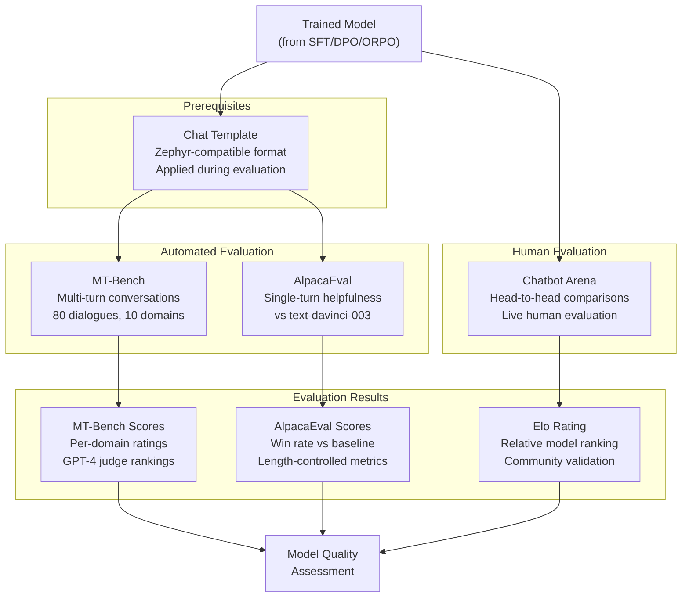
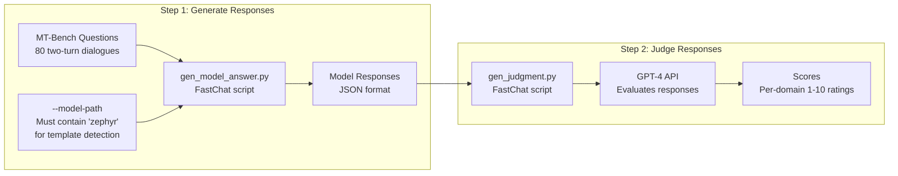
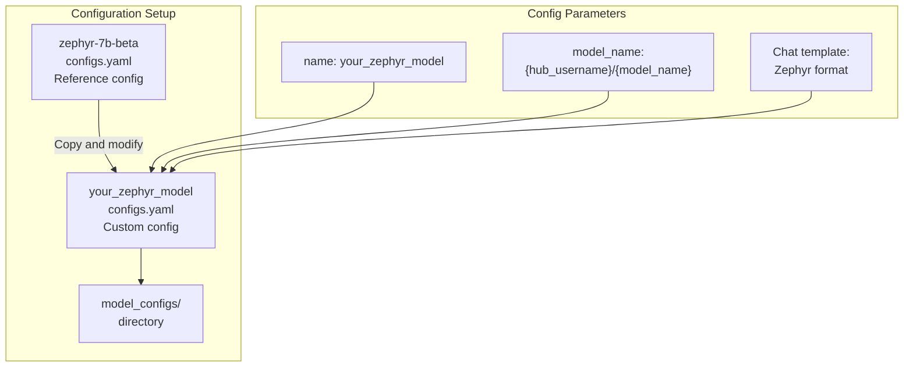
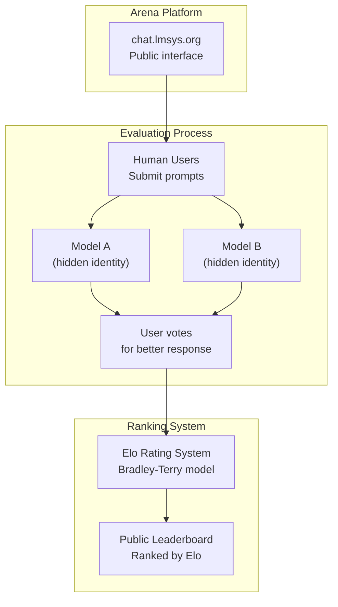
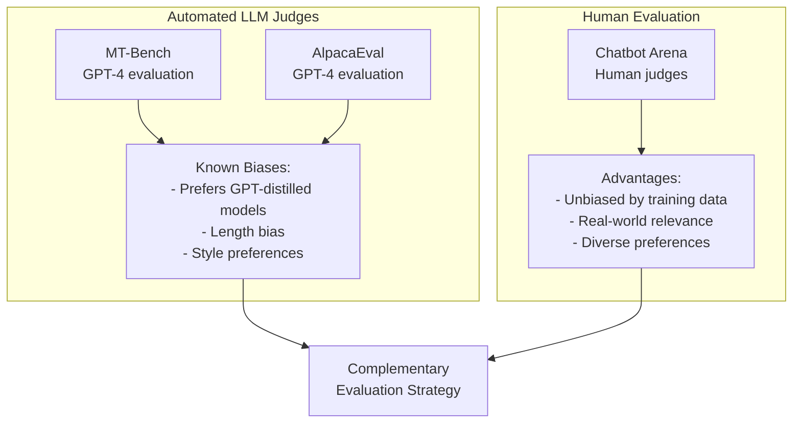
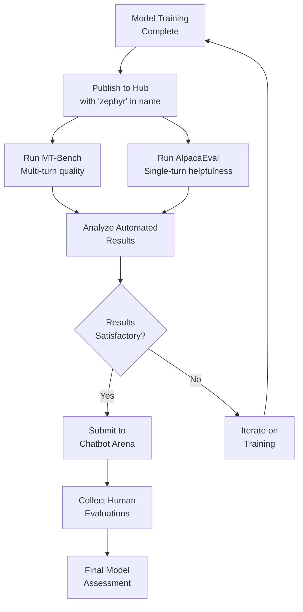

<!-- source: DeepWiki mcp.deepwiki.com · repo huggingface/alignment-handbook · page 6.5 Model Evaluation · fetched 2026-10-26 -->

# Model Evaluation

<details>
<summary>Relevant source files</summary>

The following files were used as context for generating this wiki page:

- [scripts/README.md](scripts/README.md)

</details>


## Purpose and Scope

This page documents the recommended evaluation methodologies for chat and instruction-tuned models trained with the Alignment Handbook. It covers the setup and usage of MT-Bench, AlpacaEval, and Chatbot Arena benchmarks, along with chat template integration requirements for proper evaluation.

For information about training models, see [Training Methods](#3). For chat template configuration during training, see [Chat Templates and Message Formatting](#6.3).

---

## Overview

The Alignment Handbook recommends evaluating trained chat models on standardized benchmarks that measure different aspects of model quality. The evaluation strategy combines automated LLM-based evaluation with human assessment to provide comprehensive quality metrics.



**Sources:** [scripts/README.md:117-142]()

---

## Benchmark Overview

The evaluation strategy uses three complementary benchmarks:

| Benchmark | Type | Scope | Evaluator | Key Metric |
|-----------|------|-------|-----------|------------|
| **MT-Bench** | Multi-turn | 80 dialogues across 10 domains (writing, roleplay, reasoning, math, coding, etc.) | GPT-4 | Per-domain scores (1-10) |
| **AlpacaEval** | Single-turn | 805 instructions testing helpfulness | GPT-4 or other LLMs | Win rate vs baseline |
| **Chatbot Arena** | Interactive | User-submitted prompts across all domains | Human judges | Elo rating |

**Sources:** [scripts/README.md:119-141]()

---

## MT-Bench Evaluation

MT-Bench is a multi-turn benchmark that evaluates conversational abilities across diverse domains. It consists of 80 dialogues with follow-up questions, testing the model's ability to maintain context and provide coherent responses.

### Setup and Installation

MT-Bench is part of the FastChat repository. Follow these steps to set it up:

1. Clone and install FastChat with LLM judge support:
```bash
git clone https://github.com/lm-sys/FastChat.git
cd FastChat
pip install -e ".[model_worker,llm_judge]"
```

2. Set up your OpenAI API key for GPT-4 judging:
```bash
export OPENAI_API_KEY=your_api_key_here
```

**Sources:** [scripts/README.md:126-128]()

### Running MT-Bench Evaluation

The evaluation process consists of two steps: generating model responses and obtaining GPT-4 judgments.



#### Step 1: Generate Model Answers

```bash
python gen_model_answer.py \
    --model-path {hub_username}/my-baby-zephyr \
    --model-id my-baby-zephyr
```

**Important:** The model path must contain the word `zephyr` to ensure the correct chat template is loaded. This naming convention triggers the Zephyr-specific prompt formatting in FastChat.

#### Step 2: Generate GPT-4 Judgments

```bash
python gen_judgment.py \
    --model-list my-baby-zephyr \
    --judge-model gpt-4
```

**Sources:** [scripts/README.md:128-130]()

### Chat Template Integration

The MT-Bench evaluation system automatically detects and applies the Zephyr chat template when the model name contains `zephyr`. This template is compatible with models trained using the Alignment Handbook's default configuration.

The chat template applied during evaluation must match the template used during training. Models trained with the handbook use the Zephyr format by default:

```
<|system|>
{system_message}</s>
<|user|>
{user_message}</s>
<|assistant|>
{assistant_message}</s>
```

**Sources:** [scripts/README.md:124-129]()

---

## AlpacaEval Evaluation

AlpacaEval is a single-turn benchmark that measures the helpfulness of model responses compared to a reference model (originally `text-davinci-003`). It evaluates on 805 diverse instructions.

### Setup and Installation

```bash
pip install alpaca-eval
```

**Sources:** [scripts/README.md:134]()

### Configuration for Handbook Models

To evaluate models trained with the Alignment Handbook, you need to create a configuration file compatible with the Zephyr chat template:



#### Step 1: Copy Base Configuration

1. Navigate to the AlpacaEval `model_configs` directory
2. Copy the `zephyr-7b-beta` configuration folder
3. Rename it to match your model name

```bash
cd src/alpaca_eval/models_configs/
cp -r zephyr-7b-beta your_zephyr_model
cd your_zephyr_model
```

#### Step 2: Update Configuration

Edit the `configs.yaml` file to update:
- **Line 1**: Change the config name to `your_zephyr_model`
- **Line 5**: Update the Hub model ID to `{hub_username}/{model_name}`

Example configuration structure:
```yaml
your_zephyr_model:
  fn_completions: openai_completions
  completions_kwargs:
    model_name: hub_username/my-zephyr-model
    # Other parameters...
```

**Sources:** [scripts/README.md:135-136]()

### Running AlpacaEval

Execute the evaluation with your configured model:

```bash
alpaca_eval --model_outputs your_zephyr_model
```

The evaluation will:
1. Load your model from the Hugging Face Hub
2. Apply the Zephyr chat template
3. Generate responses to 805 instructions
4. Compare responses against the reference model using GPT-4
5. Calculate win rates and other metrics

**Sources:** [scripts/README.md:137]()

### Interpreting Results

AlpacaEval provides several metrics:

| Metric | Description | Interpretation |
|--------|-------------|----------------|
| **Win Rate** | % of responses judged better than baseline | Higher is better; >50% beats baseline |
| **Avg Length** | Average token length of responses | Used for length-controlled comparisons |
| **Length-Controlled Win Rate** | Win rate adjusted for length bias | More accurate quality metric |

---

## Chatbot Arena

Chatbot Arena provides human evaluation through head-to-head model comparisons in a live environment.



### Submission Process

To submit your trained model for Arena evaluation:

1. Ensure your model is published on the Hugging Face Hub
2. Visit [Chatbot Arena](https://chat.lmsys.org)
3. Follow the submission guidelines for adding new models
4. Your model will be included in blind head-to-head comparisons

Unlike automated benchmarks, Arena provides:
- **Unbiased evaluation**: Humans judge responses without knowing model identity
- **Diverse prompts**: Real user queries across all domains
- **Ongoing validation**: Continuous evaluation as new models are submitted
- **Community consensus**: Elo ratings based on thousands of comparisons

**Sources:** [scripts/README.md:141]()

---

## Evaluation Best Practices

### Why Multiple Benchmarks?

The Alignment Handbook recommends using all three benchmarks because each addresses different aspects and biases:



**Key insight:** MT-Bench and AlpacaEval exhibit biases toward models distilled from GPTs (since GPT-4 is the judge). Human evaluation in Chatbot Arena provides validation without this bias.

**Sources:** [scripts/README.md:139-141]()

### Chat Template Requirements

All evaluation tools require proper chat template application. The Alignment Handbook's training scripts automatically apply the Zephyr chat template to trained models, making them compatible with these evaluation tools.

**Verification checklist:**
- ✓ Model name contains `zephyr` (for MT-Bench auto-detection)
- ✓ `tokenizer_config.json` includes the chat template
- ✓ Chat template matches training configuration
- ✓ Special tokens (`<|system|>`, `<|user|>`, `<|assistant|>`, `</s>`) are properly defined

**Sources:** [scripts/README.md:124-129]()

### Evaluation Workflow

The recommended evaluation workflow for models trained with the Alignment Handbook:



**Sources:** [scripts/README.md:117-141]()

---

## Model Naming Conventions for Evaluation

To ensure proper chat template detection across evaluation tools, follow these naming conventions:

| Convention | Purpose | Example |
|------------|---------|---------|
| Include `zephyr` in model path | MT-Bench template detection | `username/my-baby-zephyr` |
| Use descriptive task suffix | Identify training stage | `model-name-sft-full` |
| Maintain consistency | Link SFT and DPO models | `zephyr-7b-sft` → `zephyr-7b-dpo` |

The model names produced by the Alignment Handbook follow the pattern: `{username}/{model_name}-{task}`, which is compatible with these conventions.

**Sources:** [scripts/README.md:49](), [scripts/README.md:129]()

---

## External Tool References

The evaluation tools are maintained by external projects:

| Tool | Repository | Documentation |
|------|-----------|---------------|
| **MT-Bench** | [lm-sys/FastChat](https://github.com/lm-sys/FastChat/tree/main/fastchat/llm_judge) | Installation and usage guide |
| **AlpacaEval** | [tatsu-lab/alpaca_eval](https://github.com/tatsu-lab/alpaca_eval) | Quick start and model configs |
| **Chatbot Arena** | [lmsys.org](https://chat.lmsys.org) | Live evaluation platform |

**Sources:** [scripts/README.md:128](), [scripts/README.md:134](), [scripts/README.md:141]()

---

## Summary

The Alignment Handbook's evaluation strategy combines:
1. **MT-Bench** for multi-turn conversational quality across diverse domains
2. **AlpacaEval** for single-turn helpfulness benchmarking
3. **Chatbot Arena** for unbiased human evaluation

All three benchmarks support the Zephyr chat template used by handbook-trained models, enabling seamless evaluation. The combination of automated LLM judges and human evaluation provides comprehensive quality assessment while acknowledging the biases inherent in each approach.

**Sources:** [scripts/README.md:117-142]()

---

