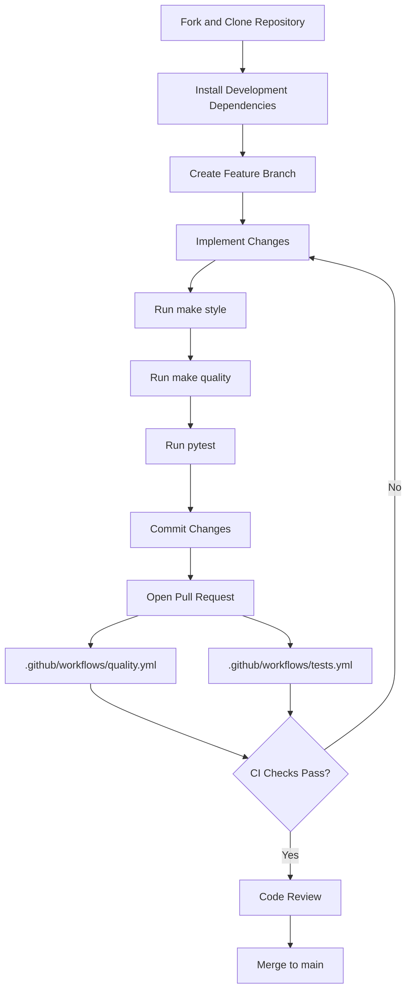
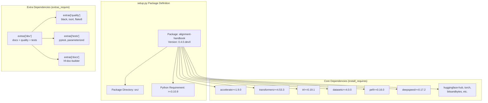
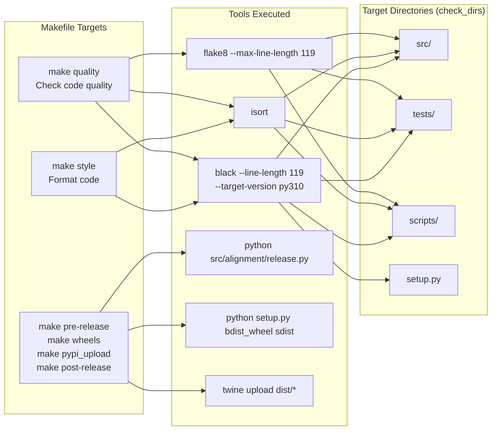
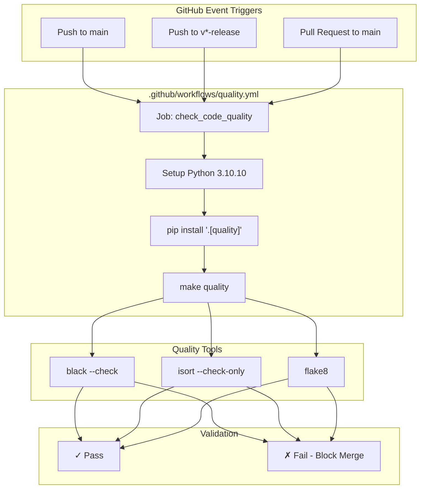
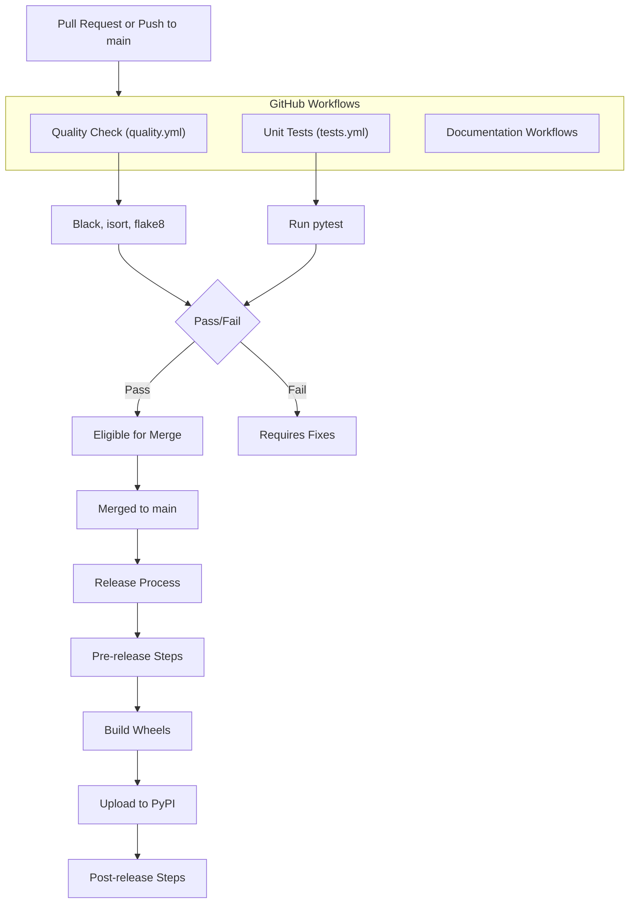

<!-- source: DeepWiki mcp.deepwiki.com · repo huggingface/alignment-handbook · page 7 Development and Contribution · fetched 2026-10-26 -->

# Development and Contribution

Relevant source files

The following files were used as context for generating this wiki page:

- [.github/workflows/quality.yml](.github/workflows/quality.yml)
- [Makefile](Makefile)
- [setup.cfg](setup.cfg)
- [setup.py](setup.py)

This page provides an overview of the development and contribution process for the Alignment Handbook. It introduces the key development files, workflows, and automation systems that enable collaborative development.

For detailed information on specific topics, see:
- **Page 7.1: Development Setup** - Installing dependencies and setting up your development environment
- **Page 7.2: Code Quality and Style** - Code formatting, linting, and style enforcement
- **Page 7.3: Testing Framework** - Running and writing tests
- **Page 7.4: Release Process** - Building and publishing releases

For end-user installation, see **Page 1.1: Installation and Setup**.
</thinking>

## Overview

The Alignment Handbook follows a structured development workflow built around standard Python packaging tools and automated quality checks. The development infrastructure is defined in several key files:

| File | Purpose |
|------|---------|
| `setup.py` | Package definition, dependencies, and metadata |
| `Makefile` | Development commands for formatting, testing, and releases |
| `setup.cfg` | Configuration for isort, flake8, and pytest |
| `.github/workflows/*.yml` | CI/CD automation for quality checks and testing |

Sources: [setup.py:1-150](), [Makefile:1-45](), [setup.cfg:1-41]()

## Development Workflow

### High-Level Development Process

Sources: [.github/workflows/quality.yml:1-32](), [Makefile:8-15]()

The development workflow consists of:

1. **Environment Setup** - Install the package with `pip install -e ".[dev]"` (see **Page 7.1**)
2. **Code Changes** - Modify code in `src/alignment/`, `scripts/`, or `tests/`
3. **Quality Checks** - Run `make style` (formatting) and `make quality` (validation) (see **Page 7.2**)
4. **Testing** - Run `pytest` to validate changes (see **Page 7.3**)
5. **CI Validation** - Automated checks run on pull requests
6. **Review and Merge** - Code review followed by merge to main

Sources: [Makefile:1-15](), [setup.py:89-93]()

## Package Structure

### setup.py Package Definition

The `setup.py` file defines the package structure and dependencies:

Sources: [setup.py:121-149](), [setup.py:43-119](), [setup.py:88-93]()

Key package metadata:
- **Package name**: `alignment-handbook` (installed as `alignment` module)
- **Version**: `0.4.0.dev0` (development version)
- **Source directory**: `src/` (via `package_dir={"": "src"}`)
- **Python requirement**: `>=3.10.9`
- **Core dependencies**: 19 packages including TRL, Transformers, Datasets, and Accelerate
- **Development extras**: Quality tools, testing frameworks, and documentation builders

Sources: [setup.py:121-137]()

### Makefile Development Commands

The `Makefile` provides standardized commands for development tasks:

Sources: [Makefile:1-45](), [Makefile:6]()

The Makefile defines:
- **PYTHONPATH**: Set to `src` to test local checkout (line 4)
- **check_dirs**: `src tests scripts` (line 6)
- **style**: Formats code with black and isort (lines 8-10)
- **quality**: Validates code without modification (lines 12-15)
- **release targets**: Commands for version management and PyPI upload (lines 20-44)

For detailed information on using these commands, see **Page 7.2: Code Quality and Style** and **Page 7.4: Release Process**.

Sources: [Makefile:1-45]()

## Configuration Files

### setup.cfg Tool Configuration

The `setup.cfg` file configures the behavior of development tools:

| Tool | Configuration | Details |
|------|---------------|---------|
| **isort** | Import sorting | Line length: 119, multi-line output style 3, known first party: `alignment` |
| **flake8** | Linting | Max line length: 119, ignores specific rules (E203, E501, E741, W503, W605) |
| **pytest** | Testing | Doctest options: NUMBER, NORMALIZE_WHITESPACE, ELLIPSIS |

**isort configuration** (lines 1-31):
- `known_first_party = alignment` - Treats `alignment` module as first-party import
- `known_third_party` - Lists external dependencies like `transformers`, `datasets`, `torch`
- `line_length = 119` - Matches black formatting
- `multi_line_output = 3` - Uses vertical hanging indent style

**flake8 configuration** (lines 33-38):
- Ignores style rules that conflict with black (E203, W503)
- Allows long lines (E501) since black handles line length
- Special per-file ignores: `__init__.py: F401` (allows unused imports)

**pytest configuration** (lines 40-41):
- Doctest options for flexible string matching in tests

Sources: [setup.cfg:1-41]()

## Continuous Integration

### GitHub Actions Workflows

The project uses GitHub Actions for automated quality checks and testing:

Sources: [.github/workflows/quality.yml:1-31]()

The quality workflow:
1. **Triggers**: On push to `main` or `v*-release` branches, and on PRs to `main` (lines 3-10)
2. **Environment**: Ubuntu runner with Python 3.10.10 (lines 22-23)
3. **Dependencies**: Installs package with `[quality]` extras (lines 24-27)
4. **Execution**: Runs `make quality` which validates code formatting and linting (lines 28-30)

**Quality checks performed**:
- `black --check --line-length 119 --target-version py310` - Validates formatting without changes
- `isort --check-only` - Validates import sorting without changes
- `flake8 --max-line-length 119` - Validates code against linting rules

Sources: [.github/workflows/quality.yml:1-31](), [Makefile:12-15]()

### CI/CD Integration Points

The CI system integrates with the development workflow at multiple points:

| Event | Workflow | Purpose | Blocking |
|-------|----------|---------|----------|
| Push to main | quality.yml | Validate code quality on main branch | No |
| Push to v*-release | quality.yml | Validate code quality on release branches | No |
| Pull Request | quality.yml | Validate code quality before merge | Yes |
| Pull Request | tests.yml (if present) | Run test suite before merge | Yes |

For detailed information on testing, see **Page 7.3: Testing Framework**.

Sources: [.github/workflows/quality.yml:3-10]()

## CI/CD Pipeline Overview

The Alignment Handbook uses GitHub Actions for continuous integration and deployment. The following diagram illustrates the complete CI/CD pipeline:

Sources:
- [.github/workflows/quality.yml:1-32]()
- [.github/workflows/tests.yml:1-31]()
- [Makefile:18-44]()

---

