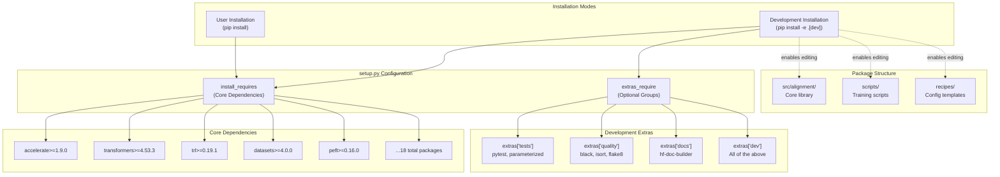
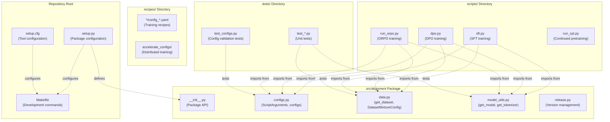
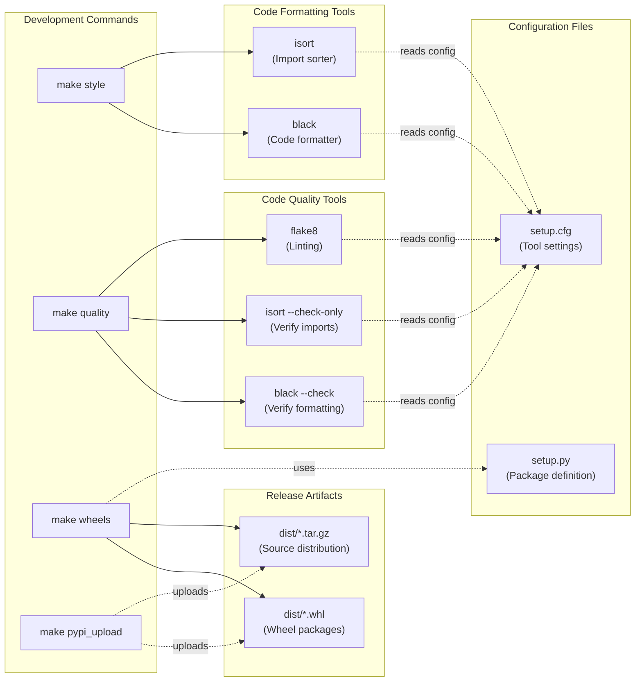

<!-- source: DeepWiki mcp.deepwiki.com · repo huggingface/alignment-handbook · page 7.1 Development Setup · fetched 2026-10-26 -->

# Development Setup

<details>
<summary>Relevant source files</summary>

The following files were used as context for generating this wiki page:

- [.github/workflows/quality.yml](.github/workflows/quality.yml)
- [Makefile](Makefile)
- [setup.cfg](setup.cfg)
- [setup.py](setup.py)

</details>


This page provides instructions for setting up a development environment for contributing to the Alignment Handbook. It covers installing the package in editable mode, understanding the dependency structure, and configuring development tools.

For information about code quality standards and formatting tools, see [Code Quality and Style](#7.2). For testing procedures, see [Testing Framework](#7.3). For general installation to use the handbook for training models, see [Installation and Setup](#1.1).

## Prerequisites

Before setting up the development environment, ensure you have:

- **Python 3.10.9 or higher** - specified in [setup.py:136]()
- **Git** - for cloning the repository and version control
- **CUDA-compatible GPU** (recommended) - for testing training scripts
- **Sufficient disk space** - for dependencies and model caching

## Installation for Development

### Cloning the Repository

```bash
git clone https://github.com/huggingface/alignment-handbook.git
cd alignment-handbook
```

### Installing in Editable Mode

Install the package in editable mode with development dependencies:

```bash
pip install -e ".[dev]"
```

The `[dev]` extra includes all development tools defined in [setup.py:93]():
- Documentation tools (`hf-doc-builder`)
- Code quality tools (`black`, `isort`, `flake8`)
- Testing tools (`pytest`, `parameterized`)

### Alternative Installation Options

You can install specific subsets of development dependencies:

| Extra | Purpose | Command |
|-------|---------|---------|
| `[tests]` | Testing framework only | `pip install -e ".[tests]"` |
| `[quality]` | Code formatting and linting | `pip install -e ".[quality]"` |
| `[docs]` | Documentation building | `pip install -e ".[docs]"` |
| `[dev]` | All development tools | `pip install -e ".[dev]"` |

These extras are defined in [setup.py:88-93]().



**Diagram: Development Installation Architecture**

Sources: [setup.py:88-149]()

## Understanding setup.py Structure

The [setup.py]() file is the central configuration for the package. Understanding its structure is essential for development.

### Package Metadata

The package is configured with key metadata in [setup.py:121-149]():

```python
# Package identity
name="alignment-handbook"
version="0.4.0.dev0"
author="The Hugging Face team (past and future)"
```

The version format follows semantic versioning with development suffixes:
- `x.y.z.dev0` - development version
- `x.y.z.rc1` - release candidate
- `x.y.z` - stable release

### Dependency Management

Dependencies are defined in a structured way in [setup.py:41-73]():

1. **Dependency List** (`_deps`) - Contains all dependencies with version constraints
2. **Dependency Dictionary** (`deps`) - Parsed mapping for lookup
3. **Helper Function** (`deps_list`) - Extracts specific dependencies

This structure allows precise version control. Note the important constraints:

| Dependency | Version Constraint | Rationale |
|-----------|-------------------|-----------|
| `accelerate` | `>=1.9.0` | Required for distributed training features |
| `transformers` | `>=4.53.3` | Fast-moving library, pinned for stability |
| `trl` | `>=0.19.1` | Required for trainer classes |
| `torch` | `>=2.6.0` | Recent PyTorch features needed |
| `protobuf` | `<=3.20.2` | Avoid conflicts with transformers |

### Stale Egg Info Cleanup

The setup script includes automatic cleanup logic in [setup.py:25-38]():

```python
stale_egg_info = Path(__file__).parent / "alignment.egg-info"
if stale_egg_info.exists():
    shutil.rmtree(stale_egg_info)
```

This prevents installation issues when upgrading from previous versions, addressing [pip issue #5466](https://github.com/pypa/pip/issues/5466).

### Package Discovery

The package is configured to find all modules under `src/` in [setup.py:132-133]():

```python
package_dir={"": "src"}
packages=find_packages("src")
```

This means the `alignment` package is located at `src/alignment/`, not at the repository root.

Sources: [setup.py:1-149]()

## Package Structure and Import System

Understanding the package structure is crucial for development work.

### Source Layout



**Diagram: Package Structure and Import Dependencies**

### Import Paths

When developing, imports use the `alignment` package name:

```python
# Correct imports in development
from alignment import ScriptArguments, SFTConfig, DPOConfig
from alignment.data import get_dataset, DatasetMixtureConfig
from alignment.model_utils import get_model, get_tokenizer
```

The `PYTHONPATH` is configured in [Makefile:4]() to ensure local changes are tested:

```makefile
export PYTHONPATH = src
```

This ensures that when running `make quality` or `make style`, the commands test the local `src/alignment` directory, not a pre-installed version.

### Package API Surface

The public API is exposed through `src/alignment/__init__.py`, which should export:
- Configuration classes (ScriptArguments, SFTConfig, DPOConfig, ORPOConfig)
- Utility functions (get_dataset, get_model, get_tokenizer)
- Version information

Sources: [setup.py:132-133](), [Makefile:4]()

## Development Tools Configuration

The development environment includes several code quality tools configured through [setup.cfg]().

### Code Formatting with Black

Black is configured in [Makefile:9]() and [setup.cfg]() with these parameters:

- **Line length**: 119 characters (specified in [Makefile:9]())
- **Target version**: Python 3.10 (specified in [Makefile:9]())
- **Directories**: `src`, `tests`, `scripts`, `setup.py` (specified in [Makefile:6]())

### Import Sorting with isort

isort configuration in [setup.cfg:1-32]():

| Setting | Value | Purpose |
|---------|-------|---------|
| `line_length` | 119 | Match Black's line length |
| `multi_line_output` | 3 | Use vertical hanging indent |
| `known_first_party` | alignment | Recognize local package |
| `known_third_party` | transformers, datasets, torch, ... | Order third-party imports |
| `include_trailing_comma` | True | Match Black's style |

### Linting with flake8

flake8 configuration in [setup.cfg:33-38]():

- **Ignored rules**: E203, E501, E741, W503, W605
- **Max line length**: 119
- **Per-file ignores**: F401 (unused imports) in `__init__.py` files

### Testing with pytest

pytest configuration in [setup.cfg:40-41]():

- **Doctest flags**: NUMBER, NORMALIZE_WHITESPACE, ELLIPSIS

Sources: [setup.cfg:1-41](), [Makefile:6-15]()

## Development Workflow Commands

The [Makefile]() provides convenient commands for common development tasks.



**Diagram: Development Workflow and Tool Integration**

### Available Make Targets

| Command | Purpose | Description |
|---------|---------|-------------|
| `make style` | Format code | Runs Black and isort on all code |
| `make quality` | Check code quality | Runs Black, isort, and flake8 in check mode |
| `make wheels` | Build packages | Creates wheel and source distributions |
| `make wheels_clean` | Clean build artifacts | Removes `build/` and `dist/` directories |
| `make pypi_upload` | Upload to PyPI | Uploads built packages to PyPI (maintainers only) |
| `make pre-release` | Bump version | Prepares for new release |
| `make post-release` | Finalize release | Updates version after release |

### Example Development Workflow

1. **Make changes** to code in `src/alignment/` or `scripts/`
2. **Format code**: `make style`
3. **Check quality**: `make quality`
4. **Run tests**: `pytest tests/`
5. **Commit changes**: `git commit -am "Your message"`

Sources: [Makefile:1-44]()

## Continuous Integration

The repository includes automated quality checks via GitHub Actions.

The quality workflow in [.github/workflows/quality.yml]() runs on:
- Push to `main` branch
- Push to `v*-release` branches
- Pull requests to `main` branch

The workflow performs these steps in [.github/workflows/quality.yml:17-30]():

1. **Checkout code**: Uses actions/checkout@v2
2. **Setup Python**: Installs Python 3.10.10
3. **Install dependencies**: Installs package with `[quality]` extra
4. **Run quality checks**: Executes `make quality`

This ensures all code merged into the main branch meets quality standards.

Sources: [.github/workflows/quality.yml:1-31]()

## Verifying Your Development Setup

After completing the installation, verify your development environment:

### 1. Check Package Installation

```bash
python -c "import alignment; print(alignment.__version__)"
```

This should print the current version (e.g., `0.4.0.dev0`).

### 2. Verify Code Quality Tools

```bash
make quality
```

This should run without errors on a clean checkout.

### 3. Test Editable Installation

Make a small change to a file in `src/alignment/`, then verify the change is immediately visible:

```bash
python -c "from alignment import ScriptArguments"
```

The import should succeed without reinstalling.

### 4. Check PYTHONPATH

Ensure the development PYTHONPATH is set correctly:

```bash
echo $PYTHONPATH
```

When running make commands, this should include `src`.

### Common Installation Issues

| Issue | Symptom | Solution |
|-------|---------|----------|
| Stale egg-info | ImportError after update | Delete `alignment.egg-info/` manually |
| Wrong Python version | Module not found errors | Ensure Python >= 3.10.9 |
| Dependency conflicts | Version incompatibilities | Create fresh virtual environment |
| CUDA not found | Torch not using GPU | Install CUDA toolkit matching PyTorch version |

## Next Steps

After setting up your development environment:

- Review [Code Quality and Style](#7.2) for detailed formatting guidelines
- See [Testing Framework](#7.3) to understand the test suite
- Check [Release Process](#7.4) if you need to understand versioning (maintainers only)
- Refer to [Configuration System](#2.1) to understand the config architecture you'll be working with

Sources: [setup.py:1-149](), [Makefile:1-44](), [setup.cfg:1-41](), [.github/workflows/quality.yml:1-31]()

---

