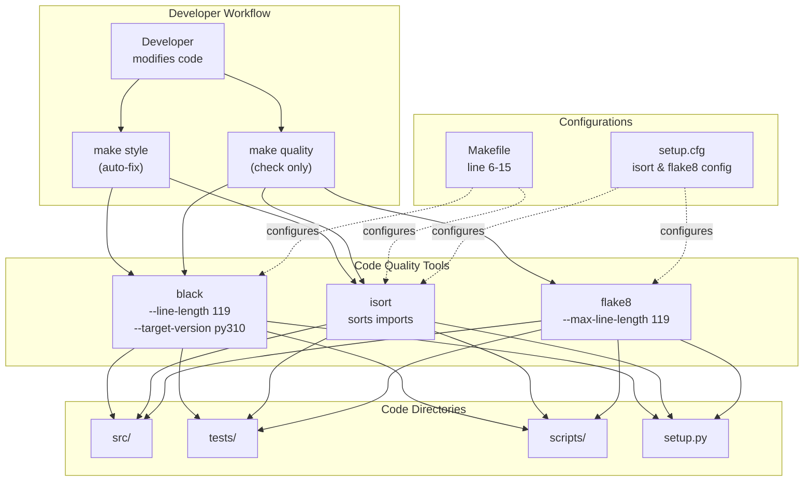
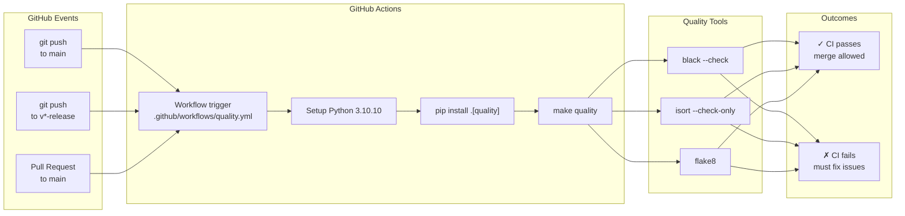
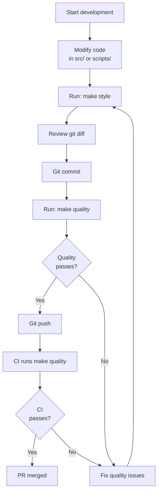

<!-- source: DeepWiki mcp.deepwiki.com · repo huggingface/alignment-handbook · page 7.2 Code Quality and Style · fetched 2026-10-26 -->

# Code Quality and Style

<details>
<summary>Relevant source files</summary>

The following files were used as context for generating this wiki page:

- [.github/workflows/quality.yml](.github/workflows/quality.yml)
- [Makefile](Makefile)
- [setup.cfg](setup.cfg)

</details>


## Purpose and Scope

This page documents the code quality and style enforcement system used in the Alignment Handbook. It covers the automated formatting, import sorting, and linting tools that maintain code consistency across the repository. The system uses `black`, `isort`, and `flake8` orchestrated through `make` commands and enforced via continuous integration.

For information about setting up the development environment, see [Development Setup](#7.1). For information about the testing framework, see [Testing Framework](#7.3).

## Code Quality Tools Overview

The Alignment Handbook employs three primary tools to maintain code quality:

| Tool | Purpose | Configuration File | Usage Mode |
|------|---------|-------------------|------------|
| `black` | Code formatter | Command-line args in Makefile | Format or check |
| `isort` | Import statement sorter | `setup.cfg` | Format or check |
| `flake8` | Style linter | `setup.cfg` | Check only |

All tools are configured to use a maximum line length of **119 characters** and target **Python 3.10** compatibility.

**Sources:** [Makefile:1-16](), [setup.cfg:1-39]()

### Tool Execution Flow



**Sources:** [Makefile:6-15](), [setup.cfg:1-39]()

## Make Commands for Developers

The repository provides two primary `make` targets for code quality management:

### make style

The `make style` command automatically formats code and sorts imports. This command **modifies files in place** to conform to the project's style guidelines.

```bash
make style
```

**Execution details:**
- Runs `black` with auto-formatting on all check directories
- Runs `isort` with auto-formatting on all check directories
- Modifies files in: `src/`, `tests/`, `scripts/`, and `setup.py`

**Sources:** [Makefile:8-10]()

### make quality

The `make quality` command performs **check-only** validation without modifying files. This is used in CI/CD pipelines and for pre-commit verification.

```bash
make quality
```

**Execution details:**
- Runs `black --check` to verify formatting compliance
- Runs `isort --check-only` to verify import order
- Runs `flake8` to check for style violations
- Exits with non-zero status if any issues are found

**Sources:** [Makefile:12-15]()

### Check Directories

Both commands operate on the following directories, defined in the `check_dirs` variable:

| Directory | Purpose |
|-----------|---------|
| `src/` | Core library code (`alignment` package) |
| `tests/` | Test suite |
| `scripts/` | Training scripts (sft.py, dpo.py, etc.) |
| `setup.py` | Package configuration |

**Sources:** [Makefile:6]()

## Configuration Details

### Black Configuration

Black is configured via command-line arguments in the Makefile:

```bash
black --line-length 119 --target-version py310
```

**Parameters:**
- `--line-length 119`: Maximum line length before wrapping
- `--target-version py310`: Ensures compatibility with Python 3.10 syntax

Black uses **no configuration file** and is invoked directly from the Makefile with these parameters.

**Sources:** [Makefile:9](), [Makefile:13]()

### isort Configuration

isort is configured in `setup.cfg` with detailed settings:

```ini
[isort]
default_section = FIRSTPARTY
ensure_newline_before_comments = True
force_grid_wrap = 0
include_trailing_comma = True
known_first_party = alignment
line_length = 119
lines_after_imports = 2
multi_line_output = 3
use_parentheses = True
```

**Key configuration options:**

| Parameter | Value | Purpose |
|-----------|-------|---------|
| `known_first_party` | `alignment` | Identifies local package imports |
| `known_third_party` | (list) | Known external dependencies |
| `line_length` | `119` | Matches black's line length |
| `multi_line_output` | `3` | Vertical hanging indent style |
| `include_trailing_comma` | `True` | Adds trailing commas for git-friendly diffs |
| `lines_after_imports` | `2` | Two blank lines after imports |

**Third-party package list:**
The configuration explicitly lists known third-party packages including `transformers`, `datasets`, `torch`, `numpy`, `pytest`, and others to ensure correct import grouping.

**Sources:** [setup.cfg:1-27]()

### flake8 Configuration

flake8 is configured in `setup.cfg` with specific error code ignores:

```ini
[flake8]
ignore = E203, E501, E741, W503, W605
max-line-length = 119
per-file-ignores =
    __init__.py: F401
```

**Configuration breakdown:**

| Parameter | Value | Purpose |
|-----------|-------|---------|
| `ignore` | `E203` | Whitespace before ':' (conflicts with black) |
| | `E501` | Line too long (handled by black) |
| | `E741` | Ambiguous variable names (l, O, I) |
| | `W503` | Line break before binary operator |
| | `W605` | Invalid escape sequence |
| `max-line-length` | `119` | Matches black and isort |
| `per-file-ignores` | `__init__.py: F401` | Allows unused imports in `__init__.py` files |

**Rationale for ignores:**
- `E203` and `W503`: Black compatibility
- `E501`: Line length handled by black
- `F401` in `__init__.py`: Common pattern for package exports

**Sources:** [setup.cfg:33-38]()

## CI/CD Integration

The quality checks are enforced via GitHub Actions on every push and pull request.

### Continuous Integration Workflow



**Workflow configuration:**
- **Name:** `Quality`
- **Triggers:** 
  - Push to `main` or `v*-release` branches
  - Pull requests targeting `main`
- **Python version:** 3.10.10
- **Dependencies:** Installs with `[quality]` extras

**Sources:** [.github/workflows/quality.yml:1-31]()

### Quality Job Details

The CI workflow executes the following steps:

1. **Checkout code** - Uses `actions/checkout@v2`
2. **Setup Python** - Installs Python 3.10.10 using `actions/setup-python@v2`
3. **Install dependencies** - Runs `pip install --upgrade pip` and `pip install ".[quality]"`
4. **Run quality checks** - Executes `make quality`

If any quality check fails, the entire workflow fails and prevents merging.

**Sources:** [.github/workflows/quality.yml:17-30]()

## Development Workflow

### Typical Developer Workflow



**Recommended practice:**

1. **During development:** Run `make style` frequently to auto-format code
2. **Before committing:** Run `make quality` to verify all checks pass locally
3. **Review changes:** Check `git diff` after `make style` to understand formatting changes
4. **Before pushing:** Ensure `make quality` passes to avoid CI failures

**Sources:** [Makefile:8-15](), [.github/workflows/quality.yml:1-31]()

### Pre-commit Hook (Recommended)

While not enforced by the repository, developers can add a git pre-commit hook to automatically run quality checks:

```bash
#!/bin/bash
# .git/hooks/pre-commit
make quality
```

This prevents committing code that would fail CI checks.

## PYTHONPATH Configuration

The Makefile sets a critical environment variable to ensure local development:

```makefile
export PYTHONPATH = src
```

**Purpose:** This ensures that quality checks test the **local checkout** in `src/` rather than any pre-installed version of the `alignment` package. Without this, developers might inadvertently check code quality against an installed package version instead of their working changes.

**Sources:** [Makefile:4]()

## Quality Check Scope

### Files Checked

The quality system checks all Python files in:

| Path | File Types | Purpose |
|------|-----------|---------|
| `src/alignment/` | `*.py` | Core library code |
| `tests/` | `test_*.py` | Test suite |
| `scripts/` | `*.py` | Training entry points (sft.py, dpo.py, run_orpo.py, run_cpt.py) |
| `setup.py` | Single file | Package configuration |

**Sources:** [Makefile:6]()

### Special Case: __init__.py Files

The flake8 configuration allows unused imports in `__init__.py` files:

```ini
per-file-ignores =
    __init__.py: F401
```

This accommodates the common Python pattern of importing symbols in `__init__.py` for package-level exports, even if they're not used within that file.

**Example use case:**
```python
# src/alignment/__init__.py
from alignment.configs import ScriptArguments  # F401 ignored
```

**Sources:** [setup.cfg:36-38]()

## Common Formatting Patterns

### Import Order

isort organizes imports into three groups with two blank lines after:

1. **Standard library imports**
2. **Third-party imports** (transformers, datasets, torch, etc.)
3. **First-party imports** (alignment package)

Example:
```python
import os
import sys

from transformers import AutoTokenizer
import torch

from alignment import get_model, get_tokenizer


def train():
    ...
```

**Sources:** [setup.cfg:1-27]()

### Line Length and Wrapping

All tools enforce a **119-character** line length limit. Black automatically wraps long lines, while flake8 reports violations.

**Wrapping strategies:**
- Function arguments: Vertical hanging indent
- Long strings: Use implicit string concatenation or multiline strings
- Comments: Manual wrapping required

**Sources:** [Makefile:9](), [Makefile:13](), [setup.cfg:28](), [setup.cfg:35]()

## Troubleshooting

### Common Issues

| Issue | Cause | Solution |
|-------|-------|----------|
| `make quality` fails locally but code looks correct | Inconsistent tool versions | Run `pip install -e ".[quality]"` to ensure correct versions |
| Black and isort produce conflicting changes | Outdated configuration | Ensure `setup.cfg` line_length matches black's (119) |
| CI fails but local checks pass | Missing PYTHONPATH | Verify `PYTHONPATH=src` is set in your environment |
| F401 errors in `__init__.py` | Missing per-file-ignores | These should be ignored by flake8 configuration |

### Debugging Quality Failures

To see detailed output from quality checks:

```bash
# Run black in verbose mode
black --check --line-length 119 --target-version py310 --verbose src/

# Run isort with diff
isort --check-only --diff src/

# Run flake8 with verbose output
flake8 --max-line-length 119 --verbose src/
```

**Sources:** [Makefile:12-15]()

### Manual Tool Invocation

If `make` commands fail, tools can be invoked directly:

```bash
# Format with black
python -m black --line-length 119 --target-version py310 src/

# Sort imports
python -m isort src/

# Run linter
python -m flake8 --max-line-length 119 src/
```

This is useful for debugging or working on specific files.

## Integration with Other Tools

The quality system integrates with:

- **pytest:** Style checks complement the test suite (see [Testing Framework](#7.3))
- **Release process:** Quality checks must pass before releases (see [Release Process](#7.4))
- **Development setup:** Quality tools installed via `[quality]` extras (see [Development Setup](#7.1))

The `make quality` command is a prerequisite for successful CI builds and merging contributions.

**Sources:** [.github/workflows/quality.yml:1-31](), [Makefile:1-45]()

---

