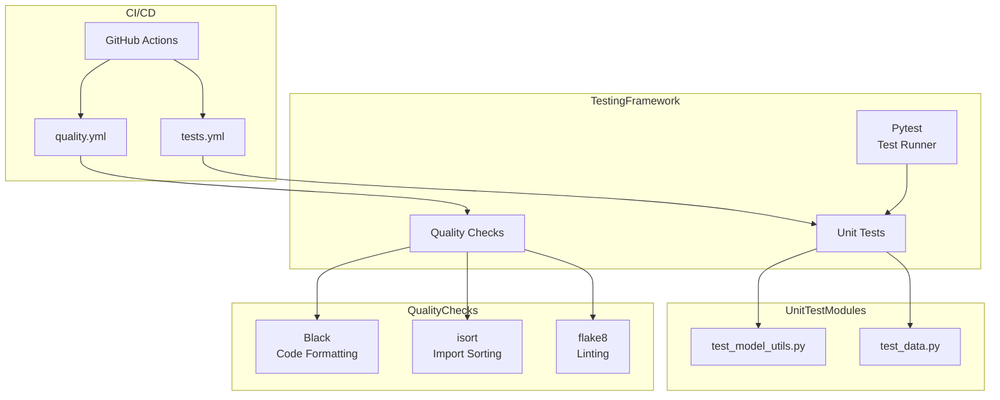
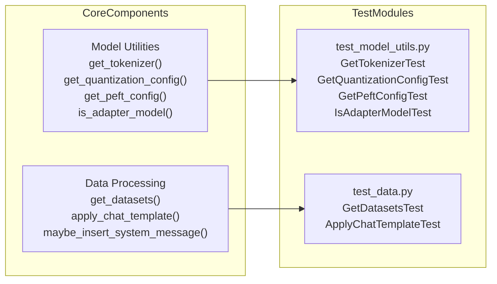

<!-- source: DeepWiki mcp.deepwiki.com · repo huggingface/alignment-handbook · page 7.3 Testing Framework · fetched 2026-10-26 -->

# Testing

<details>
<summary>Relevant source files</summary>

The following files were used as context for generating this wiki page:

- [tests/fixtures/config_dpo_full.yaml](tests/fixtures/config_dpo_full.yaml)
- [tests/fixtures/config_sft_full.yaml](tests/fixtures/config_sft_full.yaml)
- [tests/test_data.py](tests/test_data.py)

</details>


This document covers the testing framework used in the Alignment Handbook repository, explaining how tests are organized, how to run tests locally, and how the continuous integration system is configured. It focuses on the unit testing approach and code quality checks implemented in the codebase.

## Testing Framework Overview

The Alignment Handbook uses pytest for running unit tests, with a focus on ensuring the correct functionality of core components, particularly the model utilities and data processing functions. The testing framework incorporates both unit tests and code quality checks.

### Testing Architecture



Sources: [.github/workflows/tests.yml:1-31](), [.github/workflows/quality.yml:1-32](), [Makefile:8-16]()

## Unit Testing

The repository uses Python's standard `unittest` library in conjunction with pytest as the test runner. Tests are organized by component, with separate test modules for different subsystems in the codebase.

### Component-Test Mapping



Sources: [tests/test_model_utils.py:17-24](), [tests/test_data.py:22-23]()

### Model Utilities Tests

The `test_model_utils.py` file contains tests for functions that handle model configuration, tokenization, and parameter-efficient fine-tuning (PEFT). The tests verify the correct behavior of these utilities when used with different arguments.

Key test classes:

| Test Class | Purpose | Functions Tested |
|------------|---------|-----------------|
| `GetQuantizationConfigTest` | Verify quantization settings for 4-bit and 8-bit models | `get_quantization_config()` |
| `GetTokenizerTest` | Test tokenizer configuration including truncation and chat templates | `get_tokenizer()` |
| `GetPeftConfigTest` | Validate creation of PEFT configurations for LoRA | `get_peft_config()` |
| `IsAdapterModelTest` | Test detection of adapter-based models | `is_adapter_model()` |

Example test case for 4-bit quantization:

```python
def test_4bit(self):
    model_args = ModelArguments(load_in_4bit=True)
    quantization_config = get_quantization_config(model_args)
    self.assertTrue(quantization_config["load_in_4bit"])
    self.assertEqual(quantization_config["bnb_4bit_compute_dtype"], "float16")
    self.assertEqual(quantization_config["bnb_4bit_quant_type"], "nf4")
    self.assertFalse(quantization_config["bnb_4bit_use_double_quant"])
```

Sources: [tests/test_model_utils.py:28-45](), [tests/test_model_utils.py:48-67](), [tests/test_model_utils.py:70-81](), [tests/test_model_utils.py:84-88]()

### Data Processing Tests

The `test_data.py` file contains tests for data processing functions that handle dataset loading, mixing, and chat template application. These tests ensure that datasets are properly loaded and processed according to the specified parameters.

Key test classes:

| Test Class | Purpose | Functions Tested |
|------------|---------|-----------------|
| `GetDatasetsTest` | Test dataset loading and mixing functionality | `get_datasets()` |
| `ApplyChatTemplateTest` | Verify correct application of chat templates for different tasks | `apply_chat_template()`, `maybe_insert_system_message()` |

Examples of test cases:

```python
# Testing dataset loading with specified proportions
def test_loading_with_fractions_greater_than_unity(self):
    dataset_mixer = {
        "HuggingFaceH4/testing_alpaca_small": 0.7,
        "HuggingFaceH4/testing_self_instruct_small": 0.4,
    }
    datasets = get_datasets(dataset_mixer, columns_to_keep=["prompt", "completion"])
    self.assertEqual(len(datasets["train"]), 70 + 40)
    self.assertEqual(len(datasets["test"]), 200)

# Testing chat template application for DPO
def test_dpo(self):
    dataset = self.dataset.map(
        apply_chat_template,
        fn_kwargs={"tokenizer": self.tokenizer, "task": "dpo"},
        remove_columns=self.dataset.column_names,
    )
    self.assertDictEqual(
        dataset[0],
        {
            "text_prompt": "<|system|>\nYou are a happy chatbot</s>\n<|user|>\nHello!</s>\n<|assistant|>\nBonjour!</s>\n<|user|>\nHow are you?</s>\n",
            "text_chosen": "<|assistant|>\nI am doing well, thanks!</s>\n",
            "text_rejected": "<|assistant|>\nNot so good tbh</s>\n",
        }
    )
```

Sources: [tests/test_data.py:26-83](), [tests/test_data.py:86-196]()

## Running Tests Locally

Tests can be run locally using pytest. The repository's test configuration is defined in `setup.cfg`.

To run all tests:

```bash
# Make sure to install development dependencies
pip install -e ".[dev]"

# Run all tests with verbose output
pytest -sv tests/
```

To run specific test modules:

```bash
# Run model utilities tests
pytest -sv tests/test_model_utils.py

# Run data processing tests
pytest -sv tests/test_data.py
```

To run a specific test class or method:

```bash
pytest -sv tests/test_model_utils.py::GetTokenizerTest
pytest -sv tests/test_data.py::ApplyChatTemplateTest::test_dpo
```

Sources: [.github/workflows/tests.yml:27-31](), [setup.cfg:40-41]()

## Continuous Integration

The Alignment Handbook uses GitHub Actions for continuous integration, with separate workflows for tests and code quality checks.

### Test Workflow

The test workflow runs on push to the main branch and on pull requests. It:

1. Checks out the code
2. Sets up a Python 3.10.10 environment
3. Installs the package with development and torch dependencies
4. Runs all tests using pytest

The workflow is defined in `.github/workflows/tests.yml` and uses an authentication token for accessing Hugging Face resources during tests.

Sources: [.github/workflows/tests.yml:1-31]()

### Quality Workflow

The quality workflow ensures code quality standards are met. It runs on push to the main branch and on pull requests, checking:

1. Code formatting using Black
2. Import sorting using isort
3. Linting using flake8

The workflow is defined in `.github/workflows/quality.yml` and executes the `make quality` command to run these checks.

Sources: [.github/workflows/quality.yml:1-32]()

## Code Quality Tools

The repository maintains code quality using several tools configured in `setup.cfg`:

1. **Black**: For code formatting with a line length of 119 characters
2. **isort**: For sorting imports with specific configurations for first and third-party imports
3. **flake8**: For linting with specific rules (ignoring E203, E501, E741, W503, W605)

These tools can be run locally using make commands:

```bash
# Format code with black and isort
make style

# Check code quality with black, isort, and flake8
make quality
```

Sources: [Makefile:8-16](), [setup.cfg:1-39]()

## Test Coverage and Future Improvements

The current test suite focuses on core components of the framework:

1. Model utilities (tokenization, quantization, PEFT configuration)
2. Data processing (dataset loading, mixing, chat template application)

Areas that could benefit from additional test coverage include:

1. Training scripts (SFT, DPO, CPT, ORPO)
2. Model recipes
3. Distributed training infrastructure components

---

