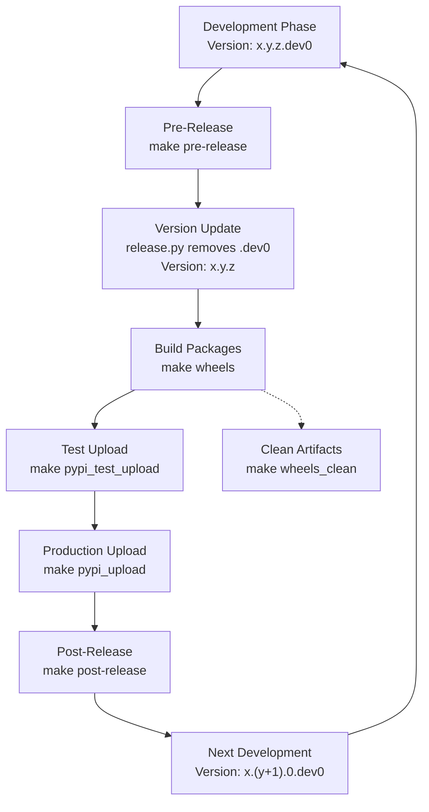
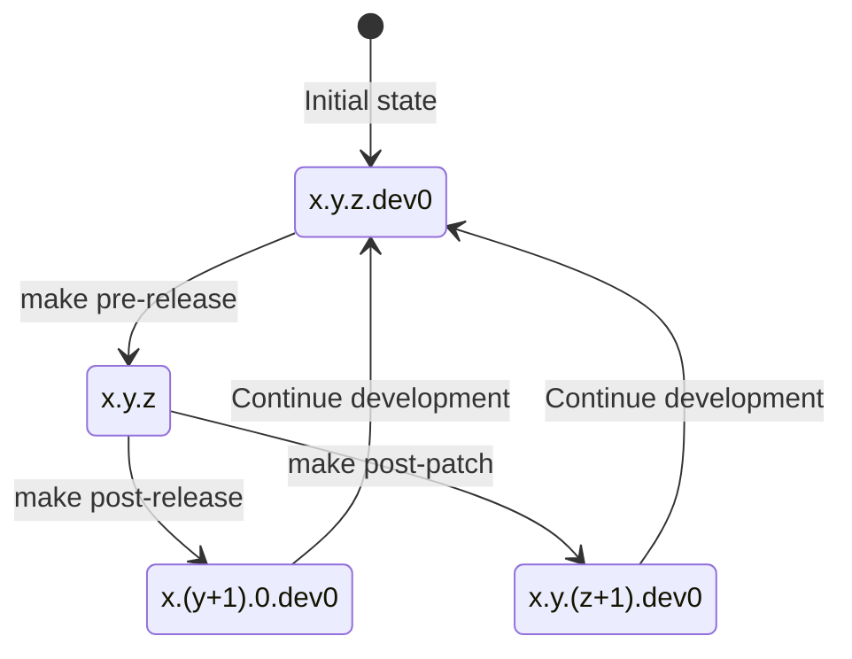
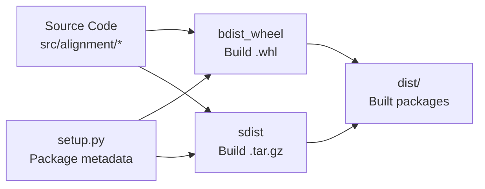
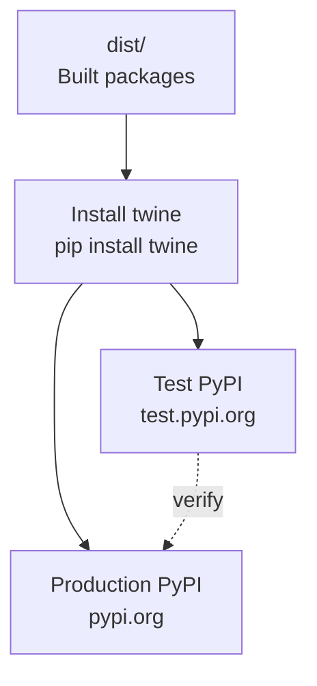
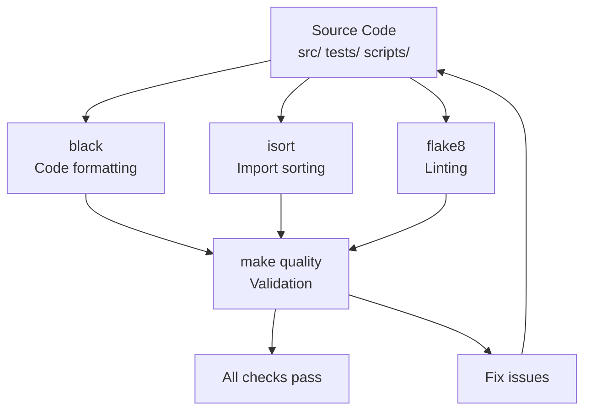

<!-- source: DeepWiki mcp.deepwiki.com · repo huggingface/alignment-handbook · page 7.4 Release Process · fetched 2026-10-26 -->

# Release Process

<details>
<summary>Relevant source files</summary>

The following files were used as context for generating this wiki page:

- [.github/workflows/quality.yml](.github/workflows/quality.yml)
- [Makefile](Makefile)
- [setup.cfg](setup.cfg)
- [setup.py](setup.py)

</details>


This document describes the release process for the `alignment-handbook` Python package, including version management, package building, and PyPI distribution. The release workflow is managed through a set of Makefile targets that automate versioning, building, and uploading.

For development environment setup, see [Development Setup](#7.1). For code quality standards that must be met before release, see [Code Quality and Style](#7.2).

---

## Overview

The Alignment Handbook uses a structured release process with version management utilities and Make targets that handle the entire release lifecycle. The process involves updating version numbers, building distribution packages (wheels and source distributions), and uploading to PyPI.

**Key Components:**
- `setup.py` defines package metadata and version (currently `0.4.0.dev0`)
- `Makefile` provides release automation targets
- `src/alignment/release.py` manages version number updates (called by Make targets)
- `twine` handles PyPI uploads

Sources: [setup.py:1-150](), [Makefile:1-45]()

---

## Release Workflow

The complete release workflow follows these stages:



**Workflow Description:**

1. **Development Phase**: Work proceeds with development version (e.g., `0.4.0.dev0`)
2. **Pre-Release**: Run `make pre-release` to prepare for release by updating version
3. **Build Packages**: Run `make wheels` to build wheel and source distributions
4. **Test Upload** (Optional): Run `make pypi_test_upload` to test on test.pypi.org
5. **Production Upload**: Run `make pypi_upload` to publish to PyPI
6. **Post-Release**: Run `make post-release` to bump version for next development cycle

Sources: [Makefile:18-44](), [setup.py:123]()

---

## Version Management

The package version is defined in `setup.py` and follows semantic versioning with development indicators:

**Version Format:**
- Development versions: `x.y.z.dev0` (e.g., `0.4.0.dev0`)
- Release candidates: `x.y.z.rc1` (e.g., `0.4.0.rc1`)
- Stable releases: `x.y.z` (e.g., `0.4.0`)

**Version Management Targets:**

| Make Target | Script Call | Purpose |
|------------|-------------|---------|
| `make pre-release` | `python src/alignment/release.py` | Remove `.dev0` suffix for release |
| `make pre-patch` | `python src/alignment/release.py --patch` | Prepare patch version release |
| `make post-release` | `python src/alignment/release.py --post_release` | Bump minor version, add `.dev0` |
| `make post-patch` | `python src/alignment/release.py --post_release --patch` | Bump patch version, add `.dev0` |



**Version Location:**

The version string is defined in [setup.py:123]():

```python
version="0.4.0.dev0",  # expected format is one of x.y.z.dev0, or x.y.z.rc1 or x.y.z (no to dashes, yes to dots)
```

Sources: [setup.py:123](), [Makefile:20-30]()

---

## Building Distribution Packages

Distribution packages are built using setuptools through the `make wheels` target:

**Build Process:**



**Make Targets:**

| Target | Command | Output |
|--------|---------|--------|
| `make wheels` | `python setup.py bdist_wheel && python setup.py sdist` | Creates `dist/*.whl` and `dist/*.tar.gz` |
| `make wheels_clean` | `rm -rf build && rm -rf dist` | Removes `build/` and `dist/` directories |

**Package Metadata** (from [setup.py:121-149]()):

- **Name**: `alignment-handbook`
- **License**: Apache 2.0
- **Python Requirement**: `>=3.10.9`
- **Package Location**: Sources from `src/` directory
- **Package Discovery**: Uses `find_packages("src")`

**Build Artifacts:**

After running `make wheels`, the following are created:
- `dist/alignment_handbook-x.y.z-py3-none-any.whl` - Wheel distribution
- `dist/alignment-handbook-x.y.z.tar.gz` - Source distribution
- `build/` - Temporary build directory

Sources: [Makefile:32-36](), [setup.py:121-149]()

---

## PyPI Upload Process

Packages are uploaded to PyPI using `twine`, which provides secure authenticated uploads:

**Upload Targets:**



**Upload Commands:**

| Target | Command | Destination |
|--------|---------|-------------|
| `make pypi_test_upload` | `twine upload dist/* -r pypitest --repository-url=https://test.pypi.org/legacy/` | Test PyPI |
| `make pypi_upload` | `twine upload dist/* -r pypi` | Production PyPI |

**Upload Process:**

1. Ensure packages are built: `make wheels`
2. (Optional) Test upload: `make pypi_test_upload`
3. Production upload: `make pypi_upload`
4. Enter PyPI credentials when prompted by `twine`

**Authentication:**

`twine` requires PyPI credentials. Configure using one of:
- Interactive prompt (default)
- `.pypirc` configuration file
- Environment variables (`TWINE_USERNAME`, `TWINE_PASSWORD`)

Sources: [Makefile:38-44]()

---

## Complete Release Procedure

The recommended complete release procedure combines all steps:

### Standard Release

```bash
# 1. Ensure code quality passes
make quality

# 2. Prepare release version
make pre-release

# 3. Commit version change
git add setup.py
git commit -m "Release version x.y.z"

# 4. Build packages
make wheels

# 5. Test on test PyPI (optional but recommended)
make pypi_test_upload

# 6. Upload to production PyPI
make pypi_upload

# 7. Create git tag
git tag -a vx.y.z -m "Release version x.y.z"
git push origin vx.y.z

# 8. Bump to next development version
make post-release

# 9. Commit development version
git add setup.py
git commit -m "Bump version to x.(y+1).0.dev0"
git push
```

### Patch Release

For patch releases (e.g., `0.4.0` → `0.4.1`):

```bash
# Use patch-specific targets
make pre-patch      # Instead of pre-release
# ... build and upload steps ...
make post-patch     # Instead of post-release
```

Sources: [Makefile:20-30](), [Makefile:32-44]()

---

## Code Quality Requirements

Before any release, code quality checks must pass. These are automated through the Makefile and GitHub Actions:

**Quality Checks:**



**Make Targets:**

| Target | Purpose | Command |
|--------|---------|---------|
| `make style` | Auto-format code | `black` and `isort` with write mode |
| `make quality` | Validate code quality | `black --check`, `isort --check-only`, `flake8` |

**Configuration:**

- **Black**: Line length 119, target Python 3.10 ([Makefile:9]())
- **Isort**: Integrated with Black, line length 119 ([setup.cfg:1-32]())
- **Flake8**: Max line length 119, specific ignores ([setup.cfg:33-38]())

**Checked Directories:**
- `src/` - Core library code
- `tests/` - Test suite
- `scripts/` - Training scripts
- `setup.py` - Package definition

Sources: [Makefile:1-15](), [setup.cfg:1-41]()

---

## Continuous Integration

GitHub Actions automatically runs quality checks on every push and pull request:

**Quality Workflow** ([.github/workflows/quality.yml:1-32]()):

```yaml
name: Quality
on:
  push:
    branches: [main, v*-release]
  pull_request:
    branches: [main]
```

**Workflow Steps:**

1. Checkout code
2. Setup Python 3.10.10
3. Install package with quality extras: `pip install ".[quality]"`
4. Run quality checks: `make quality`

**Quality Extras** (from [setup.py:91]()):

```python
extras["quality"] = deps_list("black", "isort", "flake8")
```

The CI ensures that code quality standards are maintained across all branches and prevents merging of code that doesn't pass quality checks.

Sources: [.github/workflows/quality.yml:1-32](), [setup.py:89-93]()

---

## Dependencies and Versioning

The package has comprehensive dependency specifications to ensure compatibility:

**Dependency Categories:**

| Category | Purpose | Examples |
|----------|---------|----------|
| Core | Training infrastructure | `transformers>=4.53.3`, `trl>=0.19.1`, `accelerate>=1.9.0` |
| Quantization | Memory optimization | `bitsandbytes>=0.46.1` |
| Distributed | Multi-GPU training | `deepspeed>=0.17.2` |
| Data | Dataset handling | `datasets>=4.0.0` |
| Efficiency | Performance | `liger-kernel>=0.6.0` |
| Quality | Code standards | `black>=24.4.2`, `isort>=5.12.0`, `flake8>=6.0.0` |

**Version Pinning Strategy:**

- Fast-moving dependencies (e.g., `transformers`, `trl`) are pinned to minimum versions
- Stable dependencies use loose version constraints
- `protobuf<=3.20.2` is pinned to avoid conflicts with transformers

**Extras Available:**

```python
extras["tests"] = deps_list("pytest", "parameterized")
extras["torch"] = deps_list("torch")
extras["quality"] = deps_list("black", "isort", "flake8")
extras["docs"] = deps_list("hf-doc-builder")
extras["dev"] = extras["docs"] + extras["quality"] + extras["tests"]
```

Install with extras: `pip install alignment-handbook[dev]`

Sources: [setup.py:41-119]()

---

## Makefile Reference

Complete reference of all release-related Make targets:

```mermaid
graph TB
    subgraph "Version Management"
        PreRelease["pre-release<br/>Remove .dev0"]
        PrePatch["pre-patch<br/>Prepare patch"]
        PostRelease["post-release<br/>Bump minor + .dev0"]
        PostPatch["post-patch<br/>Bump patch + .dev0"]
    end
    
    subgraph "Package Building"
        Wheels["wheels<br/>Build distributions"]
        WheelsClean["wheels_clean<br/>Remove artifacts"]
    end
    
    subgraph "Publishing"
        PyPITest["pypi_test_upload<br/>Upload to test PyPI"]
        PyPI["pypi_upload<br/>Upload to PyPI"]
    end
    
    subgraph "Quality"
        Style["style<br/>Format code"]
        Quality["quality<br/>Validate code"]
    end
    
    ReleaseScript["src/alignment/release.py"]
    SetupPy["setup.py"]
    Twine["twine"]
    
    PreRelease --> ReleaseScript
    PrePatch --> ReleaseScript
    PostRelease --> ReleaseScript
    PostPatch --> ReleaseScript
    
    Wheels --> SetupPy
    WheelsClean --> SetupPy
    
    PyPITest --> Twine
    PyPI --> Twine
```

**All Targets:**

| Target | Purpose | Dependencies |
|--------|---------|--------------|
| `style` | Format code with black and isort | None |
| `quality` | Check code formatting and linting | None |
| `pre-release` | Prepare version for release | None |
| `pre-patch` | Prepare patch version for release | None |
| `post-release` | Bump to next development version | None |
| `post-patch` | Bump to next patch development version | None |
| `wheels` | Build wheel and source distributions | `setup.py` |
| `wheels_clean` | Remove build artifacts | None |
| `pypi_upload` | Upload to production PyPI | `wheels`, `twine` |
| `pypi_test_upload` | Upload to test PyPI | `wheels`, `twine` |

Sources: [Makefile:1-45]()

---

## Package Metadata

The package is configured with the following metadata in [setup.py:121-149]():

**Basic Information:**
- **Name**: `alignment-handbook`
- **Current Version**: `0.4.0.dev0`
- **License**: Apache 2.0
- **Author**: The Hugging Face team
- **Repository**: https://github.com/huggingface/alignment-handbook

**Python Requirements:**
- **Minimum Python**: 3.10.9
- **Package Structure**: Sources in `src/`, packages auto-discovered

**PyPI Classifiers:**
- Development Status: Alpha
- Intended Audience: Developers, Education, Science/Research
- License: Apache 2.0
- Programming Language: Python 3.10+
- Topic: Artificial Intelligence

**Package Contents:**
- Core library: `src/alignment/`
- No scripts or entry points defined
- Relies on `accelerate launch` for execution

Sources: [setup.py:121-149]()

---

