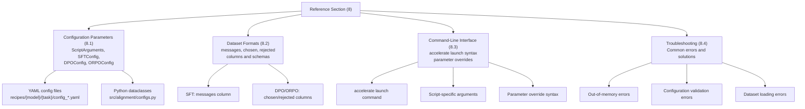
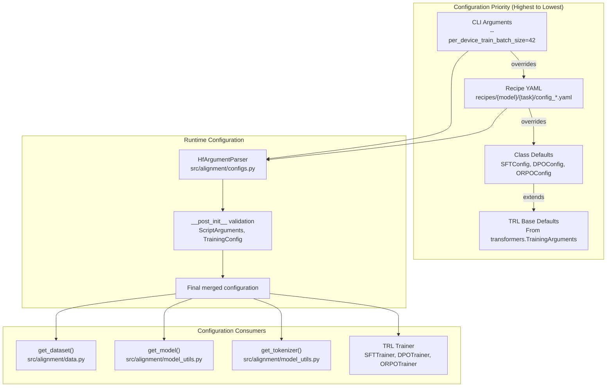
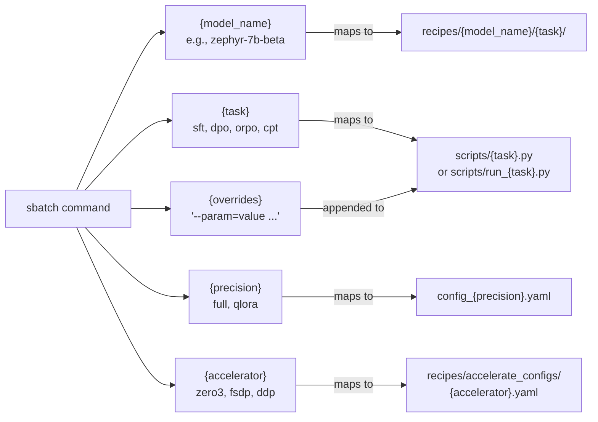

<!-- source: DeepWiki mcp.deepwiki.com · repo huggingface/alignment-handbook · page 8 Reference · fetched 2026-10-26 -->

# Reference

<details>
<summary>Relevant source files</summary>

The following files were used as context for generating this wiki page:

- [scripts/README.md](scripts/README.md)

</details>


## Purpose and Scope

This section provides technical reference documentation for quick lookup of configuration parameters, dataset formats, CLI commands, and troubleshooting information. It is designed as a reference guide for practitioners who are already familiar with the Alignment Handbook and need to quickly look up specific technical details.

For conceptual explanations of training methodologies, see [Training Methods](#3). For step-by-step setup and usage tutorials, see [Quick Start Guide](#1.3) and [Project Structure](#1.2). For detailed information about creating custom training recipes, see [Creating Custom Recipes](#4.5).

## Reference Material Organization

The reference section is organized into four main categories, each documented in a dedicated subsection:



**Sources:** [scripts/README.md:1-142]()

## Training Script Command Reference

The Alignment Handbook uses a consistent command structure across all training scripts. The general pattern is:

```bash
ACCELERATE_LOG_LEVEL=info accelerate launch \
  --config_file recipes/accelerate_configs/{accelerate_config}.yaml \
  scripts/{task}.py \
  --config recipes/{model_name}/{task}/config_{precision}.yaml \
  [--param1=value1 --param2=value2 ...]
```

### Script Name Mapping

| Training Task | Script Name | Section Reference |
|--------------|-------------|-------------------|
| Supervised Fine-Tuning | `scripts/sft.py` | [SFT Documentation](#3.1) |
| Direct Preference Optimization | `scripts/dpo.py` | [DPO Documentation](#3.2) |
| Odds Ratio Preference Optimization | `scripts/run_orpo.py` | [ORPO Documentation](#3.3) |
| Continued Pretraining | `scripts/run_cpt.py` | [CPT Documentation](#3.4) |

### Accelerate Configuration Mapping

| Use Case | Config File | Section Reference |
|----------|-------------|-------------------|
| Single GPU / QLoRA | `recipes/accelerate_configs/ddp.yaml` | [DDP Documentation](#5.1.3) |
| Multi-GPU Full Training | `recipes/accelerate_configs/zero3.yaml` | [DeepSpeed Documentation](#5.1.1) |
| Very Large Models (Mixtral 8x22B) | `recipes/accelerate_configs/fsdp.yaml` | [FSDP Documentation](#5.1.2) |
| Multi-GPU QLoRA | `recipes/accelerate_configs/fsdp+qlora.yaml` | [FSDP Documentation](#5.1.2) |

**Sources:** [scripts/README.md:14-29]()

## Configuration File Hierarchy

The system uses a multi-layer configuration hierarchy where parameters can be specified at different levels:



**Sources:** [scripts/README.md:49-54]()

## Dataset Format Quick Reference

The Alignment Handbook expects datasets to follow specific column schemas depending on the training task:

| Training Task | Required Columns | Column Type | Example Dataset |
|--------------|------------------|-------------|-----------------|
| SFT | `messages` | List of dicts with `role` and `content` keys | [ultrachat_200k](https://huggingface.co/datasets/HuggingFaceH4/ultrachat_200k) |
| DPO | `chosen`, `rejected` | Each is a list of dicts with `role` and `content` keys | [ultrafeedback_binarized](https://huggingface.co/datasets/HuggingFaceH4/ultrafeedback_binarized) |
| ORPO | `chosen`, `rejected` | Each is a list of dicts with `role` and `content` keys | [ultrafeedback_binarized](https://huggingface.co/datasets/HuggingFaceH4/ultrafeedback_binarized) |

### Recommended Dataset Split Naming

The handbook follows a consistent split naming convention:

| Split Name | Purpose |
|------------|---------|
| `train_sft` | Training data for supervised fine-tuning |
| `test_sft` | Test data for supervised fine-tuning |
| `train_prefs` | Training data for preference modeling (DPO, ORPO) |
| `test_prefs` | Test data for preference modeling |
| `train_gen` | Training data for generation tasks (rejection sampling, PPO) |
| `test_gen` | Test data for generation tasks |

**Sources:** [scripts/README.md:96-115]()

## Parameter Override Syntax

Parameters specified in YAML configuration files can be overridden via CLI:

```bash
# Override single parameter
accelerate launch ... scripts/sft.py --config recipe.yaml \
  --per_device_train_batch_size=42

# Override multiple parameters
accelerate launch ... scripts/sft.py --config recipe.yaml \
  --per_device_train_batch_size=42 \
  --num_train_epochs=5 \
  --learning_rate=2e-5

# Slurm job parameter override (note the quotes)
sbatch recipes/launch.slurm zephyr-7b-beta sft full zero3 \
  '--per_device_train_batch_size=42 --num_train_epochs=5'
```

**Sources:** [scripts/README.md:49-54](), [scripts/README.md:71-76]()

## Training Hardware Quick Reference

The following table maps training methods to recommended hardware configurations:

| Training Method | Minimum Hardware | Recommended Config File | Memory Usage |
|----------------|------------------|------------------------|--------------|
| Full Fine-Tuning 7B | 8x A100 (80GB) | `zero3.yaml` | ~70GB per GPU |
| Full Fine-Tuning 70B+ | 8x A100 (80GB) | `fsdp.yaml` | ~75GB per GPU |
| LoRA 7B | 1x RTX 4090 (24GB) | `ddp.yaml` with `--num_processes=1` | ~20GB |
| QLoRA 7B | 1x RTX 4090 (24GB) | `ddp.yaml` with `--num_processes=1` | ~12GB |
| Multi-GPU LoRA | 2+ A100 (80GB) | `zero3.yaml` | ~40GB per GPU |
| Multi-GPU QLoRA | 2+ A6000 (48GB) | `fsdp+qlora.yaml` | ~30GB per GPU |

For detailed hardware requirements and scaling strategies, see [Resource Requirements and Hardware](#5.3).

**Sources:** [scripts/README.md:5-11]()

## Logging and Experiment Tracking

The handbook supports multiple logging backends:

| Backend | Enable Command | Output Location | Section Reference |
|---------|---------------|-----------------|-------------------|
| TensorBoard (default) | No flag needed | `data/{model}-{task}/runs/` | Default |
| Weights & Biases | `--report_to=wandb` | WandB dashboard | [Training Infrastructure](#5) |
| Both | `--report_to=tensorboard,wandb` | Both locations | [Training Infrastructure](#5) |

**Sources:** [scripts/README.md:56-61]()

## Slurm Job Submission Quick Reference

For HPC cluster environments, use the `recipes/launch.slurm` script:

```bash
sbatch --job-name=handbook_{task} --nodes={num_nodes} \
  recipes/launch.slurm {model_name} {task} {precision} {accelerator} \
  ['{optional_overrides}']
```

### Slurm Parameter Mapping



**Example:**
```bash
# Launch Zephyr SFT training on 1 node with custom hyperparameters
sbatch --job-name=handbook_sft --nodes=1 \
  recipes/launch.slurm zephyr-7b-beta sft full zero3 \
  '--per_device_train_batch_size=8 --gradient_accumulation_steps=4'
```

**Sources:** [scripts/README.md:63-81]()

## Dataset Mixing Quick Reference

The `dataset_mixture` configuration allows combining multiple datasets with specified weights:

```yaml
# In config YAML file
dataset_mixer:
  dataset_1: 0.5   # Use 50% of available examples
  dataset_2: 0.66  # Use 66% of available examples
  dataset_3: 0.10  # Use 10% of available examples
dataset_splits:
  - train_sft      # Training split to use
  - test_sft       # Test split to use
```

The `get_dataset()` function in [src/alignment/data.py]() processes this configuration to:
1. Load each dataset from the Hub or local path
2. Sample the specified proportion of examples
3. Concatenate all datasets
4. Shuffle with a fixed seed for reproducibility
5. Optionally split into train/test sets

For detailed information on dataset mixing, see [Dataset Mixing and Weighting](#6.1).

**Sources:** [scripts/README.md:82-95]()

## Model Evaluation Quick Reference

The handbook recommends three evaluation benchmarks:

| Benchmark | Type | Evaluation Focus | Setup Reference |
|-----------|------|------------------|-----------------|
| MT-Bench | Multi-turn (80 dialogues, 10 domains) | Conversational ability | [MT-Bench docs](https://github.com/lm-sys/FastChat/tree/main/fastchat/llm_judge) |
| AlpacaEval | Single-turn comparison | Helpfulness vs `text-davinci-003` | [AlpacaEval docs](https://github.com/tatsu-lab/alpaca_eval) |
| Chatbot Arena | Live human evaluation | Head-to-head human preference | [Chatbot Arena](https://chat.lmsys.org) |

For detailed evaluation methodologies, see [Model Evaluation](#6.5).

**Sources:** [scripts/README.md:117-142]()

## Configuration Validation

All configuration classes implement validation in their `__post_init__` methods. Common validation checks include:

- **Column name consistency**: Ensures `dataset_text_field`, `dataset_chosen_field`, and `dataset_rejected_field` match across all datasets in a mixture
- **Mutual exclusivity**: Ensures `dataset_name` and `dataset_mixer` are not both specified
- **Parameter dependencies**: Validates that dependent parameters are set correctly (e.g., LoRA requires specific target modules)

Validation errors are raised immediately after configuration parsing, before any training begins. For detailed parameter specifications and validation rules, see [Configuration Parameters](#8.1).

**Sources:** Referenced from configuration system design

## Quick Navigation Guide

To find specific reference information:

- **"What parameters can I set for SFT training?"** → See [Configuration Parameters](#8.1)
- **"What format should my dataset be in?"** → See [Dataset Formats](#8.2)
- **"How do I override config parameters from CLI?"** → See [Command-Line Interface](#8.3)
- **"Training fails with an error"** → See [Troubleshooting](#8.4)
- **"How do I scale training to multiple GPUs?"** → See [Distributed Training Configurations](#5.1)
- **"How do I create a custom training recipe?"** → See [Creating Custom Recipes](#4.5)
- **"What's the difference between DPO, ORPO, and KTO?"** → See [Comparing Preference Alignment Methods](#3.5)

---

