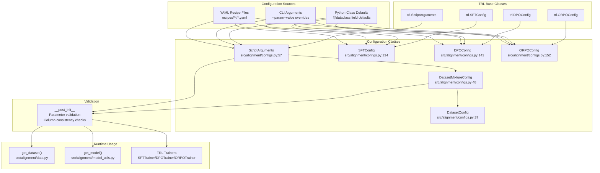
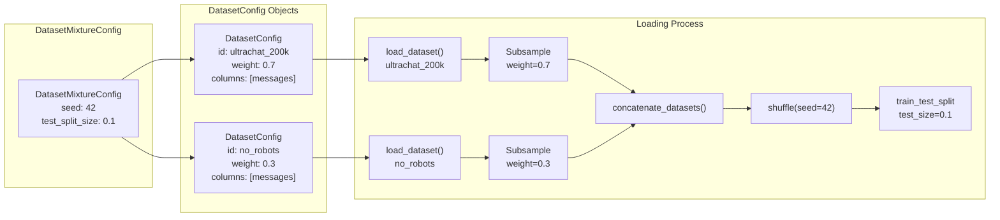
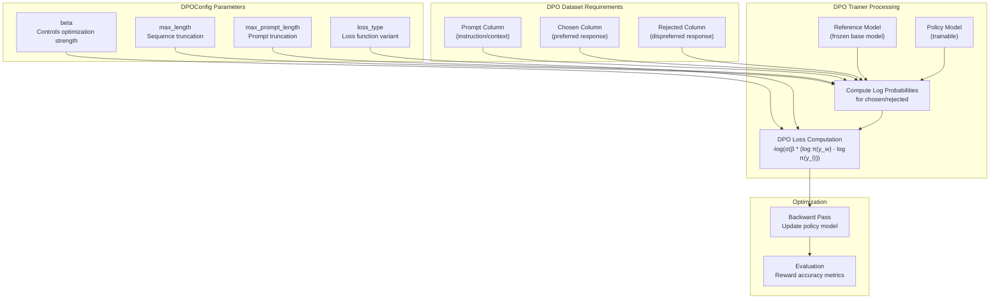
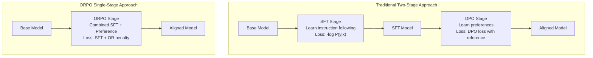
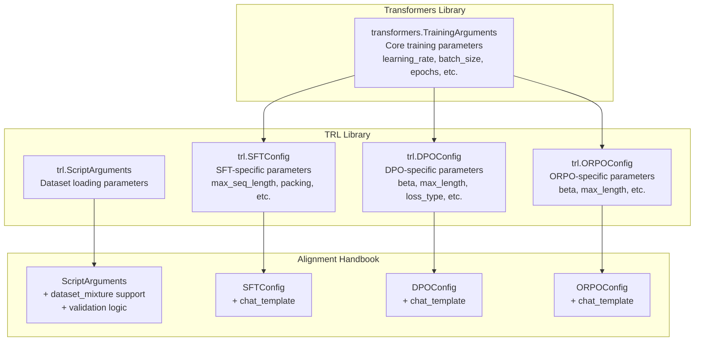
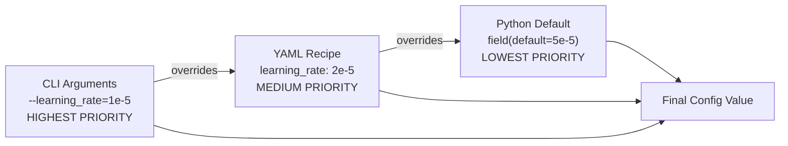

<!-- source: DeepWiki mcp.deepwiki.com · repo huggingface/alignment-handbook · page 8.1 Configuration Parameters · fetched 2026-10-26 -->

# Configuration Parameters

<details>
<summary>Relevant source files</summary>

The following files were used as context for generating this wiki page:

- [src/alignment/configs.py](src/alignment/configs.py)
- [tests/fixtures/config_dpo_full.yaml](tests/fixtures/config_dpo_full.yaml)
- [tests/fixtures/config_sft_full.yaml](tests/fixtures/config_sft_full.yaml)

</details>


This page provides a comprehensive reference for all configuration parameters used in the Alignment Handbook training system. It documents the parameters available in `ScriptArguments`, `SFTConfig`, `DPOConfig`, and `ORPOConfig` classes, along with dataset configuration schemas.

For information on how configurations are loaded and validated, see [Configuration System](#2.1). For practical examples of using these parameters in training recipes, see [Model Training Recipes](#4). For details on distributed training configurations (DeepSpeed, FSDP, DDP), see [Distributed Training Configurations](#5.1).

## Configuration System Architecture

The Alignment Handbook uses a multi-layered configuration system that merges parameters from YAML files, command-line arguments, and Python dataclasses. All training configuration classes extend base classes from the TRL library and add alignment-specific features.



**Sources:** [src/alignment/configs.py:1-158]()

## ScriptArguments

`ScriptArguments` extends `trl.ScriptArguments` to add support for advanced dataset mixing capabilities. It is defined at [src/alignment/configs.py:57-131]().

### Core Parameters

| Parameter | Type | Default | Description |
|-----------|------|---------|-------------|
| `dataset_name` | `Optional[str]` | `None` | Single dataset identifier from Hugging Face Hub or local path |
| `dataset_mixer` | `Optional[dict]` | `None` | Legacy dictionary mapping dataset names to weights |
| `dataset_mixture` | `Optional[dict[str, Any]]` | `None` | Advanced dataset mixture configuration with full control |
| `dataset_splits` | `Optional[list[str]]` | `None` | List of splits to load (e.g., `["train_sft", "test_sft"]`) |
| `dataset_configs` | `Optional[list[str]]` | `None` | Configuration names for datasets |
| `dataset_num_proc` | `Optional[int]` | `None` | Number of processes for dataset loading/preprocessing |
| `model_name_or_path` | `str` | Required | Path or identifier for the base model |
| `model_revision` | `str` | `"main"` | Model revision/branch to load |
| `torch_dtype` | `Optional[str]` | `None` | Torch dtype (e.g., `"bfloat16"`, `"float16"`) |
| `attn_implementation` | `Optional[str]` | `None` | Attention implementation (e.g., `"flash_attention_2"`) |

### Dataset Mixture Configuration

The `dataset_mixture` parameter accepts a nested dictionary structure that is converted to a `DatasetMixtureConfig` object during validation:

```yaml
dataset_mixture:
  datasets:
    - id: "HuggingFaceH4/ultrachat_200k"
      config: "default"
      split: "train_sft"
      columns: ["messages"]
      weight: 0.7
    - id: "HuggingFaceH4/no_robots"
      split: "train"
      columns: ["messages"]
      weight: 0.3
  seed: 42
  test_split_size: 0.1
```

### Validation Logic

The `__post_init__` method at [src/alignment/configs.py:88-130]() performs critical validation:

1. **Mutual Exclusivity**: Ensures either `dataset_name` or `dataset_mixture` is provided (but not both)
2. **Structure Validation**: Checks that `dataset_mixture` has the required `"datasets"` key
3. **Column Consistency**: Validates that all datasets in a mixture specify the same columns
4. **Dataclass Conversion**: Converts raw dictionary data to typed `DatasetConfig` objects

**Sources:** [src/alignment/configs.py:57-131](), [tests/fixtures/config_sft_full.yaml:1-41]()

## DatasetConfig and DatasetMixtureConfig

These classes define the schema for dataset composition and mixing.

### DatasetConfig

Defined at [src/alignment/configs.py:37-44](), `DatasetConfig` specifies a single dataset within a mixture:

| Parameter | Type | Default | Description |
|-----------|------|---------|-------------|
| `id` | `str` | Required | Dataset identifier (Hub ID or local path) |
| `config` | `Optional[str]` | `None` | Dataset configuration/subset name |
| `split` | `str` | `"train"` | Split to load (e.g., `"train"`, `"test"`) |
| `columns` | `Optional[list[str]]` | `None` | Columns to retain from the dataset |
| `weight` | `Optional[float]` | `None` | Sampling weight for this dataset in the mixture |

### DatasetMixtureConfig

Defined at [src/alignment/configs.py:48-53](), `DatasetMixtureConfig` orchestrates multiple datasets:

| Parameter | Type | Default | Description |
|-----------|------|---------|-------------|
| `datasets` | `list[DatasetConfig]` | Required | List of dataset configurations |
| `seed` | `int` | `0` | Random seed for shuffling and sampling |
| `test_split_size` | `Optional[float]` | `None` | Proportion of data to reserve for testing (e.g., `0.1` for 10%) |



**Sources:** [src/alignment/configs.py:37-53]()

## SFTConfig

`SFTConfig` extends `trl.SFTConfig` to add chat template support for supervised fine-tuning. It is defined at [src/alignment/configs.py:134-139]().

### Additional Parameters

| Parameter | Type | Default | Description |
|-----------|------|---------|-------------|
| `chat_template` | `Optional[str]` | `None` | Custom chat template for tokenizer (Jinja2 format) |

### Inherited Parameters from trl.SFTConfig

`SFTConfig` inherits all parameters from `trl.SFTConfig`, which in turn inherits from `transformers.TrainingArguments`. Key SFT-specific parameters include:

| Parameter | Type | Default | Description |
|-----------|------|---------|-------------|
| `max_seq_length` | `Optional[int]` | `None` | Maximum sequence length for training |
| `packing` | `bool` | `False` | Whether to pack multiple examples into one sequence |
| `dataset_text_field` | `Optional[str]` | `None` | Text field name in dataset (if not using formatting function) |
| `dataset_kwargs` | `Optional[dict]` | `None` | Additional arguments passed to dataset processing |
| `num_of_sequences` | `int` | `1024` | Number of sequences to pack together (if packing=True) |
| `chars_per_token` | `float` | `3.6` | Average characters per token (for packing estimation) |

### Common TrainingArguments Parameters

From `transformers.TrainingArguments`, frequently used parameters include:

| Parameter | Type | Default | Description |
|-----------|------|---------|-------------|
| `output_dir` | `str` | Required | Directory to save model checkpoints and logs |
| `num_train_epochs` | `float` | `3.0` | Total number of training epochs |
| `per_device_train_batch_size` | `int` | `8` | Batch size per GPU/TPU for training |
| `per_device_eval_batch_size` | `int` | `8` | Batch size per GPU/TPU for evaluation |
| `learning_rate` | `float` | `5e-5` | Initial learning rate for optimizer |
| `lr_scheduler_type` | `str` | `"linear"` | Learning rate scheduler (e.g., `"cosine"`, `"constant"`) |
| `warmup_ratio` | `float` | `0.0` | Ratio of warmup steps to total training steps |
| `gradient_accumulation_steps` | `int` | `1` | Number of steps to accumulate gradients |
| `gradient_checkpointing` | `bool` | `False` | Enable gradient checkpointing for memory efficiency |
| `bf16` | `bool` | `False` | Use bfloat16 mixed precision training |
| `fp16` | `bool` | `False` | Use float16 mixed precision training |
| `logging_steps` | `int` | `500` | Log metrics every N steps |
| `eval_strategy` | `str` | `"no"` | Evaluation strategy (`"no"`, `"steps"`, `"epoch"`) |
| `eval_steps` | `Optional[int]` | `None` | Evaluate every N steps (if eval_strategy="steps") |
| `save_strategy` | `str` | `"steps"` | Save checkpoint strategy |
| `save_steps` | `int` | `500` | Save checkpoint every N steps |
| `save_total_limit` | `Optional[int]` | `None` | Maximum number of checkpoints to keep |
| `push_to_hub` | `bool` | `False` | Push model to Hugging Face Hub after training |
| `hub_model_id` | `Optional[str]` | `None` | Hub repository ID for model upload |
| `hub_strategy` | `str` | `"every_save"` | Hub push strategy |
| `seed` | `int` | `42` | Random seed for reproducibility |
| `report_to` | `list[str]` | `["tensorboard"]` | Logging integrations (e.g., `["tensorboard", "wandb"]`) |

### Example SFT Configuration

```yaml
# From tests/fixtures/config_sft_full.yaml
model_name_or_path: mistralai/Mistral-7B-v0.1
torch_dtype: bfloat16
attn_implementation: flash_attention_2

dataset_mixer:
  HuggingFaceH4/ultrachat_200k: 1.0
dataset_splits:
  - train_sft
  - test_sft

bf16: true
do_eval: true
eval_strategy: epoch
gradient_accumulation_steps: 2
gradient_checkpointing: true
learning_rate: 2.0e-05
lr_scheduler_type: cosine
max_seq_length: 2048
num_train_epochs: 1
per_device_train_batch_size: 32
per_device_eval_batch_size: 16
output_dir: data/zephyr-7b-sft-full
hub_model_id: zephyr-7b-sft-full
push_to_hub: true
seed: 42
```

**Sources:** [src/alignment/configs.py:134-139](), [tests/fixtures/config_sft_full.yaml:1-41]()

## DPOConfig

`DPOConfig` extends `trl.DPOConfig` to add chat template support for Direct Preference Optimization. It is defined at [src/alignment/configs.py:143-148]().

### Additional Parameters

| Parameter | Type | Default | Description |
|-----------|------|---------|-------------|
| `chat_template` | `Optional[str]` | `None` | Custom chat template for tokenizer (Jinja2 format) |

### Inherited DPO-Specific Parameters

From `trl.DPOConfig`, key DPO-specific parameters include:

| Parameter | Type | Default | Description |
|-----------|------|---------|-------------|
| `beta` | `float` | `0.1` | Temperature parameter for DPO loss (controls strength of preference optimization) |
| `max_length` | `Optional[int]` | `None` | Maximum length for chosen and rejected sequences |
| `max_prompt_length` | `Optional[int]` | `None` | Maximum length for prompts |
| `label_pad_token_id` | `int` | `-100` | Token ID for padding labels |
| `loss_type` | `str` | `"sigmoid"` | DPO loss variant (`"sigmoid"`, `"hinge"`, `"ipo"`, `"kto_pair"`) |
| `label_smoothing` | `float` | `0.0` | Label smoothing factor |
| `generate_during_eval` | `bool` | `False` | Generate samples during evaluation |
| `is_encoder_decoder` | `Optional[bool]` | `None` | Whether the model is encoder-decoder |
| `precompute_ref_log_probs` | `bool` | `False` | Precompute reference model log probabilities |
| `reference_free` | `bool` | `False` | Use reference-free variant of DPO |

### DPO Configuration Flow



### Example DPO Configuration

```yaml
# From tests/fixtures/config_dpo_full.yaml
model_name_or_path: alignment-handbook/zephyr-7b-sft-full

dataset_mixer:
  HuggingFaceH4/ultrafeedback_binarized: 1.0
dataset_splits:
  - train_prefs
  - test_prefs

bf16: true
beta: 0.1
do_eval: true
eval_strategy: steps
eval_steps: 100
gradient_accumulation_steps: 1
gradient_checkpointing: true
learning_rate: 5.0e-7
lr_scheduler_type: linear
max_length: 1024
max_prompt_length: 512
num_train_epochs: 3
optim: rmsprop
per_device_train_batch_size: 8
per_device_eval_batch_size: 4
output_dir: data/zephyr-7b-dpo-full
hub_model_id: zephyr-7b-dpo-full
push_to_hub: true
seed: 42
warmup_ratio: 0.1
```

**Sources:** [src/alignment/configs.py:143-148](), [tests/fixtures/config_dpo_full.yaml:1-37]()

## ORPOConfig

`ORPOConfig` extends `trl.ORPOConfig` to add chat template support for Odds Ratio Preference Optimization. It is defined at [src/alignment/configs.py:152-157]().

### Additional Parameters

| Parameter | Type | Default | Description |
|-----------|------|---------|-------------|
| `chat_template` | `Optional[str]` | `None` | Custom chat template for tokenizer (Jinja2 format) |

### Inherited ORPO-Specific Parameters

From `trl.ORPOConfig`, key ORPO-specific parameters include:

| Parameter | Type | Default | Description |
|-----------|------|---------|-------------|
| `beta` | `float` | `0.1` | Temperature parameter for odds ratio (controls preference strength) |
| `max_length` | `Optional[int]` | `None` | Maximum length for chosen and rejected sequences |
| `max_prompt_length` | `Optional[int]` | `None` | Maximum length for prompts |
| `max_completion_length` | `Optional[int]` | `None` | Maximum length for completions |
| `label_pad_token_id` | `int` | `-100` | Token ID for padding labels |

### ORPO vs DPO+SFT

ORPO combines supervised fine-tuning with preference optimization in a single stage, unlike the traditional two-stage DPO approach:



### Example ORPO Configuration

ORPO configurations are similar to DPO but typically applied directly to base models:

```yaml
model_name_or_path: mistralai/Mistral-7B-v0.1

dataset_mixture:
  datasets:
    - id: HuggingFaceH4/ultrafeedback_binarized
      split: train_prefs
      columns: ["prompt", "chosen", "rejected"]
      weight: 1.0

bf16: true
beta: 0.1
learning_rate: 8.0e-6
lr_scheduler_type: linear
max_length: 2048
max_prompt_length: 1024
num_train_epochs: 1
per_device_train_batch_size: 4
gradient_accumulation_steps: 4
gradient_checkpointing: true
output_dir: data/zephyr-7b-orpo
```

**Sources:** [src/alignment/configs.py:152-157]()

## Configuration Inheritance Hierarchy

The alignment handbook configuration classes extend TRL base classes, which inherit from Transformers training arguments:



This inheritance means that:

1. **Full Parameter Access**: All Transformers `TrainingArguments` parameters are available in `SFTConfig`, `DPOConfig`, and `ORPOConfig`
2. **Method-Specific Extensions**: Each config class adds parameters specific to its training method
3. **Alignment-Specific Features**: The handbook adds `chat_template` support and advanced dataset mixing
4. **Validation Logic**: The handbook adds validation in `__post_init__` methods

**Sources:** [src/alignment/configs.py:1-158]()

## Parameter Override Priority

When the same parameter is specified in multiple places, the priority order is:



This allows for:
- **Reproducible Recipes**: YAML files define stable configurations
- **Experimental Flexibility**: CLI arguments enable quick parameter sweeps
- **Sensible Defaults**: Python classes provide reasonable starting points

**Sources:** [src/alignment/configs.py:1-158]()

## Complete Parameter Tables

### Key SFT-Specific Parameters

| Parameter | Type | Default | Used For |
|-----------|------|---------|----------|
| `max_seq_length` | `int` | `None` | Maximum sequence length for training examples |
| `packing` | `bool` | `False` | Whether to concatenate multiple short examples |
| `num_of_sequences` | `int` | `1024` | Number of sequences to pack together |
| `chars_per_token` | `float` | `3.6` | Average characters per token for packing |
| `dataset_text_field` | `str` | `None` | Name of text field in dataset |
| `chat_template` | `str` | `None` | Custom chat template (Alignment Handbook addition) |

### Key DPO-Specific Parameters

| Parameter | Type | Default | Used For |
|-----------|------|---------|----------|
| `beta` | `float` | `0.1` | KL penalty coefficient (higher = stronger regularization) |
| `max_length` | `int` | `None` | Maximum total sequence length |
| `max_prompt_length` | `int` | `None` | Maximum prompt length (remainder for completion) |
| `loss_type` | `str` | `"sigmoid"` | DPO loss variant (`"sigmoid"`, `"ipo"`, `"kto_pair"`) |
| `reference_free` | `bool` | `False` | Use reference-free DPO variant |
| `precompute_ref_log_probs` | `bool` | `False` | Cache reference model outputs |
| `generate_during_eval` | `bool` | `False` | Generate samples during evaluation |
| `chat_template` | `str` | `None` | Custom chat template (Alignment Handbook addition) |

### Key ORPO-Specific Parameters

| Parameter | Type | Default | Used For |
|-----------|------|---------|----------|
| `beta` | `float` | `0.1` | Odds ratio penalty coefficient |
| `max_length` | `int` | `None` | Maximum total sequence length |
| `max_prompt_length` | `int` | `None` | Maximum prompt length |
| `max_completion_length` | `int` | `None` | Maximum completion length |
| `chat_template` | `str` | `None` | Custom chat template (Alignment Handbook addition) |

### Essential Training Parameters

| Parameter | Type | Default | Critical For |
|-----------|------|---------|-------------|
| `learning_rate` | `float` | `5e-5` | Optimizer step size (typically 2e-5 for SFT, 5e-7 for DPO) |
| `num_train_epochs` | `float` | `3.0` | Number of complete passes through dataset |
| `per_device_train_batch_size` | `int` | `8` | Samples per GPU (adjust based on VRAM) |
| `gradient_accumulation_steps` | `int` | `1` | Steps to accumulate before optimizer update |
| `gradient_checkpointing` | `bool` | `False` | Trade compute for memory (enable for large models) |
| `bf16` | `bool` | `False` | Use bfloat16 precision (recommended for A100+) |
| `lr_scheduler_type` | `str` | `"linear"` | LR schedule (`"cosine"` often better for SFT) |
| `warmup_ratio` | `float` | `0.0` | Fraction of training for warmup |
| `seed` | `int` | `42` | Random seed for reproducibility |

**Sources:** [src/alignment/configs.py:1-158](), [tests/fixtures/config_sft_full.yaml:1-41](), [tests/fixtures/config_dpo_full.yaml:1-37]()

---

