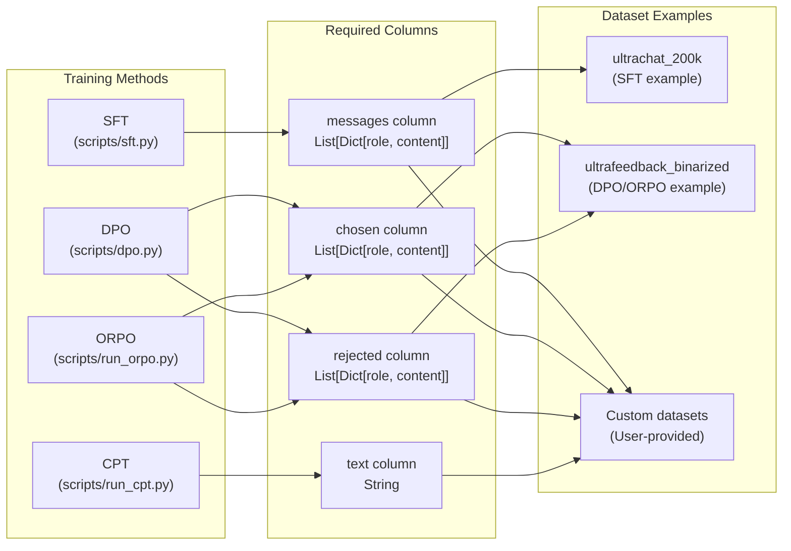
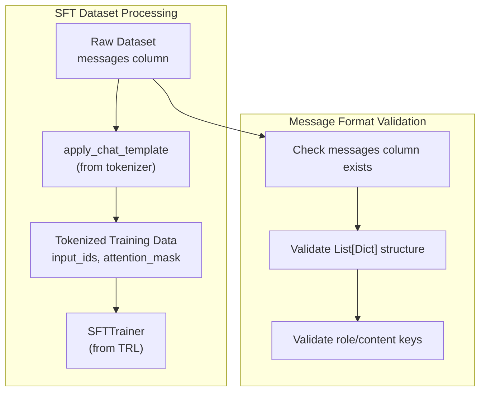
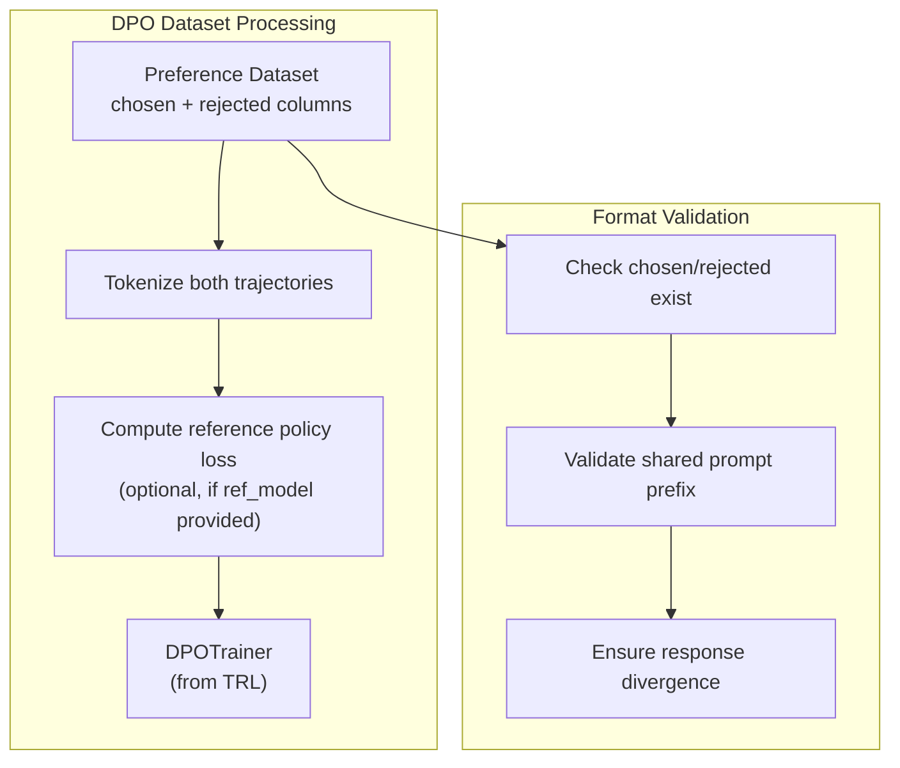
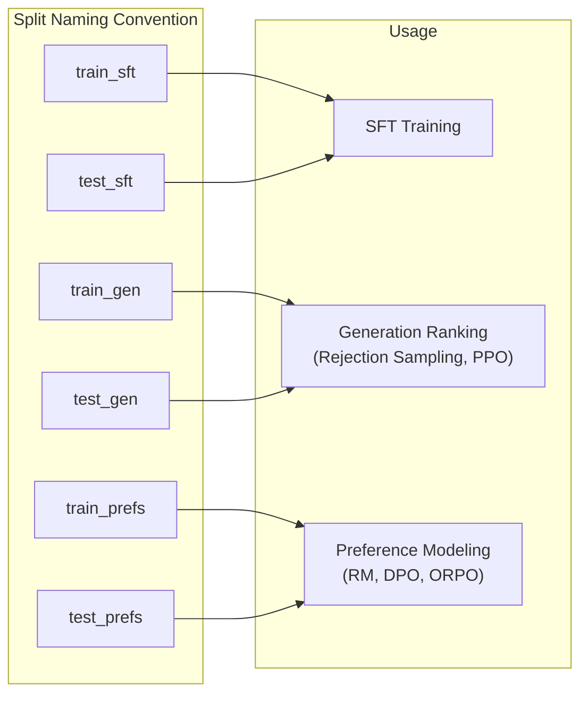
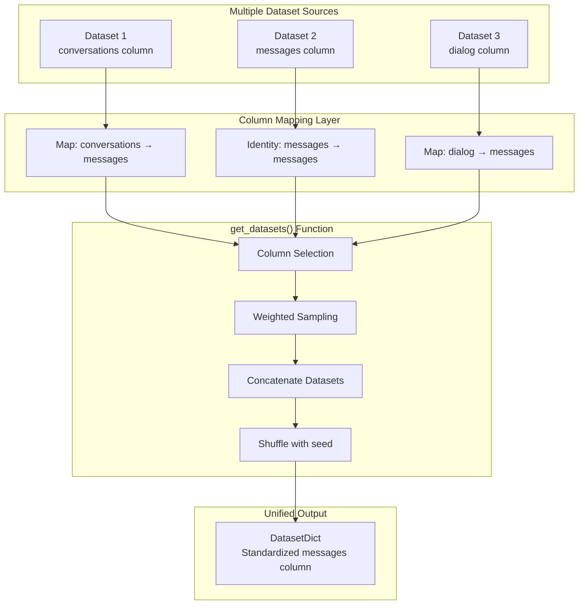
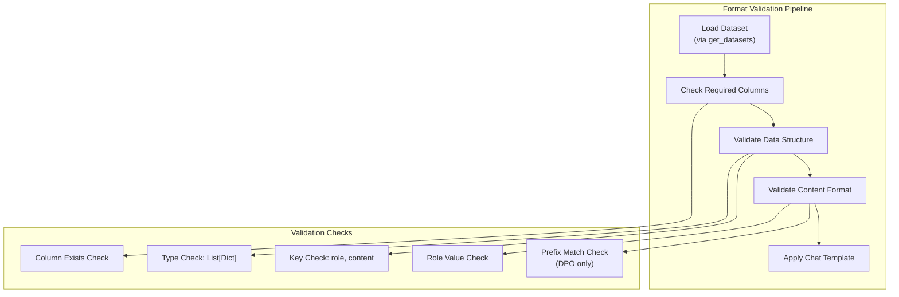

<!-- source: DeepWiki mcp.deepwiki.com · repo huggingface/alignment-handbook · page 8.2 Dataset Formats · fetched 2026-10-26 -->

# Dataset Formats

<details>
<summary>Relevant source files</summary>

The following files were used as context for generating this wiki page:

- [scripts/README.md](scripts/README.md)

</details>


This page documents the required dataset formats and column structures for each training method supported by the Alignment Handbook. Understanding these formats is essential for preparing custom datasets or adapting existing datasets for training.

For information about loading and mixing datasets programmatically, see [Dataset Loading and Mixing](#2.3). For advanced dataset mixing strategies and weighting schemes, see [Dataset Mixing and Weighting](#6.1).

## Overview

The Alignment Handbook training scripts expect datasets to conform to specific column schemas that vary by training task. All datasets use a conversational message format based on lists of dictionaries with `role` and `content` keys, enabling consistent application of chat templates across different model architectures.



**Sources:** [scripts/README.md:96-115]()

## Supervised Fine-Tuning (SFT) Format

SFT datasets must contain a `messages` column where each row is a list of message dictionaries. Each message dictionary has two required keys:

| Key | Type | Description |
|-----|------|-------------|
| `role` | `str` | The speaker role: `"system"`, `"user"`, or `"assistant"` |
| `content` | `str` | The message text content |

### Message Structure

```python
# Single example from the messages column
[
    {"role": "system", "content": "You are a helpful assistant."},
    {"role": "user", "content": "What is the capital of France?"},
    {"role": "assistant", "content": "The capital of France is Paris."},
    {"role": "user", "content": "What is its population?"},
    {"role": "assistant", "content": "As of 2023, Paris has approximately 2.1 million residents."}
]
```

The `messages` list represents a complete conversational turn sequence. The training script applies the model's chat template to convert this structure into the appropriate token format for the specific model architecture.

### Reference Dataset

The canonical example is `HuggingFaceH4/ultrachat_200k`, which contains 200,000 multi-turn conversations suitable for instruction tuning. Each row contains a `messages` column formatted as described above.



**Sources:** [scripts/README.md:98-101]()

## Direct Preference Optimization (DPO) Format

DPO and related preference alignment methods (KTO, IPO) require datasets with two columns representing preferred and dispreferred responses:

| Column | Type | Description |
|--------|------|-------------|
| `chosen` | `List[Dict[str, str]]` | The preferred conversation trajectory |
| `rejected` | `List[Dict[str, str]]` | The dispreferred conversation trajectory |

Both columns use the same message dictionary format as SFT (with `role` and `content` keys).

### Preference Pair Structure

```python
# Example row with chosen and rejected columns
{
    "chosen": [
        {"role": "user", "content": "Explain quantum computing"},
        {"role": "assistant", "content": "Quantum computing uses quantum mechanics principles like superposition and entanglement to process information..."}
    ],
    "rejected": [
        {"role": "user", "content": "Explain quantum computing"},
        {"role": "assistant", "content": "It's like a really fast computer that uses atoms."}
    ]
}
```

### Key Requirements

1. **Shared Prefix**: The user messages (prompts) in both `chosen` and `rejected` must be identical up to the final assistant response
2. **Response Divergence**: Only the final assistant response should differ between chosen and rejected
3. **Multi-Turn Support**: The system supports multi-turn preference pairs where the divergence occurs at any turn

### Reference Dataset

The canonical example is `HuggingFaceH4/ultrafeedback_binarized`, which contains binarized preference pairs derived from UltraFeedback ratings. Each row has `chosen` and `rejected` columns formatted as conversational message lists.



**Sources:** [scripts/README.md:103-107]()

## ORPO Format

ORPO (Odds Ratio Preference Optimization) uses the same dataset format as DPO:

- `chosen` column: List of message dictionaries for preferred responses
- `rejected` column: List of message dictionaries for dispreferred responses

ORPO combines supervised fine-tuning with preference alignment in a single stage, but the input dataset format remains identical to DPO. The training script [`scripts/run_orpo.py`]() handles the combined objective internally.

**Sources:** [scripts/README.md:103-107](), [scripts/README.md:35]()

## Continued Pretraining (CPT) Format

Continued pretraining typically uses raw text data rather than conversational formats. The expected column is:

| Column | Type | Description |
|--------|------|-------------|
| `text` | `str` | Raw text content for language modeling |

CPT is used for domain adaptation or language adaptation before instruction tuning. For example, the GPT-NL recipe uses CPT to adapt a model to Dutch language before fine-tuning.

**Sources:** [scripts/README.md:32]()

## Dataset Split Naming Conventions

The Alignment Handbook follows a naming convention for dataset splits that organizes data by task type:



### Recommended Split Names

| Split Pattern | Purpose |
|---------------|---------|
| `train_sft`, `test_sft` | Supervised fine-tuning data |
| `train_gen`, `test_gen` | Generation ranking (rejection sampling, PPO) |
| `train_prefs`, `test_prefs` | Preference modeling (reward models, DPO, ORPO) |

This convention allows a single dataset to contain data for multiple training stages. The training scripts accept a `dataset_splits` parameter to specify which splits to use.

### Configuration Example

```yaml
# In a recipe config file
dataset_splits:
  - train_sft
  - test_sft

# Or for preference training
dataset_splits:
  - train_prefs
  - test_prefs
```

**Sources:** [scripts/README.md:109-113]()

## Dataset Mixing and Column Selection

The `get_datasets()` function supports loading and mixing multiple datasets with different column names through the `dataset_mixer` configuration:

```yaml
datasets_mixer:
    dataset_1: 0.5  # Use 50% of the training examples
    dataset_2: 0.66 # Use 66% of the training examples
    dataset_3: 0.10 # Use 10% of the training examples
dataset_splits:
- train_xxx         # The training splits to mix
- test_xxx          # The test splits to mix
```

### Column Mapping

When datasets use different column names, the `DatasetConfig` class supports column mapping to standardize them to the expected format. This is particularly useful when integrating datasets from different sources.



**Sources:** [scripts/README.md:84-94]()

## Format Validation

The training scripts perform validation to ensure datasets conform to expected formats:

### SFT Validation
- Checks that `messages` column exists
- Validates each row is a list of dictionaries
- Ensures each dictionary has `role` and `content` keys
- Verifies role values are valid (`"system"`, `"user"`, `"assistant"`)

### DPO/ORPO Validation
- Checks that both `chosen` and `rejected` columns exist
- Validates both columns use the message list format
- Ensures prompt prefixes match between chosen and rejected
- Verifies responses diverge appropriately



**Sources:** [scripts/README.md:96-115]()

## Example Datasets

### Recommended Datasets by Task

| Task | Dataset | Hub ID | Format |
|------|---------|--------|--------|
| SFT | UltraChat 200k | `HuggingFaceH4/ultrachat_200k` | `messages` column |
| DPO | UltraFeedback Binarized | `HuggingFaceH4/ultrafeedback_binarized` | `chosen`/`rejected` columns |
| ORPO | UltraFeedback Binarized | `HuggingFaceH4/ultrafeedback_binarized` | `chosen`/`rejected` columns |
| Constitutional AI | Harmless Conversations | Multiple variants available | Task-specific formats |
| Code SFT | Code datasets | Various code instruction datasets | `messages` column |

### Creating Custom Datasets

To create a custom dataset compatible with the Alignment Handbook:

1. **Format your data** according to the column requirements for your task
2. **Use message dictionaries** with `role` and `content` keys
3. **Include appropriate splits** following the naming convention
4. **Upload to Hugging Face Hub** or save locally
5. **Reference in config YAML** via `dataset_name` or `dataset_mixer`

The training scripts will automatically handle tokenization and chat template application if your dataset follows these format requirements.

**Sources:** [scripts/README.md:82-115]()

## Summary Table

| Training Method | Required Columns | Column Format | Reference Dataset |
|-----------------|------------------|---------------|-------------------|
| **SFT** | `messages` | `List[Dict[str, str]]` with `role`/`content` keys | `HuggingFaceH4/ultrachat_200k` |
| **DPO** | `chosen`, `rejected` | Both `List[Dict[str, str]]` with `role`/`content` keys | `HuggingFaceH4/ultrafeedback_binarized` |
| **ORPO** | `chosen`, `rejected` | Both `List[Dict[str, str]]` with `role`/`content` keys | `HuggingFaceH4/ultrafeedback_binarized` |
| **CPT** | `text` | `str` (raw text) | Various pretraining corpora |
| **KTO** | `chosen`, `rejected` | Both `List[Dict[str, str]]` with `role`/`content` keys | Same as DPO |
| **IPO** | `chosen`, `rejected` | Both `List[Dict[str, str]]` with `role`/`content` keys | Same as DPO |

**Sources:** [scripts/README.md:96-107]()

---

