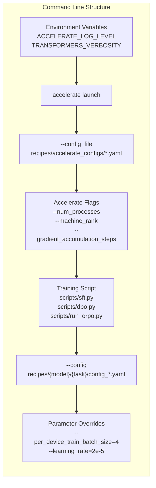
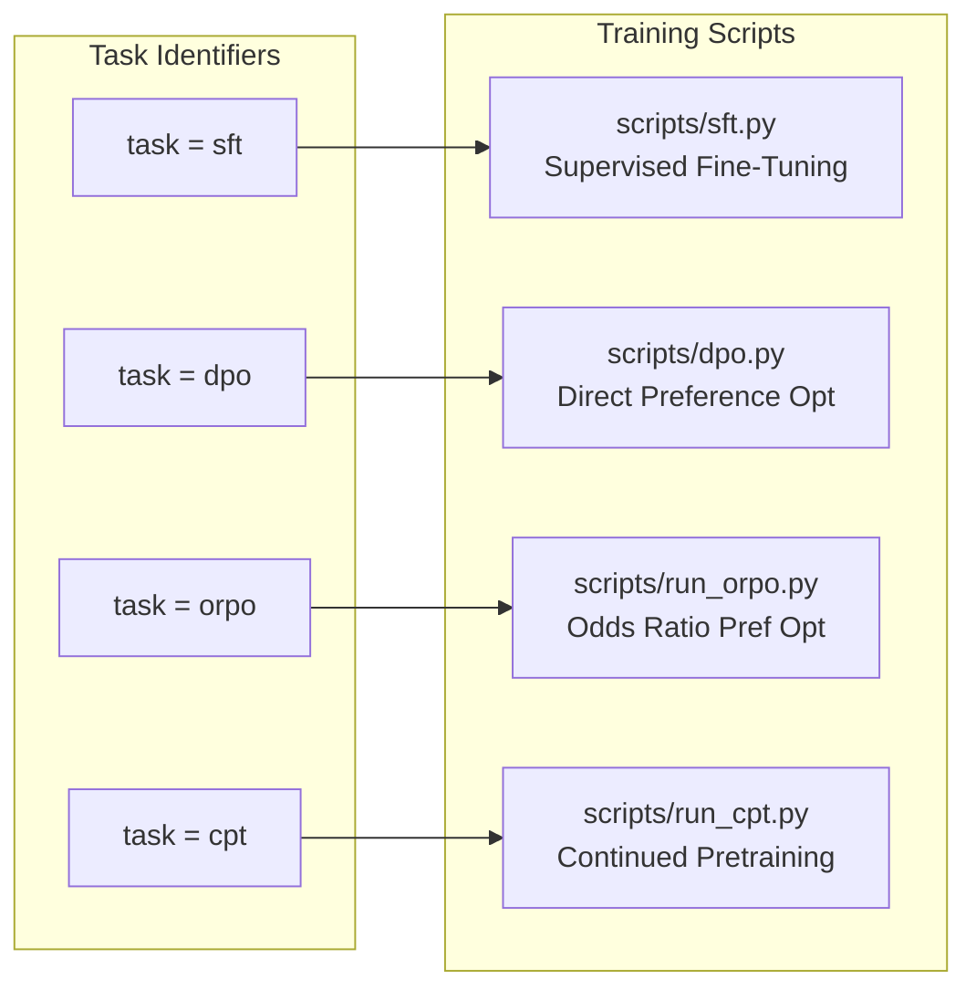
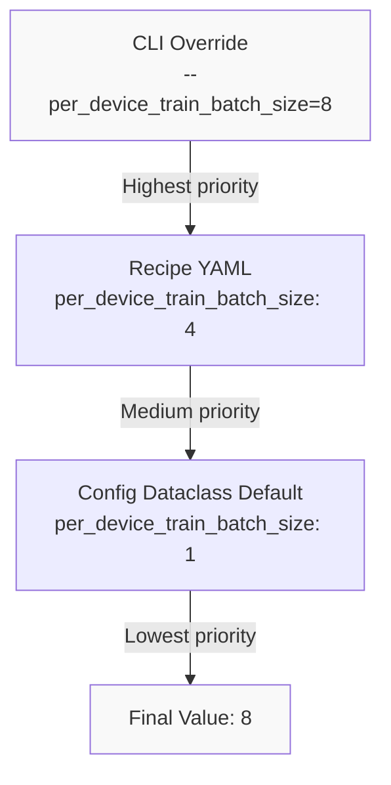
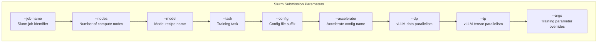
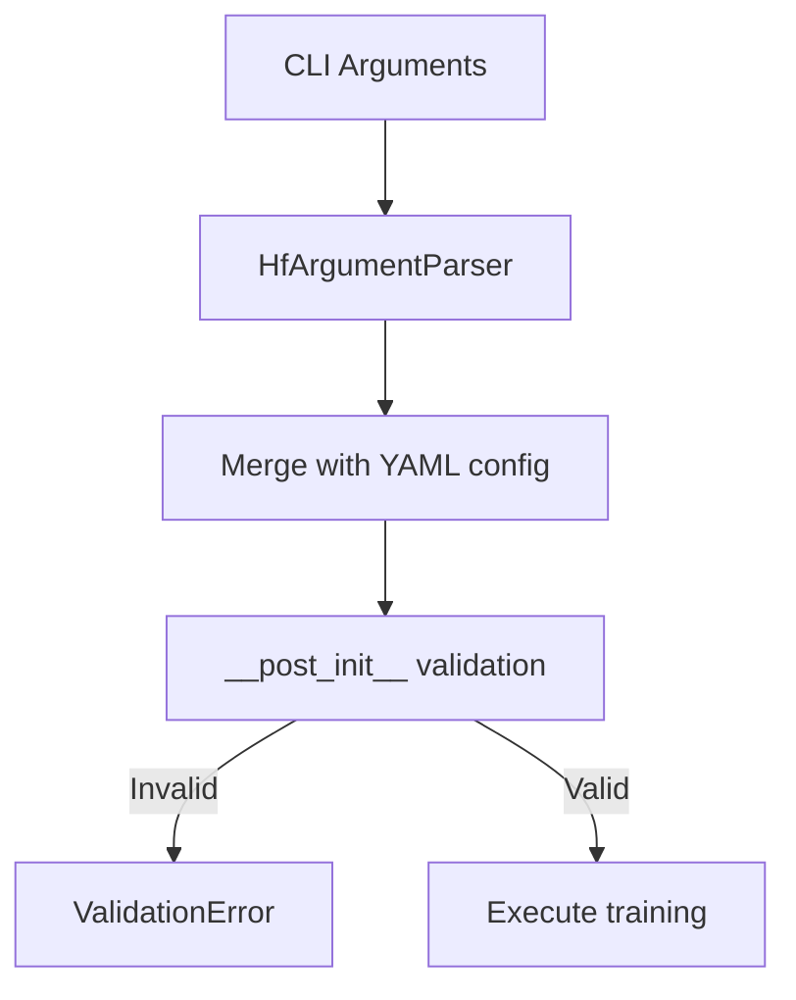

<!-- source: DeepWiki mcp.deepwiki.com · repo huggingface/alignment-handbook · page 8.3 Command-Line Interface · fetched 2026-10-26 -->

# Command-Line Interface

<details>
<summary>Relevant source files</summary>

The following files were used as context for generating this wiki page:

- [recipes/launch.slurm](recipes/launch.slurm)
- [scripts/README.md](scripts/README.md)

</details>


This page documents the command-line interface for running training jobs in the Alignment Handbook. It covers the `accelerate launch` command structure, parameter override mechanisms, environment variables, and Slurm job submission.

For information about configuration file formats and parameters, see [Configuration Parameters](#8.1). For details about the Slurm cluster execution environment, see [Slurm Cluster Deployment](#5.2).

## Command Structure Overview

All training jobs in the Alignment Handbook are executed through HuggingFace Accelerate's launch command. The general pattern follows a multi-layer configuration system where parameters can be specified at different levels.



**Diagram: Command-Line Execution Flow**

The command structure follows this precedence order (highest to lowest):
1. CLI parameter overrides (rightmost arguments)
2. Recipe YAML configuration files
3. Accelerate configuration files
4. Default values in config dataclasses

Sources: [scripts/README.md:14-29]()

## Basic Command Template

The canonical command structure is:

```bash
ACCELERATE_LOG_LEVEL=info accelerate launch \
    --config_file recipes/accelerate_configs/{accelerator}.yaml \
    [accelerate_flags] \
    scripts/{task}.py \
    --config recipes/{model_name}/{task}/config_{precision}.yaml \
    [parameter_overrides]
```

### Command Components

| Component | Purpose | Examples |
|-----------|---------|----------|
| `ACCELERATE_LOG_LEVEL` | Controls logging verbosity | `info`, `debug`, `warning` |
| `accelerate launch` | Entry point for distributed training | Required |
| `--config_file` | Specifies distributed training strategy | `zero3.yaml`, `fsdp.yaml`, `ddp.yaml` |
| Accelerate flags | Runtime configuration for Accelerate | `--num_processes=8`, `--machine_rank=0` |
| Script path | Training script to execute | `scripts/sft.py`, `scripts/dpo.py` |
| `--config` | Recipe configuration file | `config_full.yaml`, `config_qlora.yaml` |
| Parameter overrides | Ad-hoc parameter modifications | `--per_device_train_batch_size=4` |

Sources: [scripts/README.md:14-29]()

## Accelerate Launch Parameters

The `accelerate launch` command accepts various parameters that control distributed training execution. These parameters appear between the `--config_file` flag and the training script path.

```mermaid
graph TD
    subgraph "Accelerate Parameters"
        ConfigFile["--config_file<br/>Base distributed strategy"]
        NumProc["--num_processes<br/>Total process count"]
        NumMach["--num_machines<br/>Number of nodes"]
        MachRank["--machine_rank<br/>Node identifier"]
        MainIP["--main_process_ip<br/>Master node address"]
        MainPort["--main_process_port<br/>Master node port"]
        GradAcc["--gradient_accumulation_steps<br/>Gradient accumulation"]
        Rdzv["--rdzv_backend<br/>Rendezvous backend"]
        MaxRestart["--max_restarts<br/>Fault tolerance"]
        Tee["--tee<br/>Output redirection"]
    end
    
    ConfigFile --> NumProc
    NumProc --> NumMach
    NumMach --> MachRank
    MachRank --> MainIP
    MainIP --> MainPort
    MainPort --> GradAcc
    GradAcc --> Rdzv
    Rdzv --> MaxRestart
    MaxRestart --> Tee
```



**Diagram: Accelerate Launch Parameter Chain**

### Single-Node Parameters

For single-node (single or multi-GPU) training:

```bash
ACCELERATE_LOG_LEVEL=info accelerate launch \
    --config_file recipes/accelerate_configs/zero3.yaml \
    --num_processes=8 \
    scripts/sft.py \
    --config recipes/zephyr-7b-beta/sft/config_full.yaml
```

The `--num_processes` flag specifies the total number of GPUs to use.

Sources: [scripts/README.md:15-16]()

### Multi-Node Parameters

For multi-node distributed training, additional parameters are required:

| Parameter | Purpose | Example |
|-----------|---------|---------|
| `--num_machines` | Total number of nodes | `2`, `4`, `8` |
| `--num_processes` | Total processes across all nodes | `16` (for 2 nodes × 8 GPUs) |
| `--main_process_ip` | IP address of master node | `192.168.1.1` |
| `--main_process_port` | Port for master process | `6000` |
| `--machine_rank` | Current machine identifier (0-indexed) | `0`, `1`, `2` |
| `--rdzv_backend` | Rendezvous backend | `c10d`, `static` |
| `--max_restarts` | Number of allowed restarts | `1`, `3` |
| `--tee` | Output redirection level | `3` |

Sources: [recipes/launch.slurm:144-155]()

## Training Script Selection

The Alignment Handbook supports multiple training tasks, each with its own script:



**Diagram: Task-to-Script Mapping**

All scripts follow the same interface pattern and accept the `--config` parameter plus arbitrary parameter overrides.

Sources: [scripts/README.md:31-36]()

## Recipe Configuration Files

Recipe configuration files are specified with the `--config` flag and must appear after the training script path:

```bash
scripts/sft.py --config recipes/{model_name}/{task}/config_{precision}.yaml
```

### Configuration Naming Conventions

Recipe configurations follow a structured naming pattern:

- **Path structure**: `recipes/{model_name}/{task}/config_{precision}.yaml`
- **Model name**: `zephyr-7b-beta`, `smollm2`, `starchat2-15b`
- **Task**: `sft`, `dpo`, `orpo`, `cpt`
- **Precision**: `full`, `qlora`, `lora`, custom suffixes

Examples:
- `recipes/zephyr-7b-beta/sft/config_full.yaml`
- `recipes/zephyr-7b-beta/dpo/config_qlora.yaml`
- `recipes/smollm2/sft/config_full.yaml`

Sources: [scripts/README.md:37-45]()

## Parameter Override System

Any parameter defined in the recipe YAML configuration can be overridden via command-line arguments. Overrides are specified after the `--config` flag using standard argument syntax.

### Override Syntax

```bash
--parameter_name=value
```

Multiple overrides can be chained:

```bash
scripts/sft.py \
    --config recipes/zephyr-7b-beta/sft/config_full.yaml \
    --per_device_train_batch_size=4 \
    --num_train_epochs=5 \
    --learning_rate=2e-5 \
    --gradient_accumulation_steps=2
```

### Common Override Patterns

| Parameter Category | Common Overrides | Example Values |
|-------------------|------------------|----------------|
| Training scale | `per_device_train_batch_size`<br/>`gradient_accumulation_steps` | `4`, `8`, `16`<br/>`1`, `2`, `4` |
| Training duration | `num_train_epochs`<br/>`max_steps` | `1`, `3`, `5`<br/>`1000`, `10000` |
| Learning | `learning_rate`<br/>`warmup_ratio` | `1e-5`, `2e-5`, `5e-5`<br/>`0.03`, `0.1` |
| Model paths | `model_name_or_path`<br/>`output_dir` | HF Hub model ID<br/>Local directory path |
| Dataset | `dataset_mixer`<br/>`dataset_splits` | YAML dict format<br/>List of split names |
| Quantization | `load_in_4bit`<br/>`bnb_4bit_quant_storage` | `true`, `false`<br/>`bfloat16`, `float16` |
| Logging | `report_to`<br/>`logging_steps` | `tensorboard`, `wandb`<br/>`10`, `100` |

Sources: [scripts/README.md:49-54]()

### Override Precedence



**Diagram: Parameter Override Precedence**

Sources: [scripts/README.md:49-54]()

## Environment Variables

Several environment variables control logging and execution behavior:

### Logging Variables

| Variable | Purpose | Values | Default |
|----------|---------|--------|---------|
| `ACCELERATE_LOG_LEVEL` | Accelerate logging verbosity | `debug`, `info`, `warning`, `error` | `warning` |
| `TRANSFORMERS_VERBOSITY` | Transformers library logging | `debug`, `info`, `warning`, `error` | `warning` |

### Distributed Training Variables

| Variable | Purpose | Usage |
|----------|---------|-------|
| `NCCL_ASYNC_ERROR_HANDLING` | Force crash on NCCL errors | Set to `1` to enable |
| `NCCL_DEBUG` | NCCL debugging output | `INFO`, `WARN` |
| `NCCL_DEBUG_SUBSYS` | NCCL subsystem debugging | `COLL`, `ALL` |
| `CUDA_LAUNCH_BLOCKING` | Synchronous CUDA execution | Set to `1` for debugging |

Sources: [recipes/launch.slurm:134-139](), [scripts/README.md:16-17]()

## Slurm Command-Line Interface

The Alignment Handbook provides a Slurm submission script with its own CLI interface.

### Basic Slurm Submission

```bash
sbatch --job-name=handbook_{task} --nodes={num_nodes} recipes/launch.slurm \
    --model {model_name} \
    --task {task} \
    --config {config_suffix} \
    --accelerator {accelerator} \
    [--args "override_string"]
```

### Slurm CLI Parameters



**Diagram: Slurm CLI Parameter Structure**

| Parameter | Required | Purpose | Example |
|-----------|----------|---------|---------|
| `--model` | Yes | Model recipe directory name | `zephyr-7b-beta`, `smollm2` |
| `--task` | Yes | Training task identifier | `sft`, `dpo`, `orpo` |
| `--config` | Yes | Config file suffix | `full`, `qlora`, `demo` |
| `--accelerator` | Yes | Accelerate config name | `zero3`, `fsdp`, `ddp` |
| `--dp` | No | vLLM data parallelism | `1`, `2`, `4` (default: `1`) |
| `--tp` | No | vLLM tensor parallelism | `1`, `2`, `4` (default: `1`) |
| `--args` | No | Training parameter overrides | String of CLI overrides |

Sources: [recipes/launch.slurm:12-23](), [recipes/launch.slurm:44-80]()

### Slurm Parameter Override Format

The `--args` parameter accepts a quoted string containing space-separated parameter overrides:

```bash
sbatch --job-name=handbook_sft --nodes=1 recipes/launch.slurm \
    --model zephyr-7b-beta \
    --task sft \
    --config full \
    --accelerator zero3 \
    --args "--per_device_train_batch_size=8 --num_train_epochs=5 --learning_rate=2e-5"
```

The script parses this string and appends it to the training command.

Sources: [recipes/launch.slurm:70-72](), [recipes/launch.slurm:141-143]()

### vLLM Server Parameters

When training with online generation (GRPO, etc.), the Slurm script can spawn a vLLM server:

```bash
sbatch --nodes=2 recipes/launch.slurm \
    --model zephyr-7b-beta \
    --task grpo \
    --config full \
    --accelerator zero3 \
    --dp 1 \
    --tp 2
```

The `--dp` and `--tp` flags control vLLM's data and tensor parallelism respectively. The script automatically:
1. Detects if `use_vllm: true` in config
2. Reserves last node for vLLM server
3. Configures remaining nodes for training
4. Injects `--vllm_server_host` into training args

Sources: [recipes/launch.slurm:118-131]()

## Command Pattern Reference

### Single GPU Training

```bash
# QLoRA on single GPU (24GB+)
ACCELERATE_LOG_LEVEL=info accelerate launch \
    --config_file recipes/accelerate_configs/ddp.yaml \
    --num_processes=1 \
    scripts/sft.py \
    --config recipes/zephyr-7b-beta/sft/config_qlora.yaml
```

Sources: [scripts/README.md:18-19]()

### Single GPU LoRA Training

```bash
# LoRA without quantization on single GPU
ACCELERATE_LOG_LEVEL=info accelerate launch \
    --config_file recipes/accelerate_configs/ddp.yaml \
    --num_processes=1 \
    scripts/sft.py \
    --config recipes/zephyr-7b-beta/sft/config_qlora.yaml \
    --load_in_4bit=false
```

Sources: [scripts/README.md:21-22]()

### Multi-GPU Full Training

```bash
# Full fine-tuning with DeepSpeed ZeRO-3 on 8 GPUs
ACCELERATE_LOG_LEVEL=info accelerate launch \
    --config_file recipes/accelerate_configs/zero3.yaml \
    scripts/sft.py \
    --config recipes/zephyr-7b-beta/sft/config_full.yaml
```

Sources: [scripts/README.md:15-16]()

### Multi-GPU LoRA Training

```bash
# LoRA with ZeRO-3 on multiple GPUs
ACCELERATE_LOG_LEVEL=info accelerate launch \
    --config_file recipes/accelerate_configs/zero3.yaml \
    --num_processes=4 \
    scripts/sft.py \
    --config recipes/zephyr-7b-beta/sft/config_qlora.yaml \
    --load_in_4bit=false
```

Sources: [scripts/README.md:24-25]()

### Multi-GPU QLoRA with FSDP

```bash
# QLoRA with FSDP on multiple GPUs
ACCELERATE_LOG_LEVEL=info accelerate launch \
    --config_file recipes/accelerate_configs/fsdp+qlora.yaml \
    --num_processes=4 \
    scripts/sft.py \
    --config recipes/zephyr-7b-beta/sft/config_qlora.yaml \
    --torch_dtype=bfloat16 \
    --bnb_4bit_quant_storage=bfloat16
```

Sources: [scripts/README.md:27-28]()

### Training with Weights & Biases

```bash
# Add W&B logging to any training command
ACCELERATE_LOG_LEVEL=info accelerate launch \
    --config_file recipes/accelerate_configs/zero3.yaml \
    scripts/dpo.py \
    --config recipes/zephyr-7b-beta/dpo/config_full.yaml \
    --report_to=wandb
```

Sources: [scripts/README.md:57-61]()

### Multi-Stage Training Pipeline

```bash
# Step 1: Supervised Fine-Tuning
ACCELERATE_LOG_LEVEL=info accelerate launch \
    --config_file recipes/accelerate_configs/zero3.yaml \
    scripts/sft.py \
    --config recipes/zephyr-7b-beta/sft/config_full.yaml

# Step 2: Direct Preference Optimization
ACCELERATE_LOG_LEVEL=info accelerate launch \
    --config_file recipes/accelerate_configs/zero3.yaml \
    scripts/dpo.py \
    --config recipes/zephyr-7b-beta/dpo/config_full.yaml
```

Sources: [scripts/README.md:40-44]()

### Slurm Training Job

```bash
# Submit SFT job to Slurm cluster
sbatch --job-name=handbook_sft --nodes=1 recipes/launch.slurm \
    --model zephyr-7b-beta \
    --task sft \
    --config full \
    --accelerator zero3 \
    --args "--per_device_train_batch_size=4 --num_train_epochs=3"
```

Sources: [scripts/README.md:74-76]()

## CLI Validation and Error Handling

The training scripts perform validation on CLI arguments:



**Diagram: CLI Argument Processing Flow**

### Common Validation Errors

| Error Type | Cause | Solution |
|------------|-------|----------|
| Missing required parameter | Required config parameter not provided | Add parameter to YAML or CLI |
| Type mismatch | Wrong parameter type (e.g., string for int) | Correct parameter type |
| Invalid enum value | Invalid choice for categorical parameter | Use valid value from choices |
| Path not found | Model or dataset path doesn't exist | Verify path or download resources |
| Column name mismatch | Dataset columns don't match config | Update dataset column mappings |
| Incompatible parameters | Conflicting parameter combinations | Review parameter compatibility |

### Help and Documentation

To view available parameters for a training script:

```bash
python scripts/sft.py --help
python scripts/dpo.py --help
python scripts/run_orpo.py --help
```

This displays all parameters from the script's configuration classes including defaults and descriptions.

Sources: [scripts/README.md:1-177](), [recipes/launch.slurm:12-23]()

---

