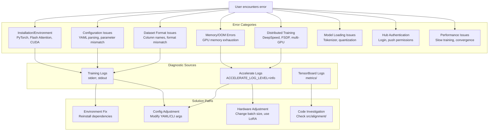
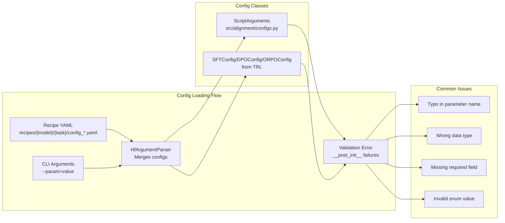
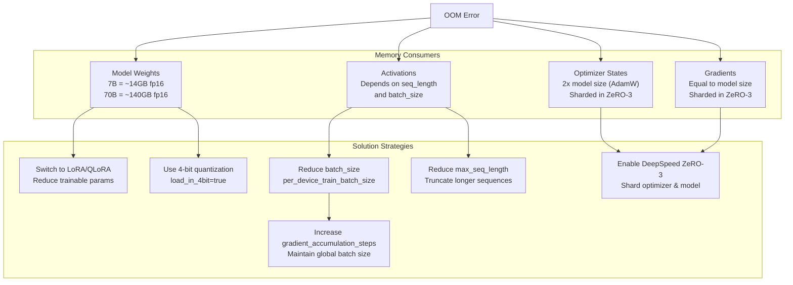
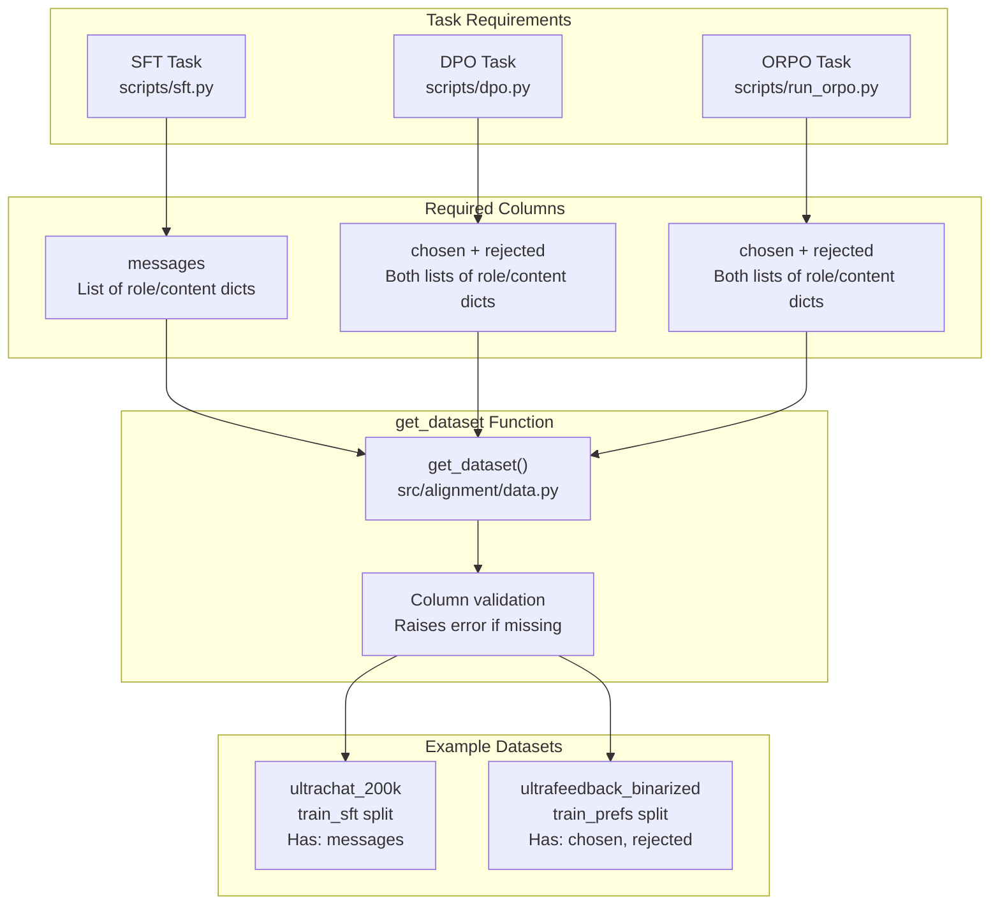

<!-- source: DeepWiki mcp.deepwiki.com · repo huggingface/alignment-handbook · page 8.4 Troubleshooting · fetched 2026-10-26 -->

# Troubleshooting

<details>
<summary>Relevant source files</summary>

The following files were used as context for generating this wiki page:

- [README.md](README.md)
- [scripts/README.md](scripts/README.md)

</details>


This page provides solutions to common issues encountered when using the Alignment Handbook. It covers installation problems, configuration errors, memory issues, distributed training failures, and other runtime errors. For general configuration parameters, see [Configuration Parameters](#8.1). For dataset format requirements, see [Dataset Formats](#8.2).

## Error Categories Overview



Sources: [README.md:1-134](), [scripts/README.md:1-142]()

---

## Installation and Environment Issues

### PyTorch Version Mismatch

**Symptom**: Import errors, CUDA errors, or Flash Attention failures after installation.

**Diagnosis**: The Alignment Handbook requires PyTorch 2.6.0 for reproducibility. Mismatched versions can cause incompatibilities.

**Solution**:
```bash
# Uninstall existing PyTorch
uv pip uninstall torch

# Install exact version
uv pip install torch==2.6.0 --index-url https://download.pytorch.org/whl/cu126
```

**Common Variants**:
- **Error: "CUDA version mismatch"**: Ensure your CUDA toolkit version matches the PyTorch wheel (cu126 for CUDA 12.6)
- **Error: "Unsupported GPU architecture"**: Check your GPU compute capability and use the appropriate PyTorch build

Sources: [README.md:73-79]()

### Flash Attention Installation Failures

**Symptom**: Build errors when installing Flash Attention, or import errors during training.

**Diagnosis**: Flash Attention requires compilation and specific CUDA/compute capability support.

**Solution**:
```bash
# Install with no build isolation
uv pip install "flash-attn==2.7.4.post1" --no-build-isolation

# If compilation fails, check:
# 1. CUDA toolkit is installed
# 2. GPU compute capability >= 8.0 (Ampere or newer)
# 3. Sufficient disk space for compilation
```

**Common Variants**:
- **Error: "CUDA not found"**: Install CUDA toolkit separately
- **Error: "Compute capability not supported"**: Flash Attention requires Ampere GPUs or newer (compute capability 8.0+). Use older models without Flash Attention by modifying model loading

Sources: [README.md:87-91]()

### Hub Authentication Issues

**Symptom**: "Repository not found" or "Authentication required" when loading datasets/models or pushing to Hub.

**Diagnosis**: Missing or expired Hugging Face Hub authentication token.

**Solution**:
```bash
# Login to Hugging Face Hub
huggingface-cli login

# Verify authentication
huggingface-cli whoami

# For gated models, accept terms on model card page
# Example: https://huggingface.co/mistralai/Mistral-7B-v0.1
```

**Common Variants**:
- **Error: "Cannot push to repository"**: Ensure you have write permissions or the repository exists
- **Error: "Token expired"**: Re-run `huggingface-cli login`

Sources: [README.md:93-97]()

### Git LFS Issues

**Symptom**: Large files fail to push to Hub, or only pointer files are pushed.

**Diagnosis**: Git LFS not installed or configured.

**Solution**:
```bash
# Install Git LFS
sudo apt-get install git-lfs

# Initialize in repository
cd path/to/model/output
git lfs install

# Track large files (if needed)
git lfs track "*.bin" "*.safetensors"
```

Sources: [README.md:99-103]()

---

## Configuration Issues

### YAML Parsing Errors

**Symptom**: Errors when loading config files, "KeyError" or "AttributeError" when accessing config values.

**Diagnosis**: Invalid YAML syntax or incorrect parameter names.



**Solution**:
1. Check parameter names match config class fields in [src/alignment/configs.py]()
2. Verify data types (strings should be quoted, numbers should not)
3. Use CLI override to test: `--parameter_name=value`
4. Enable verbose logging: `ACCELERATE_LOG_LEVEL=info`

**Example Error and Fix**:
```yaml
# Wrong (causes KeyError)
model_name: mistralai/Mistral-7B-v0.1
learning_rate: "2e-5"  # Should be number, not string

# Correct
model_name_or_path: mistralai/Mistral-7B-v0.1
learning_rate: 2e-5
```

Sources: [scripts/README.md:49-54]()

### Dataset Mixture Configuration Errors

**Symptom**: "Column not found" errors, dataset loading failures, or validation errors about column mismatches.

**Diagnosis**: Incorrect column names in `dataset_mixture` configuration or mismatched columns across datasets.

**Solution**:
1. Verify dataset format matches task requirements (see [Dataset Formats](#8.2))
2. For SFT: ensure all datasets have `messages` column
3. For DPO/ORPO: ensure all datasets have `chosen` and `rejected` columns
4. Check dataset on Hub to verify column names

**Example Configuration**:
```yaml
# SFT dataset mixture
dataset_mixture:
  datasets:
    - id: HuggingFaceH4/ultrachat_200k
      split: train_sft
      columns: messages  # Must match actual dataset
      weight: 1.0
```

Sources: [scripts/README.md:82-116]()

### Accelerate Configuration Mismatch

**Symptom**: "Configuration mismatch" errors, processes fail to initialize, or unexpected training behavior.

**Diagnosis**: Accelerate config file doesn't match the training script or hardware setup.

**Solution**:
1. Verify correct accelerate config is specified: `--config_file recipes/accelerate_configs/{config}.yaml`
2. Match config to training method:
   - DeepSpeed ZeRO-3: Use `zero3.yaml` for full training on 8x80GB GPUs
   - FSDP: Use `fsdp.yaml` for very large models (Mixtral 8x22B)
   - DDP: Use `ddp.yaml` for single GPU or QLoRA multi-GPU
3. Ensure `num_processes` matches available GPUs
4. For QLoRA with FSDP, use `fsdp+qlora.yaml` with correct dtype settings

**Common Mismatch Table**:

| Training Method | Hardware | Accelerate Config | Notes |
|----------------|----------|-------------------|-------|
| Full Fine-tuning | 8x A100 80GB | `zero3.yaml` | DeepSpeed ZeRO-3 |
| QLoRA | 1x RTX 4090 | `ddp.yaml` with `--num_processes=1` | Single GPU |
| LoRA | 2x A100 80GB | `zero3.yaml` | Remove `load_in_4bit` |
| QLoRA | 2x A6000 48GB | `fsdp+qlora.yaml` | Requires bfloat16 storage |
| Full (Mixtral 8x22B) | 8x H100 80GB | `fsdp.yaml` | Very large models |

Sources: [scripts/README.md:14-29](), [scripts/README.md:7-11]()

---

## Memory and Hardware Issues

### Out of Memory (OOM) Errors

**Symptom**: CUDA OOM errors, process killed, or "RuntimeError: CUDA out of memory".



**Solution Steps**:

1. **Reduce per-device batch size**:
   ```bash
   # In config YAML or CLI override
   --per_device_train_batch_size=1  # Reduce from default
   --gradient_accumulation_steps=8   # Increase to maintain global batch
   ```

2. **Switch to parameter-efficient training**:
   ```bash
   # Use QLoRA config instead of full
   --config recipes/{model}/sft/config_qlora.yaml
   ```

3. **Enable gradient checkpointing** (already enabled in most configs via TRL):
   ```yaml
   gradient_checkpointing: true
   gradient_checkpointing_kwargs:
     use_reentrant: false
   ```

4. **Reduce sequence length**:
   ```yaml
   max_seq_length: 1024  # Reduce from 2048
   ```

5. **For multi-GPU setups, ensure proper sharding**:
   - Use DeepSpeed ZeRO-3 for full training: `zero3.yaml`
   - Use FSDP for very large models: `fsdp.yaml`

**Memory Usage Estimation**:
- Full fine-tuning 7B model: ~60GB (model + optimizer + gradients + activations)
- QLoRA 7B model: ~10-15GB (4-bit model + LoRA adapters + activations)
- Full fine-tuning 70B model: ~500GB (requires 8x A100 80GB with ZeRO-3)

Sources: [scripts/README.md:7-11](), [scripts/README.md:47-48]()

### GPU Utilization Issues

**Symptom**: Low GPU utilization (<70%), very slow training, or inefficient resource usage.

**Diagnosis**: Batch size too small, data loading bottleneck, or inefficient packing.

**Solution**:
1. **Increase effective batch size**:
   ```yaml
   per_device_train_batch_size: 8  # Increase if memory allows
   gradient_accumulation_steps: 2  # Adjust to maintain global batch
   ```

2. **Enable dataset packing for SFT**:
   ```yaml
   packing: true  # Pack multiple sequences into one batch
   dataset_kwargs:
     add_special_tokens: false  # Required for packing
   ```

3. **Increase dataloader workers**:
   ```yaml
   dataloader_num_workers: 4  # Increase from 0
   dataloader_prefetch_factor: 2
   ```

4. **Check for disk I/O bottlenecks**: Use SSD storage for datasets

Sources: [scripts/README.md:1-142]()

---

## Distributed Training Issues

### DeepSpeed Initialization Failures

**Symptom**: "DeepSpeed config not found", processes hang during initialization, or NCCL timeout errors.

**Diagnosis**: DeepSpeed configuration mismatch, network issues, or incorrect process initialization.

**Solution**:
1. **Verify DeepSpeed is properly configured**:
   ```bash
   # Check zero3.yaml has correct parameters
   cat recipes/accelerate_configs/zero3.yaml
   ```

2. **Set NCCL timeout for slow networks**:
   ```bash
   export NCCL_TIMEOUT=3600  # 1 hour timeout
   export NCCL_DEBUG=INFO    # Enable debug logging
   ```

3. **Verify all processes can communicate**:
   ```bash
   # Test with simple distributed script first
   accelerate launch --config_file recipes/accelerate_configs/zero3.yaml \
     python -c "import torch; print(torch.distributed.get_rank())"
   ```

4. **For Slurm clusters, check node communication**:
   - Verify `MASTER_ADDR` and `MASTER_PORT` are set correctly
   - Check firewall rules allow inter-node communication
   - Verify InfiniBand/network configuration

Sources: [scripts/README.md:63-81]()

### FSDP Mixed Precision Issues

**Symptom**: NaN losses, training divergence, or "Invalid tensor values" when using FSDP with QLoRA.

**Diagnosis**: Incorrect dtype configuration for FSDP with quantization.

**Solution**:
```bash
# For FSDP + QLoRA, must specify correct dtypes
accelerate launch --config_file recipes/accelerate_configs/fsdp+qlora.yaml \
  scripts/sft.py --config recipes/{model}/sft/config_qlora.yaml \
  --torch_dtype=bfloat16 \
  --bnb_4bit_quant_storage=bfloat16
```

**Requirements**:
- `torch_dtype` must match `bnb_4bit_quant_storage`
- Both should be `bfloat16` for stability
- Hardware must support bfloat16 (Ampere GPUs or newer)

Sources: [scripts/README.md:28-29]()

### Multi-Node Training Issues

**Symptom**: Training works on single node but fails across nodes, rank mismatches, or communication timeouts.

**Common Issues and Solutions**:

| Issue | Diagnosis | Solution |
|-------|-----------|----------|
| Rank mismatch | Nodes have different process counts | Verify `--num_processes` matches total GPUs across nodes |
| NCCL timeout | Slow network or initialization | Increase NCCL_TIMEOUT, check network bandwidth |
| Port conflicts | Multiple jobs using same master port | Specify unique `MASTER_PORT` for each job |
| Node unavailable | Slurm allocation issues | Check `squeue`, verify node health with `sinfo` |

**Slurm Multi-Node Example**:
```bash
# Scale to 4 nodes (32 GPUs total)
sbatch --job-name=handbook_sft --nodes=4 \
  recipes/launch.slurm zephyr-7b-beta sft full zero3
```

Sources: [scripts/README.md:63-81]()

---

## Dataset Format Issues

### Missing Required Columns

**Symptom**: "KeyError: 'messages'" or "KeyError: 'chosen'" during dataset loading.

**Diagnosis**: Dataset doesn't have required columns for the training task.



**Solution**:
1. **Verify dataset format on Hub**: Check the dataset card and preview
2. **Use correct dataset split**:
   ```yaml
   # For SFT
   dataset_mixture:
     datasets:
       - id: HuggingFaceH4/ultrachat_200k
         split: train_sft  # Not train_prefs!
   ```

3. **For custom datasets, rename columns**:
   ```python
   # Preprocess your dataset
   dataset = dataset.rename_column("conversations", "messages")
   ```

4. **Specify columns explicitly in config**:
   ```yaml
   dataset_mixture:
     datasets:
       - id: my-org/my-dataset
         columns: messages  # Explicitly specify
         split: train
   ```

Sources: [scripts/README.md:96-116]()

### Incorrect Message Format

**Symptom**: "ValueError: Invalid message format" or training starts but model doesn't learn.

**Diagnosis**: Messages are not properly formatted as list of dicts with "role" and "content" keys.

**Required Format**:
```json
{
  "messages": [
    {"role": "system", "content": "You are a helpful assistant."},
    {"role": "user", "content": "What is 2+2?"},
    {"role": "assistant", "content": "2+2 equals 4."}
  ]
}
```

**Common Mistakes**:
- Using strings instead of list of dicts
- Missing "role" or "content" keys
- Using non-standard role names (should be: system, user, assistant)
- Incorrect nesting structure

**Solution**: Transform your data to match the expected format before training.

Sources: [scripts/README.md:98-107]()

### Dataset Mixture Weight Issues

**Symptom**: Warning messages about dataset sizes, unbalanced training, or unexpected data distribution.

**Diagnosis**: Dataset mixture weights don't produce desired sampling ratios.

**Solution**:
1. **Understand weight semantics**: Weight represents fraction of dataset to use, not relative proportion
   ```yaml
   dataset_mixture:
     datasets:
       - id: dataset_A  # 10,000 examples
         weight: 0.5    # Use 5,000 examples
       - id: dataset_B  # 20,000 examples
         weight: 0.25   # Use 5,000 examples
   ```

2. **For equal representation**: Calculate weights based on dataset sizes
   ```yaml
   # To get 50-50 mix from different sized datasets:
   # Dataset A: 10,000 examples
   # Dataset B: 20,000 examples
   dataset_mixture:
     datasets:
       - id: dataset_A
         weight: 1.0    # All 10,000
       - id: dataset_B
         weight: 0.5    # 10,000 from 20,000
   ```

3. **Check actual dataset sizes after loading**: Look for log messages about final dataset composition

Sources: [scripts/README.md:84-94]()

---

## Model Loading Issues

### Tokenizer Errors

**Symptom**: "Could not load tokenizer", "Tokenizer mismatch", or incorrect tokenization during training.

**Diagnosis**: Tokenizer not found, incompatible version, or incorrect chat template.

**Solution**:
1. **Verify model ID is correct**:
   ```yaml
   model_name_or_path: mistralai/Mistral-7B-v0.1  # Check spelling
   ```

2. **Check model has tokenizer on Hub**: Some base models don't include tokenizers
   ```bash
   # Download and inspect
   huggingface-cli download mistralai/Mistral-7B-v0.1 --repo-type model
   ```

3. **Specify tokenizer explicitly if different from model**:
   ```yaml
   model_name_or_path: my-org/my-model
   tokenizer_name_or_path: mistralai/Mistral-7B-v0.1  # Use base model tokenizer
   ```

4. **For chat template issues**: Verify chat template is compatible with your data format

Sources: [README.md:1-134]()

### Quantization Issues

**Symptom**: "BitsAndBytes not available", "Quantization failed", or model loads but training fails.

**Diagnosis**: BitsAndBytes library issues, GPU incompatibility, or incorrect quantization configuration.

**Solution**:
1. **Verify BitsAndBytes is installed**:
   ```bash
   pip list | grep bitsandbytes
   # Should show bitsandbytes with CUDA support
   ```

2. **For QLoRA, ensure correct configuration**:
   ```yaml
   load_in_4bit: true
   bnb_4bit_quant_type: nf4
   bnb_4bit_compute_dtype: bfloat16
   ```

3. **Check GPU compute capability**: BitsAndBytes requires compute capability >= 7.0
   ```bash
   nvidia-smi --query-gpu=compute_cap --format=csv
   ```

4. **For FSDP + QLoRA, use matching dtypes**:
   ```bash
   --torch_dtype=bfloat16 --bnb_4bit_quant_storage=bfloat16
   ```

Sources: [scripts/README.md:28-29]()

### Device Mapping Failures

**Symptom**: "Device mismatch", "Expected tensor on cuda:0 but got cpu", or models loaded on wrong devices.

**Diagnosis**: Incorrect device mapping configuration for multi-GPU setups.

**Solution**:
1. **Let Accelerate handle device mapping**: Don't specify device_map manually
2. **For single GPU debugging**:
   ```bash
   --num_processes=1  # Force single GPU
   ```

3. **Check CUDA_VISIBLE_DEVICES**:
   ```bash
   # Limit to specific GPUs
   export CUDA_VISIBLE_DEVICES=0,1
   ```

Sources: [scripts/README.md:1-142]()

---

## Hub and Authentication Issues

### Push Failures

**Symptom**: "Permission denied" when pushing models, or models pushed without large files.

**Diagnosis**: Authentication issues, Git LFS not configured, or repository doesn't exist.

**Solution Steps**:

1. **Verify authentication**:
   ```bash
   huggingface-cli whoami
   # Should show your username
   ```

2. **Create repository first**:
   ```python
   # Or create on hub.huggingface.co
   huggingface-cli repo create {model-name} --type model
   ```

3. **Check Git LFS is installed**:
   ```bash
   git lfs version
   # Should show version number
   ```

4. **For automatic pushing, set in config**:
   ```yaml
   hub_model_id: your-username/model-name
   push_to_hub: true
   hub_strategy: every_save  # or end, checkpoint, epoch
   ```

5. **Manual push if automatic fails**:
   ```bash
   cd data/{model-name}
   huggingface-cli upload your-username/model-name .
   ```

Sources: [README.md:93-103](), [scripts/README.md:49-50]()

---

## Logging and Monitoring Issues

### Missing Logs

**Symptom**: No training logs, empty TensorBoard directory, or missing Weights & Biases runs.

**Diagnosis**: Logging not configured, wrong output directory, or permissions issues.

**Solution**:

1. **Enable Accelerate logging**:
   ```bash
   export ACCELERATE_LOG_LEVEL=info
   # Add to launch command
   ACCELERATE_LOG_LEVEL=info accelerate launch ...
   ```

2. **Verify output directory**:
   ```yaml
   output_dir: ./data/{model-name}-{task}  # Check exists and writable
   logging_steps: 10  # Log every 10 steps
   ```

3. **For TensorBoard**:
   ```bash
   # Start TensorBoard
   tensorboard --logdir ./data/{model-name}-{task}
   ```

4. **For Weights & Biases**:
   ```bash
   # Login first
   wandb login
   
   # Then add to config or CLI
   --report_to=wandb
   ```

Sources: [scripts/README.md:56-61]()

### NaN Losses

**Symptom**: Loss becomes NaN during training, training diverges, or "RuntimeError: loss is NaN".

**Diagnosis**: Learning rate too high, mixed precision issues, or data problems.

**Solution**:

1. **Reduce learning rate**:
   ```yaml
   learning_rate: 5e-6  # Reduce from 2e-5
   ```

2. **Check data for corrupted examples**:
   - Verify no null/empty messages
   - Check for extremely long sequences
   - Look for non-text content

3. **For mixed precision issues**:
   ```yaml
   bf16: true  # Use bfloat16 instead of fp16
   fp16: false
   ```

4. **Enable gradient clipping**:
   ```yaml
   max_grad_norm: 1.0  # Clip gradients
   ```

5. **Check for model-specific issues**: Some models need specific stabilization techniques

Sources: [scripts/README.md:1-142]()

---

## Performance and Training Issues

### Slow Training Speed

**Symptom**: Training much slower than expected, low GPU utilization, or very long epoch times.

**Diagnosis**: Inefficient configuration, data loading bottleneck, or hardware issues.

**Optimization Checklist**:

| Issue | Check | Solution |
|-------|-------|----------|
| Small batch size | GPU memory not fully used | Increase `per_device_train_batch_size` |
| No packing | Sequences not efficiently batched | Enable `packing: true` for SFT |
| Slow data loading | CPU bottleneck | Increase `dataloader_num_workers` |
| Wrong precision | Using fp32 | Use `bf16: true` or `fp16: true` |
| No Flash Attention | Slow attention computation | Install Flash Attention 2 |
| Wrong accelerator config | Not using DeepSpeed/FSDP | Use appropriate accelerate config |
| Disk I/O bottleneck | HDD instead of SSD | Move datasets to SSD storage |

**Solution Steps**:

1. **Profile to identify bottleneck**:
   ```bash
   # Enable profiling
   --profiling_enabled=true
   ```

2. **Optimize batch size and accumulation**:
   ```yaml
   per_device_train_batch_size: 8  # Maximize without OOM
   gradient_accumulation_steps: 4  # Maintain global batch
   ```

3. **Enable all performance optimizations**:
   ```yaml
   bf16: true
   tf32: true  # For Ampere GPUs
   packing: true  # For SFT only
   dataloader_num_workers: 4
   ```

Sources: [scripts/README.md:1-142]()

### Model Not Learning

**Symptom**: Loss not decreasing, or model produces poor outputs after training.

**Diagnosis**: Learning rate issues, data problems, or training configuration errors.

**Solution**:

1. **Verify data format is correct**: See [Dataset Format Issues](#dataset-format-issues)

2. **Check learning rate**:
   ```yaml
   # Typical ranges
   learning_rate: 2e-5  # Full fine-tuning
   learning_rate: 2e-4  # LoRA/QLoRA (10x higher)
   ```

3. **Ensure sufficient training**:
   ```yaml
   num_train_epochs: 3  # Increase from 1
   max_steps: -1  # Or set explicit step count
   ```

4. **Verify model is trainable**:
   ```python
   # Check trainable parameters
   # Should see significant reduction for LoRA/QLoRA
   ```

5. **For DPO/ORPO, check beta parameter**:
   ```yaml
   beta: 0.1  # May need tuning, typical range 0.01-0.5
   ```

6. **Monitor training metrics**: Check TensorBoard for loss trends, learning rate schedule

Sources: [scripts/README.md:1-142]()

---

## Known Limitations

### Hardware Limitations

**Documented Constraints**:
- Full fine-tuning 7B models: Minimum 8x A100 80GB GPUs with DeepSpeed ZeRO-3
- Full fine-tuning 70B+ models: Requires 8x H100 80GB GPUs with FSDP
- QLoRA 7B models: Minimum 24GB VRAM (RTX 4090, RTX 3090, A5000)
- Flash Attention: Requires Ampere architecture or newer (compute capability >= 8.0)

**Workarounds**:
- Use QLoRA for limited hardware
- Reduce sequence length
- Reduce batch size and increase gradient accumulation
- Use gradient checkpointing

Sources: [scripts/README.md:7-11](), [README.md:87-91]()

### Model Compatibility

**Known Issues**:
- Some base models don't include tokenizers (use compatible tokenizer separately)
- Some models require specific chat templates
- Very large models (70B+) may require custom FSDP configurations
- Some architectures don't support Flash Attention

**Checking Compatibility**:
```bash
# Verify model has required components
huggingface-cli repo info {model-id}
```

Sources: [README.md:1-134]()

### Dataset Size Limitations

**Practical Limits**:
- Very large datasets (>100GB) may require streaming mode (not currently implemented)
- Dataset mixing with many large datasets can cause memory issues during loading
- Some datasets require significant preprocessing time

**Workarounds**:
- Use dataset subsampling via `weight` parameter
- Preprocess and save datasets locally
- Split very large datasets into smaller chunks

Sources: [scripts/README.md:82-94]()

### Slurm Cluster Limitations

**Note from Documentation**: The Slurm configuration in `recipes/launch.slurm` is optimized for the Hugging Face Compute Cluster and may require significant modification for other HPC environments.

**Common Adaptations Needed**:
- Partition names
- GPU types and counts
- Module loading (CUDA, MPI, etc.)
- File system paths
- Environment variables

**Solution**: Copy and modify `recipes/launch.slurm` for your specific cluster configuration.

Sources: [scripts/README.md:80-81]()

---

## Getting Help

### Debugging Checklist

Before seeking help, gather the following information:

1. **Environment Details**:
   ```bash
   python --version
   pip list | grep torch
   pip list | grep transformers
   pip list | grep trl
   nvidia-smi
   ```

2. **Full Error Traceback**: Copy complete error message including traceback

3. **Configuration**:
   - Command used to launch training
   - YAML config file contents
   - CLI overrides applied

4. **Logs**:
   - Accelerate logs (set `ACCELERATE_LOG_LEVEL=info`)
   - Training logs from stdout/stderr
   - TensorBoard logs if available

5. **Reproducibility**:
   - Can you reproduce with a minimal example?
   - Does it work with example recipes (e.g., Zephyr-7B-Beta)?

### Where to Report Issues

1. **GitHub Issues**: https://github.com/huggingface/alignment-handbook/issues
   - Include all debugging information
   - Tag with appropriate labels (bug, question, etc.)
   - Search existing issues first

2. **Hugging Face Forums**: https://discuss.huggingface.co/
   - For general questions and discussions
   - Community support available

3. **Model-Specific Issues**: Check the model card on Hugging Face Hub for known issues

Sources: [README.md:1-134]()