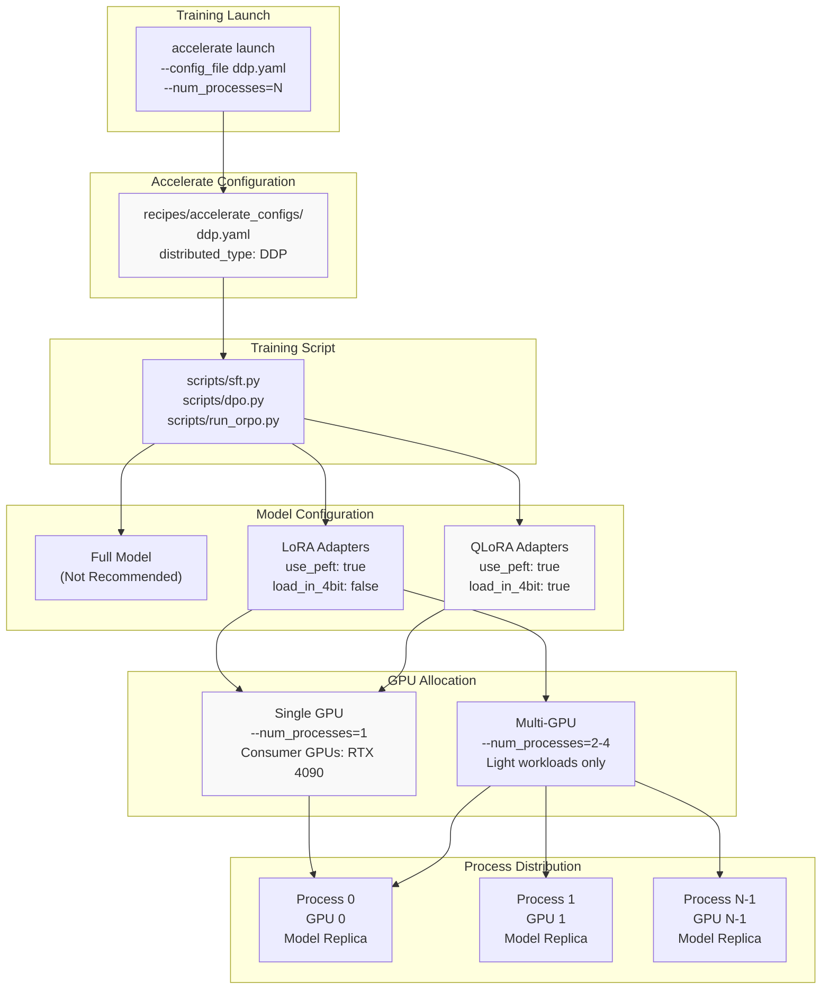
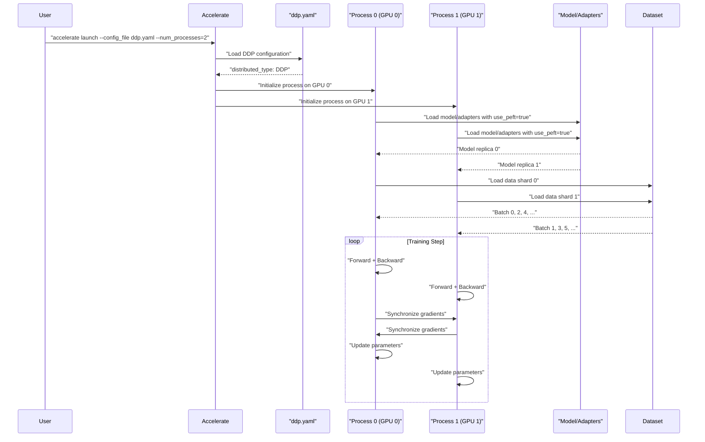
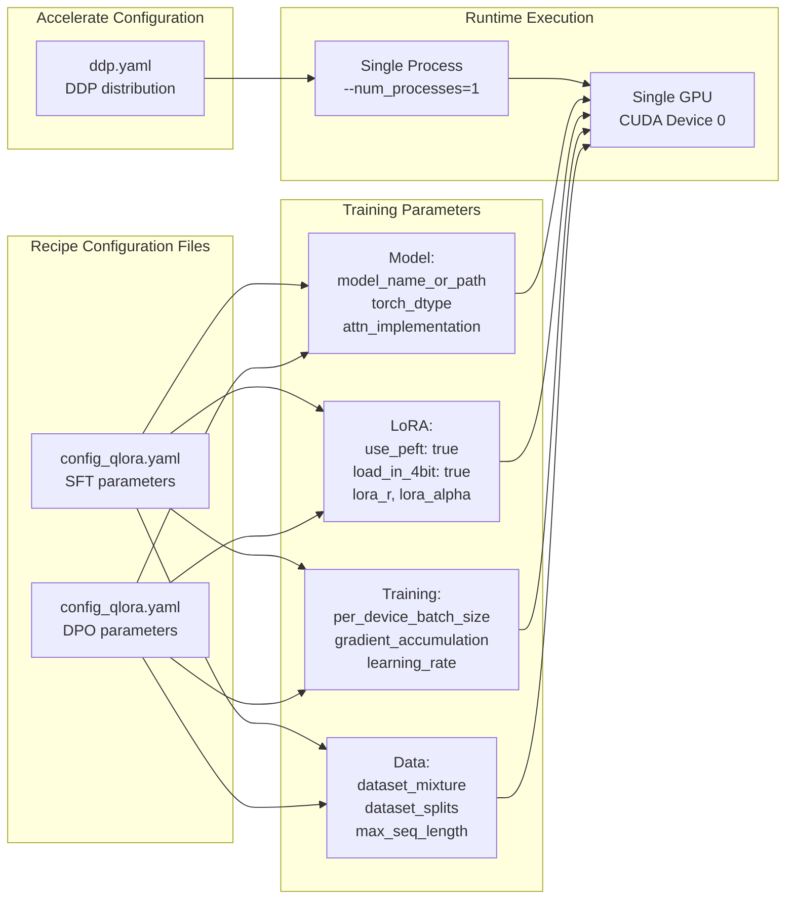
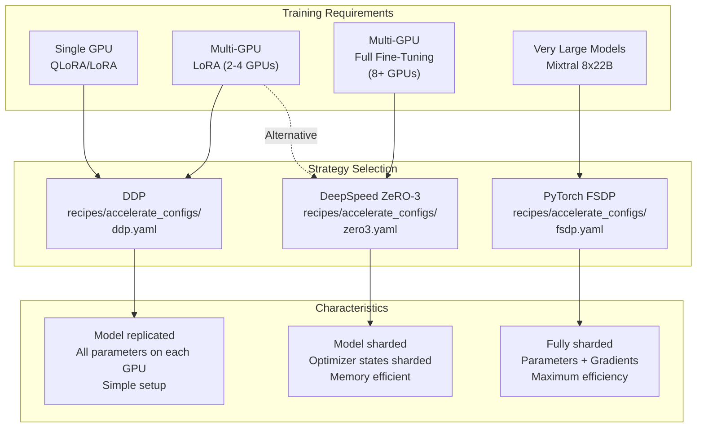

<!-- source: DeepWiki mcp.deepwiki.com · repo huggingface/alignment-handbook · extra page Data Parallel (DDP) · fetched 2026-10-26 -->

# Data Parallel (DDP)

<details>
<summary>Relevant source files</summary>

The following files were used as context for generating this wiki page:

- [recipes/zephyr-7b-beta/README.md](recipes/zephyr-7b-beta/README.md)
- [recipes/zephyr-7b-beta/dpo/config_qlora.yaml](recipes/zephyr-7b-beta/dpo/config_qlora.yaml)
- [recipes/zephyr-7b-beta/sft/config_qlora.yaml](recipes/zephyr-7b-beta/sft/config_qlora.yaml)
- [scripts/README.md](scripts/README.md)

</details>


## Purpose and Scope

This page documents the use of PyTorch's Distributed Data Parallel (DDP) strategy within the Alignment Handbook training infrastructure. DDP is the recommended approach for single-GPU training and lightweight multi-GPU setups, particularly when using parameter-efficient methods like LoRA and QLoRA.

For full model training on multi-GPU systems, see [DeepSpeed ZeRO-3](#5.1.1). For very large models requiring advanced sharding, see [PyTorch FSDP](#5.1.2). For general information about distributed training strategies, see [Distributed Training Configurations](#5.1).

---

## Overview

DDP (Data Parallel with Distributed Data Parallel) is PyTorch's native distributed training strategy that replicates the model across multiple processes, with each process handling a subset of the training data. In the Alignment Handbook, DDP serves as the default strategy for parameter-efficient training methods and single-GPU scenarios.

### DDP Architecture in the Handbook



**Sources:** [scripts/README.md:1-29](), [recipes/zephyr-7b-beta/README.md:24-44]()

---

## When to Use DDP

DDP is the appropriate choice in the following scenarios:

| Scenario | Reason |
|----------|--------|
| Single GPU training | Minimal overhead, supports all training methods |
| QLoRA training (any GPU count) | QLoRA requires specific quantization setup incompatible with some advanced strategies |
| LoRA training on 1-4 GPUs | Simple setup, adequate for smaller adapter training |
| Consumer hardware (RTX 4090, etc.) | Works well with limited VRAM when using 4-bit quantization |
| Prototyping and experimentation | Fast iteration with minimal configuration complexity |

**Do not use DDP for:**
- Full fine-tuning on multi-GPU systems (use [DeepSpeed ZeRO-3](#5.1.1))
- Models larger than ~13B parameters full fine-tuning (use [FSDP](#5.1.2))
- Maximum training throughput on multi-node clusters (use DeepSpeed or FSDP)

**Sources:** [scripts/README.md:6-11](), [scripts/README.md:18-28]()

---

## Configuration File

The DDP configuration is specified in the Accelerate config file located at [recipes/accelerate_configs/ddp.yaml](). This file defines the distributed training strategy that Accelerate will use.

### Key DDP Configuration Parameters

While the exact contents of `ddp.yaml` are not shown in the provided files, based on the usage patterns, it typically contains:

```yaml
compute_environment: LOCAL_MACHINE
distributed_type: MULTI_GPU  # or NO for single GPU
num_processes: 1              # Override via CLI
gpu_ids: all
mixed_precision: bf16         # or fp16
```

The `distributed_type` is set to enable DDP mode, and `num_processes` controls how many GPUs participate in training.

**Sources:** [scripts/README.md:19](), [scripts/README.md:22]()

---

## Usage Patterns

### Command Structure

All DDP-based training follows this command pattern:

```bash
ACCELERATE_LOG_LEVEL=info accelerate launch \
    --config_file recipes/accelerate_configs/ddp.yaml \
    --num_processes=<N> \
    scripts/<task>.py \
    --config recipes/<model>/<task>/config_<precision>.yaml \
    [additional overrides]
```

**Components:**
- `accelerate launch`: Entry point for distributed training
- `--config_file ddp.yaml`: Specifies DDP as the distribution strategy
- `--num_processes`: Number of GPUs to use (1 for single GPU)
- `scripts/<task>.py`: Training script (sft.py, dpo.py, run_orpo.py)
- `--config recipes/.../config_<precision>.yaml`: Task-specific configuration
- Additional overrides: Command-line parameter overrides

**Sources:** [scripts/README.md:14-29]()

### Single GPU Training

The most common DDP use case is single-GPU training with QLoRA:

```bash
# QLoRA 4-bit training on a single GPU
ACCELERATE_LOG_LEVEL=info accelerate launch \
    --config_file recipes/accelerate_configs/ddp.yaml \
    --num_processes=1 \
    scripts/sft.py \
    --config recipes/zephyr-7b-beta/sft/config_qlora.yaml \
    --load_in_4bit=true
```

**Key characteristics:**
- `--num_processes=1`: Single process, single GPU
- `--load_in_4bit=true`: Enables 4-bit quantization for memory efficiency
- Typical for models up to 13B parameters on consumer GPUs

**LoRA without quantization:**

```bash
# LoRA training on a single GPU (without 4-bit quantization)
ACCELERATE_LOG_LEVEL=info accelerate launch \
    --config_file recipes/accelerate_configs/ddp.yaml \
    --num_processes=1 \
    scripts/sft.py \
    --config recipes/zephyr-7b-beta/sft/config_qlora.yaml \
    --load_in_4bit=false
```

**Sources:** [scripts/README.md:18-22](), [recipes/zephyr-7b-beta/README.md:27-32]()

### Multi-GPU DDP Training

DDP can be used with multiple GPUs for LoRA training (without quantization):

```bash
# LoRA training with DDP on 2 GPUs
ACCELERATE_LOG_LEVEL=info accelerate launch \
    --config_file recipes/accelerate_configs/ddp.yaml \
    --num_processes=2 \
    scripts/sft.py \
    --config recipes/zephyr-7b-beta/sft/config_qlora.yaml \
    --load_in_4bit=false
```

**Important notes:**
- Multi-GPU DDP with QLoRA is not recommended; use FSDP+QLoRA instead ([see FSDP documentation](#5.1.2))
- For LoRA on multiple GPUs, consider using DeepSpeed ZeRO-3 for better performance
- DDP replicates the entire model on each GPU, so it's less memory-efficient than ZeRO-3 or FSDP

**Sources:** [scripts/README.md:24-25]()

---

## Training Flow with DDP



**Sources:** [scripts/README.md:6-29]()

---

## DDP with QLoRA Configuration

QLoRA training with DDP is the most memory-efficient approach for fine-tuning large models on consumer hardware. Here's a breakdown of the configuration:

### Example QLoRA Configuration

From [recipes/zephyr-7b-beta/sft/config_qlora.yaml:1-21]():

```yaml
# Model arguments
model_name_or_path: mistralai/Mistral-7B-v0.1
torch_dtype: bfloat16
attn_implementation: flash_attention_2

# LoRA arguments
load_in_4bit: true        # Enable 4-bit quantization
use_peft: true            # Enable PEFT (LoRA)
lora_r: 16                # LoRA rank
lora_alpha: 16            # LoRA alpha
lora_dropout: 0.05        # LoRA dropout
lora_target_modules:      # Which layers to adapt
- q_proj
- k_proj
- v_proj
- o_proj
- gate_proj
- up_proj
- down_proj
```

### Key Parameters

| Parameter | Purpose | Typical Value |
|-----------|---------|---------------|
| `load_in_4bit` | Enable 4-bit quantization | `true` for QLoRA |
| `use_peft` | Enable Parameter-Efficient Fine-Tuning | `true` |
| `lora_r` | Rank of LoRA matrices | 16-128 |
| `lora_alpha` | LoRA scaling factor | Usually equal to `lora_r` |
| `lora_target_modules` | Layers to apply LoRA | All attention and MLP projection layers |
| `torch_dtype` | Model precision | `bfloat16` or `float16` |
| `attn_implementation` | Attention mechanism | `flash_attention_2` (faster) or `sdpa` |

**Sources:** [recipes/zephyr-7b-beta/sft/config_qlora.yaml:1-21](), [recipes/zephyr-7b-beta/dpo/config_qlora.yaml:1-20]()

---

## Complete Training Examples

### Zephyr-7B-Beta with DDP+QLoRA

The complete two-stage training process for Zephyr-7B-Beta using DDP:

```bash
# Stage 1: Supervised Fine-Tuning (SFT)
ACCELERATE_LOG_LEVEL=info accelerate launch \
    --config_file recipes/accelerate_configs/ddp.yaml \
    --num_processes=1 \
    scripts/sft.py \
    --config recipes/zephyr-7b-beta/sft/config_qlora.yaml \
    --load_in_4bit=true

# Stage 2: Direct Preference Optimization (DPO)
ACCELERATE_LOG_LEVEL=info accelerate launch \
    --config_file recipes/accelerate_configs/ddp.yaml \
    --num_processes=1 \
    scripts/dpo.py \
    --config recipes/zephyr-7b-beta/dpo/config_qlora.yaml
```

### DDP Training Configuration Mapping



**Sources:** [recipes/zephyr-7b-beta/README.md:24-44](), [recipes/zephyr-7b-beta/sft/config_qlora.yaml:1-71]()

---

## Attention Implementation Options

DDP training supports multiple attention implementations, which can significantly impact training speed and memory usage:

### Flash Attention 2 (Recommended)

```bash
# With Flash Attention 2 (requires compatible GPU: A100, H100, etc.)
ACCELERATE_LOG_LEVEL=info accelerate launch \
    --config_file recipes/accelerate_configs/ddp.yaml \
    --num_processes=1 \
    scripts/sft.py \
    --config recipes/zephyr-7b-beta/sft/config_qlora.yaml \
    --load_in_4bit=true
```

**Benefits:**
- 2x faster training
- Allows 2x larger batch sizes
- Lower memory footprint

**Requirements:**
- GPU with compute capability 8.0+ (A100, A6000, H100, RTX 4090, etc.)
- Flash Attention 2 installed

### Scaled Dot Product Attention (Fallback)

```bash
# With PyTorch SDPA (fallback for GPUs without FA2 support)
ACCELERATE_LOG_LEVEL=info accelerate launch \
    --config_file recipes/accelerate_configs/ddp.yaml \
    --num_processes=1 \
    scripts/sft.py \
    --config recipes/zephyr-7b-beta/sft/config_qlora.yaml \
    --load_in_4bit=true \
    --attn_implementation=sdpa
```

**Use when:**
- GPU doesn't support Flash Attention 2
- Flash Attention 2 installation issues
- Debugging attention-related issues

**Sources:** [recipes/zephyr-7b-beta/README.md:26-44]()

---

## Memory and Performance Characteristics

### Memory Footprint Comparison

| Configuration | Model Size | VRAM Usage | Example GPU |
|---------------|------------|------------|-------------|
| Full FP16 (Not DDP) | 7B | ~14 GB | Not practical |
| LoRA FP16 | 7B | ~16 GB | A100 40GB |
| QLoRA 4-bit + DDP | 7B | ~6-8 GB | RTX 4090 24GB |
| QLoRA 4-bit + DDP + FA2 | 7B | ~5-6 GB | RTX 4090 24GB |

### Batch Size Guidelines

For QLoRA training with DDP on a 24GB GPU (e.g., RTX 4090):

```yaml
# In config_qlora.yaml
per_device_train_batch_size: 4  # Without Flash Attention 2
per_device_train_batch_size: 8  # With Flash Attention 2

gradient_accumulation_steps: 2   # Effective batch size = 4*2=8 or 8*2=16
```

**Important:** When scaling across multiple GPUs, maintain the global batch size:

```
Global Batch Size = num_processes × per_device_batch_size × gradient_accumulation_steps
```

**Sources:** [recipes/zephyr-7b-beta/README.md:35](), [scripts/README.md:47]()

---

## Parameter Override Examples

DDP training configurations can be overridden via command line:

```bash
# Override batch size and learning rate
ACCELERATE_LOG_LEVEL=info accelerate launch \
    --config_file recipes/accelerate_configs/ddp.yaml \
    --num_processes=1 \
    scripts/sft.py \
    --config recipes/zephyr-7b-beta/sft/config_qlora.yaml \
    --per_device_train_batch_size=8 \
    --learning_rate=5.0e-5 \
    --num_train_epochs=2

# Override LoRA rank and alpha
ACCELERATE_LOG_LEVEL=info accelerate launch \
    --config_file recipes/accelerate_configs/ddp.yaml \
    --num_processes=1 \
    scripts/sft.py \
    --config recipes/zephyr-7b-beta/sft/config_qlora.yaml \
    --lora_r=64 \
    --lora_alpha=64

# Override dataset and output directory
ACCELERATE_LOG_LEVEL=info accelerate launch \
    --config_file recipes/accelerate_configs/ddp.yaml \
    --num_processes=1 \
    scripts/sft.py \
    --config recipes/zephyr-7b-beta/sft/config_qlora.yaml \
    --dataset_name=my-custom/dataset \
    --output_dir=data/my-experiment
```

**Sources:** [scripts/README.md:49-54]()

---

## Integration with Other Systems

### Logging with DDP

DDP training integrates with multiple logging backends:

```bash
# With Weights & Biases
ACCELERATE_LOG_LEVEL=info accelerate launch \
    --config_file recipes/accelerate_configs/ddp.yaml \
    --num_processes=1 \
    scripts/sft.py \
    --config recipes/zephyr-7b-beta/sft/config_qlora.yaml \
    --report_to=wandb

# With TensorBoard (default)
ACCELERATE_LOG_LEVEL=info accelerate launch \
    --config_file recipes/accelerate_configs/ddp.yaml \
    --num_processes=1 \
    scripts/sft.py \
    --config recipes/zephyr-7b-beta/sft/config_qlora.yaml \
    --report_to=tensorboard
```

### Slurm Cluster Submission

DDP training can be submitted to Slurm clusters using the provided script:

```bash
# Submit QLoRA training job with DDP
sbatch --job-name=handbook_sft --nodes=1 \
    recipes/launch.slurm \
    zephyr-7b-beta sft qlora ddp \
    '--per_device_train_batch_size=8'
```

**Note:** The `ddp` argument specifies the accelerate config to use.

**Sources:** [scripts/README.md:56-78]()

---

## Comparison with Other Strategies

### DDP vs DeepSpeed ZeRO-3 vs FSDP



| Feature | DDP | DeepSpeed ZeRO-3 | FSDP |
|---------|-----|------------------|------|
| Model Replication | Full replica per GPU | Sharded across GPUs | Fully sharded |
| Memory Efficiency | Low | High | Highest |
| Setup Complexity | Simple | Moderate | Moderate |
| Best For | QLoRA, single GPU | Full training, multi-GPU | Very large models |
| Supports 4-bit Quantization | Yes | No (use DDP) | Yes (via FSDP+QLoRA) |
| Multi-node Support | Yes | Yes | Yes |
| Typical Use Case | Consumer GPUs | Professional multi-GPU | HPC clusters |

**Sources:** [scripts/README.md:6-11]()

---

## Best Practices

### When to Use DDP

✅ **Use DDP for:**
- All single-GPU training scenarios
- QLoRA training (regardless of GPU count)
- LoRA training on 1-2 GPUs
- Rapid prototyping and experimentation
- Training on consumer hardware

❌ **Avoid DDP for:**
- Full fine-tuning on multi-GPU systems (use DeepSpeed ZeRO-3)
- Models that don't fit on a single GPU even with quantization
- Maximum throughput on professional multi-GPU setups

### Optimization Tips

1. **Enable Flash Attention 2** when available for 2x speedup
2. **Increase batch size** with Flash Attention 2 to improve GPU utilization
3. **Use gradient accumulation** to simulate larger batch sizes
4. **Monitor GPU memory** and adjust batch size accordingly
5. **Use bfloat16** instead of float16 for better numerical stability

### Common Configuration

```yaml
# Recommended DDP+QLoRA configuration
bf16: true                           # Use bfloat16 precision
gradient_accumulation_steps: 2-4     # Accumulate gradients
gradient_checkpointing: true         # Save memory
gradient_checkpointing_kwargs:
  use_reentrant: false              # Better memory efficiency
per_device_train_batch_size: 4-8    # Adjust based on GPU memory
load_in_4bit: true                  # Enable 4-bit quantization
attn_implementation: flash_attention_2  # Use FA2 if available
```

**Sources:** [recipes/zephyr-7b-beta/sft/config_qlora.yaml:42-49](), [recipes/zephyr-7b-beta/dpo/config_qlora.yaml:31-39]()

---

## Troubleshooting

### Common Issues

**Out of Memory (OOM) Errors:**
- Reduce `per_device_train_batch_size`
- Increase `gradient_accumulation_steps` to maintain global batch size
- Enable `gradient_checkpointing`
- Reduce `max_seq_length`
- Ensure `load_in_4bit=true` for QLoRA

**Slow Training:**
- Install and enable Flash Attention 2
- Check that `attn_implementation: flash_attention_2` is set
- Increase batch size if memory allows
- Verify GPU utilization with `nvidia-smi`

**Multi-GPU DDP Not Working:**
- Ensure `--num_processes` matches the number of GPUs
- Check that all GPUs are visible with `nvidia-smi`
- Verify `load_in_4bit=false` for multi-GPU LoRA (4-bit doesn't work well with multi-GPU DDP)

**Sources:** [recipes/zephyr-7b-beta/README.md:27-44]()

---

