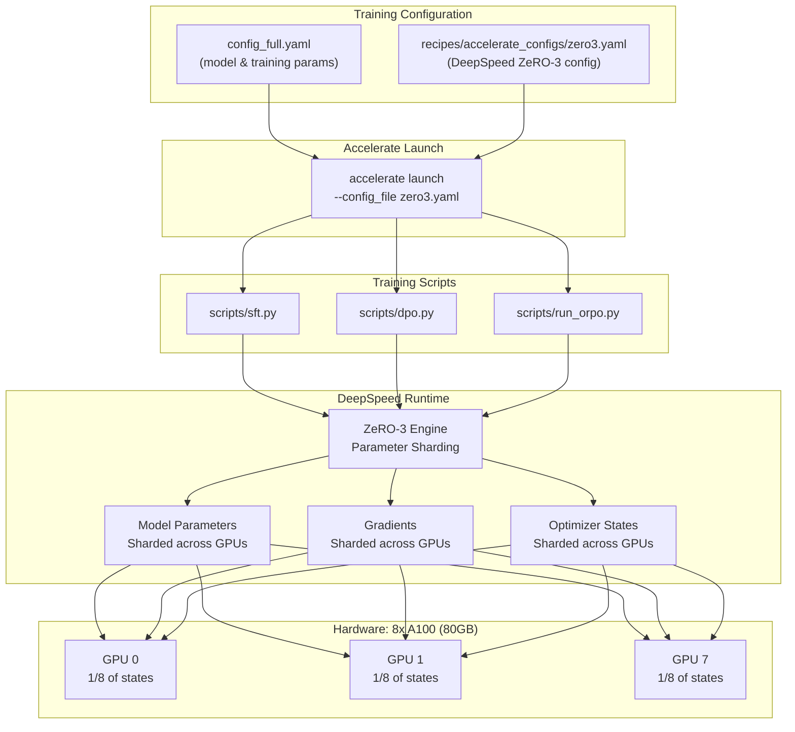
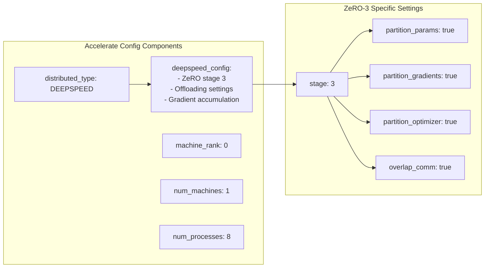
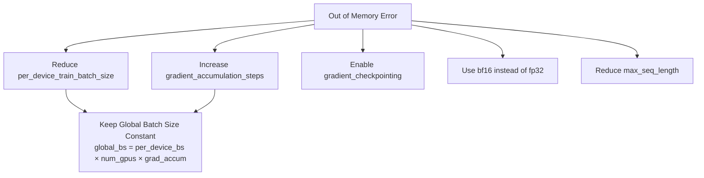
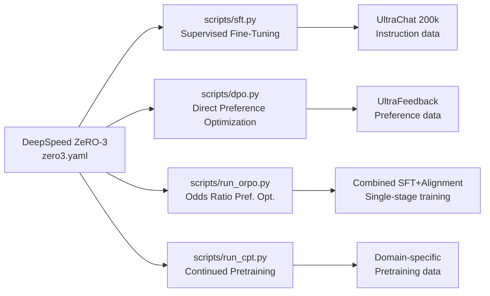
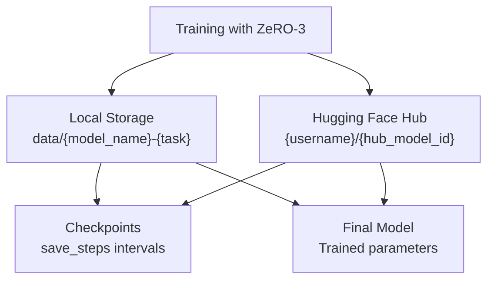

<!-- source: DeepWiki mcp.deepwiki.com · repo huggingface/alignment-handbook · extra page DeepSpeed ZeRO-3 · fetched 2026-10-26 -->

# DeepSpeed ZeRO-3

<details>
<summary>Relevant source files</summary>

The following files were used as context for generating this wiki page:

- [recipes/zephyr-7b-beta/README.md](recipes/zephyr-7b-beta/README.md)
- [recipes/zephyr-7b-beta/dpo/config_qlora.yaml](recipes/zephyr-7b-beta/dpo/config_qlora.yaml)
- [recipes/zephyr-7b-beta/sft/config_qlora.yaml](recipes/zephyr-7b-beta/sft/config_qlora.yaml)
- [scripts/README.md](scripts/README.md)

</details>


## Purpose and Scope

This page provides a detailed guide to using DeepSpeed ZeRO-3 for full parameter fine-tuning of large language models in the Alignment Handbook. DeepSpeed ZeRO-3 enables training models that would otherwise not fit in GPU memory by partitioning model states across multiple devices.

For information about other distributed training strategies, see [PyTorch FSDP](#5.1.2) and [Data Parallel (DDP)](#5.1.3). For parameter-efficient alternatives that work on smaller hardware, see [LoRA and QLoRA Training](#6.2).

## Overview

DeepSpeed ZeRO-3 (Zero Redundancy Optimizer Stage 3) is a distributed training strategy that shards model parameters, gradients, and optimizer states across all available GPUs. This approach dramatically reduces per-GPU memory requirements, enabling full fine-tuning of large models like Mistral-7B, Gemma-7B, and Mixtral models on multi-GPU setups.



**Sources:** [scripts/README.md:1-45](), [recipes/zephyr-7b-beta/README.md:1-22]()

## Hardware Requirements

DeepSpeed ZeRO-3 in the Alignment Handbook is configured and tested for the following hardware setup:

| Configuration | GPUs | VRAM per GPU | Total VRAM | Supported Models |
|---------------|------|--------------|------------|------------------|
| **Standard Full Training** | 8 | 80GB | 640GB | Mistral-7B, Gemma-7B, Llama-7B |
| **LoRA with ZeRO-3** | 2+ | 80GB | 160GB+ | Any 7B model with LoRA |

The standard configuration uses **8x A100 (80GB)** GPUs for full parameter fine-tuning. This setup supports:
- Supervised Fine-Tuning (SFT) on datasets like UltraChat
- Direct Preference Optimization (DPO) on datasets like UltraFeedback
- Odds Ratio Preference Optimization (ORPO)

**Sources:** [scripts/README.md:7-10](), [recipes/zephyr-7b-beta/README.md:15]()

## Configuration File Structure

The DeepSpeed ZeRO-3 configuration is stored in `recipes/accelerate_configs/zero3.yaml`. While the exact file content is not provided in the repository snippets, the configuration is referenced throughout the training commands.



**Sources:** [scripts/README.md:16](), [recipes/zephyr-7b-beta/README.md:18]()

## Launching Training Commands

### Basic Command Structure

The general pattern for launching training with DeepSpeed ZeRO-3:

```bash
ACCELERATE_LOG_LEVEL=info accelerate launch \
  --config_file recipes/accelerate_configs/zero3.yaml \
  scripts/{task}.py \
  --config recipes/{model_name}/{task}/config_full.yaml
```

The command consists of:
- **Environment variable:** `ACCELERATE_LOG_LEVEL=info` for detailed logging
- **Accelerate launcher:** `accelerate launch` orchestrates distributed training
- **Accelerate config:** `--config_file recipes/accelerate_configs/zero3.yaml` specifies ZeRO-3
- **Training script:** `scripts/{task}.py` where task is `sft`, `dpo`, or `run_orpo`
- **Recipe config:** `--config recipes/{model_name}/{task}/config_full.yaml` with hyperparameters

**Sources:** [scripts/README.md:14-17]()

### Concrete Training Examples

#### Example 1: Zephyr-7B-Beta Two-Stage Training

```bash
# Stage 1: Supervised Fine-Tuning
ACCELERATE_LOG_LEVEL=info accelerate launch \
  --config_file recipes/accelerate_configs/zero3.yaml \
  scripts/sft.py \
  --config recipes/zephyr-7b-beta/sft/config_full.yaml

# Stage 2: Direct Preference Optimization
ACCELERATE_LOG_LEVEL=info accelerate launch \
  --config_file recipes/accelerate_configs/zero3.yaml \
  scripts/dpo.py \
  --config recipes/zephyr-7b-beta/dpo/config_full.yaml
```

**Sources:** [scripts/README.md:40-44](), [recipes/zephyr-7b-beta/README.md:17-21]()

#### Example 2: Generic Task Training

```bash
# For any supported task (sft, dpo, orpo, cpt)
ACCELERATE_LOG_LEVEL=info accelerate launch \
  --config_file recipes/accelerate_configs/zero3.yaml \
  scripts/run_{task}.py \
  --config recipes/{model_name}/{task}/config_full.yaml
```

**Sources:** [scripts/README.md:16]()

### Parameter Overrides

Override configuration parameters directly via command-line arguments:

```bash
ACCELERATE_LOG_LEVEL=info accelerate launch \
  --config_file recipes/accelerate_configs/zero3.yaml \
  scripts/run_{task}.py \
  --config recipes/{model_name}/{task}/config_full.yaml \
  --per_device_train_batch_size=42 \
  --num_train_epochs=5
```

This allows experimentation without modifying YAML files. CLI arguments take precedence over YAML values.

**Sources:** [scripts/README.md:49-54]()

## Configuration Parameters for Full Training

### Model Configuration

Full training configuration files (e.g., `config_full.yaml`) typically include:

| Parameter | Purpose | Typical Value |
|-----------|---------|---------------|
| `model_name_or_path` | Base model to fine-tune | `mistralai/Mistral-7B-v0.1` |
| `torch_dtype` | Precision for training | `bfloat16` |
| `attn_implementation` | Attention mechanism | `flash_attention_2` |

### Training Configuration

| Parameter | Purpose | Full Training Value | Notes |
|-----------|---------|-------------------|-------|
| `bf16` | Use bfloat16 precision | `true` | Reduces memory, maintains stability |
| `gradient_checkpointing` | Trade compute for memory | `true` | Essential for large models |
| `gradient_accumulation_steps` | Virtual batch size increase | Varies (2-8) | Scale with available memory |
| `per_device_train_batch_size` | Batch size per GPU | Varies (1-8) | Depends on model size |

### ZeRO-3 Specific Considerations

When using ZeRO-3, the following configuration choices are important:

1. **Gradient Checkpointing:** Nearly always enabled (`gradient_checkpointing: true`) to reduce memory
2. **Reentrant Checkpointing:** Set to false for better compatibility (`use_reentrant: false`)
3. **Learning Rate:** Often higher than QLoRA training (e.g., `2.0e-04` for SFT, `5.0e-6` for DPO)
4. **Optimizer:** Standard AdamW optimizers work well (`adamw_torch`, `adamw_hf`)

**Sources:** [recipes/zephyr-7b-beta/sft/config_qlora.yaml:1-71](), [recipes/zephyr-7b-beta/dpo/config_qlora.yaml:1-57]()

## Best Practices

### Memory Optimization



**Sources:** [scripts/README.md:47]()

### Scaling Across GPUs

When scaling the number of GPUs, maintain constant effective batch size:

```
Global Batch Size = per_device_batch_size × num_gpus × gradient_accumulation_steps
```

If you use 4 GPUs instead of 8:
- Double `per_device_train_batch_size`, OR
- Double `gradient_accumulation_steps`

**Important:** The Alignment Handbook configurations are optimized for 8 GPUs. When scaling, adjust accordingly to replicate results.

**Sources:** [scripts/README.md:47]()

### Gradient Checkpointing Configuration

Always use non-reentrant gradient checkpointing for stability:

```yaml
gradient_checkpointing: true
gradient_checkpointing_kwargs:
  use_reentrant: false
```

This configuration prevents potential issues with activation checkpointing in transformer models.

**Sources:** [recipes/zephyr-7b-beta/dpo/config_qlora.yaml:37-39](), [recipes/zephyr-7b-beta/sft/config_qlora.yaml:47-49]()

## Supported Training Tasks

DeepSpeed ZeRO-3 supports all training tasks in the Alignment Handbook:



**Sources:** [scripts/README.md:31-35]()

## LoRA Training with ZeRO-3

While ZeRO-3 is primarily used for full training, it can also accelerate LoRA training on 2+ GPUs:

```bash
# LoRA training with ZeRO-3 on multiple GPUs
ACCELERATE_LOG_LEVEL=info accelerate launch \
  --config_file recipes/accelerate_configs/zero3.yaml \
  --num_processes={num_gpus} \
  scripts/run_{task}.py \
  --config recipes/{model_name}/{task}/config_qlora.yaml \
  --load_in_4bit=false
```

Note:
- `--load_in_4bit=false` disables quantization (incompatible with ZeRO-3 sharding)
- Use LoRA configuration files but specify ZeRO-3 for distributed training
- Beneficial for LoRA when you have multiple GPUs but don't need the memory savings of QLoRA

**Sources:** [scripts/README.md:24-25]()

## Comparison with Other Strategies

| Feature | DeepSpeed ZeRO-3 | FSDP | DDP |
|---------|------------------|------|-----|
| **Use Case** | Full training, 7B-22B models | Very large models (Mixtral 8x22B) | LoRA/QLoRA, single GPU |
| **Parameter Sharding** | Yes | Yes | No |
| **Optimizer Sharding** | Yes | Yes | No |
| **Gradient Sharding** | Yes | Yes | No |
| **Min GPUs** | 1 (typically 8) | 2+ | 1 |
| **Config File** | `zero3.yaml` | `fsdp.yaml` | `ddp.yaml` |
| **Memory Efficiency** | Very High | Very High | Low |
| **Communication Overhead** | Moderate | Moderate | Low |

### When to Use ZeRO-3

Choose DeepSpeed ZeRO-3 when:
- Performing **full parameter fine-tuning** of 7B-22B models
- You have **8x 80GB GPUs** available
- Training standard models like Mistral-7B, Gemma-7B, or Llama-7B
- Following established recipes like Zephyr or SmolLM

Choose alternatives when:
- **FSDP:** Training extremely large models (Mixtral 8x22B) - see [PyTorch FSDP](#5.1.2)
- **DDP:** Training with LoRA/QLoRA on 1-2 GPUs - see [Data Parallel (DDP)](#5.1.3)

**Sources:** [scripts/README.md:7-10]()

## Integration with Slurm

DeepSpeed ZeRO-3 integrates seamlessly with Slurm for HPC cluster deployment:

```bash
sbatch --job-name=handbook_{task} --nodes=1 \
  recipes/launch.slurm \
  {model_name} {task} full zero3 \
  '--per_device_train_batch_size=42 --num_train_epochs=5'
```

Arguments:
- `{model_name}`: Recipe directory name (e.g., `zephyr-7b-beta`)
- `{task}`: Training task (`sft`, `dpo`, `orpo`)
- `full`: Indicates full training (vs. `qlora`)
- `zero3`: Specifies the accelerate config file
- Final argument: Optional parameter overrides as string

Scale to multiple nodes by increasing `--nodes` parameter.

**Sources:** [scripts/README.md:63-78]()

## Output and Model Publishing

Models trained with ZeRO-3 are automatically saved and can be published:



Configuration for publishing:

```yaml
output_dir: data/{model_name}-{task}
hub_model_id: {model_name}-{task}
push_to_hub: true
hub_strategy: every_save  # or end
save_strategy: steps
save_steps: 100
save_total_limit: 1
```

The `hub_model_id` defaults to `{username}/{model_name}-{task}` on Hugging Face Hub.

**Sources:** [scripts/README.md:49](), [recipes/zephyr-7b-beta/sft/config_qlora.yaml:50-51]()

## Troubleshooting

### Common Issues

| Issue | Cause | Solution |
|-------|-------|----------|
| Out of Memory | Batch size too large | Reduce `per_device_train_batch_size`, increase `gradient_accumulation_steps` |
| Slow training | Not using Flash Attention | Set `attn_implementation: flash_attention_2` |
| Checkpoint corruption | Multiple saves | Use `save_total_limit: 1` for space constraints |
| Communication timeout | Network issues | Check inter-GPU communication, reduce batch size |

### Verifying ZeRO-3 is Active

Check training logs for DeepSpeed initialization messages:

```
[INFO] DeepSpeed info: version=..., git-hash=..., git-branch=...
[INFO] DeepSpeed Flops Profiler Enabled: False
[INFO] Using DeepSpeed ZeRO Stage 3
```

**Sources:** [scripts/README.md:47]()

---

