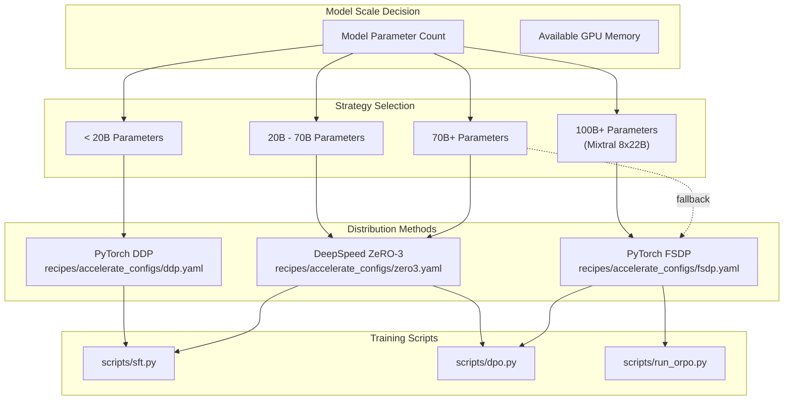
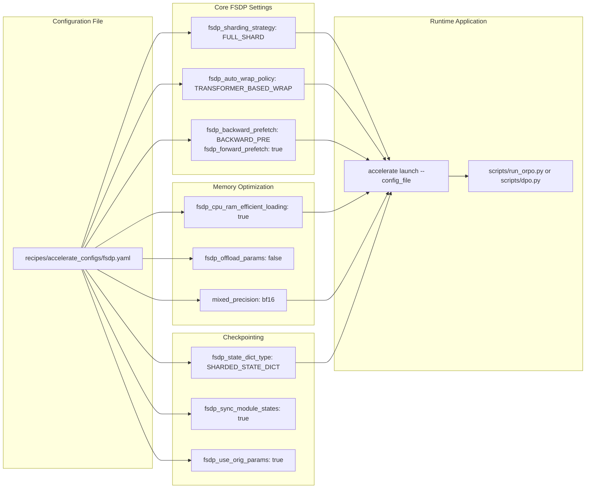
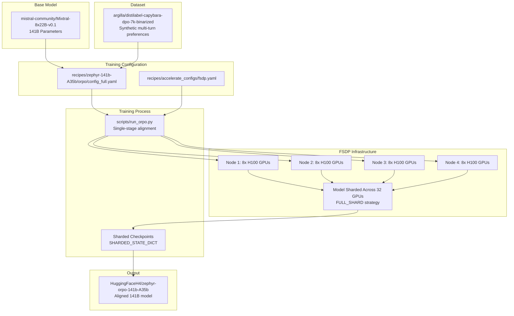

<!-- source: DeepWiki mcp.deepwiki.com · repo huggingface/alignment-handbook · extra page PyTorch FSDP · fetched 2026-10-26 -->

# PyTorch FSDP

<details>
<summary>Relevant source files</summary>

The following files were used as context for generating this wiki page:

- [recipes/accelerate_configs/fsdp.yaml](recipes/accelerate_configs/fsdp.yaml)
- [recipes/starchat2-15b/README.md](recipes/starchat2-15b/README.md)
- [recipes/zephyr-141b-A35b/README.md](recipes/zephyr-141b-A35b/README.md)
- [recipes/zephyr-141b-A35b/orpo/config_full.yaml](recipes/zephyr-141b-A35b/orpo/config_full.yaml)

</details>


## Purpose and Scope

This document covers the use of PyTorch's Fully Sharded Data Parallel (FSDP) strategy for distributed training in the Alignment Handbook. FSDP is specifically configured for training very large language models (100B+ parameters) where other distributed strategies may encounter technical limitations.

For information about DeepSpeed ZeRO-3 configurations, see [DeepSpeed ZeRO-3](#5.1.1). For data parallel training on smaller models, see [Data Parallel (DDP)](#5.1.3). For general distributed training guidance, see [Distributed Training Configurations](#5.1).

## Overview

PyTorch FSDP (Fully Sharded Data Parallel) is a distributed training strategy that shards model parameters, gradients, and optimizer states across all available GPUs. Unlike standard data parallelism where each GPU holds a full copy of the model, FSDP breaks the model into smaller shards, enabling training of models that would not fit in memory with traditional approaches.

The Alignment Handbook uses FSDP primarily for:
- **Very Large Models**: Models with 100B+ parameters (e.g., Mixtral-8x22B-based Zephyr-141B)
- **DeepSpeed Limitations**: Cases where DeepSpeed ZeRO-3 encounters NCCL communication errors
- **Multi-Node Training**: Scaling across multiple nodes with 8 GPUs each

**Diagram: FSDP in the Training Infrastructure**



Sources: [recipes/zephyr-141b-A35b/README.md:1-23](), [recipes/accelerate_configs/fsdp.yaml:1-27]()

## FSDP Configuration File

The Alignment Handbook provides a pre-configured FSDP setup at [recipes/accelerate_configs/fsdp.yaml:1-27](). This configuration is optimized for training very large models across multiple GPUs and nodes.

### Key Configuration Parameters

| Parameter | Value | Description |
|-----------|-------|-------------|
| `distributed_type` | `FSDP` | Activates Fully Sharded Data Parallel |
| `fsdp_sharding_strategy` | `FULL_SHARD` | Shards parameters, gradients, and optimizer states |
| `fsdp_auto_wrap_policy` | `TRANSFORMER_BASED_WRAP` | Automatically wraps transformer layers |
| `fsdp_backward_prefetch` | `BACKWARD_PRE` | Prefetches parameters during backward pass |
| `fsdp_forward_prefetch` | `true` | Prefetches parameters during forward pass |
| `fsdp_cpu_ram_efficient_loading` | `true` | Loads model shards efficiently into CPU RAM first |
| `fsdp_state_dict_type` | `SHARDED_STATE_DICT` | Saves checkpoints in sharded format |
| `fsdp_sync_module_states` | `true` | Synchronizes module states across ranks |
| `fsdp_use_orig_params` | `true` | Uses original parameter objects (required for optimizer state) |
| `mixed_precision` | `bf16` | Uses bfloat16 for reduced memory footprint |
| `num_processes` | `8` | Number of GPUs per node (adjust for your hardware) |

**Diagram: FSDP Configuration Components**



Sources: [recipes/accelerate_configs/fsdp.yaml:1-27]()

## When to Use FSDP vs DeepSpeed

The choice between FSDP and DeepSpeed ZeRO-3 depends on model size, hardware configuration, and practical stability considerations:

### Use FSDP When:

1. **Model Size > 100B Parameters**: FSDP is the primary choice for Mixtral-8x22B-based models (141B+ parameters)
2. **DeepSpeed Encounters NCCL Errors**: As documented in the Zephyr-141B training, DeepSpeed ZeRO-3 can cause unresolved NCCL errors that hang GPUs on very large models
3. **Multi-Node Training Required**: FSDP has robust multi-node support built into PyTorch
4. **Native PyTorch Ecosystem**: Teams preferring to stay within native PyTorch without external dependencies

### Use DeepSpeed ZeRO-3 When:

1. **Model Size 7B-70B**: DeepSpeed is well-tested for models in this range (see [DeepSpeed ZeRO-3](#5.1.1))
2. **Single-Node 8x GPU Setup**: DeepSpeed has excellent performance on single-node configurations
3. **Mature Training Pipelines**: For models where DeepSpeed has proven stable (StarChat2-15B, Zephyr-7B)

### Comparison Table

| Aspect | FSDP | DeepSpeed ZeRO-3 |
|--------|------|------------------|
| Model Size Sweet Spot | 100B+ parameters | 7B-70B parameters |
| Multi-Node Stability | Excellent | Good |
| Memory Efficiency | Very High | Very High |
| Setup Complexity | Medium (native PyTorch) | Medium (requires DeepSpeed) |
| Checkpointing | Sharded state dict | ZeRO checkpoint format |
| Community Support | Growing | Mature |
| Known Issues | Fewer for very large models | NCCL errors on 100B+ models |

Sources: [recipes/zephyr-141b-A35b/README.md:6-6](), [recipes/starchat2-15b/README.md:13-21]()

## Launching Training with FSDP

### Basic Launch Command

The standard command structure for launching FSDP training:

```bash
ACCELERATE_LOG_LEVEL=info TRANSFORMERS_VERBOSITY=info \
accelerate launch --config_file recipes/accelerate_configs/fsdp.yaml \
scripts/run_orpo.py --config recipes/zephyr-141b-A35b/orpo/config_full.yaml
```

**Components:**
- `ACCELERATE_LOG_LEVEL=info`: Sets logging verbosity for debugging
- `TRANSFORMERS_VERBOSITY=info`: Enables detailed transformer library logs
- `--config_file recipes/accelerate_configs/fsdp.yaml`: Specifies FSDP configuration
- `scripts/run_orpo.py`: The training script (can be `sft.py`, `dpo.py`, or `run_orpo.py`)
- `--config recipes/zephyr-141b-A35b/orpo/config_full.yaml`: Model/training configuration

Sources: [recipes/zephyr-141b-A35b/README.md:22-22]()

### Multi-Node Launch with Slurm

For large-scale training across multiple nodes, use the Slurm launcher:

```bash
sbatch --job-name=handbook_sft --nodes=4 recipes/launch.slurm \
zephyr-141b-A35b orpo full fsdp
```

**Parameters:**
- `--nodes=4`: Specifies 4 nodes (32 GPUs total at 8 GPUs/node)
- `recipes/launch.slurm`: The Slurm submission script
- `zephyr-141b-A35b orpo full fsdp`: Arguments passed to the launcher specifying model, task, training type, and distributed strategy

For detailed information on Slurm deployment, see [Slurm Cluster Deployment](#5.2).

Sources: [recipes/zephyr-141b-A35b/README.md:14-16]()

**Diagram: FSDP Launch Flow**

```mermaid
sequenceDiagram
    participant User
    participant Slurm["Slurm Scheduler<br/>recipes/launch.slurm"]
    participant Accelerate["Accelerate<br/>--config_file fsdp.yaml"]
    participant FSDP["FSDP Runtime"]
    participant Script["Training Script<br/>scripts/run_orpo.py"]
    participant Model["Model Shards<br/>Mixtral-8x22B"]
    
    User->>Slurm: sbatch --nodes=4 launch.slurm
    Slurm->>Slurm: Allocate 4 nodes x 8 GPUs
    Slurm->>Accelerate: accelerate launch --config_file fsdp.yaml
    Accelerate->>FSDP: Initialize FULL_SHARD strategy
    FSDP->>FSDP: Configure TRANSFORMER_BASED_WRAP
    FSDP->>FSDP: Enable backward/forward prefetch
    FSDP->>Script: Launch training script
    Script->>Model: Load model with fsdp_cpu_ram_efficient_loading
    Model->>FSDP: Shard parameters across 32 GPUs
    FSDP->>Script: Begin training with sharded model
    Script->>Script: Train for num_train_epochs
    Script->>FSDP: Save SHARDED_STATE_DICT checkpoint
```

Sources: [recipes/zephyr-141b-A35b/README.md:12-22](), [recipes/accelerate_configs/fsdp.yaml:1-27]()

## Training Configuration Parameters

When training with FSDP, the model configuration file (e.g., `config_full.yaml`) contains training-specific parameters that work alongside the FSDP infrastructure configuration:

### Memory and Performance Parameters

| Parameter | Example Value | Purpose with FSDP |
|-----------|---------------|-------------------|
| `per_device_train_batch_size` | `1` | Start with 1 due to memory constraints; FSDP enables larger effective batch via sharding |
| `gradient_accumulation_steps` | `1` | Increase if global batch size needs to be larger |
| `gradient_checkpointing` | `true` | Essential for memory efficiency with large models |
| `gradient_checkpointing_kwargs.use_reentrant` | `true` | Controls checkpointing implementation |
| `bf16` | `true` | Must match `mixed_precision: bf16` in FSDP config |
| `torch_dtype` | `bfloat16` | Model loading precision |

### Model and Attention Parameters

| Parameter | Example Value | Purpose |
|-----------|---------------|---------|
| `model_name_or_path` | `mistral-community/Mixtral-8x22B-v0.1` | Base model identifier |
| `attn_implementation` | `flash_attention_2` | Required for efficient attention on large models |
| `optim` | `adamw_bnb_8bit` | 8-bit optimizer reduces memory usage |

### Checkpointing with FSDP

| Parameter | Example Value | Consideration |
|-----------|---------------|---------------|
| `save_strategy` | `"no"` | Often disabled for very large models due to checkpoint size |
| `output_dir` | `data/zephyr-orpo-141b-A35b` | Local checkpoint directory |
| `hub_model_id` | `zephyr-orpo-141b-A35b` | Hub identifier for final model |
| `push_to_hub` | `true` | Upload final model to HuggingFace Hub |

Sources: [recipes/zephyr-141b-A35b/orpo/config_full.yaml:1-38]()

## Example: Training Zephyr-141B with FSDP

The Zephyr-141B-A35B model provides a concrete example of FSDP usage for training a 141B parameter model (Mixtral-8x22B base) using ORPO alignment.

### Hardware Requirements

- **4 nodes** × **8 GPUs/node** = **32 GPUs total**
- **80GB VRAM per GPU** (H100 or A100 80GB)
- High-bandwidth inter-node networking for multi-node communication

### Training Configuration

The training uses:
- **Base Model**: `mistral-community/Mixtral-8x22B-v0.1` (141B parameters)
- **Method**: ORPO (single-stage alignment, no SFT required)
- **Dataset**: `argilla/distilabel-capybara-dpo-7k-binarized`
- **Batch Size**: 1 per device (32 global batch size)
- **Optimizer**: `adamw_bnb_8bit` for memory efficiency
- **Learning Rate**: `5.0e-6` with `inverse_sqrt` scheduler
- **Max Length**: 2048 tokens
- **Training**: 3 epochs

### Why FSDP Was Required

As documented in [recipes/zephyr-141b-A35b/README.md:6-6]():

> **Note:** we found it was not possible to train this large model with DeepSpeed ZeRO-3 due to unresolved NCCL errors which cause GPUs to hang.

This demonstrates a practical case where FSDP's stability advantages become critical for very large models.

**Diagram: Zephyr-141B Training Architecture**



Sources: [recipes/zephyr-141b-A35b/README.md:1-23](), [recipes/zephyr-141b-A35b/orpo/config_full.yaml:1-38]()

### Resource Scaling Considerations

From [recipes/zephyr-141b-A35b/README.md:10-10]():

> You will require 4 nodes of 8 GPUs (80GB of VRAM) to train the full model - alternatively, you may be able to train on fewer GPUs by adjusting `per_device_train_batch_size` and `gradient_accumulation_steps` and `num_train_epochs` to keep the global batch size constant.

This illustrates the flexibility of the system: while 32 GPUs is the reference configuration, the batch size arithmetic can be adjusted for different hardware setups.

## FSDP Parameter Reference

### Sharding Strategy Options

The `fsdp_sharding_strategy` parameter in [recipes/accelerate_configs/fsdp.yaml:12]() is set to `FULL_SHARD`, which provides maximum memory savings. Alternative options include:

| Strategy | Description | Memory Savings | Use Case |
|----------|-------------|----------------|----------|
| `FULL_SHARD` | Shards parameters, gradients, optimizer states | Highest | Very large models (100B+) |
| `SHARD_GRAD_OP` | Shards gradients and optimizer states only | Medium | When parameters fit but gradients don't |
| `NO_SHARD` | No sharding (equivalent to DDP) | None | Debugging FSDP setup |

### Auto-Wrap Policy Options

The `fsdp_auto_wrap_policy` parameter in [recipes/accelerate_configs/fsdp.yaml:7]() is set to `TRANSFORMER_BASED_WRAP`, which automatically identifies and wraps transformer layers. This is optimal for LLM training as it aligns with model architecture.

### Prefetching Configuration

Prefetching parameters optimize communication overlap:

- **`fsdp_backward_prefetch: BACKWARD_PRE`** [recipes/accelerate_configs/fsdp.yaml:8](): Prefetches parameters needed for the next backward computation
- **`fsdp_forward_prefetch: true`** [recipes/accelerate_configs/fsdp.yaml:10](): Prefetches parameters needed for the next forward computation

Both settings reduce idle time during training by overlapping communication and computation.

### CPU RAM Efficient Loading

The `fsdp_cpu_ram_efficient_loading: true` parameter [recipes/accelerate_configs/fsdp.yaml:9]() enables loading model shards into CPU RAM before moving to GPU. This is critical for very large models where naive loading would cause CPU OOM errors.

Sources: [recipes/accelerate_configs/fsdp.yaml:1-27]()

## Troubleshooting FSDP Training

### Common Issues and Solutions

| Issue | Symptom | Solution |
|-------|---------|----------|
| **NCCL Timeout** | Training hangs during communication | Increase NCCL timeout: `export NCCL_TIMEOUT=1800` |
| **CPU OOM During Loading** | Model loading fails before training | Verify `fsdp_cpu_ram_efficient_loading: true` |
| **Mismatched Precision** | Training crashes or produces NaN | Ensure `bf16: true` in config matches `mixed_precision: bf16` in FSDP config |
| **Checkpoint Loading Fails** | Cannot load saved checkpoint | Verify `fsdp_state_dict_type: SHARDED_STATE_DICT` and use matching loading code |
| **Slow Multi-Node Training** | Poor scaling efficiency | Check inter-node network bandwidth; ensure InfiniBand or high-speed networking |

### Validation Steps

Before starting large-scale FSDP training:

1. **Test on Smaller Scale**: Run with `num_processes: 2` and shorter training to validate configuration
2. **Verify Network**: Run NCCL tests to ensure inter-node communication works
3. **Check Memory**: Monitor GPU memory during initial steps to ensure no OOM
4. **Validate Checkpointing**: Test save/load cycle with sharded checkpoints

### Debug Logging

Enable comprehensive logging for debugging:

```bash
export ACCELERATE_LOG_LEVEL=debug
export TRANSFORMERS_VERBOSITY=debug
export NCCL_DEBUG=INFO
```

Sources: [recipes/zephyr-141b-A35b/README.md:22-22]()

## Related Documentation

- For DeepSpeed ZeRO-3 configuration and usage, see [DeepSpeed ZeRO-3](#5.1.1)
- For DDP configuration for smaller models, see [Data Parallel (DDP)](#5.1.3)
- For Slurm-based multi-node job submission, see [Slurm Cluster Deployment](#5.2)
- For hardware requirements and scaling strategies, see [Resource Requirements and Hardware](#5.3)
- For the ORPO training methodology used with Zephyr-141B, see [Odds Ratio Preference Optimization (ORPO)](#3.3)

---

