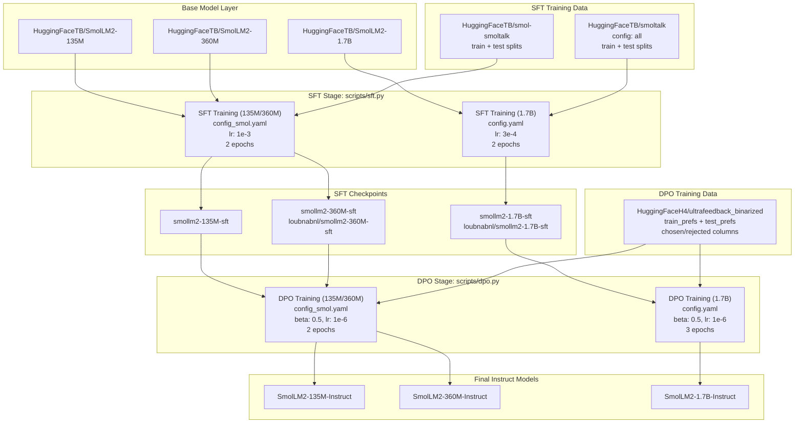
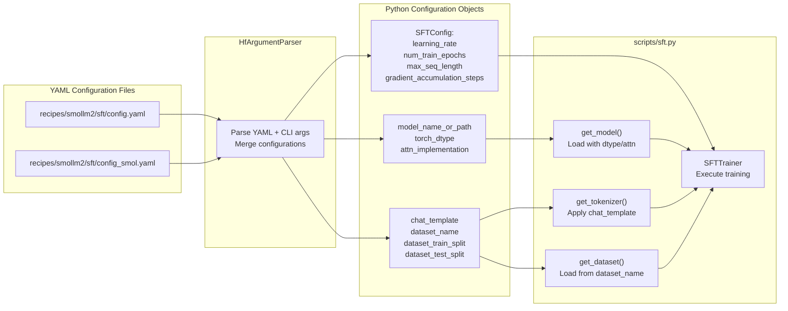

<!-- source: DeepWiki mcp.deepwiki.com · repo huggingface/alignment-handbook · extra page SmolLM2 Training · fetched 2026-10-26 -->

# SmolLM2 Training

<details>
<summary>Relevant source files</summary>

The following files were used as context for generating this wiki page:

- [recipes/smollm2/README.md](recipes/smollm2/README.md)
- [recipes/smollm2/dpo/config.yaml](recipes/smollm2/dpo/config.yaml)
- [recipes/smollm2/dpo/config_smol.yaml](recipes/smollm2/dpo/config_smol.yaml)
- [recipes/smollm2/sft/config.yaml](recipes/smollm2/sft/config.yaml)
- [recipes/smollm2/sft/config_smol.yaml](recipes/smollm2/sft/config_smol.yaml)

</details>


This page documents the training process for SmolLM2 models (135M, 360M, and 1.7B parameters). SmolLM2 uses a two-stage training pipeline: Supervised Fine-Tuning (SFT) followed by Direct Preference Optimization (DPO). This page focuses specifically on the SmolLM2 generation; for the more advanced SmolLM3 training with reasoning modes and APO, see [SmolLM3 Advanced Training](#4.2.2). For general information about the SmolLM model family, see [SmolLM Small Language Models](#4.2). For methodology details, see [Supervised Fine-Tuning](#3.1) and [Direct Preference Optimization](#3.2).

## SmolLM2 Model Variants

The SmolLM2 family consists of three model sizes, each trained using the same two-stage pipeline but with different datasets and hyperparameters:

| Model Size | Base Model | SFT Dataset | Parameters |
|------------|------------|-------------|------------|
| 135M | `HuggingFaceTB/SmolLM2-135M` | `HuggingFaceTB/smol-smoltalk` | 135 million |
| 360M | `HuggingFaceTB/SmolLM2-360M` | `HuggingFaceTB/smol-smoltalk` | 360 million |
| 1.7B | `HuggingFaceTB/SmolLM2-1.7B` | `HuggingFaceTB/smoltalk` | 1.7 billion |

All variants use `HuggingFaceH4/ultrafeedback_binarized` for the DPO stage. The smaller models (135M/360M) use a filtered version of the instruction dataset (`smol-smoltalk`) specifically curated for efficient small model training.

Sources: [recipes/smollm2/README.md:1-28](), [recipes/smollm2/sft/config.yaml:2](), [recipes/smollm2/sft/config_smol.yaml:2]()

## Training Pipeline Architecture

The following diagram illustrates the complete training flow from base models to aligned instruct models, showing how configurations and datasets are used at each stage:



Sources: [recipes/smollm2/README.md:1-28](), [recipes/smollm2/sft/config.yaml:1-44](), [recipes/smollm2/sft/config_smol.yaml:1-43](), [recipes/smollm2/dpo/config.yaml:1-55](), [recipes/smollm2/dpo/config_smol.yaml:1-55]()

## Stage 1: Supervised Fine-Tuning (SFT)

### Configuration Mapping

The SFT stage uses configuration files that map to the `SFTConfig` class and `ScriptArguments`. The following diagram shows how YAML configuration files are processed into Python objects:



Sources: [recipes/smollm2/sft/config.yaml:1-44](), [recipes/smollm2/sft/config_smol.yaml:1-43]()

### Chat Template

Both configurations use an identical chat template based on the ChatML format with a custom system message:

```

  
    {{ '<|im_start|>system\nYou are a helpful AI assistant named SmolLM, trained by Hugging Face<|im_end|>\n' }}
  
  {{'<|im_start|>' + message['role'] + '\n' + message['content'] + '<|im_end|>' + '\n'}}


  {{ '<|im_start|>assistant\n' }}

```

This template is specified in [recipes/smollm2/sft/config.yaml:8]() and [recipes/smollm2/sft/config_smol.yaml:8]() and applied via the `chat_template` parameter passed to `get_tokenizer()`.

Sources: [recipes/smollm2/sft/config.yaml:8](), [recipes/smollm2/sft/config_smol.yaml:8]()

### SFT Configuration Comparison

The following table highlights the key differences between the 1.7B and smaller model (135M/360M) SFT configurations:

| Parameter | 1.7B Config | 135M/360M Config | Location |
|-----------|-------------|------------------|----------|
| `model_name_or_path` | `HuggingFaceTB/SmolLM2-1.7B` | `HuggingFaceTB/SmolLM2-360M` | Line 2 |
| `dataset_name` | `HuggingFaceTB/smoltalk` | `HuggingFaceTB/smol-smoltalk` | Line 9 |
| `dataset_config` | `all` | (not specified) | Line 10 |
| `learning_rate` | `3.0e-04` | `1.0e-03` | Line 25/24 |
| `max_seq_length` | `8192` | `8192` | Line 30/29 |
| `num_train_epochs` | `2` | `2` | Line 32/31 |
| `per_device_train_batch_size` | `4` | `4` | Line 36/35 |
| `gradient_accumulation_steps` | `4` | `4` | Line 19/18 |
| `hub_model_id` | `smollm2-1.7B-sft` | `smollm2-360M-sft` | Line 23/22 |
| `output_dir` | `data/smollm2-1.7B-sft` | `data/smollm2-360M-sft` | Line 33/32 |

Key observations:
- The smaller models use a **3.3x higher learning rate** (`1e-3` vs `3e-4`) to compensate for their reduced capacity
- The `smoltalk` dataset for 1.7B requires the `all` config selector, while `smol-smoltalk` uses the default config
- All other training hyperparameters remain identical across model sizes

Sources: [recipes/smollm2/sft/config.yaml:1-44](), [recipes/smollm2/sft/config_smol.yaml:1-43]()

### Common SFT Parameters

Both configurations share these important settings:

| Parameter | Value | Purpose |
|-----------|-------|---------|
| `torch_dtype` | `bfloat16` | Use BF16 precision for efficiency |
| `attn_implementation` | `flash_attention_2` | Use Flash Attention for faster training |
| `bf16` | `true` | Enable BF16 training in Trainer |
| `gradient_checkpointing` | `true` | Enable gradient checkpointing to reduce memory |
| `gradient_checkpointing_kwargs.use_reentrant` | `false` | Use non-reentrant checkpointing |
| `do_eval` | `true` | Evaluate on test set |
| `eval_strategy` | `epoch` | Evaluate after each epoch |
| `lr_scheduler_type` | `cosine` | Cosine learning rate schedule |
| `warmup_ratio` | `0.1` | 10% warmup steps |
| `save_strategy` | `"no"` | Don't save intermediate checkpoints |
| `push_to_hub` | `true` | Push final model to HuggingFace Hub |

Sources: [recipes/smollm2/sft/config.yaml:1-44](), [recipes/smollm2/sft/config_smol.yaml:1-43]()

## Stage 2: Direct Preference Optimization (DPO)

### Dataset Mixture Configuration

The DPO stage uses a dataset mixture from `HuggingFaceH4/ultrafeedback_binarized` combining both train and test preference splits. The configuration structure is identical for all model sizes:

```yaml
dataset_mixture:
  datasets:
    - id: HuggingFaceH4/ultrafeedback_binarized
      config: default
      split: train_prefs           
      columns:
        - chosen
        - rejected
      weight: 1.0
    - id: HuggingFaceH4/ultrafeedback_binarized
      config: default
      split: test_prefs
      columns:
        - chosen
        - rejected
      weight: 1.0
  test_split_size: 2000
  seed: 0
```

This configuration loads both `train_prefs` and `test_prefs` splits with equal weight, then creates a 2000-example held-out test set. The `chosen` and `rejected` columns contain the preference pairs required for DPO training.

Sources: [recipes/smollm2/dpo/config.yaml:6-24](), [recipes/smollm2/dpo/config_smol.yaml:6-24]()

### DPO Configuration Comparison

The following table shows differences between the 1.7B and smaller model DPO configurations:

| Parameter | 1.7B Config | 135M/360M Config | Location |
|-----------|-------------|------------------|----------|
| `model_name_or_path` | `loubnabnl/smollm2-1.7B-sft` | `loubnabnl/smollm2-360M-sft` | Line 2 |
| `num_train_epochs` | `3` | `2` | Line 44 |
| `beta` | `0.5` | `0.5` | Line 28 |
| `learning_rate` | `1.0e-6` | `1.0e-6` | Line 38 |
| `max_length` | `1024` | `1024` | Line 42 |
| `max_prompt_length` | `512` | `512` | Line 43 |
| `per_device_train_batch_size` | `2` | `2` | Line 47 |
| `gradient_accumulation_steps` | `8` | `8` | Line 33 |
| `hub_model_id` | `smollm2-1.7B-dpo` | `smollm2-360M-dpo` | Line 37 |

Key observations:
- The 1.7B model trains for **3 epochs** while smaller models use **2 epochs**
- Unlike SFT, the learning rate is identical (`1e-6`) across all model sizes
- The `beta` parameter (DPO temperature) is consistently `0.5` for all variants
- All models use the same batch size and gradient accumulation strategy

Sources: [recipes/smollm2/dpo/config.yaml:1-55](), [recipes/smollm2/dpo/config_smol.yaml:1-55]()

### DPO-Specific Parameters

The DPO configurations include parameters specific to preference optimization:

| Parameter | Value | Purpose |
|-----------|-------|---------|
| `beta` | `0.5` | DPO temperature controlling KL divergence penalty |
| `max_length` | `1024` | Maximum sequence length for chosen/rejected responses |
| `max_prompt_length` | `512` | Maximum length for prompts in preference pairs |
| `eval_steps` | `100` | Evaluate every 100 steps |
| `eval_strategy` | `steps` | Evaluate based on steps rather than epochs |

Note that DPO uses `eval_strategy: steps` (line 31) instead of `eval_strategy: epoch` used in SFT, allowing more frequent evaluation during training.

Sources: [recipes/smollm2/dpo/config.yaml:26-55](), [recipes/smollm2/dpo/config_smol.yaml:26-55]()

## Execution Commands

### 1.7B Model Training

Train the 1.7B model using 8 GPUs with DeepSpeed ZeRO-3:

```bash
# Stage 1: SFT
ACCELERATE_LOG_LEVEL=info accelerate launch \
  --config_file recipes/accelerate_configs/zero3.yaml \
  scripts/sft.py \
  --config recipes/smollm2/sft/config.yaml

# Stage 2: DPO
ACCELERATE_LOG_LEVEL=info accelerate launch \
  --config_file recipes/accelerate_configs/zero3.yaml \
  scripts/dpo.py \
  --config recipes/smollm2/dpo/config.yaml
```

Sources: [recipes/smollm2/README.md:11-19]()

### 135M and 360M Model Training

Train the smaller models (135M or 360M) using the same distributed setup:

```bash
# Stage 1: SFT
ACCELERATE_LOG_LEVEL=info accelerate launch \
  --config_file recipes/accelerate_configs/zero3.yaml \
  scripts/sft.py \
  --config recipes/smollm2/sft/config_smol.yaml

# Stage 2: DPO
ACCELERATE_LOG_LEVEL=info accelerate launch \
  --config_file recipes/accelerate_configs/zero3.yaml \
  scripts/dpo.py \
  --config recipes/smollm2/dpo/config_smol.yaml
```

The `config_smol.yaml` files are shared between 135M and 360M models. To train the 135M variant, update `model_name_or_path` to `HuggingFaceTB/SmolLM2-135M` via CLI override or by editing the configuration file.

Sources: [recipes/smollm2/README.md:21-28](), [recipes/smollm2/sft/config_smol.yaml:2]()

## Hardware Requirements and Distributed Training

All SmolLM2 variants are trained using **8 GPUs** with **DeepSpeed ZeRO-3** configuration. The training uses:

- **Accelerate config**: `recipes/accelerate_configs/zero3.yaml`
- **Effective batch size**: Varies by stage
  - SFT: `4 (per_device) × 4 (grad_accum) × 8 (GPUs) = 128`
  - DPO: `2 (per_device) × 8 (grad_accum) × 8 (GPUs) = 128`
- **Precision**: BF16 (`bfloat16` for model, `bf16: true` for training)
- **Memory optimization**: Gradient checkpointing enabled with `use_reentrant: False`

For details on ZeRO-3 configuration and alternatives, see [DeepSpeed ZeRO-3](#5.1.1).

Sources: [recipes/smollm2/README.md:11-28](), [recipes/smollm2/sft/config.yaml:16-22](), [recipes/smollm2/dpo/config.yaml:27-36]()

## Output Artifacts

### Model Checkpoints

The training produces the following checkpoints:

| Stage | 135M | 360M | 1.7B |
|-------|------|------|------|
| SFT Output | `data/smollm2-135M-sft` | `data/smollm2-360M-sft` | `data/smollm2-1.7B-sft` |
| Hub (SFT) | (user)/smollm2-135M-sft | `loubnabnl/smollm2-360M-sft` | `loubnabnl/smollm2-1.7B-sft` |
| DPO Output | `data/smollm2-135M-dpo` | `data/smollm2-360M-dpo` | `data/smollm2-1.7B-dpo` |
| Hub (DPO) | (user)/smollm2-135M-dpo | (user)/smollm2-360M-dpo | (user)/smollm2-1.7B-dpo |

Models are automatically pushed to the Hugging Face Hub when training completes (controlled by `push_to_hub: true`). The `hub_model_id` parameter determines the repository name.

Sources: [recipes/smollm2/sft/config.yaml:23,33](), [recipes/smollm2/sft/config_smol.yaml:22,32](), [recipes/smollm2/dpo/config.yaml:37,46](), [recipes/smollm2/dpo/config_smol.yaml:37,46]()

### Experiment Tracking

Both SFT and DPO stages log metrics to:
- **TensorBoard**: Local logs for visualization
- **Weights & Biases**: Cloud-based experiment tracking

This is configured via the `report_to` parameter in [recipes/smollm2/sft/config.yaml:39-41]() and [recipes/smollm2/dpo/config.yaml:50-52]().

## Key Configuration Principles

The SmolLM2 training recipes demonstrate several important design patterns:

1. **Learning Rate Scaling**: Smaller models use higher learning rates during SFT (`1e-3` vs `3e-4`) but identical rates during DPO (`1e-6`), suggesting that preference alignment is less sensitive to model scale.

2. **Dataset Specialization**: The `smol-smoltalk` dataset for 135M/360M models is a filtered version optimized for small model training, while the full `smoltalk` dataset is used for 1.7B.

3. **Training Duration**: DPO training is longer for the 1.7B model (3 epochs vs 2), possibly due to its higher capacity requiring more alignment iterations.

4. **Consistent Batch Size**: Despite different model sizes, all variants use the same effective batch size (128), achieved through the combination of per-device batch size and gradient accumulation.

5. **Shared Infrastructure**: All models use the same distributed training setup (8×GPU + ZeRO-3), demonstrating that the infrastructure scales from 135M to 1.7B parameters.

Sources: [recipes/smollm2/sft/config.yaml:25](), [recipes/smollm2/sft/config_smol.yaml:24](), [recipes/smollm2/dpo/config.yaml:38,44](), [recipes/smollm2/dpo/config_smol.yaml:38,44]()

---

