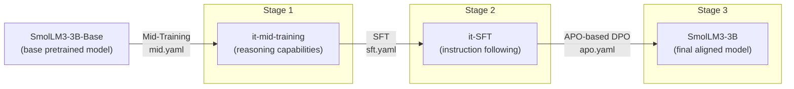
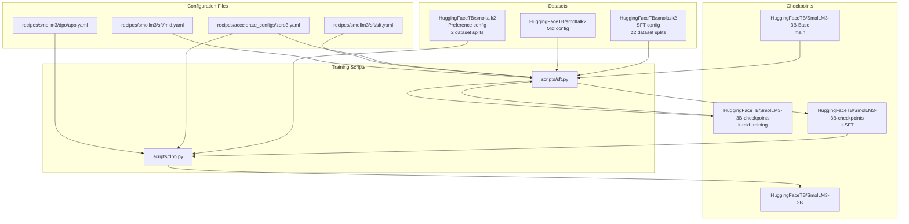
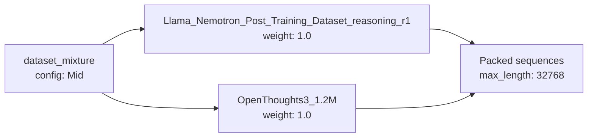
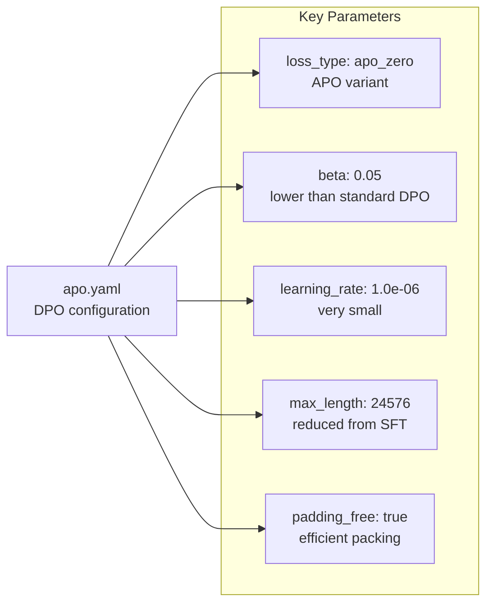
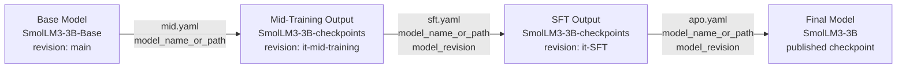

<!-- source: DeepWiki mcp.deepwiki.com · repo huggingface/alignment-handbook · extra page SmolLM3 Advanced Training · fetched 2026-10-26 -->

# SmolLM3 Advanced Training

<details>
<summary>Relevant source files</summary>

The following files were used as context for generating this wiki page:

- [recipes/smollm3/README.md](recipes/smollm3/README.md)
- [recipes/smollm3/dpo/apo.yaml](recipes/smollm3/dpo/apo.yaml)
- [recipes/smollm3/sft/mid.yaml](recipes/smollm3/sft/mid.yaml)
- [recipes/smollm3/sft/sft.yaml](recipes/smollm3/sft/sft.yaml)

</details>


This page documents the advanced 3-stage training pipeline for SmolLM3-3B, a sophisticated small language model with reasoning capabilities, tool calling support, and multi-lingual instruction following. SmolLM3 represents a more complex training approach compared to SmolLM2, introducing mid-training, reasoning modes, and APO-based preference optimization.

For the simpler SmolLM2 training approach, see [SmolLM2 Training](#4.2.1). For general supervised fine-tuning concepts, see [Supervised Fine-Tuning (SFT)](#3.1) and for preference optimization, see [Direct Preference Optimization (DPO)](#3.2).

## Overview of the 3-Stage Pipeline

SmolLM3-3B training consists of three sequential stages, each building on the previous checkpoint:



**Sources:** [recipes/smollm3/README.md:1-20]()

The three stages serve distinct purposes:
1. **Mid-Training**: Develops reasoning capabilities using large-scale reasoning datasets
2. **Supervised Fine-Tuning**: Teaches instruction following with mixed reasoning modes
3. **APO-based DPO**: Aligns model outputs with preferences while maintaining reasoning

## Training Pipeline Architecture



**Sources:** [recipes/smollm3/sft/mid.yaml:1-64](), [recipes/smollm3/sft/sft.yaml:1-228](), [recipes/smollm3/dpo/apo.yaml:1-66]()

## Stage 1: Mid-Training

Mid-training adapts the base model to reasoning tasks before instruction tuning. This stage uses two datasets focused on reasoning traces.

### Mid-Training Configuration

| Parameter | Value | Purpose |
|-----------|-------|---------|
| `model_name_or_path` | `HuggingFaceTB/SmolLM3-3B-Base` | Base pretrained model |
| `model_revision` | `main` | Uses main branch checkpoint |
| `max_length` | 32768 | Context window for reasoning |
| `num_train_epochs` | 5 | Full passes over mid-training data |
| `learning_rate` | 2.0e-05 | Higher LR for mid-stage adaptation |
| `packing` | true | Efficient sequence packing |
| `save_steps` | 0.05 | Frequent checkpointing (every 0.05 epochs) |

**Sources:** [recipes/smollm3/sft/mid.yaml:1-64]()

### Mid-Training Dataset Composition



**Sources:** [recipes/smollm3/sft/mid.yaml:11-25]()

The mid-training stage uses a simple chat template without reasoning mode support:

```jinja2

    {{- "<|im_start|>" + message.role + "\n" + message.content + "<|im_end|>" + "\n" -}}


    {{- "<|im_start|>assistant\n" -}}

```

**Sources:** [recipes/smollm3/sft/mid.yaml:10]()

## Stage 2: Supervised Fine-Tuning

The SFT stage introduces complex reasoning modes, tool calling, and diverse instruction following capabilities.

### Dataset Composition and Reasoning Modes

SmolLM3 SFT uses 22 dataset splits with different reasoning modes, controlled by the `chat_template_kwargs` column:

```mermaid
graph TB
    subgraph "No-Think Datasets (11 splits)"
        NoThink1["smoltalk_smollm3_everyday_conversations_no_think<br/>weight: 1.0"]
        NoThink2["smoltalk_smollm3_systemchats_30k_no_think<br/>weight: 1.0"]
        NoThink3["tulu_3_sft_personas_instruction_following_no_think<br/>weight: 1.0"]
        NoThink4["hermes_function_calling_v1_no_think<br/>weight: 1.0"]
        NoThink5["smoltalk_smollm3_smol_magpie_ultra_no_think<br/>weight: 0.5"]
        NoThink6["OpenHermes_2.5_no_think<br/>weight: 0.5"]
        NoThink7["OpenThoughts3_1.2M_no_think_no_think<br/>weight: 0.4"]
        NoThinkMore["... 4 more no_think splits"]
    end
    
    subgraph "Think Datasets (11 splits)"
        Think1["multi_turn_reasoning_if_think<br/>weight: 1.0"]
        Think2["smoltalk_everyday_convs_reasoning_Qwen3_32B_think<br/>weight: 1.0"]
        Think3["smoltalk_systemchats_Qwen3_32B_think<br/>weight: 1.0"]
        Think4["smolagents_toolcalling_traces_think<br/>weight: 1.0"]
        Think5["s1k_1.1_think<br/>weight: 1.0"]
        Think6["LongAlign_64k_Qwen3_32B_yarn_131k_think<br/>weight: 1.0"]
        Think7["OpenThoughts3_1.2M_think<br/>weight: 0.02"]
        ThinkMore["... 4 more think splits"]
    end
    
    Mixer["get_dataset<br/>weighted sampling & concatenation"]
    
    NoThink1 --> Mixer
    NoThink2 --> Mixer
    NoThink3 --> Mixer
    NoThink4 --> Mixer
    NoThink5 --> Mixer
    NoThink6 --> Mixer
    NoThink7 --> Mixer
    NoThinkMore --> Mixer
    
    Think1 --> Mixer
    Think2 --> Mixer
    Think3 --> Mixer
    Think4 --> Mixer
    Think5 --> Mixer
    Think6 --> Mixer
    Think7 --> Mixer
    ThinkMore --> Mixer
    
    Mixer --> Packed["Packed dataset<br/>max_length: 65536<br/>packing_strategy: ffd"]
```



**Sources:** [recipes/smollm3/sft/sft.yaml:11-188]()

The dataset mixture includes:
- **Everyday conversations** (no_think and think variants)
- **System chats and instruction following** 
- **Function calling and tool use** (hermes, xlam, smolagents)
- **Multilingual data** (8 languages)
- **Long context tasks** (64k context, LongAlign)
- **Reasoning datasets** (OpenThoughts3, s1k, Mixture_of_Thoughts)
- **Rewriting and summarization** tasks

### Chat Template System

The SFT stage uses a sophisticated chat template that supports multiple features:

```mermaid
graph TD
    Template["chat_template Jinja2"]
    
    subgraph "Template Components"
        Defaults["Default Settings<br/>enable_thinking=true"]
        ReasoningMode["Reasoning Mode Detection<br/>/think or /no_think"]
        SystemMsg["System Message Parsing<br/>extract mode & custom instructions"]
        Metadata["Metadata Section<br/>date, reasoning mode"]
        CustomInst["Custom Instructions<br/>user-defined or defaults"]
        Tools["Tools Section<br/>XML and Python tools"]
        MainLoop["Message Loop<br/>user, assistant, tool roles"]
        Generation["Generation Prompt<br/>with/without 
[final answer]
<|im_end|>
```

When `/no_think` mode is active, empty think tags are added:
```
<|im_start|>assistant

[direct answer]
<|im_end|>
```

**Sources:** [recipes/smollm3/sft/sft.yaml:10]()

#### System Message Structure

The generated system message includes:

1. **Metadata Section**:
   - Knowledge cutoff: June 2025
   - Current date (dynamic via `strftime_now`)
   - Reasoning mode: `/think` or `/no_think`

2. **Custom Instructions**:
   - User-provided instructions (if system message exists)
   - Default reasoning instructions (for `/think` mode)
   - Simple assistant description (for `/no_think` mode)

3. **Tools Section**:
   - XML Tools: JSON function signatures in XML tags
   - Python Tools: Custom tool definitions

**Sources:** [recipes/smollm3/sft/sft.yaml:10]()

### SFT Training Configuration

| Parameter | Value | Purpose |
|-----------|-------|---------|
| `model_name_or_path` | `HuggingFaceTB/SmolLM3-3B-checkpoints` | Mid-training checkpoint |
| `model_revision` | `it-mid-training` | Loads mid-trained model |
| `max_length` | 65536 | Extended context for long tasks |
| `num_train_epochs` | 5 | Multiple epochs over mixed data |
| `learning_rate` | 2.0e-05 | Consistent with mid-training |
| `packing` | true | Efficient packing with FFD strategy |
| `packing_strategy` | `ffd` | First-fit-decreasing bin packing |
| `assistant_only_loss` | true | Only compute loss on assistant turns |
| `use_liger_kernel` | true | Memory-efficient kernels |
| `average_tokens_across_devices` | true | Correct gradient scaling |

**Sources:** [recipes/smollm3/sft/sft.yaml:192-228]()

### Column Configuration

SFT datasets require both standard and template control columns:

```yaml
columns:
  - messages          # Standard conversation format
  - chat_template_kwargs  # Reasoning mode control
```

The `chat_template_kwargs` column contains a dictionary that can override template variables like `enable_thinking`.

**Sources:** [recipes/smollm3/sft/sft.yaml:16-19]()

## Stage 3: APO-based DPO

The final stage uses Adaptive Preference Optimization (APO), a variant of DPO, to align the model with human preferences.

### APO Configuration



**Sources:** [recipes/smollm3/dpo/apo.yaml:32-58]()

### APO Dataset Composition

The preference dataset mixes no-think and think variants:

| Dataset Split | Weight | Reasoning Mode |
|--------------|--------|----------------|
| `llama_3.1_tulu_3_8b_preference_mixture_no_think` | 0.5 | no_think |
| `tulu_3_8b_pref_mix_Qwen3_32B_Qwen3_0.6B_think` | 0.25 | think |

**Sources:** [recipes/smollm3/dpo/apo.yaml:10-29]()

The APO dataset requires four columns:
- `chosen`: Preferred response
- `rejected`: Dispreferred response
- `prompt`: User query
- `chat_template_kwargs`: Reasoning mode control

### APO vs Standard DPO

APO (Adaptive Preference Optimization) differs from standard DPO:

1. **Loss Function**: Uses `apo_zero` loss type
2. **Beta Parameter**: Lower beta (0.05 vs typical 0.1-0.5)
3. **Learning Rate**: Much smaller (1e-6 vs typical 5e-7 to 5e-6)
4. **Training Duration**: Single epoch with 0.5 epoch checkpoints

**Sources:** [recipes/smollm3/dpo/apo.yaml:51-52]()

## Execution Commands

### Complete Training Pipeline

```bash
# Stage 1: Mid-Training
ACCELERATE_LOG_LEVEL=info accelerate launch \
  --config_file recipes/accelerate_configs/zero3.yaml \
  scripts/sft.py \
  --config recipes/smollm3/sft/mid.yaml \
  --gradient_accumulation_steps 16

# Stage 2: SFT
ACCELERATE_LOG_LEVEL=info accelerate launch \
  --config_file recipes/accelerate_configs/zero3.yaml \
  scripts/sft.py \
  --config recipes/smollm3/sft/sft.yaml \
  --gradient_accumulation_steps 16

# Stage 3: DPO (APO)
ACCELERATE_LOG_LEVEL=info accelerate launch \
  --config_file recipes/accelerate_configs/zero3.yaml \
  scripts/dpo.py \
  --config recipes/smollm3/dpo/apo.yaml \
  --gradient_accumulation_steps 4
```

**Sources:** [recipes/smollm3/README.md:11-20]()

### Hardware Requirements

All three stages are configured for **8 GPUs with 80GB VRAM** using DeepSpeed ZeRO-3.

| Stage | GBS | Per-Device BS | Gradient Accumulation | Effective BS |
|-------|-----|---------------|----------------------|--------------|
| Mid-Training | 128 | 1 | 16 | 8 × 1 × 16 = 128 |
| SFT | 128 | 1 | 16 | 8 × 1 × 16 = 128 |
| DPO | 32 | 1 | 4 | 8 × 1 × 4 = 32 |

**Sources:** [recipes/smollm3/README.md:7](), [recipes/smollm3/sft/mid.yaml:1](), [recipes/smollm3/sft/sft.yaml:1](), [recipes/smollm3/dpo/apo.yaml:1]()

## Advanced Features

### Liger Kernels

All three stages enable `use_liger_kernel: true` for memory-efficient gradient computation. This reduces memory usage during backpropagation.

**Sources:** [recipes/smollm3/sft/mid.yaml:61](), [recipes/smollm3/sft/sft.yaml:225](), [recipes/smollm3/dpo/apo.yaml:65]()

### Extended Context Windows

SmolLM3 training progressively uses large context windows:

- **Mid-Training**: 32,768 tokens
- **SFT**: 65,536 tokens (double mid-training)
- **DPO**: 24,576 tokens (reduced for preference optimization)

**Sources:** [recipes/smollm3/sft/mid.yaml:49](), [recipes/smollm3/sft/sft.yaml:214](), [recipes/smollm3/dpo/apo.yaml:53]()

### Sequence Packing

Both mid-training and SFT use sequence packing for efficiency:

```yaml
packing: true
packing_strategy: ffd  # First-fit-decreasing algorithm
```

DPO uses `padding_free: true` instead of explicit packing.

**Sources:** [recipes/smollm3/sft/mid.yaml:47](), [recipes/smollm3/sft/sft.yaml:211-212](), [recipes/smollm3/dpo/apo.yaml:58]()

### Gradient Checkpointing

All stages use reentrant gradient checkpointing to reduce memory:

```yaml
gradient_checkpointing: true
gradient_checkpointing_kwargs:
  use_reentrant: true
```

**Sources:** [recipes/smollm3/sft/mid.yaml:35-37](), [recipes/smollm3/sft/sft.yaml:199-201](), [recipes/smollm3/dpo/apo.yaml:36-38]()

### Learning Rate Scheduling

All stages use cosine learning rate decay with minimum learning rate:

```yaml
lr_scheduler_type: cosine_with_min_lr
lr_scheduler_kwargs:
  min_lr_rate: 0.1  # Decays to 10% of peak LR
```

**Sources:** [recipes/smollm3/sft/mid.yaml:44-46](), [recipes/smollm3/sft/sft.yaml:208-210](), [recipes/smollm3/dpo/apo.yaml:47-49]()

## Configuration Inheritance

Each stage builds on the previous checkpoint:



**Sources:** [recipes/smollm3/sft/mid.yaml:3-4](), [recipes/smollm3/sft/sft.yaml:3-4](), [recipes/smollm3/dpo/apo.yaml:3-4]()

## Key Differences from SmolLM2

| Feature | SmolLM2 | SmolLM3 |
|---------|---------|---------|
| **Training Stages** | 2 (SFT, DPO) | 3 (Mid, SFT, DPO) |
| **Reasoning Mode** | None | `/think` and `/no_think` |
| **Chat Template** | Simple | Complex with metadata, tools |
| **Context Window** | 8,192 tokens | Up to 65,536 tokens |
| **Tool Calling** | Limited | Full XML and Python tools |
| **Preference Method** | Standard DPO | APO-based DPO |
| **Dataset Splits** | ~5-10 | 22 (SFT) + 2 (DPO) |
| **Liger Kernels** | No | Yes |

**Sources:** [recipes/smollm3/sft/sft.yaml:1-228](), [recipes/smollm3/dpo/apo.yaml:1-66]()

---

