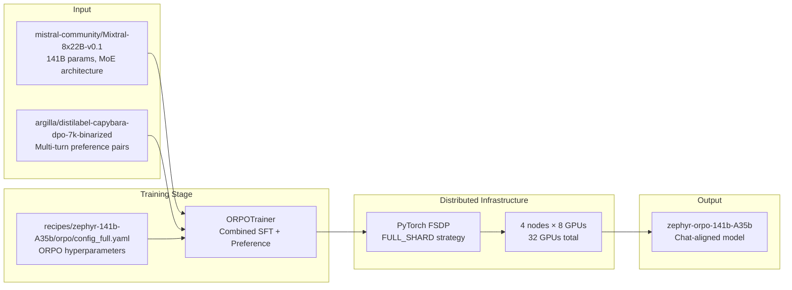
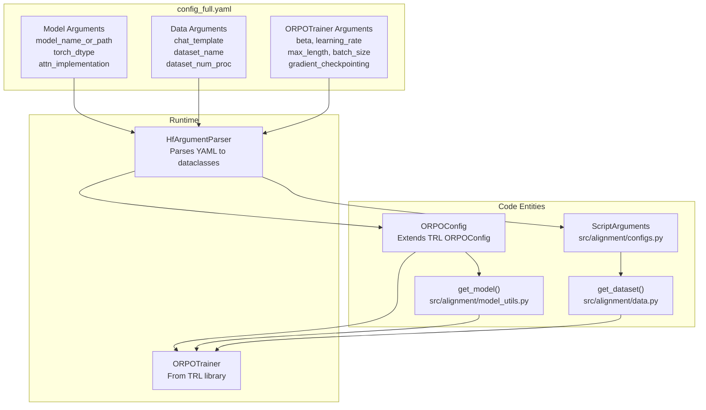
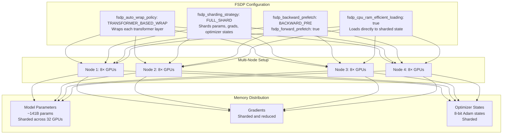
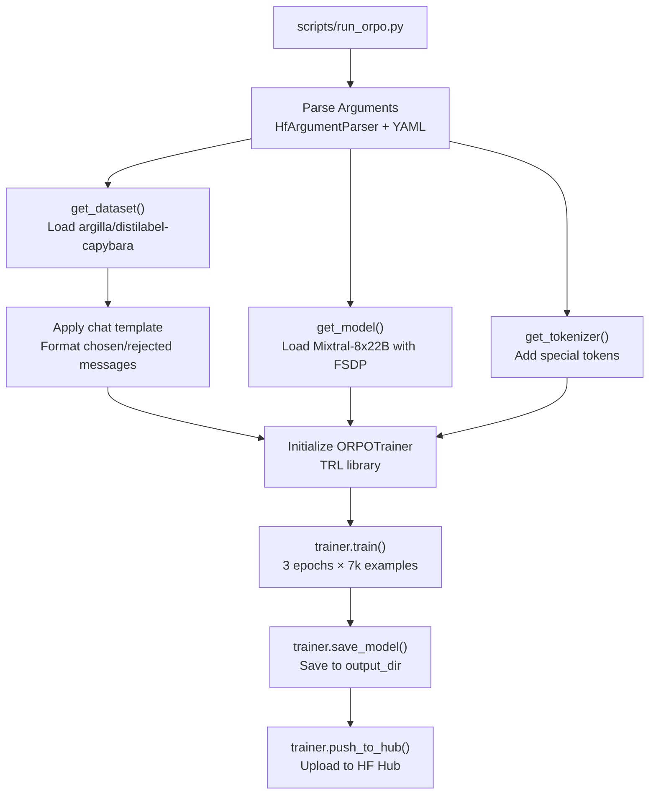

<!-- source: DeepWiki mcp.deepwiki.com · repo huggingface/alignment-handbook · extra page Zephyr-141B-A35B (Large Scale ORPO) · fetched 2026-10-26 -->

# Zephyr-141B-A35B (Large Scale ORPO)

<details>
<summary>Relevant source files</summary>

The following files were used as context for generating this wiki page:

- [recipes/accelerate_configs/fsdp.yaml](recipes/accelerate_configs/fsdp.yaml)
- [recipes/starchat2-15b/README.md](recipes/starchat2-15b/README.md)
- [recipes/zephyr-141b-A35b/README.md](recipes/zephyr-141b-A35b/README.md)
- [recipes/zephyr-141b-A35b/orpo/config_full.yaml](recipes/zephyr-141b-A35b/orpo/config_full.yaml)

</details>


## Purpose and Scope

This page documents the training recipe for Zephyr-141B-A35B, a 141-billion parameter chat model based on Mixtral-8x22B-v0.1. This model demonstrates large-scale alignment using ORPO (Odds Ratio Preference Optimization) as a single-stage training method, eliminating the need for separate SFT and DPO stages. This recipe requires multi-node GPU infrastructure and uses PyTorch FSDP for distributed training.

For the general ORPO methodology and theoretical background, see [Odds Ratio Preference Optimization (ORPO)](#3.3). For general FSDP configuration details, see [PyTorch FSDP](#5.1.2). For Slurm cluster execution, see [Slurm Cluster Deployment](#5.2). For other Zephyr family models using traditional SFT+DPO pipelines, see [Zephyr-7B-Beta](#4.1.1) and [Zephyr-7B-Gemma and Variants](#4.1.2).

**Sources:** [recipes/zephyr-141b-A35b/README.md:1-23]()

---

## Model Overview

Zephyr-141B-A35B is built on the Mixtral-8x22B-v0.1 base model, a sparse Mixture-of-Experts (MoE) architecture with 141 billion total parameters and 35 billion active parameters per token. The model is trained using ORPO, which combines supervised fine-tuning and preference alignment into a single training stage, making it more computationally efficient than traditional multi-stage approaches.

### Key Characteristics

| Property | Value |
|----------|-------|
| **Base Model** | `mistral-community/Mixtral-8x22B-v0.1` |
| **Total Parameters** | 141B |
| **Active Parameters** | ~35B per token |
| **Alignment Method** | ORPO (single-stage) |
| **Training Dataset** | `argilla/distilabel-capybara-dpo-7k-binarized` |
| **Hardware Required** | 4 nodes × 8 GPUs (80GB VRAM) |
| **Distributed Strategy** | PyTorch FSDP |

The choice of ORPO for this model is significant: at this scale, running separate SFT and DPO stages would require approximately 2× the compute resources and training time. ORPO achieves comparable or better alignment quality while training only once.

**Sources:** [recipes/zephyr-141b-A35b/orpo/config_full.yaml:1-6](), [recipes/zephyr-141b-A35b/README.md:4]()

---

## Training Architecture

### Single-Stage ORPO Pipeline



**Diagram: Single-stage ORPO training pipeline for Zephyr-141B-A35B**

The training architecture uses a single pass through the ORPO trainer, which simultaneously optimizes for:
1. **Language modeling loss** on chosen responses (similar to SFT)
2. **Odds ratio preference loss** that increases the relative likelihood of chosen responses over rejected responses

This contrasts with traditional approaches where models first undergo SFT, then separately undergo DPO alignment.

**Sources:** [recipes/zephyr-141b-A35b/README.md:4](), [scripts/run_orpo.py]() (referenced)

---

## Training Configuration

### Configuration File Structure



**Diagram: Configuration flow from YAML to runtime components**

**Sources:** [recipes/zephyr-141b-A35b/orpo/config_full.yaml:1-38](), [src/alignment/configs.py]() (referenced)

---

## Key Configuration Parameters

### Model Configuration

The model configuration specifies how to load and prepare the base Mixtral model:

```yaml
model_name_or_path: mistral-community/Mixtral-8x22B-v0.1
model_revision: main
torch_dtype: bfloat16
attn_implementation: flash_attention_2
```

**Key parameters:**
- **`model_name_or_path`**: The base Mixtral-8x22B model from the Mistral community
- **`torch_dtype: bfloat16`**: Uses bfloat16 precision for memory efficiency and numerical stability
- **`attn_implementation: flash_attention_2`**: Flash Attention 2 for memory-efficient attention computation, critical for the 2048 token context length

**Sources:** [recipes/zephyr-141b-A35b/orpo/config_full.yaml:1-5]()

### Data Configuration

```yaml
chat_template: "..."
dataset_name: argilla/distilabel-capybara-dpo-7k-binarized
dataset_train_split: train
dataset_num_proc: 8
```

**Key parameters:**
- **`chat_template`**: Zephyr-style chat template with `<|user|>`, `<|assistant|>`, and `<|system|>` special tokens
- **`dataset_name`**: Uses the Capybara DPO dataset, which contains synthetic high-quality multi-turn preference pairs scored by LLMs
- **`dataset_num_proc: 8`**: Parallel dataset preprocessing using 8 processes

The dataset contains examples with both `chosen` and `rejected` responses, which ORPO uses to learn preference alignment while maintaining language modeling capabilities.

**Sources:** [recipes/zephyr-141b-A35b/orpo/config_full.yaml:8-11]()

### ORPO Training Parameters

| Parameter | Value | Purpose |
|-----------|-------|---------|
| **`beta`** | `0.05` | ORPO odds ratio coefficient; controls strength of preference signal |
| **`learning_rate`** | `5.0e-6` | Conservative learning rate for large model stability |
| **`lr_scheduler_type`** | `inverse_sqrt` | Inverse square root decay for longer training |
| **`max_length`** | `2048` | Maximum sequence length for training |
| **`max_prompt_length`** | `1792` | Maximum prompt length, leaving 256 tokens for response |
| **`per_device_train_batch_size`** | `1` | One sample per GPU; global batch size = 32 |
| **`gradient_accumulation_steps`** | `1` | No gradient accumulation (large batch from multi-node) |
| **`gradient_checkpointing`** | `true` | Memory optimization via activation checkpointing |
| **`gradient_checkpointing_kwargs.use_reentrant`** | `true` | Uses reentrant checkpointing for better FSDP compatibility |
| **`num_train_epochs`** | `3` | Full training epochs over the dataset |
| **`optim`** | `adamw_bnb_8bit` | 8-bit Adam optimizer for memory efficiency |
| **`warmup_steps`** | `100` | Learning rate warmup period |

**Critical settings for large-scale training:**
- The combination of `beta: 0.05` balances preference learning with language modeling
- `use_reentrant: true` in gradient checkpointing is essential for FSDP stability
- `adamw_bnb_8bit` significantly reduces optimizer memory footprint
- `save_strategy: "no"` avoids intermediate checkpoints (only final model saved)

**Sources:** [recipes/zephyr-141b-A35b/orpo/config_full.yaml:14-37]()

---

## Distributed Training Configuration

### FSDP Strategy

This training requires PyTorch Fully Sharded Data Parallel (FSDP) rather than DeepSpeed ZeRO-3. The README explicitly notes that DeepSpeed ZeRO-3 causes unresolved NCCL errors that hang GPUs at this scale.



**Diagram: FSDP multi-node sharding strategy**

### FSDP Configuration Details

From [recipes/accelerate_configs/fsdp.yaml:1-27]():

```yaml
distributed_type: FSDP
fsdp_config:
  fsdp_auto_wrap_policy: TRANSFORMER_BASED_WRAP
  fsdp_backward_prefetch: BACKWARD_PRE
  fsdp_cpu_ram_efficient_loading: true
  fsdp_forward_prefetch: true
  fsdp_offload_params: false
  fsdp_sharding_strategy: FULL_SHARD
  fsdp_state_dict_type: SHARDED_STATE_DICT
  fsdp_sync_module_states: true
  fsdp_use_orig_params: true
```

**Key FSDP settings:**
- **`TRANSFORMER_BASED_WRAP`**: Automatically wraps each transformer layer as a separate FSDP unit
- **`FULL_SHARD`**: Shards parameters, gradients, and optimizer states across all GPUs
- **`BACKWARD_PRE` and `forward_prefetch: true`**: Prefetching strategies to overlap communication with computation
- **`cpu_ram_efficient_loading: true`**: Loads model directly into sharded state to avoid OOM during initialization
- **`use_orig_params: true`**: Uses original parameter names for compatibility with gradient checkpointing
- **`offload_params: false`**: No CPU offloading (not needed with 32× 80GB GPUs)

**Sources:** [recipes/accelerate_configs/fsdp.yaml:1-27](), [recipes/zephyr-141b-A35b/README.md:6]()

---

## Execution Instructions

### Multi-Node Slurm Execution

The primary execution method uses Slurm for multi-node orchestration:

```bash
sbatch --job-name=handbook_sft --nodes=4 recipes/launch.slurm zephyr-141b-A35b orpo full fsdp
```

This invokes the Slurm launcher script with the following parameters:
- **Job name**: `handbook_sft` (can be customized)
- **Nodes**: 4 nodes required
- **Arguments**: `zephyr-141b-A35b orpo full fsdp`
  - Recipe directory: `zephyr-141b-A35b`
  - Task: `orpo`
  - Configuration type: `full` (full precision training, not QLoRA)
  - Accelerate config: `fsdp`

**Sources:** [recipes/zephyr-141b-A35b/README.md:14-16]()

### Direct Accelerate Launch

For non-Slurm environments or manual execution:

```bash
ACCELERATE_LOG_LEVEL=info TRANSFORMERS_VERBOSITY=info \
accelerate launch \
  --config_file recipes/accelerate_configs/fsdp.yaml \
  scripts/run_orpo.py \
  --config recipes/zephyr-141b-A35b/orpo/config_full.yaml
```

**Command components:**
- **Environment variables**: Set logging levels for debugging
- **`accelerate launch`**: Launches distributed training
- **`--config_file`**: Points to FSDP configuration
- **`scripts/run_orpo.py`**: ORPO training script
- **`--config`**: Points to model-specific ORPO configuration

The `accelerate launch` command automatically handles multi-node setup when the FSDP config specifies `num_machines > 1`.

**Sources:** [recipes/zephyr-141b-A35b/README.md:22]()

---

## Hardware Requirements

### GPU Resource Requirements

| Component | Specification |
|-----------|--------------|
| **Total GPUs** | 32 (4 nodes × 8 GPUs) |
| **GPU Memory** | 80GB VRAM per GPU |
| **Total VRAM** | 2.56 TB aggregate |
| **Precision** | bfloat16 mixed precision |
| **Interconnect** | High-bandwidth inter-node networking (InfiniBand recommended) |

### Memory Breakdown

With FSDP `FULL_SHARD` strategy:

1. **Model parameters**: ~141B params × 2 bytes (bf16) = ~282 GB
   - Sharded across 32 GPUs: ~8.8 GB per GPU
   
2. **Gradients**: Same as parameters when not accumulated
   - Sharded: ~8.8 GB per GPU
   
3. **Optimizer states**: 8-bit Adam reduces this significantly
   - Typical Adam: ~2× parameters = ~564 GB total
   - 8-bit Adam: ~½ of typical = ~282 GB total
   - Sharded: ~8.8 GB per GPU
   
4. **Activations**: With gradient checkpointing
   - Batch size 1 per GPU, 2048 tokens
   - Checkpointed: stores only selected layer activations
   - ~20-30 GB per GPU (estimated)

5. **Total per GPU**: ~45-55 GB per GPU, well within 80GB capacity

The configuration is designed to fit comfortably within 80GB VRAM per GPU while maintaining training efficiency.

**Sources:** [recipes/zephyr-141b-A35b/README.md:10](), [recipes/zephyr-141b-A35b/orpo/config_full.yaml:28-30]()

---

## Training Script Flow



**Diagram: Execution flow of scripts/run_orpo.py**

The ORPO script follows a standard pattern:
1. **Configuration**: Parse YAML config and CLI overrides
2. **Data loading**: Load preference dataset and apply chat template
3. **Model loading**: Load base model with FSDP sharding
4. **Training**: Run ORPO trainer for specified epochs
5. **Output**: Save model locally and push to Hugging Face Hub

**Sources:** [scripts/run_orpo.py]() (script structure), [recipes/zephyr-141b-A35b/README.md:22]()

---

## Key Differences from Smaller Models

### Why FSDP Instead of DeepSpeed ZeRO-3

The README explicitly states that DeepSpeed ZeRO-3 was not viable for this model size due to NCCL errors:

> "Note: we found it was not possible to train this large model with DeepSpeed ZeRO-3 due to unresolved NCCL errors which cause GPUs to hang."

This is a critical consideration for large-scale training. FSDP provides:
- Better stability at multi-node scale (4+ nodes)
- Native PyTorch integration with better debugging
- More predictable memory behavior with FULL_SHARD strategy
- Better compatibility with gradient checkpointing at this scale

**Sources:** [recipes/zephyr-141b-A35b/README.md:6]()

### Computational Efficiency of Single-Stage ORPO

Compared to traditional two-stage training (SFT then DPO):

| Approach | Stages | Total Epochs | Compute Cost |
|----------|--------|--------------|--------------|
| **Traditional (SFT+DPO)** | 2 | ~1 SFT + ~3 DPO = 4 total | ~4× dataset passes |
| **ORPO (this recipe)** | 1 | 3 epochs | ~3× dataset passes |
| **Savings** | - | - | ~25% compute reduction |

Additionally, ORPO eliminates the need to:
- Store intermediate SFT checkpoint
- Load model twice (once for SFT, once for DPO)
- Manage two separate training jobs

At 141B parameters and 32 GPUs, this represents significant infrastructure cost savings.

**Sources:** [recipes/zephyr-141b-A35b/README.md:4]()

---

## Output and Model Publishing

### Output Configuration

```yaml
output_dir: data/zephyr-orpo-141b-A35b
hub_model_id: zephyr-orpo-141b-A35b
push_to_hub: true
save_strategy: "no"
```

**Output behavior:**
- **`output_dir`**: Local directory for final model checkpoint
- **`hub_model_id`**: Name for Hugging Face Hub publication
- **`push_to_hub: true`**: Automatically uploads to Hub after training
- **`save_strategy: "no"`**: No intermediate checkpoints saved during training

The `save_strategy: "no"` setting is intentional for large models:
- Intermediate checkpoints for 141B model would consume significant storage
- Multi-node FSDP checkpoint saving can be slow
- Final model is what matters for deployment

### Logging and Monitoring

```yaml
report_to:
- tensorboard
- wandb
logging_steps: 10
```

Training metrics are logged to both TensorBoard and Weights & Biases every 10 steps, including:
- Training loss
- ORPO odds ratio loss
- Learning rate schedule
- GPU memory utilization
- Training throughput

**Sources:** [recipes/zephyr-141b-A35b/orpo/config_full.yaml:29-35]()

---

## Adapting This Recipe

### Reducing GPU Requirements

To train on fewer GPUs, adjust the global batch size parameters:

```yaml
# Original: 32 GPUs, batch 1/GPU, 1 accumulation = 32 effective batch
per_device_train_batch_size: 1
gradient_accumulation_steps: 1

# For 16 GPUs: batch 1/GPU, 2 accumulation = 32 effective batch
per_device_train_batch_size: 1
gradient_accumulation_steps: 2

# For 8 GPUs: batch 1/GPU, 4 accumulation = 32 effective batch
per_device_train_batch_size: 1
gradient_accumulation_steps: 4
```

Also adjust epochs to maintain similar training steps:
```yaml
# Original: 3 epochs
num_train_epochs: 3

# With 2× gradient accumulation: 1.5 epochs (same total steps)
num_train_epochs: 1.5
```

However, training on fewer than 16 GPUs (2 nodes) may require:
- Enabling CPU parameter offloading: `fsdp_offload_params: true`
- Reducing `max_length` to 1024 or 1536
- Using 4-bit quantization (though ORPO with quantization is less tested)

**Sources:** [recipes/zephyr-141b-A35b/README.md:10]()

### Using Different Datasets

To use a different preference dataset:

```yaml
dataset_name: your-org/your-preference-dataset
dataset_train_split: train
```

The dataset must have:
- `messages` column with conversation history
- `chosen` column with preferred responses
- `rejected` column with dispreferred responses

See [Dataset Formats](#8.2) for complete format specifications.

---

## Troubleshooting

### NCCL Timeout Errors

If encountering NCCL timeouts during multi-node training:

1. **Increase NCCL timeout**:
   ```bash
   export NCCL_TIMEOUT=1800  # 30 minutes
   ```

2. **Verify network connectivity**:
   ```bash
   # Test inter-node bandwidth
   iperf3 -s  # on one node
   iperf3 -c <node-ip>  # on another node
   ```

3. **Check FSDP sync settings**:
   ```yaml
   fsdp_sync_module_states: true  # Must be true for multi-node
   ```

### Out of Memory Errors

If encountering OOM despite configuration:

1. **Reduce sequence length**:
   ```yaml
   max_length: 1536  # down from 2048
   max_prompt_length: 1280  # down from 1792
   ```

2. **Enable CPU offloading**:
   ```yaml
   fsdp_offload_params: true
   ```

3. **Reduce prefetching**:
   ```yaml
   fsdp_forward_prefetch: false
   fsdp_backward_prefetch: BACKWARD_POST  # Less aggressive
   ```

### Model Loading Failures

If model fails to load in sharded state:

1. **Ensure internet connectivity** on all nodes to download model
2. **Pre-download model** to shared filesystem:
   ```python
   from transformers import AutoModel
   AutoModel.from_pretrained("mistral-community/Mixtral-8x22B-v0.1")
   ```
3. **Use `model_name_or_path`** pointing to shared filesystem path

**Sources:** [recipes/zephyr-141b-A35b/README.md:6](), [recipes/accelerate_configs/fsdp.yaml:6-15]()

---

## Summary

This recipe demonstrates training a 141B parameter model using:
- **Single-stage ORPO** for efficient alignment without separate SFT
- **PyTorch FSDP** for reliable multi-node distributed training  
- **4 nodes × 8 GPUs** with FULL_SHARD strategy
- **Gradient checkpointing** and 8-bit Adam for memory optimization
- **Slurm orchestration** for production HPC environments

The key insights are:
1. ORPO eliminates the need for two-stage training, saving ~25% compute
2. FSDP is more stable than DeepSpeed ZeRO-3 at this scale
3. Careful memory optimization (bf16, 8-bit Adam, checkpointing) fits 141B model in 80GB GPUs
4. Multi-node training requires robust NCCL configuration and high-bandwidth networking

**Sources:** [recipes/zephyr-141b-A35b/README.md:1-23](), [recipes/zephyr-141b-A35b/orpo/config_full.yaml:1-38]()

---

