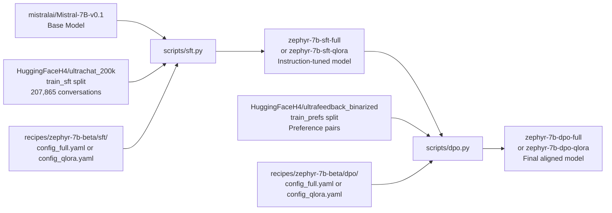
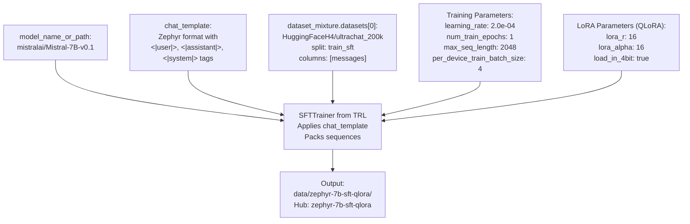
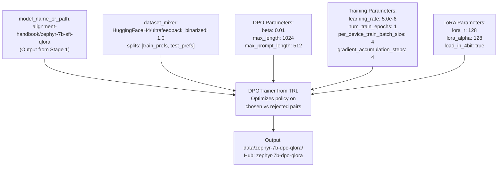
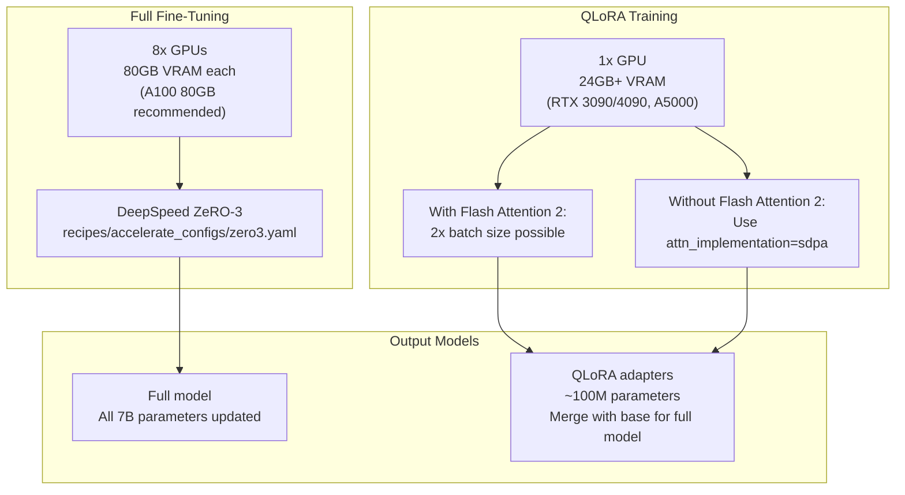

<!-- source: DeepWiki mcp.deepwiki.com · repo huggingface/alignment-handbook · extra page Zephyr-7B-Beta · fetched 2026-10-26 -->

# Zephyr-7B-Beta

<details>
<summary>Relevant source files</summary>

The following files were used as context for generating this wiki page:

- [recipes/zephyr-7b-beta/README.md](recipes/zephyr-7b-beta/README.md)
- [recipes/zephyr-7b-beta/dpo/config_qlora.yaml](recipes/zephyr-7b-beta/dpo/config_qlora.yaml)
- [recipes/zephyr-7b-beta/sft/config_qlora.yaml](recipes/zephyr-7b-beta/sft/config_qlora.yaml)

</details>


## Purpose and Scope

This page provides detailed documentation for training Zephyr-7B-Beta, a chat-aligned language model based on Mistral-7B-v0.1. Zephyr-7B-Beta follows a two-stage training methodology: supervised fine-tuning (SFT) followed by direct preference optimization (DPO). This recipe demonstrates the traditional alignment pipeline used in the Alignment Handbook.

For an overview of the entire Zephyr model family including other variants, see [Zephyr Model Family](#4.1). For general information about SFT and DPO training methods, see [Supervised Fine-Tuning](#3.1) and [Direct Preference Optimization](#3.2).

**Sources:** [recipes/zephyr-7b-beta/README.md:1-11]()

## Training Pipeline Overview

Zephyr-7B-Beta training proceeds in two sequential stages, each producing an intermediate or final model:



**Two-Stage Training Process:**

| Stage | Method | Input Model | Dataset | Output Model | Purpose |
|-------|--------|-------------|---------|--------------|---------|
| 1 | SFT | `mistralai/Mistral-7B-v0.1` | `ultrachat_200k` (train_sft) | `zephyr-7b-sft-*` | Instruction following |
| 2 | DPO | `zephyr-7b-sft-*` | `ultrafeedback_binarized` (train_prefs) | `zephyr-7b-dpo-*` | Preference alignment |

**Sources:** [recipes/zephyr-7b-beta/README.md:4-7](), [recipes/zephyr-7b-beta/sft/config_qlora.yaml:24-31](), [recipes/zephyr-7b-beta/dpo/config_qlora.yaml:23-27]()

## Recipe Directory Structure

The Zephyr-7B-Beta recipe is organized into separate directories for each training stage:

```
recipes/zephyr-7b-beta/
├── README.md              # Training instructions and commands
├── sft/
│   ├── config_full.yaml   # Full fine-tuning SFT configuration
│   └── config_qlora.yaml  # QLoRA SFT configuration
└── dpo/
    ├── config_full.yaml   # Full fine-tuning DPO configuration
    └── config_qlora.yaml  # QLoRA DPO configuration
```

Each stage provides two configuration variants:
- **Full fine-tuning**: Updates all model parameters, requires 8x80GB GPUs
- **QLoRA**: Parameter-efficient training with 4-bit quantization, runs on single GPU

**Sources:** [recipes/zephyr-7b-beta/README.md:1-45]()

## Stage 1: Supervised Fine-Tuning (SFT)

### Configuration Details

The SFT stage fine-tunes Mistral-7B-v0.1 on conversational data to teach instruction-following behavior.



### Key Configuration Parameters (QLoRA)

| Parameter | Value | Description |
|-----------|-------|-------------|
| `model_name_or_path` | `mistralai/Mistral-7B-v0.1` | Base model to fine-tune |
| `torch_dtype` | `bfloat16` | Mixed precision training |
| `attn_implementation` | `flash_attention_2` | Efficient attention mechanism |
| `load_in_4bit` | `true` | Enable 4-bit quantization |
| `lora_r` | `16` | LoRA rank |
| `lora_alpha` | `16` | LoRA scaling factor |
| `lora_target_modules` | `q_proj, k_proj, v_proj, o_proj, gate_proj, up_proj, down_proj` | Modules to apply LoRA |
| `learning_rate` | `2.0e-04` | Initial learning rate |
| `num_train_epochs` | `1` | Training epochs |
| `max_seq_length` | `2048` | Maximum sequence length |
| `per_device_train_batch_size` | `4` | Batch size per GPU |
| `gradient_accumulation_steps` | `2` | Gradient accumulation steps |

**Sources:** [recipes/zephyr-7b-beta/sft/config_qlora.yaml:1-71]()

### Chat Template

The SFT configuration defines a custom chat template for formatting conversations:

```


{{ '<|user|>\n' + message['content'] + eos_token }}

{{ '<|system|>\n' + message['content'] + eos_token }}

{{ '<|assistant|>\n'  + message['content'] + eos_token }}


{{ '<|assistant|>' }}


```

This Jinja2 template transforms message dictionaries into the Zephyr format with special tokens `<|user|>`, `<|assistant|>`, and `<|system|>`.

**Sources:** [recipes/zephyr-7b-beta/sft/config_qlora.yaml:23]()

### Training Commands

**Full Fine-Tuning (8x80GB GPUs with DeepSpeed ZeRO-3):**
```bash
ACCELERATE_LOG_LEVEL=info accelerate launch \
  --config_file recipes/accelerate_configs/zero3.yaml \
  scripts/sft.py \
  --config recipes/zephyr-7b-beta/sft/config_full.yaml
```

**QLoRA Training (1 GPU with Flash Attention 2):**
```bash
ACCELERATE_LOG_LEVEL=info accelerate launch \
  --config_file recipes/accelerate_configs/ddp.yaml \
  --num_processes=1 \
  scripts/sft.py \
  --config recipes/zephyr-7b-beta/sft/config_qlora.yaml \
  --load_in_4bit=true
```

**QLoRA Training (without Flash Attention 2):**
```bash
ACCELERATE_LOG_LEVEL=info accelerate launch \
  --config_file recipes/accelerate_configs/ddp.yaml \
  --num_processes=1 \
  scripts/sft.py \
  --config recipes/zephyr-7b-beta/sft/config_qlora.yaml \
  --load_in_4bit=true \
  --attn_implementation=sdpa
```

**Sources:** [recipes/zephyr-7b-beta/README.md:13-44]()

## Stage 2: Direct Preference Optimization (DPO)

### Configuration Details

The DPO stage aligns the SFT model to human preferences using chosen/rejected response pairs from UltraFeedback.



### Key Configuration Parameters (QLoRA)

| Parameter | Value | Description |
|-----------|-------|-------------|
| `model_name_or_path` | `alignment-handbook/zephyr-7b-sft-qlora` | SFT model from Stage 1 |
| `beta` | `0.01` | DPO temperature parameter |
| `max_length` | `1024` | Maximum sequence length |
| `max_prompt_length` | `512` | Maximum prompt length |
| `learning_rate` | `5.0e-6` | Lower learning rate than SFT |
| `num_train_epochs` | `1` | Single epoch training |
| `lora_r` | `128` | Higher rank than SFT (16→128) |
| `lora_alpha` | `128` | Matches LoRA rank |
| `gradient_accumulation_steps` | `4` | More accumulation for stability |
| `optim` | `paged_adamw_32bit` | Memory-efficient optimizer |

**Sources:** [recipes/zephyr-7b-beta/dpo/config_qlora.yaml:1-57]()

### Training Commands

**Full Fine-Tuning (8x80GB GPUs with DeepSpeed ZeRO-3):**
```bash
ACCELERATE_LOG_LEVEL=info accelerate launch \
  --config_file recipes/accelerate_configs/zero3.yaml \
  scripts/dpo.py \
  --config recipes/zephyr-7b-beta/dpo/config_full.yaml
```

**QLoRA Training (1 GPU with Flash Attention 2):**
```bash
ACCELERATE_LOG_LEVEL=info accelerate launch \
  --config_file recipes/accelerate_configs/ddp.yaml \
  --num_processes=1 \
  scripts/dpo.py \
  --config recipes/zephyr-7b-beta/dpo/config_qlora.yaml
```

**QLoRA Training (without Flash Attention 2):**
```bash
ACCELERATE_LOG_LEVEL=info accelerate launch \
  --config_file recipes/accelerate_configs/ddp.yaml \
  --num_processes=1 \
  scripts/dpo.py \
  --config recipes/zephyr-7b-beta/dpo/config_qlora.yaml \
  --attn_implementation=sdpa
```

**Sources:** [recipes/zephyr-7b-beta/README.md:20-44]()

## Hyperparameter Evolution and Important Notes

### Corrected Hyperparameters

After the initial Zephyr-7B-Beta release, the training process was refined based on two important findings:

1. **UltraFeedback Dataset Corrections**: The Argilla team discovered several thousand incorrect preference labels in the source dataset that were corrected in later versions.

2. **TRL Learning Rate Scheduler Bug**: A bug in `SFTTrainer` caused training to terminate early, requiring hyperparameter adjustments.

These corrections led to improved hyperparameters that differ from the original technical report:

| Parameter | Original (Tech Report) | Corrected (Current Recipe) | Impact |
|-----------|----------------------|---------------------------|---------|
| DPO `beta` | `0.1` | `0.01` | Lower temperature for more conservative alignment |
| DPO `num_train_epochs` | `3` | `1` | Single epoch sufficient with corrected data |

The current recipe configurations achieve comparable performance to the original `zephyr-7b-beta` with more efficient training (1 epoch vs 3 epochs).

**Sources:** [recipes/zephyr-7b-beta/README.md:9-10](), [recipes/zephyr-7b-beta/dpo/config_qlora.yaml:32](), [recipes/zephyr-7b-beta/dpo/config_qlora.yaml:47]()

## Resource Requirements and Training Time

### Hardware Requirements



### Training Configuration Comparison

| Aspect | Full Fine-Tuning | QLoRA |
|--------|-----------------|-------|
| GPU Memory | 8x 80GB | 1x 24GB+ |
| Distributed Strategy | DeepSpeed ZeRO-3 | DDP (single process) |
| Quantization | None (bfloat16) | 4-bit (`load_in_4bit=true`) |
| Parameters Updated | All 7B parameters | LoRA adapters only |
| SFT LoRA Rank | N/A | `lora_r=16` |
| DPO LoRA Rank | N/A | `lora_r=128` |
| Flash Attention 2 | Optional | Recommended (enables 2x batch size) |
| Training Speed | Faster (parallel) | Slower (single GPU) |
| Final Model Size | 7B parameters | Base + adapters (mergeable) |

**Sources:** [recipes/zephyr-7b-beta/README.md:15-35](), [recipes/zephyr-7b-beta/sft/config_qlora.yaml:8-20](), [recipes/zephyr-7b-beta/dpo/config_qlora.yaml:6-19]()

## Published Models

The Zephyr-7B-Beta recipe produces four variants published on the Hugging Face Hub:

| Model | Training Method | Hub Location | Description |
|-------|----------------|--------------|-------------|
| `zephyr-7b-sft-full` | Full fine-tuning SFT | `alignment-handbook/zephyr-7b-sft-full` | SFT checkpoint, all parameters |
| `zephyr-7b-sft-qlora` | QLoRA SFT | `alignment-handbook/zephyr-7b-sft-qlora` | SFT checkpoint with LoRA adapters |
| `zephyr-7b-dpo-full` | Full fine-tuning DPO | `alignment-handbook/zephyr-7b-dpo-full` | Final aligned model, all parameters |
| `zephyr-7b-dpo-qlora` | QLoRA DPO | `alignment-handbook/zephyr-7b-dpo-qlora` | Final aligned model with LoRA adapters |

All models are automatically pushed to the Hub during training when `push_to_hub: true` is set in the configuration. The `hub_model_id` parameter in each config file specifies the model name on the Hub.

**Sources:** [recipes/zephyr-7b-beta/README.md:6-7](), [recipes/zephyr-7b-beta/sft/config_qlora.yaml:50-64](), [recipes/zephyr-7b-beta/dpo/config_qlora.yaml:40-52]()

## Configuration File Reference

### SFT Configuration Structure

The SFT configuration files ([recipes/zephyr-7b-beta/sft/config_qlora.yaml:1-71]()) define:

- **Model arguments**: Base model, dtype, attention implementation
- **LoRA arguments** (QLoRA only): Quantization, rank, target modules
- **Data arguments**: `chat_template`, `dataset_mixture` with `datasets` list
- **SFTConfig arguments**: Learning rate, batch size, epochs, logging, Hub publishing

### DPO Configuration Structure

The DPO configuration files ([recipes/zephyr-7b-beta/dpo/config_qlora.yaml:1-57]()) define:

- **Model arguments**: SFT checkpoint path, dtype, attention implementation
- **LoRA arguments** (QLoRA only): Higher rank (128 vs 16), target modules
- **Data arguments**: `dataset_mixer` with UltraFeedback dataset
- **DPOConfig arguments**: `beta`, sequence lengths, learning rate, training parameters

Both configurations integrate with the core library's configuration system documented in [Configuration System](#2.1).

**Sources:** [recipes/zephyr-7b-beta/sft/config_qlora.yaml:1-71](), [recipes/zephyr-7b-beta/dpo/config_qlora.yaml:1-57]()

---

