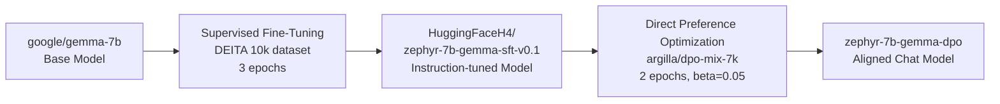
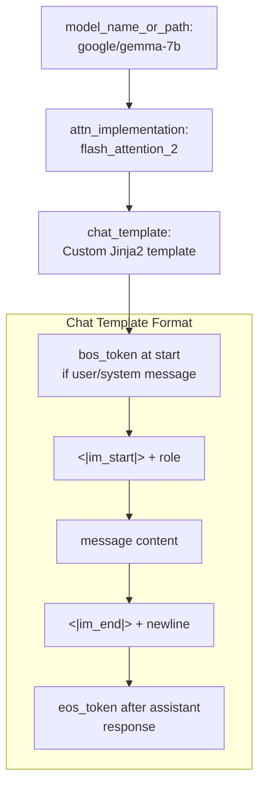
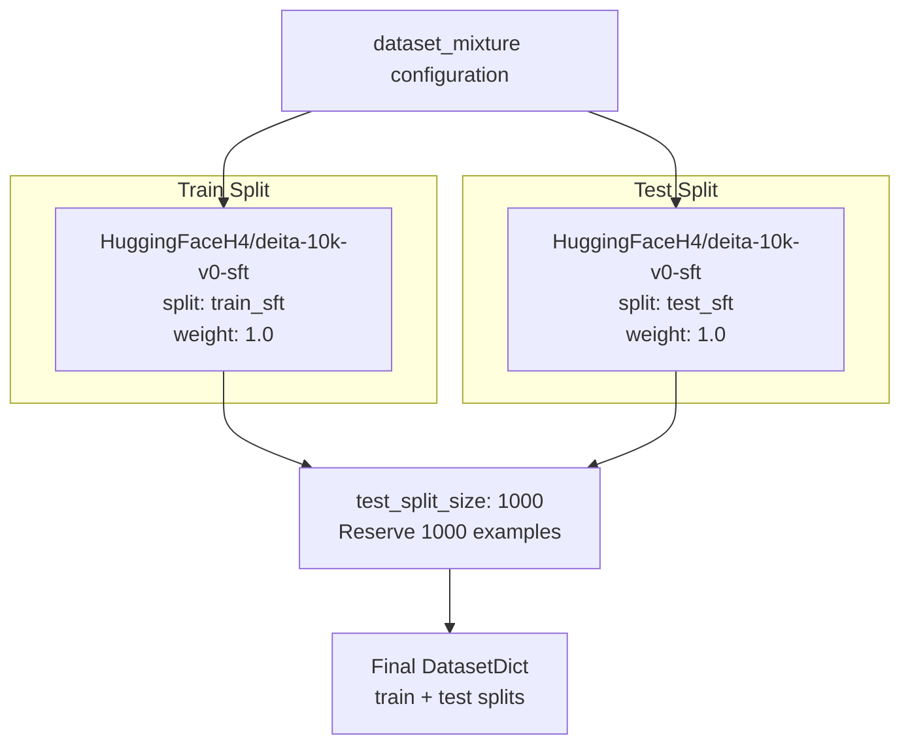
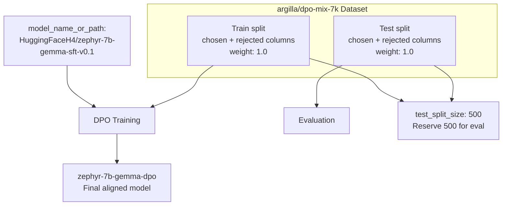
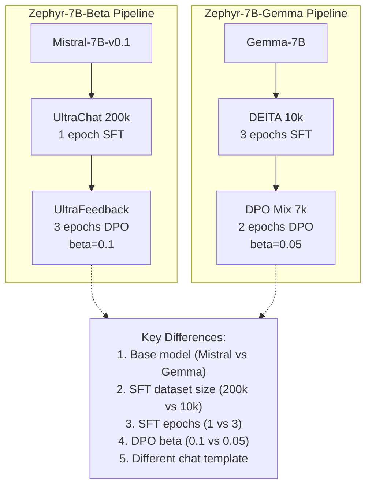

<!-- source: DeepWiki mcp.deepwiki.com · repo huggingface/alignment-handbook · extra page Zephyr-7B-Gemma and Variants · fetched 2026-10-26 -->

# Zephyr-7B-Gemma and Variants

<details>
<summary>Relevant source files</summary>

The following files were used as context for generating this wiki page:

- [recipes/starchat2-15b/dpo/config_v0.1.yaml](recipes/starchat2-15b/dpo/config_v0.1.yaml)
- [recipes/starchat2-15b/sft/config_v0.1.yaml](recipes/starchat2-15b/sft/config_v0.1.yaml)
- [recipes/zephyr-7b-gemma/dpo/config_full.yaml](recipes/zephyr-7b-gemma/dpo/config_full.yaml)
- [recipes/zephyr-7b-gemma/sft/config_full.yaml](recipes/zephyr-7b-gemma/sft/config_full.yaml)

</details>


## Purpose and Scope

This page documents the training recipes for Zephyr-7B-Gemma, a variant of the Zephyr model family built on Google's Gemma-7B base model instead of Mistral-7B. This variant demonstrates how the Alignment Handbook can be adapted to different base models while maintaining the two-stage SFT→DPO training approach. For information about the original Mistral-based Zephyr model, see [Zephyr-7B-Beta](#4.1.1). For large-scale ORPO training, see [Zephyr-141B-A35B](#4.1.3).

## Overview

Zephyr-7B-Gemma follows the same alignment philosophy as Zephyr-7B-Beta but uses a different foundation:

| Aspect | Zephyr-7B-Beta | Zephyr-7B-Gemma |
|--------|----------------|-----------------|
| Base Model | `mistralai/Mistral-7B-v0.1` | `google/gemma-7b` |
| SFT Dataset | UltraChat 200k | DEITA 10k |
| DPO Dataset | UltraFeedback (binarized) | argilla/dpo-mix-7k |
| Chat Template | ChatML-style | ChatML-style (custom) |
| SFT Epochs | 1 | 3 |
| DPO Beta | 0.1 | 0.05 |

The Gemma variant uses a more compact SFT dataset (DEITA 10k) and a different preference dataset (DPO Mix 7k), while maintaining comparable performance characteristics. The training recipes are located in `recipes/zephyr-7b-gemma/`.

Sources: [recipes/zephyr-7b-gemma/sft/config_full.yaml:1-59](), [recipes/zephyr-7b-gemma/dpo/config_full.yaml:1-54]()

## Training Pipeline

The Zephyr-7B-Gemma training follows a two-stage approach:



**Training Pipeline: Zephyr-7B-Gemma Two-Stage Training**

Each stage produces a checkpoint that can be used independently or as input to the next stage. The SFT model is suitable for general instruction-following, while the DPO model provides improved alignment with human preferences.

Sources: [recipes/zephyr-7b-gemma/sft/config_full.yaml:1-59](), [recipes/zephyr-7b-gemma/dpo/config_full.yaml:1-54]()

## Supervised Fine-Tuning Configuration

### Base Model and Chat Template

The SFT stage starts from `google/gemma-7b` and applies a custom ChatML-style template:



**Chat Template Structure: Custom ChatML Format**

The chat template is defined inline in the configuration:

```yaml
chat_template: "{{ bos_token }}{{ '<|im_start|>' + message['role'] + '\n' + message['content'] + '<|im_end|>' + '\n' }}{{ '<|im_start|>assistant\n' }}{{ eos_token }}"
```

This template wraps each message with `<|im_start|>` and `<|im_end|>` tokens, similar to OpenAI's ChatML format but adapted for Gemma's tokenizer.

Sources: [recipes/zephyr-7b-gemma/sft/config_full.yaml:1-8]()

### Dataset Configuration

The SFT stage uses the DEITA-10k dataset, a high-quality instruction dataset:



**Dataset Mixing: DEITA-10k for Instruction Tuning**

The dataset configuration specifies the `messages` column for the conversational format:

| Parameter | Value |
|-----------|-------|
| Dataset ID | `HuggingFaceH4/deita-10k-v0-sft` |
| Config | `default` |
| Train Split | `train_sft` |
| Test Split | `test_sft` |
| Columns | `messages` |
| Test Split Size | 1000 examples |
| Seed | 0 |

Sources: [recipes/zephyr-7b-gemma/sft/config_full.yaml:9-25]()

### Training Hyperparameters

The SFT configuration uses the following key parameters:

| Parameter | Value | Purpose |
|-----------|-------|---------|
| `bf16` | `true` | BFloat16 mixed precision training |
| `learning_rate` | `2.0e-05` | Learning rate for AdamW |
| `num_train_epochs` | `3` | More epochs than Zephyr-Beta (1 epoch) |
| `per_device_train_batch_size` | `4` | Batch size per GPU |
| `gradient_accumulation_steps` | `4` | Effective batch size = 16 per GPU |
| `max_seq_length` | `2048` | Maximum sequence length |
| `gradient_checkpointing` | `true` | Reduces memory usage |
| `warmup_ratio` | `0.1` | 10% warmup steps |
| `lr_scheduler_type` | `cosine` | Cosine annealing schedule |
| `eval_strategy` | `epoch` | Evaluate after each epoch |

Special dataset handling flags:

```yaml
dataset_kwargs:
  add_special_tokens: false  # Already wrapped in chat template
  append_concat_token: false # No need for <eos> across samples
```

These flags prevent double-adding special tokens since the chat template already handles `<bos>` and `<eos>` tokens.

Sources: [recipes/zephyr-7b-gemma/sft/config_full.yaml:27-59]()

### Model Output Configuration

```yaml
hub_model_id: zephyr-7b-gemma-sft
hub_strategy: every_save
push_to_hub: true
output_dir: data/zephyr-7b-gemma-sft
save_strategy: "no"
```

The model is pushed to the Hub with ID `zephyr-7b-gemma-sft` but no intermediate checkpoints are saved locally (`save_strategy: "no"`), conserving disk space.

Sources: [recipes/zephyr-7b-gemma/sft/config_full.yaml:38-57]()

## Direct Preference Optimization Configuration

### Starting Model and Dataset

The DPO stage starts from the SFT checkpoint and uses a different preference dataset:



**DPO Stage: Preference Alignment with DPO Mix 7k**

The DPO Mix 7k dataset is a curated collection of preference pairs. Unlike UltraFeedback used in Zephyr-Beta, this dataset provides a more diverse mix of preference data.

| Parameter | Value |
|-----------|-------|
| Dataset ID | `argilla/dpo-mix-7k` |
| Config | `default` |
| Splits | `train`, `test` |
| Columns | `chosen`, `rejected` |
| Test Split Size | 500 examples |

Sources: [recipes/zephyr-7b-gemma/dpo/config_full.yaml:1-24]()

### DPO Training Parameters

The DPO configuration differs from Zephyr-Beta in several key parameters:

| Parameter | Zephyr-Beta | Zephyr-Gemma | Notes |
|-----------|-------------|--------------|-------|
| `beta` | `0.1` | `0.05` | Lower beta = stronger preference signal |
| `learning_rate` | `5.0e-7` | `5.0e-7` | Same learning rate |
| `max_length` | `1024` | `1024` | Maximum response length |
| `max_prompt_length` | `512` | `512` | Maximum prompt length |
| `num_train_epochs` | `3` | `2` | Fewer epochs |
| `per_device_train_batch_size` | `2` | `2` | Same batch size |
| `gradient_accumulation_steps` | `8` | `8` | Same accumulation |

The lower beta value (`0.05` vs `0.1`) means the Gemma variant applies stronger regularization toward the reference policy, potentially resulting in more conservative preference learning.

### Training Infrastructure

```yaml
gradient_checkpointing: true
gradient_checkpointing_kwargs:
  use_reentrant: False
bf16: true
optim: adamw_torch
lr_scheduler_type: cosine
warmup_ratio: 0.1
```

The configuration uses:
- Gradient checkpointing with `use_reentrant: False` for better memory efficiency with modern PyTorch
- BFloat16 precision throughout
- AdamW optimizer with cosine learning rate schedule
- 10% warmup ratio for stable training

Sources: [recipes/zephyr-7b-gemma/dpo/config_full.yaml:26-54]()

### Evaluation and Logging

```yaml
do_eval: true
eval_strategy: steps
eval_steps: 100
report_to:
  - tensorboard
  - wandb
```

The DPO stage evaluates every 100 training steps and logs to both TensorBoard and Weights & Biases for experiment tracking.

Sources: [recipes/zephyr-7b-gemma/dpo/config_full.yaml:29-51]()

## Execution Commands

### SFT Stage Execution

To run the supervised fine-tuning stage:

```bash
# Using DeepSpeed ZeRO-3 for multi-GPU training
accelerate launch \
  --config_file recipes/accelerate_configs/zero3.yaml \
  scripts/sft.py \
  recipes/zephyr-7b-gemma/sft/config_full.yaml
```

The SFT stage requires approximately 8x80GB A100 GPUs with DeepSpeed ZeRO-3 for full fine-tuning. For lower memory requirements, use QLoRA variants (not shown in the provided files).

### DPO Stage Execution

After SFT completes and the model is pushed to the Hub:

```bash
# Using DeepSpeed ZeRO-3 for DPO training
accelerate launch \
  --config_file recipes/accelerate_configs/zero3.yaml \
  scripts/dpo.py \
  recipes/zephyr-7b-gemma/dpo/config_full.yaml
```

The DPO stage automatically loads the SFT checkpoint from `HuggingFaceH4/zephyr-7b-gemma-sft-v0.1` as specified in the configuration.

### Parameter Overrides

Both stages support CLI parameter overrides:

```bash
# Override learning rate and batch size
accelerate launch \
  --config_file recipes/accelerate_configs/zero3.yaml \
  scripts/sft.py \
  recipes/zephyr-7b-gemma/sft/config_full.yaml \
  --learning_rate 1.0e-05 \
  --per_device_train_batch_size 2
```

Sources: [recipes/zephyr-7b-gemma/sft/config_full.yaml:1-59](), [recipes/zephyr-7b-gemma/dpo/config_full.yaml:1-54]()

## Key Design Differences

### Comparison with Zephyr-7B-Beta



**Training Comparison: Beta vs Gemma Variants**

### Dataset Strategy

Zephyr-7B-Gemma uses a **quality over quantity** approach:

- **DEITA 10k**: A carefully curated subset of high-quality instructions (10k examples) trained for 3 epochs
- **Zephyr-Beta's UltraChat 200k**: Larger dataset (200k examples) trained for only 1 epoch

This demonstrates that fewer high-quality examples with more training can achieve comparable results to larger datasets with less training.

### Preference Learning

The lower DPO beta value (`0.05`) in Zephyr-Gemma indicates:

1. **Stronger KL penalty**: The model stays closer to the reference (SFT) policy
2. **More conservative alignment**: Less likely to deviate from the instruction-following behavior learned during SFT
3. **Potentially better calibration**: May produce more reliable uncertainty estimates

Sources: [recipes/zephyr-7b-gemma/sft/config_full.yaml:1-59](), [recipes/zephyr-7b-gemma/dpo/config_full.yaml:1-54]()

## Expected Outputs and Artifacts

### Model Checkpoints

The training pipeline produces the following Hub models:

| Stage | Hub ID | Purpose |
|-------|--------|---------|
| SFT | `zephyr-7b-gemma-sft` (or custom `hub_model_id`) | Instruction-tuned model |
| DPO | `zephyr-7b-gemma-dpo` (or custom `hub_model_id`) | Preference-aligned model |

### Local Outputs

Local directories created during training:

- `data/zephyr-7b-gemma-sft/`: SFT training outputs (logs, but no checkpoints due to `save_strategy: "no"`)
- `data/zephyr-7b-gemma-dpo/`: DPO training outputs

### Logging and Metrics

Both stages log to:
- **TensorBoard**: Local tensorboard logs in the output directory
- **Weights & Biases**: Remote experiment tracking (if configured)

Key metrics tracked:
- Training loss
- Evaluation loss (SFT: per epoch, DPO: every 100 steps)
- Learning rate schedule
- Gradient norms

Sources: [recipes/zephyr-7b-gemma/sft/config_full.yaml:48-56](), [recipes/zephyr-7b-gemma/dpo/config_full.yaml:49-51]()

## Configuration File Locations

The complete configuration files for Zephyr-7B-Gemma training are located at:

- **SFT Configuration**: [recipes/zephyr-7b-gemma/sft/config_full.yaml:1-59]()
- **DPO Configuration**: [recipes/zephyr-7b-gemma/dpo/config_full.yaml:1-54]()

These YAML files can be used directly with `scripts/sft.py` and `scripts/dpo.py`, or modified for custom training runs. For information about creating custom recipes based on these templates, see [Creating Custom Recipes](#4.5).

---

