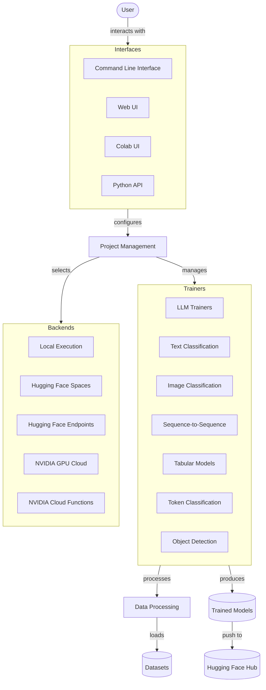
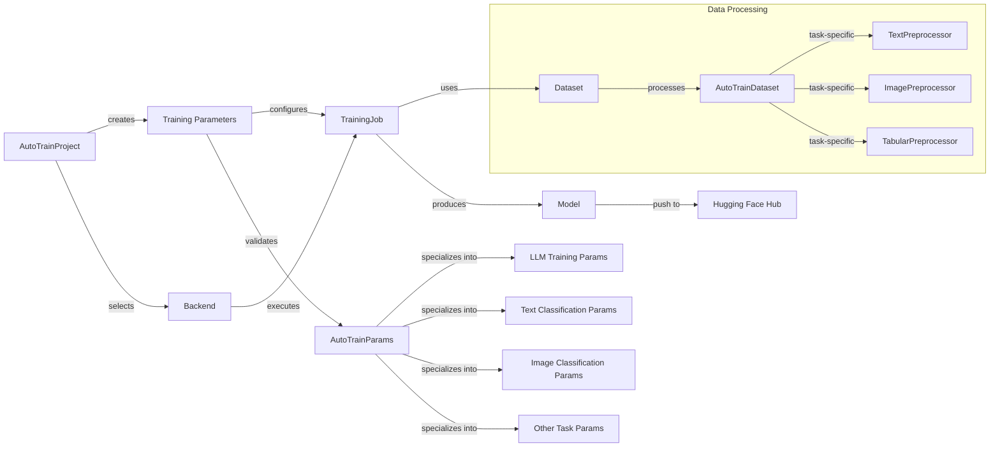
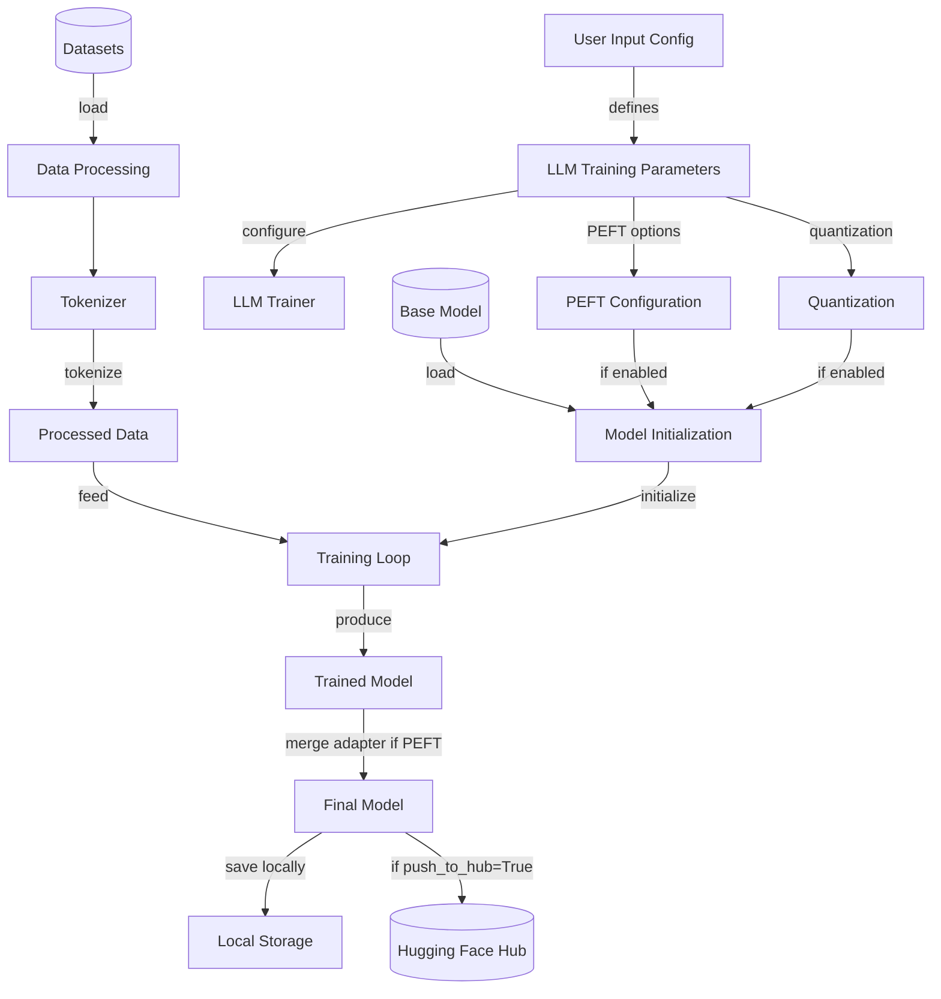

<!-- source: DeepWiki mcp.deepwiki.com · repo huggingface/autotrain-advanced · page 1 Overview · fetched 2026-10-26 -->

# Overview

<details>
<summary>Relevant source files</summary>

The following files were used as context for generating this wiki page:

- [README.md](README.md)
- [colabs/AutoTrain.ipynb](colabs/AutoTrain.ipynb)
- [colabs/AutoTrain_ngrok.ipynb](colabs/AutoTrain_ngrok.ipynb)
- [docs/source/_toctree.yml](docs/source/_toctree.yml)
- [docs/source/cost.mdx](docs/source/cost.mdx)
- [docs/source/index.mdx](docs/source/index.mdx)
- [docs/source/tasks/llm_finetuning.mdx](docs/source/tasks/llm_finetuning.mdx)
- [docs/source/tasks/text_classification_regression.mdx](docs/source/tasks/text_classification_regression.mdx)
- [static/autotrain_homepage.png](static/autotrain_homepage.png)
- [static/autotrain_text_classification.png](static/autotrain_text_classification.png)
- [static/dreambooth2.png](static/dreambooth2.png)
- [static/llm_orpo_example.png](static/llm_orpo_example.png)
- [static/space_template_2.png](static/space_template_2.png)

</details>


AutoTrain Advanced is a no-code solution for training and deploying state-of-the-art machine learning models. It provides an accessible interface for users to train custom models on their data without requiring extensive programming knowledge or machine learning expertise. This document provides a comprehensive overview of the AutoTrain Advanced system architecture and components.

## Purpose and Scope

AutoTrain Advanced aims to democratize machine learning by allowing users to train sophisticated models with just a few clicks. It abstracts away the complexity of model training while offering flexibility for advanced users. This page explains the overall architecture and main components of the system. For more specific information about individual components, refer to their respective pages:

- For detailed information about Project Management, see [Project Management](#2.1)
- For information about Data Processing, see [Data Processing](#2.2)
- For information about Training Components, see [Training Components](#3)
- For details on interfaces, see [User Interfaces](#4)

Sources: [README.md:1-48](https://github.com/huggingface/autotrain-advanced/blob/main/README.md), [docs/source/index.mdx:1-47](https://github.com/huggingface/autotrain-advanced/blob/main/docs/source/index.mdx)

## Key Capabilities

AutoTrain Advanced supports a wide range of machine learning tasks:

| Task Type | Supported Tasks |
|-----------|----------------|
| Text Processing | LLM Finetuning (SFT, ORPO, DPO, Reward), Text Classification/Regression, Token Classification, Sequence-to-Sequence, Extractive QA, Sentence Transformers |
| Vision | Image Classification/Regression, Object Detection |
| Multimodal | Visual Language Model (VLM) finetuning |
| Structured Data | Tabular Classification/Regression |

Users can train models using different execution backends, including local machines, Hugging Face Spaces, Hugging Face Endpoints, NVIDIA GPU Cloud, and NVIDIA Cloud Functions.

Sources: [README.md:7-23](https://github.com/huggingface/autotrain-advanced/blob/main/README.md), [docs/source/_toctree.yml:21-40](https://github.com/huggingface/autotrain-advanced/blob/main/docs/source/_toctree.yml)

## System Architecture

### High-Level Architecture Overview



AutoTrain Advanced uses a modular architecture with clear separation of concerns. Users interact with the system through various interfaces, configure training projects, and the system handles the data processing, model training, and deployment.

Sources: [README.md:1-133](https://github.com/huggingface/autotrain-advanced/blob/main/README.md), [docs/source/index.mdx:1-62](https://github.com/huggingface/autotrain-advanced/blob/main/docs/source/index.mdx)

### Core Components Relationship



The `AutoTrainProject` class serves as the central orchestrator, creating parameter objects and selecting the appropriate backend. Parameters are validated through the `AutoTrainParams` hierarchy, which has specialized subclasses for different tasks. The training job uses datasets that are processed by task-specific preprocessors.

Sources: [docs/source/tasks/llm_finetuning.mdx:1-357](https://github.com/huggingface/autotrain-advanced/blob/main/docs/source/tasks/llm_finetuning.mdx), [docs/source/tasks/text_classification_regression.mdx:1-150](https://github.com/huggingface/autotrain-advanced/blob/main/docs/source/tasks/text_classification_regression.mdx)

## User Interaction Modes

AutoTrain Advanced provides multiple ways for users to interact with the system:

1. **Command Line Interface (CLI)**: For users who prefer terminal-based interactions
   ```bash
   autotrain --config config.yaml
   ```

2. **Web User Interface**: Accessible by running:
   ```bash
   autotrain app --port 8080 --host 127.0.0.1
   ```

3. **Colab Integration**: Users can run AutoTrain in Google Colab using provided notebooks
   ```python
   # Inside Colab
   from autotrain.app.colab import colab_app
   elements = colab_app()
   display(elements)
   ```

4. **Hosted on Hugging Face Spaces**: Users can deploy AutoTrain on Spaces using the provided Docker image

5. **Python API**: For programmatic access and integration into existing workflows

Sources: [README.md:26-55](https://github.com/huggingface/autotrain-advanced/blob/main/README.md), [colabs/AutoTrain.ipynb:1-50](https://github.com/huggingface/autotrain-advanced/blob/main/colabs/AutoTrain.ipynb), [colabs/AutoTrain_ngrok.ipynb:1-52](https://github.com/huggingface/autotrain-advanced/blob/main/colabs/AutoTrain_ngrok.ipynb)

## Typical Workflow

The typical workflow for using AutoTrain Advanced consists of the following steps:

1. **Data Preparation**: Prepare the dataset in the required format (CSV, JSONL, etc.)

2. **Configuration**: Set up training parameters through the interface or a configuration file
   ```yaml
   task: llm-sft
   base_model: HuggingFaceTB/SmolLM2-1.7B-Instruct
   project_name: autotrain-smollm2-finetune
   log: tensorboard
   backend: local
   
   data:
     path: HuggingFaceH4/no_robots
     train_split: train
     valid_split: null
     chat_template: tokenizer
     column_mapping:
       text_column: messages
   
   params:
     block_size: 2048
     model_max_length: 4096
     epochs: 2
     batch_size: 1
     lr: 1e-5
     peft: true
     quantization: int4
     target_modules: all-linear
     padding: right
     optimizer: paged_adamw_8bit
     scheduler: linear
     gradient_accumulation: 8
     mixed_precision: bf16
     merge_adapter: true
   
   hub:
     username: ${HF_USERNAME}
     token: ${HF_TOKEN}
     push_to_hub: true
   ```

3. **Execution**: Run the training process through the chosen interface

4. **Deployment**: Download the trained model or push it to Hugging Face Hub for sharing and deployment

Sources: [README.md:65-111](https://github.com/huggingface/autotrain-advanced/blob/main/README.md), [docs/source/tasks/llm_finetuning.mdx:175-226](https://github.com/huggingface/autotrain-advanced/blob/main/docs/source/tasks/llm_finetuning.mdx)

## Cost and Accessibility

AutoTrain Advanced is designed to be accessible to users with different requirements and resources:

- **Free Local Usage**: When running locally, users only pay for the computing resources they use on their own infrastructure
- **Pay-As-You-Go on Spaces**: When using Hugging Face Spaces, costs are based on computing resources consumed
- **Model Ownership**: Users retain full ownership of their trained models, which can be downloaded and deployed anywhere

This flexibility allows users to choose the most suitable approach based on their needs, whether they are experimenting locally or scaling up operations on Hugging Face Spaces.

Sources: [README.md:3-5](https://github.com/huggingface/autotrain-advanced/blob/main/README.md), [docs/source/cost.mdx:1-40](https://github.com/huggingface/autotrain-advanced/blob/main/docs/source/cost.mdx)

## LLM Training Data Flow



This diagram illustrates the data flow during LLM training, one of the most important capabilities in AutoTrain. The process begins with user configuration, which sets the training parameters. Data is loaded, tokenized, and processed while the base model is initialized with options for PEFT (Parameter-Efficient Fine-Tuning) and quantization. The processed data and initialized model feed into the training loop, which produces the trained model. If PEFT was used, the adapter may be merged into the base model. Finally, the model can be saved locally or pushed to the Hugging Face Hub.

Sources: [docs/source/tasks/llm_finetuning.mdx:1-285](https://github.com/huggingface/autotrain-advanced/blob/main/docs/source/tasks/llm_finetuning.mdx)

## Summary

AutoTrain Advanced simplifies the process of training and deploying machine learning models through a no-code interface. It supports a wide range of tasks and provides multiple ways for users to interact with the system. The modular architecture allows for flexibility and extensibility, making it suitable for both beginners and experienced users.

The system's key strengths include:

1. **Accessibility**: No-code interface makes ML accessible to non-technical users
2. **Flexibility**: Multiple interfaces and backends to suit different needs
3. **Extensibility**: Modular architecture that can be extended to support new tasks and models
4. **Integration**: Seamless integration with the Hugging Face ecosystem

This overview provides a high-level understanding of AutoTrain Advanced. For more detailed information about specific components, please refer to the respective wiki pages.

Sources: [README.md:1-133](https://github.com/huggingface/autotrain-advanced/blob/main/README.md), [docs/source/index.mdx:1-62](https://github.com/huggingface/autotrain-advanced/blob/main/docs/source/index.mdx)

---

