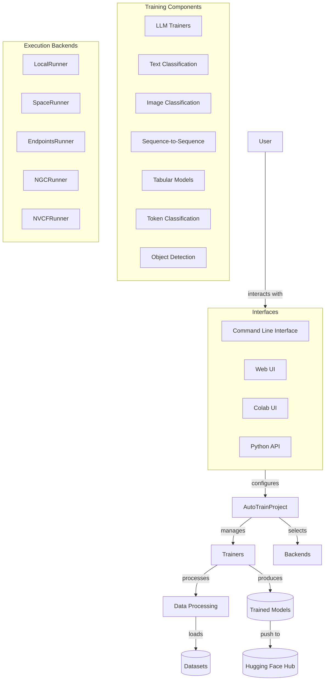
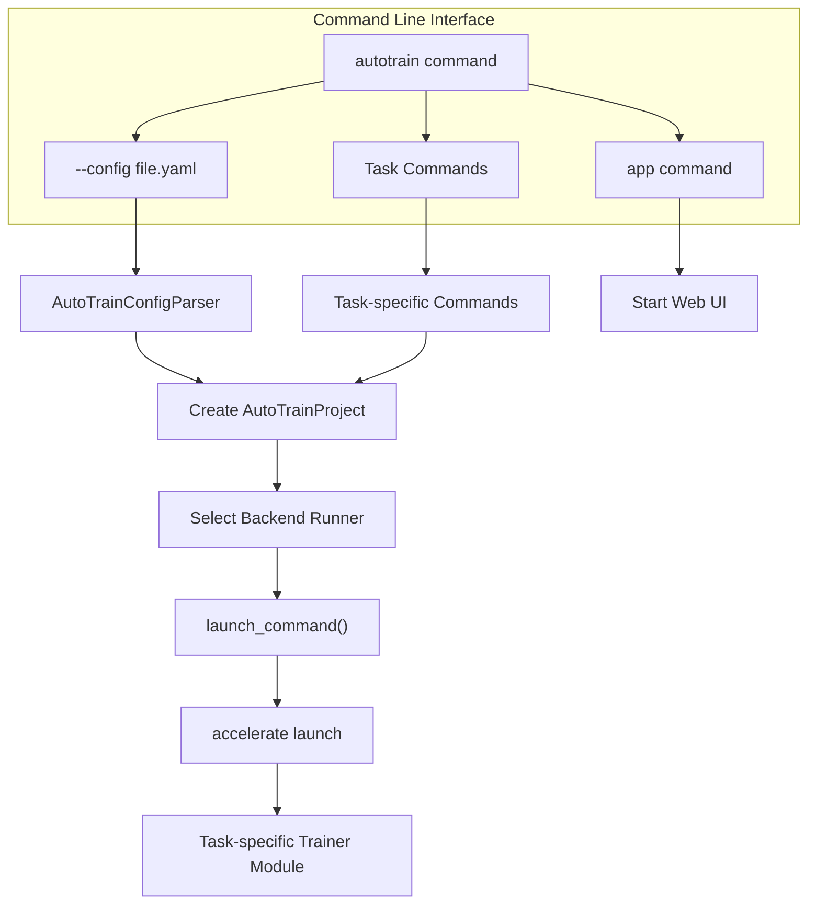
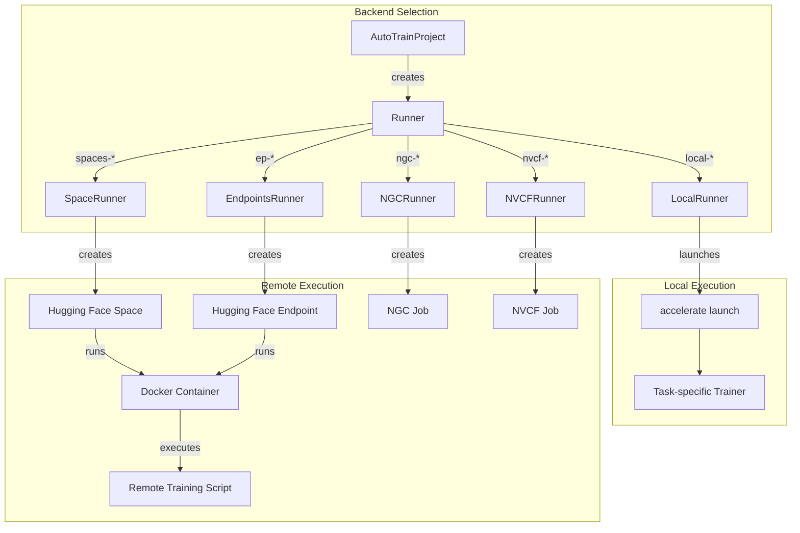
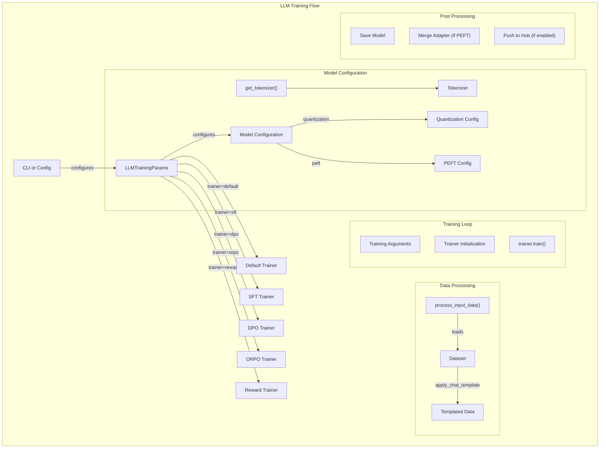
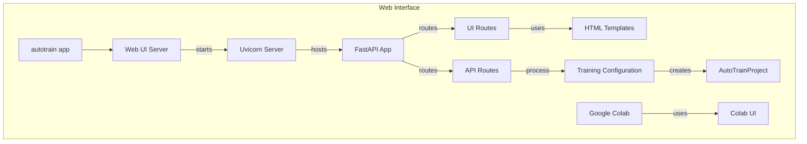
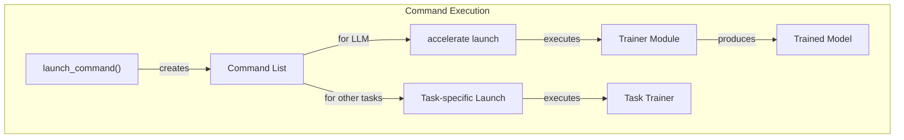

<!-- source: DeepWiki mcp.deepwiki.com · repo huggingface/autotrain-advanced · page 2 Architecture · fetched 2026-10-26 -->

# Architecture

<details>
<summary>Relevant source files</summary>

The following files were used as context for generating this wiki page:

- [configs/image_scoring/image_quality.yml](configs/image_scoring/image_quality.yml)
- [requirements.txt](requirements.txt)
- [src/autotrain/__init__.py](src/autotrain/__init__.py)
- [src/autotrain/app/colab.py](src/autotrain/app/colab.py)
- [src/autotrain/cli/autotrain.py](src/autotrain/cli/autotrain.py)
- [src/autotrain/cli/run_app.py](src/autotrain/cli/run_app.py)
- [src/autotrain/commands.py](src/autotrain/commands.py)
- [src/autotrain/params.py](src/autotrain/params.py)
- [src/autotrain/project.py](src/autotrain/project.py)
- [src/autotrain/trainers/clm/__main__.py](src/autotrain/trainers/clm/__main__.py)
- [src/autotrain/trainers/clm/utils.py](src/autotrain/trainers/clm/utils.py)
- [src/autotrain/utils.py](src/autotrain/utils.py)

</details>


This document provides a high-level overview of the AutoTrain Advanced system architecture, explaining the major components and their interactions. It covers the core systems that enable no-code machine learning training across various tasks and deployment environments. For specific details about training components, see [Training Components](#3), and for user interfaces, see [User Interfaces](#4).

## System Overview

AutoTrain Advanced is built with a modular architecture that separates concerns between project management, data processing, training, and execution backends. This design enables flexibility in how and where models are trained while maintaining a consistent user experience.



Sources: [src/autotrain/project.py:443-563](), [src/autotrain/trainers/clm/__main__.py:1-53]()

## Key Components and Relationships

### AutoTrainProject

The central orchestrator of the system is the `AutoTrainProject` class, which is responsible for:
- Creating and validating training parameters
- Processing input data
- Selecting and initializing the appropriate backend
- Launching training jobs

```mermaid
graph LR
    subgraph "AutoTrainProject Class"
        AutoTrainProject["AutoTrainProject"] --> |validates| Backend["backend"]
        AutoTrainProject --> |processes| Params["params"]
        AutoTrainProject --> |creates| Runner["Runner"]
    end
    
    subgraph "Parameter Classes"
        Params --> LLMParams["LLMTrainingParams"]
        Params --> TextParams["TextClassificationParams"]
        Params --> ImgParams["ImageClassificationParams"]
        Params --> TabParams["TabularParams"]
        Params --> OtherParams["Other Task Params"]
    end
    
    subgraph "Backends"
        Runner --> LocalRunner["LocalRunner"]
        Runner --> SpaceRunner["SpaceRunner"]
        Runner --> EndpointsRunner["EndpointsRunner"]
        Runner --> NGCRunner["NGCRunner"]
        Runner --> NVCFRunner["NVCFRunner"]
    end
    
    AutoTrainProject --> |create()| TrainingJob["Training Job"]
```

Sources: [src/autotrain/project.py:443-563](), [src/autotrain/params.py:1-12]()

### Training Parameters

Each training task has a dedicated parameters class that inherits from a base class, providing task-specific configuration:

| Task Type | Parameter Class | Description |
|-----------|----------------|-------------|
| LLM Training | `LLMTrainingParams` | Parameters for language model fine-tuning |
| Text Classification | `TextClassificationParams` | Text classification parameters |
| Image Classification | `ImageClassificationParams` | Image classification parameters |
| Tabular | `TabularParams` | Parameters for tabular data models |
| Sequence-to-Sequence | `Seq2SeqParams` | Seq2Seq model parameters |
| Token Classification | `TokenClassificationParams` | NER and token classification parameters |
| Object Detection | `ObjectDetectionParams` | Image object detection parameters |
| Vision Language Models | `VLMTrainingParams` | VLM training parameters |

Sources: [src/autotrain/params.py:1-12](), [src/autotrain/project.py:493-506]()

### Command Flow Architecture

The system provides multiple entry points with a consistent flow:



Sources: [src/autotrain/cli/autotrain.py:23-72](), [src/autotrain/commands.py:98-516](), [src/autotrain/cli/run_app.py:35-169]()

## Data Processing

Data processing is handled by specialized functions for each task type. The system can work with:

1. Different data formats (CSV, JSONL, directories of images, etc.)
2. Data from the Hugging Face Hub or local files
3. Custom column mappings

```mermaid
graph TD
    subgraph "Data Processing Flow"
        AutoTrainProject --> |_process_params_data| TaskSpecificMunge["Task-specific munge_data()"]
        
        TaskSpecificMunge --> |creates| AutoTrainDataset["AutoTrainDataset"]
        
        subgraph "Dataset Processing"
            AutoTrainDataset --> |for text tasks| TextProcessing["Text Processing"]
            AutoTrainDataset --> |for image tasks| ImageProcessing["Image Processing"]
            AutoTrainDataset --> |for tabular tasks| TabularProcessing["Tabular Processing"]
        end
        
        AutoTrainDataset --> |prepare()| ProcessedData["Processed Data"]
        
        ProcessedData --> |updates| Params["Task Parameters"]
    end
```

The data processing system normalizes column names and formats, making them consistent for the trainers and enabling a uniform training interface regardless of the original data format.

Sources: [src/autotrain/project.py:36-440](), [src/autotrain/trainers/clm/utils.py:465-553]()

## Execution Backends

AutoTrain Advanced supports multiple execution backends, allowing training to happen in different environments:



Each backend implementation handles the necessary setup, configuration, and execution of the training job in its respective environment.

Sources: [src/autotrain/project.py:547-563](), [src/autotrain/commands.py:38-96]()

## LLM Training Architecture

The LLM training system is particularly sophisticated, supporting multiple training approaches:



Sources: [src/autotrain/trainers/clm/__main__.py:15-46](), [src/autotrain/trainers/clm/utils.py:392-463]()

## Web Interface Architecture

The web interface provides a user-friendly way to interact with AutoTrain Advanced:



For Colab users, there's a specialized Jupyter widgets-based interface that provides similar functionality to the web UI.

Sources: [src/autotrain/cli/run_app.py:35-169](), [src/autotrain/app/colab.py:21-402]()

## Additional Architecture Components

### Environment Configuration

AutoTrain Advanced configures various environment variables and warnings to ensure optimal operation with different ML frameworks:

```python
os.environ["BITSANDBYTES_NOWELCOME"] = "1"
os.environ["TF_CPP_MIN_LOG_LEVEL"] = "3"
os.environ["TOKENIZERS_PARALLELISM"] = "false"
```

This suppresses unnecessary warnings and optimizes the execution environment.

Sources: [src/autotrain/__init__.py:21-23]()

### Command Execution System

The system uses a combination of `accelerate launch` for distributed training and subprocess management to execute training commands:



The system detects available hardware (GPU/CPU) and configures the appropriate acceleration settings.

Sources: [src/autotrain/commands.py:38-96](), [src/autotrain/utils.py:24-79]()

## Integration with Hugging Face Ecosystem

AutoTrain Advanced is tightly integrated with the Hugging Face ecosystem:

| Component | Integration |
|-----------|-------------|
| Hugging Face Hub | Models can be pushed directly to the Hub |
| Hugging Face Datasets | Datasets can be loaded from the Hub |
| Hugging Face Spaces | Can be used as an execution backend |
| Hugging Face Endpoints | Can be used as an execution backend |
| Transformers | Used for model loading and configuration |
| PEFT | Used for parameter-efficient fine-tuning |
| Accelerate | Used for distributed training |

Sources: [requirements.txt:1-50](), [src/autotrain/trainers/clm/utils.py:392-463]()

## Summary

The AutoTrain Advanced architecture is designed as a modular, extensible system for automating machine learning training workflows. By separating concerns between project management, data processing, training algorithms, and execution backends, it provides flexibility while maintaining a consistent user experience across different interfaces and deployment environments.

The core of the system is the `AutoTrainProject` class, which orchestrates the entire training process, from parameter validation to backend selection and execution. This architecture allows AutoTrain Advanced to support a wide range of training tasks and deployment scenarios while providing a unified interface for users.

---

