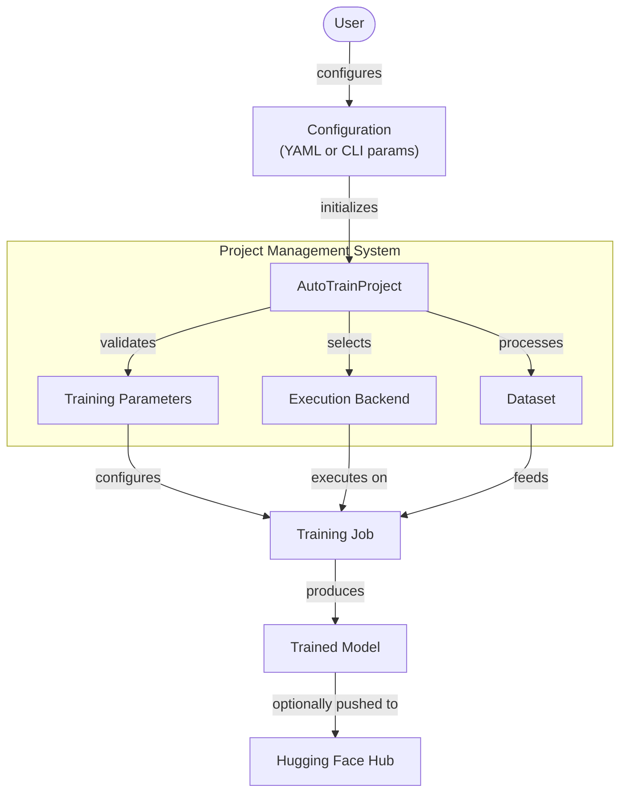
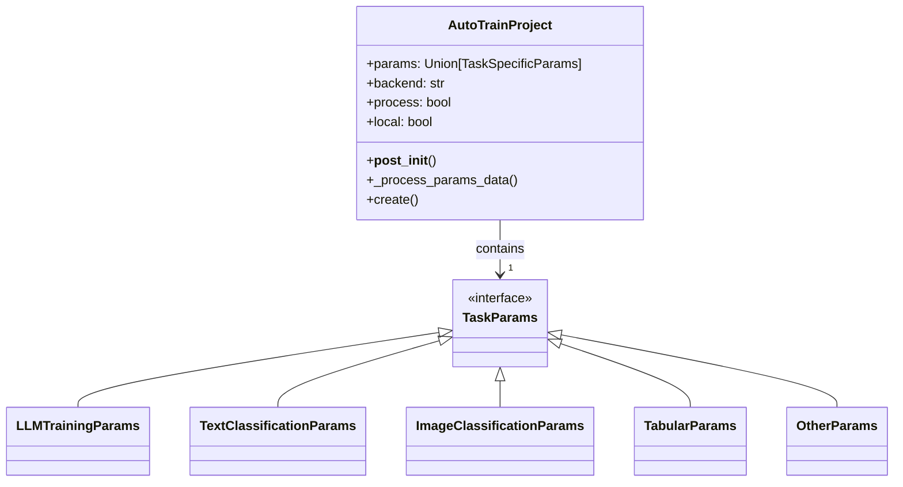
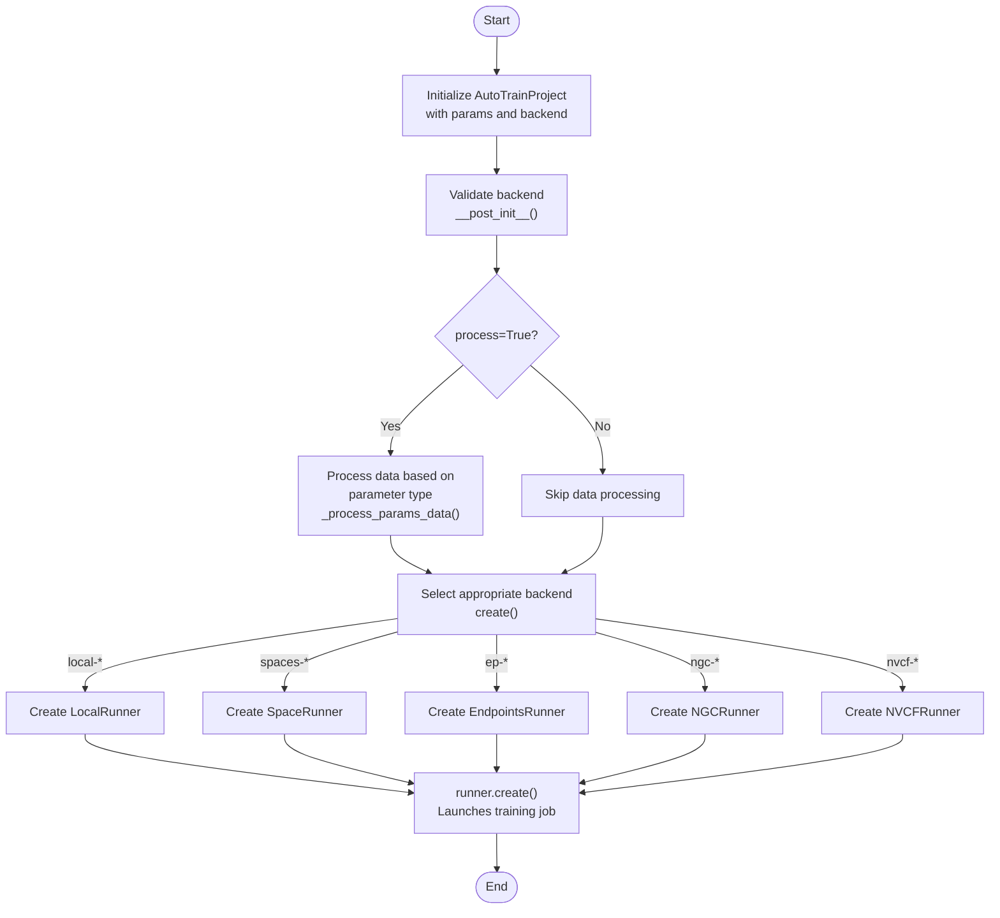
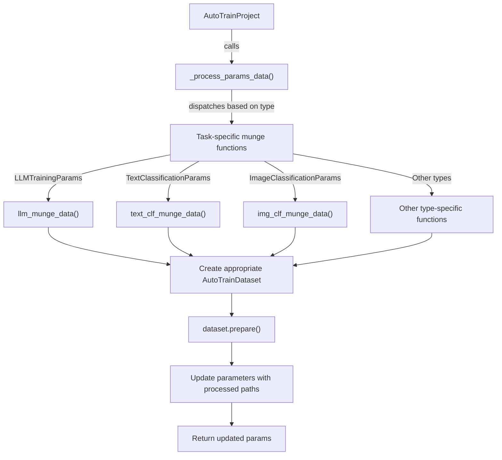

<!-- source: DeepWiki mcp.deepwiki.com · repo huggingface/autotrain-advanced · page 2.1 Project Management · fetched 2026-10-26 -->

# Project Management

<details>
<summary>Relevant source files</summary>

The following files were used as context for generating this wiki page:

- [configs/image_classification/local.yml](configs/image_classification/local.yml)
- [configs/llm_finetuning/llama3-70b-orpo-v1.yml](configs/llm_finetuning/llama3-70b-orpo-v1.yml)
- [configs/llm_finetuning/llama3-70b-sft.yml](configs/llm_finetuning/llama3-70b-sft.yml)
- [configs/llm_finetuning/llama32-1b-sft.yml](configs/llm_finetuning/llama32-1b-sft.yml)
- [configs/llm_finetuning/qwen.yml](configs/llm_finetuning/qwen.yml)
- [configs/llm_finetuning/smollm2.yml](configs/llm_finetuning/smollm2.yml)
- [src/autotrain/cli/run_app.py](src/autotrain/cli/run_app.py)
- [src/autotrain/params.py](src/autotrain/params.py)
- [src/autotrain/project.py](src/autotrain/project.py)
- [src/autotrain/utils.py](src/autotrain/utils.py)

</details>


Project Management in AutoTrain Advanced is the central orchestration system that coordinates training workflows from configuration to execution. This module is responsible for initializing training parameters, selecting appropriate execution backends, processing datasets, and launching training jobs. 

For information about specific training components, see [Training Components](#3), and for execution backends, see [Execution Backends](#2.3).

## Core Project Management Architecture



Sources: [src/autotrain/project.py:443-563]()

## The AutoTrainProject Class

The heart of project management is the `AutoTrainProject` class, which serves as the central coordinator for all training jobs.



The `AutoTrainProject` class is initialized with three key attributes:

1. **params**: A task-specific parameter object that configures the training process
2. **backend**: A string specifying where to run the training (e.g., local, Spaces, Endpoints)
3. **process**: A boolean flag indicating whether data preprocessing is needed

The class provides methods to validate backends, process input data, and create training jobs on the selected backend.

Sources: [src/autotrain/project.py:443-508]()

## Supported Training Parameters

AutoTrain supports a diverse range of training tasks, each with its specialized parameter class. The `AutoTrainProject` accepts any of these parameter types:

| Parameter Class | Training Task |
|-----------------|---------------|
| `LLMTrainingParams` | Large Language Model training (SFT, DPO, ORPO) |
| `TextClassificationParams` | Text classification |
| `TabularParams` | Tabular data (classification and regression) |
| `Seq2SeqParams` | Sequence-to-sequence tasks |
| `ImageClassificationParams` | Image classification |
| `TextRegressionParams` | Text regression |
| `ObjectDetectionParams` | Object detection |
| `TokenClassificationParams` | Token classification (NER, etc.) |
| `SentenceTransformersParams` | Sentence embeddings |
| `ImageRegressionParams` | Image regression |
| `ExtractiveQuestionAnsweringParams` | Extractive QA |
| `VLMTrainingParams` | Vision-Language Models |

Sources: [src/autotrain/project.py:493-506](), [src/autotrain/params.py:1-12]()

## Project Creation Workflow

The creation of a training project follows a specific workflow:



When `AutoTrainProject.create()` is called, it:
1. Processes data if the `process` flag is True
2. Selects the appropriate backend based on the prefix of the backend string
3. Creates a runner instance for that backend
4. Calls the runner's `create()` method to launch the training job

Sources: [src/autotrain/project.py:510-563]()

## Data Processing System

A key responsibility of the Project Management system is data preprocessing, which transforms raw data into a format suitable for training.



Each task-specific data munging function:
1. Determines file extensions and paths
2. Creates a specialized dataset object (e.g., `AutoTrainDataset`, `AutoTrainImageClassificationDataset`)
3. Prepares the dataset (converting formats, organizing files, etc.)
4. Updates parameter attributes with processed data paths

Sources: [src/autotrain/project.py:36-440](), [src/autotrain/project.py:515-541]()

## Backend Selection System

The backend selection system determines where and how the training job will be executed:

| Backend Prefix | Runner | Description |
|----------------|--------|-------------|
| `local-` | `LocalRunner` | Executes training on local hardware |
| `spaces-` | `SpaceRunner` | Executes on Hugging Face Spaces |
| `ep-` | `EndpointsRunner` | Executes on Hugging Face Endpoints |
| `ngc-` | `NGCRunner` | Executes on NVIDIA GPU Cloud |
| `nvcf-` | `NVCFRunner` | Executes on NVIDIA Cloud Functions |

The backend string often includes hardware specifications (e.g., `spaces-a10g-large` or `local-cuda:0`), which are validated against the `AVAILABLE_HARDWARE` constant.

Sources: [src/autotrain/project.py:507-513](), [src/autotrain/project.py:547-562]()

## Example Configuration

AutoTrain projects can be configured through YAML files, which are parsed and converted into parameter objects before being passed to `AutoTrainProject`. Here's a simplified example for LLM fine-tuning:

```yaml
task: llm-sft
base_model: meta-llama/Llama-3.2-1B
project_name: autotrain-llama32-1b-finetune
log: tensorboard
backend: local

data:
  path: HuggingFaceH4/no_robots
  train_split: train
  column_mapping:
    text_column: messages

params:
  block_size: 2048
  model_max_length: 4096
  epochs: 2
  batch_size: 1
  lr: 1e-5
  peft: true
  quantization: int4

hub:
  username: ${HF_USERNAME}
  token: ${HF_TOKEN}
  push_to_hub: true
```

Sources: [configs/llm_finetuning/llama32-1b-sft.yml:1-35]()

## Integration with User Interfaces

The Project Management system integrates with both the command-line interface and web UI:

```mermaid
graph TD
    CLI["CLI\nautotrain command"] -->|parses| CLIArgs["Command Arguments"]
    WebUI["Web UI\napp"] -->|captures| WebInputs["User Inputs"]
    ConfigFile["YAML Config\n--config file.yml"] -->|loaded by| Parser["AutoTrainConfigParser"]
    
    CLIArgs --> CreateParams["Create Parameters Object"]
    WebInputs --> CreateParams
    Parser --> CreateParams
    
    CreateParams --> Project["AutoTrainProject"]
    Project -->|create()| RunTraining["Execute Training"]
    
    RunTraining --> SaveModel["Save Model"]
    SaveModel -->|if push_to_hub=True| HF["Push to Hugging Face Hub"]
```

Sources: [src/autotrain/cli/run_app.py:35-170](), [src/autotrain/utils.py:24-79]()

## Project Execution Flow

When a project is executed, it follows this sequence:

1. The user provides configuration through CLI, web UI, or YAML file
2. A task-specific parameter object is created
3. An `AutoTrainProject` instance is initialized with parameters and backend
4. Data is optionally processed and transformed
5. A backend-specific runner is created
6. The runner launches the training job
7. The trained model is saved locally and optionally pushed to the Hugging Face Hub

This unified workflow allows AutoTrain to manage diverse training tasks across multiple execution environments while maintaining a consistent user experience.

Sources: [src/autotrain/project.py:443-563]()

---

