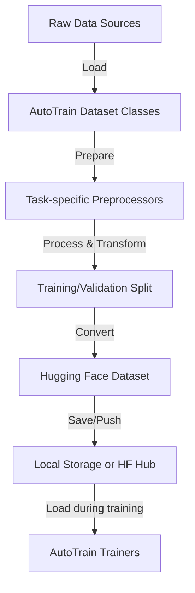
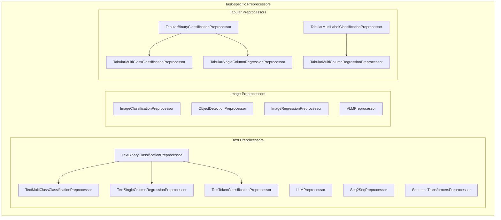
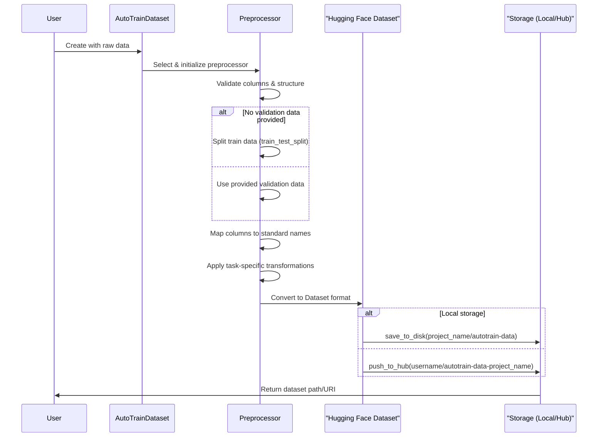
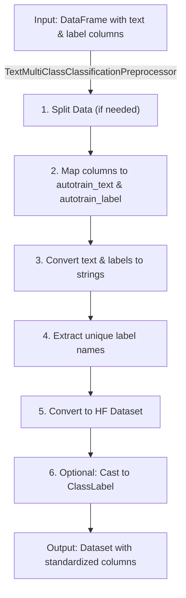
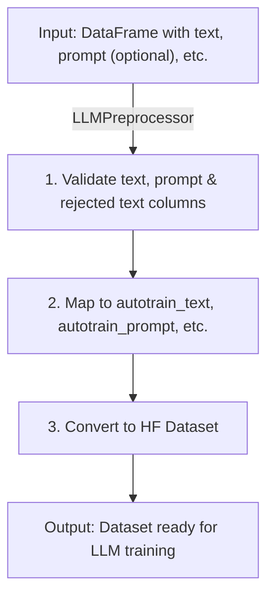
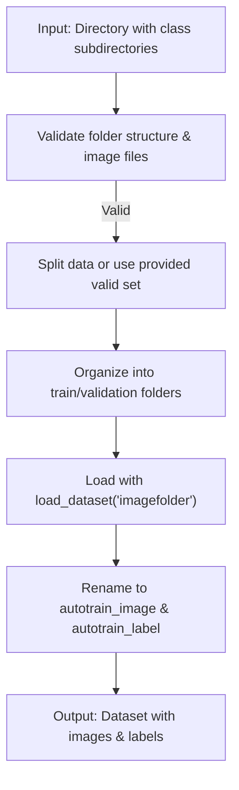
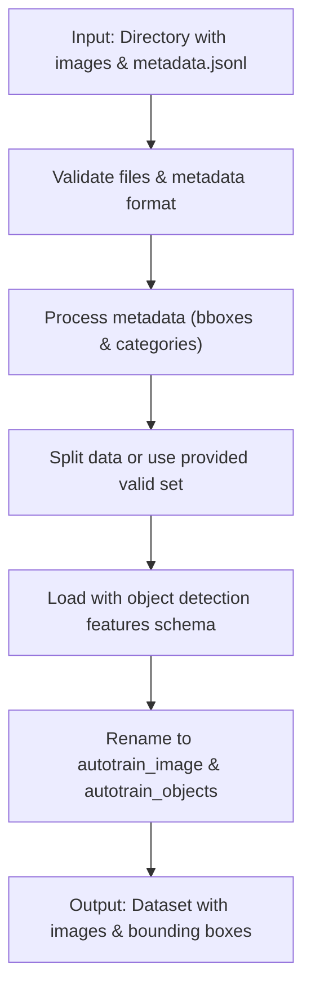
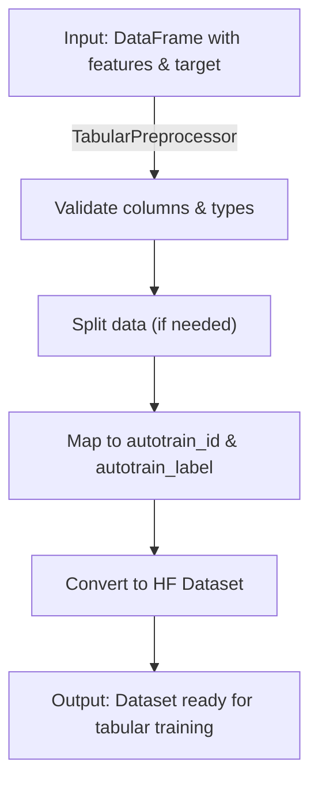
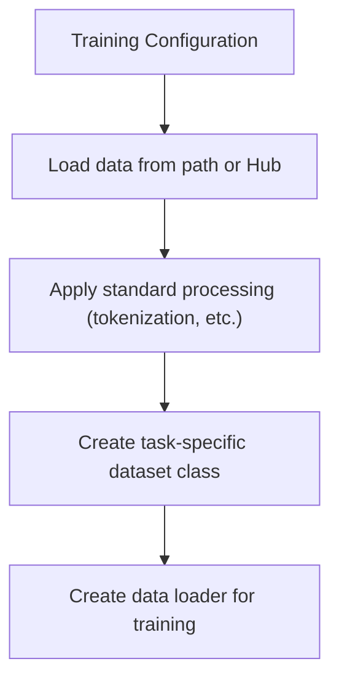

<!-- source: DeepWiki mcp.deepwiki.com · repo huggingface/autotrain-advanced · page 2.2 Data Processing · fetched 2026-10-26 -->

# Data Processing

<details>
<summary>Relevant source files</summary>

The following files were used as context for generating this wiki page:

- [src/autotrain/dataset.py](src/autotrain/dataset.py)
- [src/autotrain/preprocessor/tabular.py](src/autotrain/preprocessor/tabular.py)
- [src/autotrain/preprocessor/text.py](src/autotrain/preprocessor/text.py)
- [src/autotrain/preprocessor/vision.py](src/autotrain/preprocessor/vision.py)
- [src/autotrain/tasks.py](src/autotrain/tasks.py)
- [src/autotrain/trainers/common.py](src/autotrain/trainers/common.py)
- [src/autotrain/trainers/image_classification/__main__.py](src/autotrain/trainers/image_classification/__main__.py)
- [src/autotrain/trainers/object_detection/dataset.py](src/autotrain/trainers/object_detection/dataset.py)
- [src/autotrain/trainers/seq2seq/__main__.py](src/autotrain/trainers/seq2seq/__main__.py)
- [src/autotrain/trainers/tabular/__main__.py](src/autotrain/trainers/tabular/__main__.py)
- [src/autotrain/trainers/text_classification/__main__.py](src/autotrain/trainers/text_classification/__main__.py)

</details>


This page documents the data processing subsystem in AutoTrain Advanced, which is responsible for loading, validating, preprocessing, and preparing datasets for various training tasks. The data processing system handles multiple data types (text, images, tabular data) and ensures they're transformed into the correct format for model training.

For information about how the prepared data is used in training, see [Training Components](#3).

## Overview

AutoTrain's data processing components follow a consistent pattern across different data types, creating a flexible pipeline that:

1. Loads raw data from files, DataFrames, or the Hugging Face Hub
2. Validates data format and contents
3. Splits data into training and validation sets (if needed)
4. Maps columns to standardized formats
5. Applies task-specific preprocessing
6. Converts processed data to Hugging Face Datasets format
7. Either saves locally or pushes to Hugging Face Hub



Sources: [src/autotrain/dataset.py:478-502](). [src/autotrain/trainers/common.py:242-250]()

## Dataset Classes

The data processing begins with specialized `AutoTrainDataset` classes that handle different data types.

```mermaid
classDiagram
    class "AutoTrainDataset" {
        +train_data: list[str]
        +task: str
        +token: str
        +project_name: str
        +column_mapping: Dict
        +prepare()
        +split()
    }
    class "AutoTrainImageClassificationDataset" {
        +train_data: str
        +token: str
        +project_name: str 
        +prepare()
    }
    class "AutoTrainObjectDetectionDataset" {
        +train_data: str
        +token: str
        +project_name: str
        +prepare()
    }
    class "AutoTrainImageRegressionDataset" {
        +train_data: str
        +token: str 
        +project_name: str
        +prepare()
    }
    class "AutoTrainVLMDataset" {
        +train_data: str
        +token: str
        +project_name: str
        +column_mapping: Dict
        +prepare()
    }
```

Sources: [src/autotrain/dataset.py:69-137](), [src/autotrain/dataset.py:168-265](), [src/autotrain/dataset.py:267-376](), [src/autotrain/dataset.py:379-475]()

Each dataset class:

1. Accepts raw data (paths or DataFrames)
2. Validates data format and structure
3. Extracts the right preprocessor based on task
4. Calls `prepare()` on the preprocessor to process the data

The general-purpose `AutoTrainDataset` handles multiple data formats and tasks, while specialized classes like `AutoTrainImageClassificationDataset` focus on specific data types with their own validation logic.

### Common Dataset Parameters

| Parameter | Type | Description |
|-----------|------|-------------|
| `train_data` | str or DataFrame | Path to training data or DataFrame containing it |
| `token` | str | Authentication token for Hugging Face Hub |
| `project_name` | str | Name of the project (used for storage) |
| `username` | str | Username for Hugging Face Hub |
| `valid_data` | str or DataFrame | Optional validation data |
| `percent_valid` | float | Percentage of data to use for validation if `valid_data` not provided |
| `local` | bool | Whether to save data locally or push to Hub |
| `column_mapping` | Dict | Maps dataset columns to standard AutoTrain columns |

Sources: [src/autotrain/dataset.py:478-513]()

## Preprocessors Architecture

The preprocessors form the core of the data processing system, handling task-specific data transformations.



Sources: [src/autotrain/preprocessor/text.py:21-681](), [src/autotrain/preprocessor/vision.py:14-565](), [src/autotrain/preprocessor/tabular.py:11-273]()

### Key Preprocessor Methods

All preprocessors implement a common set of methods:

1. **Validation (`__post_init__`)**: Validates input data format and columns
2. **Split**: Handles train/validation splitting if needed
3. **Column Preparation**: Maps input columns to standardized AutoTrain column names
4. **Prepare**: Main method that orchestrates the entire preprocessing pipeline

Sources: [src/autotrain/preprocessor/text.py:58-144]()

## Data Processing Flow

The typical data processing flow follows these steps:



Sources: [src/autotrain/preprocessor/text.py:104-144](), [src/autotrain/preprocessor/vision.py:126-190]()

### Column Standardization

A key aspect of the preprocessing is standardizing column names. AutoTrain uses reserved column names to ensure consistency across tasks:

| Data Type | Reserved Columns |
|-----------|------------------|
| Text | `autotrain_text`, `autotrain_label`, `autotrain_question`, `autotrain_answer`, `autotrain_prompt`, `autotrain_context`, `autotrain_rejected_text`, `autotrain_prompt_start` |
| Tabular | `autotrain_id`, `autotrain_label` |
| Images | `autotrain_image`, `autotrain_label`, `autotrain_objects` |

Sources: [src/autotrain/preprocessor/text.py:12-18](), [src/autotrain/preprocessor/tabular.py:9]()

## Text Data Processing

Text processing handles various NLP tasks including classification, regression, token classification, and sequence-to-sequence tasks.

### Text Classification Example



Sources: [src/autotrain/preprocessor/text.py:21-144]()

### LLM Data Processing

For large language model training, specialized preprocessing is applied:



Sources: [src/autotrain/preprocessor/text.py:310-443]()

## Image Data Processing

Image data processing handles various vision tasks, with special requirements for folder structure and metadata files.

### Image Classification Processing



Sources: [src/autotrain/preprocessor/vision.py:14-190]()

### Object Detection Processing

Object detection requires additional steps to handle bounding boxes and categories:



Sources: [src/autotrain/preprocessor/vision.py:193-411]()

## Tabular Data Processing

Tabular data processing handles various tabular tasks, including classification and regression.



Sources: [src/autotrain/preprocessor/tabular.py:11-146]()

## Data Loading During Training

Once data is processed, trainers load it during the training phase:



Sources: [src/autotrain/trainers/text_classification/__main__.py:45-90](), [src/autotrain/trainers/seq2seq/__main__.py:45-101](), [src/autotrain/trainers/image_classification/__main__.py:44-84]()

## Conclusion

The data processing system in AutoTrain Advanced provides a flexible framework for handling various data types and tasks. By standardizing column names and implementing consistent processing patterns, it ensures that data is properly prepared for model training, regardless of the specific task or data format.

The system's modular design allows for easy extension to new data types and tasks, while maintaining compatibility with the Hugging Face ecosystem through the use of the Datasets library.

---

