<!-- source: DeepWiki mcp.deepwiki.com · repo huggingface/autotrain-advanced · page 2.3 Execution Backends · fetched 2026-10-26 -->

# Execution Backends

Relevant source files

The following files were used as context for generating this wiki page:

- [.gitignore](.gitignore)
- [docs/source/col_map.mdx](docs/source/col_map.mdx)
- [src/autotrain/app/app.py](src/autotrain/app/app.py)
- [src/autotrain/app/db.py](src/autotrain/app/db.py)
- [src/autotrain/app/oauth.py](src/autotrain/app/oauth.py)
- [src/autotrain/app/training_api.py](src/autotrain/app/training_api.py)
- [src/autotrain/app/utils.py](src/autotrain/app/utils.py)
- [src/autotrain/cli/run_api.py](src/autotrain/cli/run_api.py)
- [src/autotrain/cli/run_app.py](src/autotrain/cli/run_app.py)
- [src/autotrain/cli/run_spacerunner.py](src/autotrain/cli/run_spacerunner.py)
- [src/autotrain/params.py](src/autotrain/params.py)
- [src/autotrain/project.py](src/autotrain/project.py)
- [src/autotrain/trainers/generic/__main__.py](src/autotrain/trainers/generic/__main__.py)
- [src/autotrain/trainers/generic/params.py](src/autotrain/trainers/generic/params.py)
- [src/autotrain/trainers/generic/utils.py](src/autotrain/trainers/generic/utils.py)
- [src/autotrain/trainers/tabular/params.py](src/autotrain/trainers/tabular/params.py)
- [src/autotrain/utils.py](src/autotrain/utils.py)

This document provides a detailed explanation of the execution backends available in AutoTrain Advanced. Execution backends are responsible for the actual running of training jobs in different computing environments. AutoTrain supports various backends including local execution, Hugging Face Spaces, Hugging Face Endpoints, NVIDIA GPU Cloud (NGC), and NVIDIA Cloud Functions (NVCF).

## Overview

Execution backends allow AutoTrain to be flexible in where and how it runs training workloads. Each backend has different characteristics in terms of computing power, cost, and setup requirements. The selection of an appropriate backend depends on the specific needs of the training job, such as model size, dataset size, and performance requirements.

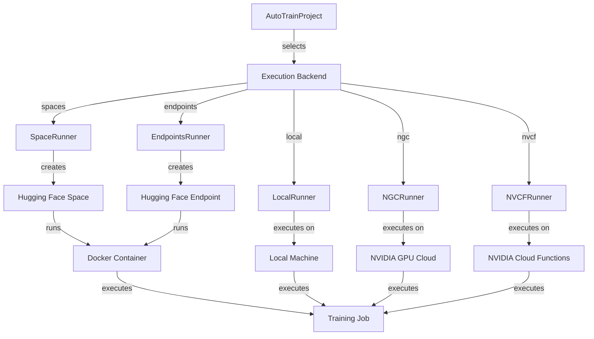

Sources: [src/autotrain/project.py:9-14](), [src/autotrain/project.py:547-561]()

## Available Hardware Options

AutoTrain supports a variety of hardware configurations across different backends. The available hardware is defined in the `AVAILABLE_HARDWARE` constant imported from `autotrain.backends.base`. When configuring an AutoTrain project, you must specify a backend that matches one of these available options.

Available backends include:

- `local`: Run on the local machine
- `spaces-*`: Run on Hugging Face Spaces with various GPU configurations (A10G, A100, T4, CPU, L4, L40S)
- `ep-*`: Run on Hugging Face Endpoints
- `ngc-*`: Run on NVIDIA GPU Cloud
- `nvcf-*`: Run on NVIDIA Cloud Functions

Sources: [src/autotrain/project.py:9](), [src/autotrain/project.py:512-513]()

## Backend Selection and Configuration

The `AutoTrainProject` class is responsible for managing the entire training process, including selecting and configuring the appropriate backend. Here's how it works:

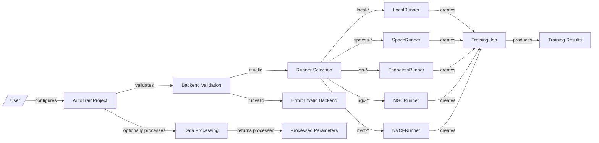

When creating an `AutoTrainProject`, you need to provide:

1. **Parameters**: A task-specific parameter object (e.g., `LLMTrainingParams`, `TextClassificationParams`, etc.)
2. **Backend**: A string identifying the backend to use (e.g., "local", "spaces-a10g-large")
3. **Process flag**: A boolean indicating whether data should be processed before training

The `create()` method selects the appropriate runner based on the backend string prefix and instantiates it with the parameters.

Sources: [src/autotrain/project.py:443-508](), [src/autotrain/project.py:543-563]()

## Local Execution Backend

The `LocalRunner` is used when the backend is set to "local". This backend executes the training job on the local machine where AutoTrain is running. It's suitable for smaller models or when you have sufficient local computing resources.

### Local Execution Flow

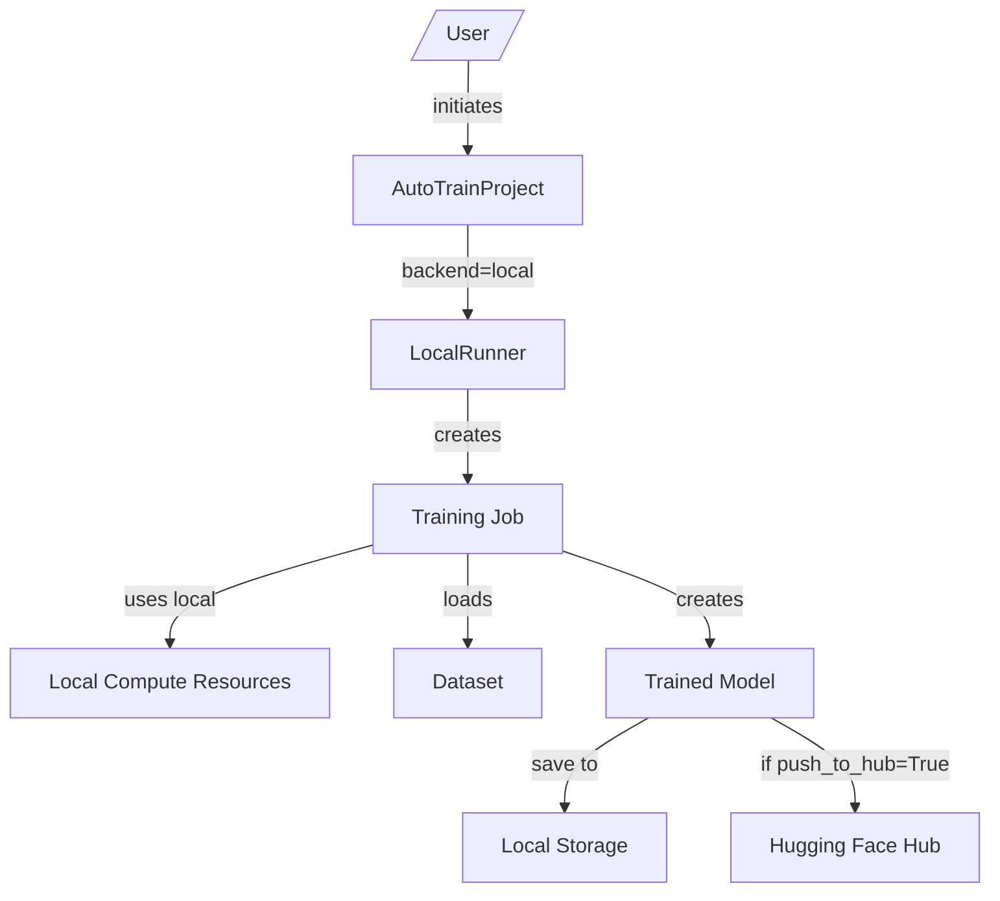

The local backend doesn't require any additional setup apart from having the necessary dependencies installed locally. It's controlled by the `LocalRunner` class, which executes the training process directly on the machine.

Sources: [src/autotrain/project.py:547-549]()

## Hugging Face Spaces Backend

The `SpaceRunner` is used when the backend starts with "spaces-". This backend creates a Hugging Face Space that runs the training job in a container environment. It's good for medium-sized models and when you don't have local GPU resources.

### Spaces Execution Flow

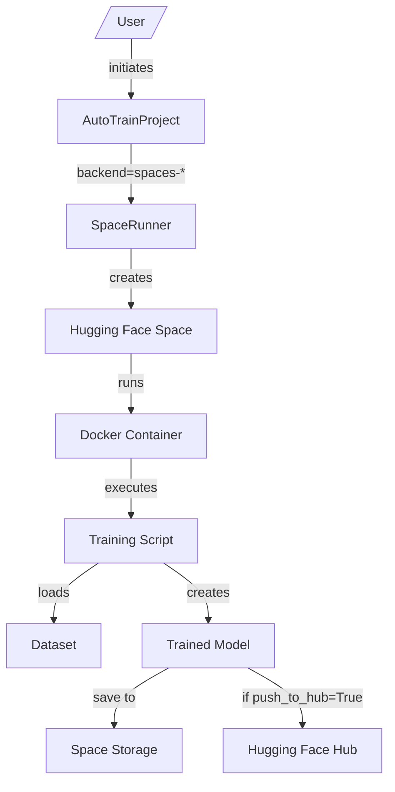

The Spaces backend offers various hardware configurations identified by the suffix of the backend string:
- `spaces-a10g-large`: A10G GPU (large instance)
- `spaces-a10g-small`: A10G GPU (small instance)
- `spaces-a100-large`: A100 GPU
- `spaces-t4-medium`: T4 GPU (medium instance)
- `spaces-t4-small`: T4 GPU (small instance)
- `spaces-cpu-upgrade`: CPU (upgraded instance)
- `spaces-cpu-basic`: CPU (basic instance)
- And more options with L4 and L40S configurations

When using the `SpaceRunner`, AutoTrain creates a new Space with the specified hardware, uploads the dataset, and runs the training job in that environment.

Sources: [src/autotrain/project.py:550-552](), [src/autotrain/cli/run_spacerunner.py:12-13](), [src/autotrain/cli/run_spacerunner.py:141-143]()

### The SpaceRunner Command

AutoTrain provides a specific command for running jobs on Spaces:

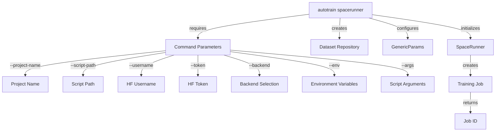

This command uploads a local script and dataset to a Hugging Face Space, then runs the training job in that environment. The dataset is stored in a separate repository on the Hugging Face Hub.

Sources: [src/autotrain/cli/run_spacerunner.py:16-143](), [src/autotrain/trainers/generic/utils.py:10-38]()

## Hugging Face Endpoints Backend

The `EndpointsRunner` is used when the backend starts with "ep-". This backend creates a Hugging Face Endpoint that runs the training job. It's suitable for production deployments and models that need to be accessed via API.

### Endpoints Execution Flow

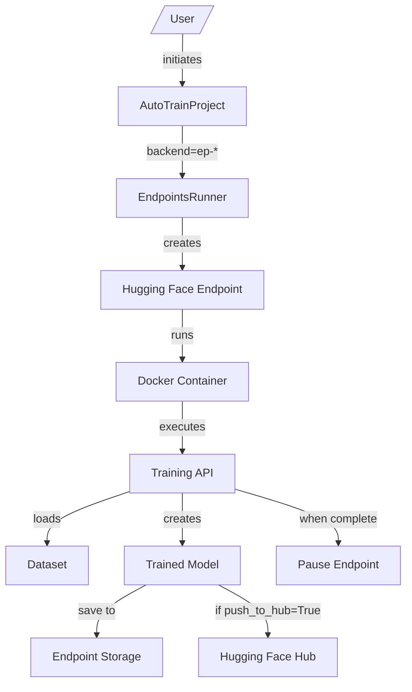

The Endpoints backend creates a managed API endpoint on Hugging Face's infrastructure. When the training is complete, the endpoint can be paused to save resources, as implemented in the `pause_endpoint` function.

Sources: [src/autotrain/project.py:553-555](), [src/autotrain/trainers/generic/utils.py:181-201]()

## NVIDIA GPU Cloud (NGC) Backend

The `NGCRunner` is used when the backend starts with "ngc-". This backend executes the training job on NVIDIA's GPU Cloud platform. It's intended for larger models that require significant GPU resources.

### NGC Execution Flow

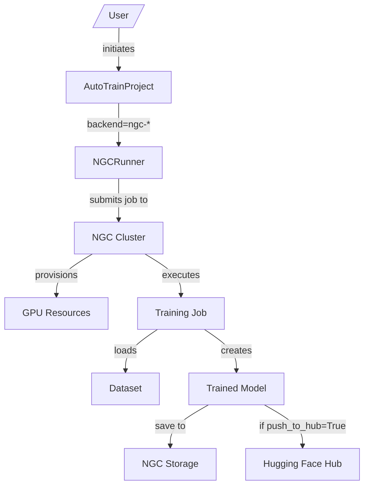

The NGC backend provides access to NVIDIA's cloud infrastructure, offering powerful GPU resources for training large models. The specific configuration depends on the NGC backend variant chosen.

Sources: [src/autotrain/project.py:556-558]()

## NVIDIA Cloud Functions (NVCF) Backend

The `NVCFRunner` is used when the backend starts with "nvcf-". This backend runs the training job as a serverless function on NVIDIA's cloud infrastructure. It's suitable for intermittent or event-driven training workloads.

### NVCF Execution Flow

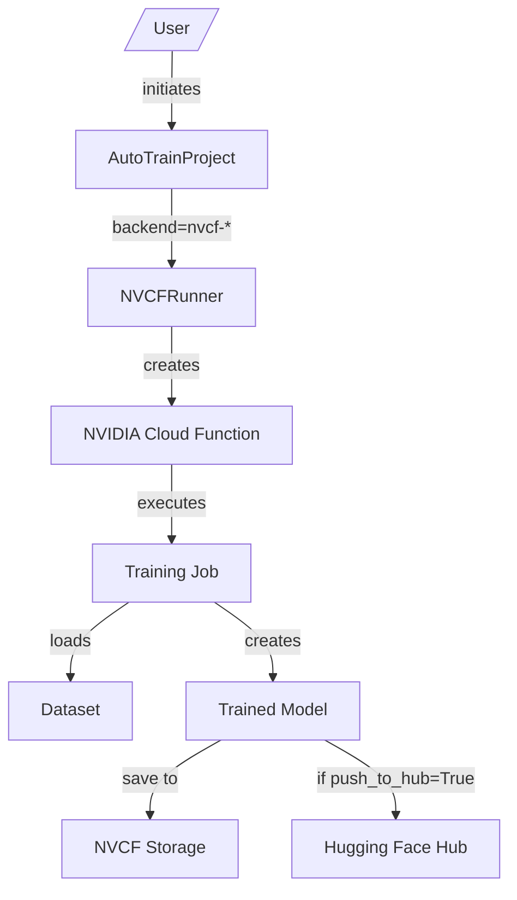

The NVCF backend is NVIDIA's serverless computing platform, which allows running training jobs without provisioning or managing servers. The resources are automatically allocated based on the workload.

Sources: [src/autotrain/project.py:559-561]()

## Generic Trainer for Custom Scripts

For custom training workflows, AutoTrain provides a "Generic Trainer" that can execute arbitrary Python scripts in any of the available backends. This is particularly useful when using the Spaces backend.

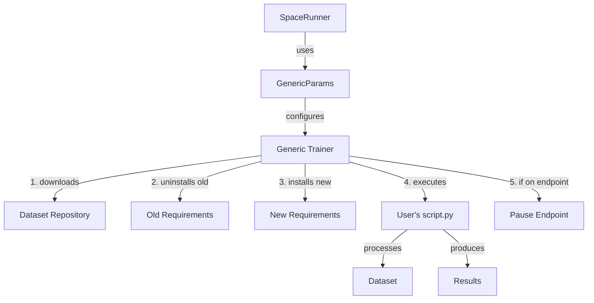

The Generic Trainer workflow:
1. Downloads the dataset repository from Hugging Face Hub
2. Uninstalls existing requirements (if any)
3. Installs the requirements specified in `requirements.txt`
4. Runs the user's script with the provided arguments
5. Pauses the space or endpoint when complete (if applicable)

This provides a flexible way to run custom training scripts in cloud environments.

Sources: [src/autotrain/trainers/generic/__main__.py:16-52](), [src/autotrain/trainers/generic/utils.py:41-201](), [src/autotrain/trainers/generic/params.py:8-36]()

## Integration with AutoTrain Web Application

AutoTrain provides a web application that integrates with the execution backends, allowing users to configure and monitor training jobs through a graphical interface.

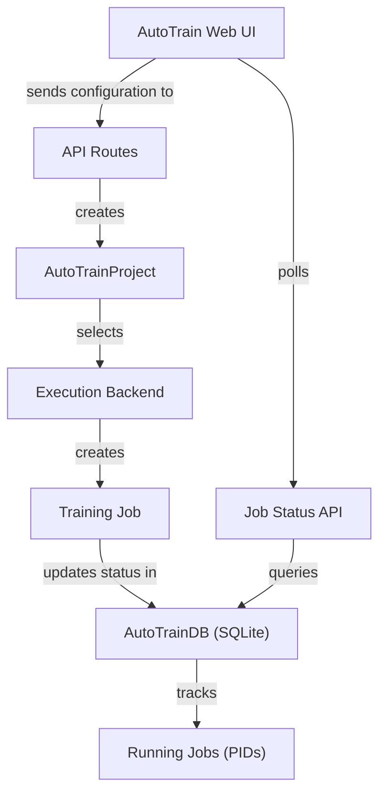

The web application allows users to:
1. Configure training parameters
2. Select the execution backend
3. Start training jobs
4. Monitor job progress
5. View and download results

The application uses a SQLite database (`AutoTrainDB`) to track running jobs and their status.

Sources: [src/autotrain/app/app.py:1-43](), [src/autotrain/app/db.py:4-62](), [src/autotrain/app/utils.py:19-49]()

## Running Training Jobs

When a training job is initiated, AutoTrain uses the `run_training` function to start the process. This function takes the training parameters, task ID, and flags for local execution and waiting.

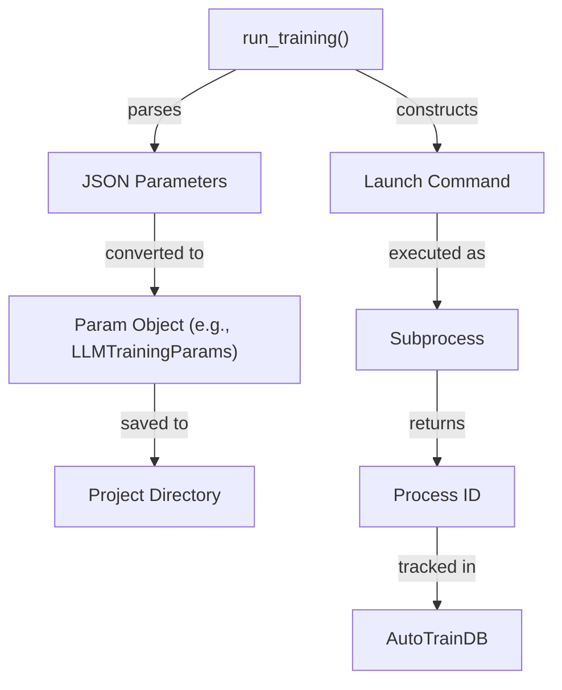

For web application training jobs, the process is managed by the `training_api.py` module, which:
1. Creates a FastAPI application
2. Starts the training process
3. Adds the job to the database
4. Monitors running jobs
5. Shuts down when no jobs are running

Sources: [src/autotrain/utils.py:24-79](), [src/autotrain/app/training_api.py:80-82](), [src/autotrain/app/utils.py:52-94]()

## OAuth Integration for Cloud Backends

When using cloud-based backends like Spaces and Endpoints, AutoTrain leverages OAuth for authentication with the Hugging Face Hub.

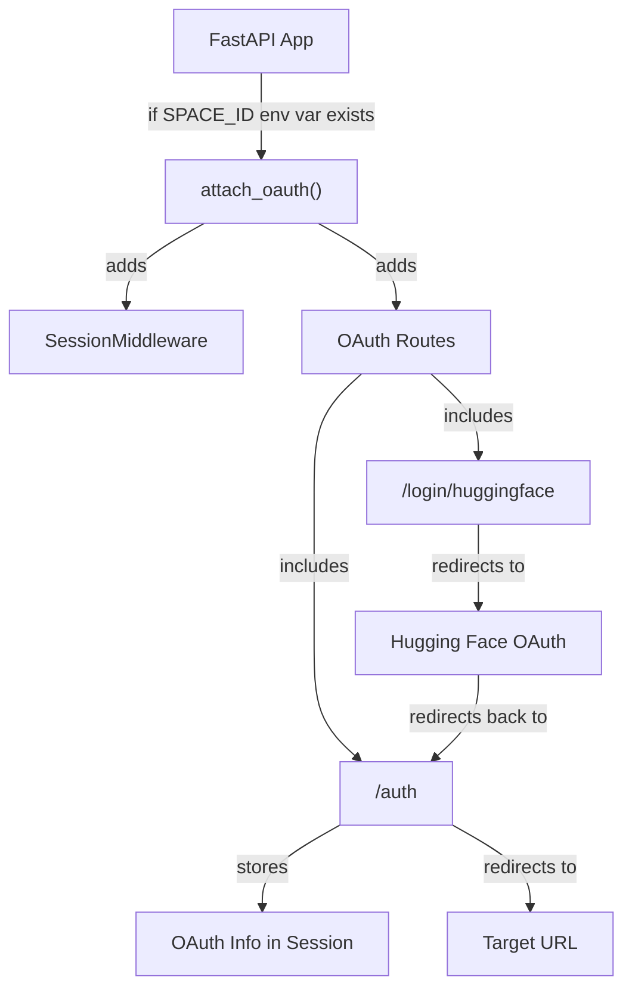

The OAuth integration allows users to authenticate with their Hugging Face accounts when using the web application to launch training jobs on cloud backends.

Sources: [src/autotrain/app/app.py:16-17](), [src/autotrain/app/oauth.py:24-172]()

## Conclusion

AutoTrain's execution backends provide a flexible system for running machine learning training jobs across a variety of computing environments. Whether you need to train a small model locally, leverage Hugging Face's infrastructure with Spaces and Endpoints, or tap into NVIDIA's powerful cloud resources with NGC and NVCF, AutoTrain offers a unified interface for configuring and launching your training workloads.

The backend system integrates with AutoTrain's data processing, parameter configuration, and monitoring capabilities to provide a comprehensive solution for automated machine learning model training.

---

