<!-- source: DeepWiki mcp.deepwiki.com · repo huggingface/autotrain-advanced · page 3 Training Components · fetched 2026-10-26 -->

# Training Components

Relevant source files

The following files were used as context for generating this wiki page:

- [requirements.txt](requirements.txt)
- [src/autotrain/__init__.py](src/autotrain/__init__.py)
- [src/autotrain/trainers/clm/__main__.py](src/autotrain/trainers/clm/__main__.py)
- [src/autotrain/trainers/clm/utils.py](src/autotrain/trainers/clm/utils.py)
- [src/autotrain/trainers/common.py](src/autotrain/trainers/common.py)
- [src/autotrain/trainers/image_classification/__main__.py](src/autotrain/trainers/image_classification/__main__.py)
- [src/autotrain/trainers/seq2seq/__main__.py](src/autotrain/trainers/seq2seq/__main__.py)
- [src/autotrain/trainers/tabular/__main__.py](src/autotrain/trainers/tabular/__main__.py)
- [src/autotrain/trainers/text_classification/__main__.py](src/autotrain/trainers/text_classification/__main__.py)

This page provides an overview of the various model training capabilities within AutoTrain Advanced. It covers the core training components that enable users to fine-tune different types of machine learning models through a unified interface.

AutoTrain Advanced supports training a variety of model types, each with specialized training workflows and parameters. For information about how these components are orchestrated, see [Project Management](#2.1). For details on data processing before training, see [Data Processing](#2.2).

## Overview of Training Components

AutoTrain Advanced provides specialized training components for different AI tasks, each implemented as a separate module within the codebase. These components handle the specific requirements and optimizations needed for their respective model types.

**Training Component Types Diagram**

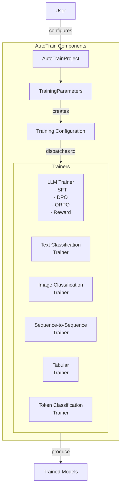

Sources: [src/autotrain/trainers/clm/__main__.py:15-46](), [src/autotrain/trainers/text_classification/__main__.py:40-239](), [src/autotrain/trainers/image_classification/__main__.py:39-242](), [src/autotrain/trainers/seq2seq/__main__.py:45-272](), [src/autotrain/trainers/tabular/__main__.py:152-402]()

## Common Architecture

All training components share a common architecture pattern that provides consistency across different model types. This includes parameter validation, training monitoring, checkpointing, and integration with Hugging Face Hub.

**Common Training Architecture Diagram**

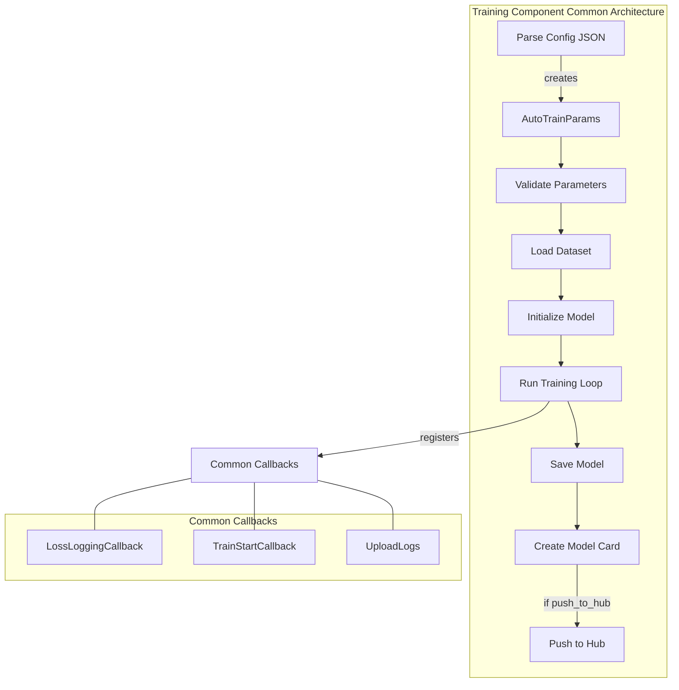

Sources: [src/autotrain/trainers/common.py:189-220](), [src/autotrain/trainers/common.py:223-286](), [src/autotrain/trainers/common.py:289-340]()

The base parameters class, `AutoTrainParams`, provides common functionality for parameter validation and serialization. It ensures that configuration parameters are properly validated before training begins.

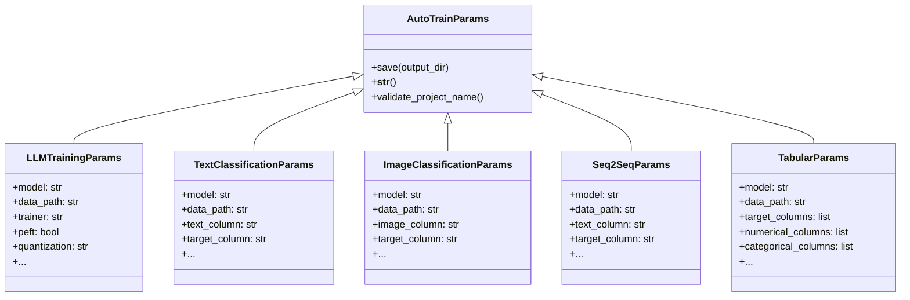

Sources: [src/autotrain/trainers/common.py:223-286]()

## LLM Training

The LLM training component is the most feature-rich in AutoTrain, supporting various fine-tuning techniques for large language models.

**LLM Training Techniques Diagram**

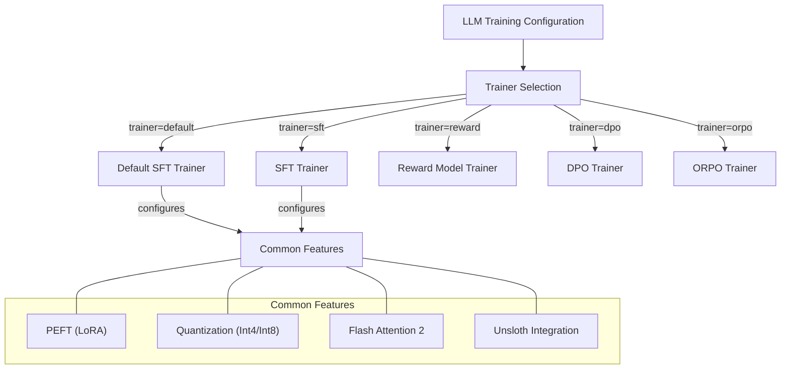

Sources: [src/autotrain/trainers/clm/__main__.py:15-46](), [src/autotrain/trainers/clm/utils.py:32-106](), [src/autotrain/trainers/clm/utils.py:392-462]()

### LLM Training Data Flow

The LLM training component supports sophisticated data processing and training workflows:

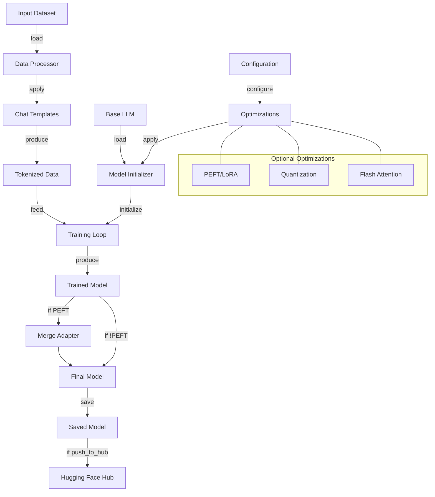

Sources: [src/autotrain/trainers/clm/utils.py:392-462](), [src/autotrain/trainers/clm/utils.py:465-553](), [src/autotrain/trainers/clm/utils.py:828-1196]()

## Text Classification Training

The text classification training component supports binary and multi-class classification tasks for text data.

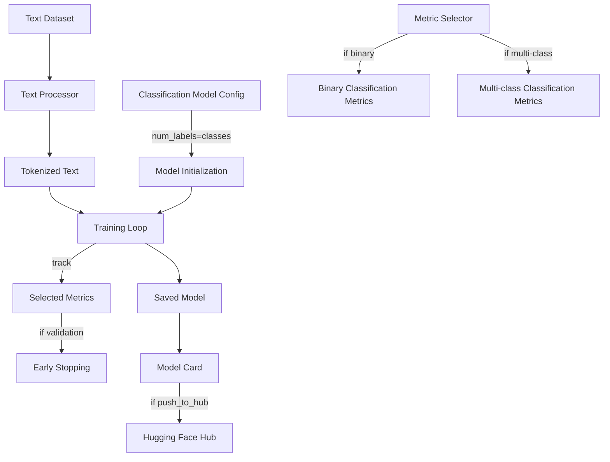

Sources: [src/autotrain/trainers/text_classification/__main__.py:40-239]()

## Image Classification Training

The image classification component follows a similar pattern to text classification but with image-specific processing:

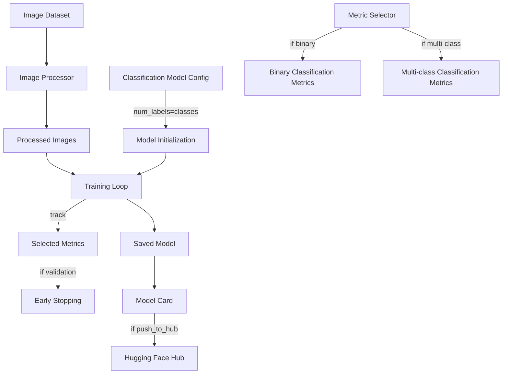

Sources: [src/autotrain/trainers/image_classification/__main__.py:39-242]()

## Sequence-to-Sequence Training

The sequence-to-sequence component handles tasks like translation, summarization, and other text generation tasks:

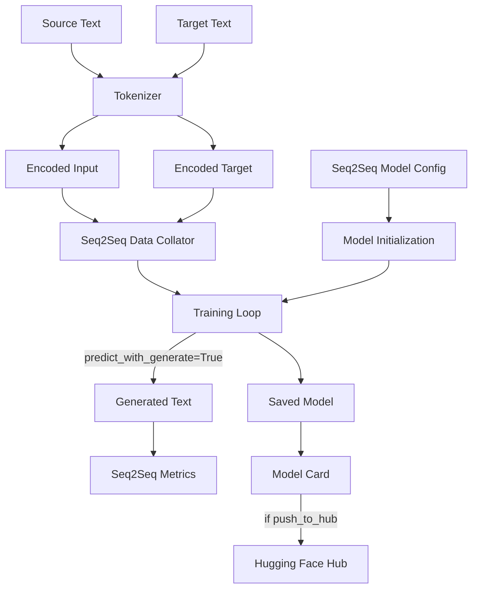

Sources: [src/autotrain/trainers/seq2seq/__main__.py:45-272]()

## Tabular Training

The tabular training component handles structured data with support for various classic machine learning models:

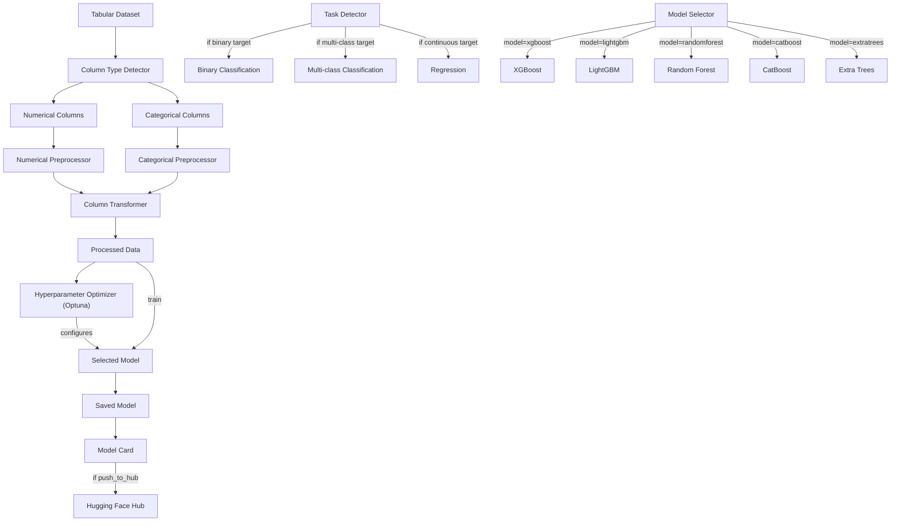

Sources: [src/autotrain/trainers/tabular/__main__.py:152-402](), [src/autotrain/trainers/tabular/__main__.py:34-150]()

## Common Training Workflow

Despite the differences between training components, they all follow a similar high-level workflow:

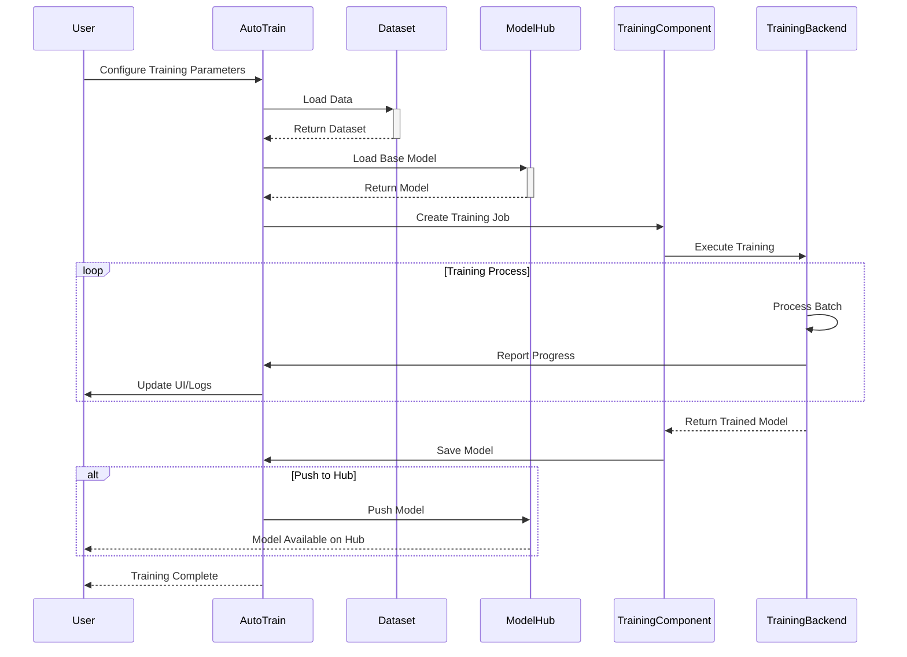

Sources: [src/autotrain/trainers/common.py:189-220](), [src/autotrain/trainers/clm/utils.py:392-462]()

## Parameter Management

Each training component has its own parameters class that inherits from `AutoTrainParams`. The following table summarizes the key parameters for each trainer type:

| Trainer Type | Key Parameters | Description |
|-------------|---------------|------------|
| LLM | `model`, `trainer`, `peft`, `quantization`, `chat_template` | Controls LLM fine-tuning with options for PEFT, quantization, and different training methods |
| Text Classification | `model`, `text_column`, `target_column` | Configures text classifier training with column mappings |
| Image Classification | `model`, `image_column`, `target_column` | Sets up image classifier with column mappings |
| Sequence-to-Sequence | `model`, `text_column`, `target_column` | Configures seq2seq models with input/output column mappings |
| Tabular | `model`, `numerical_columns`, `categorical_columns`, `target_columns` | Sets up tabular model training with column type specifications |

Sources: [src/autotrain/trainers/common.py:223-286]()

## Training Component Integration

The training components integrate with the rest of the AutoTrain system through a consistent interface:

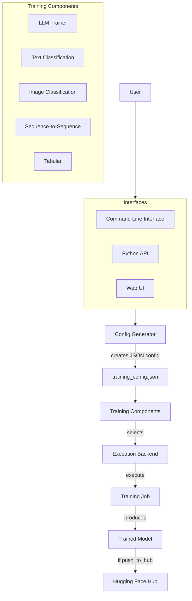

Sources: [src/autotrain/trainers/clm/__main__.py:8-53](), [src/autotrain/trainers/text_classification/__main__.py:32-239](), [src/autotrain/trainers/image_classification/__main__.py:32-242](), [src/autotrain/trainers/seq2seq/__main__.py:38-275](), [src/autotrain/trainers/tabular/__main__.py:26-409]()

For more details on how these components are used in specific training contexts, see [LLM Training](#3.1), [Text Classification and Regression](#3.2), [Vision Models](#3.3), and [Other Training Types](#3.4).

---

