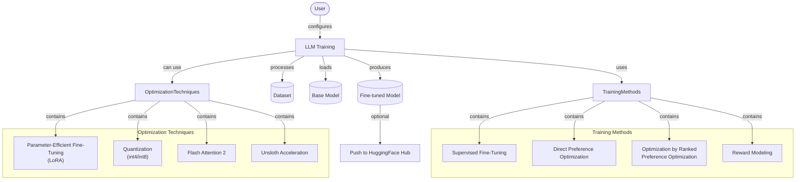
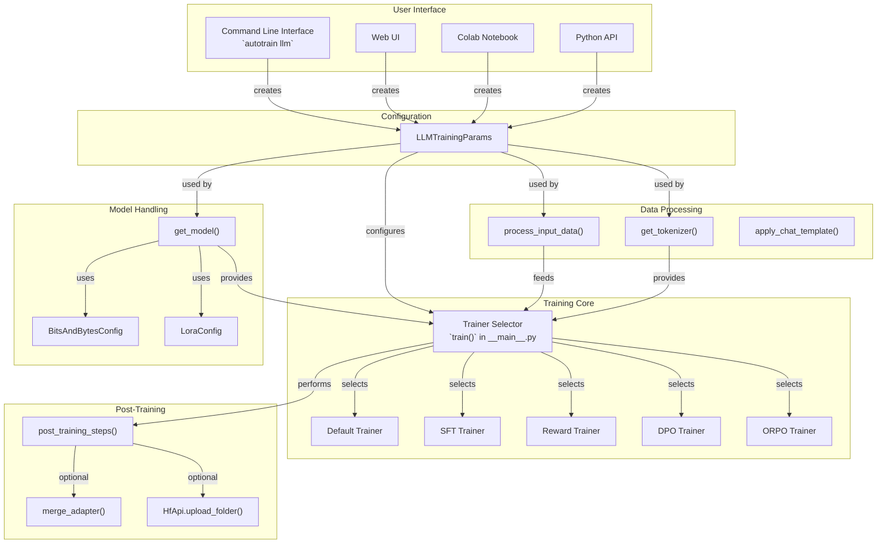
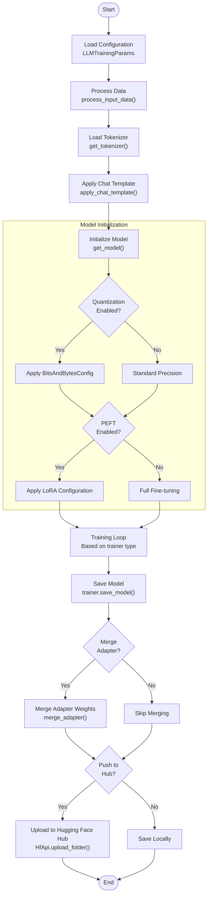
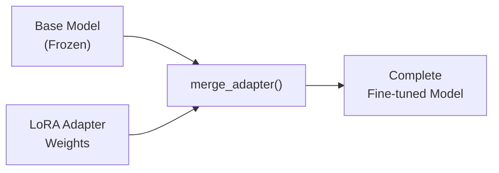

<!-- source: DeepWiki mcp.deepwiki.com · repo huggingface/autotrain-advanced · page 3.1 LLM Training · fetched 2026-10-26 -->

# LLM Training

<details>
<summary>Relevant source files</summary>

The following files were used as context for generating this wiki page:

- [colabs/AutoTrain_LLM.ipynb](colabs/AutoTrain_LLM.ipynb)
- [requirements.txt](requirements.txt)
- [src/autotrain/__init__.py](src/autotrain/__init__.py)
- [src/autotrain/cli/run_llm.py](src/autotrain/cli/run_llm.py)
- [src/autotrain/trainers/clm/__main__.py](src/autotrain/trainers/clm/__main__.py)
- [src/autotrain/trainers/clm/params.py](src/autotrain/trainers/clm/params.py)
- [src/autotrain/trainers/clm/utils.py](src/autotrain/trainers/clm/utils.py)
- [src/autotrain/trainers/image_classification/params.py](src/autotrain/trainers/image_classification/params.py)
- [src/autotrain/trainers/seq2seq/params.py](src/autotrain/trainers/seq2seq/params.py)
- [src/autotrain/trainers/text_classification/params.py](src/autotrain/trainers/text_classification/params.py)
- [src/autotrain/trainers/token_classification/dataset.py](src/autotrain/trainers/token_classification/dataset.py)
- [src/autotrain/trainers/token_classification/params.py](src/autotrain/trainers/token_classification/params.py)

</details>


This page documents the LLM (Large Language Model) training functionality in AutoTrain Advanced. It covers the architecture, parameters, training methods, and workflow for fine-tuning large language models using AutoTrain. For information about other training types such as text classification, see [Text Classification and Regression](#3.2).

## Overview

AutoTrain Advanced provides comprehensive capabilities for fine-tuning large language models with minimal code. The LLM training subsystem supports multiple training methodologies including:

- Standard Supervised Fine-Tuning (SFT)
- Direct Preference Optimization (DPO)
- Optimization by Ranked Preference Optimization (ORPO)
- Reward Modeling

The system is designed to make advanced techniques like Parameter-Efficient Fine-Tuning (PEFT), quantization, and gradient checkpointing accessible through simple configuration options.



Sources:
- [src/autotrain/trainers/clm/__main__.py:15-46]()
- [src/autotrain/trainers/clm/params.py:8-140]()
- [requirements.txt:25-31]()

## Architecture

The LLM training system in AutoTrain Advanced has a modular architecture designed to handle different training paradigms while providing common utilities for data processing, model initialization, and optimization techniques.



Sources:
- [src/autotrain/trainers/clm/__main__.py:15-46]()
- [src/autotrain/trainers/clm/utils.py:392-463]()
- [src/autotrain/cli/run_llm.py:15-141]()

## Training Parameters

The LLM training functionality is configured through the `LLMTrainingParams` class, which inherits from `AutoTrainParams`. This class defines all the parameters that can be used to customize the training process.

### Key Parameters

| Category | Parameter | Description | Default |
|----------|-----------|-------------|---------|
| **Basic** | model | Base model to fine-tune | "gpt2" |
| | project_name | Name of the project | "project-name" |
| | trainer | Training method to use (default, sft, reward, dpo, orpo) | "default" |
| **Data** | data_path | Path to the dataset | "data" |
| | train_split | Training data split name | "train" |
| | valid_split | Validation data split name | None |
| | text_column | Column name for text data | "text" |
| | prompt_text_column | Column for prompt text (for DPO/ORPO) | None |
| | rejected_text_column | Column for rejected text (for DPO/ORPO) | None |
| | chat_template | Template for chat formatting | None |
| **Training** | lr | Learning rate | 3e-5 |
| | epochs | Number of training epochs | 1 |
| | batch_size | Batch size for training | 2 |
| | gradient_accumulation | Gradient accumulation steps | 4 |
| | mixed_precision | Mixed precision mode (fp16, bf16, None) | None |
| | block_size | Size of text blocks for training | -1 |
| | model_max_length | Maximum length of model input | 2048 |
| **Advanced** | peft | Whether to use Parameter-Efficient Fine-Tuning | False |
| | quantization | Quantization mode (int4, int8, None) | "int4" |
| | lora_r | Rank of LoRA matrices | 16 |
| | lora_alpha | Alpha parameter for LoRA | 32 |
| | target_modules | Target modules for PEFT/quantization | "all-linear" |
| | use_flash_attention_2 | Whether to use Flash Attention 2 | False |
| | unsloth | Whether to use Unsloth acceleration | False |
| **Hub** | push_to_hub | Whether to push model to Hugging Face Hub | False |
| | username | Hugging Face username | None |
| | token | Hugging Face token | None |

Sources:
- [src/autotrain/trainers/clm/params.py:8-140]()
- [src/autotrain/cli/run_llm.py:84-95]()

## Data Flow

The data flow during LLM training follows a pipeline from loading the dataset to producing a trained model.



Sources:
- [src/autotrain/trainers/clm/__main__.py:15-46]()
- [src/autotrain/trainers/clm/utils.py:392-463]()
- [src/autotrain/trainers/clm/utils.py:465-553]()
- [src/autotrain/trainers/clm/utils.py:828-1004]()

## Training Methods

AutoTrain Advanced supports multiple training methodologies for LLM fine-tuning:

### 1. Supervised Fine-Tuning (SFT)

The basic approach for fine-tuning a language model on a dataset of examples. It uses standard cross-entropy loss to make the model generate text similar to the training examples.

**Key characteristics:**
- Uses standard `text` column with text examples
- Can utilize chat templates for conversational data
- Suitable for general-purpose fine-tuning

### 2. Direct Preference Optimization (DPO)

DPO fine-tunes a model to align with human preferences by using pairs of chosen and rejected responses.

**Key characteristics:**
- Requires `chosen` and `rejected` responses for each prompt
- Implicitly learns a reward function from preference data
- More data-efficient than techniques like RLHF

### 3. Optimization by Ranked Preference Optimization (ORPO)

An extension of DPO that can learn from ranked preferences rather than just binary preferences.

**Key characteristics:**
- Similar to DPO but can handle ranked responses
- Useful when you have multiple responses with different quality levels
- Can capture more nuanced preference information

### 4. Reward Modeling

Creates a reward model that can be used to judge the quality of model outputs.

**Key characteristics:**
- Trained on pairs of chosen and rejected responses
- Outputs a scalar value representing the quality of a response
- Can be used in reinforcement learning loops

Sources:
- [src/autotrain/trainers/clm/__main__.py:15-46]()
- [src/autotrain/trainers/clm/utils.py:318-389]()

## Data Processing

Data processing for LLM training involves several steps to prepare the data for the model.

### Dataset Loading

The system loads datasets from either a local directory or the Hugging Face Hub:

```python
# Simplified example of dataset loading
if config.data_path == f"{config.project_name}/autotrain-data":
    train_data = load_from_disk(config.data_path)[config.train_split]
else:
    train_data = load_dataset(
        config.data_path,
        split=config.train_split,
        token=config.token
    )
```

### Column Mapping

For different training methods, the system maps dataset columns appropriately:

| Training Method | Required Columns |
|-----------------|------------------|
| Default/SFT | `text` |
| DPO/ORPO | `chosen`, `rejected`, `prompt` |
| Reward | `chosen`, `rejected` |

### Chat Templates

For conversational data, the system supports different chat templates:

1. **Default Template**: Used for general conversational models
2. **ChatML**: Format used by models like ChatGPT
3. **Zephyr**: Format used by Zephyr models

### Tokenization

Text is tokenized using the model's tokenizer with configurable parameters:

- Block size (sequence length)
- Padding options
- Special tokens handling

Sources:
- [src/autotrain/trainers/clm/utils.py:465-553]()
- [src/autotrain/trainers/clm/utils.py:556-611]()
- [src/autotrain/trainers/clm/utils.py:613-651]()

## Advanced Techniques

AutoTrain Advanced implements several advanced techniques to make LLM training more efficient.

### Parameter-Efficient Fine-Tuning (PEFT)

PEFT allows fine-tuning large models with significantly reduced memory requirements. AutoTrain implements LoRA (Low-Rank Adaptation) by default:

```python
# Configuration for LoRA
lora_config = LoraConfig(
    r=config.lora_r,
    lora_alpha=config.lora_alpha,
    lora_dropout=config.lora_dropout,
    bias="none",
    task_type="CAUSAL_LM",
    target_modules=target_modules,
)
```

Key parameters:
- `lora_r`: Rank of the LoRA matrices (default: 16)
- `lora_alpha`: Scaling factor (default: 32)
- `lora_dropout`: Dropout probability (default: 0.05)
- `target_modules`: Which modules to apply LoRA to

### Quantization

AutoTrain supports quantizing models to reduce memory usage and speed up training:

- **int4 quantization**: Represents weights with 4-bit precision
- **int8 quantization**: Represents weights with 8-bit precision

```python
# Simplified example of quantization config
if config.quantization == "int4":
    compute_dtype = torch.float16
    quant_config = BitsAndBytesConfig(
        load_in_4bit=True,
        bnb_4bit_compute_dtype=compute_dtype,
        bnb_4bit_use_double_quant=True,
        bnb_4bit_quant_type="nf4",
    )
```

### Additional Optimizations

- **Flash Attention 2**: Faster and more memory-efficient attention mechanism
- **Unsloth**: Integration with the Unsloth library for faster training
- **Gradient Checkpointing**: Trades computation for memory by recomputing intermediate activations during backprop

Sources:
- [src/autotrain/trainers/clm/utils.py:828-1004]()
- [src/autotrain/__init__.py:60-68]()
- [requirements.txt:25-31]()

## Post-Training Operations

After training, AutoTrain performs several operations to finalize the model.

### Model Saving

The trained model is saved to the specified project directory:
```python
trainer.save_model(config.project_name)
```

### Adapter Merging

For models fine-tuned with PEFT, adapter weights can optionally be merged back into the base model:



### Model Card Generation

AutoTrain generates a standard model card with usage examples and metadata:

```markdown
# Model Trained Using AutoTrain

This model was trained using AutoTrain. For more information, please visit [AutoTrain](https://hf.co/docs/autotrain).

# Usage

```python
from transformers import AutoModelForCausalLM, AutoTokenizer

model_path = "PATH_TO_THIS_REPO"

tokenizer = AutoTokenizer.from_pretrained(model_path)
model = AutoModelForCausalLM.from_pretrained(
    model_path,
    device_map="auto",
    torch_dtype='auto'
).eval()

# Example usage
```
```

### Pushing to Hugging Face Hub

If configured, the model is pushed to the Hugging Face Hub:
```python
api = HfApi(token=config.token)
api.create_repo(
    repo_id=f"{config.username}/{config.project_name}", 
    repo_type="model", 
    private=True, 
    exist_ok=True
)
api.upload_folder(
    folder_path=config.project_name,
    repo_id=f"{config.username}/{config.project_name}",
    repo_type="model",
)
```

Sources:
- [src/autotrain/trainers/clm/utils.py:392-463]()
- [src/autotrain/trainers/clm/utils.py:220-254]()
- [src/autotrain/trainers/clm/utils.py:257-291]()

## Command-Line Usage

The LLM training functionality can be accessed through the AutoTrain command-line interface:

```bash
autotrain llm \
  --train \
  --model "meta-llama/Llama-2-7b-hf" \
  --project_name "my-llama-project" \
  --data_path "my_dataset" \
  --text_column "text" \
  --train_split "train" \
  --valid_split "validation" \
  --peft True \
  --quantization "int4" \
  --batch_size 1 \
  --epochs 3 \
  --lr 2e-4 \
  --block_size 1024 \
  --trainer "sft"
```

Alternative ways to use AutoTrain include:

1. **Google Colab**: Using the provided notebook template
2. **YAML Configuration**: Define all parameters in a YAML file and run with `autotrain --config config.yaml`
3. **Python API**: Program directly against the AutoTrain API

Sources:
- [src/autotrain/cli/run_llm.py:15-141]()
- [colabs/AutoTrain_LLM.ipynb:14-128]()

## Comparison with Other Training Types

AutoTrain's LLM training differs from other training types in the framework:

| Feature | LLM Training | Text Classification | Seq2Seq | Token Classification |
|---------|--------------|---------------------|---------|----------------------|
| Primary Model Architecture | Decoder-only | Encoder | Encoder-Decoder | Encoder |
| Task Type | Text Generation | Classification | Conditional Generation | Token Labeling |
| Quantization Support | ✓ | ✓ | ✓ | ✓ |
| PEFT Support | ✓ | ✓ | ✓ | ✓ |
| Training Methods | SFT, DPO, ORPO, Reward | Standard | Standard | Standard |
| Block Size Parameter | ✓ | ✗ | ✗ | ✗ |
| Flash Attention 2 | ✓ | ✗ | ✗ | ✗ |
| Unsloth Support | ✓ | ✗ | ✗ | ✗ |

Sources:
- [src/autotrain/trainers/clm/params.py:8-140]()
- [src/autotrain/trainers/text_classification/params.py:8-72]()
- [src/autotrain/trainers/seq2seq/params.py:8-88]()
- [src/autotrain/trainers/token_classification/params.py:8-72]()

By integrating these advanced techniques and providing a user-friendly interface, AutoTrain Advanced's LLM training functionality makes it possible to fine-tune state-of-the-art language models with minimal effort and technical expertise.

---

