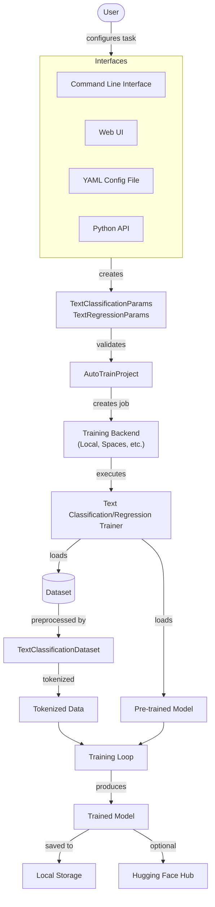
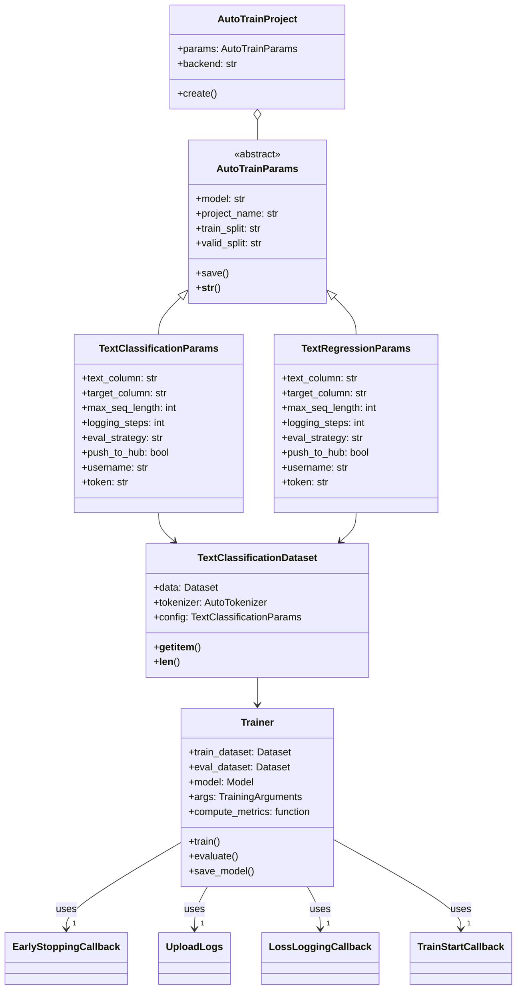
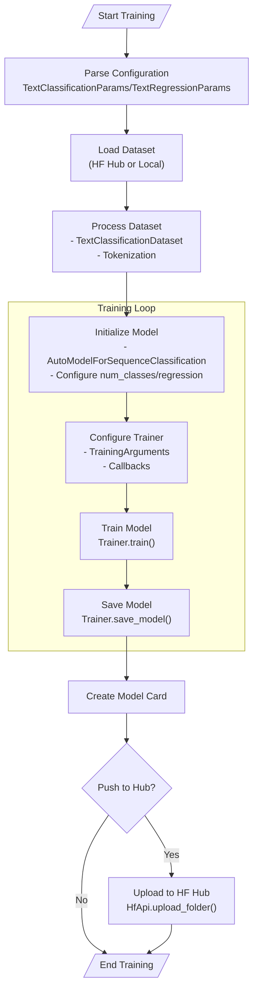
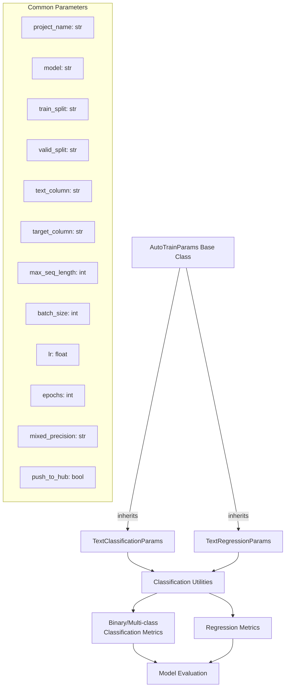
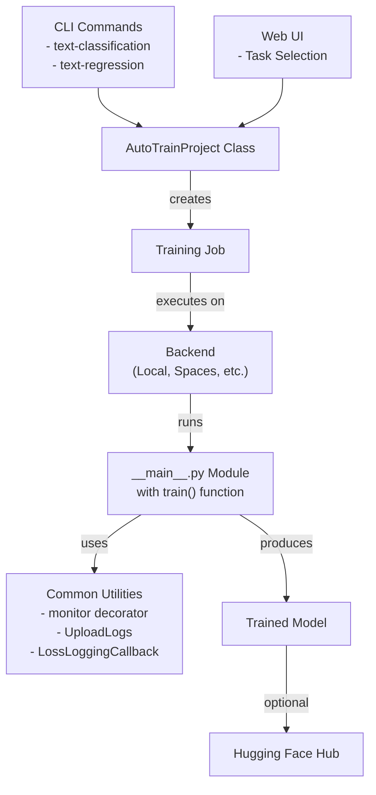

<!-- source: DeepWiki mcp.deepwiki.com · repo huggingface/autotrain-advanced · page 3.2 Text Classification and Regression · fetched 2026-10-26 -->

# Text Classification and Regression

<details>
<summary>Relevant source files</summary>

The following files were used as context for generating this wiki page:

- [docs/source/_toctree.yml](docs/source/_toctree.yml)
- [docs/source/tasks/llm_finetuning.mdx](docs/source/tasks/llm_finetuning.mdx)
- [docs/source/tasks/text_classification_regression.mdx](docs/source/tasks/text_classification_regression.mdx)
- [src/autotrain/cli/run_image_classification.py](src/autotrain/cli/run_image_classification.py)
- [src/autotrain/cli/run_seq2seq.py](src/autotrain/cli/run_seq2seq.py)
- [src/autotrain/cli/run_tabular.py](src/autotrain/cli/run_tabular.py)
- [src/autotrain/cli/run_text_classification.py](src/autotrain/cli/run_text_classification.py)
- [src/autotrain/cli/run_text_regression.py](src/autotrain/cli/run_text_regression.py)
- [src/autotrain/cli/run_token_classification.py](src/autotrain/cli/run_token_classification.py)
- [src/autotrain/cli/utils.py](src/autotrain/cli/utils.py)
- [src/autotrain/trainers/common.py](src/autotrain/trainers/common.py)
- [src/autotrain/trainers/image_classification/__main__.py](src/autotrain/trainers/image_classification/__main__.py)
- [src/autotrain/trainers/seq2seq/__main__.py](src/autotrain/trainers/seq2seq/__main__.py)
- [src/autotrain/trainers/tabular/__main__.py](src/autotrain/trainers/tabular/__main__.py)
- [src/autotrain/trainers/text_classification/__main__.py](src/autotrain/trainers/text_classification/__main__.py)
- [static/autotrain_text_classification.png](static/autotrain_text_classification.png)
- [static/llm_orpo_example.png](static/llm_orpo_example.png)

</details>


## Purpose and Scope

This document describes the Text Classification and Regression components within AutoTrain Advanced, which enable users to fine-tune transformer models for text classification and regression tasks with minimal technical expertise. Text classification involves categorizing text into predefined classes (e.g., sentiment analysis, topic classification), while text regression predicts continuous numerical values from text (e.g., rating prediction, scoring systems).

For information about other training components such as LLM fine-tuning, see [LLM Training](#3.1), or for vision models, see [Vision Models](#3.3).

## System Overview

Text Classification and Regression share a nearly identical architecture and training pipeline in AutoTrain Advanced, differing primarily in their evaluation metrics and output layer. These components allow users to train models through various interfaces (CLI, Web UI, Python API) with flexible configuration options.



Sources: 
- [src/autotrain/trainers/text_classification/__main__.py:39-232](https://github.com/huggingface/autotrain-advanced/blob/main/src/autotrain/trainers/text_classification/__main__.py)
- [src/autotrain/cli/run_text_classification.py:1-106](https://github.com/huggingface/autotrain-advanced/blob/main/src/autotrain/cli/run_text_classification.py)
- [src/autotrain/cli/run_text_regression.py:1-106](https://github.com/huggingface/autotrain-advanced/blob/main/src/autotrain/cli/run_text_regression.py)

## Architecture and Components

The Text Classification and Regression components follow a modular design pattern that integrates with the broader AutoTrain Advanced system. Below is a detailed look at the core components and their interactions.



Sources:
- [src/autotrain/trainers/common.py:223-286](https://github.com/huggingface/autotrain-advanced/blob/main/src/autotrain/trainers/common.py)
- [src/autotrain/trainers/text_classification/__main__.py:39-232](https://github.com/huggingface/autotrain-advanced/blob/main/src/autotrain/trainers/text_classification/__main__.py)

## Training Process

The Text Classification and Regression training process in AutoTrain Advanced follows a series of well-defined steps, from data loading to model evaluation and deployment.



Sources:
- [src/autotrain/trainers/text_classification/__main__.py:39-232](https://github.com/huggingface/autotrain-advanced/blob/main/src/autotrain/trainers/text_classification/__main__.py)
- [src/autotrain/trainers/common.py:189-220](https://github.com/huggingface/autotrain-advanced/blob/main/src/autotrain/trainers/common.py)

### Key Training Steps

1. **Parameter Validation**
   - The system validates the user-provided parameters through the `TextClassificationParams` or `TextRegressionParams` class
   - Project name is checked for valid format (alphanumeric with hyphens allowed)
   - Required parameters are verified

2. **Data Loading**
   - Supports loading data from Hugging Face datasets or local files
   - For local files, both CSV and JSONL formats are supported
   - Handles multiple dataset configurations through split syntax (e.g., "config_name:split")

3. **Model Initialization**
   - For classification, determines the number of classes from training data
   - For regression, configures the model for continuous output prediction
   - Handles model loading with trust_remote_code option and token authentication
   - Supports loading from TensorFlow checkpoints when needed

4. **Training Configuration**
   - Dynamic calculation of logging steps based on dataset size
   - Configuration of training arguments (batch size, learning rate, etc.)
   - Setup of evaluation strategies and callbacks

5. **Training Execution**
   - Monitoring and logging of training progress
   - Early stopping based on validation metrics when validation data is provided
   - Mixed precision training (FP16/BF16) when enabled

6. **Model Saving and Publishing**
   - Saving model and tokenizer to local storage
   - Generating model card with training details and metrics
   - Optional pushing to Hugging Face Hub with private repository creation

Sources:
- [src/autotrain/trainers/text_classification/__main__.py:39-232](https://github.com/huggingface/autotrain-advanced/blob/main/src/autotrain/trainers/text_classification/__main__.py)
- [src/autotrain/trainers/common.py:79-99](https://github.com/huggingface/autotrain-advanced/blob/main/src/autotrain/trainers/common.py)

## Data Format and Processing

### Supported Data Formats

AutoTrain supports both CSV and JSONL formats for text classification and regression tasks:

| Format | Structure | Example |
|--------|-----------|---------|
| CSV | Two columns: text and target | `text,target`<br>`"this movie is great",positive`<br>`"this movie is bad",negative` |
| JSONL | JSON objects with text and target fields | `{"text": "this movie is great", "target": "positive"}`<br>`{"text": "this movie is bad", "target": "negative"}` |

For regression tasks, the target values are numerical instead of categorical:

| Format | Structure | Example |
|--------|-----------|---------|
| CSV | Two columns: text and target | `text,target`<br>`"this movie is great",4.9`<br>`"this movie is bad",1.5` |
| JSONL | JSON objects with text and target fields | `{"text": "this movie is great", "target": 4.9}`<br>`{"text": "this movie is bad", "target": 1.5}` |

### Column Mapping

If your dataset uses different column names, you can map them to the expected format using the `column_mapping` parameter:

```yaml
column_mapping:
  text_column: review_text  # Your actual text column name
  target_column: sentiment  # Your actual target column name
```

This flexibility allows users to use datasets with varied column naming conventions without modifying the original data.

Sources:
- [docs/source/tasks/text_classification_regression.mdx:14-64](https://github.com/huggingface/autotrain-advanced/blob/main/docs/source/tasks/text_classification_regression.mdx)

## Using Text Classification and Regression

### Command Line Interface

The command line interface provides a straightforward way to initiate training:

```bash
# For text classification
autotrain text-classification --train \
  --model google-bert/bert-base-uncased \
  --project-name my-text-classifier \
  --data-path path/to/data \
  --train-split train \
  --valid-split valid \
  --text-column text \
  --target-column target \
  --epochs 3 \
  --lr 2e-5 \
  --batch-size 8

# For text regression
autotrain text-regression --train \
  --model google-bert/bert-base-uncased \
  --project-name my-text-regressor \
  --data-path path/to/data \
  --train-split train \
  --valid-split valid \
  --text-column text \
  --target-column target \
  --epochs 3 \
  --lr 2e-5 \
  --batch-size 8
```

### Configuration File

Alternatively, you can use a YAML configuration file:

```yaml
task: text_classification  # or text_regression
base_model: google-bert/bert-base-uncased
project_name: autotrain-bert-imdb-finetuned
log: tensorboard
backend: local

data:
  path: stanfordnlp/imdb  # HF dataset or local path
  train_split: train
  valid_split: test
  column_mapping:
    text_column: text
    target_column: label

params:
  max_seq_length: 512
  epochs: 3
  batch_size: 4
  lr: 2e-5
  optimizer: adamw_torch
  scheduler: linear
  gradient_accumulation: 1
  mixed_precision: fp16

hub:
  username: ${HF_USERNAME}
  token: ${HF_TOKEN}
  push_to_hub: true
```

Then run:

```bash
autotrain --config config.yaml
```

Sources:
- [src/autotrain/cli/run_text_classification.py:1-106](https://github.com/huggingface/autotrain-advanced/blob/main/src/autotrain/cli/run_text_classification.py)
- [src/autotrain/cli/run_text_regression.py:1-106](https://github.com/huggingface/autotrain-advanced/blob/main/src/autotrain/cli/run_text_regression.py)
- [docs/source/tasks/text_classification_regression.mdx:72-133](https://github.com/huggingface/autotrain-advanced/blob/main/docs/source/tasks/text_classification_regression.mdx)

## Metrics and Evaluation

AutoTrain uses different metrics for evaluation based on the task type:

### Text Classification Metrics

- **Binary Classification** (2 classes):
  - Accuracy
  - F1 Score
  - Precision
  - Recall
  - ROC AUC

- **Multi-class Classification** (3+ classes):
  - Accuracy
  - Macro F1 Score
  - Weighted F1 Score
  - Macro Precision
  - Weighted Precision
  - Macro Recall
  - Weighted Recall

### Text Regression Metrics

- Mean Squared Error (MSE)
- Root Mean Squared Error (RMSE)
- Mean Absolute Error (MAE)
- R² (Coefficient of Determination)

The appropriate evaluation function is automatically selected based on the number of classes detected in the training data.

Sources:
- [src/autotrain/trainers/text_classification/__main__.py:193-196](https://github.com/huggingface/autotrain-advanced/blob/main/src/autotrain/trainers/text_classification/__main__.py)

## Text Classification vs. Text Regression Parameters

Both text classification and regression share the same parameter structure with minor differences in how they're processed:



Sources:
- [src/autotrain/trainers/common.py:223-286](https://github.com/huggingface/autotrain-advanced/blob/main/src/autotrain/trainers/common.py)

## Integration with AutoTrain System

Text Classification and Regression are integrated into the broader AutoTrain system, leveraging common components for execution:



Sources:
- [src/autotrain/trainers/text_classification/__main__.py:39-232](https://github.com/huggingface/autotrain-advanced/blob/main/src/autotrain/trainers/text_classification/__main__.py)
- [src/autotrain/trainers/common.py:189-220](https://github.com/huggingface/autotrain-advanced/blob/main/src/autotrain/trainers/common.py)

## Limitations and Best Practices

### Limitations

- Maximum sequence length is constrained by the model architecture (typically 512 tokens for BERT-based models)
- Very large datasets may require significant computing resources
- Multi-label classification is not directly supported

### Best Practices

1. **Data Preparation**
   - Ensure balanced class distribution for classification tasks
   - Clean and preprocess text data to remove noise
   - Provide a validation split for better model selection

2. **Model Selection**
   - For short texts, compact models like DistilBERT may be sufficient
   - For longer texts, consider models with larger context windows
   - Domain-specific models often outperform general models

3. **Training Configuration**
   - Start with default hyperparameters and adjust as needed
   - Use mixed precision training to reduce memory usage
   - Enable early stopping to prevent overfitting

4. **Evaluation**
   - For imbalanced classification datasets, focus on F1 score rather than accuracy
   - For regression tasks, consider the scale of your target variable when interpreting metrics
   - Test model on a diverse set of inputs before deployment

Sources:
- [src/autotrain/trainers/text_classification/__main__.py:39-232](https://github.com/huggingface/autotrain-advanced/blob/main/src/autotrain/trainers/text_classification/__main__.py)
- [docs/source/tasks/text_classification_regression.mdx:1-150](https://github.com/huggingface/autotrain-advanced/blob/main/docs/source/tasks/text_classification_regression.mdx)

---

