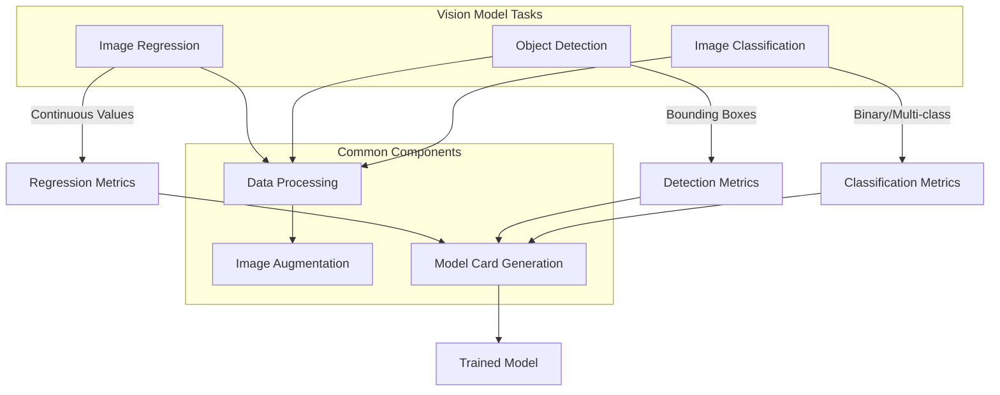
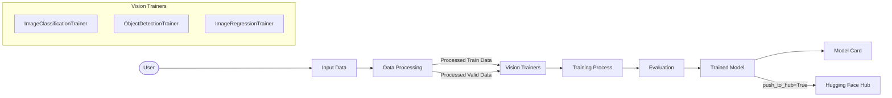
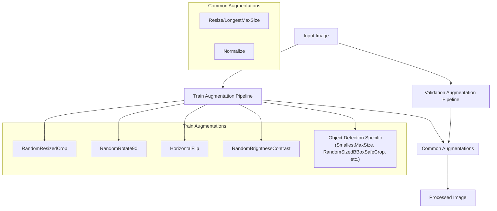
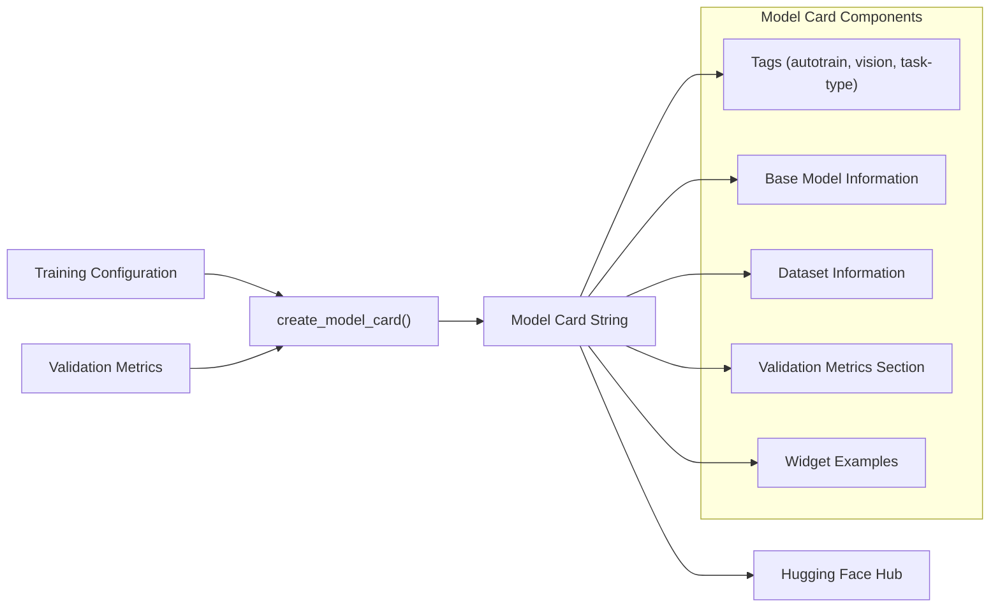

<!-- source: DeepWiki mcp.deepwiki.com · repo huggingface/autotrain-advanced · page 3.3 Vision Models · fetched 2026-10-26 -->

# Vision Models

Relevant source files

The following files were used as context for generating this wiki page:

- [.dockerignore](.dockerignore)
- [src/autotrain/trainers/image_classification/utils.py](src/autotrain/trainers/image_classification/utils.py)
- [src/autotrain/trainers/image_regression/utils.py](src/autotrain/trainers/image_regression/utils.py)
- [src/autotrain/trainers/object_detection/utils.py](src/autotrain/trainers/object_detection/utils.py)
- [src/autotrain/trainers/sent_transformers/utils.py](src/autotrain/trainers/sent_transformers/utils.py)
- [src/autotrain/trainers/seq2seq/utils.py](src/autotrain/trainers/seq2seq/utils.py)
- [src/autotrain/trainers/text_classification/utils.py](src/autotrain/trainers/text_classification/utils.py)
- [src/autotrain/trainers/text_regression/utils.py](src/autotrain/trainers/text_regression/utils.py)
- [src/autotrain/trainers/token_classification/utils.py](src/autotrain/trainers/token_classification/utils.py)

This document details the vision model training components in AutoTrain Advanced. It covers image classification, object detection, and image regression capabilities, focusing on the functionality, data processing, metrics, and model outputs. For information about text-based models, refer to [LLM Training](#3.1) and [Text Classification and Regression](#3.2).

## Overview

AutoTrain Advanced provides no-code training capabilities for various vision tasks, enabling users to fine-tune state-of-the-art vision models for specialized use cases. The platform supports three main vision model types:

1. **Image Classification**: Training models to categorize images into predefined classes
2. **Object Detection**: Training models to identify and locate objects within images
3. **Image Regression**: Training models to predict continuous values from images

Sources:
- [src/autotrain/trainers/image_classification/utils.py:1-219]()
- [src/autotrain/trainers/object_detection/utils.py:1-271]()
- [src/autotrain/trainers/image_regression/utils.py:1-175]()

## Architecture

The vision model training components integrate into the larger AutoTrain Advanced architecture as specialized trainers for visual tasks. These trainers handle the unique requirements of vision data processing, model training, and evaluation.

Sources:
- [src/autotrain/trainers/image_classification/utils.py:125-169]()
- [src/autotrain/trainers/object_detection/utils.py:76-128]()
- [src/autotrain/trainers/image_regression/utils.py:91-134]()

## Data Processing

Each vision task has specialized data processing components that handle input images and associated labels or targets. All vision trainers use the Albumentations library for efficient image augmentation.

### Image Augmentation Techniques

Sources:
- [src/autotrain/trainers/image_classification/utils.py:125-169]()
- [src/autotrain/trainers/object_detection/utils.py:76-128]()
- [src/autotrain/trainers/image_regression/utils.py:91-134]()

### Specialized Dataset Classes

Each vision task has a specialized dataset class that handles data loading, preprocessing, and formatting. These classes extend PyTorch's Dataset class to provide compatibility with PyTorch's DataLoader.

For image classification and regression, the processing pipeline is similar:

1. Process image size according to model requirements
2. Apply train/validation-specific transformations
3. Create task-specific dataset instances

For object detection, additional steps are required:

1. Process bounding box formats (COCO, YOLO, or Pascal VOC)
2. Ensure label compatibility with model requirements
3. Apply specialized augmentations that maintain bounding box validity

Sources:
- [src/autotrain/trainers/image_classification/utils.py:125-169]()
- [src/autotrain/trainers/object_detection/utils.py:76-128]()
- [src/autotrain/trainers/image_regression/utils.py:91-134]()

## Task-Specific Components

### Image Classification

Image classification training supports both binary (two-class) and multi-class classification scenarios.

#### Metrics

The evaluation metrics differ based on whether it's a binary or multi-class task:

**Binary Classification Metrics:**
- Accuracy
- F1 Score
- Precision
- Recall
- AUC (Area Under ROC Curve)

**Multi-class Classification Metrics:**
- Accuracy
- F1 (macro, micro, weighted)
- Precision (macro, micro, weighted)
- Recall (macro, micro, weighted)

#### Data Processing

The image classification data processing pipeline:
1. Applies transformations like random crops, rotations, flips for training data
2. Uses simpler resize and normalize for validation data
3. Creates a consistent interface via `ImageClassificationDataset`

Sources:
- [src/autotrain/trainers/image_classification/utils.py:10-31]()
- [src/autotrain/trainers/image_classification/utils.py:57-122]()

### Object Detection

Object detection focuses on locating and classifying objects within images by predicting bounding boxes and class labels.

#### Bounding Box Format Handling

The system handles different bounding box formats and conversions:

1. YOLO format (x_center, y_center, width, height in normalized coordinates)
2. Pascal VOC format (x_min, y_min, x_max, y_max in absolute coordinates)
3. COCO format for processing

#### Metrics

Object detection uses specialized metrics for evaluation:

- Mean Average Precision (mAP)
  - mAP at IoU threshold of 0.5 (mAP_50)
  - mAP at IoU threshold of 0.75 (mAP_75)
  - mAP for small/medium/large objects
- Mean Average Recall (mAR)
  - mAR@1, mAR@10, mAR@100
  - mAR for small/medium/large objects

The metrics are calculated using the torchmetrics library.

#### Data Processing and Collation

Object detection has specialized data handling:

1. Transforms that preserve bounding box validity
2. Custom collation function for batching that handles variable number of objects per image
3. Post-processing for prediction visualization

Sources:
- [src/autotrain/trainers/object_detection/utils.py:12-26]()
- [src/autotrain/trainers/object_detection/utils.py:53-73]()
- [src/autotrain/trainers/object_detection/utils.py:131-150]()
- [src/autotrain/trainers/object_detection/utils.py:154-229]()

### Image Regression

Image regression trains models to predict continuous values from images, useful for tasks like age estimation, pose estimation, or other continuous attribute prediction.

#### Metrics

Image regression uses standard regression metrics:

- Mean Squared Error (MSE)
- Mean Absolute Error (MAE)
- R-squared (R2)
- Root Mean Squared Error (RMSE)
- Explained Variance

#### Data Processing

Similar to image classification but optimized for regression tasks:

1. Applies transformations like random crops, rotations, flips for training
2. Uses resize and normalize for validation
3. Creates a consistent interface via `ImageRegressionDataset`

Sources:
- [src/autotrain/trainers/image_regression/utils.py:10-17]()
- [src/autotrain/trainers/image_regression/utils.py:46-88]()
- [src/autotrain/trainers/image_regression/utils.py:91-134]()

## Model Card Generation

All vision trainers include automatic model card generation functionality that creates standardized documentation for the trained models.

The model card includes:

1. Library name (transformers)
2. Task-specific tags
3. Base model reference (if applicable)
4. Dataset information
5. Visual widget examples
6. Validation metrics

Each model type has a specialized model card template that highlights the relevant metrics for that task type.

Sources:
- [src/autotrain/trainers/image_classification/utils.py:33-54]()
- [src/autotrain/trainers/image_classification/utils.py:171-218]()
- [src/autotrain/trainers/object_detection/utils.py:28-50]()
- [src/autotrain/trainers/object_detection/utils.py:232-270]()
- [src/autotrain/trainers/image_regression/utils.py:19-43]()
- [src/autotrain/trainers/image_regression/utils.py:137-174]()

## Usage

Using AutoTrain Advanced for vision tasks follows a consistent pattern:

1. Prepare your dataset in the required format
   - For image classification: images with class labels
   - For object detection: images with bounding box annotations
   - For image regression: images with continuous target values

2. Select a base model from supported vision model architectures

3. Configure training parameters (learning rate, batch size, etc.)

4. Start the training process via CLI, Web UI, or Python API

5. Evaluate the model using task-specific metrics

6. Deploy or share the model via the Hugging Face Hub

The common interfaces for all vision tasks make it easy to switch between different vision tasks while maintaining a consistent workflow.

## Conclusion

AutoTrain Advanced's vision model training components provide a comprehensive suite of tools for training state-of-the-art vision models without writing code. The system handles the complexities of data preprocessing, model training, evaluation, and deployment, allowing users to focus on their specific task requirements.

The standardized interfaces and metrics make it easy to compare different models and approaches, while the automatic model card generation ensures proper documentation of the trained models. These vision components integrate seamlessly with the rest of the AutoTrain Advanced ecosystem, providing a unified experience for users working with different modalities.

---

