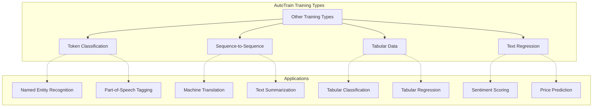
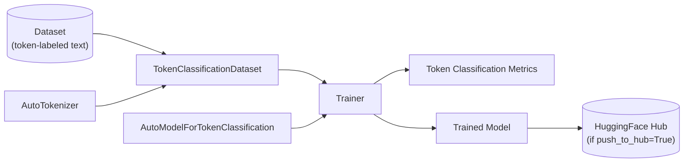
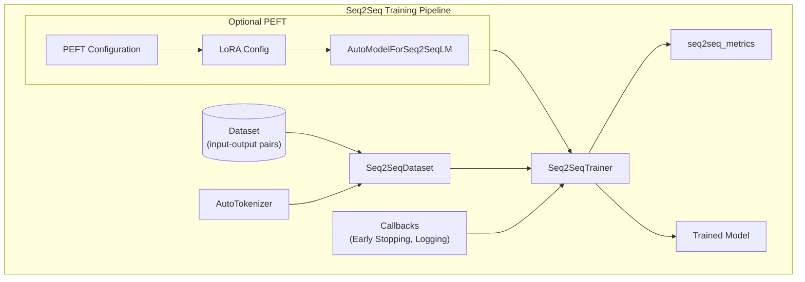
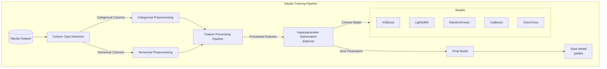
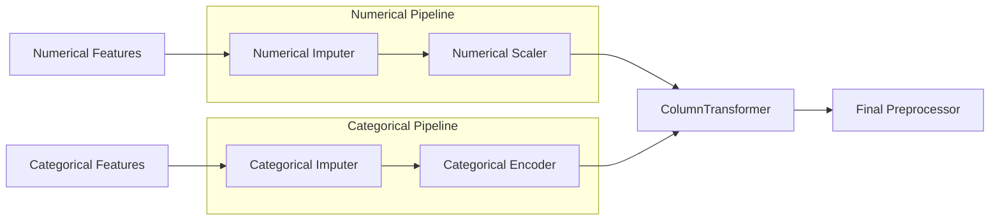
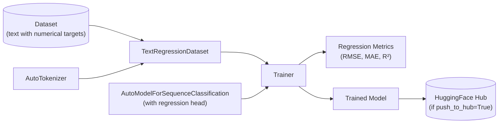
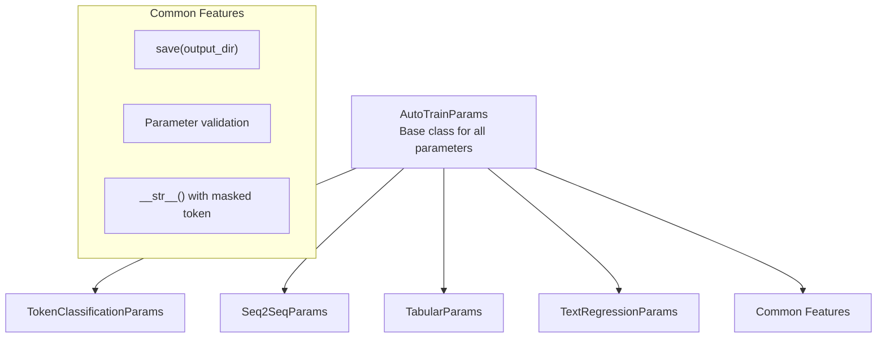

<!-- source: DeepWiki mcp.deepwiki.com · repo huggingface/autotrain-advanced · page 3.4 Other Training Types · fetched 2026-10-26 -->

# Other Training Types

<details>
<summary>Relevant source files</summary>

The following files were used as context for generating this wiki page:

- [src/autotrain/cli/run_image_classification.py](src/autotrain/cli/run_image_classification.py)
- [src/autotrain/cli/run_seq2seq.py](src/autotrain/cli/run_seq2seq.py)
- [src/autotrain/cli/run_tabular.py](src/autotrain/cli/run_tabular.py)
- [src/autotrain/cli/run_text_classification.py](src/autotrain/cli/run_text_classification.py)
- [src/autotrain/cli/run_text_regression.py](src/autotrain/cli/run_text_regression.py)
- [src/autotrain/cli/run_token_classification.py](src/autotrain/cli/run_token_classification.py)
- [src/autotrain/cli/utils.py](src/autotrain/cli/utils.py)
- [src/autotrain/trainers/common.py](src/autotrain/trainers/common.py)
- [src/autotrain/trainers/image_classification/__main__.py](src/autotrain/trainers/image_classification/__main__.py)
- [src/autotrain/trainers/seq2seq/__main__.py](src/autotrain/trainers/seq2seq/__main__.py)
- [src/autotrain/trainers/tabular/__main__.py](src/autotrain/trainers/tabular/__main__.py)
- [src/autotrain/trainers/text_classification/__main__.py](src/autotrain/trainers/text_classification/__main__.py)

</details>


This page documents the additional training capabilities in AutoTrain Advanced beyond the primary training types covered in pages [LLM Training](3.1), [Text Classification and Regression](3.2), and [Vision Models](3.3). We'll explore specialized training types that enable users to tackle diverse machine learning tasks with minimal code.

## Overview of Additional Training Types

AutoTrain Advanced extends beyond the more common training types to support several specialized machine learning tasks:



Sources: [src/autotrain/cli/run_token_classification.py:1-107](), [src/autotrain/cli/run_seq2seq.py:1-98](), [src/autotrain/cli/run_tabular.py:1-107](), [src/autotrain/cli/run_text_regression.py:1-107]()

## Token Classification

Token classification involves assigning a label to each token in a sequence, making it ideal for tasks like named entity recognition, part-of-speech tagging, and chunking.

### Key Features

- Supports various pre-trained transformer models
- Handles token-level annotations
- Provides specialized metrics for token classification tasks
- Supports early stopping and model checkpointing

### Implementation

The token classification trainer follows the standard AutoTrain pattern with specialized parameters defined in `TokenClassificationParams`.



Sources: [src/autotrain/cli/run_token_classification.py:1-107]()

### CLI Usage

Token classification models can be trained using the CLI:

```
autotrain token-classification \
  --train \
  --model "bert-base-uncased" \
  --project-name "my-ner-model" \
  --data-path "path/to/token/dataset" \
  --train-split "train" \
  --valid-split "validation" \
  --text-column "text" \
  --target-column "labels" \
  --push-to-hub \
  --username "your-username"
```

Sources: [src/autotrain/cli/run_token_classification.py:47-71]()

## Sequence-to-Sequence (Seq2Seq) Models

Sequence-to-sequence models transform one sequence into another, making them suitable for tasks like machine translation, text summarization, and question answering.

### Key Features

- Support for encoder-decoder architectures
- Integration with PEFT (Parameter-Efficient Fine-Tuning)
- LoRA (Low-Rank Adaptation) for efficient fine-tuning
- Generation-based evaluation metrics
- Optional quantization (8-bit)

### Implementation Architecture



Sources: [src/autotrain/trainers/seq2seq/__main__.py:1-280]()

### Code Structure

The sequence-to-sequence training implementation is centered around the `Seq2SeqTrainer` from the Transformers library, with several customizations:

1. **Data Preparation**: The `Seq2SeqDataset` class handles tokenization and formatting of input-output pairs
2. **Model Initialization**: Supports loading pretrained seq2seq models with optional PEFT configuration
3. **Training Configuration**: Specialized parameters for sequence generation tasks
4. **Metrics**: Custom metrics for evaluating sequence generation quality

The training function includes support for:
- Mixed precision training (FP16/BF16)
- Gradient accumulation
- Different learning rate schedulers
- Early stopping
- Model serialization and upload to Hugging Face Hub

Sources: [src/autotrain/trainers/seq2seq/__main__.py:46-273]()

### PEFT Support

For efficient fine-tuning, Seq2Seq models can use LoRA:

```python
lora_config = LoraConfig(
    r=config.lora_r,
    lora_alpha=config.lora_alpha,
    target_modules=target_modules,
    lora_dropout=config.lora_dropout,
    bias="none",
    task_type=TaskType.SEQ_2_SEQ_LM,
)
model = get_peft_model(model, lora_config)
```

Sources: [src/autotrain/trainers/seq2seq/__main__.py:209-220]()

### CLI Usage

Seq2Seq models can be trained using the CLI:

```
autotrain seq2seq \
  --train \
  --model "t5-small" \
  --project-name "my-summarizer" \
  --data-path "path/to/seq2seq/dataset" \
  --train-split "train" \
  --valid-split "validation" \
  --text-column "text" \
  --target-column "summary" \
  --peft \
  --lora-r 8 \
  --push-to-hub \
  --username "your-username"
```

Sources: [src/autotrain/cli/run_seq2seq.py:46-68]()

## Tabular Data Training

AutoTrain supports training models on tabular data, with automatic preprocessing, model selection, and hyperparameter optimization.

### Key Features

- Support for multiple models: XGBoost, LightGBM, RandomForest, CatBoost, ExtraTrees
- Automatic hyperparameter optimization using Optuna
- Preprocessing for numerical and categorical features
- Support for classification and regression tasks
- Handling of single-column and multi-column targets

### Implementation Architecture



Sources: [src/autotrain/trainers/tabular/__main__.py:1-410]()

### Processing Pipeline

The tabular training implementation follows a sophisticated pipeline:

1. **Data Loading**: Loading tabular data from various sources
2. **Column Type Detection**: Automatic identification of categorical and numerical columns
3. **Preprocessing**: Specialized pipelines for categorical and numerical features
   - Imputation of missing values
   - Scaling of numerical features
   - Encoding of categorical features (one-hot or ordinal)
4. **Task Determination**: Automatic identification of task type
   - Binary classification
   - Multi-class classification
   - Multi-label classification
   - Single-column regression
   - Multi-column regression
5. **Hyperparameter Optimization**: Using Optuna to find optimal hyperparameters
6. **Model Training**: Training with the best hyperparameters
7. **Model Serialization**: Saving the model and preprocessing pipeline

Sources: [src/autotrain/trainers/tabular/__main__.py:152-403]()

### Preprocessing Details



The preprocessing uses scikit-learn's `ColumnTransformer` to handle different column types appropriately:

```python
numeric_steps = []
# Add imputation and scaling steps
numeric_transformer = pipeline.Pipeline(numeric_steps)

categorical_steps = []
# Add imputation and encoding steps
categorical_transformer = pipeline.Pipeline(categorical_steps)

transformers = [
    ("numeric", numeric_transformer, numerical_columns),
    ("categorical", categorical_transformer, categorical_columns)
]
preprocessor = ColumnTransformer(transformers=transformers)
```

Sources: [src/autotrain/trainers/tabular/__main__.py:269-316]()

### CLI Usage

Tabular models can be trained using the CLI:

```
autotrain tabular \
  --train \
  --model "xgboost" \
  --project-name "customer-churn" \
  --data-path "path/to/tabular/dataset" \
  --train-split "train" \
  --valid-split "validation" \
  --target-columns "churn" \
  --task "classification" \
  --push-to-hub \
  --username "your-username"
```

Sources: [src/autotrain/cli/run_tabular.py:48-69]()

## Text Regression

While similar to text classification, text regression predicts continuous values rather than categorical labels. This is useful for tasks like sentiment scoring, price prediction from descriptions, or any problem where text inputs map to numerical outputs.

### Key Features

- Uses autoregressive models to predict continuous values
- Similar architecture to text classification but with regression-specific metrics
- Supports various pre-trained transformer models
- Specialized evaluation metrics for regression tasks

### Implementation

The text regression trainer is based on the same architecture as text classification but uses regression-specific metrics:



Sources: [src/autotrain/cli/run_text_regression.py:1-107]()

### CLI Usage

Text regression models can be trained using the CLI:

```
autotrain text-regression \
  --train \
  --model "distilbert-base-uncased" \
  --project-name "price-predictor" \
  --data-path "path/to/regression/dataset" \
  --train-split "train" \
  --valid-split "validation" \
  --text-column "description" \
  --target-column "price" \
  --push-to-hub \
  --username "your-username"
```

Sources: [src/autotrain/cli/run_text_regression.py:47-70]()

## Common Components Across Training Types

All the training types in AutoTrain share common components for consistency and code reuse.

### Base Parameter Class

All training types inherit from the `AutoTrainParams` base class, which provides common functionality:



The `AutoTrainParams` provides:
- Parameter validation
- Token masking for security
- Parameter serialization
- Default value handling

Sources: [src/autotrain/trainers/common.py:223-287]()

### Callbacks and Monitoring

All training types utilize common callbacks for monitoring and logging:

1. **UploadLogs**: Uploads training logs to Hugging Face Hub
2. **LossLoggingCallback**: Enhanced logging of training losses
3. **TrainStartCallback**: Notifies when training starts
4. **monitor**: A decorator that catches exceptions and handles failures

These components ensure consistent behavior and error handling across all training types.

Sources: [src/autotrain/trainers/common.py:289-387]()

### Parameter Handling

CLI commands for all training types follow a consistent pattern for parameter handling:

1. Register parameters from the corresponding parameter class
2. Add common arguments (train, deploy, inference, backend)
3. Set up argument parsing with appropriate help text
4. Validate required parameters
5. Convert arguments to the appropriate parameter class
6. Create an `AutoTrainProject` with the parameters
7. Launch training with the configured backend

Sources: [src/autotrain/cli/utils.py:140-178](), [src/autotrain/cli/run_text_classification.py:18-46](), [src/autotrain/cli/run_seq2seq.py:18-45](), [src/autotrain/cli/run_tabular.py:18-45](), [src/autotrain/cli/run_token_classification.py:18-46]()

## Conclusion

AutoTrain Advanced provides specialized trainers for a variety of machine learning tasks beyond the primary training types. These additional trainers—Token Classification, Sequence-to-Sequence, Tabular Data, and Text Regression—follow consistent patterns while offering task-specific optimizations. The common architecture makes it easy to use different training types with minimal code changes, while still providing the flexibility to tune parameters for each specific task.

---

