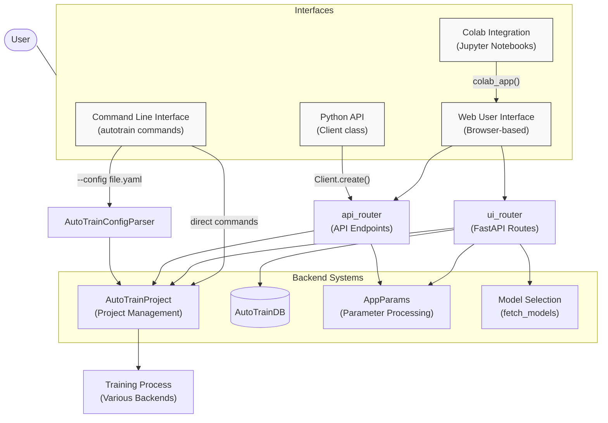
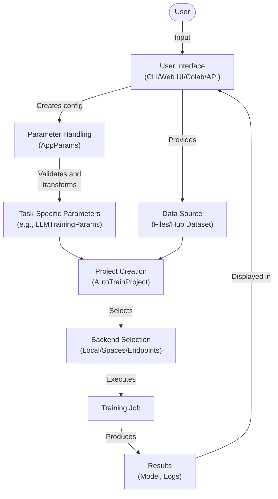
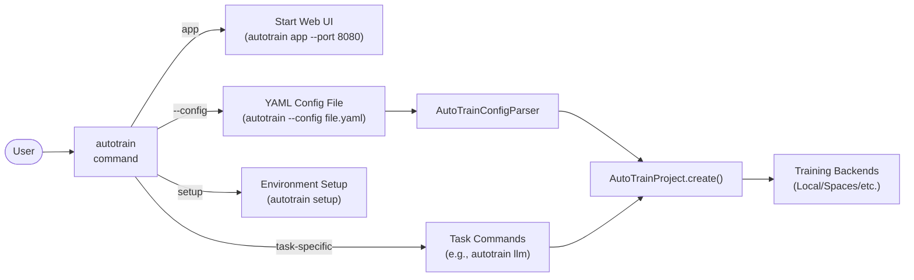
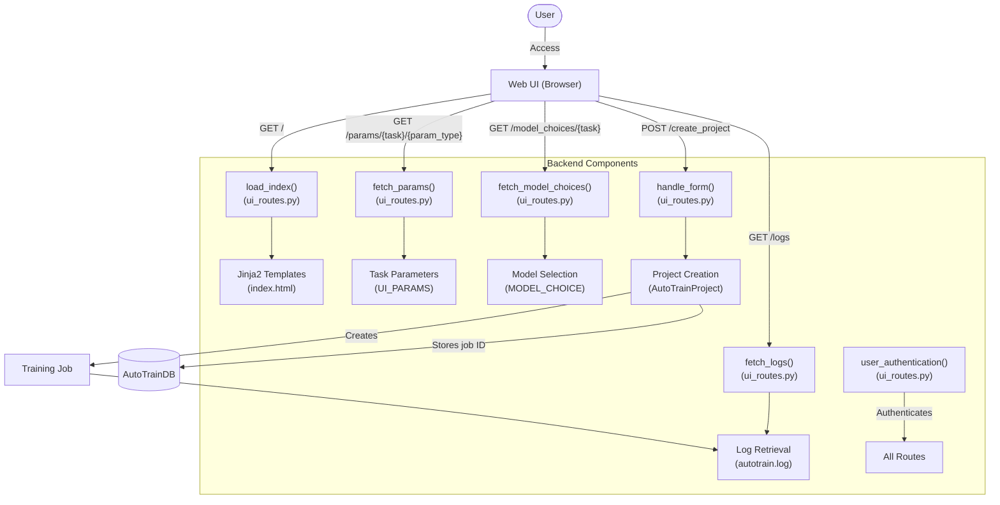
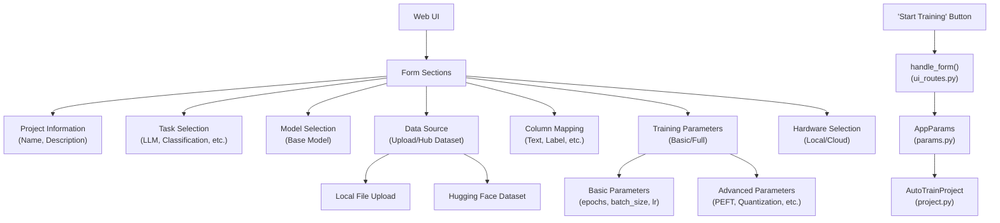
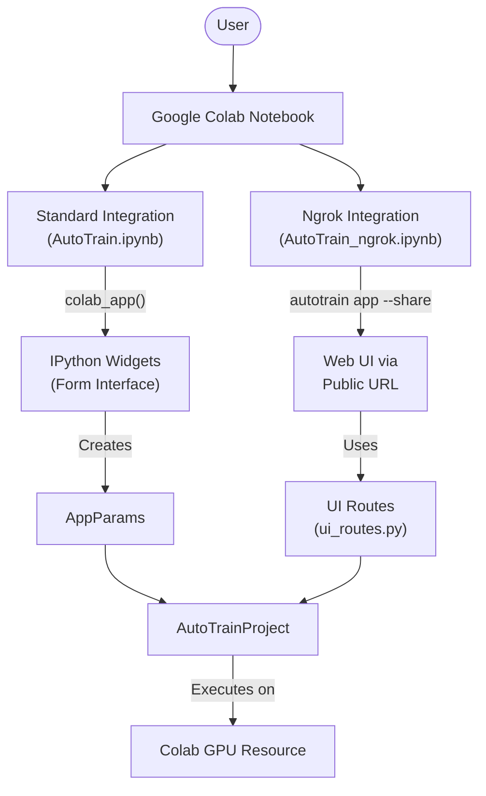
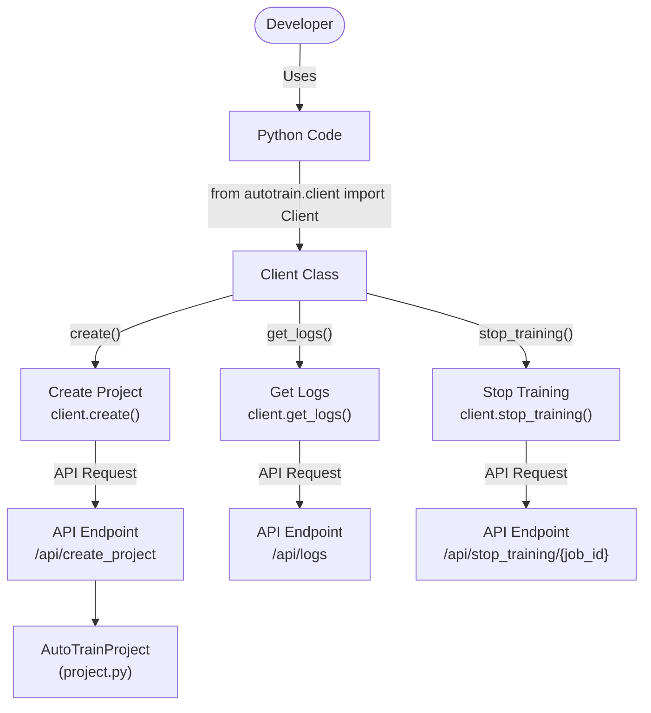
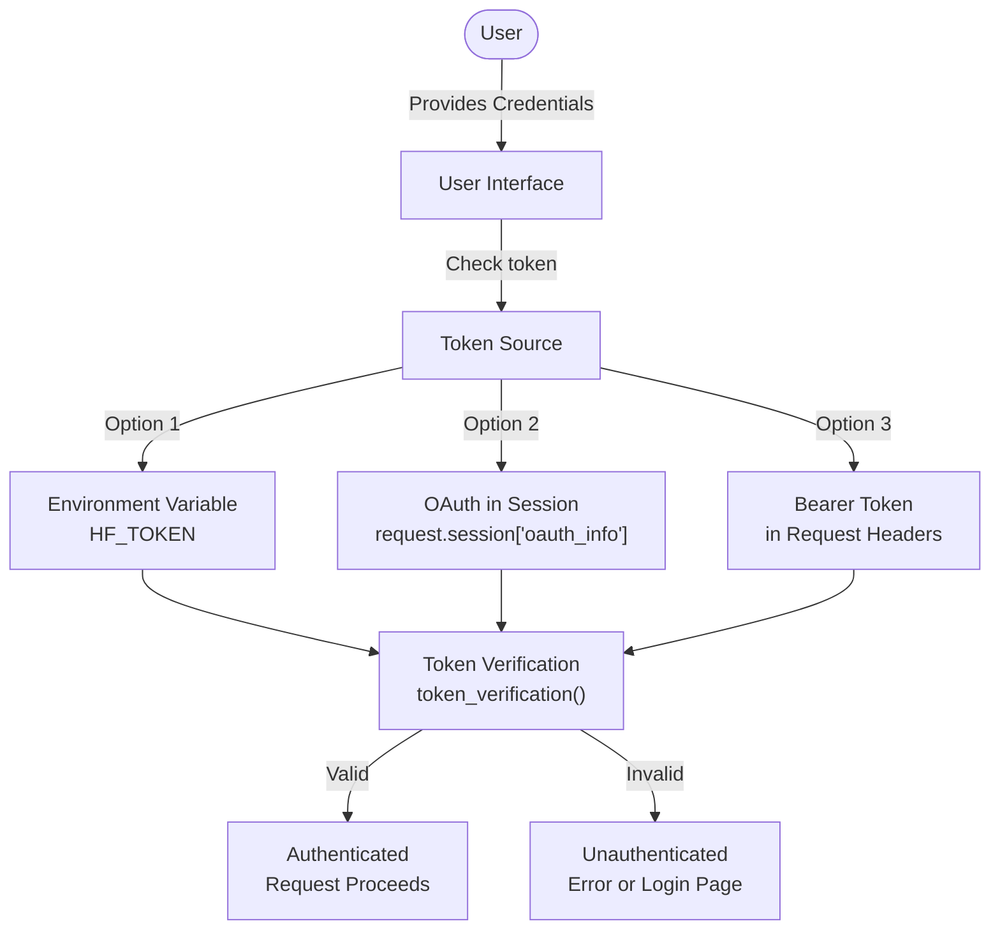

<!-- source: DeepWiki mcp.deepwiki.com · repo huggingface/autotrain-advanced · page 4 User Interfaces · fetched 2026-10-26 -->

# User Interfaces

<details>
<summary>Relevant source files</summary>

The following files were used as context for generating this wiki page:

- [README.md](README.md)
- [colabs/AutoTrain.ipynb](colabs/AutoTrain.ipynb)
- [colabs/AutoTrain_ngrok.ipynb](colabs/AutoTrain_ngrok.ipynb)
- [src/autotrain/app/api_routes.py](src/autotrain/app/api_routes.py)
- [src/autotrain/app/models.py](src/autotrain/app/models.py)
- [src/autotrain/app/params.py](src/autotrain/app/params.py)
- [src/autotrain/app/templates/index.html](src/autotrain/app/templates/index.html)
- [src/autotrain/app/ui_routes.py](src/autotrain/app/ui_routes.py)
- [src/autotrain/backends/base.py](src/autotrain/backends/base.py)
- [src/autotrain/backends/spaces.py](src/autotrain/backends/spaces.py)
- [src/autotrain/client.py](src/autotrain/client.py)
- [src/autotrain/logging.py](src/autotrain/logging.py)
- [src/autotrain/parser.py](src/autotrain/parser.py)

</details>


This page provides an overview of the different ways users can interact with AutoTrain Advanced. The system offers multiple interfaces to accommodate various user preferences and workflows, from command-line operations to graphical user interfaces. For detailed information about specific interface implementations, see [Command Line Interface](#4.1), [Web Application](#4.2), and [Colab and Notebook Integration](#4.3).

## Available User Interfaces

AutoTrain Advanced provides four primary user interfaces:

1. **Command Line Interface (CLI)** - For users who prefer terminal-based workflows
2. **Web User Interface (Web UI)** - A browser-based graphical interface
3. **Colab Integration** - Jupyter notebook interfaces specifically for Google Colab
4. **Python API** - Programmatic access for developers and custom workflows



Sources: 
- [README.md:25-34]()
- [src/autotrain/app/ui_routes.py:41-93]()
- [src/autotrain/client.py:166-294]()
- [colabs/AutoTrain.ipynb:1-50]()
- [colabs/AutoTrain_ngrok.ipynb:1-52]()

## Interface Relationships and Data Flow

The following diagram illustrates how user input flows through the system, regardless of which interface is used:



Sources:
- [src/autotrain/app/params.py:139-489]()
- [src/autotrain/app/ui_routes.py:493-703]()
- [src/autotrain/client.py:214-282]()
- [src/autotrain/parser.py:38-229]()

## Command Line Interface

The Command Line Interface (CLI) provides a terminal-based way to interact with AutoTrain. It supports both direct commands for specific tasks and configuration file-based execution.



Sources:
- [README.md:57-113]()
- [src/autotrain/parser.py:38-230]()

## Web User Interface

The Web UI provides a graphical interface accessible through a web browser. It's built with FastAPI for the backend and uses Jinja2 templates for rendering the frontend.



Sources:
- [src/autotrain/app/ui_routes.py:41-796]()
- [src/autotrain/app/templates/index.html:1-480]()
- [src/autotrain/app/params.py:139-489]()
- [src/autotrain/app/models.py:336-374]()

### Web UI Components and Parameters

The Web UI presents a form-based interface where users can configure various parameters for their training jobs:



Sources:
- [src/autotrain/app/ui_routes.py:45-291]()
- [src/autotrain/app/ui_routes.py:493-703]()
- [src/autotrain/app/templates/index.html:148-380]()

## Colab and Notebook Integration

AutoTrain Advanced provides special integration for Google Colab through dedicated notebooks:



Sources:
- [colabs/AutoTrain.ipynb:1-50]()
- [colabs/AutoTrain_ngrok.ipynb:1-52]()

## Python API

The Python API provides programmatic access to AutoTrain through the `Client` class:



Sources:
- [src/autotrain/client.py:166-294]()
- [src/autotrain/app/api_routes.py:1-140]()

### Python API Usage Example

Here's a simplified example of how to use the Python API:

```python
from autotrain.client import Client

# Initialize client
client = Client(
    host="https://autotrain-projects-autotrain-advanced.hf.space/", 
    token="YOUR_HF_TOKEN",
    username="YOUR_USERNAME"
)

# Create a project
response = client.create(
    project_name="my-llm-project",
    task="llm:sft",
    base_model="mistralai/Mistral-7B-v0.1",
    backend="spaces-a10g-large",
    dataset="my-dataset",
    train_split="train",
    column_mapping={"text_column": "text"},
    params={
        "epochs": 3,
        "batch_size": 4,
        "lr": 5e-5,
        "peft": True,
        "quantization": "int4"
    }
)

# Get logs for a job
logs = client.get_logs(job_id="username/autotrain-my-llm-project")

# Stop training for a job
client.stop_training(job_id="username/autotrain-my-llm-project")
```

Sources:
- [src/autotrain/client.py:166-294]()

## Authentication Flow

All interfaces in AutoTrain Advanced require authentication with Hugging Face credentials:



Sources:
- [src/autotrain/app/ui_routes.py:318-367]()
- [src/autotrain/client.py:189-206]()

## Interface Selection Guidelines

Each interface in AutoTrain Advanced is designed for specific use cases:

| Interface | Best For | Key Features | Limitations |
|-----------|----------|--------------|-------------|
| **CLI** | Automation, scripting, CI/CD pipelines | Scriptable, supports configuration files | Steeper learning curve |
| **Web UI** | Visual exploration, interactive experimentation | User-friendly, visual, guided workflow | Requires running a server |
| **Colab** | Quick experimentation, limited local resources | Free GPU access, notebook environment | Limited by Colab constraints |
| **Python API** | Custom applications, programmatic control | Full programmatic control, integration with other Python code | Requires coding knowledge |

Sources:
- [README.md:25-56]()

## Environment Variables and Configuration

All interfaces respect various environment variables that control AutoTrain's behavior:

| Environment Variable | Description | Used By |
|----------------------|-------------|---------|
| `HF_TOKEN` | Hugging Face authentication token | All interfaces |
| `SPACE_ID` | ID when running in Hugging Face Spaces | Web UI |
| `ENABLE_NGC` | Enable NVIDIA GPU Cloud backend (0/1) | Web UI |
| `ENABLE_NVCF` | Enable NVIDIA Cloud Functions backend (0/1) | Web UI |
| `AUTOTRAIN_LOCAL` | Enable local backend (0/1) | Web UI |
| `HF_USERNAME` | Default username for Hugging Face | Python API |
| `AUTOTRAIN_API` | Override API endpoint URL | Python API |
| `AUTOTRAIN_CUSTOM_MODELS` | Comma-separated list of custom models | Web UI |

Sources:
- [src/autotrain/app/ui_routes.py:31-37]()
- [src/autotrain/client.py:10-29]()
- [colabs/AutoTrain_ngrok.ipynb:26-29]()

## Conclusion

AutoTrain Advanced provides multiple user interfaces to accommodate different user preferences and workflows. Whether you prefer command-line operations, visual interfaces, notebook environments, or programmatic control, there's an interface designed to meet your needs. Each interface ultimately leverages the same core functionality, ensuring consistent behavior regardless of how you choose to interact with the system.

All interfaces connect to the same underlying project management system and training components, allowing users to select the interface that best suits their workflow while benefiting from the full capabilities of AutoTrain Advanced.

---

