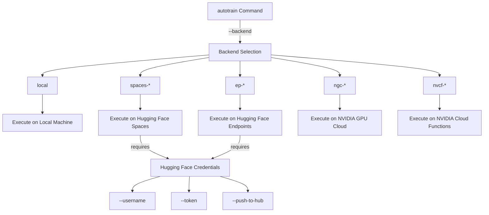
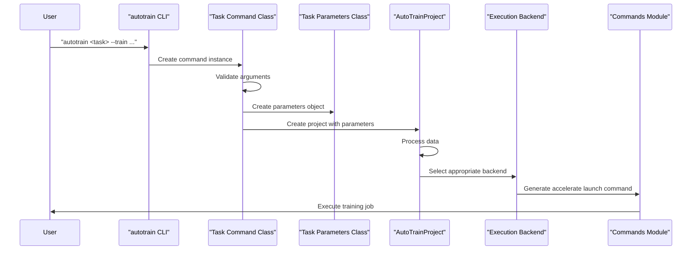
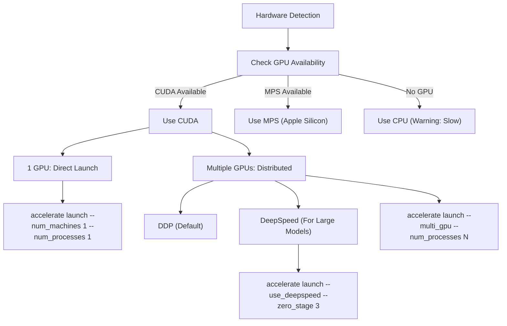

<!-- source: DeepWiki mcp.deepwiki.com · repo huggingface/autotrain-advanced · page 4.1 Command Line Interface · fetched 2026-10-26 -->

# Command Line Interface

<details>
<summary>Relevant source files</summary>

The following files were used as context for generating this wiki page:

- [configs/image_scoring/image_quality.yml](configs/image_scoring/image_quality.yml)
- [src/autotrain/app/colab.py](src/autotrain/app/colab.py)
- [src/autotrain/cli/autotrain.py](src/autotrain/cli/autotrain.py)
- [src/autotrain/cli/run_image_classification.py](src/autotrain/cli/run_image_classification.py)
- [src/autotrain/cli/run_llm.py](src/autotrain/cli/run_llm.py)
- [src/autotrain/cli/run_seq2seq.py](src/autotrain/cli/run_seq2seq.py)
- [src/autotrain/cli/run_setup.py](src/autotrain/cli/run_setup.py)
- [src/autotrain/cli/run_tabular.py](src/autotrain/cli/run_tabular.py)
- [src/autotrain/cli/run_text_classification.py](src/autotrain/cli/run_text_classification.py)
- [src/autotrain/cli/run_text_regression.py](src/autotrain/cli/run_text_regression.py)
- [src/autotrain/cli/run_token_classification.py](src/autotrain/cli/run_token_classification.py)
- [src/autotrain/cli/utils.py](src/autotrain/cli/utils.py)
- [src/autotrain/commands.py](src/autotrain/commands.py)

</details>


The Command Line Interface (CLI) for AutoTrain Advanced provides a direct and scriptable way to access the model training functionality without using the graphical interface. It allows users to train a wide variety of machine learning models from the command line, including large language models (LLMs), text and image classification models, and more.

For information about the Web Application interface, see [Web Application](#4.2). For information about using AutoTrain in Google Colab, see [Colab and Notebook Integration](#4.3).

## CLI Architecture

The AutoTrain CLI follows a standard command pattern with a main command (`autotrain`) followed by task-specific subcommands and options.

```mermaid
graph TD
    CLI["autotrain Command"] --> GlobalOptions["Global Options"]
    CLI --> TaskCommands["Task-Specific Commands"]
    CLI --> UtilityCommands["Utility Commands"]
    
    GlobalOptions --> ConfigFile["--config file.yaml"]
    GlobalOptions --> Version["--version"]
    
    TaskCommands --> LLM["llm"]
    TaskCommands --> TextClassification["text-classification"]
    TaskCommands --> ImageClassification["image-classification"]
    TaskCommands --> TabularData["tabular"]
    TaskCommands --> Seq2Seq["seq2seq"]
    TaskCommands --> TokenClassification["token-classification"]
    TaskCommands --> TextRegression["text-regression"]
    TaskCommands --> ObjectDetection["object-detection"]
    TaskCommands --> ImageRegression["image-regression"]
    TaskCommands --> SentTransformers["sent-transformers"]
    TaskCommands --> ExtractiveQA["extractive-qa"]
    
    UtilityCommands --> App["app"]
    UtilityCommands --> Setup["setup"]
    UtilityCommands --> SpaceRunner["space-runner"]
    UtilityCommands --> Tools["tools"]
    
    TaskCommands --> |common pattern| Actions["Actions"]
    Actions --> Train["--train"]
    Actions --> Deploy["--deploy"]
    Actions --> Inference["--inference"]
```



Sources: [src/autotrain/cli/autotrain.py:23-72]()

## Basic Command Structure

All task-specific commands follow a similar structure, with common parameters and task-specific options:

```
autotrain <task-command> --train --model <model_name> --project-name <project_name> --data-path <data_path> [options]
```

For example, to train a language model:

```
autotrain llm --train --model mistralai/Mistral-7B-v0.1 --project-name my-project --data-path my_dataset
```

Sources: [src/autotrain/cli/run_llm.py:10-141](), [src/autotrain/cli/autotrain.py:23-72]()

## Task-Specific Commands

The AutoTrain CLI provides specialized commands for different machine learning tasks:

### Language Model Fine-tuning (LLM)

```
autotrain llm --train --model mistralai/Mistral-7B-v0.1 --project-name my-llm-project --data-path my_dataset --peft --lora-r 16
```

The `llm` command supports various parameters for fine-tuning language models, including PEFT (Parameter-Efficient Fine-Tuning) methods like LoRA, quantization options, and more.

Sources: [src/autotrain/cli/run_llm.py:10-141]()

### Text Classification

```
autotrain text-classification --train --model bert-base-uncased --project-name my-text-clf --data-path my_dataset
```

Used for training models to classify text into predefined categories.

Sources: [src/autotrain/cli/run_text_classification.py:10-106]()

### Image Classification

```
autotrain image-classification --train --model google/vit-base-patch16-224 --project-name my-img-clf --data-path my_dataset
```

Used for training models to classify images into categories.

Sources: [src/autotrain/cli/run_image_classification.py:10-113]()

### Sequence-to-Sequence (Seq2Seq)

```
autotrain seq2seq --train --model t5-base --project-name my-seq2seq --data-path my_dataset
```

Used for tasks like translation, summarization, and other text-to-text transformations.

Sources: [src/autotrain/cli/run_seq2seq.py:10-97]()

### Tabular Data

```
autotrain tabular --train --model tabular-classification --project-name my-tabular --data-path my_dataset --target-columns target
```

Used for classification or regression on tabular (structured) data.

Sources: [src/autotrain/cli/run_tabular.py:10-106]()

### Other Supported Tasks

- `token-classification`: For named entity recognition and similar tasks
- `text-regression`: For predicting continuous values from text
- `object-detection`: For detecting and localizing objects in images
- `image-regression`: For predicting continuous values from images
- `sent-transformers`: For training sentence transformer models
- `extractive-qa`: For training extractive question answering models

## Common Parameters

Most task commands share these common parameters:

| Parameter | Description | Required | Default |
|-----------|-------------|----------|---------|
| `--train` | Flag to train a model | Yes | - |
| `--model` | Base model to use | Yes | - |
| `--project-name` | Output directory/repo ID | Yes | - |
| `--data-path` | Path to training data | Yes | - |
| `--train-split` | Train dataset split | No | `train` |
| `--valid-split` | Validation dataset split | No | None |
| `--batch-size` | Training batch size | No | 2 |
| `--epochs` | Number of training epochs | No | 1 |
| `--gradient-accumulation` | Gradient accumulation steps | No | 1 |
| `--lr` | Learning rate | No | 5e-4 |
| `--seed` | Random seed | No | 42 |
| `--backend` | Execution backend | No | `local` |
| `--push-to-hub` | Push model to Hub | No | `False` |
| `--username` | Hugging Face username | If pushing to Hub | - |
| `--token` | Hugging Face API token | If pushing to Hub | - |
| `--log` | Experiment tracking | No | `none` |

Sources: [src/autotrain/cli/utils.py:6-137]()

## Configuration File

Instead of specifying all parameters on the command line, you can use a YAML configuration file:

```
autotrain --config config.yml
```

Example configuration file:

```yaml
task: image_regression
base_model: microsoft/resnet-50
project_name: autotrain-img-quality-resnet50
log: tensorboard
backend: local

data:
  path: abhishek/img-quality-full
  train_split: train
  valid_split: null
  column_mapping:
    image_column: image
    target_column: target

params:
  epochs: 10
  batch_size: 8
  lr: 2e-3
  optimizer: adamw_torch
  scheduler: cosine
  gradient_accumulation: 1
  mixed_precision: fp16

hub:
  username: ${HF_USERNAME}
  token: ${HF_TOKEN}
  push_to_hub: true
```

Sources: [src/autotrain/cli/autotrain.py:57-61](), [configs/image_scoring/image_quality.yml:1-27]()

## Execution Backends

The `--backend` parameter determines where the training job will run:



Sources: [src/autotrain/cli/run_image_classification.py:99-105](), [src/autotrain/cli/run_llm.py:122-129]()

## Command Implementation Flow

When you run an AutoTrain CLI command, the processing follows this sequence:



Sources: [src/autotrain/cli/run_llm.py:134-141](), [src/autotrain/commands.py:22-516]()

## Utility Commands

### Setup Command

The `setup` command configures your environment:

```
autotrain setup [--update-torch] [--colab]
```

Options:
- `--update-torch`: Update PyTorch to the latest version
- `--colab`: Set up for Google Colab environment

Sources: [src/autotrain/cli/run_setup.py:9-53]()

### App Command

Starts the AutoTrain web UI:

```
autotrain app
```

This launches the web interface, allowing you to manage training jobs through a browser.

### Space Runner Command

Special command for running AutoTrain in a Hugging Face Space:

```
autotrain space-runner
```

## Hardware Acceleration and Distribution

The CLI automatically detects available hardware and configures acceleration accordingly:



Sources: [src/autotrain/commands.py:38-95]()

## Integrating CLI into Scripts

The CLI can be embedded into Python scripts:

```python
import subprocess

# Run AutoTrain command
subprocess.run([
    "autotrain", "llm", "--train",
    "--model", "mistralai/Mistral-7B-v0.1",
    "--project-name", "my-project",
    "--data-path", "my_dataset",
    "--peft", "--lora-r", "16"
])
```

This allows for programmatic use of AutoTrain in larger workflows.

Sources: [src/autotrain/app/colab.py:376-394]()

## Google Colab Integration

AutoTrain provides special support for running in Google Colab:

```
autotrain setup --colab
```

This installs the required dependencies optimized for Colab environments.

Sources: [src/autotrain/cli/run_setup.py:37-45](), [src/autotrain/app/colab.py:21-402]()

## Conclusion

The AutoTrain Advanced CLI provides a powerful and flexible interface for training various types of machine learning models without writing code. By understanding the common command structure and available options, you can quickly set up training jobs for a wide range of tasks, from simple text classification to complex language model fine-tuning.

For more complex use cases, the configuration file approach offers a more structured way to define training configurations that can be version-controlled and shared.

---

