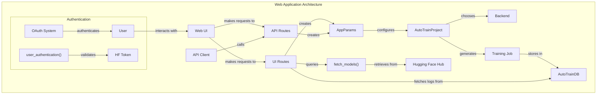
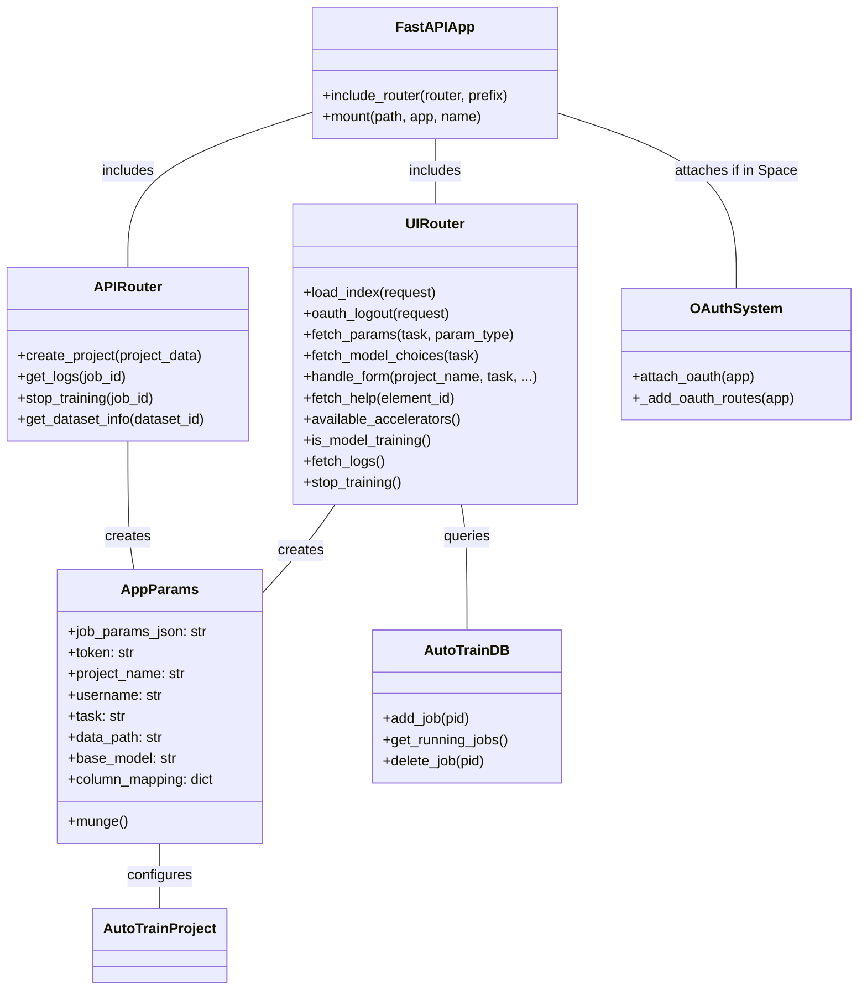
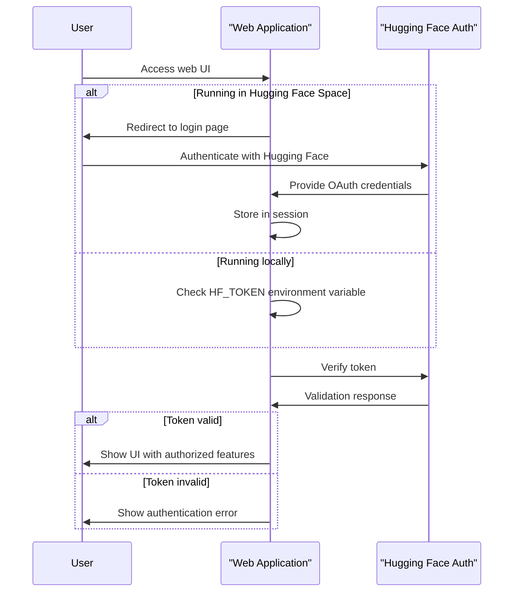
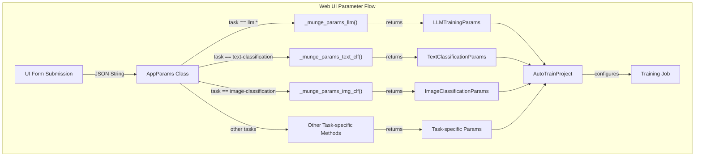
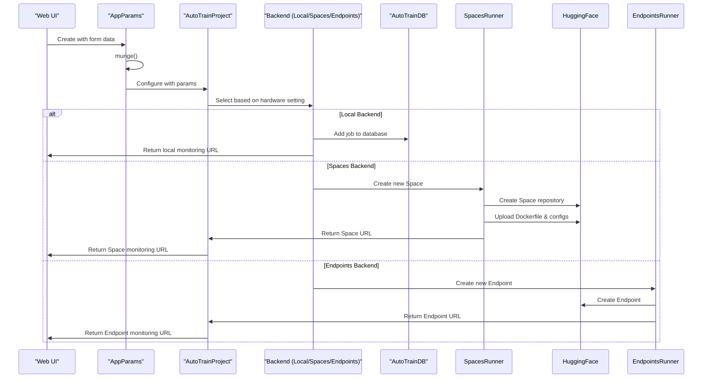

<!-- source: DeepWiki mcp.deepwiki.com · repo huggingface/autotrain-advanced · page 4.2 Web Application · fetched 2026-10-26 -->

# Web Application

<details>
<summary>Relevant source files</summary>

The following files were used as context for generating this wiki page:

- [.gitignore](.gitignore)
- [docs/source/col_map.mdx](docs/source/col_map.mdx)
- [src/autotrain/app/api_routes.py](src/autotrain/app/api_routes.py)
- [src/autotrain/app/app.py](src/autotrain/app/app.py)
- [src/autotrain/app/db.py](src/autotrain/app/db.py)
- [src/autotrain/app/models.py](src/autotrain/app/models.py)
- [src/autotrain/app/oauth.py](src/autotrain/app/oauth.py)
- [src/autotrain/app/params.py](src/autotrain/app/params.py)
- [src/autotrain/app/templates/index.html](src/autotrain/app/templates/index.html)
- [src/autotrain/app/training_api.py](src/autotrain/app/training_api.py)
- [src/autotrain/app/ui_routes.py](src/autotrain/app/ui_routes.py)
- [src/autotrain/app/utils.py](src/autotrain/app/utils.py)
- [src/autotrain/backends/base.py](src/autotrain/backends/base.py)
- [src/autotrain/backends/spaces.py](src/autotrain/backends/spaces.py)
- [src/autotrain/cli/run_api.py](src/autotrain/cli/run_api.py)
- [src/autotrain/client.py](src/autotrain/client.py)
- [src/autotrain/logging.py](src/autotrain/logging.py)
- [src/autotrain/parser.py](src/autotrain/parser.py)

</details>


This document details the web application component of AutoTrain Advanced. The web UI provides a user-friendly interface for configuring and launching machine learning training jobs without requiring code. For information about the Command Line Interface, see [Command Line Interface](#4.1).

## Overview

The AutoTrain web application is a FastAPI-based interface that allows users to configure and launch training jobs through a browser. It supports authentication via Hugging Face's OAuth system, provides real-time logging, and offers an API for programmatic access. The web application can run both locally and as a Hugging Face Space.



Sources: [src/autotrain/app/app.py:1-44](), [src/autotrain/app/ui_routes.py:1-797](), [src/autotrain/app/api_routes.py:1-30]()

## Component Structure

The web application consists of several key components that work together to provide a seamless experience:



Sources: [src/autotrain/app/app.py:1-44](), [src/autotrain/app/ui_routes.py:1-797](), [src/autotrain/app/api_routes.py:1-30](), [src/autotrain/app/params.py:1-300](), [src/autotrain/app/db.py:1-63](), [src/autotrain/app/oauth.py:1-173]()

## FastAPI Application

The main application is built using FastAPI and includes both UI and API routers. It also conditionally attaches OAuth authentication when running in a Hugging Face Space environment.

```python
app = FastAPI()
if "SPACE_ID" in os.environ:
    attach_oauth(app)

app.include_router(ui_router, prefix="/ui", include_in_schema=False)
app.include_router(api_router, prefix="/api")
```

The root endpoint simply redirects to the UI endpoint:

```python
@app.get("/")
async def forward_to_ui(request: Request):
    query_params = request.query_params
    url = "/ui/"
    if query_params:
        url += f"?{query_params}"
    return RedirectResponse(url=url)
```

Sources: [src/autotrain/app/app.py:1-44]()

## Authentication System

The authentication system is used to verify user identity and permissions. It supports both token-based authentication and OAuth integration.



Authentication is handled by the `user_authentication` function which checks for:
1. The `HF_TOKEN` environment variable
2. OAuth information in the session
3. Bearer token in request headers

For Hugging Face Spaces, OAuth is used, with routes for login, callback, and logout.

Sources: [src/autotrain/app/ui_routes.py:318-367](), [src/autotrain/app/oauth.py:1-173]()

## UI Routes

The UI Router provides endpoints for the web interface, allowing users to:

### Main Index Route
Loads the main web UI template, which includes the project configuration form.

```python
@ui_router.get("/", response_class=HTMLResponse)
async def load_index(request: Request, token: str = Depends(user_authentication)):
    # Validate user and prepare context
    # Return templates.TemplateResponse("index.html", context)
```

### Parameter and Model Endpoints
Retrieve task-specific parameters and model choices:

```python
@ui_router.get("/params/{task}/{param_type}", response_class=JSONResponse)
async def fetch_params(task: str, param_type: str, authenticated: bool = Depends(user_authentication)):
    # Fetch task parameters based on task type and param type
    
@ui_router.get("/model_choices/{task}", response_class=JSONResponse)
async def fetch_model_choices(task: str, custom_models: str = Query(None), authenticated: bool = Depends(user_authentication)):
    # Fetch model choices for a given task
```

### Project Creation
The most critical endpoint that handles form submission for creating training projects:

```python
@ui_router.post("/create_project", response_class=JSONResponse)
async def handle_form(
    project_name: str = Form(...),
    task: str = Form(...),
    base_model: str = Form(...),
    hardware: str = Form(...),
    params: str = Form(...),
    autotrain_user: str = Form(...),
    column_mapping: str = Form('{"default": "value"}'),
    data_files_training: List[UploadFile] = File(None),
    data_files_valid: List[UploadFile] = File(None),
    hub_dataset: str = Form(""),
    train_split: str = Form(""),
    valid_split: str = Form(""),
    token: str = Depends(user_authentication),
):
    # Process form data
    # Create dataset
    # Configure parameters
    # Create project
    # Return response
```

### Monitoring and Control Endpoints
For monitoring running jobs and system status:

```python
@ui_router.get("/logs", response_class=JSONResponse)
async def fetch_logs(authenticated: bool = Depends(user_authentication)):
    # Fetch logs from log file or database
    
@ui_router.get("/stop_training", response_class=JSONResponse)
async def stop_training(authenticated: bool = Depends(user_authentication)):
    # Stop running training jobs
    
@ui_router.get("/accelerators", response_class=JSONResponse)
async def available_accelerators(authenticated: bool = Depends(user_authentication)):
    # Get available accelerators (GPUs)
    
@ui_router.get("/is_model_training", response_class=JSONResponse)
async def is_model_training(authenticated: bool = Depends(user_authentication)):
    # Check if models are currently training
```

Sources: [src/autotrain/app/ui_routes.py:370-797]()

## API Routes

The API routes allow programmatic access to AutoTrain functionality through HTTP requests. These endpoints are used by the `Client` class in `client.py` to provide a Python interface to the AutoTrain service.

The API endpoints include:
- Create project
- Get logs
- Stop training
- Get dataset information

These endpoints follow RESTful conventions and use Pydantic models for request validation.

Sources: [src/autotrain/app/api_routes.py:1-30](), [src/autotrain/client.py:1-295]()

## User Interface

The web UI is built with HTML, CSS, and JavaScript, using Tailwind CSS for styling. The main interface is defined in `index.html` and includes:

### Key UI Components:
1. **Sidebar** - With configuration options for:
   - Hugging Face user
   - Task selection
   - Hardware selection
   - Parameter mode
   - Links to logs, documentation, and FAQs

2. **Main Form** - For project configuration:
   - Project name
   - Base model selection
   - Dataset source (local upload or Hugging Face Hub)
   - Column mapping
   - Training parameters

3. **Control Panel** - For:
   - Starting/stopping training
   - Viewing accelerator status
   - Viewing training status
   - Monitoring logs

The UI dynamically adjusts based on the selected task, showing relevant input fields and options.

Sources: [src/autotrain/app/templates/index.html:1-15800]()

## Parameter Handling

The parameter system is a central component of the web application, responsible for configuring training jobs for different tasks.



The `AppParams` class is responsible for:
1. Converting web form inputs into task-specific parameter objects
2. Handling column mapping for datasets
3. Setting default values for parameters
4. Validating parameter combinations

Parameter handling includes an extensive set of defaults and validation rules for each task type (LLM training, text classification, image classification, etc.).

Sources: [src/autotrain/app/params.py:1-700]()

## Model Fetching

The web application fetches model recommendations from the Hugging Face Hub based on the selected task:

```python
def fetch_models():
    _mc = collections.defaultdict(list)
    _mc["text-classification"] = _fetch_text_classification_models()
    _mc["llm"] = _fetch_llm_models()
    _mc["image-classification"] = _fetch_image_classification_models()
    # ... other model types
    return _mc
```

Each task has a specific function to fetch and sort relevant models based on download counts and trending status.

Sources: [src/autotrain/app/models.py:1-375]()

## Job Management and Monitoring

The web application uses SQLite to track running jobs. The `AutoTrainDB` class provides methods to:
- Add jobs
- Get running jobs
- Delete jobs

The UI includes functionality to monitor running jobs and view logs:

```python
@ui_router.get("/logs", response_class=JSONResponse)
async def fetch_logs(authenticated: bool = Depends(user_authentication)):
    # Fetch logs from log file
    log_file = "autotrain.log"
    with open(log_file, "r", encoding="utf-8") as f:
        logs = f.read()
    # Process and return logs
```

Sources: [src/autotrain/app/db.py:1-63](), [src/autotrain/app/ui_routes.py:750-797]()

## Backend Integration

The web application integrates with various execution backends through the `AutoTrainProject` class:



The web application supports multiple backends:
- Local execution
- Hugging Face Spaces
- Hugging Face Endpoints
- NVIDIA GPU Cloud (NGC)
- NVIDIA Cloud Functions (NVCF)

Backend selection is based on the user's hardware choice, and each backend has specific configuration requirements.

Sources: [src/autotrain/backends/base.py:1-164](), [src/autotrain/backends/spaces.py:1-94](), [src/autotrain/app/ui_routes.py:492-703]()

## Client API Integration

The AutoTrain web application includes a client API that allows programmatic interaction with the service. The `Client` class in `client.py` provides methods to:
- Create projects
- Get logs
- Stop training

This client communicates with the API routes of the web application:

```python
def create(
    self,
    project_name: str,
    task: str,
    base_model: str,
    backend: str,
    dataset: str,
    train_split: str,
    column_mapping: Optional[dict] = None,
    params: Optional[dict] = None,
    valid_split: Optional[str] = None,
):
    # Validate task and backend
    # Prepare request data
    # Send POST request to API
    # Return response
```

The client API simplifies integration of AutoTrain into external applications and workflows.

Sources: [src/autotrain/client.py:166-294]()

## Running the Web Application

The web application can be started using:

1. **Within Python code:**
```python
import uvicorn
from autotrain.app.app import app

uvicorn.run(app, host="0.0.0.0", port=7860)
```

2. **Using the CLI command:**
```bash
autotrain app
```

When the web application starts, it:
1. Sets up FastAPI routes
2. Configures OAuth if running in a Space
3. Mounts static files
4. Prepares the database
5. Starts listening for connections

Sources: [src/autotrain/cli/run_api.py:1-71](), [src/autotrain/app/app.py:1-44]()

## Summary

The AutoTrain web application provides a user-friendly interface for configuring and launching machine learning training jobs. Key features include:

1. **User Interface:** A clean, task-oriented interface built with Tailwind CSS
2. **Authentication:** Support for Hugging Face token and OAuth authentication
3. **Parameter Configuration:** Task-specific parameter configuration and validation
4. **Model Selection:** Integration with Hugging Face Hub for model recommendations
5. **Job Management:** Creation, monitoring, and control of training jobs
6. **Multiple Backends:** Support for local execution, Spaces, Endpoints, NGC, and NVCF
7. **API Access:** RESTful API for programmatic interaction

The web application is a critical component of the AutoTrain ecosystem, providing accessibility to users who prefer a graphical interface over command-line tools.

---

