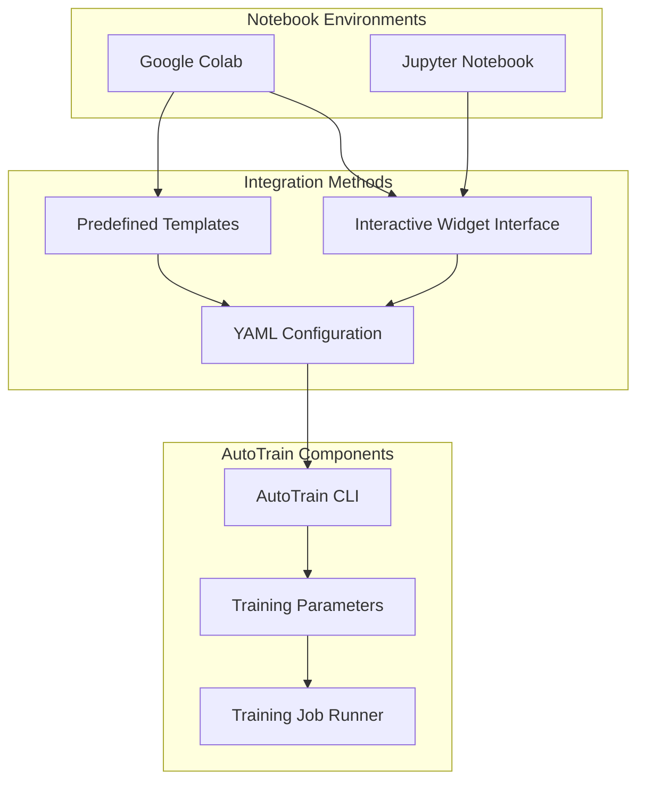
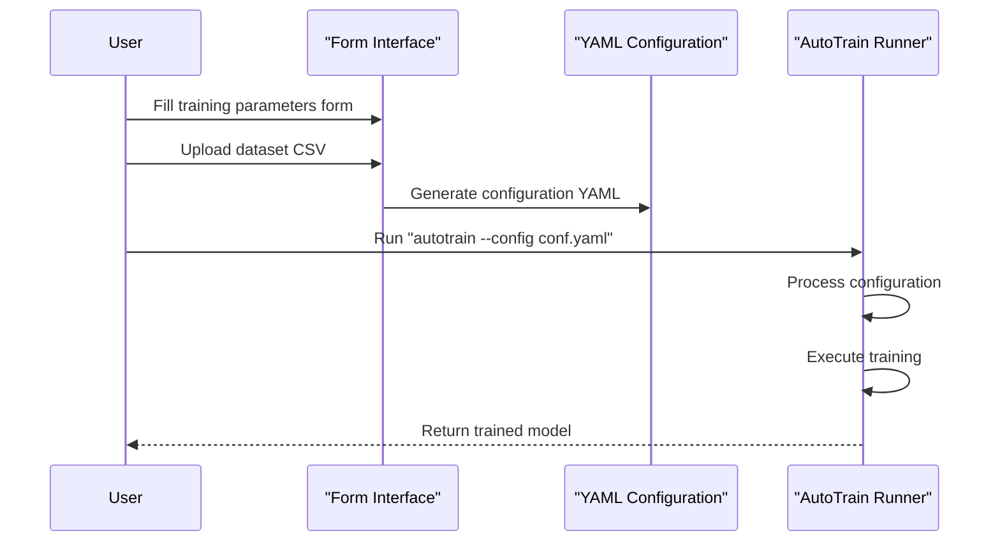
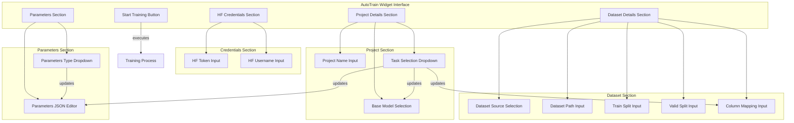
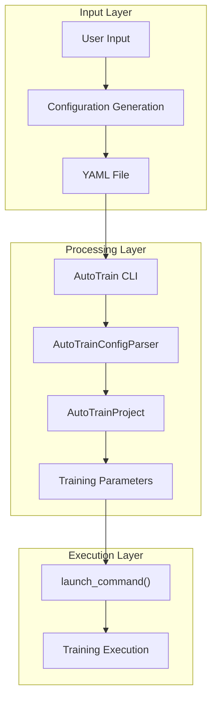
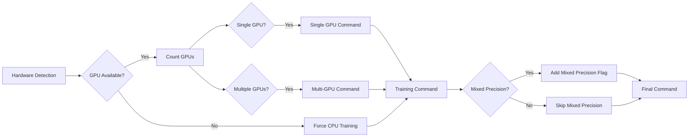

<!-- source: DeepWiki mcp.deepwiki.com · repo huggingface/autotrain-advanced · page 4.3 Colab and Notebook Integration · fetched 2026-10-26 -->

# Colab and Notebook Integration

<details>
<summary>Relevant source files</summary>

The following files were used as context for generating this wiki page:

- [colabs/AutoTrain_LLM.ipynb](colabs/AutoTrain_LLM.ipynb)
- [configs/image_scoring/image_quality.yml](configs/image_scoring/image_quality.yml)
- [src/autotrain/app/colab.py](src/autotrain/app/colab.py)
- [src/autotrain/cli/autotrain.py](src/autotrain/cli/autotrain.py)
- [src/autotrain/commands.py](src/autotrain/commands.py)

</details>


This page documents how to use AutoTrain Advanced in Google Colab and Jupyter notebooks. AutoTrain provides dedicated integration for these environments to make model training accessible through an interactive interface with minimal code. For information about the command line interface, see [Command Line Interface](#4.1).

## Overview

AutoTrain Advanced offers two primary methods for notebook integration:

1. **Predefined Colab Notebooks** - Ready-to-use templates for specific tasks
2. **Interactive Widget Interface** - A dynamic form-based UI for Jupyter environments



Sources: [colabs/AutoTrain_LLM.ipynb:1-157](), [src/autotrain/app/colab.py:1-402]()

## Setup in Notebook Environments

To use AutoTrain Advanced in Colab or Jupyter notebooks, you need to install and set up the library first.

### Installation

```python
# Install AutoTrain Advanced
!pip install -U autotrain-advanced

# Setup for Colab environment
!autotrain setup --colab

# Verify installation
from autotrain import __version__
print(f'AutoTrain version: {__version__}')
```

The `setup --colab` command installs necessary dependencies specific to the Colab environment and configures AutoTrain to work with Colab's file system and GPU resources.

Sources: [colabs/AutoTrain_LLM.ipynb:24-29]()

## Predefined Colab Notebooks

AutoTrain provides pre-configured Colab notebooks for common tasks. These notebooks include user-friendly form interfaces and minimal code requirements.

### Available Template Notebooks

AutoTrain offers template notebooks for tasks including:

- LLM fine-tuning (SFT, DPO, ORPO)
- Text classification and regression
- Image classification and regression
- Object detection
- Sequence-to-sequence tasks
- Token classification
- Tabular data tasks

### LLM Fine-tuning Example

The LLM fine-tuning notebook demonstrates a typical workflow:



Sources: [colabs/AutoTrain_LLM.ipynb:1-157](), [src/autotrain/cli/autotrain.py:51-61]()

### Using Template Notebooks

1. Open the appropriate notebook from the AutoTrain repository
2. Upload your dataset to the `data/` directory in Colab
3. Configure training parameters through the form interface
4. Run all cells to start training

Example configuration from the LLM notebook:

```yaml
task: llm-sft
base_model: abhishek/llama-2-7b-hf-small-shards
project_name: my-autotrain-llm
log: tensorboard
backend: local

data:
  path: data/
  train_split: train
  valid_split: null
  chat_template: null
  column_mapping:
    text_column: text

params:
  block_size: 1024
  lr: 0.0002
  warmup_ratio: 0.1
  weight_decay: 0.01
  epochs: 1
  batch_size: 1
  gradient_accumulation: 4
  mixed_precision: fp16
  peft: true
  quantization: int4
  lora_r: 16
  lora_alpha: 32
  lora_dropout: 0.05
  unsloth: false

hub:
  username: ${HF_USERNAME}
  token: ${HF_TOKEN}
  push_to_hub: false
```

Sources: [colabs/AutoTrain_LLM.ipynb:78-113]()

## Interactive Widget Interface

AutoTrain provides an interactive widget-based UI for Jupyter and Colab environments through the `colab_app()` function.

### Launching the Widget Interface

```python
from autotrain.app.colab import colab_app

# Display the interactive interface
colab_app()
```

### Widget Interface Components

The interface is organized into several sections:



Sources: [src/autotrain/app/colab.py:21-202]()

### Widget Interface Workflow

1. The user fills out the form sections (credentials, project details, dataset, parameters)
2. When task selection changes, appropriate defaults are set for column mapping and parameters
3. When the user clicks "Start Training":
   - A YAML configuration is generated based on the form values
   - The configuration is written to a file
   - AutoTrain is launched with the configuration
   - Output is streamed back to the notebook

Sources: [src/autotrain/app/colab.py:328-394]()

## Task and Model Support

The widget interface supports multiple task types through a dropdown selector. Each task type has associated default models and parameter configurations.

### Supported Task Types

| UI Task Name | Internal Task ID | Default Column Mapping |
|--------------|------------------|------------------------|
| LLM SFT | llm:sft | `{"text": "text"}` |
| LLM ORPO | llm:orpo | `{"prompt": "prompt", "text": "text", "rejected_text": "rejected_text"}` |
| LLM DPO | llm:dpo | `{"prompt": "prompt", "text": "text", "rejected_text": "rejected_text"}` |
| LLM Reward | llm:reward | `{"text": "text", "rejected_text": "rejected_text"}` |
| Text Classification | text-classification | `{"text": "text", "label": "target"}` |
| Text Regression | text-regression | `{"text": "text", "label": "target"}` |
| Token Classification | token-classification | `{"text": "tokens", "label": "tags"}` |
| Sequence to Sequence | seq2seq | `{"text": "text", "label": "target"}` |
| Image Classification | image-classification | `{"image": "image", "label": "label"}` |
| Image Regression | image-regression | `{"image": "image", "label": "target"}` |
| Object Detection | image-object-detection | `{"image": "image", "objects": "objects"}` |
| Tabular Classification | tabular:classification | `{"id": "id", "label": ["target"]}` |
| Tabular Regression | tabular:regression | `{"id": "id", "label": ["target"]}` |

Sources: [src/autotrain/app/colab.py:232-302]()

## Configuration and Execution Pipeline

When using AutoTrain in notebooks, a common workflow pattern emerges:



Sources: [src/autotrain/cli/autotrain.py:51-61](), [src/autotrain/commands.py:98-516]()

### Execution Model

The execution flow from notebook to training:

1. User provides input through either:
   - Form fields in a template notebook
   - Interactive widget interface
2. Configuration is generated as a YAML file
3. AutoTrain CLI is invoked with the configuration file
4. Configuration is parsed by `AutoTrainConfigParser`
5. Appropriate training parameters are created based on the task
6. `launch_command()` function constructs the execution command
7. Training is executed with hardware acceleration based on available resources

Sources: [src/autotrain/cli/autotrain.py:51-61](), [src/autotrain/commands.py:38-95](), [src/autotrain/app/colab.py:376-384]()

## Hardware Detection and Acceleration

When running in notebooks, AutoTrain automatically detects available hardware and configures acceleration appropriately:



The `get_accelerate_command()` function in `commands.py` handles this logic:

- If no GPU is available, training falls back to CPU (with a warning)
- For a single GPU, simple acceleration is used
- For multiple GPUs, distributed training is configured
- Mixed precision can be enabled based on user configuration

Sources: [src/autotrain/commands.py:38-95](), [src/autotrain/commands.py:125-143]()

## Practical Examples

### Example 1: Basic LLM Fine-tuning in Colab

1. Open the AutoTrain LLM notebook
2. Upload a CSV file with a `text` column to the `data/` directory
3. Configure the model, project name, and training parameters
4. Run the notebook to start training

### Example 2: Using the Widget Interface for Custom Tasks

```python
# Install and import
!pip install -U autotrain-advanced
!autotrain setup --colab
from autotrain.app.colab import colab_app

# Launch the interactive UI
ui = colab_app()
display(ui)

# After configuring and running training through the UI:
# The model will be saved locally or pushed to Hugging Face Hub
```

## Troubleshooting

Common issues in Colab/Notebook environments:

1. **Memory errors**: Colab has limited memory. Reduce batch size or use smaller models
2. **Session timeouts**: Colab sessions expire after idle periods or long runs
3. **Data access**: Ensure your data is in the correct format and location
4. **Authentication**: Verify your Hugging Face token has write access for push_to_hub

## Technical Implementation

The notebook integration is primarily implemented in:

- `src/autotrain/app/colab.py`: Widget interface implementation using ipywidgets
- `colabs/*.ipynb`: Template notebooks for specific tasks
- `src/autotrain/cli/autotrain.py`: CLI entry point supporting config files
- `src/autotrain/commands.py`: Command execution logic

The system leverages ipywidgets to create an interactive interface that generates YAML configurations, which are then passed to the same CLI infrastructure used by command-line users.

Sources: [src/autotrain/app/colab.py:1-402](), [colabs/AutoTrain_LLM.ipynb:1-157](), [src/autotrain/cli/autotrain.py:1-73](), [src/autotrain/commands.py:1-516]()

---

