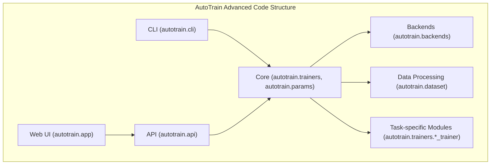
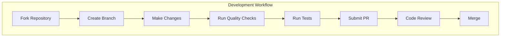
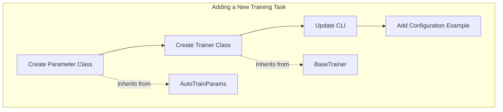
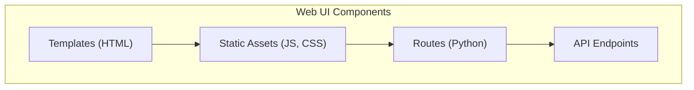
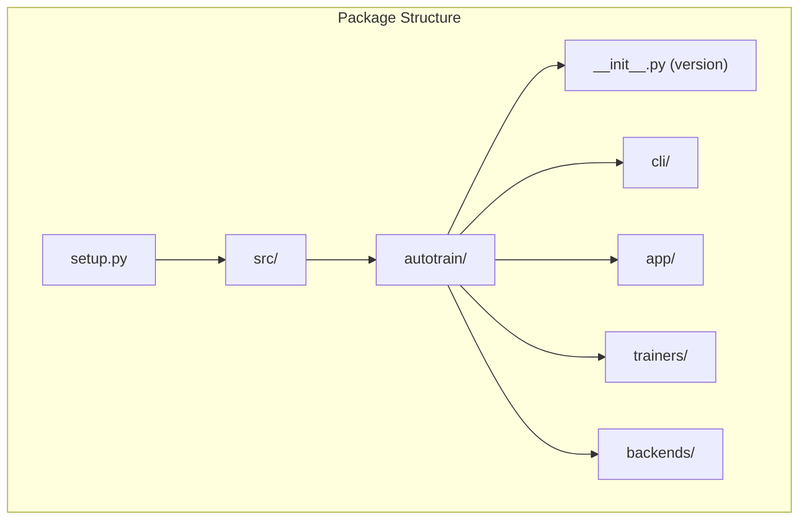

<!-- source: DeepWiki mcp.deepwiki.com · repo huggingface/autotrain-advanced · page 5 Development · fetched 2026-10-26 -->

# Development

<details>
<summary>Relevant source files</summary>

The following files were used as context for generating this wiki page:

- [README.md](README.md)
- [colabs/AutoTrain.ipynb](colabs/AutoTrain.ipynb)
- [colabs/AutoTrain_ngrok.ipynb](colabs/AutoTrain_ngrok.ipynb)
- [setup.cfg](setup.cfg)
- [setup.py](setup.py)

</details>


This page provides a comprehensive guide for developers who want to contribute to or modify the AutoTrain Advanced codebase. It covers environment setup, code structure, development workflow, and best practices. For information about using AutoTrain Advanced, see [Overview](#1), and for deployment options, see [Docker and Deployment](#5.2).

## Development Environment Setup

Setting up a development environment for AutoTrain Advanced requires a few prerequisites and specific steps to ensure all components work correctly.

### Prerequisites

Before setting up the development environment, ensure you have:

- Python 3.10 or higher installed
- Git and Git LFS installed (required for model downloads)
- PyTorch with appropriate CUDA support (if using GPU)
- A Hugging Face account (for pushing models and accessing datasets)

### Installing for Development

To set up a development environment for AutoTrain Advanced:

```bash
# Clone the repository
git clone https://github.com/huggingface/autotrain-advanced.git
cd autotrain-advanced

# Create and activate a conda environment
conda create -n autotrain-dev python=3.10
conda activate autotrain-dev

# Install dependencies with development extras
pip install -e ".[dev]"

# Install PyTorch with CUDA support (if using GPU)
conda install pytorch torchvision torchaudio pytorch-cuda=12.1 -c pytorch -c nvidia
conda install -c "nvidia/label/cuda-12.1.0" cuda-nvcc
```

The `-e` flag installs the package in development mode, which means changes to the source code will be immediately available without reinstallation.

Sources: [README.md:35-51](), [setup.py:17-52]()

## Code Structure

AutoTrain Advanced has a modular architecture organized by functionality.



### Key Components:

1. **Entry Points**:
   - CLI interface (`autotrain.cli`)
   - Web application (`autotrain.app`)
   - Python API (`autotrain`)

2. **Core Components**:
   - Project management (`autotrain.project`)
   - Parameters and configuration (`autotrain.params`)
   - Trainers for different tasks (`autotrain.trainers`)

3. **Supporting Components**:
   - Data processing (`autotrain.dataset`)
   - Execution backends (`autotrain.backends`)
   - Utilities (`autotrain.utils`)

Sources: [setup.py:63-67]()

## Development Workflow

The development workflow for AutoTrain Advanced follows standard open-source project practices with some specific requirements for code quality and testing.



### Code Style Guidelines

AutoTrain Advanced uses the following tools for code quality:

- **Black**: For code formatting
- **isort**: For import sorting
- **flake8**: For linting

The configuration for these tools is specified in `setup.cfg`:

- Maximum line length: 119 characters
- isort configuration includes trailing commas and ensures newline before comments
- flake8 ignores E203, E501, and W503 errors

To check your code before submitting:

```bash
# Sort imports
isort .

# Format code
black .

# Run linting
flake8
```

Sources: [setup.cfg:5-25](), [setup.py:28-32]()

### Running Tests

AutoTrain Advanced uses pytest for testing. To run the tests:

```bash
pytest
```

Tests are included in the `dev` extras in `setup.py`.

Sources: [setup.py:34](), [setup.py:41-42]()

## Extending AutoTrain Advanced

One of the key benefits of AutoTrain Advanced is its extensibility. Developers can add new model types, training tasks, or modify existing ones.

### Adding a New Training Task

The following diagram illustrates the process of adding a new training task to AutoTrain Advanced:



1. **Create Parameter Class**: Define a new class that inherits from `AutoTrainParams` with task-specific parameters
2. **Create Trainer Class**: Implement a new trainer that inherits from `BaseTrainer`
3. **Update CLI**: Add a new command to the CLI for the new task
4. **Add Configuration Example**: Create example YAML configuration files

### Extending the Web UI

The web UI can be extended by modifying the following components:



Key files to modify:
- HTML templates in `src/autotrain/app/templates/`
- JavaScript files in `src/autotrain/app/static/scripts/`
- Routes in the Python app module

Sources: [setup.py:83-104]()

## Building and Packaging

AutoTrain Advanced uses standard Python packaging tools for building and distribution.

### Package Structure



The package is organized with the source code in the `src/autotrain` directory. Version information is stored in `autotrain/__init__.py`.

### Building the Package

To build the package:

```bash
# Create a source distribution
python setup.py sdist

# Create a wheel
python setup.py bdist_wheel
```

### Entry Points

The CLI is defined as an entry point in `setup.py`:

```python
entry_points={"console_scripts": ["autotrain=autotrain.cli.autotrain:main"]}
```

This makes the `autotrain` command available when the package is installed.

Sources: [setup.py:67-68]()

## Running in Development Mode

There are several ways to run AutoTrain Advanced during development:

### Running the CLI

```bash
# Run CLI commands directly
python -m autotrain.cli.autotrain --help

# Or, since the entry point is installed:
autotrain --help
```

### Running the Web UI

```bash
# Start the web UI on localhost
autotrain app --port 8080 --host 127.0.0.1
```

### Using in Colab

For development and testing in Colab environments, AutoTrain provides specialized notebook interfaces:

```python
from autotrain.app.colab import colab_app
elements = colab_app()
display(elements)
```

Sources: [README.md:52-55](), [colabs/AutoTrain.ipynb:17-26](), [colabs/AutoTrain_ngrok.ipynb:11-32]()

## Debugging Tips

When developing for AutoTrain Advanced, consider these debugging approaches:

1. **Enable Verbose Logging**: Increase log verbosity to debug issues
2. **Interactive Debugging**: Use Python's debugging tools (pdb, ipdb) for interactive debugging
3. **Test with Small Datasets**: Use small datasets to speed up the development cycle
4. **Local Backend**: Use the local backend for faster iteration during development

## Contributing Guidelines

When contributing to AutoTrain Advanced:

1. **Create a Fork**: Fork the repository on GitHub
2. **Create a Branch**: Create a branch for your feature or bugfix
3. **Write Tests**: Add tests for your changes
4. **Follow Code Style**: Ensure your code follows the project's style guidelines
5. **Submit a PR**: Create a pull request with a clear description of your changes

## Conclusion

This guide provides the fundamental information needed to start developing with AutoTrain Advanced. For more specific information about Docker configuration and deployment, see [Docker and Deployment](#5.2), and for CI/CD workflows, see [CI/CD Workflows](#5.3).

---

