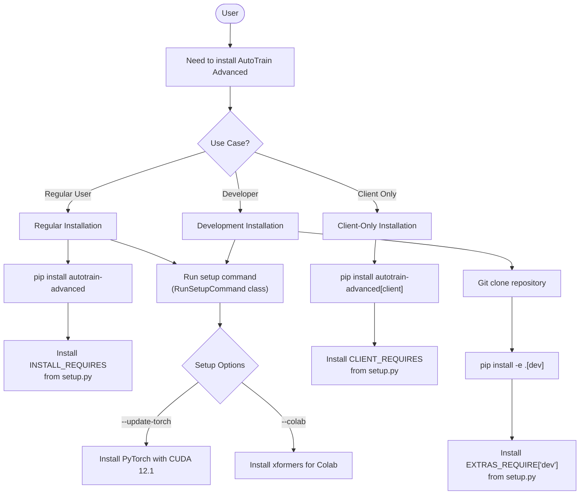
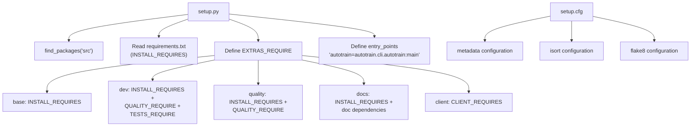
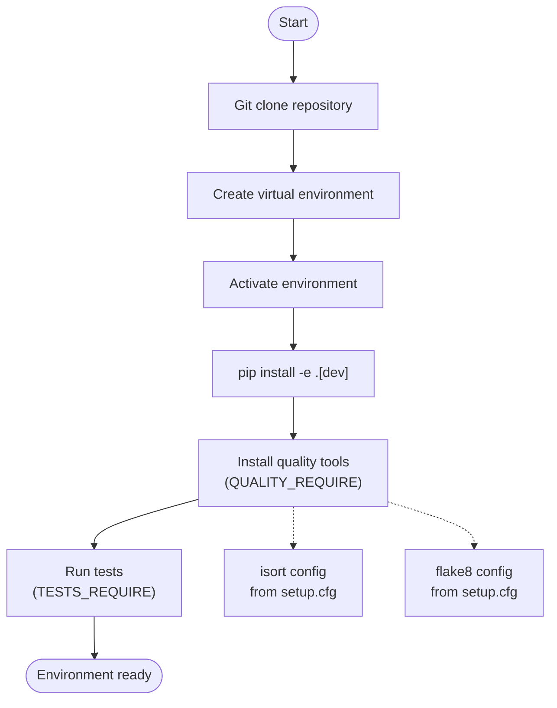
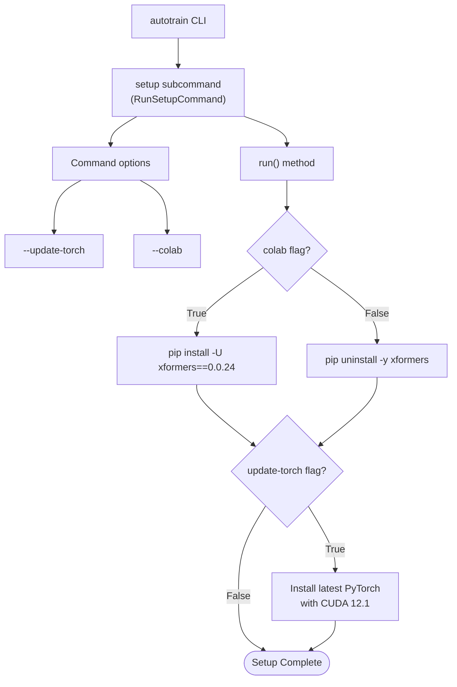

<!-- source: DeepWiki mcp.deepwiki.com · repo huggingface/autotrain-advanced · page 5.1 Setup and Installation · fetched 2026-10-26 -->

# Setup and Installation

<details>
<summary>Relevant source files</summary>

The following files were used as context for generating this wiki page:

- [setup.cfg](setup.cfg)
- [setup.py](setup.py)
- [src/autotrain/cli/run_setup.py](src/autotrain/cli/run_setup.py)

</details>


This page provides detailed instructions for setting up and installing AutoTrain Advanced for developers who want to contribute to or modify the codebase. For information about Docker configuration and deployment options, see [Docker and Deployment](#5.2).

## Installation Methods

AutoTrain Advanced offers several installation methods depending on your specific needs:



Sources: [setup.py:17-52](), [src/autotrain/cli/run_setup.py:9-53]()

### Regular Installation

For users who want to use AutoTrain Advanced without modifying the codebase:

```bash
pip install autotrain-advanced
```

### Development Installation

For developers who want to contribute to AutoTrain Advanced:

```bash
git clone https://github.com/huggingface/autotrain-advanced.git
cd autotrain-advanced
pip install -e .[dev]
```

This installs the package in development mode (`-e`) with additional development dependencies.

### Client-Only Installation

For users who only need the client functionality to interact with AutoTrain services remotely:

```bash
pip install autotrain-advanced[client]
```

Sources: [setup.py:39-52]()

## Package Structure and Dependencies

AutoTrain Advanced uses a standard Python package structure with setup tools for installation. The configuration is defined in `setup.py` and `setup.cfg`:



Sources: [setup.py:54-106](), [setup.cfg:1-25]()

### Dependency Categories

AutoTrain Advanced organizes its dependencies into different categories defined in `setup.py`:

| Category | Variable in setup.py | Description | Key Components |
|----------|----------------------|-------------|----------------|
| Base Dependencies | `INSTALL_REQUIRES` | Core dependencies required for basic functionality | PyTorch, transformers, datasets, flask, etc. |
| Quality Tools | `QUALITY_REQUIRE` | Tools for code formatting and linting | black, isort, flake8 |
| Testing Tools | `TESTS_REQUIRE` | Tools for running tests | pytest |
| Client Dependencies | `CLIENT_REQUIRES` | Minimal set for client operations | requests, loguru |
| Development | `EXTRAS_REQUIRE["dev"]` | Complete development environment | Base + Quality + Tests |
| Documentation | `EXTRAS_REQUIRE["docs"]` | Tools for building docs | sphinx and plugins |

### Platform-Specific Dependencies

The setup script handles platform-specific dependencies. For example, `bitsandbytes` is only installed on Linux systems:

```python
# From setup.py
if "bitsandbytes" in line:
    line = line.strip() + " ; sys_platform == 'linux'"
    INSTALL_REQUIRES.append(line.strip())
```

Sources: [setup.py:16-52]()

## Setting Up a Development Environment

Follow these steps to set up a complete development environment:

1. **Clone the repository**:
   ```bash
   git clone https://github.com/huggingface/autotrain-advanced.git
   cd autotrain-advanced
   ```

2. **Create a virtual environment** (recommended):
   ```bash
   python -m venv .venv
   source .venv/bin/activate  # On Windows: .venv\Scripts\activate
   ```

3. **Install in development mode with all dev dependencies**:
   ```bash
   pip install -e .[dev]
   ```

4. **Verify your setup by running tests**:
   ```bash
   pytest
   ```

### Development Setup Workflow



Sources: [setup.py:28-34](), [setup.cfg:5-25]()

## Code Quality Tools Configuration

AutoTrain Advanced enforces code quality standards through configuration in `setup.cfg`:

### isort Configuration

The isort tool is configured to maintain consistent import formatting:

```
[isort]
ensure_newline_before_comments = True
force_grid_wrap = 0
include_trailing_comma = True
line_length = 119
lines_after_imports = 2
multi_line_output = 3
use_parentheses = True
```

### flake8 Configuration

Flake8 is configured with specific rules for linting the codebase:

```
[flake8]
ignore = E203, E501, W503
max-line-length = 119
per-file-ignores =
    # imported but unused
    __init__.py: F401, E402
    src/autotrain/params.py: F401
exclude =
    .git,
    .venv,
    __pycache__,
    dist
    build
```

Sources: [setup.cfg:5-25]()

## Using the Setup Command

AutoTrain Advanced provides a CLI setup command implemented in `RunSetupCommand` class that handles additional setup tasks:

```bash
autotrain setup [options]
```

### Options:

- `--update-torch`: Updates PyTorch to the latest version with CUDA 12.1 support
- `--colab`: Installs dependencies specific to Google Colab environments

### Example usage:

```bash
# Regular setup
autotrain setup

# Update PyTorch to latest version with CUDA support
autotrain setup --update-torch

# Setup for Google Colab
autotrain setup --colab
```

### Setup Command Implementation

The setup command is implemented through the `RunSetupCommand` class in `src/autotrain/cli/run_setup.py`:



The `RunSetupCommand` class first processes the `colab` flag to determine whether to install or uninstall xformers. Then, if the `update_torch` flag is set, it installs the latest PyTorch version with CUDA 12.1 support.

Sources: [src/autotrain/cli/run_setup.py:9-53]()

## Troubleshooting Installation Issues

### CUDA Compatibility

If you encounter CUDA-related issues, use the setup command to update PyTorch with CUDA 12.1 support:

```bash
autotrain setup --update-torch
```

This executes the following command:
```bash
pip install torch torchvision torchaudio --index-url https://download.pytorch.org/whl/cu121
```

### Dependencies Conflicts

If you encounter dependency conflicts, try installing in a fresh virtual environment:

```bash
python -m venv fresh_env
source fresh_env/bin/activate
pip install autotrain-advanced
```

### Missing Dependencies

If you get errors about missing dependencies, you might need to install them manually:

```bash
pip install -r requirements.txt
```

Sources: [src/autotrain/cli/run_setup.py:47-53]()

---

