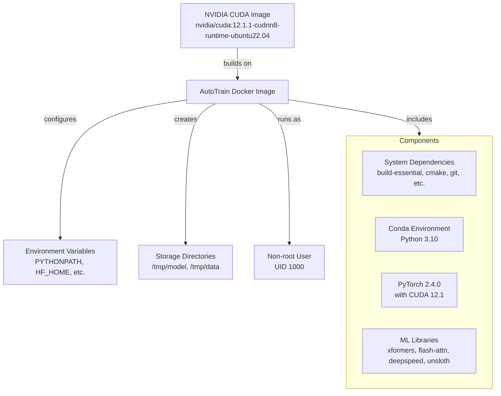
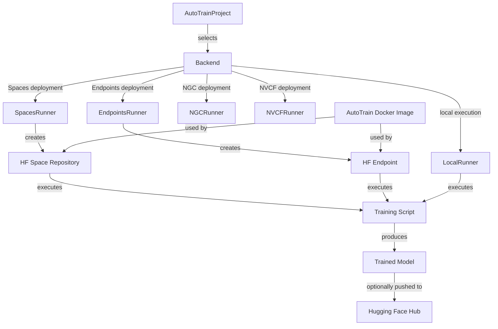
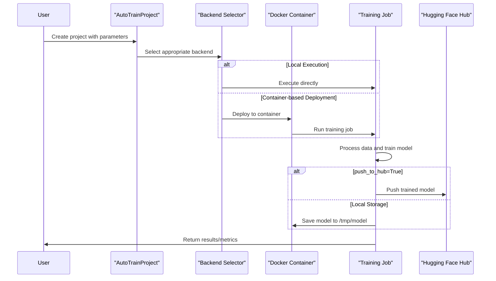

<!-- source: DeepWiki mcp.deepwiki.com · repo huggingface/autotrain-advanced · page 5.2 Docker and Deployment · fetched 2026-10-26 -->

# Docker and Deployment

<details>
<summary>Relevant source files</summary>

The following files were used as context for generating this wiki page:

- [.dockerignore](.dockerignore)
- [.github/workflows/stale.yml](.github/workflows/stale.yml)
- [Dockerfile](Dockerfile)

</details>


This document explains how Docker is used within AutoTrain Advanced for containerization and deployment across various execution backends. It covers the Docker configuration, container details, and deployment options available in the system.

For information about the continuous integration and deployment processes, see [CI/CD Workflows](#5.3).

## 1. Docker Configuration

AutoTrain Advanced uses Docker to create consistent, portable environments for training machine learning models. The Docker configuration is designed to support GPU-accelerated workloads and provide all necessary dependencies for various training tasks.

### 1.1 Base Image and Dependencies



Sources: [Dockerfile:1-1](), [Dockerfile:17-39](), [Dockerfile:61-73](), [Dockerfile:76-83]()

The Dockerfile starts with an NVIDIA CUDA base image, which provides GPU acceleration capabilities essential for efficient model training. It installs system dependencies, sets up a Conda environment with Python 3.10, and installs PyTorch with CUDA support along with specialized ML libraries.

### 1.2 Security and User Configuration

The Docker container runs as a non-root user (UID 1000) for improved security:

```
RUN useradd -m -u 1000 user
RUN chown -R user:user /app
USER user
ENV HOME=/app
```

This follows security best practices by avoiding container execution as the root user.

Sources: [Dockerfile:48-51]()

### 1.3 Environment Configuration

The container is configured with various environment variables that control its behavior:

| Environment Variable | Purpose |
|----------------------|---------|
| `DEBIAN_FRONTEND=noninteractive` | Prevents interactive prompts during build |
| `TZ=UTC` | Sets timezone |
| `HF_HUB_ENABLE_HF_TRANSFER=1` | Enables optimized Hugging Face model transfers |
| `HF_HOME="/app/.cache"` | Sets cache location for Hugging Face models |
| `PYTHONPATH=$HOME/app` | Adds application directory to Python path |
| `SYSTEM=spaces` | Indicates deployment environment |
| `GRADIO_*` variables | Configure the Gradio web interface |

Sources: [Dockerfile:3-5](), [Dockerfile:47](), [Dockerfile:53-58]()

### 1.4 Docker Build Optimization

The `.dockerignore` file excludes unnecessary files from the build context, improving build times and reducing image size:

| Excluded Patterns | Description |
|-------------------|-------------|
| `build/`, `dist/` | Build artifacts |
| `logs/`, `output/` | Log and output files |
| `test/`, `test.py` | Test files |
| `.git` | Git repository data |
| `*.db` | Database files |
| `autotrain-data*` | AutoTrain data files |

Sources: [.dockerignore]()

## 2. Deployment Architecture

AutoTrain Advanced supports multiple deployment backends, with Docker containers playing a crucial role in several of them.



Sources: [Dockerfile]()

### 2.1 Deployment Backends

#### Local Execution

In local execution mode, AutoTrain runs directly on the host machine without containerization. This is suitable for development and testing or when you have direct access to the required hardware.

#### Hugging Face Spaces Deployment

When deploying to Hugging Face Spaces, AutoTrain uses Docker containers to ensure consistent runtime environments. The `SYSTEM=spaces` environment variable in the Dockerfile configures the application for Spaces-specific behavior.

Sources: [Dockerfile:58]()

#### Hugging Face Endpoints Deployment

Hugging Face Endpoints provide a scalable solution for deploying training jobs. The Docker container contains all necessary dependencies and can be deployed to Endpoints for on-demand training.

#### NVIDIA GPU Cloud (NGC) Deployment

NGC deployment leverages NVIDIA's cloud infrastructure for machine learning workloads. The Docker image includes the NGC CLI in its PATH:

```
ENV PATH="/app/ngc-cli:${PATH}"
ARG PATH="/app/ngc-cli:${PATH}"
```

Sources: [Dockerfile:9-10]()

#### NVIDIA Cloud Functions (NVCF) Deployment

NVCF provides serverless computing for AI workloads, allowing AutoTrain to run training jobs without managing infrastructure.

## 3. Container Runtime Details

### 3.1 Data and Model Storage

The Docker container creates dedicated directories for data and model storage:

```
RUN mkdir -p /tmp/model && \
    chown -R 1000:1000 /tmp/model && \
    mkdir -p /tmp/data && \
    chown -R 1000:1000 /tmp/data
```

These directories can be mounted as volumes to persist data across container restarts.

Sources: [Dockerfile:12-15]()

### 3.2 ML Environment Configuration

The Docker image comes with a pre-configured ML environment:

1. CUDA 12.1 with cuDNN 8 for GPU acceleration
2. PyTorch 2.4.0 with CUDA support
3. Specialized libraries for efficient LLM training:
   - flash-attention for memory-efficient attention computation
   - deepspeed for distributed training
   - unsloth for optimized inference
   - xformers for transformer optimizations

Sources: [Dockerfile:70-73](), [Dockerfile:77-83]()

## 4. Deployment Workflow

The following sequence diagram illustrates the deployment flow from project creation to model training:



Sources: [Dockerfile:12-15](), [Dockerfile:53-58]()

## 5. Using the Docker Image

### 5.1 Building the Image

To build the AutoTrain Docker image locally:

```bash
docker build -t autotrain-advanced .
```

### 5.2 Running the Container

To run the AutoTrain container with GPU support:

```bash
docker run --gpus all -p 7860:7860 autotrain-advanced
```

For training tasks requiring data persistence:

```bash
docker run --gpus all -p 7860:7860 \
  -v /path/to/local/data:/tmp/data \
  -v /path/to/local/models:/tmp/model \
  autotrain-advanced
```

### 5.3 Resource Requirements

The Docker container has specific resource requirements:

- NVIDIA GPU with CUDA compatibility
- Sufficient RAM for model training (varies by model size)
- Adequate disk space for models and datasets

## 6. Custom Deployment Considerations

### 6.1 Customizing the Docker Image

For custom deployments, you may need to modify the Dockerfile to:

- Adjust the base image for different CUDA versions
- Add or remove Python dependencies
- Change environment variable configurations
- Modify resource allocations

### 6.2 Security Best Practices

The Docker configuration implements several security best practices:

- Runs as a non-root user (UID 1000)
- Uses fixed versions of dependencies
- Excludes potential sensitive information via .dockerignore

Sources: [Dockerfile:48-51](), [.dockerignore]()

## 7. Integration with CI/CD

The Docker image for AutoTrain Advanced is typically built and pushed through automated CI/CD workflows. For more information on these processes, see [CI/CD Workflows](#5.3).

---

