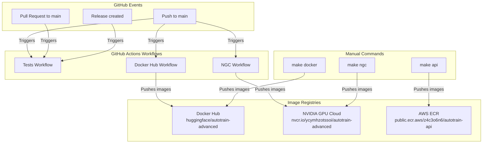
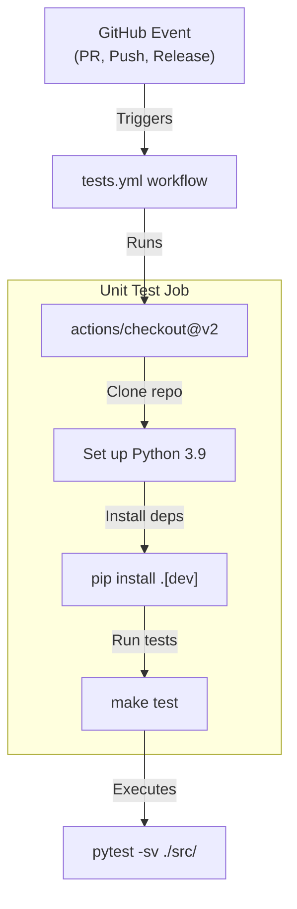
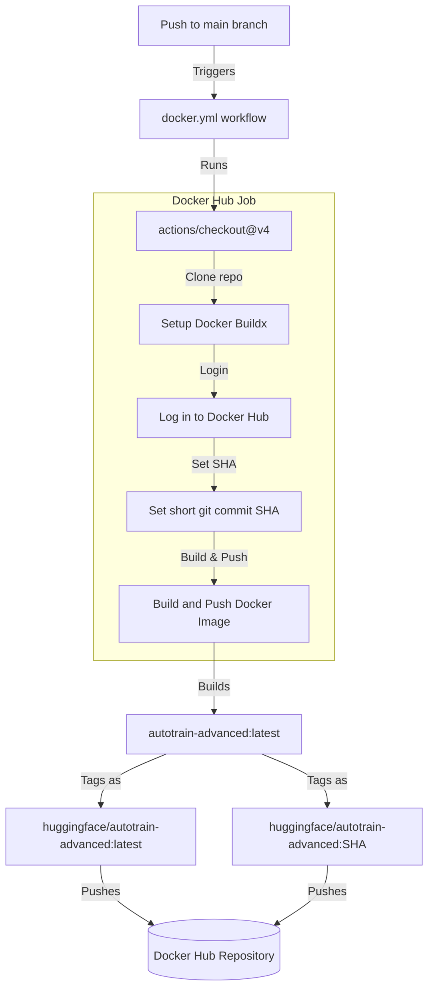
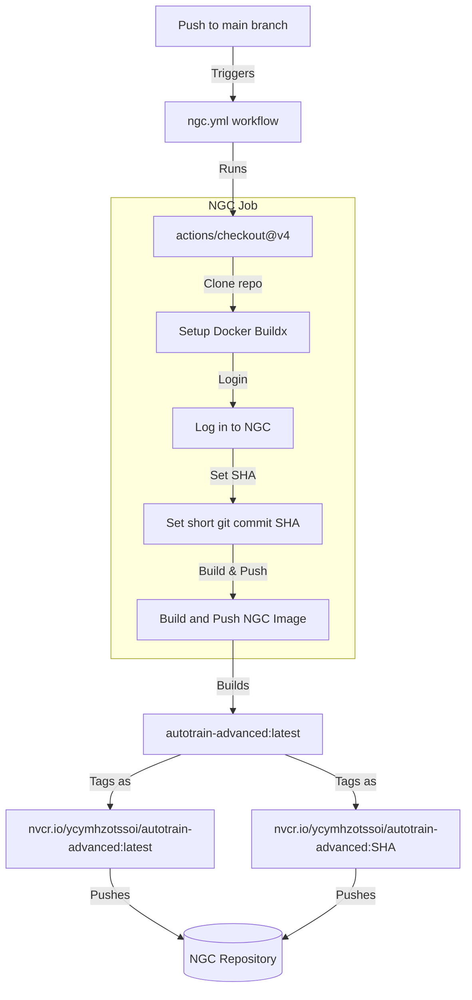
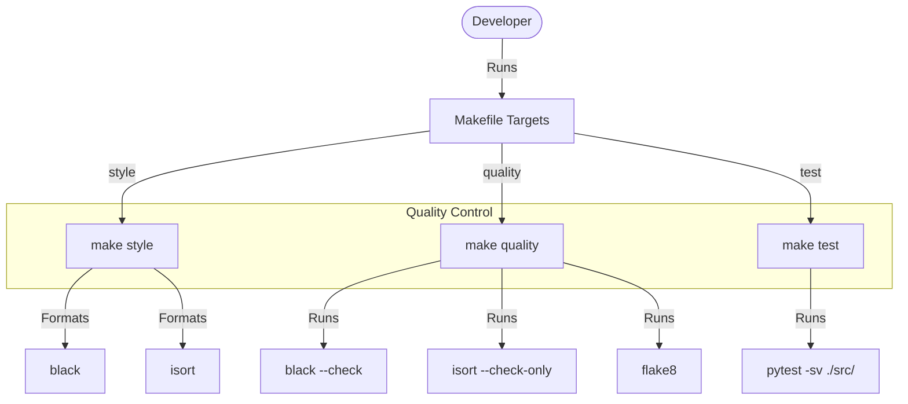
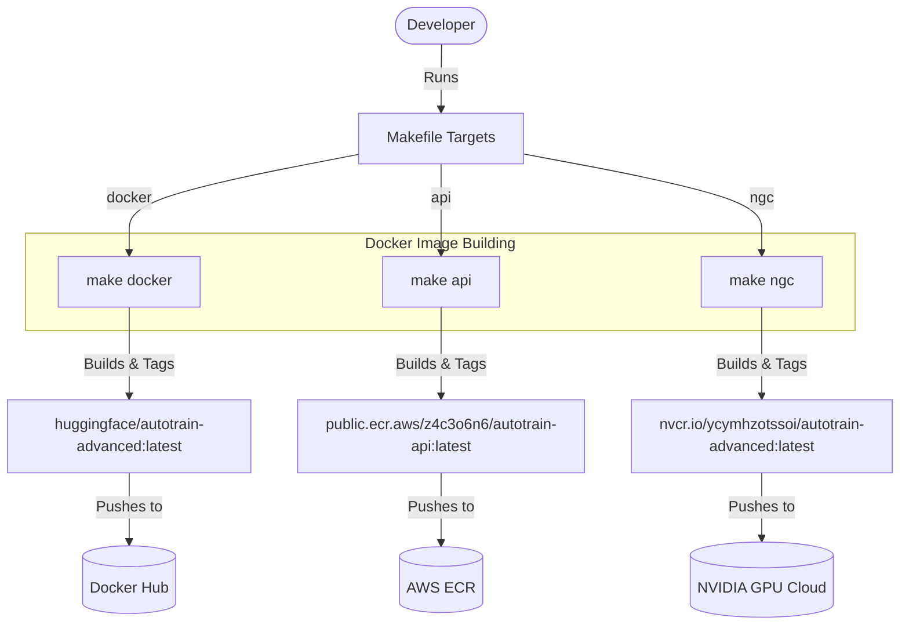
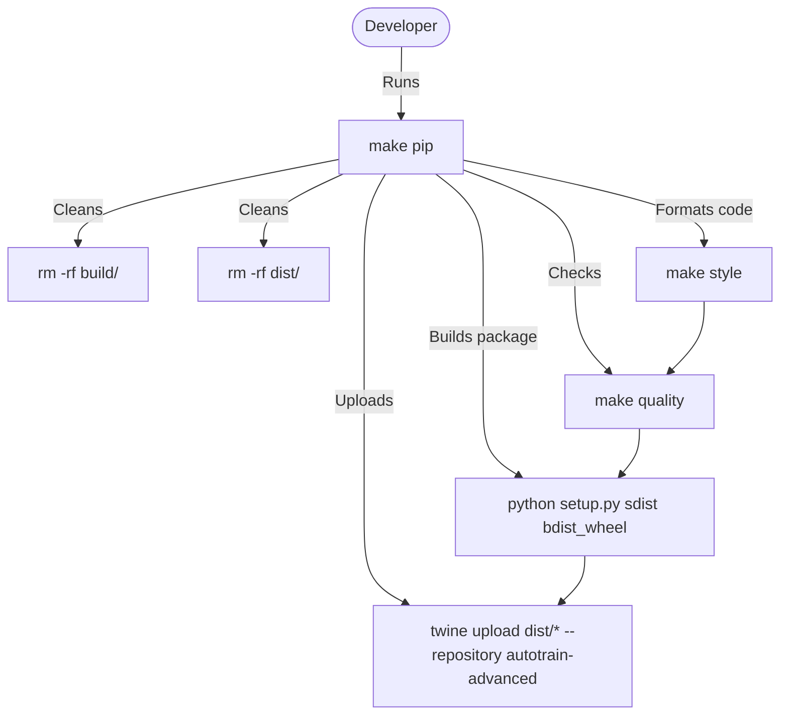
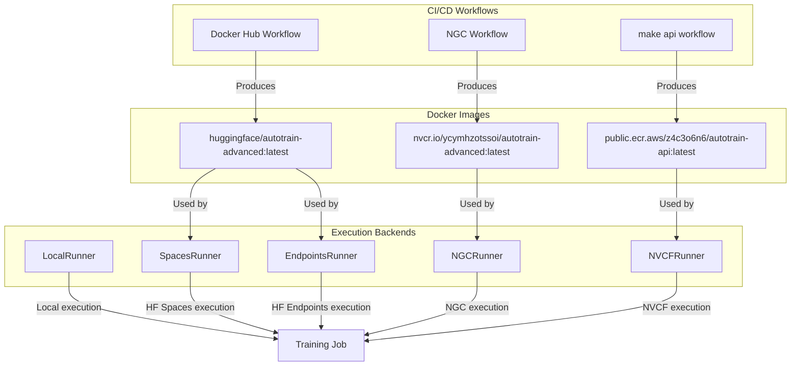
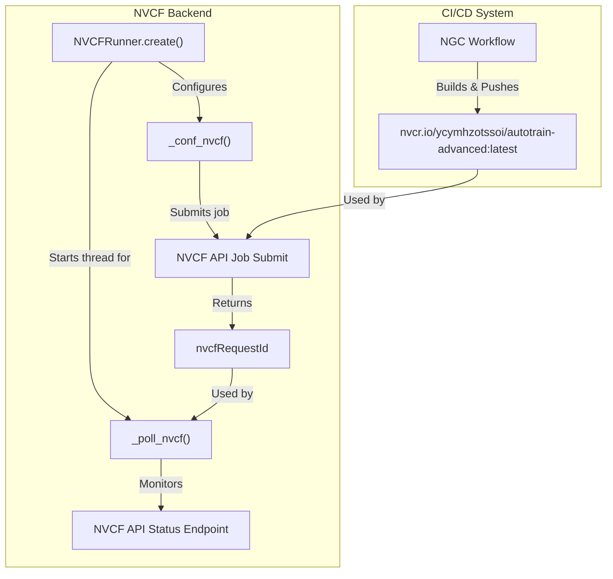

<!-- source: DeepWiki mcp.deepwiki.com · repo huggingface/autotrain-advanced · page 5.3 CI/CD Workflows · fetched 2026-10-26 -->

# CI/CD Workflows

Relevant source files

The following files were used as context for generating this wiki page:

- [.github/workflows/docker.yml](.github/workflows/docker.yml)
- [.github/workflows/ngc.yml](.github/workflows/ngc.yml)
- [.github/workflows/tests.yml](.github/workflows/tests.yml)
- [Dockerfile.api](Dockerfile.api)
- [Makefile](Makefile)
- [configs/object_detection/hub_dataset.yml](configs/object_detection/hub_dataset.yml)
- [src/autotrain/backends/nvcf.py](src/autotrain/backends/nvcf.py)
- [src/autotrain/tools/merge_adapter.py](src/autotrain/tools/merge_adapter.py)

This document provides a detailed overview of the continuous integration and continuous deployment workflows used in the AutoTrain Advanced project. These workflows automate testing, building, and deployment of various components to ensure consistent quality and availability of the system.

For information about Docker configuration and deployment options, see [Docker and Deployment](#5.2).

## Overview of CI/CD Architecture

The AutoTrain Advanced project implements several CI/CD workflows using GitHub Actions and Makefile targets to automate the building, testing, and deployment of different components. These workflows ensure that code changes are properly tested before deployment and that Docker images are consistently built and published.

Sources: [.github/workflows/docker.yml](), [.github/workflows/ngc.yml](), [.github/workflows/tests.yml](), [Makefile]()

## Automated Testing Workflow

The automated testing workflow runs on pull requests to the main branch, pushes to the main branch, and when releases are created. It ensures that all code changes meet the project's quality standards before they are merged or deployed.

Sources: [.github/workflows/tests.yml:1-31]()

## Docker Image Deployment Workflows

AutoTrain Advanced uses multiple Docker image deployment workflows to make the software available in different container registries:

1. **Docker Hub Workflow**: Automatically builds and pushes the main Docker image to Docker Hub
2. **NGC Workflow**: Automatically builds and pushes the same image to NVIDIA GPU Cloud
3. **Manual API Image Deployment**: Builds a specialized API image for deployment to AWS ECR

### Docker Hub Workflow

The Docker Hub workflow builds and pushes the main AutoTrain Advanced Docker image to Docker Hub whenever changes are pushed to the main branch.

Sources: [.github/workflows/docker.yml:1-41]()

### NGC Workflow

Similar to the Docker Hub workflow, the NGC workflow builds and pushes the same image to NVIDIA GPU Cloud.

Sources: [.github/workflows/ngc.yml:1-43]()

## Manual CI/CD Commands

In addition to the automated workflows, the project includes several Makefile targets that can be used for manual CI/CD operations:

### Code Quality and Testing

Sources: [Makefile:1-17]()

### Manual Docker Image Building

Sources: [Makefile:19-32]()

## Package Distribution

The project also includes a workflow for building and distributing Python packages:

Sources: [Makefile:34-39]()

## Integration with Execution Backends

The CI/CD workflows play a crucial role in supporting the different execution backends of AutoTrain Advanced. The Docker images built and deployed by these workflows are used by the backend runners, particularly for remote execution.

Sources: [.github/workflows/docker.yml](), [.github/workflows/ngc.yml](), [Makefile](), [src/autotrain/backends/nvcf.py]()

## NVCF Backend Integration with CI/CD

The NVIDIA Cloud Functions (NVCF) backend utilizes the Docker images built by the CI/CD workflows for execution. This integration allows AutoTrain to run training jobs on NVIDIA's cloud infrastructure.

Sources: [src/autotrain/backends/nvcf.py:146-203]()

## Summary

The AutoTrain Advanced project implements a comprehensive set of CI/CD workflows that automate testing, building, and deployment of Docker images and Python packages. These workflows ensure code quality, consistent building of Docker images for different container registries, and support for the various execution backends that rely on these images.

The main CI/CD components include:
- GitHub Actions workflows for automated testing and Docker image deployment
- Makefile targets for manual testing, code quality checks, and Docker image building
- Integration with multiple Docker registries (Docker Hub, NGC, AWS ECR)
- Support for Python package distribution

These workflows enable the AutoTrain Advanced system to maintain high code quality while providing multiple deployment options for users.