# Page: Overview

# Overview

<details>
<summary>Relevant source files</summary>

The following files were used as context for generating this wiki page:

- [README.md](README.md)
- [colabs/AutoTrain.ipynb](colabs/AutoTrain.ipynb)
- [colabs/AutoTrain_ngrok.ipynb](colabs/AutoTrain_ngrok.ipynb)
- [docs/source/_toctree.yml](docs/source/_toctree.yml)
- [docs/source/cost.mdx](docs/source/cost.mdx)
- [docs/source/index.mdx](docs/source/index.mdx)
- [docs/source/tasks/llm_finetuning.mdx](docs/source/tasks/llm_finetuning.mdx)
- [docs/source/tasks/text_classification_regression.mdx](docs/source/tasks/text_classification_regression.mdx)
- [static/autotrain_homepage.png](static/autotrain_homepage.png)
- [static/autotrain_text_classification.png](static/autotrain_text_classification.png)
- [static/dreambooth2.png](static/dreambooth2.png)
- [static/llm_orpo_example.png](static/llm_orpo_example.png)
- [static/space_template_2.png](static/space_template_2.png)

</details>


AutoTrain Advanced is a no-code solution for training and deploying state-of-the-art machine learning models. It provides an accessible interface for users to train custom models on their data without requiring extensive programming knowledge or machine learning expertise. This document provides a comprehensive overview of the AutoTrain Advanced system architecture and components.

## Purpose and Scope

AutoTrain Advanced aims to democratize machine learning by allowing users to train sophisticated models with just a few clicks. It abstracts away the complexity of model training while offering flexibility for advanced users. This page explains the overall architecture and main components of the system. For more specific information about individual components, refer to their respective pages:

- For detailed information about Project Management, see [Project Management](#2.1)
- For information about Data Processing, see [Data Processing](#2.2)
- For information about Training Components, see [Training Components](#3)
- For details on interfaces, see [User Interfaces](#4)

Sources: [README.md:1-48](https://github.com/huggingface/autotrain-advanced/blob/main/README.md), [docs/source/index.mdx:1-47](https://github.com/huggingface/autotrain-advanced/blob/main/docs/source/index.mdx)

## Key Capabilities

AutoTrain Advanced supports a wide range of machine learning tasks:

| Task Type | Supported Tasks |
|-----------|----------------|
| Text Processing | LLM Finetuning (SFT, ORPO, DPO, Reward), Text Classification/Regression, Token Classification, Sequence-to-Sequence, Extractive QA, Sentence Transformers |
| Vision | Image Classification/Regression, Object Detection |
| Multimodal | Visual Language Model (VLM) finetuning |
| Structured Data | Tabular Classification/Regression |

Users can train models using different execution backends, including local machines, Hugging Face Spaces, Hugging Face Endpoints, NVIDIA GPU Cloud, and NVIDIA Cloud Functions.

Sources: [README.md:7-23](https://github.com/huggingface/autotrain-advanced/blob/main/README.md), [docs/source/_toctree.yml:21-40](https://github.com/huggingface/autotrain-advanced/blob/main/docs/source/_toctree.yml)

## System Architecture

### High-Level Architecture Overview

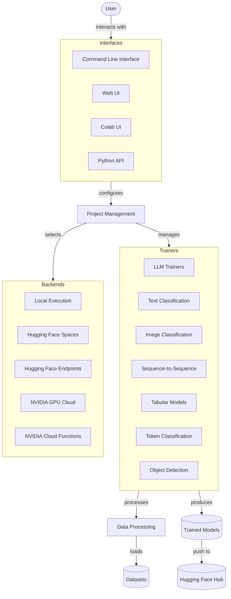

AutoTrain Advanced uses a modular architecture with clear separation of concerns. Users interact with the system through various interfaces, configure training projects, and the system handles the data processing, model training, and deployment.

Sources: [README.md:1-133](https://github.com/huggingface/autotrain-advanced/blob/main/README.md), [docs/source/index.mdx:1-62](https://github.com/huggingface/autotrain-advanced/blob/main/docs/source/index.mdx)

### Core Components Relationship

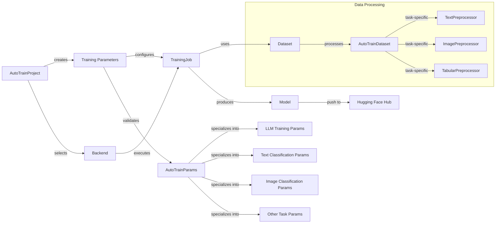

The `AutoTrainProject` class serves as the central orchestrator, creating parameter objects and selecting the appropriate backend. Parameters are validated through the `AutoTrainParams` hierarchy, which has specialized subclasses for different tasks. The training job uses datasets that are processed by task-specific preprocessors.

Sources: [docs/source/tasks/llm_finetuning.mdx:1-357](https://github.com/huggingface/autotrain-advanced/blob/main/docs/source/tasks/llm_finetuning.mdx), [docs/source/tasks/text_classification_regression.mdx:1-150](https://github.com/huggingface/autotrain-advanced/blob/main/docs/source/tasks/text_classification_regression.mdx)

## User Interaction Modes

AutoTrain Advanced provides multiple ways for users to interact with the system:

1. **Command Line Interface (CLI)**: For users who prefer terminal-based interactions
   ```bash
   autotrain --config config.yaml
   ```

2. **Web User Interface**: Accessible by running:
   ```bash
   autotrain app --port 8080 --host 127.0.0.1
   ```

3. **Colab Integration**: Users can run AutoTrain in Google Colab using provided notebooks
   ```python
   # Inside Colab
   from autotrain.app.colab import colab_app
   elements = colab_app()
   display(elements)
   ```

4. **Hosted on Hugging Face Spaces**: Users can deploy AutoTrain on Spaces using the provided Docker image

5. **Python API**: For programmatic access and integration into existing workflows

Sources: [README.md:26-55](https://github.com/huggingface/autotrain-advanced/blob/main/README.md), [colabs/AutoTrain.ipynb:1-50](https://github.com/huggingface/autotrain-advanced/blob/main/colabs/AutoTrain.ipynb), [colabs/AutoTrain_ngrok.ipynb:1-52](https://github.com/huggingface/autotrain-advanced/blob/main/colabs/AutoTrain_ngrok.ipynb)

## Typical Workflow

The typical workflow for using AutoTrain Advanced consists of the following steps:

1. **Data Preparation**: Prepare the dataset in the required format (CSV, JSONL, etc.)

2. **Configuration**: Set up training parameters through the interface or a configuration file
   ```yaml
   task: llm-sft
   base_model: HuggingFaceTB/SmolLM2-1.7B-Instruct
   project_name: autotrain-smollm2-finetune
   log: tensorboard
   backend: local
   
   data:
     path: HuggingFaceH4/no_robots
     train_split: train
     valid_split: null
     chat_template: tokenizer
     column_mapping:
       text_column: messages
   
   params:
     block_size: 2048
     model_max_length: 4096
     epochs: 2
     batch_size: 1
     lr: 1e-5
     peft: true
     quantization: int4
     target_modules: all-linear
     padding: right
     optimizer: paged_adamw_8bit
     scheduler: linear
     gradient_accumulation: 8
     mixed_precision: bf16
     merge_adapter: true
   
   hub:
     username: ${HF_USERNAME}
     token: ${HF_TOKEN}
     push_to_hub: true
   ```

3. **Execution**: Run the training process through the chosen interface

4. **Deployment**: Download the trained model or push it to Hugging Face Hub for sharing and deployment

Sources: [README.md:65-111](https://github.com/huggingface/autotrain-advanced/blob/main/README.md), [docs/source/tasks/llm_finetuning.mdx:175-226](https://github.com/huggingface/autotrain-advanced/blob/main/docs/source/tasks/llm_finetuning.mdx)

## Cost and Accessibility

AutoTrain Advanced is designed to be accessible to users with different requirements and resources:

- **Free Local Usage**: When running locally, users only pay for the computing resources they use on their own infrastructure
- **Pay-As-You-Go on Spaces**: When using Hugging Face Spaces, costs are based on computing resources consumed
- **Model Ownership**: Users retain full ownership of their trained models, which can be downloaded and deployed anywhere

This flexibility allows users to choose the most suitable approach based on their needs, whether they are experimenting locally or scaling up operations on Hugging Face Spaces.

Sources: [README.md:3-5](https://github.com/huggingface/autotrain-advanced/blob/main/README.md), [docs/source/cost.mdx:1-40](https://github.com/huggingface/autotrain-advanced/blob/main/docs/source/cost.mdx)

## LLM Training Data Flow

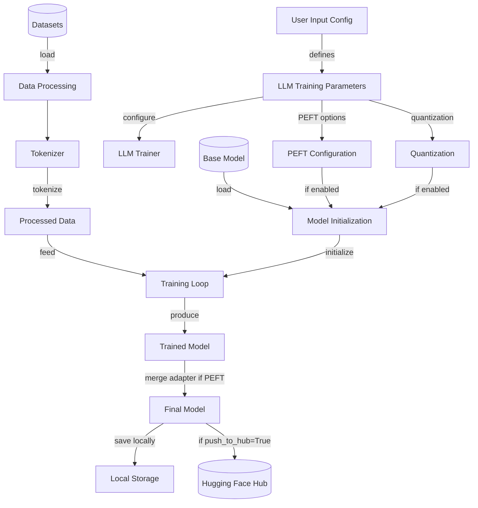

This diagram illustrates the data flow during LLM training, one of the most important capabilities in AutoTrain. The process begins with user configuration, which sets the training parameters. Data is loaded, tokenized, and processed while the base model is initialized with options for PEFT (Parameter-Efficient Fine-Tuning) and quantization. The processed data and initialized model feed into the training loop, which produces the trained model. If PEFT was used, the adapter may be merged into the base model. Finally, the model can be saved locally or pushed to the Hugging Face Hub.

Sources: [docs/source/tasks/llm_finetuning.mdx:1-285](https://github.com/huggingface/autotrain-advanced/blob/main/docs/source/tasks/llm_finetuning.mdx)

## Summary

AutoTrain Advanced simplifies the process of training and deploying machine learning models through a no-code interface. It supports a wide range of tasks and provides multiple ways for users to interact with the system. The modular architecture allows for flexibility and extensibility, making it suitable for both beginners and experienced users.

The system's key strengths include:

1. **Accessibility**: No-code interface makes ML accessible to non-technical users
2. **Flexibility**: Multiple interfaces and backends to suit different needs
3. **Extensibility**: Modular architecture that can be extended to support new tasks and models
4. **Integration**: Seamless integration with the Hugging Face ecosystem

This overview provides a high-level understanding of AutoTrain Advanced. For more detailed information about specific components, please refer to the respective wiki pages.

Sources: [README.md:1-133](https://github.com/huggingface/autotrain-advanced/blob/main/README.md), [docs/source/index.mdx:1-62](https://github.com/huggingface/autotrain-advanced/blob/main/docs/source/index.mdx)

---

# Page: Architecture

# Architecture

<details>
<summary>Relevant source files</summary>

The following files were used as context for generating this wiki page:

- [configs/image_scoring/image_quality.yml](configs/image_scoring/image_quality.yml)
- [requirements.txt](requirements.txt)
- [src/autotrain/__init__.py](src/autotrain/__init__.py)
- [src/autotrain/app/colab.py](src/autotrain/app/colab.py)
- [src/autotrain/cli/autotrain.py](src/autotrain/cli/autotrain.py)
- [src/autotrain/cli/run_app.py](src/autotrain/cli/run_app.py)
- [src/autotrain/commands.py](src/autotrain/commands.py)
- [src/autotrain/params.py](src/autotrain/params.py)
- [src/autotrain/project.py](src/autotrain/project.py)
- [src/autotrain/trainers/clm/__main__.py](src/autotrain/trainers/clm/__main__.py)
- [src/autotrain/trainers/clm/utils.py](src/autotrain/trainers/clm/utils.py)
- [src/autotrain/utils.py](src/autotrain/utils.py)

</details>


This document provides a high-level overview of the AutoTrain Advanced system architecture, explaining the major components and their interactions. It covers the core systems that enable no-code machine learning training across various tasks and deployment environments. For specific details about training components, see [Training Components](#3), and for user interfaces, see [User Interfaces](#4).

## System Overview

AutoTrain Advanced is built with a modular architecture that separates concerns between project management, data processing, training, and execution backends. This design enables flexibility in how and where models are trained while maintaining a consistent user experience.

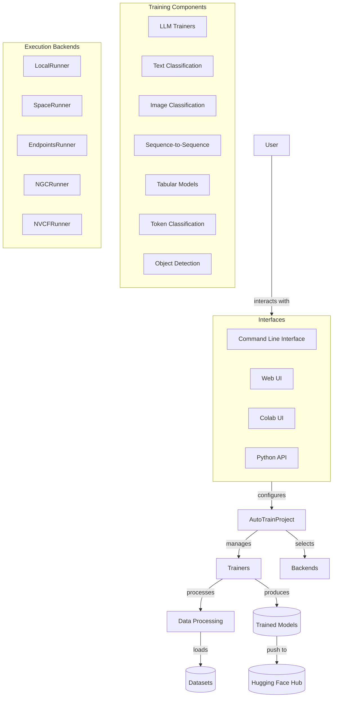

Sources: [src/autotrain/project.py:443-563](), [src/autotrain/trainers/clm/__main__.py:1-53]()

## Key Components and Relationships

### AutoTrainProject

The central orchestrator of the system is the `AutoTrainProject` class, which is responsible for:
- Creating and validating training parameters
- Processing input data
- Selecting and initializing the appropriate backend
- Launching training jobs

```mermaid
graph LR
    subgraph "AutoTrainProject Class"
        AutoTrainProject["AutoTrainProject"] --> |validates| Backend["backend"]
        AutoTrainProject --> |processes| Params["params"]
        AutoTrainProject --> |creates| Runner["Runner"]
    end
    
    subgraph "Parameter Classes"
        Params --> LLMParams["LLMTrainingParams"]
        Params --> TextParams["TextClassificationParams"]
        Params --> ImgParams["ImageClassificationParams"]
        Params --> TabParams["TabularParams"]
        Params --> OtherParams["Other Task Params"]
    end
    
    subgraph "Backends"
        Runner --> LocalRunner["LocalRunner"]
        Runner --> SpaceRunner["SpaceRunner"]
        Runner --> EndpointsRunner["EndpointsRunner"]
        Runner --> NGCRunner["NGCRunner"]
        Runner --> NVCFRunner["NVCFRunner"]
    end
    
    AutoTrainProject --> |create()| TrainingJob["Training Job"]
```

Sources: [src/autotrain/project.py:443-563](), [src/autotrain/params.py:1-12]()

### Training Parameters

Each training task has a dedicated parameters class that inherits from a base class, providing task-specific configuration:

| Task Type | Parameter Class | Description |
|-----------|----------------|-------------|
| LLM Training | `LLMTrainingParams` | Parameters for language model fine-tuning |
| Text Classification | `TextClassificationParams` | Text classification parameters |
| Image Classification | `ImageClassificationParams` | Image classification parameters |
| Tabular | `TabularParams` | Parameters for tabular data models |
| Sequence-to-Sequence | `Seq2SeqParams` | Seq2Seq model parameters |
| Token Classification | `TokenClassificationParams` | NER and token classification parameters |
| Object Detection | `ObjectDetectionParams` | Image object detection parameters |
| Vision Language Models | `VLMTrainingParams` | VLM training parameters |

Sources: [src/autotrain/params.py:1-12](), [src/autotrain/project.py:493-506]()

### Command Flow Architecture

The system provides multiple entry points with a consistent flow:

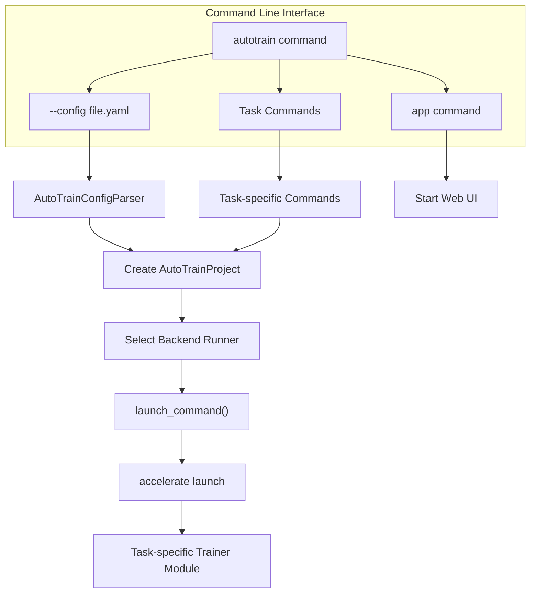

Sources: [src/autotrain/cli/autotrain.py:23-72](), [src/autotrain/commands.py:98-516](), [src/autotrain/cli/run_app.py:35-169]()

## Data Processing

Data processing is handled by specialized functions for each task type. The system can work with:

1. Different data formats (CSV, JSONL, directories of images, etc.)
2. Data from the Hugging Face Hub or local files
3. Custom column mappings

```mermaid
graph TD
    subgraph "Data Processing Flow"
        AutoTrainProject --> |_process_params_data| TaskSpecificMunge["Task-specific munge_data()"]
        
        TaskSpecificMunge --> |creates| AutoTrainDataset["AutoTrainDataset"]
        
        subgraph "Dataset Processing"
            AutoTrainDataset --> |for text tasks| TextProcessing["Text Processing"]
            AutoTrainDataset --> |for image tasks| ImageProcessing["Image Processing"]
            AutoTrainDataset --> |for tabular tasks| TabularProcessing["Tabular Processing"]
        end
        
        AutoTrainDataset --> |prepare()| ProcessedData["Processed Data"]
        
        ProcessedData --> |updates| Params["Task Parameters"]
    end
```

The data processing system normalizes column names and formats, making them consistent for the trainers and enabling a uniform training interface regardless of the original data format.

Sources: [src/autotrain/project.py:36-440](), [src/autotrain/trainers/clm/utils.py:465-553]()

## Execution Backends

AutoTrain Advanced supports multiple execution backends, allowing training to happen in different environments:

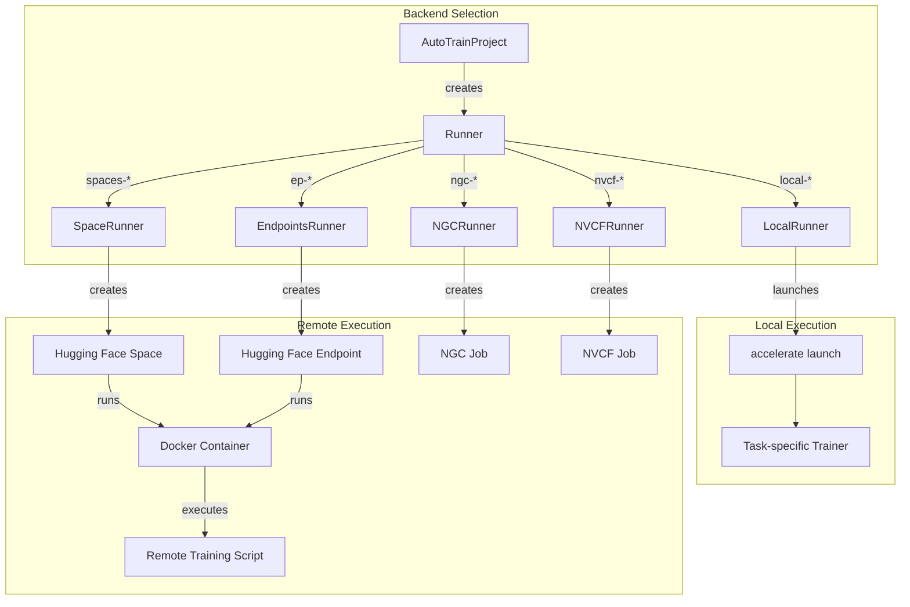

Each backend implementation handles the necessary setup, configuration, and execution of the training job in its respective environment.

Sources: [src/autotrain/project.py:547-563](), [src/autotrain/commands.py:38-96]()

## LLM Training Architecture

The LLM training system is particularly sophisticated, supporting multiple training approaches:

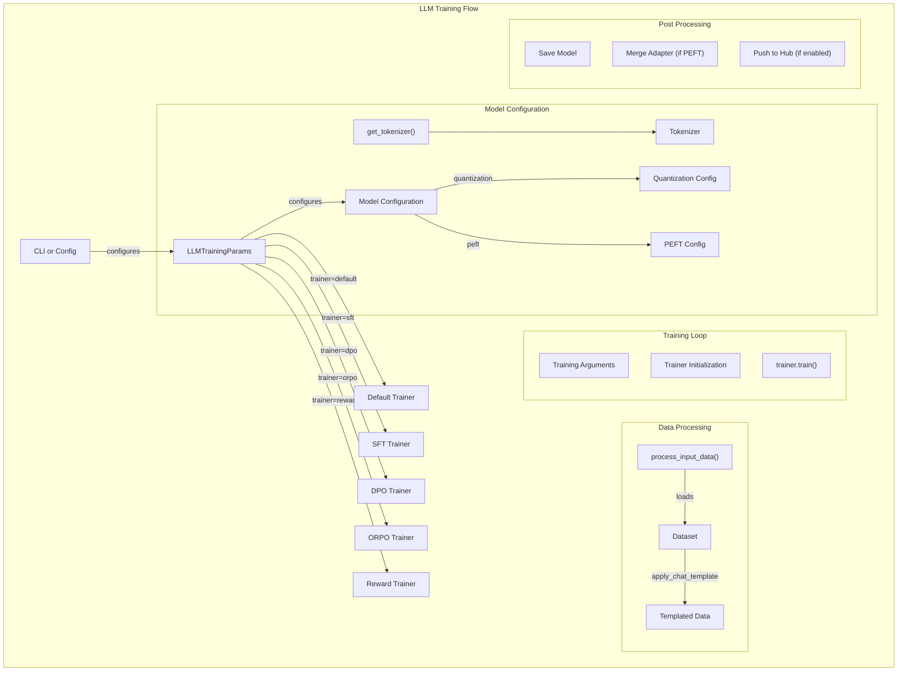

Sources: [src/autotrain/trainers/clm/__main__.py:15-46](), [src/autotrain/trainers/clm/utils.py:392-463]()

## Web Interface Architecture

The web interface provides a user-friendly way to interact with AutoTrain Advanced:

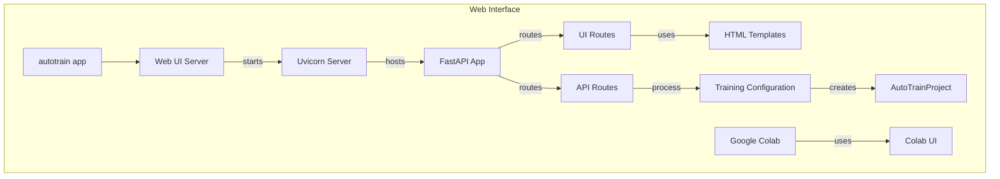

For Colab users, there's a specialized Jupyter widgets-based interface that provides similar functionality to the web UI.

Sources: [src/autotrain/cli/run_app.py:35-169](), [src/autotrain/app/colab.py:21-402]()

## Additional Architecture Components

### Environment Configuration

AutoTrain Advanced configures various environment variables and warnings to ensure optimal operation with different ML frameworks:

```python
os.environ["BITSANDBYTES_NOWELCOME"] = "1"
os.environ["TF_CPP_MIN_LOG_LEVEL"] = "3"
os.environ["TOKENIZERS_PARALLELISM"] = "false"
```

This suppresses unnecessary warnings and optimizes the execution environment.

Sources: [src/autotrain/__init__.py:21-23]()

### Command Execution System

The system uses a combination of `accelerate launch` for distributed training and subprocess management to execute training commands:

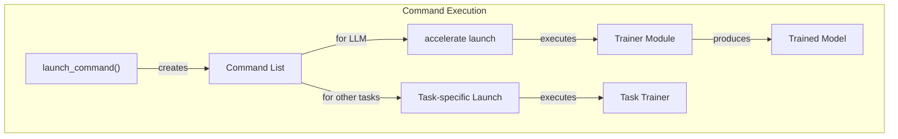

The system detects available hardware (GPU/CPU) and configures the appropriate acceleration settings.

Sources: [src/autotrain/commands.py:38-96](), [src/autotrain/utils.py:24-79]()

## Integration with Hugging Face Ecosystem

AutoTrain Advanced is tightly integrated with the Hugging Face ecosystem:

| Component | Integration |
|-----------|-------------|
| Hugging Face Hub | Models can be pushed directly to the Hub |
| Hugging Face Datasets | Datasets can be loaded from the Hub |
| Hugging Face Spaces | Can be used as an execution backend |
| Hugging Face Endpoints | Can be used as an execution backend |
| Transformers | Used for model loading and configuration |
| PEFT | Used for parameter-efficient fine-tuning |
| Accelerate | Used for distributed training |

Sources: [requirements.txt:1-50](), [src/autotrain/trainers/clm/utils.py:392-463]()

## Summary

The AutoTrain Advanced architecture is designed as a modular, extensible system for automating machine learning training workflows. By separating concerns between project management, data processing, training algorithms, and execution backends, it provides flexibility while maintaining a consistent user experience across different interfaces and deployment environments.

The core of the system is the `AutoTrainProject` class, which orchestrates the entire training process, from parameter validation to backend selection and execution. This architecture allows AutoTrain Advanced to support a wide range of training tasks and deployment scenarios while providing a unified interface for users.

---

# Page: Project Management

# Project Management

<details>
<summary>Relevant source files</summary>

The following files were used as context for generating this wiki page:

- [configs/image_classification/local.yml](configs/image_classification/local.yml)
- [configs/llm_finetuning/llama3-70b-orpo-v1.yml](configs/llm_finetuning/llama3-70b-orpo-v1.yml)
- [configs/llm_finetuning/llama3-70b-sft.yml](configs/llm_finetuning/llama3-70b-sft.yml)
- [configs/llm_finetuning/llama32-1b-sft.yml](configs/llm_finetuning/llama32-1b-sft.yml)
- [configs/llm_finetuning/qwen.yml](configs/llm_finetuning/qwen.yml)
- [configs/llm_finetuning/smollm2.yml](configs/llm_finetuning/smollm2.yml)
- [src/autotrain/cli/run_app.py](src/autotrain/cli/run_app.py)
- [src/autotrain/params.py](src/autotrain/params.py)
- [src/autotrain/project.py](src/autotrain/project.py)
- [src/autotrain/utils.py](src/autotrain/utils.py)

</details>


Project Management in AutoTrain Advanced is the central orchestration system that coordinates training workflows from configuration to execution. This module is responsible for initializing training parameters, selecting appropriate execution backends, processing datasets, and launching training jobs. 

For information about specific training components, see [Training Components](#3), and for execution backends, see [Execution Backends](#2.3).

## Core Project Management Architecture

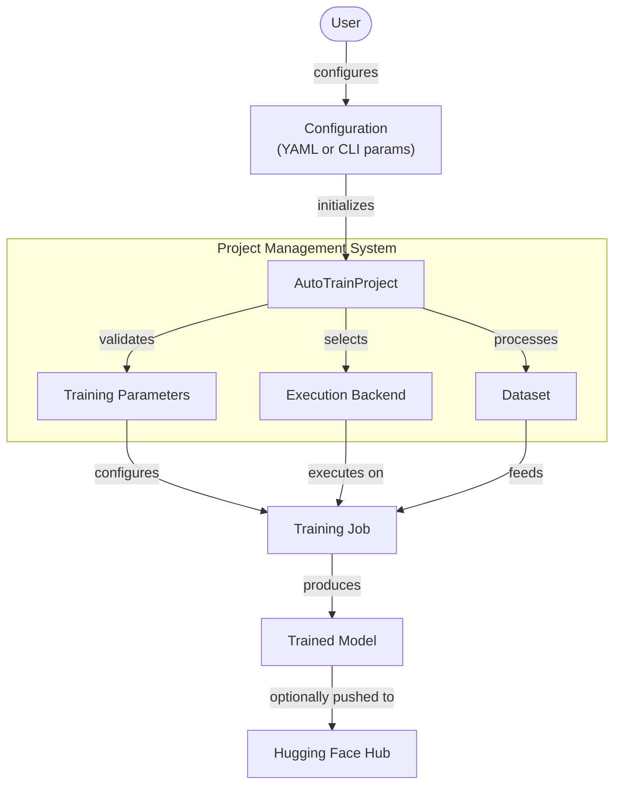

Sources: [src/autotrain/project.py:443-563]()

## The AutoTrainProject Class

The heart of project management is the `AutoTrainProject` class, which serves as the central coordinator for all training jobs.

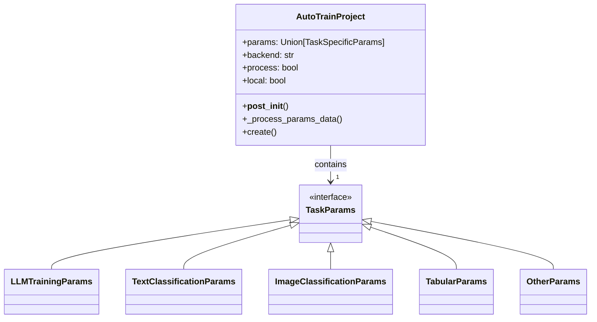

The `AutoTrainProject` class is initialized with three key attributes:

1. **params**: A task-specific parameter object that configures the training process
2. **backend**: A string specifying where to run the training (e.g., local, Spaces, Endpoints)
3. **process**: A boolean flag indicating whether data preprocessing is needed

The class provides methods to validate backends, process input data, and create training jobs on the selected backend.

Sources: [src/autotrain/project.py:443-508]()

## Supported Training Parameters

AutoTrain supports a diverse range of training tasks, each with its specialized parameter class. The `AutoTrainProject` accepts any of these parameter types:

| Parameter Class | Training Task |
|-----------------|---------------|
| `LLMTrainingParams` | Large Language Model training (SFT, DPO, ORPO) |
| `TextClassificationParams` | Text classification |
| `TabularParams` | Tabular data (classification and regression) |
| `Seq2SeqParams` | Sequence-to-sequence tasks |
| `ImageClassificationParams` | Image classification |
| `TextRegressionParams` | Text regression |
| `ObjectDetectionParams` | Object detection |
| `TokenClassificationParams` | Token classification (NER, etc.) |
| `SentenceTransformersParams` | Sentence embeddings |
| `ImageRegressionParams` | Image regression |
| `ExtractiveQuestionAnsweringParams` | Extractive QA |
| `VLMTrainingParams` | Vision-Language Models |

Sources: [src/autotrain/project.py:493-506](), [src/autotrain/params.py:1-12]()

## Project Creation Workflow

The creation of a training project follows a specific workflow:

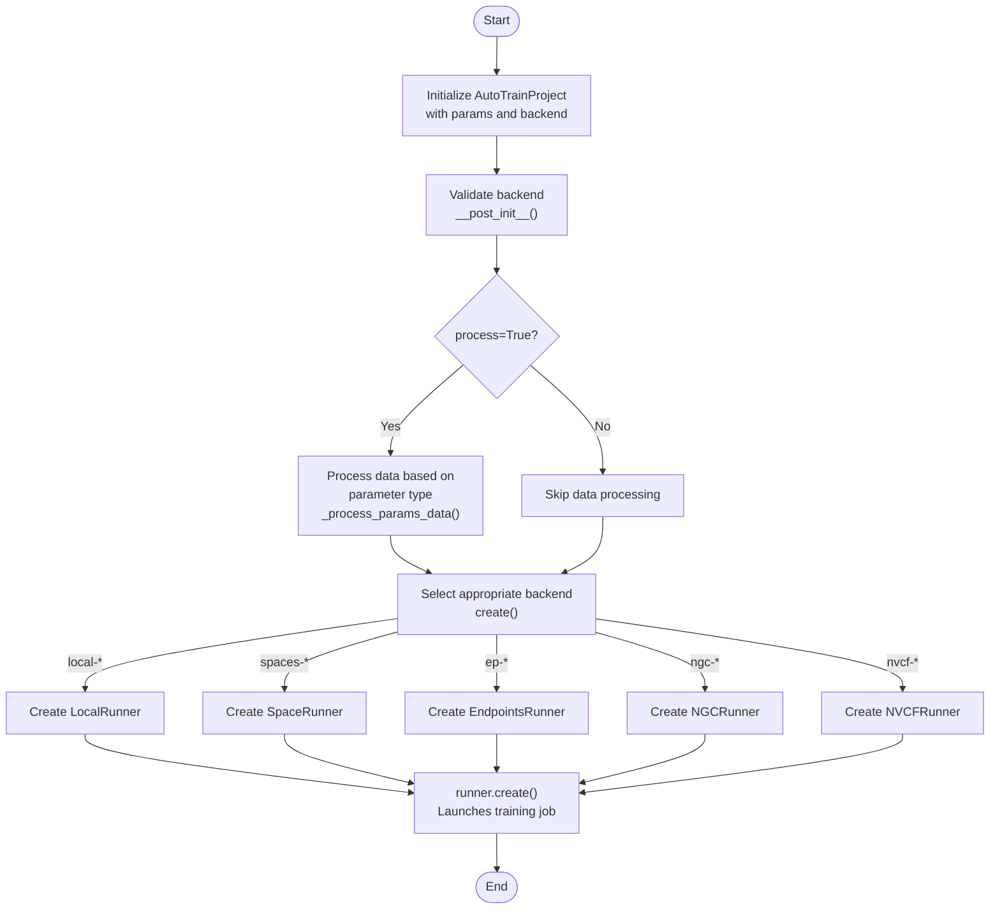

When `AutoTrainProject.create()` is called, it:
1. Processes data if the `process` flag is True
2. Selects the appropriate backend based on the prefix of the backend string
3. Creates a runner instance for that backend
4. Calls the runner's `create()` method to launch the training job

Sources: [src/autotrain/project.py:510-563]()

## Data Processing System

A key responsibility of the Project Management system is data preprocessing, which transforms raw data into a format suitable for training.

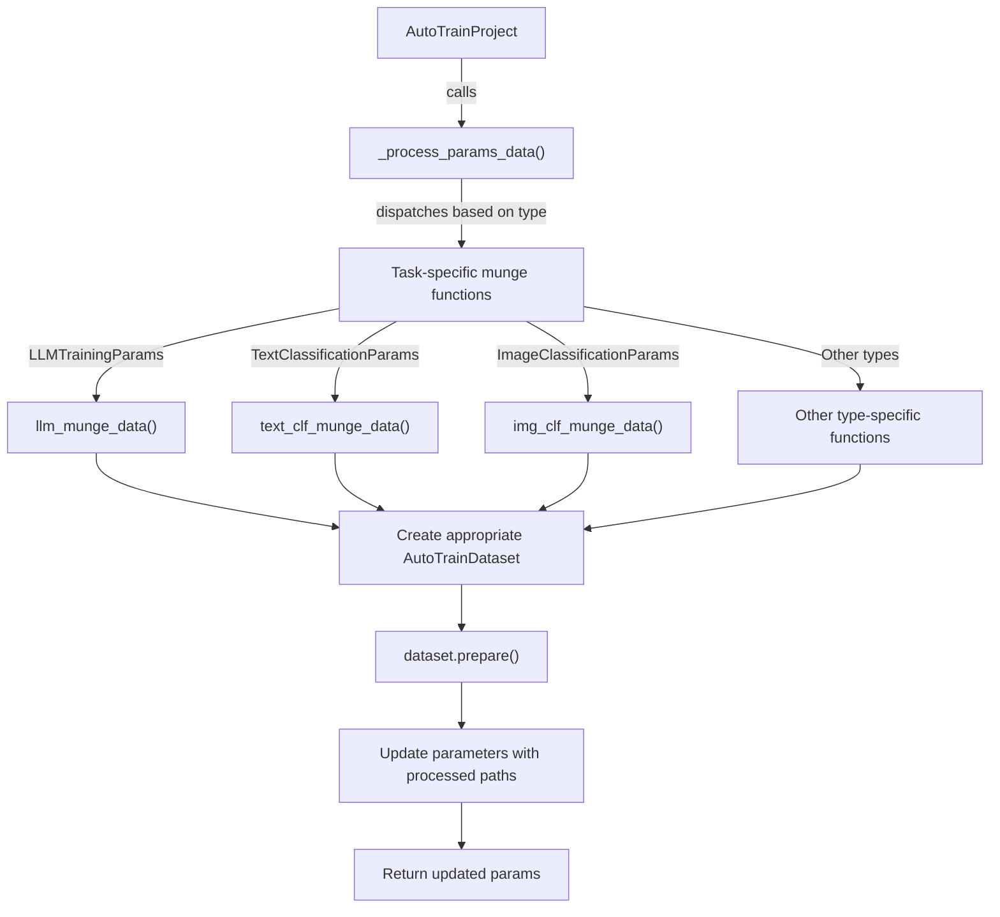

Each task-specific data munging function:
1. Determines file extensions and paths
2. Creates a specialized dataset object (e.g., `AutoTrainDataset`, `AutoTrainImageClassificationDataset`)
3. Prepares the dataset (converting formats, organizing files, etc.)
4. Updates parameter attributes with processed data paths

Sources: [src/autotrain/project.py:36-440](), [src/autotrain/project.py:515-541]()

## Backend Selection System

The backend selection system determines where and how the training job will be executed:

| Backend Prefix | Runner | Description |
|----------------|--------|-------------|
| `local-` | `LocalRunner` | Executes training on local hardware |
| `spaces-` | `SpaceRunner` | Executes on Hugging Face Spaces |
| `ep-` | `EndpointsRunner` | Executes on Hugging Face Endpoints |
| `ngc-` | `NGCRunner` | Executes on NVIDIA GPU Cloud |
| `nvcf-` | `NVCFRunner` | Executes on NVIDIA Cloud Functions |

The backend string often includes hardware specifications (e.g., `spaces-a10g-large` or `local-cuda:0`), which are validated against the `AVAILABLE_HARDWARE` constant.

Sources: [src/autotrain/project.py:507-513](), [src/autotrain/project.py:547-562]()

## Example Configuration

AutoTrain projects can be configured through YAML files, which are parsed and converted into parameter objects before being passed to `AutoTrainProject`. Here's a simplified example for LLM fine-tuning:

```yaml
task: llm-sft
base_model: meta-llama/Llama-3.2-1B
project_name: autotrain-llama32-1b-finetune
log: tensorboard
backend: local

data:
  path: HuggingFaceH4/no_robots
  train_split: train
  column_mapping:
    text_column: messages

params:
  block_size: 2048
  model_max_length: 4096
  epochs: 2
  batch_size: 1
  lr: 1e-5
  peft: true
  quantization: int4

hub:
  username: ${HF_USERNAME}
  token: ${HF_TOKEN}
  push_to_hub: true
```

Sources: [configs/llm_finetuning/llama32-1b-sft.yml:1-35]()

## Integration with User Interfaces

The Project Management system integrates with both the command-line interface and web UI:

```mermaid
graph TD
    CLI["CLI\nautotrain command"] -->|parses| CLIArgs["Command Arguments"]
    WebUI["Web UI\napp"] -->|captures| WebInputs["User Inputs"]
    ConfigFile["YAML Config\n--config file.yml"] -->|loaded by| Parser["AutoTrainConfigParser"]
    
    CLIArgs --> CreateParams["Create Parameters Object"]
    WebInputs --> CreateParams
    Parser --> CreateParams
    
    CreateParams --> Project["AutoTrainProject"]
    Project -->|create()| RunTraining["Execute Training"]
    
    RunTraining --> SaveModel["Save Model"]
    SaveModel -->|if push_to_hub=True| HF["Push to Hugging Face Hub"]
```

Sources: [src/autotrain/cli/run_app.py:35-170](), [src/autotrain/utils.py:24-79]()

## Project Execution Flow

When a project is executed, it follows this sequence:

1. The user provides configuration through CLI, web UI, or YAML file
2. A task-specific parameter object is created
3. An `AutoTrainProject` instance is initialized with parameters and backend
4. Data is optionally processed and transformed
5. A backend-specific runner is created
6. The runner launches the training job
7. The trained model is saved locally and optionally pushed to the Hugging Face Hub

This unified workflow allows AutoTrain to manage diverse training tasks across multiple execution environments while maintaining a consistent user experience.

Sources: [src/autotrain/project.py:443-563]()

---

# Page: Data Processing

# Data Processing

<details>
<summary>Relevant source files</summary>

The following files were used as context for generating this wiki page:

- [src/autotrain/dataset.py](src/autotrain/dataset.py)
- [src/autotrain/preprocessor/tabular.py](src/autotrain/preprocessor/tabular.py)
- [src/autotrain/preprocessor/text.py](src/autotrain/preprocessor/text.py)
- [src/autotrain/preprocessor/vision.py](src/autotrain/preprocessor/vision.py)
- [src/autotrain/tasks.py](src/autotrain/tasks.py)
- [src/autotrain/trainers/common.py](src/autotrain/trainers/common.py)
- [src/autotrain/trainers/image_classification/__main__.py](src/autotrain/trainers/image_classification/__main__.py)
- [src/autotrain/trainers/object_detection/dataset.py](src/autotrain/trainers/object_detection/dataset.py)
- [src/autotrain/trainers/seq2seq/__main__.py](src/autotrain/trainers/seq2seq/__main__.py)
- [src/autotrain/trainers/tabular/__main__.py](src/autotrain/trainers/tabular/__main__.py)
- [src/autotrain/trainers/text_classification/__main__.py](src/autotrain/trainers/text_classification/__main__.py)

</details>


This page documents the data processing subsystem in AutoTrain Advanced, which is responsible for loading, validating, preprocessing, and preparing datasets for various training tasks. The data processing system handles multiple data types (text, images, tabular data) and ensures they're transformed into the correct format for model training.

For information about how the prepared data is used in training, see [Training Components](#3).

## Overview

AutoTrain's data processing components follow a consistent pattern across different data types, creating a flexible pipeline that:

1. Loads raw data from files, DataFrames, or the Hugging Face Hub
2. Validates data format and contents
3. Splits data into training and validation sets (if needed)
4. Maps columns to standardized formats
5. Applies task-specific preprocessing
6. Converts processed data to Hugging Face Datasets format
7. Either saves locally or pushes to Hugging Face Hub

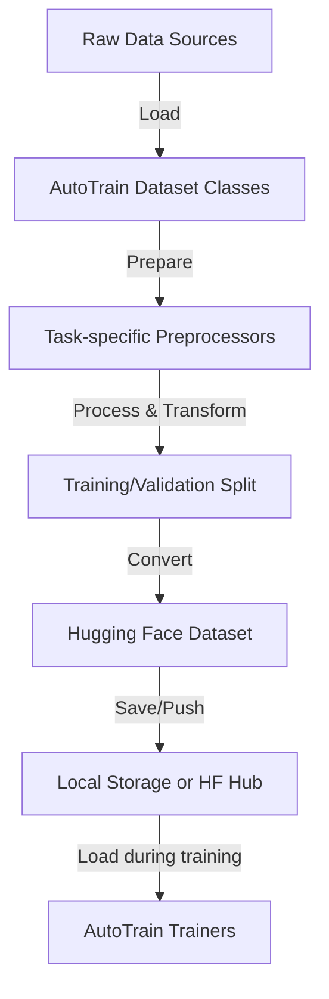

Sources: [src/autotrain/dataset.py:478-502](). [src/autotrain/trainers/common.py:242-250]()

## Dataset Classes

The data processing begins with specialized `AutoTrainDataset` classes that handle different data types.

```mermaid
classDiagram
    class "AutoTrainDataset" {
        +train_data: list[str]
        +task: str
        +token: str
        +project_name: str
        +column_mapping: Dict
        +prepare()
        +split()
    }
    class "AutoTrainImageClassificationDataset" {
        +train_data: str
        +token: str
        +project_name: str 
        +prepare()
    }
    class "AutoTrainObjectDetectionDataset" {
        +train_data: str
        +token: str
        +project_name: str
        +prepare()
    }
    class "AutoTrainImageRegressionDataset" {
        +train_data: str
        +token: str 
        +project_name: str
        +prepare()
    }
    class "AutoTrainVLMDataset" {
        +train_data: str
        +token: str
        +project_name: str
        +column_mapping: Dict
        +prepare()
    }
```

Sources: [src/autotrain/dataset.py:69-137](), [src/autotrain/dataset.py:168-265](), [src/autotrain/dataset.py:267-376](), [src/autotrain/dataset.py:379-475]()

Each dataset class:

1. Accepts raw data (paths or DataFrames)
2. Validates data format and structure
3. Extracts the right preprocessor based on task
4. Calls `prepare()` on the preprocessor to process the data

The general-purpose `AutoTrainDataset` handles multiple data formats and tasks, while specialized classes like `AutoTrainImageClassificationDataset` focus on specific data types with their own validation logic.

### Common Dataset Parameters

| Parameter | Type | Description |
|-----------|------|-------------|
| `train_data` | str or DataFrame | Path to training data or DataFrame containing it |
| `token` | str | Authentication token for Hugging Face Hub |
| `project_name` | str | Name of the project (used for storage) |
| `username` | str | Username for Hugging Face Hub |
| `valid_data` | str or DataFrame | Optional validation data |
| `percent_valid` | float | Percentage of data to use for validation if `valid_data` not provided |
| `local` | bool | Whether to save data locally or push to Hub |
| `column_mapping` | Dict | Maps dataset columns to standard AutoTrain columns |

Sources: [src/autotrain/dataset.py:478-513]()

## Preprocessors Architecture

The preprocessors form the core of the data processing system, handling task-specific data transformations.

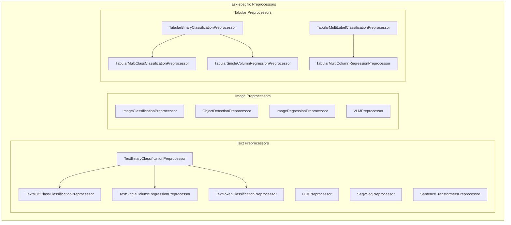

Sources: [src/autotrain/preprocessor/text.py:21-681](), [src/autotrain/preprocessor/vision.py:14-565](), [src/autotrain/preprocessor/tabular.py:11-273]()

### Key Preprocessor Methods

All preprocessors implement a common set of methods:

1. **Validation (`__post_init__`)**: Validates input data format and columns
2. **Split**: Handles train/validation splitting if needed
3. **Column Preparation**: Maps input columns to standardized AutoTrain column names
4. **Prepare**: Main method that orchestrates the entire preprocessing pipeline

Sources: [src/autotrain/preprocessor/text.py:58-144]()

## Data Processing Flow

The typical data processing flow follows these steps:

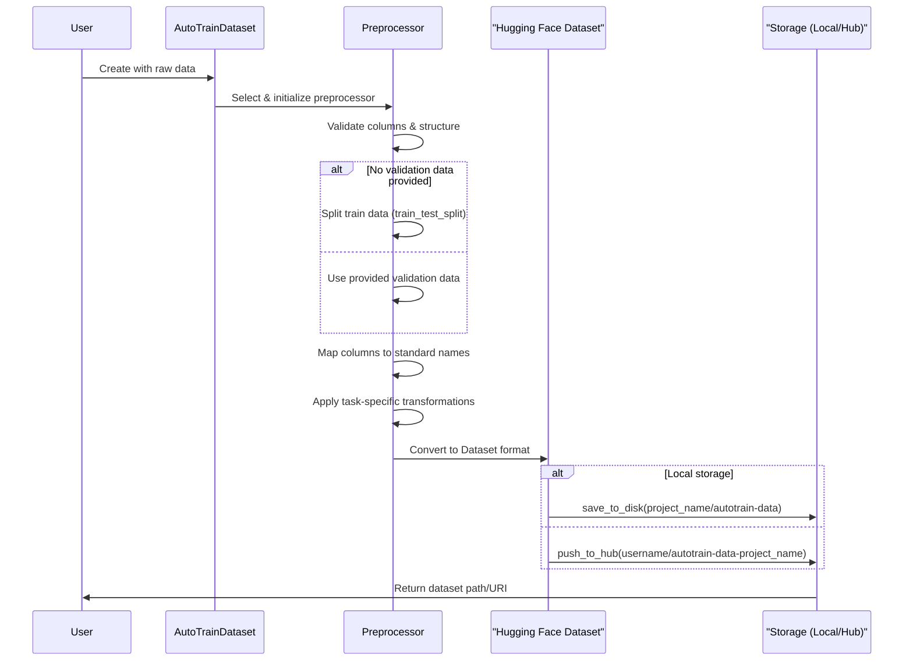

Sources: [src/autotrain/preprocessor/text.py:104-144](), [src/autotrain/preprocessor/vision.py:126-190]()

### Column Standardization

A key aspect of the preprocessing is standardizing column names. AutoTrain uses reserved column names to ensure consistency across tasks:

| Data Type | Reserved Columns |
|-----------|------------------|
| Text | `autotrain_text`, `autotrain_label`, `autotrain_question`, `autotrain_answer`, `autotrain_prompt`, `autotrain_context`, `autotrain_rejected_text`, `autotrain_prompt_start` |
| Tabular | `autotrain_id`, `autotrain_label` |
| Images | `autotrain_image`, `autotrain_label`, `autotrain_objects` |

Sources: [src/autotrain/preprocessor/text.py:12-18](), [src/autotrain/preprocessor/tabular.py:9]()

## Text Data Processing

Text processing handles various NLP tasks including classification, regression, token classification, and sequence-to-sequence tasks.

### Text Classification Example

```mermaid
graph TD
    Input["Input: DataFrame with text & label columns"] --> |"TextMultiClassClassificationPreprocessor"| Step1["1. Split Data (if needed)"]
    Step1 --> Step2["2. Map columns to autotrain_text & autotrain_label"]
    Step2 --> Step3["3. Convert text & labels to strings"]
    Step3 --> Step4["4. Extract unique label names"]
    Step4 --> Step5["5. Convert to HF Dataset"]
    Step5 --> Step6["6. Optional: Cast to ClassLabel"]
    Step6 --> Output["Output: Dataset with standardized columns"]
```

Sources: [src/autotrain/preprocessor/text.py:21-144]()

### LLM Data Processing

For large language model training, specialized preprocessing is applied:

```mermaid
graph TD
    Input["Input: DataFrame with text, prompt (optional), etc."] --> |"LLMPreprocessor"| Step1["1. Validate text, prompt & rejected text columns"]
    Step1 --> Step2["2. Map to autotrain_text, autotrain_prompt, etc."]
    Step2 --> Step3["3. Convert to HF Dataset"]
    Step3 --> Output["Output: Dataset ready for LLM training"]
```

Sources: [src/autotrain/preprocessor/text.py:310-443]()

## Image Data Processing

Image data processing handles various vision tasks, with special requirements for folder structure and metadata files.

### Image Classification Processing

```mermaid
graph TD
    Input["Input: Directory with class subdirectories"] --> Validate["Validate folder structure & image files"]
    Validate --> |"Valid"| Split["Split data or use provided valid set"]
    Split --> Organize["Organize into train/validation folders"]
    Organize --> ImageFolder["Load with load_dataset('imagefolder')"]
    ImageFolder --> Rename["Rename to autotrain_image & autotrain_label"]
    Rename --> Output["Output: Dataset with images & labels"]
```

Sources: [src/autotrain/preprocessor/vision.py:14-190]()

### Object Detection Processing

Object detection requires additional steps to handle bounding boxes and categories:

```mermaid
graph TD
    Input["Input: Directory with images & metadata.jsonl"] --> Validate["Validate files & metadata format"]
    Validate --> ProcessMeta["Process metadata (bboxes & categories)"]
    ProcessMeta --> Split["Split data or use provided valid set"]
    Split --> LoadFeatures["Load with object detection features schema"]
    LoadFeatures --> Rename["Rename to autotrain_image & autotrain_objects"]
    Rename --> Output["Output: Dataset with images & bounding boxes"]
```

Sources: [src/autotrain/preprocessor/vision.py:193-411]()

## Tabular Data Processing

Tabular data processing handles various tabular tasks, including classification and regression.

```mermaid
graph TD
    Input["Input: DataFrame with features & target"] --> |"TabularPreprocessor"| Validate["Validate columns & types"]
    Validate --> Split["Split data (if needed)"]
    Split --> MapColumns["Map to autotrain_id & autotrain_label"]
    MapColumns --> Convert["Convert to HF Dataset"]
    Convert --> Output["Output: Dataset ready for tabular training"]
```

Sources: [src/autotrain/preprocessor/tabular.py:11-146]()

## Data Loading During Training

Once data is processed, trainers load it during the training phase:

```mermaid
graph TD
    Config["Training Configuration"] --> LoadData["Load data from path or Hub"]
    LoadData --> ProcessStandard["Apply standard processing (tokenization, etc.)"]
    ProcessStandard --> CreateDataset["Create task-specific dataset class"]
    CreateDataset --> DataLoader["Create data loader for training"]
```

Sources: [src/autotrain/trainers/text_classification/__main__.py:45-90](), [src/autotrain/trainers/seq2seq/__main__.py:45-101](), [src/autotrain/trainers/image_classification/__main__.py:44-84]()

## Conclusion

The data processing system in AutoTrain Advanced provides a flexible framework for handling various data types and tasks. By standardizing column names and implementing consistent processing patterns, it ensures that data is properly prepared for model training, regardless of the specific task or data format.

The system's modular design allows for easy extension to new data types and tasks, while maintaining compatibility with the Hugging Face ecosystem through the use of the Datasets library.

---

# Page: Execution Backends

# Execution Backends

<details>
<summary>Relevant source files</summary>

The following files were used as context for generating this wiki page:

- [.gitignore](.gitignore)
- [docs/source/col_map.mdx](docs/source/col_map.mdx)
- [src/autotrain/app/app.py](src/autotrain/app/app.py)
- [src/autotrain/app/db.py](src/autotrain/app/db.py)
- [src/autotrain/app/oauth.py](src/autotrain/app/oauth.py)
- [src/autotrain/app/training_api.py](src/autotrain/app/training_api.py)
- [src/autotrain/app/utils.py](src/autotrain/app/utils.py)
- [src/autotrain/cli/run_api.py](src/autotrain/cli/run_api.py)
- [src/autotrain/cli/run_app.py](src/autotrain/cli/run_app.py)
- [src/autotrain/cli/run_spacerunner.py](src/autotrain/cli/run_spacerunner.py)
- [src/autotrain/params.py](src/autotrain/params.py)
- [src/autotrain/project.py](src/autotrain/project.py)
- [src/autotrain/trainers/generic/__main__.py](src/autotrain/trainers/generic/__main__.py)
- [src/autotrain/trainers/generic/params.py](src/autotrain/trainers/generic/params.py)
- [src/autotrain/trainers/generic/utils.py](src/autotrain/trainers/generic/utils.py)
- [src/autotrain/trainers/tabular/params.py](src/autotrain/trainers/tabular/params.py)
- [src/autotrain/utils.py](src/autotrain/utils.py)

</details>


This document provides a detailed explanation of the execution backends available in AutoTrain Advanced. Execution backends are responsible for the actual running of training jobs in different computing environments. AutoTrain supports various backends including local execution, Hugging Face Spaces, Hugging Face Endpoints, NVIDIA GPU Cloud (NGC), and NVIDIA Cloud Functions (NVCF).

## Overview

Execution backends allow AutoTrain to be flexible in where and how it runs training workloads. Each backend has different characteristics in terms of computing power, cost, and setup requirements. The selection of an appropriate backend depends on the specific needs of the training job, such as model size, dataset size, and performance requirements.

```mermaid
graph TD
    Client["AutoTrainProject"] --> |selects| Backend["Execution Backend"]
    
    Backend --> |local| LocalRunner["LocalRunner"]
    Backend --> |spaces| SpaceRunner["SpaceRunner"]
    Backend --> |endpoints| EndpointsRunner["EndpointsRunner"]
    Backend --> |ngc| NGCRunner["NGCRunner"]
    Backend --> |nvcf| NVCFRunner["NVCFRunner"]
    
    LocalRunner --> |executes on| LocalMachine["Local Machine"]
    SpaceRunner --> |creates| Space["Hugging Face Space"]
    EndpointsRunner --> |creates| Endpoint["Hugging Face Endpoint"]
    NGCRunner --> |executes on| NGCCloud["NVIDIA GPU Cloud"]
    NVCFRunner --> |executes on| NVCFCloud["NVIDIA Cloud Functions"]
    
    Space --> |runs| DockerContainer["Docker Container"]
    Endpoint --> |runs| DockerContainer
    
    DockerContainer --> |executes| TrainingJob["Training Job"]
    LocalMachine --> |executes| TrainingJob
    NGCCloud --> |executes| TrainingJob
    NVCFCloud --> |executes| TrainingJob
```

Sources: [src/autotrain/project.py:9-14](), [src/autotrain/project.py:547-561]()

## Available Hardware Options

AutoTrain supports a variety of hardware configurations across different backends. The available hardware is defined in the `AVAILABLE_HARDWARE` constant imported from `autotrain.backends.base`. When configuring an AutoTrain project, you must specify a backend that matches one of these available options.

Available backends include:

- `local`: Run on the local machine
- `spaces-*`: Run on Hugging Face Spaces with various GPU configurations (A10G, A100, T4, CPU, L4, L40S)
- `ep-*`: Run on Hugging Face Endpoints
- `ngc-*`: Run on NVIDIA GPU Cloud
- `nvcf-*`: Run on NVIDIA Cloud Functions

Sources: [src/autotrain/project.py:9](), [src/autotrain/project.py:512-513]()

## Backend Selection and Configuration

The `AutoTrainProject` class is responsible for managing the entire training process, including selecting and configuring the appropriate backend. Here's how it works:

```mermaid
graph LR
    User[/"User"/] -->|"configures"| Project["AutoTrainProject"]
    
    Project -->|"validates"| BackendValidation["Backend Validation"]
    BackendValidation -->|"if valid"| RunnerSelection["Runner Selection"]
    BackendValidation -->|"if invalid"| Error["Error: Invalid Backend"]
    
    Project -->|"optionally processes"| DataProcessing["Data Processing"]
    DataProcessing -->|"returns processed"| ProcessedParams["Processed Parameters"]
    
    RunnerSelection -->|"local-*"| LocalRunner["LocalRunner"]
    RunnerSelection -->|"spaces-*"| SpaceRunner["SpaceRunner"]
    RunnerSelection -->|"ep-*"| EndpointsRunner["EndpointsRunner"]
    RunnerSelection -->|"ngc-*"| NGCRunner["NGCRunner"]
    RunnerSelection -->|"nvcf-*"| NVCFRunner["NVCFRunner"]
    
    LocalRunner -->|"creates"| Job["Training Job"]
    SpaceRunner -->|"creates"| Job
    EndpointsRunner -->|"creates"| Job
    NGCRunner -->|"creates"| Job
    NVCFRunner -->|"creates"| Job
    
    Job -->|"produces"| Results["Training Results"]
```

When creating an `AutoTrainProject`, you need to provide:

1. **Parameters**: A task-specific parameter object (e.g., `LLMTrainingParams`, `TextClassificationParams`, etc.)
2. **Backend**: A string identifying the backend to use (e.g., "local", "spaces-a10g-large")
3. **Process flag**: A boolean indicating whether data should be processed before training

The `create()` method selects the appropriate runner based on the backend string prefix and instantiates it with the parameters.

Sources: [src/autotrain/project.py:443-508](), [src/autotrain/project.py:543-563]()

## Local Execution Backend

The `LocalRunner` is used when the backend is set to "local". This backend executes the training job on the local machine where AutoTrain is running. It's suitable for smaller models or when you have sufficient local computing resources.

### Local Execution Flow

```mermaid
graph TD
    User[/"User"/] -->|"initiates"| Project["AutoTrainProject"]
    Project -->|"backend=local"| LocalRunner["LocalRunner"]
    
    LocalRunner -->|"creates"| TrainingJob["Training Job"]
    
    TrainingJob -->|"uses local"| ComputeResources["Local Compute Resources"]
    TrainingJob -->|"loads"| Dataset["Dataset"]
    TrainingJob -->|"creates"| Model["Trained Model"]
    
    Model -->|"save to"| LocalStorage["Local Storage"]
    Model -->|"if push_to_hub=True"| HFHub["Hugging Face Hub"]
```

The local backend doesn't require any additional setup apart from having the necessary dependencies installed locally. It's controlled by the `LocalRunner` class, which executes the training process directly on the machine.

Sources: [src/autotrain/project.py:547-549]()

## Hugging Face Spaces Backend

The `SpaceRunner` is used when the backend starts with "spaces-". This backend creates a Hugging Face Space that runs the training job in a container environment. It's good for medium-sized models and when you don't have local GPU resources.

### Spaces Execution Flow

```mermaid
graph TD
    User[/"User"/] -->|"initiates"| Project["AutoTrainProject"]
    Project -->|"backend=spaces-*"| SpaceRunner["SpaceRunner"]
    
    SpaceRunner -->|"creates"| Space["Hugging Face Space"]
    
    Space -->|"runs"| Container["Docker Container"]
    Container -->|"executes"| TrainingScript["Training Script"]
    
    TrainingScript -->|"loads"| Dataset["Dataset"]
    TrainingScript -->|"creates"| Model["Trained Model"]
    
    Model -->|"save to"| SpaceStorage["Space Storage"]
    Model -->|"if push_to_hub=True"| HFHub["Hugging Face Hub"]
```

The Spaces backend offers various hardware configurations identified by the suffix of the backend string:
- `spaces-a10g-large`: A10G GPU (large instance)
- `spaces-a10g-small`: A10G GPU (small instance)
- `spaces-a100-large`: A100 GPU
- `spaces-t4-medium`: T4 GPU (medium instance)
- `spaces-t4-small`: T4 GPU (small instance)
- `spaces-cpu-upgrade`: CPU (upgraded instance)
- `spaces-cpu-basic`: CPU (basic instance)
- And more options with L4 and L40S configurations

When using the `SpaceRunner`, AutoTrain creates a new Space with the specified hardware, uploads the dataset, and runs the training job in that environment.

Sources: [src/autotrain/project.py:550-552](), [src/autotrain/cli/run_spacerunner.py:12-13](), [src/autotrain/cli/run_spacerunner.py:141-143]()

### The SpaceRunner Command

AutoTrain provides a specific command for running jobs on Spaces:

```mermaid
graph TD
    Command["autotrain spacerunner"] -->|"requires"| Parameters["Command Parameters"]
    
    Parameters -->|"--project-name"| ProjectName["Project Name"]
    Parameters -->|"--script-path"| ScriptPath["Script Path"]
    Parameters -->|"--username"| Username["HF Username"]
    Parameters -->|"--token"| Token["HF Token"]
    Parameters -->|"--backend"| Backend["Backend Selection"]
    Parameters -->|"--env"| Environment["Environment Variables"]
    Parameters -->|"--args"| Arguments["Script Arguments"]
    
    Command -->|"creates"| DatasetRepo["Dataset Repository"]
    Command -->|"configures"| GenericParams["GenericParams"]
    Command -->|"initializes"| Runner["SpaceRunner"]
    
    Runner -->|"creates"| Job["Training Job"]
    Job -->|"returns"| JobID["Job ID"]
```

This command uploads a local script and dataset to a Hugging Face Space, then runs the training job in that environment. The dataset is stored in a separate repository on the Hugging Face Hub.

Sources: [src/autotrain/cli/run_spacerunner.py:16-143](), [src/autotrain/trainers/generic/utils.py:10-38]()

## Hugging Face Endpoints Backend

The `EndpointsRunner` is used when the backend starts with "ep-". This backend creates a Hugging Face Endpoint that runs the training job. It's suitable for production deployments and models that need to be accessed via API.

### Endpoints Execution Flow

```mermaid
graph TD
    User[/"User"/] -->|"initiates"| Project["AutoTrainProject"]
    Project -->|"backend=ep-*"| EndpointsRunner["EndpointsRunner"]
    
    EndpointsRunner -->|"creates"| Endpoint["Hugging Face Endpoint"]
    
    Endpoint -->|"runs"| Container["Docker Container"]
    Container -->|"executes"| TrainingAPI["Training API"]
    
    TrainingAPI -->|"loads"| Dataset["Dataset"]
    TrainingAPI -->|"creates"| Model["Trained Model"]
    
    Model -->|"save to"| EndpointStorage["Endpoint Storage"]
    Model -->|"if push_to_hub=True"| HFHub["Hugging Face Hub"]
    
    TrainingAPI -->|"when complete"| PauseEndpoint["Pause Endpoint"]
```

The Endpoints backend creates a managed API endpoint on Hugging Face's infrastructure. When the training is complete, the endpoint can be paused to save resources, as implemented in the `pause_endpoint` function.

Sources: [src/autotrain/project.py:553-555](), [src/autotrain/trainers/generic/utils.py:181-201]()

## NVIDIA GPU Cloud (NGC) Backend

The `NGCRunner` is used when the backend starts with "ngc-". This backend executes the training job on NVIDIA's GPU Cloud platform. It's intended for larger models that require significant GPU resources.

### NGC Execution Flow

```mermaid
graph TD
    User[/"User"/] -->|"initiates"| Project["AutoTrainProject"]
    Project -->|"backend=ngc-*"| NGCRunner["NGCRunner"]
    
    NGCRunner -->|"submits job to"| NGCCluster["NGC Cluster"]
    
    NGCCluster -->|"provisions"| ComputeResources["GPU Resources"]
    NGCCluster -->|"executes"| TrainingJob["Training Job"]
    
    TrainingJob -->|"loads"| Dataset["Dataset"]
    TrainingJob -->|"creates"| Model["Trained Model"]
    
    Model -->|"save to"| NGCStorage["NGC Storage"]
    Model -->|"if push_to_hub=True"| HFHub["Hugging Face Hub"]
```

The NGC backend provides access to NVIDIA's cloud infrastructure, offering powerful GPU resources for training large models. The specific configuration depends on the NGC backend variant chosen.

Sources: [src/autotrain/project.py:556-558]()

## NVIDIA Cloud Functions (NVCF) Backend

The `NVCFRunner` is used when the backend starts with "nvcf-". This backend runs the training job as a serverless function on NVIDIA's cloud infrastructure. It's suitable for intermittent or event-driven training workloads.

### NVCF Execution Flow

```mermaid
graph TD
    User[/"User"/] -->|"initiates"| Project["AutoTrainProject"]
    Project -->|"backend=nvcf-*"| NVCFRunner["NVCFRunner"]
    
    NVCFRunner -->|"creates"| CloudFunction["NVIDIA Cloud Function"]
    
    CloudFunction -->|"executes"| TrainingJob["Training Job"]
    
    TrainingJob -->|"loads"| Dataset["Dataset"]
    TrainingJob -->|"creates"| Model["Trained Model"]
    
    Model -->|"save to"| NVCFStorage["NVCF Storage"]
    Model -->|"if push_to_hub=True"| HFHub["Hugging Face Hub"]
```

The NVCF backend is NVIDIA's serverless computing platform, which allows running training jobs without provisioning or managing servers. The resources are automatically allocated based on the workload.

Sources: [src/autotrain/project.py:559-561]()

## Generic Trainer for Custom Scripts

For custom training workflows, AutoTrain provides a "Generic Trainer" that can execute arbitrary Python scripts in any of the available backends. This is particularly useful when using the Spaces backend.

```mermaid
graph TD
    SpaceRunner["SpaceRunner"] -->|"uses"| GenericParams["GenericParams"]
    GenericParams -->|"configures"| GenericTrainer["Generic Trainer"]
    
    GenericTrainer -->|"1. downloads"| DataRepo["Dataset Repository"]
    GenericTrainer -->|"2. uninstalls old"| OldRequirements["Old Requirements"]
    GenericTrainer -->|"3. installs new"| NewRequirements["New Requirements"]
    GenericTrainer -->|"4. executes"| UserScript["User's script.py"]
    GenericTrainer -->|"5. if on endpoint"| PauseEndpoint["Pause Endpoint"]
    
    UserScript -->|"processes"| Dataset["Dataset"]
    UserScript -->|"produces"| Results["Results"]
```

The Generic Trainer workflow:
1. Downloads the dataset repository from Hugging Face Hub
2. Uninstalls existing requirements (if any)
3. Installs the requirements specified in `requirements.txt`
4. Runs the user's script with the provided arguments
5. Pauses the space or endpoint when complete (if applicable)

This provides a flexible way to run custom training scripts in cloud environments.

Sources: [src/autotrain/trainers/generic/__main__.py:16-52](), [src/autotrain/trainers/generic/utils.py:41-201](), [src/autotrain/trainers/generic/params.py:8-36]()

## Integration with AutoTrain Web Application

AutoTrain provides a web application that integrates with the execution backends, allowing users to configure and monitor training jobs through a graphical interface.

```mermaid
graph TD
    WebUI["AutoTrain Web UI"] -->|"sends configuration to"| APIRoutes["API Routes"]
    
    APIRoutes -->|"creates"| Project["AutoTrainProject"]
    Project -->|"selects"| Backend["Execution Backend"]
    Backend -->|"creates"| Job["Training Job"]
    
    Job -->|"updates status in"| Database["AutoTrainDB (SQLite)"]
    WebUI -->|"polls"| JobStatus["Job Status API"]
    JobStatus -->|"queries"| Database
    
    Database -->|"tracks"| RunningJobs["Running Jobs (PIDs)"]
```

The web application allows users to:
1. Configure training parameters
2. Select the execution backend
3. Start training jobs
4. Monitor job progress
5. View and download results

The application uses a SQLite database (`AutoTrainDB`) to track running jobs and their status.

Sources: [src/autotrain/app/app.py:1-43](), [src/autotrain/app/db.py:4-62](), [src/autotrain/app/utils.py:19-49]()

## Running Training Jobs

When a training job is initiated, AutoTrain uses the `run_training` function to start the process. This function takes the training parameters, task ID, and flags for local execution and waiting.

```mermaid
graph TD
    RunTraining["run_training()"] -->|"parses"| Params["JSON Parameters"]
    Params -->|"converted to"| ParamObject["Param Object (e.g., LLMTrainingParams)"]
    
    ParamObject -->|"saved to"| ProjectDir["Project Directory"]
    RunTraining -->|"constructs"| Command["Launch Command"]
    Command -->|"executed as"| Process["Subprocess"]
    
    Process -->|"returns"| PID["Process ID"]
    PID -->|"tracked in"| Database["AutoTrainDB"]
```

For web application training jobs, the process is managed by the `training_api.py` module, which:
1. Creates a FastAPI application
2. Starts the training process
3. Adds the job to the database
4. Monitors running jobs
5. Shuts down when no jobs are running

Sources: [src/autotrain/utils.py:24-79](), [src/autotrain/app/training_api.py:80-82](), [src/autotrain/app/utils.py:52-94]()

## OAuth Integration for Cloud Backends

When using cloud-based backends like Spaces and Endpoints, AutoTrain leverages OAuth for authentication with the Hugging Face Hub.

```mermaid
graph TD
    App["FastAPI App"] -->|"if SPACE_ID env var exists"| AttachOAuth["attach_oauth()"]
    
    AttachOAuth -->|"adds"| SessionMiddleware["SessionMiddleware"]
    AttachOAuth -->|"adds"| OAuthRoutes["OAuth Routes"]
    
    OAuthRoutes -->|"includes"| LoginRoute["/login/huggingface"]
    OAuthRoutes -->|"includes"| AuthRoute["/auth"]
    
    LoginRoute -->|"redirects to"| HFOAuth["Hugging Face OAuth"]
    HFOAuth -->|"redirects back to"| AuthRoute
    
    AuthRoute -->|"stores"| OAuthInfo["OAuth Info in Session"]
    AuthRoute -->|"redirects to"| TargetURL["Target URL"]
```

The OAuth integration allows users to authenticate with their Hugging Face accounts when using the web application to launch training jobs on cloud backends.

Sources: [src/autotrain/app/app.py:16-17](), [src/autotrain/app/oauth.py:24-172]()

## Conclusion

AutoTrain's execution backends provide a flexible system for running machine learning training jobs across a variety of computing environments. Whether you need to train a small model locally, leverage Hugging Face's infrastructure with Spaces and Endpoints, or tap into NVIDIA's powerful cloud resources with NGC and NVCF, AutoTrain offers a unified interface for configuring and launching your training workloads.

The backend system integrates with AutoTrain's data processing, parameter configuration, and monitoring capabilities to provide a comprehensive solution for automated machine learning model training.

---

# Page: Training Components

# Training Components

<details>
<summary>Relevant source files</summary>

The following files were used as context for generating this wiki page:

- [requirements.txt](requirements.txt)
- [src/autotrain/__init__.py](src/autotrain/__init__.py)
- [src/autotrain/trainers/clm/__main__.py](src/autotrain/trainers/clm/__main__.py)
- [src/autotrain/trainers/clm/utils.py](src/autotrain/trainers/clm/utils.py)
- [src/autotrain/trainers/common.py](src/autotrain/trainers/common.py)
- [src/autotrain/trainers/image_classification/__main__.py](src/autotrain/trainers/image_classification/__main__.py)
- [src/autotrain/trainers/seq2seq/__main__.py](src/autotrain/trainers/seq2seq/__main__.py)
- [src/autotrain/trainers/tabular/__main__.py](src/autotrain/trainers/tabular/__main__.py)
- [src/autotrain/trainers/text_classification/__main__.py](src/autotrain/trainers/text_classification/__main__.py)

</details>


This page provides an overview of the various model training capabilities within AutoTrain Advanced. It covers the core training components that enable users to fine-tune different types of machine learning models through a unified interface.

AutoTrain Advanced supports training a variety of model types, each with specialized training workflows and parameters. For information about how these components are orchestrated, see [Project Management](#2.1). For details on data processing before training, see [Data Processing](#2.2).

## Overview of Training Components

AutoTrain Advanced provides specialized training components for different AI tasks, each implemented as a separate module within the codebase. These components handle the specific requirements and optimizations needed for their respective model types.

**Training Component Types Diagram**

```mermaid
graph TD
    User["User"]
    subgraph "AutoTrain Components"
        direction LR
        Project["AutoTrainProject"]
        Project --> Params["TrainingParameters"]
        Params --> |creates| TrainingConfig["Training Configuration"]
        
        TrainingConfig --> |dispatches to| Trainers["Training Components"]
        
        subgraph "Trainers"
            LLM["LLM Trainer<br>- SFT<br>- DPO<br>- ORPO<br>- Reward"]
            TextClass["Text Classification<br>Trainer"]
            ImgClass["Image Classification<br>Trainer"] 
            Seq2Seq["Sequence-to-Sequence<br>Trainer"]
            Tabular["Tabular<br>Trainer"]
            TokenClass["Token Classification<br>Trainer"]
        end
    end
    
    User --> |configures| Project
    Trainers --> |produce| Models["Trained Models"]
```

Sources: [src/autotrain/trainers/clm/__main__.py:15-46](), [src/autotrain/trainers/text_classification/__main__.py:40-239](), [src/autotrain/trainers/image_classification/__main__.py:39-242](), [src/autotrain/trainers/seq2seq/__main__.py:45-272](), [src/autotrain/trainers/tabular/__main__.py:152-402]()

## Common Architecture

All training components share a common architecture pattern that provides consistency across different model types. This includes parameter validation, training monitoring, checkpointing, and integration with Hugging Face Hub.

**Common Training Architecture Diagram**

```mermaid
graph TB
    subgraph "Training Component Common Architecture"
        ConfigParser["Parse Config JSON"] --> |creates| Params["AutoTrainParams"]
        Params --> ValidateParams["Validate Parameters"]
        ValidateParams --> LoadData["Load Dataset"]
        LoadData --> PrepareModel["Initialize Model"]
        PrepareModel --> TrainingLoop["Run Training Loop"]
        TrainingLoop --> SaveModel["Save Model"]
        SaveModel --> CreateModelCard["Create Model Card"]
        CreateModelCard --> |if push_to_hub| PushModel["Push to Hub"]
    end
    
    subgraph "Common Callbacks"
        LoggingCallback["LossLoggingCallback"]
        StartCallback["TrainStartCallback"]
        UploadCallback["UploadLogs"]
    end
    
    TrainingLoop --> |registers| CommonCallbacks["Common Callbacks"]
    CommonCallbacks --- LoggingCallback
    CommonCallbacks --- StartCallback
    CommonCallbacks --- UploadCallback
```

Sources: [src/autotrain/trainers/common.py:189-220](), [src/autotrain/trainers/common.py:223-286](), [src/autotrain/trainers/common.py:289-340]()

The base parameters class, `AutoTrainParams`, provides common functionality for parameter validation and serialization. It ensures that configuration parameters are properly validated before training begins.

```mermaid
classDiagram
    class AutoTrainParams {
        +save(output_dir)
        +__str__()
        +validate_project_name()
    }
    
    class LLMTrainingParams {
        +model: str
        +data_path: str
        +trainer: str
        +peft: bool
        +quantization: str
        +...
    }
    
    class TextClassificationParams {
        +model: str
        +data_path: str
        +text_column: str
        +target_column: str
        +...
    }
    
    class ImageClassificationParams {
        +model: str
        +data_path: str
        +image_column: str
        +target_column: str
        +...
    }
    
    class Seq2SeqParams {
        +model: str
        +data_path: str
        +text_column: str
        +target_column: str
        +...
    }
    
    class TabularParams {
        +model: str
        +data_path: str
        +target_columns: list
        +numerical_columns: list
        +categorical_columns: list
        +...
    }
    
    AutoTrainParams <|-- LLMTrainingParams
    AutoTrainParams <|-- TextClassificationParams
    AutoTrainParams <|-- ImageClassificationParams
    AutoTrainParams <|-- Seq2SeqParams
    AutoTrainParams <|-- TabularParams
```

Sources: [src/autotrain/trainers/common.py:223-286]()

## LLM Training

The LLM training component is the most feature-rich in AutoTrain, supporting various fine-tuning techniques for large language models.

**LLM Training Techniques Diagram**

```mermaid
graph TD
    LLMConfig["LLM Training Configuration"] --> Trainer["Trainer Selection"]
    
    Trainer --> |"trainer=default"| DefaultSFT["Default SFT Trainer"]
    Trainer --> |"trainer=sft"| SFT["SFT Trainer"]
    Trainer --> |"trainer=reward"| Reward["Reward Model Trainer"]
    Trainer --> |"trainer=dpo"| DPO["DPO Trainer"]
    Trainer --> |"trainer=orpo"| ORPO["ORPO Trainer"]
    
    subgraph "Common Features"
        PEFT["PEFT (LoRA)"]
        Quantization["Quantization (Int4/Int8)"]
        FlashAttention["Flash Attention 2"]
        UnslothLib["Unsloth Integration"]
    end
    
    DefaultSFT --> |configures| CommonFeatures["Common Features"]
    SFT --> |configures| CommonFeatures
    
    CommonFeatures --- PEFT
    CommonFeatures --- Quantization
    CommonFeatures --- FlashAttention
    CommonFeatures --- UnslothLib
```

Sources: [src/autotrain/trainers/clm/__main__.py:15-46](), [src/autotrain/trainers/clm/utils.py:32-106](), [src/autotrain/trainers/clm/utils.py:392-462]()

### LLM Training Data Flow

The LLM training component supports sophisticated data processing and training workflows:

```mermaid
flowchart TD
    Dataset["Input Dataset"] --> |load| DataProcessor["Data Processor"]
    DataProcessor --> |apply| ChatTemplates["Chat Templates"]
    ChatTemplates --> |produce| TokenizedData["Tokenized Data"]
    
    BaseModel["Base LLM"] --> |load| ModelInitializer["Model Initializer"]
    
    ConfigParser["Configuration"] --> |configure| Optimizations["Optimizations"]
    Optimizations --> |apply| ModelInitializer
    
    subgraph "Optional Optimizations"
        PEFT["PEFT/LoRA"]
        Quant["Quantization"]
        Flash["Flash Attention"]
    end
    
    Optimizations --- PEFT
    Optimizations --- Quant
    Optimizations --- Flash
    
    TokenizedData --> |feed| TrainingLoop["Training Loop"]
    ModelInitializer --> |initialize| TrainingLoop
    
    TrainingLoop --> |produce| TrainedModel["Trained Model"]
    
    TrainedModel --> |if PEFT| MergeAdapter["Merge Adapter"]
    MergeAdapter --> FinalModel["Final Model"]
    
    TrainedModel --> |if !PEFT| FinalModel
    
    FinalModel --> |save| SavedModel["Saved Model"]
    SavedModel --> |if push_to_hub| HFHub["Hugging Face Hub"]
```

Sources: [src/autotrain/trainers/clm/utils.py:392-462](), [src/autotrain/trainers/clm/utils.py:465-553](), [src/autotrain/trainers/clm/utils.py:828-1196]()

## Text Classification Training

The text classification training component supports binary and multi-class classification tasks for text data.

```mermaid
flowchart TD
    TextData["Text Dataset"] --> TextProcessor["Text Processor"]
    TextProcessor --> TokenizedText["Tokenized Text"]
    
    ModelConfig["Classification Model Config"] --> |"num_labels=classes"| ModelInit["Model Initialization"]
    
    TokenizedText --> TrainingLoop["Training Loop"]
    ModelInit --> TrainingLoop
    
    MetricSelector["Metric Selector"]
    MetricSelector --> |"if binary"| BinaryMetrics["Binary Classification Metrics"]
    MetricSelector --> |"if multi-class"| MultiMetrics["Multi-class Classification Metrics"]
    
    TrainingLoop --> |track| SelectedMetrics["Selected Metrics"]
    SelectedMetrics --> |"if validation"| EarlyStopping["Early Stopping"]
    
    TrainingLoop --> SavedModel["Saved Model"]
    SavedModel --> ModelCard["Model Card"]
    ModelCard --> |"if push_to_hub"| HFHub["Hugging Face Hub"]
```

Sources: [src/autotrain/trainers/text_classification/__main__.py:40-239]()

## Image Classification Training

The image classification component follows a similar pattern to text classification but with image-specific processing:

```mermaid
flowchart TD
    ImageData["Image Dataset"] --> ImageProcessor["Image Processor"]
    ImageProcessor --> ProcessedImages["Processed Images"]
    
    ModelConfig["Classification Model Config"] --> |"num_labels=classes"| ModelInit["Model Initialization"]
    
    ProcessedImages --> TrainingLoop["Training Loop"]
    ModelInit --> TrainingLoop
    
    MetricSelector["Metric Selector"]
    MetricSelector --> |"if binary"| BinaryMetrics["Binary Classification Metrics"]
    MetricSelector --> |"if multi-class"| MultiMetrics["Multi-class Classification Metrics"]
    
    TrainingLoop --> |track| SelectedMetrics["Selected Metrics"]
    SelectedMetrics --> |"if validation"| EarlyStopping["Early Stopping"]
    
    TrainingLoop --> SavedModel["Saved Model"]
    SavedModel --> ModelCard["Model Card"]
    ModelCard --> |"if push_to_hub"| HFHub["Hugging Face Hub"]
```

Sources: [src/autotrain/trainers/image_classification/__main__.py:39-242]()

## Sequence-to-Sequence Training

The sequence-to-sequence component handles tasks like translation, summarization, and other text generation tasks:

```mermaid
flowchart TD
    TextInput["Source Text"] --> Tokenizer["Tokenizer"]
    Tokenizer --> EncodedInput["Encoded Input"]
    
    TargetText["Target Text"] --> Tokenizer
    Tokenizer --> EncodedTarget["Encoded Target"]
    
    ModelConfig["Seq2Seq Model Config"] --> ModelInit["Model Initialization"]
    
    EncodedInput --> DataCollator["Seq2Seq Data Collator"]
    EncodedTarget --> DataCollator
    
    DataCollator --> TrainingLoop["Training Loop"]
    ModelInit --> TrainingLoop
    
    TrainingLoop --> |"predict_with_generate=True"| GeneratedText["Generated Text"]
    GeneratedText --> Metrics["Seq2Seq Metrics"]
    
    TrainingLoop --> SavedModel["Saved Model"]
    SavedModel --> ModelCard["Model Card"]
    ModelCard --> |"if push_to_hub"| HFHub["Hugging Face Hub"]
```

Sources: [src/autotrain/trainers/seq2seq/__main__.py:45-272]()

## Tabular Training

The tabular training component handles structured data with support for various classic machine learning models:

```mermaid
flowchart TD
    TabularData["Tabular Dataset"] --> ColumnDetector["Column Type Detector"]
    
    ColumnDetector --> NumCols["Numerical Columns"]
    ColumnDetector --> CatCols["Categorical Columns"]
    
    NumCols --> NumPreprocessor["Numerical Preprocessor"]
    CatCols --> CatPreprocessor["Categorical Preprocessor"]
    
    NumPreprocessor --> Preprocessor["Column Transformer"]
    CatPreprocessor --> Preprocessor
    
    TaskDetector["Task Detector"]
    TaskDetector --> |"if binary target"| BinaryTask["Binary Classification"]
    TaskDetector --> |"if multi-class target"| MultiTask["Multi-class Classification"]
    TaskDetector --> |"if continuous target"| RegressionTask["Regression"]
    
    Preprocessor --> ProcessedData["Processed Data"]
    ProcessedData --> HPOOptimizer["Hyperparameter Optimizer (Optuna)"]
    
    ModelSelector["Model Selector"]
    ModelSelector --> |"model=xgboost"| XGBoost["XGBoost"]
    ModelSelector --> |"model=lightgbm"| LightGBM["LightGBM"]
    ModelSelector --> |"model=randomforest"| RF["Random Forest"]
    ModelSelector --> |"model=catboost"| CatBoost["CatBoost"]
    ModelSelector --> |"model=extratrees"| ExtraTrees["Extra Trees"]
    
    HPOOptimizer --> |configures| SelectedModel["Selected Model"]
    
    ProcessedData --> |train| SelectedModel
    SelectedModel --> SavedModel["Saved Model"]
    SavedModel --> ModelCard["Model Card"]
    ModelCard --> |"if push_to_hub"| HFHub["Hugging Face Hub"]
```

Sources: [src/autotrain/trainers/tabular/__main__.py:152-402](), [src/autotrain/trainers/tabular/__main__.py:34-150]()

## Common Training Workflow

Despite the differences between training components, they all follow a similar high-level workflow:

```mermaid
sequenceDiagram
    participant User
    participant AutoTrain
    participant Dataset
    participant ModelHub
    participant TrainingComponent
    participant TrainingBackend
    
    User->>AutoTrain: Configure Training Parameters
    AutoTrain->>+Dataset: Load Data
    Dataset-->>-AutoTrain: Return Dataset
    
    AutoTrain->>+ModelHub: Load Base Model
    ModelHub-->>-AutoTrain: Return Model
    
    AutoTrain->>TrainingComponent: Create Training Job
    
    TrainingComponent->>TrainingBackend: Execute Training
    
    loop Training Process
        TrainingBackend->>TrainingBackend: Process Batch
        TrainingBackend->>AutoTrain: Report Progress
        AutoTrain->>User: Update UI/Logs
    end
    
    TrainingBackend-->>TrainingComponent: Return Trained Model
    TrainingComponent->>AutoTrain: Save Model
    
    alt Push to Hub
        AutoTrain->>ModelHub: Push Model
        ModelHub-->>User: Model Available on Hub
    end
    
    AutoTrain-->>User: Training Complete
```

Sources: [src/autotrain/trainers/common.py:189-220](), [src/autotrain/trainers/clm/utils.py:392-462]()

## Parameter Management

Each training component has its own parameters class that inherits from `AutoTrainParams`. The following table summarizes the key parameters for each trainer type:

| Trainer Type | Key Parameters | Description |
|-------------|---------------|------------|
| LLM | `model`, `trainer`, `peft`, `quantization`, `chat_template` | Controls LLM fine-tuning with options for PEFT, quantization, and different training methods |
| Text Classification | `model`, `text_column`, `target_column` | Configures text classifier training with column mappings |
| Image Classification | `model`, `image_column`, `target_column` | Sets up image classifier with column mappings |
| Sequence-to-Sequence | `model`, `text_column`, `target_column` | Configures seq2seq models with input/output column mappings |
| Tabular | `model`, `numerical_columns`, `categorical_columns`, `target_columns` | Sets up tabular model training with column type specifications |

Sources: [src/autotrain/trainers/common.py:223-286]()

## Training Component Integration

The training components integrate with the rest of the AutoTrain system through a consistent interface:

```mermaid
graph TB
    User["User"]
    
    subgraph "Interfaces"
        CLI["Command Line Interface"]
        API["Python API"]
        WebUI["Web UI"]
    end
    
    User --> Interfaces
    
    Interfaces --> ConfigGenerator["Config Generator"]
    ConfigGenerator --> |"creates JSON config"| ConfigFile["training_config.json"]
    
    ConfigFile --> TrainingComponents["Training Components"]
    
    subgraph "Training Components"
        LLM["LLM Trainer"]
        TextClass["Text Classification"]
        ImageClass["Image Classification"]
        Seq2Seq["Sequence-to-Sequence"]
        Tabular["Tabular"]
    end
    
    TrainingComponents --> |"selects"| Backend["Execution Backend"]
    
    Backend --> |"execute"| TrainingJob["Training Job"]
    
    TrainingJob --> |"produces"| Model["Trained Model"]
    
    Model --> |"if push_to_hub"| HuggingFaceHub["Hugging Face Hub"]
```

Sources: [src/autotrain/trainers/clm/__main__.py:8-53](), [src/autotrain/trainers/text_classification/__main__.py:32-239](), [src/autotrain/trainers/image_classification/__main__.py:32-242](), [src/autotrain/trainers/seq2seq/__main__.py:38-275](), [src/autotrain/trainers/tabular/__main__.py:26-409]()

For more details on how these components are used in specific training contexts, see [LLM Training](#3.1), [Text Classification and Regression](#3.2), [Vision Models](#3.3), and [Other Training Types](#3.4).

---

# Page: LLM Training

# LLM Training

<details>
<summary>Relevant source files</summary>

The following files were used as context for generating this wiki page:

- [colabs/AutoTrain_LLM.ipynb](colabs/AutoTrain_LLM.ipynb)
- [requirements.txt](requirements.txt)
- [src/autotrain/__init__.py](src/autotrain/__init__.py)
- [src/autotrain/cli/run_llm.py](src/autotrain/cli/run_llm.py)
- [src/autotrain/trainers/clm/__main__.py](src/autotrain/trainers/clm/__main__.py)
- [src/autotrain/trainers/clm/params.py](src/autotrain/trainers/clm/params.py)
- [src/autotrain/trainers/clm/utils.py](src/autotrain/trainers/clm/utils.py)
- [src/autotrain/trainers/image_classification/params.py](src/autotrain/trainers/image_classification/params.py)
- [src/autotrain/trainers/seq2seq/params.py](src/autotrain/trainers/seq2seq/params.py)
- [src/autotrain/trainers/text_classification/params.py](src/autotrain/trainers/text_classification/params.py)
- [src/autotrain/trainers/token_classification/dataset.py](src/autotrain/trainers/token_classification/dataset.py)
- [src/autotrain/trainers/token_classification/params.py](src/autotrain/trainers/token_classification/params.py)

</details>


This page documents the LLM (Large Language Model) training functionality in AutoTrain Advanced. It covers the architecture, parameters, training methods, and workflow for fine-tuning large language models using AutoTrain. For information about other training types such as text classification, see [Text Classification and Regression](#3.2).

## Overview

AutoTrain Advanced provides comprehensive capabilities for fine-tuning large language models with minimal code. The LLM training subsystem supports multiple training methodologies including:

- Standard Supervised Fine-Tuning (SFT)
- Direct Preference Optimization (DPO)
- Optimization by Ranked Preference Optimization (ORPO)
- Reward Modeling

The system is designed to make advanced techniques like Parameter-Efficient Fine-Tuning (PEFT), quantization, and gradient checkpointing accessible through simple configuration options.

```mermaid
flowchart TD
    User([User]) -->|configures| LLMTraining["LLM Training"]
    
    subgraph "Training Methods"
        SFT["Supervised Fine-Tuning"]
        DPO["Direct Preference Optimization"]
        ORPO["Optimization by Ranked<br/>Preference Optimization"]
        Reward["Reward Modeling"]
    end
    
    LLMTraining -->|uses| TrainingMethods
    TrainingMethods -->|contains| SFT
    TrainingMethods -->|contains| DPO
    TrainingMethods -->|contains| ORPO
    TrainingMethods -->|contains| Reward
    
    LLMTraining -->|processes| Data[("Dataset")]
    LLMTraining -->|loads| BaseModel[("Base Model")]
    LLMTraining -->|produces| FineTunedModel[("Fine-tuned Model")]
    
    subgraph "Optimization Techniques"
        PEFT["Parameter-Efficient Fine-Tuning<br/>(LoRA)"]
        Quant["Quantization<br/>(int4/int8)"]
        Flash["Flash Attention 2"]
        Unsloth["Unsloth Acceleration"]
    end
    
    LLMTraining -->|can use| OptimizationTechniques
    OptimizationTechniques -->|contains| PEFT
    OptimizationTechniques -->|contains| Quant
    OptimizationTechniques -->|contains| Flash
    OptimizationTechniques -->|contains| Unsloth
    
    FineTunedModel -->|optional| PushToHub["Push to HuggingFace Hub"]
```

Sources:
- [src/autotrain/trainers/clm/__main__.py:15-46]()
- [src/autotrain/trainers/clm/params.py:8-140]()
- [requirements.txt:25-31]()

## Architecture

The LLM training system in AutoTrain Advanced has a modular architecture designed to handle different training paradigms while providing common utilities for data processing, model initialization, and optimization techniques.

```mermaid
flowchart TD
    subgraph "User Interface"
        CLI["Command Line Interface<br/>`autotrain llm`"]
        WebUI["Web UI"]
        ColabUI["Colab Notebook"]
        PyAPI["Python API"]
    end
    
    subgraph "Configuration"
        LLMTrainingParams["LLMTrainingParams"]
    end
    
    subgraph "Training Core"
        TrainerSelector["Trainer Selector<br/>`train()` in __main__.py"]
        
        DefaultTrainer["Default Trainer"]
        SFTTrainer["SFT Trainer"]
        RewardTrainer["Reward Trainer"]
        DPOTrainer["DPO Trainer"]
        ORPOTrainer["ORPO Trainer"]
    end
    
    subgraph "Data Processing"
        ProcessInputData["process_input_data()"]
        GetTokenizer["get_tokenizer()"]
        ApplyChatTemplate["apply_chat_template()"]
    end
    
    subgraph "Model Handling"
        GetModel["get_model()"]
        ConfigureBnB["BitsAndBytesConfig"]
        ConfigurePEFT["LoraConfig"]
    end
    
    subgraph "Post-Training"
        PostTrainingSteps["post_training_steps()"]
        MergeAdapter["merge_adapter()"]
        PushToHub["HfApi.upload_folder()"]
    end
    
    CLI -->|creates| LLMTrainingParams
    WebUI -->|creates| LLMTrainingParams
    ColabUI -->|creates| LLMTrainingParams
    PyAPI -->|creates| LLMTrainingParams
    
    LLMTrainingParams -->|configures| TrainerSelector
    
    TrainerSelector -->|selects| DefaultTrainer
    TrainerSelector -->|selects| SFTTrainer
    TrainerSelector -->|selects| RewardTrainer
    TrainerSelector -->|selects| DPOTrainer
    TrainerSelector -->|selects| ORPOTrainer
    
    LLMTrainingParams -->|used by| ProcessInputData
    ProcessInputData -->|feeds| TrainerSelector
    
    LLMTrainingParams -->|used by| GetTokenizer
    GetTokenizer -->|provides| TrainerSelector
    
    LLMTrainingParams -->|used by| GetModel
    GetModel -->|uses| ConfigureBnB
    GetModel -->|uses| ConfigurePEFT
    GetModel -->|provides| TrainerSelector
    
    TrainerSelector -->|performs| PostTrainingSteps
    PostTrainingSteps -->|optional| MergeAdapter
    PostTrainingSteps -->|optional| PushToHub
```

Sources:
- [src/autotrain/trainers/clm/__main__.py:15-46]()
- [src/autotrain/trainers/clm/utils.py:392-463]()
- [src/autotrain/cli/run_llm.py:15-141]()

## Training Parameters

The LLM training functionality is configured through the `LLMTrainingParams` class, which inherits from `AutoTrainParams`. This class defines all the parameters that can be used to customize the training process.

### Key Parameters

| Category | Parameter | Description | Default |
|----------|-----------|-------------|---------|
| **Basic** | model | Base model to fine-tune | "gpt2" |
| | project_name | Name of the project | "project-name" |
| | trainer | Training method to use (default, sft, reward, dpo, orpo) | "default" |
| **Data** | data_path | Path to the dataset | "data" |
| | train_split | Training data split name | "train" |
| | valid_split | Validation data split name | None |
| | text_column | Column name for text data | "text" |
| | prompt_text_column | Column for prompt text (for DPO/ORPO) | None |
| | rejected_text_column | Column for rejected text (for DPO/ORPO) | None |
| | chat_template | Template for chat formatting | None |
| **Training** | lr | Learning rate | 3e-5 |
| | epochs | Number of training epochs | 1 |
| | batch_size | Batch size for training | 2 |
| | gradient_accumulation | Gradient accumulation steps | 4 |
| | mixed_precision | Mixed precision mode (fp16, bf16, None) | None |
| | block_size | Size of text blocks for training | -1 |
| | model_max_length | Maximum length of model input | 2048 |
| **Advanced** | peft | Whether to use Parameter-Efficient Fine-Tuning | False |
| | quantization | Quantization mode (int4, int8, None) | "int4" |
| | lora_r | Rank of LoRA matrices | 16 |
| | lora_alpha | Alpha parameter for LoRA | 32 |
| | target_modules | Target modules for PEFT/quantization | "all-linear" |
| | use_flash_attention_2 | Whether to use Flash Attention 2 | False |
| | unsloth | Whether to use Unsloth acceleration | False |
| **Hub** | push_to_hub | Whether to push model to Hugging Face Hub | False |
| | username | Hugging Face username | None |
| | token | Hugging Face token | None |

Sources:
- [src/autotrain/trainers/clm/params.py:8-140]()
- [src/autotrain/cli/run_llm.py:84-95]()

## Data Flow

The data flow during LLM training follows a pipeline from loading the dataset to producing a trained model.

```mermaid
graph TD
    Start([Start]) --> LoadConfig["Load Configuration<br/>LLMTrainingParams"]
    
    LoadConfig --> ProcessData["Process Data<br/>process_input_data()"]
    
    ProcessData --> LoadTokenizer["Load Tokenizer<br/>get_tokenizer()"]
    
    LoadTokenizer --> ApplyTemplate["Apply Chat Template<br/>apply_chat_template()"]
    
    ApplyTemplate --> ModelInit["Initialize Model<br/>get_model()"]
    
    subgraph "Model Initialization"
        ModelInit --> Quantization{"Quantization<br/>Enabled?"}
        Quantization -->|Yes| QuantConfig["Apply BitsAndBytesConfig"]
        Quantization -->|No| NoQuant["Standard Precision"]
        
        QuantConfig --> PEFT{"PEFT<br/>Enabled?"}
        NoQuant --> PEFT
        
        PEFT -->|Yes| LoraConfig["Apply LoRA Configuration"]
        PEFT -->|No| NoPeft["Full Fine-tuning"]
    end
    
    LoraConfig --> TrainingLoop["Training Loop<br/>Based on trainer type"]
    NoPeft --> TrainingLoop
    
    TrainingLoop --> SaveModel["Save Model<br/>trainer.save_model()"]
    
    SaveModel --> MergeAdapter{"Merge<br/>Adapter?"}
    
    MergeAdapter -->|Yes| AdapterMerge["Merge Adapter Weights<br/>merge_adapter()"]
    MergeAdapter -->|No| SkipMerge["Skip Merging"]
    
    AdapterMerge --> PushToHub{"Push to<br/>Hub?"}
    SkipMerge --> PushToHub
    
    PushToHub -->|Yes| UploadModel["Upload to Hugging Face Hub<br/>HfApi.upload_folder()"]
    PushToHub -->|No| LocalSave["Save Locally"]
    
    UploadModel --> End([End])
    LocalSave --> End
```

Sources:
- [src/autotrain/trainers/clm/__main__.py:15-46]()
- [src/autotrain/trainers/clm/utils.py:392-463]()
- [src/autotrain/trainers/clm/utils.py:465-553]()
- [src/autotrain/trainers/clm/utils.py:828-1004]()

## Training Methods

AutoTrain Advanced supports multiple training methodologies for LLM fine-tuning:

### 1. Supervised Fine-Tuning (SFT)

The basic approach for fine-tuning a language model on a dataset of examples. It uses standard cross-entropy loss to make the model generate text similar to the training examples.

**Key characteristics:**
- Uses standard `text` column with text examples
- Can utilize chat templates for conversational data
- Suitable for general-purpose fine-tuning

### 2. Direct Preference Optimization (DPO)

DPO fine-tunes a model to align with human preferences by using pairs of chosen and rejected responses.

**Key characteristics:**
- Requires `chosen` and `rejected` responses for each prompt
- Implicitly learns a reward function from preference data
- More data-efficient than techniques like RLHF

### 3. Optimization by Ranked Preference Optimization (ORPO)

An extension of DPO that can learn from ranked preferences rather than just binary preferences.

**Key characteristics:**
- Similar to DPO but can handle ranked responses
- Useful when you have multiple responses with different quality levels
- Can capture more nuanced preference information

### 4. Reward Modeling

Creates a reward model that can be used to judge the quality of model outputs.

**Key characteristics:**
- Trained on pairs of chosen and rejected responses
- Outputs a scalar value representing the quality of a response
- Can be used in reinforcement learning loops

Sources:
- [src/autotrain/trainers/clm/__main__.py:15-46]()
- [src/autotrain/trainers/clm/utils.py:318-389]()

## Data Processing

Data processing for LLM training involves several steps to prepare the data for the model.

### Dataset Loading

The system loads datasets from either a local directory or the Hugging Face Hub:

```python
# Simplified example of dataset loading
if config.data_path == f"{config.project_name}/autotrain-data":
    train_data = load_from_disk(config.data_path)[config.train_split]
else:
    train_data = load_dataset(
        config.data_path,
        split=config.train_split,
        token=config.token
    )
```

### Column Mapping

For different training methods, the system maps dataset columns appropriately:

| Training Method | Required Columns |
|-----------------|------------------|
| Default/SFT | `text` |
| DPO/ORPO | `chosen`, `rejected`, `prompt` |
| Reward | `chosen`, `rejected` |

### Chat Templates

For conversational data, the system supports different chat templates:

1. **Default Template**: Used for general conversational models
2. **ChatML**: Format used by models like ChatGPT
3. **Zephyr**: Format used by Zephyr models

### Tokenization

Text is tokenized using the model's tokenizer with configurable parameters:

- Block size (sequence length)
- Padding options
- Special tokens handling

Sources:
- [src/autotrain/trainers/clm/utils.py:465-553]()
- [src/autotrain/trainers/clm/utils.py:556-611]()
- [src/autotrain/trainers/clm/utils.py:613-651]()

## Advanced Techniques

AutoTrain Advanced implements several advanced techniques to make LLM training more efficient.

### Parameter-Efficient Fine-Tuning (PEFT)

PEFT allows fine-tuning large models with significantly reduced memory requirements. AutoTrain implements LoRA (Low-Rank Adaptation) by default:

```python
# Configuration for LoRA
lora_config = LoraConfig(
    r=config.lora_r,
    lora_alpha=config.lora_alpha,
    lora_dropout=config.lora_dropout,
    bias="none",
    task_type="CAUSAL_LM",
    target_modules=target_modules,
)
```

Key parameters:
- `lora_r`: Rank of the LoRA matrices (default: 16)
- `lora_alpha`: Scaling factor (default: 32)
- `lora_dropout`: Dropout probability (default: 0.05)
- `target_modules`: Which modules to apply LoRA to

### Quantization

AutoTrain supports quantizing models to reduce memory usage and speed up training:

- **int4 quantization**: Represents weights with 4-bit precision
- **int8 quantization**: Represents weights with 8-bit precision

```python
# Simplified example of quantization config
if config.quantization == "int4":
    compute_dtype = torch.float16
    quant_config = BitsAndBytesConfig(
        load_in_4bit=True,
        bnb_4bit_compute_dtype=compute_dtype,
        bnb_4bit_use_double_quant=True,
        bnb_4bit_quant_type="nf4",
    )
```

### Additional Optimizations

- **Flash Attention 2**: Faster and more memory-efficient attention mechanism
- **Unsloth**: Integration with the Unsloth library for faster training
- **Gradient Checkpointing**: Trades computation for memory by recomputing intermediate activations during backprop

Sources:
- [src/autotrain/trainers/clm/utils.py:828-1004]()
- [src/autotrain/__init__.py:60-68]()
- [requirements.txt:25-31]()

## Post-Training Operations

After training, AutoTrain performs several operations to finalize the model.

### Model Saving

The trained model is saved to the specified project directory:
```python
trainer.save_model(config.project_name)
```

### Adapter Merging

For models fine-tuned with PEFT, adapter weights can optionally be merged back into the base model:

```mermaid
graph LR
    BaseModel["Base Model<br/>(Frozen)"] --> MergeOperation["merge_adapter()"]
    AdapterWeights["LoRA Adapter<br/>Weights"] --> MergeOperation
    MergeOperation --> MergedModel["Complete<br/>Fine-tuned Model"]
```

### Model Card Generation

AutoTrain generates a standard model card with usage examples and metadata:

```markdown
# Model Trained Using AutoTrain

This model was trained using AutoTrain. For more information, please visit [AutoTrain](https://hf.co/docs/autotrain).

# Usage

```python
from transformers import AutoModelForCausalLM, AutoTokenizer

model_path = "PATH_TO_THIS_REPO"

tokenizer = AutoTokenizer.from_pretrained(model_path)
model = AutoModelForCausalLM.from_pretrained(
    model_path,
    device_map="auto",
    torch_dtype='auto'
).eval()

# Example usage
```
```

### Pushing to Hugging Face Hub

If configured, the model is pushed to the Hugging Face Hub:
```python
api = HfApi(token=config.token)
api.create_repo(
    repo_id=f"{config.username}/{config.project_name}", 
    repo_type="model", 
    private=True, 
    exist_ok=True
)
api.upload_folder(
    folder_path=config.project_name,
    repo_id=f"{config.username}/{config.project_name}",
    repo_type="model",
)
```

Sources:
- [src/autotrain/trainers/clm/utils.py:392-463]()
- [src/autotrain/trainers/clm/utils.py:220-254]()
- [src/autotrain/trainers/clm/utils.py:257-291]()

## Command-Line Usage

The LLM training functionality can be accessed through the AutoTrain command-line interface:

```bash
autotrain llm \
  --train \
  --model "meta-llama/Llama-2-7b-hf" \
  --project_name "my-llama-project" \
  --data_path "my_dataset" \
  --text_column "text" \
  --train_split "train" \
  --valid_split "validation" \
  --peft True \
  --quantization "int4" \
  --batch_size 1 \
  --epochs 3 \
  --lr 2e-4 \
  --block_size 1024 \
  --trainer "sft"
```

Alternative ways to use AutoTrain include:

1. **Google Colab**: Using the provided notebook template
2. **YAML Configuration**: Define all parameters in a YAML file and run with `autotrain --config config.yaml`
3. **Python API**: Program directly against the AutoTrain API

Sources:
- [src/autotrain/cli/run_llm.py:15-141]()
- [colabs/AutoTrain_LLM.ipynb:14-128]()

## Comparison with Other Training Types

AutoTrain's LLM training differs from other training types in the framework:

| Feature | LLM Training | Text Classification | Seq2Seq | Token Classification |
|---------|--------------|---------------------|---------|----------------------|
| Primary Model Architecture | Decoder-only | Encoder | Encoder-Decoder | Encoder |
| Task Type | Text Generation | Classification | Conditional Generation | Token Labeling |
| Quantization Support | ✓ | ✓ | ✓ | ✓ |
| PEFT Support | ✓ | ✓ | ✓ | ✓ |
| Training Methods | SFT, DPO, ORPO, Reward | Standard | Standard | Standard |
| Block Size Parameter | ✓ | ✗ | ✗ | ✗ |
| Flash Attention 2 | ✓ | ✗ | ✗ | ✗ |
| Unsloth Support | ✓ | ✗ | ✗ | ✗ |

Sources:
- [src/autotrain/trainers/clm/params.py:8-140]()
- [src/autotrain/trainers/text_classification/params.py:8-72]()
- [src/autotrain/trainers/seq2seq/params.py:8-88]()
- [src/autotrain/trainers/token_classification/params.py:8-72]()

By integrating these advanced techniques and providing a user-friendly interface, AutoTrain Advanced's LLM training functionality makes it possible to fine-tune state-of-the-art language models with minimal effort and technical expertise.

---

# Page: Text Classification and Regression

# Text Classification and Regression

<details>
<summary>Relevant source files</summary>

The following files were used as context for generating this wiki page:

- [docs/source/_toctree.yml](docs/source/_toctree.yml)
- [docs/source/tasks/llm_finetuning.mdx](docs/source/tasks/llm_finetuning.mdx)
- [docs/source/tasks/text_classification_regression.mdx](docs/source/tasks/text_classification_regression.mdx)
- [src/autotrain/cli/run_image_classification.py](src/autotrain/cli/run_image_classification.py)
- [src/autotrain/cli/run_seq2seq.py](src/autotrain/cli/run_seq2seq.py)
- [src/autotrain/cli/run_tabular.py](src/autotrain/cli/run_tabular.py)
- [src/autotrain/cli/run_text_classification.py](src/autotrain/cli/run_text_classification.py)
- [src/autotrain/cli/run_text_regression.py](src/autotrain/cli/run_text_regression.py)
- [src/autotrain/cli/run_token_classification.py](src/autotrain/cli/run_token_classification.py)
- [src/autotrain/cli/utils.py](src/autotrain/cli/utils.py)
- [src/autotrain/trainers/common.py](src/autotrain/trainers/common.py)
- [src/autotrain/trainers/image_classification/__main__.py](src/autotrain/trainers/image_classification/__main__.py)
- [src/autotrain/trainers/seq2seq/__main__.py](src/autotrain/trainers/seq2seq/__main__.py)
- [src/autotrain/trainers/tabular/__main__.py](src/autotrain/trainers/tabular/__main__.py)
- [src/autotrain/trainers/text_classification/__main__.py](src/autotrain/trainers/text_classification/__main__.py)
- [static/autotrain_text_classification.png](static/autotrain_text_classification.png)
- [static/llm_orpo_example.png](static/llm_orpo_example.png)

</details>


## Purpose and Scope

This document describes the Text Classification and Regression components within AutoTrain Advanced, which enable users to fine-tune transformer models for text classification and regression tasks with minimal technical expertise. Text classification involves categorizing text into predefined classes (e.g., sentiment analysis, topic classification), while text regression predicts continuous numerical values from text (e.g., rating prediction, scoring systems).

For information about other training components such as LLM fine-tuning, see [LLM Training](#3.1), or for vision models, see [Vision Models](#3.3).

## System Overview

Text Classification and Regression share a nearly identical architecture and training pipeline in AutoTrain Advanced, differing primarily in their evaluation metrics and output layer. These components allow users to train models through various interfaces (CLI, Web UI, Python API) with flexible configuration options.

```mermaid
graph TD
    User(["User"]) --> |"configures task"| Interfaces

    subgraph "Interfaces"
        CLI["Command Line Interface"]
        WebUI["Web UI"]
        ConfigFile["YAML Config File"]
        PythonAPI["Python API"]
    end

    Interfaces --> |"creates"| Params["TextClassificationParams\nTextRegressionParams"]
    
    Params --> |"validates"| Project["AutoTrainProject"]
    
    Project --> |"creates job"| Backend["Training Backend\n(Local, Spaces, etc.)"]
    
    Backend --> |"executes"| Trainer["Text Classification/Regression Trainer"]
    
    Trainer --> |"loads"| Dataset[("Dataset")]
    Trainer --> |"loads"| Model["Pre-trained Model"]
    
    Dataset --> |"preprocessed by"| TextDataset["TextClassificationDataset"]
    
    TextDataset --> |"tokenized"| TokenizedData["Tokenized Data"]
    
    TokenizedData --> Training["Training Loop"]
    Model --> Training
    
    Training --> |"produces"| TrainedModel["Trained Model"]
    
    TrainedModel --> |"saved to"| Local["Local Storage"]
    TrainedModel --> |"optional"| HFHub["Hugging Face Hub"]
```

Sources: 
- [src/autotrain/trainers/text_classification/__main__.py:39-232](https://github.com/huggingface/autotrain-advanced/blob/main/src/autotrain/trainers/text_classification/__main__.py)
- [src/autotrain/cli/run_text_classification.py:1-106](https://github.com/huggingface/autotrain-advanced/blob/main/src/autotrain/cli/run_text_classification.py)
- [src/autotrain/cli/run_text_regression.py:1-106](https://github.com/huggingface/autotrain-advanced/blob/main/src/autotrain/cli/run_text_regression.py)

## Architecture and Components

The Text Classification and Regression components follow a modular design pattern that integrates with the broader AutoTrain Advanced system. Below is a detailed look at the core components and their interactions.

```mermaid
classDiagram
    class AutoTrainParams {
        <<abstract>>
        +model: str
        +project_name: str
        +train_split: str
        +valid_split: str
        +save()
        +__str__()
    }
    
    class TextClassificationParams {
        +text_column: str
        +target_column: str
        +max_seq_length: int
        +logging_steps: int
        +eval_strategy: str
        +push_to_hub: bool
        +username: str
        +token: str
    }
    
    class TextRegressionParams {
        +text_column: str
        +target_column: str
        +max_seq_length: int
        +logging_steps: int
        +eval_strategy: str
        +push_to_hub: bool
        +username: str
        +token: str
    }
    
    class AutoTrainProject {
        +params: AutoTrainParams
        +backend: str
        +create()
    }
    
    class TextClassificationDataset {
        +data: Dataset
        +tokenizer: AutoTokenizer
        +config: TextClassificationParams
        +__getitem__()
        +__len__()
    }
    
    class Trainer {
        +train_dataset: Dataset
        +eval_dataset: Dataset
        +model: Model
        +args: TrainingArguments
        +compute_metrics: function
        +train()
        +evaluate()
        +save_model()
    }
    
    AutoTrainParams <|-- TextClassificationParams
    AutoTrainParams <|-- TextRegressionParams
    
    AutoTrainProject o-- AutoTrainParams
    
    TextClassificationParams --> TextClassificationDataset
    TextRegressionParams --> TextClassificationDataset
    
    TextClassificationDataset --> Trainer
    
    Trainer --> "1" EarlyStoppingCallback : uses
    Trainer --> "1" UploadLogs : uses
    Trainer --> "1" LossLoggingCallback : uses
    Trainer --> "1" TrainStartCallback : uses
```

Sources:
- [src/autotrain/trainers/common.py:223-286](https://github.com/huggingface/autotrain-advanced/blob/main/src/autotrain/trainers/common.py)
- [src/autotrain/trainers/text_classification/__main__.py:39-232](https://github.com/huggingface/autotrain-advanced/blob/main/src/autotrain/trainers/text_classification/__main__.py)

## Training Process

The Text Classification and Regression training process in AutoTrain Advanced follows a series of well-defined steps, from data loading to model evaluation and deployment.

```mermaid
flowchart TD
    Start[/"Start Training"/] --> ParseConfig["Parse Configuration\nTextClassificationParams/TextRegressionParams"]
    
    ParseConfig --> LoadData["Load Dataset\n(HF Hub or Local)"]
    
    LoadData --> PreprocessData["Process Dataset\n- TextClassificationDataset\n- Tokenization"]
    
    PreprocessData --> InitModel["Initialize Model\n- AutoModelForSequenceClassification\n- Configure num_classes/regression"]
    
    subgraph "Training Loop"
        InitModel --> ConfigTrainer["Configure Trainer\n- TrainingArguments\n- Callbacks"]
        
        ConfigTrainer --> TrainModel["Train Model\nTrainer.train()"]
        
        TrainModel --> SaveModel["Save Model\nTrainer.save_model()"]
    end
    
    SaveModel --> CreateModelCard["Create Model Card"]
    
    CreateModelCard --> PushToHub{"Push to Hub?"}
    
    PushToHub -->|"Yes"| UploadModel["Upload to HF Hub\nHfApi.upload_folder()"]
    PushToHub -->|"No"| End
    
    UploadModel --> End[/"End Training"/]
```

Sources:
- [src/autotrain/trainers/text_classification/__main__.py:39-232](https://github.com/huggingface/autotrain-advanced/blob/main/src/autotrain/trainers/text_classification/__main__.py)
- [src/autotrain/trainers/common.py:189-220](https://github.com/huggingface/autotrain-advanced/blob/main/src/autotrain/trainers/common.py)

### Key Training Steps

1. **Parameter Validation**
   - The system validates the user-provided parameters through the `TextClassificationParams` or `TextRegressionParams` class
   - Project name is checked for valid format (alphanumeric with hyphens allowed)
   - Required parameters are verified

2. **Data Loading**
   - Supports loading data from Hugging Face datasets or local files
   - For local files, both CSV and JSONL formats are supported
   - Handles multiple dataset configurations through split syntax (e.g., "config_name:split")

3. **Model Initialization**
   - For classification, determines the number of classes from training data
   - For regression, configures the model for continuous output prediction
   - Handles model loading with trust_remote_code option and token authentication
   - Supports loading from TensorFlow checkpoints when needed

4. **Training Configuration**
   - Dynamic calculation of logging steps based on dataset size
   - Configuration of training arguments (batch size, learning rate, etc.)
   - Setup of evaluation strategies and callbacks

5. **Training Execution**
   - Monitoring and logging of training progress
   - Early stopping based on validation metrics when validation data is provided
   - Mixed precision training (FP16/BF16) when enabled

6. **Model Saving and Publishing**
   - Saving model and tokenizer to local storage
   - Generating model card with training details and metrics
   - Optional pushing to Hugging Face Hub with private repository creation

Sources:
- [src/autotrain/trainers/text_classification/__main__.py:39-232](https://github.com/huggingface/autotrain-advanced/blob/main/src/autotrain/trainers/text_classification/__main__.py)
- [src/autotrain/trainers/common.py:79-99](https://github.com/huggingface/autotrain-advanced/blob/main/src/autotrain/trainers/common.py)

## Data Format and Processing

### Supported Data Formats

AutoTrain supports both CSV and JSONL formats for text classification and regression tasks:

| Format | Structure | Example |
|--------|-----------|---------|
| CSV | Two columns: text and target | `text,target`<br>`"this movie is great",positive`<br>`"this movie is bad",negative` |
| JSONL | JSON objects with text and target fields | `{"text": "this movie is great", "target": "positive"}`<br>`{"text": "this movie is bad", "target": "negative"}` |

For regression tasks, the target values are numerical instead of categorical:

| Format | Structure | Example |
|--------|-----------|---------|
| CSV | Two columns: text and target | `text,target`<br>`"this movie is great",4.9`<br>`"this movie is bad",1.5` |
| JSONL | JSON objects with text and target fields | `{"text": "this movie is great", "target": 4.9}`<br>`{"text": "this movie is bad", "target": 1.5}` |

### Column Mapping

If your dataset uses different column names, you can map them to the expected format using the `column_mapping` parameter:

```yaml
column_mapping:
  text_column: review_text  # Your actual text column name
  target_column: sentiment  # Your actual target column name
```

This flexibility allows users to use datasets with varied column naming conventions without modifying the original data.

Sources:
- [docs/source/tasks/text_classification_regression.mdx:14-64](https://github.com/huggingface/autotrain-advanced/blob/main/docs/source/tasks/text_classification_regression.mdx)

## Using Text Classification and Regression

### Command Line Interface

The command line interface provides a straightforward way to initiate training:

```bash
# For text classification
autotrain text-classification --train \
  --model google-bert/bert-base-uncased \
  --project-name my-text-classifier \
  --data-path path/to/data \
  --train-split train \
  --valid-split valid \
  --text-column text \
  --target-column target \
  --epochs 3 \
  --lr 2e-5 \
  --batch-size 8

# For text regression
autotrain text-regression --train \
  --model google-bert/bert-base-uncased \
  --project-name my-text-regressor \
  --data-path path/to/data \
  --train-split train \
  --valid-split valid \
  --text-column text \
  --target-column target \
  --epochs 3 \
  --lr 2e-5 \
  --batch-size 8
```

### Configuration File

Alternatively, you can use a YAML configuration file:

```yaml
task: text_classification  # or text_regression
base_model: google-bert/bert-base-uncased
project_name: autotrain-bert-imdb-finetuned
log: tensorboard
backend: local

data:
  path: stanfordnlp/imdb  # HF dataset or local path
  train_split: train
  valid_split: test
  column_mapping:
    text_column: text
    target_column: label

params:
  max_seq_length: 512
  epochs: 3
  batch_size: 4
  lr: 2e-5
  optimizer: adamw_torch
  scheduler: linear
  gradient_accumulation: 1
  mixed_precision: fp16

hub:
  username: ${HF_USERNAME}
  token: ${HF_TOKEN}
  push_to_hub: true
```

Then run:

```bash
autotrain --config config.yaml
```

Sources:
- [src/autotrain/cli/run_text_classification.py:1-106](https://github.com/huggingface/autotrain-advanced/blob/main/src/autotrain/cli/run_text_classification.py)
- [src/autotrain/cli/run_text_regression.py:1-106](https://github.com/huggingface/autotrain-advanced/blob/main/src/autotrain/cli/run_text_regression.py)
- [docs/source/tasks/text_classification_regression.mdx:72-133](https://github.com/huggingface/autotrain-advanced/blob/main/docs/source/tasks/text_classification_regression.mdx)

## Metrics and Evaluation

AutoTrain uses different metrics for evaluation based on the task type:

### Text Classification Metrics

- **Binary Classification** (2 classes):
  - Accuracy
  - F1 Score
  - Precision
  - Recall
  - ROC AUC

- **Multi-class Classification** (3+ classes):
  - Accuracy
  - Macro F1 Score
  - Weighted F1 Score
  - Macro Precision
  - Weighted Precision
  - Macro Recall
  - Weighted Recall

### Text Regression Metrics

- Mean Squared Error (MSE)
- Root Mean Squared Error (RMSE)
- Mean Absolute Error (MAE)
- R² (Coefficient of Determination)

The appropriate evaluation function is automatically selected based on the number of classes detected in the training data.

Sources:
- [src/autotrain/trainers/text_classification/__main__.py:193-196](https://github.com/huggingface/autotrain-advanced/blob/main/src/autotrain/trainers/text_classification/__main__.py)

## Text Classification vs. Text Regression Parameters

Both text classification and regression share the same parameter structure with minor differences in how they're processed:

```mermaid
graph TD
    Base["AutoTrainParams Base Class"] --> |"inherits"| TextClassParams["TextClassificationParams"]
    Base --> |"inherits"| TextRegParams["TextRegressionParams"]
    
    subgraph "Common Parameters"
        ProjectName["project_name: str"]
        Model["model: str"]
        TrainSplit["train_split: str"]
        ValidSplit["valid_split: str"]
        TextColumn["text_column: str"]
        TargetColumn["target_column: str"]
        MaxSeqLength["max_seq_length: int"]
        BatchSize["batch_size: int"]
        LR["lr: float"]
        Epochs["epochs: int"]
        MixedPrecision["mixed_precision: str"]
        PushToHub["push_to_hub: bool"]
    end
    
    TextClassParams --> Utils["Classification Utilities"]
    TextRegParams --> Utils
    
    Utils --> ClassMetrics["Binary/Multi-class\nClassification Metrics"]
    Utils --> RegMetrics["Regression Metrics"]
    
    ClassMetrics --> Evaluation["Model Evaluation"]
    RegMetrics --> Evaluation
```

Sources:
- [src/autotrain/trainers/common.py:223-286](https://github.com/huggingface/autotrain-advanced/blob/main/src/autotrain/trainers/common.py)

## Integration with AutoTrain System

Text Classification and Regression are integrated into the broader AutoTrain system, leveraging common components for execution:

```mermaid
graph TD
    CLI["CLI Commands\n- text-classification\n- text-regression"] --> AutoTrainProject

    WebUI["Web UI\n- Task Selection"] --> AutoTrainProject
    
    AutoTrainProject["AutoTrainProject Class"] --> |"creates"| TrainingJob["Training Job"]
    
    TrainingJob --> |"executes on"| Backend["Backend\n(Local, Spaces, etc.)"]
    
    Backend --> |"runs"| MainModule["__main__.py Module\nwith train() function"]
    
    MainModule --> |"uses"| CommonUtils["Common Utilities\n- monitor decorator\n- UploadLogs\n- LossLoggingCallback"]
    
    MainModule --> |"produces"| TrainedModel["Trained Model"]
    
    TrainedModel --> |"optional"| HFHub["Hugging Face Hub"]
```

Sources:
- [src/autotrain/trainers/text_classification/__main__.py:39-232](https://github.com/huggingface/autotrain-advanced/blob/main/src/autotrain/trainers/text_classification/__main__.py)
- [src/autotrain/trainers/common.py:189-220](https://github.com/huggingface/autotrain-advanced/blob/main/src/autotrain/trainers/common.py)

## Limitations and Best Practices

### Limitations

- Maximum sequence length is constrained by the model architecture (typically 512 tokens for BERT-based models)
- Very large datasets may require significant computing resources
- Multi-label classification is not directly supported

### Best Practices

1. **Data Preparation**
   - Ensure balanced class distribution for classification tasks
   - Clean and preprocess text data to remove noise
   - Provide a validation split for better model selection

2. **Model Selection**
   - For short texts, compact models like DistilBERT may be sufficient
   - For longer texts, consider models with larger context windows
   - Domain-specific models often outperform general models

3. **Training Configuration**
   - Start with default hyperparameters and adjust as needed
   - Use mixed precision training to reduce memory usage
   - Enable early stopping to prevent overfitting

4. **Evaluation**
   - For imbalanced classification datasets, focus on F1 score rather than accuracy
   - For regression tasks, consider the scale of your target variable when interpreting metrics
   - Test model on a diverse set of inputs before deployment

Sources:
- [src/autotrain/trainers/text_classification/__main__.py:39-232](https://github.com/huggingface/autotrain-advanced/blob/main/src/autotrain/trainers/text_classification/__main__.py)
- [docs/source/tasks/text_classification_regression.mdx:1-150](https://github.com/huggingface/autotrain-advanced/blob/main/docs/source/tasks/text_classification_regression.mdx)

---

# Page: Vision Models

# Vision Models

<details>
<summary>Relevant source files</summary>

The following files were used as context for generating this wiki page:

- [.dockerignore](.dockerignore)
- [src/autotrain/trainers/image_classification/utils.py](src/autotrain/trainers/image_classification/utils.py)
- [src/autotrain/trainers/image_regression/utils.py](src/autotrain/trainers/image_regression/utils.py)
- [src/autotrain/trainers/object_detection/utils.py](src/autotrain/trainers/object_detection/utils.py)
- [src/autotrain/trainers/sent_transformers/utils.py](src/autotrain/trainers/sent_transformers/utils.py)
- [src/autotrain/trainers/seq2seq/utils.py](src/autotrain/trainers/seq2seq/utils.py)
- [src/autotrain/trainers/text_classification/utils.py](src/autotrain/trainers/text_classification/utils.py)
- [src/autotrain/trainers/text_regression/utils.py](src/autotrain/trainers/text_regression/utils.py)
- [src/autotrain/trainers/token_classification/utils.py](src/autotrain/trainers/token_classification/utils.py)

</details>


This document details the vision model training components in AutoTrain Advanced. It covers image classification, object detection, and image regression capabilities, focusing on the functionality, data processing, metrics, and model outputs. For information about text-based models, refer to [LLM Training](#3.1) and [Text Classification and Regression](#3.2).

## Overview

AutoTrain Advanced provides no-code training capabilities for various vision tasks, enabling users to fine-tune state-of-the-art vision models for specialized use cases. The platform supports three main vision model types:

1. **Image Classification**: Training models to categorize images into predefined classes
2. **Object Detection**: Training models to identify and locate objects within images
3. **Image Regression**: Training models to predict continuous values from images

```mermaid
flowchart TD
    subgraph "Vision Model Tasks"
        ImageClassification["Image Classification"] 
        ObjectDetection["Object Detection"]
        ImageRegression["Image Regression"]
    end
    
    ImageClassification --> |"Binary/Multi-class"| ClassificationMetrics["Classification Metrics"]
    ObjectDetection --> |"Bounding Boxes"| DetectionMetrics["Detection Metrics"]
    ImageRegression --> |"Continuous Values"| RegressionMetrics["Regression Metrics"]
    
    subgraph "Common Components"
        DataProcessing["Data Processing"]
        Augmentation["Image Augmentation"]
        ModelCardCreation["Model Card Generation"]
    end
    
    ImageClassification --> DataProcessing
    ObjectDetection --> DataProcessing
    ImageRegression --> DataProcessing
    
    DataProcessing --> Augmentation
    
    ClassificationMetrics --> ModelCardCreation
    DetectionMetrics --> ModelCardCreation
    RegressionMetrics --> ModelCardCreation
    
    ModelCardCreation --> OutputModel["Trained Model"]
```

Sources:
- [src/autotrain/trainers/image_classification/utils.py:1-219]()
- [src/autotrain/trainers/object_detection/utils.py:1-271]()
- [src/autotrain/trainers/image_regression/utils.py:1-175]()

## Architecture

The vision model training components integrate into the larger AutoTrain Advanced architecture as specialized trainers for visual tasks. These trainers handle the unique requirements of vision data processing, model training, and evaluation.

```mermaid
flowchart LR
    User(["User"]) --> InputData["Input Data"]
    InputData --> DataProcessing["Data Processing"]
    
    subgraph "Vision Trainers"
        ImageClassificationTrainer["ImageClassificationTrainer"]
        ObjectDetectionTrainer["ObjectDetectionTrainer"]
        ImageRegressionTrainer["ImageRegressionTrainer"]
    end
    
    DataProcessing --> |"Processed Train Data"| VisionTrainers
    DataProcessing --> |"Processed Valid Data"| VisionTrainers
    
    subgraph VisionTrainers["Vision Trainers"]
        ImageClassificationTrainer
        ObjectDetectionTrainer
        ImageRegressionTrainer
    end
    
    VisionTrainers --> Training["Training Process"]
    Training --> Evaluation["Evaluation"]
    Evaluation --> ModelOutput["Trained Model"]
    
    ModelOutput --> ModelCard["Model Card"]
    ModelOutput --> |"push_to_hub=True"| HuggingFaceHub["Hugging Face Hub"]
```

Sources:
- [src/autotrain/trainers/image_classification/utils.py:125-169]()
- [src/autotrain/trainers/object_detection/utils.py:76-128]()
- [src/autotrain/trainers/image_regression/utils.py:91-134]()

## Data Processing

Each vision task has specialized data processing components that handle input images and associated labels or targets. All vision trainers use the Albumentations library for efficient image augmentation.

### Image Augmentation Techniques

```mermaid
flowchart TD
    InputImage["Input Image"] --> TrainAugmentation["Train Augmentation Pipeline"]
    InputImage --> ValAugmentation["Validation Augmentation Pipeline"]
    
    subgraph "Train Augmentations"
        RandomResizedCrop["RandomResizedCrop"]
        RandomRotate["RandomRotate90"]
        HorizontalFlip["HorizontalFlip"]
        BrightnessContrast["RandomBrightnessContrast"]
        ObjDetectionAugs["Object Detection Specific\n(SmallestMaxSize, RandomSizedBBoxSafeCrop, etc.)"]
    end
    
    subgraph "Common Augmentations"
        Resize["Resize/LongestMaxSize"]
        Normalize["Normalize"]
    end
    
    TrainAugmentation --> RandomResizedCrop
    TrainAugmentation --> RandomRotate
    TrainAugmentation --> HorizontalFlip
    TrainAugmentation --> BrightnessContrast
    TrainAugmentation --> ObjDetectionAugs
    TrainAugmentation --> Common
    
    ValAugmentation --> Common
    
    subgraph Common["Common Augmentations"]
        Resize
        Normalize
    end
    
    Common --> ProcessedImage["Processed Image"]
```

Sources:
- [src/autotrain/trainers/image_classification/utils.py:125-169]()
- [src/autotrain/trainers/object_detection/utils.py:76-128]()
- [src/autotrain/trainers/image_regression/utils.py:91-134]()

### Specialized Dataset Classes

Each vision task has a specialized dataset class that handles data loading, preprocessing, and formatting. These classes extend PyTorch's Dataset class to provide compatibility with PyTorch's DataLoader.

For image classification and regression, the processing pipeline is similar:

1. Process image size according to model requirements
2. Apply train/validation-specific transformations
3. Create task-specific dataset instances

For object detection, additional steps are required:

1. Process bounding box formats (COCO, YOLO, or Pascal VOC)
2. Ensure label compatibility with model requirements
3. Apply specialized augmentations that maintain bounding box validity

Sources:
- [src/autotrain/trainers/image_classification/utils.py:125-169]()
- [src/autotrain/trainers/object_detection/utils.py:76-128]()
- [src/autotrain/trainers/image_regression/utils.py:91-134]()

## Task-Specific Components

### Image Classification

Image classification training supports both binary (two-class) and multi-class classification scenarios.

#### Metrics

The evaluation metrics differ based on whether it's a binary or multi-class task:

**Binary Classification Metrics:**
- Accuracy
- F1 Score
- Precision
- Recall
- AUC (Area Under ROC Curve)

**Multi-class Classification Metrics:**
- Accuracy
- F1 (macro, micro, weighted)
- Precision (macro, micro, weighted)
- Recall (macro, micro, weighted)

#### Data Processing

The image classification data processing pipeline:
1. Applies transformations like random crops, rotations, flips for training data
2. Uses simpler resize and normalize for validation data
3. Creates a consistent interface via `ImageClassificationDataset`

Sources:
- [src/autotrain/trainers/image_classification/utils.py:10-31]()
- [src/autotrain/trainers/image_classification/utils.py:57-122]()

### Object Detection

Object detection focuses on locating and classifying objects within images by predicting bounding boxes and class labels.

#### Bounding Box Format Handling

The system handles different bounding box formats and conversions:

1. YOLO format (x_center, y_center, width, height in normalized coordinates)
2. Pascal VOC format (x_min, y_min, x_max, y_max in absolute coordinates)
3. COCO format for processing

#### Metrics

Object detection uses specialized metrics for evaluation:

- Mean Average Precision (mAP)
  - mAP at IoU threshold of 0.5 (mAP_50)
  - mAP at IoU threshold of 0.75 (mAP_75)
  - mAP for small/medium/large objects
- Mean Average Recall (mAR)
  - mAR@1, mAR@10, mAR@100
  - mAR for small/medium/large objects

The metrics are calculated using the torchmetrics library.

#### Data Processing and Collation

Object detection has specialized data handling:

1. Transforms that preserve bounding box validity
2. Custom collation function for batching that handles variable number of objects per image
3. Post-processing for prediction visualization

Sources:
- [src/autotrain/trainers/object_detection/utils.py:12-26]()
- [src/autotrain/trainers/object_detection/utils.py:53-73]()
- [src/autotrain/trainers/object_detection/utils.py:131-150]()
- [src/autotrain/trainers/object_detection/utils.py:154-229]()

### Image Regression

Image regression trains models to predict continuous values from images, useful for tasks like age estimation, pose estimation, or other continuous attribute prediction.

#### Metrics

Image regression uses standard regression metrics:

- Mean Squared Error (MSE)
- Mean Absolute Error (MAE)
- R-squared (R2)
- Root Mean Squared Error (RMSE)
- Explained Variance

#### Data Processing

Similar to image classification but optimized for regression tasks:

1. Applies transformations like random crops, rotations, flips for training
2. Uses resize and normalize for validation
3. Creates a consistent interface via `ImageRegressionDataset`

Sources:
- [src/autotrain/trainers/image_regression/utils.py:10-17]()
- [src/autotrain/trainers/image_regression/utils.py:46-88]()
- [src/autotrain/trainers/image_regression/utils.py:91-134]()

## Model Card Generation

All vision trainers include automatic model card generation functionality that creates standardized documentation for the trained models.

```mermaid
flowchart LR
    TrainingConfig["Training Configuration"] --> ModelCardGenerator["create_model_card()"]
    ValidationMetrics["Validation Metrics"] --> ModelCardGenerator
    
    ModelCardGenerator --> ModelCard["Model Card String"]
    
    subgraph "Model Card Components"
        Tags["Tags (autotrain, vision, task-type)"]
        BaseModelInfo["Base Model Information"]
        DatasetInfo["Dataset Information"]
        MetricsSection["Validation Metrics Section"]
        WidgetExamples["Widget Examples"]
    end
    
    ModelCard --> Tags
    ModelCard --> BaseModelInfo
    ModelCard --> DatasetInfo
    ModelCard --> MetricsSection
    ModelCard --> WidgetExamples
    
    ModelCard --> HuggingFaceHub["Hugging Face Hub"]
```

The model card includes:

1. Library name (transformers)
2. Task-specific tags
3. Base model reference (if applicable)
4. Dataset information
5. Visual widget examples
6. Validation metrics

Each model type has a specialized model card template that highlights the relevant metrics for that task type.

Sources:
- [src/autotrain/trainers/image_classification/utils.py:33-54]()
- [src/autotrain/trainers/image_classification/utils.py:171-218]()
- [src/autotrain/trainers/object_detection/utils.py:28-50]()
- [src/autotrain/trainers/object_detection/utils.py:232-270]()
- [src/autotrain/trainers/image_regression/utils.py:19-43]()
- [src/autotrain/trainers/image_regression/utils.py:137-174]()

## Usage

Using AutoTrain Advanced for vision tasks follows a consistent pattern:

1. Prepare your dataset in the required format
   - For image classification: images with class labels
   - For object detection: images with bounding box annotations
   - For image regression: images with continuous target values

2. Select a base model from supported vision model architectures

3. Configure training parameters (learning rate, batch size, etc.)

4. Start the training process via CLI, Web UI, or Python API

5. Evaluate the model using task-specific metrics

6. Deploy or share the model via the Hugging Face Hub

The common interfaces for all vision tasks make it easy to switch between different vision tasks while maintaining a consistent workflow.

## Conclusion

AutoTrain Advanced's vision model training components provide a comprehensive suite of tools for training state-of-the-art vision models without writing code. The system handles the complexities of data preprocessing, model training, evaluation, and deployment, allowing users to focus on their specific task requirements.

The standardized interfaces and metrics make it easy to compare different models and approaches, while the automatic model card generation ensures proper documentation of the trained models. These vision components integrate seamlessly with the rest of the AutoTrain Advanced ecosystem, providing a unified experience for users working with different modalities.

---

# Page: Other Training Types

# Other Training Types

<details>
<summary>Relevant source files</summary>

The following files were used as context for generating this wiki page:

- [src/autotrain/cli/run_image_classification.py](src/autotrain/cli/run_image_classification.py)
- [src/autotrain/cli/run_seq2seq.py](src/autotrain/cli/run_seq2seq.py)
- [src/autotrain/cli/run_tabular.py](src/autotrain/cli/run_tabular.py)
- [src/autotrain/cli/run_text_classification.py](src/autotrain/cli/run_text_classification.py)
- [src/autotrain/cli/run_text_regression.py](src/autotrain/cli/run_text_regression.py)
- [src/autotrain/cli/run_token_classification.py](src/autotrain/cli/run_token_classification.py)
- [src/autotrain/cli/utils.py](src/autotrain/cli/utils.py)
- [src/autotrain/trainers/common.py](src/autotrain/trainers/common.py)
- [src/autotrain/trainers/image_classification/__main__.py](src/autotrain/trainers/image_classification/__main__.py)
- [src/autotrain/trainers/seq2seq/__main__.py](src/autotrain/trainers/seq2seq/__main__.py)
- [src/autotrain/trainers/tabular/__main__.py](src/autotrain/trainers/tabular/__main__.py)
- [src/autotrain/trainers/text_classification/__main__.py](src/autotrain/trainers/text_classification/__main__.py)

</details>


This page documents the additional training capabilities in AutoTrain Advanced beyond the primary training types covered in pages [LLM Training](3.1), [Text Classification and Regression](3.2), and [Vision Models](3.3). We'll explore specialized training types that enable users to tackle diverse machine learning tasks with minimal code.

## Overview of Additional Training Types

AutoTrain Advanced extends beyond the more common training types to support several specialized machine learning tasks:

```mermaid
flowchart TD
    subgraph "AutoTrain Training Types"
        direction TB
        OtherTypes["Other Training Types"]
        OtherTypes --> TokenClass["Token Classification"]
        OtherTypes --> Seq2Seq["Sequence-to-Sequence"]
        OtherTypes --> Tabular["Tabular Data"]
        OtherTypes --> TextReg["Text Regression"]
    end

    subgraph "Applications"
        TokenClass -.-> NER["Named Entity Recognition"]
        TokenClass -.-> POS["Part-of-Speech Tagging"]
        Seq2Seq -.-> Translation["Machine Translation"]
        Seq2Seq -.-> Summarization["Text Summarization"]
        Tabular -.-> TabClas["Tabular Classification"]
        Tabular -.-> TabReg["Tabular Regression"]
        TextReg -.-> SentimentScore["Sentiment Scoring"]
        TextReg -.-> PricePredict["Price Prediction"]
    end
```

Sources: [src/autotrain/cli/run_token_classification.py:1-107](), [src/autotrain/cli/run_seq2seq.py:1-98](), [src/autotrain/cli/run_tabular.py:1-107](), [src/autotrain/cli/run_text_regression.py:1-107]()

## Token Classification

Token classification involves assigning a label to each token in a sequence, making it ideal for tasks like named entity recognition, part-of-speech tagging, and chunking.

### Key Features

- Supports various pre-trained transformer models
- Handles token-level annotations
- Provides specialized metrics for token classification tasks
- Supports early stopping and model checkpointing

### Implementation

The token classification trainer follows the standard AutoTrain pattern with specialized parameters defined in `TokenClassificationParams`.

```mermaid
flowchart LR
    Data[("Dataset\n(token-labeled text)")] --> Train["TokenClassificationDataset"]
    Train --> Trainer["Trainer"]
    
    Model["AutoModelForTokenClassification"] --> Trainer
    Tokenizer["AutoTokenizer"] --> Train
    
    Trainer --> Metrics["Token Classification Metrics"]
    Trainer --> SavedModel["Trained Model"]
    
    SavedModel --> HF[("HuggingFace Hub\n(if push_to_hub=True)")]
```

Sources: [src/autotrain/cli/run_token_classification.py:1-107]()

### CLI Usage

Token classification models can be trained using the CLI:

```
autotrain token-classification \
  --train \
  --model "bert-base-uncased" \
  --project-name "my-ner-model" \
  --data-path "path/to/token/dataset" \
  --train-split "train" \
  --valid-split "validation" \
  --text-column "text" \
  --target-column "labels" \
  --push-to-hub \
  --username "your-username"
```

Sources: [src/autotrain/cli/run_token_classification.py:47-71]()

## Sequence-to-Sequence (Seq2Seq) Models

Sequence-to-sequence models transform one sequence into another, making them suitable for tasks like machine translation, text summarization, and question answering.

### Key Features

- Support for encoder-decoder architectures
- Integration with PEFT (Parameter-Efficient Fine-Tuning)
- LoRA (Low-Rank Adaptation) for efficient fine-tuning
- Generation-based evaluation metrics
- Optional quantization (8-bit)

### Implementation Architecture

```mermaid
flowchart TD
    subgraph "Seq2Seq Training Pipeline"
        direction LR
        Data[("Dataset\n(input-output pairs)")] --> DataProc["Seq2SeqDataset"]
        Model["AutoModelForSeq2SeqLM"] --> Train["Seq2SeqTrainer"]
        DataProc --> Train
        
        Tokenizer["AutoTokenizer"] --> DataProc
        
        subgraph "Optional PEFT"
            PEFT["PEFT Configuration"] --> LoRA["LoRA Config"]
            LoRA --> Model
        end
        
        Train --> Metrics["seq2seq_metrics"]
        Train --> SavedModel["Trained Model"]
        
        Callbacks["Callbacks\n(Early Stopping, Logging)"] --> Train
    end
```

Sources: [src/autotrain/trainers/seq2seq/__main__.py:1-280]()

### Code Structure

The sequence-to-sequence training implementation is centered around the `Seq2SeqTrainer` from the Transformers library, with several customizations:

1. **Data Preparation**: The `Seq2SeqDataset` class handles tokenization and formatting of input-output pairs
2. **Model Initialization**: Supports loading pretrained seq2seq models with optional PEFT configuration
3. **Training Configuration**: Specialized parameters for sequence generation tasks
4. **Metrics**: Custom metrics for evaluating sequence generation quality

The training function includes support for:
- Mixed precision training (FP16/BF16)
- Gradient accumulation
- Different learning rate schedulers
- Early stopping
- Model serialization and upload to Hugging Face Hub

Sources: [src/autotrain/trainers/seq2seq/__main__.py:46-273]()

### PEFT Support

For efficient fine-tuning, Seq2Seq models can use LoRA:

```python
lora_config = LoraConfig(
    r=config.lora_r,
    lora_alpha=config.lora_alpha,
    target_modules=target_modules,
    lora_dropout=config.lora_dropout,
    bias="none",
    task_type=TaskType.SEQ_2_SEQ_LM,
)
model = get_peft_model(model, lora_config)
```

Sources: [src/autotrain/trainers/seq2seq/__main__.py:209-220]()

### CLI Usage

Seq2Seq models can be trained using the CLI:

```
autotrain seq2seq \
  --train \
  --model "t5-small" \
  --project-name "my-summarizer" \
  --data-path "path/to/seq2seq/dataset" \
  --train-split "train" \
  --valid-split "validation" \
  --text-column "text" \
  --target-column "summary" \
  --peft \
  --lora-r 8 \
  --push-to-hub \
  --username "your-username"
```

Sources: [src/autotrain/cli/run_seq2seq.py:46-68]()

## Tabular Data Training

AutoTrain supports training models on tabular data, with automatic preprocessing, model selection, and hyperparameter optimization.

### Key Features

- Support for multiple models: XGBoost, LightGBM, RandomForest, CatBoost, ExtraTrees
- Automatic hyperparameter optimization using Optuna
- Preprocessing for numerical and categorical features
- Support for classification and regression tasks
- Handling of single-column and multi-column targets

### Implementation Architecture

```mermaid
flowchart TD
    subgraph "Tabular Training Pipeline"
        Data[("Tabular Dataset")] --> ColType["Column Type Detection"]
        ColType --> |"Categorical Columns"| CatPreproc["Categorical Preprocessing"]
        ColType --> |"Numerical Columns"| NumPreproc["Numerical Preprocessing"]
        
        CatPreproc --> FeatureProc["Feature Processing Pipeline"]
        NumPreproc --> FeatureProc
        
        FeatureProc --> |"Processed Features"| HyperOpt["Hyperparameter Optimization\n(Optuna)"]
        
        subgraph "Models"
            XGBoost["XGBoost"]
            LightGBM["LightGBM"]
            RandomForest["RandomForest"]
            CatBoost["CatBoost"]
            ExtraTrees["ExtraTrees"]
        end
        
        HyperOpt --> |"Choose Model"| Models
        HyperOpt --> |"Best Parameters"| FinalModel["Final Model"]
        
        FinalModel --> Serialize["Save Model\n(joblib)"]
    end
```

Sources: [src/autotrain/trainers/tabular/__main__.py:1-410]()

### Processing Pipeline

The tabular training implementation follows a sophisticated pipeline:

1. **Data Loading**: Loading tabular data from various sources
2. **Column Type Detection**: Automatic identification of categorical and numerical columns
3. **Preprocessing**: Specialized pipelines for categorical and numerical features
   - Imputation of missing values
   - Scaling of numerical features
   - Encoding of categorical features (one-hot or ordinal)
4. **Task Determination**: Automatic identification of task type
   - Binary classification
   - Multi-class classification
   - Multi-label classification
   - Single-column regression
   - Multi-column regression
5. **Hyperparameter Optimization**: Using Optuna to find optimal hyperparameters
6. **Model Training**: Training with the best hyperparameters
7. **Model Serialization**: Saving the model and preprocessing pipeline

Sources: [src/autotrain/trainers/tabular/__main__.py:152-403]()

### Preprocessing Details

```mermaid
flowchart LR
    subgraph "Numerical Pipeline"
        NumImputer["Numerical Imputer"] --> NumScaler["Numerical Scaler"]
    end
    
    subgraph "Categorical Pipeline"
        CatImputer["Categorical Imputer"] --> CatEncoder["Categorical Encoder"]
    end
    
    NumFeatures["Numerical Features"] --> NumImputer
    CatFeatures["Categorical Features"] --> CatImputer
    
    NumScaler --> ColumnTransformer["ColumnTransformer"]
    CatEncoder --> ColumnTransformer
    
    ColumnTransformer --> Preprocessor["Final Preprocessor"]
```

The preprocessing uses scikit-learn's `ColumnTransformer` to handle different column types appropriately:

```python
numeric_steps = []
# Add imputation and scaling steps
numeric_transformer = pipeline.Pipeline(numeric_steps)

categorical_steps = []
# Add imputation and encoding steps
categorical_transformer = pipeline.Pipeline(categorical_steps)

transformers = [
    ("numeric", numeric_transformer, numerical_columns),
    ("categorical", categorical_transformer, categorical_columns)
]
preprocessor = ColumnTransformer(transformers=transformers)
```

Sources: [src/autotrain/trainers/tabular/__main__.py:269-316]()

### CLI Usage

Tabular models can be trained using the CLI:

```
autotrain tabular \
  --train \
  --model "xgboost" \
  --project-name "customer-churn" \
  --data-path "path/to/tabular/dataset" \
  --train-split "train" \
  --valid-split "validation" \
  --target-columns "churn" \
  --task "classification" \
  --push-to-hub \
  --username "your-username"
```

Sources: [src/autotrain/cli/run_tabular.py:48-69]()

## Text Regression

While similar to text classification, text regression predicts continuous values rather than categorical labels. This is useful for tasks like sentiment scoring, price prediction from descriptions, or any problem where text inputs map to numerical outputs.

### Key Features

- Uses autoregressive models to predict continuous values
- Similar architecture to text classification but with regression-specific metrics
- Supports various pre-trained transformer models
- Specialized evaluation metrics for regression tasks

### Implementation

The text regression trainer is based on the same architecture as text classification but uses regression-specific metrics:

```mermaid
flowchart LR
    Data[("Dataset\n(text with numerical targets)")] --> TextRegDataset["TextRegressionDataset"]
    TextRegDataset --> Trainer["Trainer"]
    
    Model["AutoModelForSequenceClassification\n(with regression head)"] --> Trainer
    Tokenizer["AutoTokenizer"] --> TextRegDataset
    
    Trainer --> RegressionMetrics["Regression Metrics\n(RMSE, MAE, R²)"]
    Trainer --> SavedModel["Trained Model"]
    
    SavedModel --> HF[("HuggingFace Hub\n(if push_to_hub=True)")]
```

Sources: [src/autotrain/cli/run_text_regression.py:1-107]()

### CLI Usage

Text regression models can be trained using the CLI:

```
autotrain text-regression \
  --train \
  --model "distilbert-base-uncased" \
  --project-name "price-predictor" \
  --data-path "path/to/regression/dataset" \
  --train-split "train" \
  --valid-split "validation" \
  --text-column "description" \
  --target-column "price" \
  --push-to-hub \
  --username "your-username"
```

Sources: [src/autotrain/cli/run_text_regression.py:47-70]()

## Common Components Across Training Types

All the training types in AutoTrain share common components for consistency and code reuse.

### Base Parameter Class

All training types inherit from the `AutoTrainParams` base class, which provides common functionality:

```mermaid
flowchart TD
    AutoTrainParams["AutoTrainParams\nBase class for all parameters"] --> TokenClassParams["TokenClassificationParams"]
    AutoTrainParams --> Seq2SeqParams["Seq2SeqParams"]
    AutoTrainParams --> TabularParams["TabularParams"]
    AutoTrainParams --> TextRegParams["TextRegressionParams"]
    
    subgraph "Common Features"
        Save["save(output_dir)"]
        Validate["Parameter validation"]
        ToString["__str__() with masked token"]
    end
    
    AutoTrainParams --> Common["Common Features"]
```

The `AutoTrainParams` provides:
- Parameter validation
- Token masking for security
- Parameter serialization
- Default value handling

Sources: [src/autotrain/trainers/common.py:223-287]()

### Callbacks and Monitoring

All training types utilize common callbacks for monitoring and logging:

1. **UploadLogs**: Uploads training logs to Hugging Face Hub
2. **LossLoggingCallback**: Enhanced logging of training losses
3. **TrainStartCallback**: Notifies when training starts
4. **monitor**: A decorator that catches exceptions and handles failures

These components ensure consistent behavior and error handling across all training types.

Sources: [src/autotrain/trainers/common.py:289-387]()

### Parameter Handling

CLI commands for all training types follow a consistent pattern for parameter handling:

1. Register parameters from the corresponding parameter class
2. Add common arguments (train, deploy, inference, backend)
3. Set up argument parsing with appropriate help text
4. Validate required parameters
5. Convert arguments to the appropriate parameter class
6. Create an `AutoTrainProject` with the parameters
7. Launch training with the configured backend

Sources: [src/autotrain/cli/utils.py:140-178](), [src/autotrain/cli/run_text_classification.py:18-46](), [src/autotrain/cli/run_seq2seq.py:18-45](), [src/autotrain/cli/run_tabular.py:18-45](), [src/autotrain/cli/run_token_classification.py:18-46]()

## Conclusion

AutoTrain Advanced provides specialized trainers for a variety of machine learning tasks beyond the primary training types. These additional trainers—Token Classification, Sequence-to-Sequence, Tabular Data, and Text Regression—follow consistent patterns while offering task-specific optimizations. The common architecture makes it easy to use different training types with minimal code changes, while still providing the flexibility to tune parameters for each specific task.

---

# Page: User Interfaces

# User Interfaces

<details>
<summary>Relevant source files</summary>

The following files were used as context for generating this wiki page:

- [README.md](README.md)
- [colabs/AutoTrain.ipynb](colabs/AutoTrain.ipynb)
- [colabs/AutoTrain_ngrok.ipynb](colabs/AutoTrain_ngrok.ipynb)
- [src/autotrain/app/api_routes.py](src/autotrain/app/api_routes.py)
- [src/autotrain/app/models.py](src/autotrain/app/models.py)
- [src/autotrain/app/params.py](src/autotrain/app/params.py)
- [src/autotrain/app/templates/index.html](src/autotrain/app/templates/index.html)
- [src/autotrain/app/ui_routes.py](src/autotrain/app/ui_routes.py)
- [src/autotrain/backends/base.py](src/autotrain/backends/base.py)
- [src/autotrain/backends/spaces.py](src/autotrain/backends/spaces.py)
- [src/autotrain/client.py](src/autotrain/client.py)
- [src/autotrain/logging.py](src/autotrain/logging.py)
- [src/autotrain/parser.py](src/autotrain/parser.py)

</details>


This page provides an overview of the different ways users can interact with AutoTrain Advanced. The system offers multiple interfaces to accommodate various user preferences and workflows, from command-line operations to graphical user interfaces. For detailed information about specific interface implementations, see [Command Line Interface](#4.1), [Web Application](#4.2), and [Colab and Notebook Integration](#4.3).

## Available User Interfaces

AutoTrain Advanced provides four primary user interfaces:

1. **Command Line Interface (CLI)** - For users who prefer terminal-based workflows
2. **Web User Interface (Web UI)** - A browser-based graphical interface
3. **Colab Integration** - Jupyter notebook interfaces specifically for Google Colab
4. **Python API** - Programmatic access for developers and custom workflows

```mermaid
graph TD
    User([User]) --- Interfaces

    subgraph "Interfaces"
        CLI["Command Line Interface<br>(autotrain commands)"]
        WebUI["Web User Interface<br>(Browser-based)"]
        ColabUI["Colab Integration<br>(Jupyter Notebooks)"]
        PythonAPI["Python API<br>(Client class)"]
    end
    
    subgraph "Backend Systems"
        ProjectMgmt["AutoTrainProject<br>(Project Management)"]
        DB[(AutoTrainDB)]
        Params["AppParams<br>(Parameter Processing)"]
        Models["Model Selection<br>(fetch_models)"]
    end
    
    CLI --> |"--config file.yaml"| ConfigParser["AutoTrainConfigParser"]
    CLI --> |"direct commands"| ProjectMgmt
    
    WebUI --> UIRoutes["ui_router<br>(FastAPI Routes)"]
    UIRoutes --> Params
    UIRoutes --> DB
    UIRoutes --> ProjectMgmt
    UIRoutes --> Models
    
    WebUI --> APIRoutes["api_router<br>(API Endpoints)"]
    APIRoutes --> Params
    APIRoutes --> ProjectMgmt
    
    ColabUI --> |"colab_app()"| WebUI
    
    PythonAPI --> |"Client.create()"| APIRoutes
    
    ConfigParser --> ProjectMgmt
    
    ProjectMgmt --> Training["Training Process<br>(Various Backends)"]
    
    classDef interface fill:#f9f9f9,stroke:#333,stroke-width:1px;
    class CLI,WebUI,ColabUI,PythonAPI interface;
```

Sources: 
- [README.md:25-34]()
- [src/autotrain/app/ui_routes.py:41-93]()
- [src/autotrain/client.py:166-294]()
- [colabs/AutoTrain.ipynb:1-50]()
- [colabs/AutoTrain_ngrok.ipynb:1-52]()

## Interface Relationships and Data Flow

The following diagram illustrates how user input flows through the system, regardless of which interface is used:

```mermaid
flowchart TD
    User([User]) --> |"Input"| UserInterface["User Interface<br>(CLI/Web UI/Colab/API)"]
    
    UserInterface --> |"Creates config"| ParameterHandling["Parameter Handling<br>(AppParams)"]
    ParameterHandling --> |"Validates and<br>transforms"| TaskSpecificParams["Task-Specific Parameters<br>(e.g., LLMTrainingParams)"]
    
    UserInterface --> |"Provides"| DataSource["Data Source<br>(Files/Hub Dataset)"]
    
    TaskSpecificParams --> ProjectCreation["Project Creation<br>(AutoTrainProject)"]
    DataSource --> ProjectCreation
    
    ProjectCreation --> |"Selects"| Backend["Backend Selection<br>(Local/Spaces/Endpoints)"]
    Backend --> |"Executes"| Training["Training Job"]
    
    Training --> |"Produces"| Results["Results<br>(Model, Logs)"]
    Results --> |"Displayed in"| UserInterface
```

Sources:
- [src/autotrain/app/params.py:139-489]()
- [src/autotrain/app/ui_routes.py:493-703]()
- [src/autotrain/client.py:214-282]()
- [src/autotrain/parser.py:38-229]()

## Command Line Interface

The Command Line Interface (CLI) provides a terminal-based way to interact with AutoTrain. It supports both direct commands for specific tasks and configuration file-based execution.

```mermaid
graph LR
    User([User]) --> CLI["autotrain<br>command"]
    
    CLI --> |"app"| WebApp["Start Web UI<br>(autotrain app --port 8080)"]
    CLI --> |"--config"| ConfigFile["YAML Config File<br>(autotrain --config file.yaml)"]
    CLI --> |"task-specific"| TaskCommands["Task Commands<br>(e.g., autotrain llm)"]
    CLI --> |"setup"| Setup["Environment Setup<br>(autotrain setup)"]
    
    ConfigFile --> ConfigParser["AutoTrainConfigParser"]
    ConfigParser --> AutoTrainProject["AutoTrainProject.create()"]
    
    TaskCommands --> AutoTrainProject
    
    AutoTrainProject --> Backend["Training Backends<br>(Local/Spaces/etc.)"]
```

Sources:
- [README.md:57-113]()
- [src/autotrain/parser.py:38-230]()

## Web User Interface

The Web UI provides a graphical interface accessible through a web browser. It's built with FastAPI for the backend and uses Jinja2 templates for rendering the frontend.

```mermaid
graph TD
    User([User]) --> |"Access"| WebUI["Web UI (Browser)"]
    
    WebUI --> |"GET /"| IndexRoute["load_index()<br>(ui_routes.py)"]
    WebUI --> |"GET /params/{task}/{param_type}"| ParamsRoute["fetch_params()<br>(ui_routes.py)"]
    WebUI --> |"GET /model_choices/{task}"| ModelsRoute["fetch_model_choices()<br>(ui_routes.py)"]
    WebUI --> |"POST /create_project"| CreateRoute["handle_form()<br>(ui_routes.py)"]
    WebUI --> |"GET /logs"| LogsRoute["fetch_logs()<br>(ui_routes.py)"]
    
    subgraph "Backend Components"
        IndexRoute --> Templates["Jinja2 Templates<br>(index.html)"]
        
        ParamsRoute --> TaskParams["Task Parameters<br>(UI_PARAMS)"]
        ModelsRoute --> ModelSelection["Model Selection<br>(MODEL_CHOICE)"]
        
        CreateRoute --> ProjectCreation["Project Creation<br>(AutoTrainProject)"]
        LogsRoute --> LogStorage["Log Retrieval<br>(autotrain.log)"]
        
        Authentication["user_authentication()<br>(ui_routes.py)"] --> |"Authenticates"| AllRoutes["All Routes"]
    end
    
    ProjectCreation --> |"Creates"| TrainingJob["Training Job"]
    ProjectCreation --> |"Stores job ID"| DB[(AutoTrainDB)]
    
    TrainingJob --> LogStorage
```

Sources:
- [src/autotrain/app/ui_routes.py:41-796]()
- [src/autotrain/app/templates/index.html:1-480]()
- [src/autotrain/app/params.py:139-489]()
- [src/autotrain/app/models.py:336-374]()

### Web UI Components and Parameters

The Web UI presents a form-based interface where users can configure various parameters for their training jobs:

```mermaid
graph TD
    WebUI["Web UI"] --> FormSections["Form Sections"]
    
    FormSections --> ProjectInfo["Project Information<br>(Name, Description)"]
    FormSections --> TaskSelection["Task Selection<br>(LLM, Classification, etc.)"]
    FormSections --> ModelSelection["Model Selection<br>(Base Model)"]
    FormSections --> DataSource["Data Source<br>(Upload/Hub Dataset)"]
    FormSections --> ColumnMapping["Column Mapping<br>(Text, Label, etc.)"]
    FormSections --> TrainingParams["Training Parameters<br>(Basic/Full)"]
    FormSections --> HardwareSelection["Hardware Selection<br>(Local/Cloud)"]
    
    TrainingParams --> BasicParams["Basic Parameters<br>(epochs, batch_size, lr)"]
    TrainingParams --> AdvancedParams["Advanced Parameters<br>(PEFT, Quantization, etc.)"]
    
    DataSource --> LocalUpload["Local File Upload"]
    DataSource --> HFDataset["Hugging Face Dataset"]
    
    SubmitForm["'Start Training' Button"] --> HandleForm["handle_form()<br>(ui_routes.py)"]
    HandleForm --> AppParams["AppParams<br>(params.py)"]
    AppParams --> AutoTrainProject["AutoTrainProject<br>(project.py)"]
```

Sources:
- [src/autotrain/app/ui_routes.py:45-291]()
- [src/autotrain/app/ui_routes.py:493-703]()
- [src/autotrain/app/templates/index.html:148-380]()

## Colab and Notebook Integration

AutoTrain Advanced provides special integration for Google Colab through dedicated notebooks:

```mermaid
graph TD
    User([User]) --> ColabNotebook["Google Colab Notebook"]
    
    ColabNotebook --> Standard["Standard Integration<br>(AutoTrain.ipynb)"]
    ColabNotebook --> NGrok["Ngrok Integration<br>(AutoTrain_ngrok.ipynb)"]
    
    Standard --> |"colab_app()"| IPythonWidgets["IPython Widgets<br>(Form Interface)"]
    NGrok --> |"autotrain app --share"| WebUIviaURL["Web UI via<br>Public URL"]
    
    IPythonWidgets --> |"Creates"| AppParams["AppParams"]
    WebUIviaURL --> |"Uses"| UIRoutes["UI Routes<br>(ui_routes.py)"]
    
    AppParams --> AutoTrainProject["AutoTrainProject"]
    UIRoutes --> AutoTrainProject
    
    AutoTrainProject --> |"Executes on"| ColabGPU["Colab GPU Resource"]
```

Sources:
- [colabs/AutoTrain.ipynb:1-50]()
- [colabs/AutoTrain_ngrok.ipynb:1-52]()

## Python API

The Python API provides programmatic access to AutoTrain through the `Client` class:

```mermaid
graph TD
    User([Developer]) --> |"Uses"| PythonCode["Python Code"]
    
    PythonCode --> |"from autotrain.client import Client"| ClientClass["Client Class"]
    
    ClientClass --> |"create()"| CreateProject["Create Project<br>client.create()"]
    ClientClass --> |"get_logs()"| GetLogs["Get Logs<br>client.get_logs()"]
    ClientClass --> |"stop_training()"| StopTraining["Stop Training<br>client.stop_training()"]
    
    CreateProject --> |"API Request"| APIEndpoint["API Endpoint<br>/api/create_project"]
    GetLogs --> |"API Request"| LogsEndpoint["API Endpoint<br>/api/logs"]
    StopTraining --> |"API Request"| StopEndpoint["API Endpoint<br>/api/stop_training/{job_id}"]
    
    APIEndpoint --> AutoTrainProject["AutoTrainProject<br>(project.py)"]
```

Sources:
- [src/autotrain/client.py:166-294]()
- [src/autotrain/app/api_routes.py:1-140]()

### Python API Usage Example

Here's a simplified example of how to use the Python API:

```python
from autotrain.client import Client

# Initialize client
client = Client(
    host="https://autotrain-projects-autotrain-advanced.hf.space/", 
    token="YOUR_HF_TOKEN",
    username="YOUR_USERNAME"
)

# Create a project
response = client.create(
    project_name="my-llm-project",
    task="llm:sft",
    base_model="mistralai/Mistral-7B-v0.1",
    backend="spaces-a10g-large",
    dataset="my-dataset",
    train_split="train",
    column_mapping={"text_column": "text"},
    params={
        "epochs": 3,
        "batch_size": 4,
        "lr": 5e-5,
        "peft": True,
        "quantization": "int4"
    }
)

# Get logs for a job
logs = client.get_logs(job_id="username/autotrain-my-llm-project")

# Stop training for a job
client.stop_training(job_id="username/autotrain-my-llm-project")
```

Sources:
- [src/autotrain/client.py:166-294]()

## Authentication Flow

All interfaces in AutoTrain Advanced require authentication with Hugging Face credentials:

```mermaid
graph TD
    User([User]) --> |"Provides Credentials"| Interface["User Interface"]
    
    Interface --> |"Check token"| TokenSource["Token Source"]
    
    TokenSource --> |"Option 1"| EnvVar["Environment Variable<br>HF_TOKEN"]
    TokenSource --> |"Option 2"| OAuthSession["OAuth in Session<br>request.session['oauth_info']"]
    TokenSource --> |"Option 3"| BearerToken["Bearer Token<br>in Request Headers"]
    
    EnvVar --> TokenVerification["Token Verification<br>token_verification()"]
    OAuthSession --> TokenVerification
    BearerToken --> TokenVerification
    
    TokenVerification --> |"Valid"| Authenticated["Authenticated<br>Request Proceeds"]
    TokenVerification --> |"Invalid"| Unauthenticated["Unauthenticated<br>Error or Login Page"]
```

Sources:
- [src/autotrain/app/ui_routes.py:318-367]()
- [src/autotrain/client.py:189-206]()

## Interface Selection Guidelines

Each interface in AutoTrain Advanced is designed for specific use cases:

| Interface | Best For | Key Features | Limitations |
|-----------|----------|--------------|-------------|
| **CLI** | Automation, scripting, CI/CD pipelines | Scriptable, supports configuration files | Steeper learning curve |
| **Web UI** | Visual exploration, interactive experimentation | User-friendly, visual, guided workflow | Requires running a server |
| **Colab** | Quick experimentation, limited local resources | Free GPU access, notebook environment | Limited by Colab constraints |
| **Python API** | Custom applications, programmatic control | Full programmatic control, integration with other Python code | Requires coding knowledge |

Sources:
- [README.md:25-56]()

## Environment Variables and Configuration

All interfaces respect various environment variables that control AutoTrain's behavior:

| Environment Variable | Description | Used By |
|----------------------|-------------|---------|
| `HF_TOKEN` | Hugging Face authentication token | All interfaces |
| `SPACE_ID` | ID when running in Hugging Face Spaces | Web UI |
| `ENABLE_NGC` | Enable NVIDIA GPU Cloud backend (0/1) | Web UI |
| `ENABLE_NVCF` | Enable NVIDIA Cloud Functions backend (0/1) | Web UI |
| `AUTOTRAIN_LOCAL` | Enable local backend (0/1) | Web UI |
| `HF_USERNAME` | Default username for Hugging Face | Python API |
| `AUTOTRAIN_API` | Override API endpoint URL | Python API |
| `AUTOTRAIN_CUSTOM_MODELS` | Comma-separated list of custom models | Web UI |

Sources:
- [src/autotrain/app/ui_routes.py:31-37]()
- [src/autotrain/client.py:10-29]()
- [colabs/AutoTrain_ngrok.ipynb:26-29]()

## Conclusion

AutoTrain Advanced provides multiple user interfaces to accommodate different user preferences and workflows. Whether you prefer command-line operations, visual interfaces, notebook environments, or programmatic control, there's an interface designed to meet your needs. Each interface ultimately leverages the same core functionality, ensuring consistent behavior regardless of how you choose to interact with the system.

All interfaces connect to the same underlying project management system and training components, allowing users to select the interface that best suits their workflow while benefiting from the full capabilities of AutoTrain Advanced.

---

# Page: Command Line Interface

# Command Line Interface

<details>
<summary>Relevant source files</summary>

The following files were used as context for generating this wiki page:

- [configs/image_scoring/image_quality.yml](configs/image_scoring/image_quality.yml)
- [src/autotrain/app/colab.py](src/autotrain/app/colab.py)
- [src/autotrain/cli/autotrain.py](src/autotrain/cli/autotrain.py)
- [src/autotrain/cli/run_image_classification.py](src/autotrain/cli/run_image_classification.py)
- [src/autotrain/cli/run_llm.py](src/autotrain/cli/run_llm.py)
- [src/autotrain/cli/run_seq2seq.py](src/autotrain/cli/run_seq2seq.py)
- [src/autotrain/cli/run_setup.py](src/autotrain/cli/run_setup.py)
- [src/autotrain/cli/run_tabular.py](src/autotrain/cli/run_tabular.py)
- [src/autotrain/cli/run_text_classification.py](src/autotrain/cli/run_text_classification.py)
- [src/autotrain/cli/run_text_regression.py](src/autotrain/cli/run_text_regression.py)
- [src/autotrain/cli/run_token_classification.py](src/autotrain/cli/run_token_classification.py)
- [src/autotrain/cli/utils.py](src/autotrain/cli/utils.py)
- [src/autotrain/commands.py](src/autotrain/commands.py)

</details>


The Command Line Interface (CLI) for AutoTrain Advanced provides a direct and scriptable way to access the model training functionality without using the graphical interface. It allows users to train a wide variety of machine learning models from the command line, including large language models (LLMs), text and image classification models, and more.

For information about the Web Application interface, see [Web Application](#4.2). For information about using AutoTrain in Google Colab, see [Colab and Notebook Integration](#4.3).

## CLI Architecture

The AutoTrain CLI follows a standard command pattern with a main command (`autotrain`) followed by task-specific subcommands and options.

```mermaid
graph TD
    CLI["autotrain Command"] --> GlobalOptions["Global Options"]
    CLI --> TaskCommands["Task-Specific Commands"]
    CLI --> UtilityCommands["Utility Commands"]
    
    GlobalOptions --> ConfigFile["--config file.yaml"]
    GlobalOptions --> Version["--version"]
    
    TaskCommands --> LLM["llm"]
    TaskCommands --> TextClassification["text-classification"]
    TaskCommands --> ImageClassification["image-classification"]
    TaskCommands --> TabularData["tabular"]
    TaskCommands --> Seq2Seq["seq2seq"]
    TaskCommands --> TokenClassification["token-classification"]
    TaskCommands --> TextRegression["text-regression"]
    TaskCommands --> ObjectDetection["object-detection"]
    TaskCommands --> ImageRegression["image-regression"]
    TaskCommands --> SentTransformers["sent-transformers"]
    TaskCommands --> ExtractiveQA["extractive-qa"]
    
    UtilityCommands --> App["app"]
    UtilityCommands --> Setup["setup"]
    UtilityCommands --> SpaceRunner["space-runner"]
    UtilityCommands --> Tools["tools"]
    
    TaskCommands --> |common pattern| Actions["Actions"]
    Actions --> Train["--train"]
    Actions --> Deploy["--deploy"]
    Actions --> Inference["--inference"]
```

Sources: [src/autotrain/cli/autotrain.py:23-72]()

## Basic Command Structure

All task-specific commands follow a similar structure, with common parameters and task-specific options:

```
autotrain <task-command> --train --model <model_name> --project-name <project_name> --data-path <data_path> [options]
```

For example, to train a language model:

```
autotrain llm --train --model mistralai/Mistral-7B-v0.1 --project-name my-project --data-path my_dataset
```

Sources: [src/autotrain/cli/run_llm.py:10-141](), [src/autotrain/cli/autotrain.py:23-72]()

## Task-Specific Commands

The AutoTrain CLI provides specialized commands for different machine learning tasks:

### Language Model Fine-tuning (LLM)

```
autotrain llm --train --model mistralai/Mistral-7B-v0.1 --project-name my-llm-project --data-path my_dataset --peft --lora-r 16
```

The `llm` command supports various parameters for fine-tuning language models, including PEFT (Parameter-Efficient Fine-Tuning) methods like LoRA, quantization options, and more.

Sources: [src/autotrain/cli/run_llm.py:10-141]()

### Text Classification

```
autotrain text-classification --train --model bert-base-uncased --project-name my-text-clf --data-path my_dataset
```

Used for training models to classify text into predefined categories.

Sources: [src/autotrain/cli/run_text_classification.py:10-106]()

### Image Classification

```
autotrain image-classification --train --model google/vit-base-patch16-224 --project-name my-img-clf --data-path my_dataset
```

Used for training models to classify images into categories.

Sources: [src/autotrain/cli/run_image_classification.py:10-113]()

### Sequence-to-Sequence (Seq2Seq)

```
autotrain seq2seq --train --model t5-base --project-name my-seq2seq --data-path my_dataset
```

Used for tasks like translation, summarization, and other text-to-text transformations.

Sources: [src/autotrain/cli/run_seq2seq.py:10-97]()

### Tabular Data

```
autotrain tabular --train --model tabular-classification --project-name my-tabular --data-path my_dataset --target-columns target
```

Used for classification or regression on tabular (structured) data.

Sources: [src/autotrain/cli/run_tabular.py:10-106]()

### Other Supported Tasks

- `token-classification`: For named entity recognition and similar tasks
- `text-regression`: For predicting continuous values from text
- `object-detection`: For detecting and localizing objects in images
- `image-regression`: For predicting continuous values from images
- `sent-transformers`: For training sentence transformer models
- `extractive-qa`: For training extractive question answering models

## Common Parameters

Most task commands share these common parameters:

| Parameter | Description | Required | Default |
|-----------|-------------|----------|---------|
| `--train` | Flag to train a model | Yes | - |
| `--model` | Base model to use | Yes | - |
| `--project-name` | Output directory/repo ID | Yes | - |
| `--data-path` | Path to training data | Yes | - |
| `--train-split` | Train dataset split | No | `train` |
| `--valid-split` | Validation dataset split | No | None |
| `--batch-size` | Training batch size | No | 2 |
| `--epochs` | Number of training epochs | No | 1 |
| `--gradient-accumulation` | Gradient accumulation steps | No | 1 |
| `--lr` | Learning rate | No | 5e-4 |
| `--seed` | Random seed | No | 42 |
| `--backend` | Execution backend | No | `local` |
| `--push-to-hub` | Push model to Hub | No | `False` |
| `--username` | Hugging Face username | If pushing to Hub | - |
| `--token` | Hugging Face API token | If pushing to Hub | - |
| `--log` | Experiment tracking | No | `none` |

Sources: [src/autotrain/cli/utils.py:6-137]()

## Configuration File

Instead of specifying all parameters on the command line, you can use a YAML configuration file:

```
autotrain --config config.yml
```

Example configuration file:

```yaml
task: image_regression
base_model: microsoft/resnet-50
project_name: autotrain-img-quality-resnet50
log: tensorboard
backend: local

data:
  path: abhishek/img-quality-full
  train_split: train
  valid_split: null
  column_mapping:
    image_column: image
    target_column: target

params:
  epochs: 10
  batch_size: 8
  lr: 2e-3
  optimizer: adamw_torch
  scheduler: cosine
  gradient_accumulation: 1
  mixed_precision: fp16

hub:
  username: ${HF_USERNAME}
  token: ${HF_TOKEN}
  push_to_hub: true
```

Sources: [src/autotrain/cli/autotrain.py:57-61](), [configs/image_scoring/image_quality.yml:1-27]()

## Execution Backends

The `--backend` parameter determines where the training job will run:

```mermaid
graph TD
    UserCommand["autotrain Command"] --> |"--backend"| BackendSelector["Backend Selection"]
    
    BackendSelector --> LocalBackend["local"]
    BackendSelector --> SpacesBackend["spaces-*"]
    BackendSelector --> EndpointsBackend["ep-*"]
    BackendSelector --> NGCBackend["ngc-*"]
    BackendSelector --> NVCFBackend["nvcf-*"]
    
    LocalBackend --> LocalExecution["Execute on Local Machine"]
    SpacesBackend --> SpacesExecution["Execute on Hugging Face Spaces"]
    EndpointsBackend --> EndpointsExecution["Execute on Hugging Face Endpoints"]
    NGCBackend --> NGCExecution["Execute on NVIDIA GPU Cloud"]
    NVCFBackend --> NVCFExecution["Execute on NVIDIA Cloud Functions"]
    
    SpacesExecution --> |requires| HFCredentials["Hugging Face Credentials"]
    EndpointsExecution --> |requires| HFCredentials
    
    HFCredentials --> Username["--username"]
    HFCredentials --> Token["--token"]
    HFCredentials --> PushToHub["--push-to-hub"]
```

Sources: [src/autotrain/cli/run_image_classification.py:99-105](), [src/autotrain/cli/run_llm.py:122-129]()

## Command Implementation Flow

When you run an AutoTrain CLI command, the processing follows this sequence:

```mermaid
sequenceDiagram
    participant User
    participant CLI as "autotrain CLI"
    participant TaskCommand as "Task Command Class"
    participant ParamsClass as "Task Parameters Class"
    participant AutoTrainProject as "AutoTrainProject"
    participant Backend as "Execution Backend"
    participant CommandsModule as "Commands Module"
    
    User->>CLI: "autotrain <task> --train ..."
    CLI->>TaskCommand: Create command instance
    TaskCommand->>TaskCommand: Validate arguments
    TaskCommand->>ParamsClass: Create parameters object
    TaskCommand->>AutoTrainProject: Create project with parameters
    AutoTrainProject->>AutoTrainProject: Process data
    AutoTrainProject->>Backend: Select appropriate backend
    Backend->>CommandsModule: Generate accelerate launch command
    CommandsModule->>User: Execute training job
```

Sources: [src/autotrain/cli/run_llm.py:134-141](), [src/autotrain/commands.py:22-516]()

## Utility Commands

### Setup Command

The `setup` command configures your environment:

```
autotrain setup [--update-torch] [--colab]
```

Options:
- `--update-torch`: Update PyTorch to the latest version
- `--colab`: Set up for Google Colab environment

Sources: [src/autotrain/cli/run_setup.py:9-53]()

### App Command

Starts the AutoTrain web UI:

```
autotrain app
```

This launches the web interface, allowing you to manage training jobs through a browser.

### Space Runner Command

Special command for running AutoTrain in a Hugging Face Space:

```
autotrain space-runner
```

## Hardware Acceleration and Distribution

The CLI automatically detects available hardware and configures acceleration accordingly:

```mermaid
graph TD
    Hardware["Hardware Detection"] --> GPUCheck["Check GPU Availability"]
    GPUCheck --> |"CUDA Available"| CUDAPath["Use CUDA"]
    GPUCheck --> |"MPS Available"| MPSPath["Use MPS (Apple Silicon)"]
    GPUCheck --> |"No GPU"| CPUPath["Use CPU (Warning: Slow)"]
    
    CUDAPath --> SingleGPU["1 GPU: Direct Launch"]
    CUDAPath --> MultiGPU["Multiple GPUs: Distributed"]
    
    MultiGPU --> DDP["DDP (Default)"]
    MultiGPU --> DeepSpeed["DeepSpeed (For Large Models)"]
    
    SingleGPU --> AccelerateCmd["accelerate launch --num_machines 1 --num_processes 1"]
    MultiGPU --> DDPCmd["accelerate launch --multi_gpu --num_processes N"]
    DeepSpeed --> DSCmd["accelerate launch --use_deepspeed --zero_stage 3"]
```

Sources: [src/autotrain/commands.py:38-95]()

## Integrating CLI into Scripts

The CLI can be embedded into Python scripts:

```python
import subprocess

# Run AutoTrain command
subprocess.run([
    "autotrain", "llm", "--train",
    "--model", "mistralai/Mistral-7B-v0.1",
    "--project-name", "my-project",
    "--data-path", "my_dataset",
    "--peft", "--lora-r", "16"
])
```

This allows for programmatic use of AutoTrain in larger workflows.

Sources: [src/autotrain/app/colab.py:376-394]()

## Google Colab Integration

AutoTrain provides special support for running in Google Colab:

```
autotrain setup --colab
```

This installs the required dependencies optimized for Colab environments.

Sources: [src/autotrain/cli/run_setup.py:37-45](), [src/autotrain/app/colab.py:21-402]()

## Conclusion

The AutoTrain Advanced CLI provides a powerful and flexible interface for training various types of machine learning models without writing code. By understanding the common command structure and available options, you can quickly set up training jobs for a wide range of tasks, from simple text classification to complex language model fine-tuning.

For more complex use cases, the configuration file approach offers a more structured way to define training configurations that can be version-controlled and shared.

---

# Page: Web Application

# Web Application

<details>
<summary>Relevant source files</summary>

The following files were used as context for generating this wiki page:

- [.gitignore](.gitignore)
- [docs/source/col_map.mdx](docs/source/col_map.mdx)
- [src/autotrain/app/api_routes.py](src/autotrain/app/api_routes.py)
- [src/autotrain/app/app.py](src/autotrain/app/app.py)
- [src/autotrain/app/db.py](src/autotrain/app/db.py)
- [src/autotrain/app/models.py](src/autotrain/app/models.py)
- [src/autotrain/app/oauth.py](src/autotrain/app/oauth.py)
- [src/autotrain/app/params.py](src/autotrain/app/params.py)
- [src/autotrain/app/templates/index.html](src/autotrain/app/templates/index.html)
- [src/autotrain/app/training_api.py](src/autotrain/app/training_api.py)
- [src/autotrain/app/ui_routes.py](src/autotrain/app/ui_routes.py)
- [src/autotrain/app/utils.py](src/autotrain/app/utils.py)
- [src/autotrain/backends/base.py](src/autotrain/backends/base.py)
- [src/autotrain/backends/spaces.py](src/autotrain/backends/spaces.py)
- [src/autotrain/cli/run_api.py](src/autotrain/cli/run_api.py)
- [src/autotrain/client.py](src/autotrain/client.py)
- [src/autotrain/logging.py](src/autotrain/logging.py)
- [src/autotrain/parser.py](src/autotrain/parser.py)

</details>


This document details the web application component of AutoTrain Advanced. The web UI provides a user-friendly interface for configuring and launching machine learning training jobs without requiring code. For information about the Command Line Interface, see [Command Line Interface](#4.1).

## Overview

The AutoTrain web application is a FastAPI-based interface that allows users to configure and launch training jobs through a browser. It supports authentication via Hugging Face's OAuth system, provides real-time logging, and offers an API for programmatic access. The web application can run both locally and as a Hugging Face Space.

```mermaid
graph TD
    subgraph "Web Application Architecture"
        User["User"] --> |"interacts with"| WebUI["Web UI"]
        WebUI --> |"makes requests to"| UIRoutes["UI Routes"]
        WebUI --> |"makes requests to"| APIRoutes["API Routes"]
        
        UIRoutes --> |"creates"| AppParams["AppParams"]
        APIRoutes --> |"creates"| AppParams
        
        AppParams --> |"configures"| AutoTrainProject["AutoTrainProject"]
        
        AutoTrainProject --> |"chooses"| Backend["Backend"]
        AutoTrainProject --> |"generates"| Job["Training Job"]
        
        Job --> |"stores in"| DB["AutoTrainDB"]
        
        APIClient["API Client"] --> |"calls"| APIRoutes
        
        subgraph "Authentication"
            OAuth["OAuth System"] --> |"authenticates"| User
            UserAuth["user_authentication()"] --> |"validates"| Token["HF Token"]
        end
        
        UIRoutes --> |"fetches logs from"| DB
        UIRoutes --> |"queries"| ModelFetcher["fetch_models()"]
        
        ModelFetcher --> |"retrieves from"| HFHub["Hugging Face Hub"]
    end
```

Sources: [src/autotrain/app/app.py:1-44](), [src/autotrain/app/ui_routes.py:1-797](), [src/autotrain/app/api_routes.py:1-30]()

## Component Structure

The web application consists of several key components that work together to provide a seamless experience:

```mermaid
classDiagram
    class FastAPIApp {
        +include_router(router, prefix)
        +mount(path, app, name)
    }
    
    class UIRouter {
        +load_index(request)
        +oauth_logout(request)
        +fetch_params(task, param_type)
        +fetch_model_choices(task)
        +handle_form(project_name, task, ...)
        +fetch_help(element_id)
        +available_accelerators()
        +is_model_training()
        +fetch_logs()
        +stop_training()
    }
    
    class APIRouter {
        +create_project(project_data)
        +get_logs(job_id)
        +stop_training(job_id)
        +get_dataset_info(dataset_id)
    }
    
    class AppParams {
        +job_params_json: str
        +token: str
        +project_name: str
        +username: str
        +task: str
        +data_path: str
        +base_model: str
        +column_mapping: dict
        +munge()
    }
    
    class AutoTrainDB {
        +add_job(pid)
        +get_running_jobs()
        +delete_job(pid)
    }
    
    class OAuthSystem {
        +attach_oauth(app)
        +_add_oauth_routes(app)
    }
    
    FastAPIApp -- UIRouter : includes
    FastAPIApp -- APIRouter : includes
    FastAPIApp -- OAuthSystem : attaches if in Space
    UIRouter -- AppParams : creates
    APIRouter -- AppParams : creates
    UIRouter -- AutoTrainDB : queries
    AppParams -- AutoTrainProject : configures
```

Sources: [src/autotrain/app/app.py:1-44](), [src/autotrain/app/ui_routes.py:1-797](), [src/autotrain/app/api_routes.py:1-30](), [src/autotrain/app/params.py:1-300](), [src/autotrain/app/db.py:1-63](), [src/autotrain/app/oauth.py:1-173]()

## FastAPI Application

The main application is built using FastAPI and includes both UI and API routers. It also conditionally attaches OAuth authentication when running in a Hugging Face Space environment.

```python
app = FastAPI()
if "SPACE_ID" in os.environ:
    attach_oauth(app)

app.include_router(ui_router, prefix="/ui", include_in_schema=False)
app.include_router(api_router, prefix="/api")
```

The root endpoint simply redirects to the UI endpoint:

```python
@app.get("/")
async def forward_to_ui(request: Request):
    query_params = request.query_params
    url = "/ui/"
    if query_params:
        url += f"?{query_params}"
    return RedirectResponse(url=url)
```

Sources: [src/autotrain/app/app.py:1-44]()

## Authentication System

The authentication system is used to verify user identity and permissions. It supports both token-based authentication and OAuth integration.

```mermaid
sequenceDiagram
    participant User
    participant WebApp as "Web Application"
    participant HF as "Hugging Face Auth"
    
    User->>WebApp: Access web UI
    
    alt Running in Hugging Face Space
        WebApp->>User: Redirect to login page
        User->>HF: Authenticate with Hugging Face
        HF->>WebApp: Provide OAuth credentials
        WebApp->>WebApp: Store in session
    else Running locally
        WebApp->>WebApp: Check HF_TOKEN environment variable
    end
    
    WebApp->>HF: Verify token
    HF->>WebApp: Validation response
    
    alt Token valid
        WebApp->>User: Show UI with authorized features
    else Token invalid
        WebApp->>User: Show authentication error
    end
```

Authentication is handled by the `user_authentication` function which checks for:
1. The `HF_TOKEN` environment variable
2. OAuth information in the session
3. Bearer token in request headers

For Hugging Face Spaces, OAuth is used, with routes for login, callback, and logout.

Sources: [src/autotrain/app/ui_routes.py:318-367](), [src/autotrain/app/oauth.py:1-173]()

## UI Routes

The UI Router provides endpoints for the web interface, allowing users to:

### Main Index Route
Loads the main web UI template, which includes the project configuration form.

```python
@ui_router.get("/", response_class=HTMLResponse)
async def load_index(request: Request, token: str = Depends(user_authentication)):
    # Validate user and prepare context
    # Return templates.TemplateResponse("index.html", context)
```

### Parameter and Model Endpoints
Retrieve task-specific parameters and model choices:

```python
@ui_router.get("/params/{task}/{param_type}", response_class=JSONResponse)
async def fetch_params(task: str, param_type: str, authenticated: bool = Depends(user_authentication)):
    # Fetch task parameters based on task type and param type
    
@ui_router.get("/model_choices/{task}", response_class=JSONResponse)
async def fetch_model_choices(task: str, custom_models: str = Query(None), authenticated: bool = Depends(user_authentication)):
    # Fetch model choices for a given task
```

### Project Creation
The most critical endpoint that handles form submission for creating training projects:

```python
@ui_router.post("/create_project", response_class=JSONResponse)
async def handle_form(
    project_name: str = Form(...),
    task: str = Form(...),
    base_model: str = Form(...),
    hardware: str = Form(...),
    params: str = Form(...),
    autotrain_user: str = Form(...),
    column_mapping: str = Form('{"default": "value"}'),
    data_files_training: List[UploadFile] = File(None),
    data_files_valid: List[UploadFile] = File(None),
    hub_dataset: str = Form(""),
    train_split: str = Form(""),
    valid_split: str = Form(""),
    token: str = Depends(user_authentication),
):
    # Process form data
    # Create dataset
    # Configure parameters
    # Create project
    # Return response
```

### Monitoring and Control Endpoints
For monitoring running jobs and system status:

```python
@ui_router.get("/logs", response_class=JSONResponse)
async def fetch_logs(authenticated: bool = Depends(user_authentication)):
    # Fetch logs from log file or database
    
@ui_router.get("/stop_training", response_class=JSONResponse)
async def stop_training(authenticated: bool = Depends(user_authentication)):
    # Stop running training jobs
    
@ui_router.get("/accelerators", response_class=JSONResponse)
async def available_accelerators(authenticated: bool = Depends(user_authentication)):
    # Get available accelerators (GPUs)
    
@ui_router.get("/is_model_training", response_class=JSONResponse)
async def is_model_training(authenticated: bool = Depends(user_authentication)):
    # Check if models are currently training
```

Sources: [src/autotrain/app/ui_routes.py:370-797]()

## API Routes

The API routes allow programmatic access to AutoTrain functionality through HTTP requests. These endpoints are used by the `Client` class in `client.py` to provide a Python interface to the AutoTrain service.

The API endpoints include:
- Create project
- Get logs
- Stop training
- Get dataset information

These endpoints follow RESTful conventions and use Pydantic models for request validation.

Sources: [src/autotrain/app/api_routes.py:1-30](), [src/autotrain/client.py:1-295]()

## User Interface

The web UI is built with HTML, CSS, and JavaScript, using Tailwind CSS for styling. The main interface is defined in `index.html` and includes:

### Key UI Components:
1. **Sidebar** - With configuration options for:
   - Hugging Face user
   - Task selection
   - Hardware selection
   - Parameter mode
   - Links to logs, documentation, and FAQs

2. **Main Form** - For project configuration:
   - Project name
   - Base model selection
   - Dataset source (local upload or Hugging Face Hub)
   - Column mapping
   - Training parameters

3. **Control Panel** - For:
   - Starting/stopping training
   - Viewing accelerator status
   - Viewing training status
   - Monitoring logs

The UI dynamically adjusts based on the selected task, showing relevant input fields and options.

Sources: [src/autotrain/app/templates/index.html:1-15800]()

## Parameter Handling

The parameter system is a central component of the web application, responsible for configuring training jobs for different tasks.

```mermaid
flowchart TD
    subgraph "Web UI Parameter Flow"
        UIForm["UI Form Submission"] --> |JSON String| AppParams["AppParams Class"]
        
        AppParams --> |"task == llm:*"| MungeLLM["_munge_params_llm()"]
        AppParams --> |"task == text-classification"| MungeTextClf["_munge_params_text_clf()"]
        AppParams --> |"task == image-classification"| MungeImgClf["_munge_params_img_clf()"]
        AppParams --> |"other tasks"| MungeOther["Other Task-specific Methods"]
        
        MungeLLM --> |"returns"| LLMParams["LLMTrainingParams"]
        MungeTextClf --> |"returns"| TextClfParams["TextClassificationParams"]
        MungeImgClf --> |"returns"| ImgClfParams["ImageClassificationParams"]
        MungeOther --> |"returns"| OtherParams["Task-specific Params"]
        
        LLMParams --> AutoTrainProject["AutoTrainProject"]
        TextClfParams --> AutoTrainProject
        ImgClfParams --> AutoTrainProject
        OtherParams --> AutoTrainProject
        
        AutoTrainProject --> |"configures"| TrainingJob["Training Job"]
    end
```

The `AppParams` class is responsible for:
1. Converting web form inputs into task-specific parameter objects
2. Handling column mapping for datasets
3. Setting default values for parameters
4. Validating parameter combinations

Parameter handling includes an extensive set of defaults and validation rules for each task type (LLM training, text classification, image classification, etc.).

Sources: [src/autotrain/app/params.py:1-700]()

## Model Fetching

The web application fetches model recommendations from the Hugging Face Hub based on the selected task:

```python
def fetch_models():
    _mc = collections.defaultdict(list)
    _mc["text-classification"] = _fetch_text_classification_models()
    _mc["llm"] = _fetch_llm_models()
    _mc["image-classification"] = _fetch_image_classification_models()
    # ... other model types
    return _mc
```

Each task has a specific function to fetch and sort relevant models based on download counts and trending status.

Sources: [src/autotrain/app/models.py:1-375]()

## Job Management and Monitoring

The web application uses SQLite to track running jobs. The `AutoTrainDB` class provides methods to:
- Add jobs
- Get running jobs
- Delete jobs

The UI includes functionality to monitor running jobs and view logs:

```python
@ui_router.get("/logs", response_class=JSONResponse)
async def fetch_logs(authenticated: bool = Depends(user_authentication)):
    # Fetch logs from log file
    log_file = "autotrain.log"
    with open(log_file, "r", encoding="utf-8") as f:
        logs = f.read()
    # Process and return logs
```

Sources: [src/autotrain/app/db.py:1-63](), [src/autotrain/app/ui_routes.py:750-797]()

## Backend Integration

The web application integrates with various execution backends through the `AutoTrainProject` class:

```mermaid
sequenceDiagram
    participant WebUI as "Web UI"
    participant AppParams as "AppParams"
    participant Project as "AutoTrainProject"
    participant Backend as "Backend (Local/Spaces/Endpoints)"
    participant DB as "AutoTrainDB"
    
    WebUI->>AppParams: Create with form data
    AppParams->>AppParams: munge()
    AppParams->>Project: Configure with params
    Project->>Backend: Select based on hardware setting
    
    alt Local Backend
        Backend->>DB: Add job to database
        Backend->>WebUI: Return local monitoring URL
    else Spaces Backend
        Backend->>SpacesRunner: Create new Space
        SpacesRunner->>HuggingFace: Create Space repository
        SpacesRunner->>HuggingFace: Upload Dockerfile & configs
        SpacesRunner->>Project: Return Space URL
        Project->>WebUI: Return Space monitoring URL
    else Endpoints Backend
        Backend->>EndpointsRunner: Create new Endpoint
        EndpointsRunner->>HuggingFace: Create Endpoint
        EndpointsRunner->>Project: Return Endpoint URL
        Project->>WebUI: Return Endpoint monitoring URL
    end
```

The web application supports multiple backends:
- Local execution
- Hugging Face Spaces
- Hugging Face Endpoints
- NVIDIA GPU Cloud (NGC)
- NVIDIA Cloud Functions (NVCF)

Backend selection is based on the user's hardware choice, and each backend has specific configuration requirements.

Sources: [src/autotrain/backends/base.py:1-164](), [src/autotrain/backends/spaces.py:1-94](), [src/autotrain/app/ui_routes.py:492-703]()

## Client API Integration

The AutoTrain web application includes a client API that allows programmatic interaction with the service. The `Client` class in `client.py` provides methods to:
- Create projects
- Get logs
- Stop training

This client communicates with the API routes of the web application:

```python
def create(
    self,
    project_name: str,
    task: str,
    base_model: str,
    backend: str,
    dataset: str,
    train_split: str,
    column_mapping: Optional[dict] = None,
    params: Optional[dict] = None,
    valid_split: Optional[str] = None,
):
    # Validate task and backend
    # Prepare request data
    # Send POST request to API
    # Return response
```

The client API simplifies integration of AutoTrain into external applications and workflows.

Sources: [src/autotrain/client.py:166-294]()

## Running the Web Application

The web application can be started using:

1. **Within Python code:**
```python
import uvicorn
from autotrain.app.app import app

uvicorn.run(app, host="0.0.0.0", port=7860)
```

2. **Using the CLI command:**
```bash
autotrain app
```

When the web application starts, it:
1. Sets up FastAPI routes
2. Configures OAuth if running in a Space
3. Mounts static files
4. Prepares the database
5. Starts listening for connections

Sources: [src/autotrain/cli/run_api.py:1-71](), [src/autotrain/app/app.py:1-44]()

## Summary

The AutoTrain web application provides a user-friendly interface for configuring and launching machine learning training jobs. Key features include:

1. **User Interface:** A clean, task-oriented interface built with Tailwind CSS
2. **Authentication:** Support for Hugging Face token and OAuth authentication
3. **Parameter Configuration:** Task-specific parameter configuration and validation
4. **Model Selection:** Integration with Hugging Face Hub for model recommendations
5. **Job Management:** Creation, monitoring, and control of training jobs
6. **Multiple Backends:** Support for local execution, Spaces, Endpoints, NGC, and NVCF
7. **API Access:** RESTful API for programmatic interaction

The web application is a critical component of the AutoTrain ecosystem, providing accessibility to users who prefer a graphical interface over command-line tools.

---

# Page: Colab and Notebook Integration

# Colab and Notebook Integration

<details>
<summary>Relevant source files</summary>

The following files were used as context for generating this wiki page:

- [colabs/AutoTrain_LLM.ipynb](colabs/AutoTrain_LLM.ipynb)
- [configs/image_scoring/image_quality.yml](configs/image_scoring/image_quality.yml)
- [src/autotrain/app/colab.py](src/autotrain/app/colab.py)
- [src/autotrain/cli/autotrain.py](src/autotrain/cli/autotrain.py)
- [src/autotrain/commands.py](src/autotrain/commands.py)

</details>


This page documents how to use AutoTrain Advanced in Google Colab and Jupyter notebooks. AutoTrain provides dedicated integration for these environments to make model training accessible through an interactive interface with minimal code. For information about the command line interface, see [Command Line Interface](#4.1).

## Overview

AutoTrain Advanced offers two primary methods for notebook integration:

1. **Predefined Colab Notebooks** - Ready-to-use templates for specific tasks
2. **Interactive Widget Interface** - A dynamic form-based UI for Jupyter environments

```mermaid
graph TD
    subgraph "Notebook Environments"
        Colab["Google Colab"]
        Jupyter["Jupyter Notebook"]
    end
    
    subgraph "Integration Methods"
        Templates["Predefined Templates"]
        Widget["Interactive Widget Interface"]
        ConfigYAML["YAML Configuration"]
    end
    
    subgraph "AutoTrain Components"
        CLI["AutoTrain CLI"]
        Params["Training Parameters"]
        Runner["Training Job Runner"]
    end
    
    Colab --> Templates
    Colab --> Widget
    Jupyter --> Widget
    
    Templates --> ConfigYAML
    Widget --> ConfigYAML
    
    ConfigYAML --> CLI
    CLI --> Params
    Params --> Runner
```

Sources: [colabs/AutoTrain_LLM.ipynb:1-157](), [src/autotrain/app/colab.py:1-402]()

## Setup in Notebook Environments

To use AutoTrain Advanced in Colab or Jupyter notebooks, you need to install and set up the library first.

### Installation

```python
# Install AutoTrain Advanced
!pip install -U autotrain-advanced

# Setup for Colab environment
!autotrain setup --colab

# Verify installation
from autotrain import __version__
print(f'AutoTrain version: {__version__}')
```

The `setup --colab` command installs necessary dependencies specific to the Colab environment and configures AutoTrain to work with Colab's file system and GPU resources.

Sources: [colabs/AutoTrain_LLM.ipynb:24-29]()

## Predefined Colab Notebooks

AutoTrain provides pre-configured Colab notebooks for common tasks. These notebooks include user-friendly form interfaces and minimal code requirements.

### Available Template Notebooks

AutoTrain offers template notebooks for tasks including:

- LLM fine-tuning (SFT, DPO, ORPO)
- Text classification and regression
- Image classification and regression
- Object detection
- Sequence-to-sequence tasks
- Token classification
- Tabular data tasks

### LLM Fine-tuning Example

The LLM fine-tuning notebook demonstrates a typical workflow:

```mermaid
sequenceDiagram
    participant User
    participant UI as "Form Interface"
    participant Config as "YAML Configuration"
    participant AT as "AutoTrain Runner"
    
    User->>UI: Fill training parameters form
    User->>UI: Upload dataset CSV
    UI->>Config: Generate configuration YAML
    User->>AT: Run "autotrain --config conf.yaml"
    AT->>AT: Process configuration
    AT->>AT: Execute training
    AT-->>User: Return trained model
```

Sources: [colabs/AutoTrain_LLM.ipynb:1-157](), [src/autotrain/cli/autotrain.py:51-61]()

### Using Template Notebooks

1. Open the appropriate notebook from the AutoTrain repository
2. Upload your dataset to the `data/` directory in Colab
3. Configure training parameters through the form interface
4. Run all cells to start training

Example configuration from the LLM notebook:

```yaml
task: llm-sft
base_model: abhishek/llama-2-7b-hf-small-shards
project_name: my-autotrain-llm
log: tensorboard
backend: local

data:
  path: data/
  train_split: train
  valid_split: null
  chat_template: null
  column_mapping:
    text_column: text

params:
  block_size: 1024
  lr: 0.0002
  warmup_ratio: 0.1
  weight_decay: 0.01
  epochs: 1
  batch_size: 1
  gradient_accumulation: 4
  mixed_precision: fp16
  peft: true
  quantization: int4
  lora_r: 16
  lora_alpha: 32
  lora_dropout: 0.05
  unsloth: false

hub:
  username: ${HF_USERNAME}
  token: ${HF_TOKEN}
  push_to_hub: false
```

Sources: [colabs/AutoTrain_LLM.ipynb:78-113]()

## Interactive Widget Interface

AutoTrain provides an interactive widget-based UI for Jupyter and Colab environments through the `colab_app()` function.

### Launching the Widget Interface

```python
from autotrain.app.colab import colab_app

# Display the interactive interface
colab_app()
```

### Widget Interface Components

The interface is organized into several sections:

```mermaid
graph TD
    subgraph "AutoTrain Widget Interface"
        credentials["HF Credentials Section"]
        project["Project Details Section"]
        dataset["Dataset Details Section"]
        parameters["Parameters Section"]
        button["Start Training Button"]
    end
    
    subgraph "Credentials Section"
        token["HF Token Input"]
        username["HF Username Input"]
    end
    
    subgraph "Project Section"
        model["Base Model Selection"]
        name["Project Name Input"]
        task["Task Selection Dropdown"]
    end
    
    subgraph "Dataset Section"
        source["Dataset Source Selection"]
        path["Dataset Path Input"]
        train["Train Split Input"]
        valid["Valid Split Input"]
        columns["Column Mapping Input"]
    end
    
    subgraph "Parameters Section"
        param_type["Parameters Type Dropdown"]
        param_editor["Parameters JSON Editor"]
    end
    
    credentials --> token
    credentials --> username
    
    project --> model
    project --> name
    project --> task
    
    dataset --> source
    dataset --> path
    dataset --> train
    dataset --> valid
    dataset --> columns
    
    parameters --> param_type
    parameters --> param_editor
    
    task --> |"updates"| model
    task --> |"updates"| columns
    task --> |"updates"| param_editor
    
    param_type --> |"updates"| param_editor
    
    button --> |"executes"| Training["Training Process"]
```

Sources: [src/autotrain/app/colab.py:21-202]()

### Widget Interface Workflow

1. The user fills out the form sections (credentials, project details, dataset, parameters)
2. When task selection changes, appropriate defaults are set for column mapping and parameters
3. When the user clicks "Start Training":
   - A YAML configuration is generated based on the form values
   - The configuration is written to a file
   - AutoTrain is launched with the configuration
   - Output is streamed back to the notebook

Sources: [src/autotrain/app/colab.py:328-394]()

## Task and Model Support

The widget interface supports multiple task types through a dropdown selector. Each task type has associated default models and parameter configurations.

### Supported Task Types

| UI Task Name | Internal Task ID | Default Column Mapping |
|--------------|------------------|------------------------|
| LLM SFT | llm:sft | `{"text": "text"}` |
| LLM ORPO | llm:orpo | `{"prompt": "prompt", "text": "text", "rejected_text": "rejected_text"}` |
| LLM DPO | llm:dpo | `{"prompt": "prompt", "text": "text", "rejected_text": "rejected_text"}` |
| LLM Reward | llm:reward | `{"text": "text", "rejected_text": "rejected_text"}` |
| Text Classification | text-classification | `{"text": "text", "label": "target"}` |
| Text Regression | text-regression | `{"text": "text", "label": "target"}` |
| Token Classification | token-classification | `{"text": "tokens", "label": "tags"}` |
| Sequence to Sequence | seq2seq | `{"text": "text", "label": "target"}` |
| Image Classification | image-classification | `{"image": "image", "label": "label"}` |
| Image Regression | image-regression | `{"image": "image", "label": "target"}` |
| Object Detection | image-object-detection | `{"image": "image", "objects": "objects"}` |
| Tabular Classification | tabular:classification | `{"id": "id", "label": ["target"]}` |
| Tabular Regression | tabular:regression | `{"id": "id", "label": ["target"]}` |

Sources: [src/autotrain/app/colab.py:232-302]()

## Configuration and Execution Pipeline

When using AutoTrain in notebooks, a common workflow pattern emerges:

```mermaid
flowchart TD
    User["User Input"] --> Config["Configuration Generation"]
    Config --> YAML["YAML File"]
    YAML --> CLI["AutoTrain CLI"]
    CLI --> Parser["AutoTrainConfigParser"]
    Parser --> Project["AutoTrainProject"]
    Project --> Params["Training Parameters"]
    Params --> Command["launch_command()"]
    Command --> Execution["Training Execution"]
    
    subgraph "Input Layer"
        User
        Config
        YAML
    end
    
    subgraph "Processing Layer"
        CLI
        Parser
        Project
        Params
    end
    
    subgraph "Execution Layer"
        Command
        Execution
    end
```

Sources: [src/autotrain/cli/autotrain.py:51-61](), [src/autotrain/commands.py:98-516]()

### Execution Model

The execution flow from notebook to training:

1. User provides input through either:
   - Form fields in a template notebook
   - Interactive widget interface
2. Configuration is generated as a YAML file
3. AutoTrain CLI is invoked with the configuration file
4. Configuration is parsed by `AutoTrainConfigParser`
5. Appropriate training parameters are created based on the task
6. `launch_command()` function constructs the execution command
7. Training is executed with hardware acceleration based on available resources

Sources: [src/autotrain/cli/autotrain.py:51-61](), [src/autotrain/commands.py:38-95](), [src/autotrain/app/colab.py:376-384]()

## Hardware Detection and Acceleration

When running in notebooks, AutoTrain automatically detects available hardware and configures acceleration appropriately:

```mermaid
flowchart LR
    Hardware["Hardware Detection"] --> GPU{"GPU Available?"}
    GPU -->|"Yes"| Count["Count GPUs"]
    GPU -->|"No"| CPU["Force CPU Training"]
    
    Count --> Single{"Single GPU?"}
    Count --> Multi{"Multiple GPUs?"}
    
    Single -->|"Yes"| SingleGPU["Single GPU Command"]
    Multi -->|"Yes"| MultiGPU["Multi-GPU Command"]
    
    SingleGPU --> Command["Training Command"]
    MultiGPU --> Command
    CPU --> Command
    
    Command --> Mixed{"Mixed Precision?"}
    Mixed -->|"Yes"| AddMP["Add Mixed Precision Flag"]
    Mixed -->|"No"| Skip["Skip Mixed Precision"]
    
    AddMP --> Final["Final Command"]
    Skip --> Final
```

The `get_accelerate_command()` function in `commands.py` handles this logic:

- If no GPU is available, training falls back to CPU (with a warning)
- For a single GPU, simple acceleration is used
- For multiple GPUs, distributed training is configured
- Mixed precision can be enabled based on user configuration

Sources: [src/autotrain/commands.py:38-95](), [src/autotrain/commands.py:125-143]()

## Practical Examples

### Example 1: Basic LLM Fine-tuning in Colab

1. Open the AutoTrain LLM notebook
2. Upload a CSV file with a `text` column to the `data/` directory
3. Configure the model, project name, and training parameters
4. Run the notebook to start training

### Example 2: Using the Widget Interface for Custom Tasks

```python
# Install and import
!pip install -U autotrain-advanced
!autotrain setup --colab
from autotrain.app.colab import colab_app

# Launch the interactive UI
ui = colab_app()
display(ui)

# After configuring and running training through the UI:
# The model will be saved locally or pushed to Hugging Face Hub
```

## Troubleshooting

Common issues in Colab/Notebook environments:

1. **Memory errors**: Colab has limited memory. Reduce batch size or use smaller models
2. **Session timeouts**: Colab sessions expire after idle periods or long runs
3. **Data access**: Ensure your data is in the correct format and location
4. **Authentication**: Verify your Hugging Face token has write access for push_to_hub

## Technical Implementation

The notebook integration is primarily implemented in:

- `src/autotrain/app/colab.py`: Widget interface implementation using ipywidgets
- `colabs/*.ipynb`: Template notebooks for specific tasks
- `src/autotrain/cli/autotrain.py`: CLI entry point supporting config files
- `src/autotrain/commands.py`: Command execution logic

The system leverages ipywidgets to create an interactive interface that generates YAML configurations, which are then passed to the same CLI infrastructure used by command-line users.

Sources: [src/autotrain/app/colab.py:1-402](), [colabs/AutoTrain_LLM.ipynb:1-157](), [src/autotrain/cli/autotrain.py:1-73](), [src/autotrain/commands.py:1-516]()

---

# Page: Development

# Development

<details>
<summary>Relevant source files</summary>

The following files were used as context for generating this wiki page:

- [README.md](README.md)
- [colabs/AutoTrain.ipynb](colabs/AutoTrain.ipynb)
- [colabs/AutoTrain_ngrok.ipynb](colabs/AutoTrain_ngrok.ipynb)
- [setup.cfg](setup.cfg)
- [setup.py](setup.py)

</details>


This page provides a comprehensive guide for developers who want to contribute to or modify the AutoTrain Advanced codebase. It covers environment setup, code structure, development workflow, and best practices. For information about using AutoTrain Advanced, see [Overview](#1), and for deployment options, see [Docker and Deployment](#5.2).

## Development Environment Setup

Setting up a development environment for AutoTrain Advanced requires a few prerequisites and specific steps to ensure all components work correctly.

### Prerequisites

Before setting up the development environment, ensure you have:

- Python 3.10 or higher installed
- Git and Git LFS installed (required for model downloads)
- PyTorch with appropriate CUDA support (if using GPU)
- A Hugging Face account (for pushing models and accessing datasets)

### Installing for Development

To set up a development environment for AutoTrain Advanced:

```bash
# Clone the repository
git clone https://github.com/huggingface/autotrain-advanced.git
cd autotrain-advanced

# Create and activate a conda environment
conda create -n autotrain-dev python=3.10
conda activate autotrain-dev

# Install dependencies with development extras
pip install -e ".[dev]"

# Install PyTorch with CUDA support (if using GPU)
conda install pytorch torchvision torchaudio pytorch-cuda=12.1 -c pytorch -c nvidia
conda install -c "nvidia/label/cuda-12.1.0" cuda-nvcc
```

The `-e` flag installs the package in development mode, which means changes to the source code will be immediately available without reinstallation.

Sources: [README.md:35-51](), [setup.py:17-52]()

## Code Structure

AutoTrain Advanced has a modular architecture organized by functionality.

```mermaid
graph TD
    subgraph "AutoTrain Advanced Code Structure"
        CLI["CLI (autotrain.cli)"] --> Core["Core (autotrain.trainers, autotrain.params)"]
        API["API (autotrain.api)"] --> Core
        WebUI["Web UI (autotrain.app)"] --> API
        Core --> Backends["Backends (autotrain.backends)"]
        Core --> DataProc["Data Processing (autotrain.dataset)"]
        Core --> Tasks["Task-specific Modules (autotrain.trainers.*_trainer)"]
    end
```

### Key Components:

1. **Entry Points**:
   - CLI interface (`autotrain.cli`)
   - Web application (`autotrain.app`)
   - Python API (`autotrain`)

2. **Core Components**:
   - Project management (`autotrain.project`)
   - Parameters and configuration (`autotrain.params`)
   - Trainers for different tasks (`autotrain.trainers`)

3. **Supporting Components**:
   - Data processing (`autotrain.dataset`)
   - Execution backends (`autotrain.backends`)
   - Utilities (`autotrain.utils`)

Sources: [setup.py:63-67]()

## Development Workflow

The development workflow for AutoTrain Advanced follows standard open-source project practices with some specific requirements for code quality and testing.

```mermaid
flowchart LR
    subgraph "Development Workflow"
        direction LR
        A["Fork Repository"] --> B["Create Branch"]
        B --> C["Make Changes"]
        C --> D["Run Quality Checks"]
        D --> E["Run Tests"]
        E --> F["Submit PR"]
        F --> G["Code Review"]
        G --> H["Merge"]
    end
```

### Code Style Guidelines

AutoTrain Advanced uses the following tools for code quality:

- **Black**: For code formatting
- **isort**: For import sorting
- **flake8**: For linting

The configuration for these tools is specified in `setup.cfg`:

- Maximum line length: 119 characters
- isort configuration includes trailing commas and ensures newline before comments
- flake8 ignores E203, E501, and W503 errors

To check your code before submitting:

```bash
# Sort imports
isort .

# Format code
black .

# Run linting
flake8
```

Sources: [setup.cfg:5-25](), [setup.py:28-32]()

### Running Tests

AutoTrain Advanced uses pytest for testing. To run the tests:

```bash
pytest
```

Tests are included in the `dev` extras in `setup.py`.

Sources: [setup.py:34](), [setup.py:41-42]()

## Extending AutoTrain Advanced

One of the key benefits of AutoTrain Advanced is its extensibility. Developers can add new model types, training tasks, or modify existing ones.

### Adding a New Training Task

The following diagram illustrates the process of adding a new training task to AutoTrain Advanced:

```mermaid
flowchart TD
    subgraph "Adding a New Training Task"
        A["Create Parameter Class"] --> B["Create Trainer Class"]
        B --> C["Update CLI"]
        C --> D["Add Configuration Example"]
        A -.-> |"Inherits from"| E["AutoTrainParams"]
        B -.-> |"Inherits from"| F["BaseTrainer"]
    end
```

1. **Create Parameter Class**: Define a new class that inherits from `AutoTrainParams` with task-specific parameters
2. **Create Trainer Class**: Implement a new trainer that inherits from `BaseTrainer`
3. **Update CLI**: Add a new command to the CLI for the new task
4. **Add Configuration Example**: Create example YAML configuration files

### Extending the Web UI

The web UI can be extended by modifying the following components:

```mermaid
graph TD
    subgraph "Web UI Components"
        A["Templates (HTML)"] --> B["Static Assets (JS, CSS)"]
        B --> C["Routes (Python)"]
        C --> D["API Endpoints"]
    end
```

Key files to modify:
- HTML templates in `src/autotrain/app/templates/`
- JavaScript files in `src/autotrain/app/static/scripts/`
- Routes in the Python app module

Sources: [setup.py:83-104]()

## Building and Packaging

AutoTrain Advanced uses standard Python packaging tools for building and distribution.

### Package Structure

```mermaid
graph TD
    subgraph "Package Structure"
        A["setup.py"] --> B["src/"]
        B --> C["autotrain/"]
        C --> D["__init__.py (version)"]
        C --> E["cli/"]
        C --> F["app/"]
        C --> G["trainers/"]
        C --> H["backends/"]
    end
```

The package is organized with the source code in the `src/autotrain` directory. Version information is stored in `autotrain/__init__.py`.

### Building the Package

To build the package:

```bash
# Create a source distribution
python setup.py sdist

# Create a wheel
python setup.py bdist_wheel
```

### Entry Points

The CLI is defined as an entry point in `setup.py`:

```python
entry_points={"console_scripts": ["autotrain=autotrain.cli.autotrain:main"]}
```

This makes the `autotrain` command available when the package is installed.

Sources: [setup.py:67-68]()

## Running in Development Mode

There are several ways to run AutoTrain Advanced during development:

### Running the CLI

```bash
# Run CLI commands directly
python -m autotrain.cli.autotrain --help

# Or, since the entry point is installed:
autotrain --help
```

### Running the Web UI

```bash
# Start the web UI on localhost
autotrain app --port 8080 --host 127.0.0.1
```

### Using in Colab

For development and testing in Colab environments, AutoTrain provides specialized notebook interfaces:

```python
from autotrain.app.colab import colab_app
elements = colab_app()
display(elements)
```

Sources: [README.md:52-55](), [colabs/AutoTrain.ipynb:17-26](), [colabs/AutoTrain_ngrok.ipynb:11-32]()

## Debugging Tips

When developing for AutoTrain Advanced, consider these debugging approaches:

1. **Enable Verbose Logging**: Increase log verbosity to debug issues
2. **Interactive Debugging**: Use Python's debugging tools (pdb, ipdb) for interactive debugging
3. **Test with Small Datasets**: Use small datasets to speed up the development cycle
4. **Local Backend**: Use the local backend for faster iteration during development

## Contributing Guidelines

When contributing to AutoTrain Advanced:

1. **Create a Fork**: Fork the repository on GitHub
2. **Create a Branch**: Create a branch for your feature or bugfix
3. **Write Tests**: Add tests for your changes
4. **Follow Code Style**: Ensure your code follows the project's style guidelines
5. **Submit a PR**: Create a pull request with a clear description of your changes

## Conclusion

This guide provides the fundamental information needed to start developing with AutoTrain Advanced. For more specific information about Docker configuration and deployment, see [Docker and Deployment](#5.2), and for CI/CD workflows, see [CI/CD Workflows](#5.3).

---

# Page: Setup and Installation

# Setup and Installation

<details>
<summary>Relevant source files</summary>

The following files were used as context for generating this wiki page:

- [setup.cfg](setup.cfg)
- [setup.py](setup.py)
- [src/autotrain/cli/run_setup.py](src/autotrain/cli/run_setup.py)

</details>


This page provides detailed instructions for setting up and installing AutoTrain Advanced for developers who want to contribute to or modify the codebase. For information about Docker configuration and deployment options, see [Docker and Deployment](#5.2).

## Installation Methods

AutoTrain Advanced offers several installation methods depending on your specific needs:

```mermaid
graph TD
    User(["User"]) --> NeedsInstall["Need to install AutoTrain Advanced"]
    NeedsInstall --> DecideUseCase{"Use Case?"}
    
    DecideUseCase -->|"Regular User"| RegularInstall["Regular Installation"]
    DecideUseCase -->|"Developer"| DevInstall["Development Installation"]
    DecideUseCase -->|"Client Only"| ClientInstall["Client-Only Installation"]
    
    RegularInstall --> PIP["pip install autotrain-advanced"]
    PIP --> InstallRequirements["Install INSTALL_REQUIRES\nfrom setup.py"]
    
    DevInstall --> Clone["Git clone repository"]
    Clone --> InstallDev["pip install -e .[dev]"]
    InstallDev --> DevExtras["Install EXTRAS_REQUIRE['dev']\nfrom setup.py"]
    
    ClientInstall --> PIPClient["pip install autotrain-advanced[client]"]
    PIPClient --> ClientExtras["Install CLIENT_REQUIRES\nfrom setup.py"]
    
    RegularInstall --> RunSetupCmd["Run setup command\n(RunSetupCommand class)"]
    DevInstall --> RunSetupCmd
    
    RunSetupCmd --> SetupOptions{"Setup Options"}
    SetupOptions -->|"--update-torch"| UpdateTorch["Install PyTorch with CUDA 12.1"]
    SetupOptions -->|"--colab"| ColabSetup["Install xformers for Colab"]
```

Sources: [setup.py:17-52](), [src/autotrain/cli/run_setup.py:9-53]()

### Regular Installation

For users who want to use AutoTrain Advanced without modifying the codebase:

```bash
pip install autotrain-advanced
```

### Development Installation

For developers who want to contribute to AutoTrain Advanced:

```bash
git clone https://github.com/huggingface/autotrain-advanced.git
cd autotrain-advanced
pip install -e .[dev]
```

This installs the package in development mode (`-e`) with additional development dependencies.

### Client-Only Installation

For users who only need the client functionality to interact with AutoTrain services remotely:

```bash
pip install autotrain-advanced[client]
```

Sources: [setup.py:39-52]()

## Package Structure and Dependencies

AutoTrain Advanced uses a standard Python package structure with setup tools for installation. The configuration is defined in `setup.py` and `setup.cfg`:

```mermaid
graph TD
    Setup["setup.py"] --> FindPackages["find_packages('src')"]
    Setup --> ReadRequirements["Read requirements.txt\n(INSTALL_REQUIRES)"]
    Setup --> DefineExtras["Define EXTRAS_REQUIRE"]
    
    DefineExtras --> BaseExtras["base: INSTALL_REQUIRES"]
    DefineExtras --> DevExtras["dev: INSTALL_REQUIRES +\nQUALITY_REQUIRE +\nTESTS_REQUIRE"]
    DefineExtras --> QualityExtras["quality: INSTALL_REQUIRES +\nQUALITY_REQUIRE"]
    DefineExtras --> DocsExtras["docs: INSTALL_REQUIRES +\ndoc dependencies"]
    DefineExtras --> ClientExtras["client: CLIENT_REQUIRES"]
    
    Setup --> EntryPoints["Define entry_points\n'autotrain=autotrain.cli.autotrain:main'"]
    
    SetupCFG["setup.cfg"] --> MetadataConfig["metadata configuration"]
    SetupCFG --> IsortConfig["isort configuration"]
    SetupCFG --> Flake8Config["flake8 configuration"]
```

Sources: [setup.py:54-106](), [setup.cfg:1-25]()

### Dependency Categories

AutoTrain Advanced organizes its dependencies into different categories defined in `setup.py`:

| Category | Variable in setup.py | Description | Key Components |
|----------|----------------------|-------------|----------------|
| Base Dependencies | `INSTALL_REQUIRES` | Core dependencies required for basic functionality | PyTorch, transformers, datasets, flask, etc. |
| Quality Tools | `QUALITY_REQUIRE` | Tools for code formatting and linting | black, isort, flake8 |
| Testing Tools | `TESTS_REQUIRE` | Tools for running tests | pytest |
| Client Dependencies | `CLIENT_REQUIRES` | Minimal set for client operations | requests, loguru |
| Development | `EXTRAS_REQUIRE["dev"]` | Complete development environment | Base + Quality + Tests |
| Documentation | `EXTRAS_REQUIRE["docs"]` | Tools for building docs | sphinx and plugins |

### Platform-Specific Dependencies

The setup script handles platform-specific dependencies. For example, `bitsandbytes` is only installed on Linux systems:

```python
# From setup.py
if "bitsandbytes" in line:
    line = line.strip() + " ; sys_platform == 'linux'"
    INSTALL_REQUIRES.append(line.strip())
```

Sources: [setup.py:16-52]()

## Setting Up a Development Environment

Follow these steps to set up a complete development environment:

1. **Clone the repository**:
   ```bash
   git clone https://github.com/huggingface/autotrain-advanced.git
   cd autotrain-advanced
   ```

2. **Create a virtual environment** (recommended):
   ```bash
   python -m venv .venv
   source .venv/bin/activate  # On Windows: .venv\Scripts\activate
   ```

3. **Install in development mode with all dev dependencies**:
   ```bash
   pip install -e .[dev]
   ```

4. **Verify your setup by running tests**:
   ```bash
   pytest
   ```

### Development Setup Workflow

```mermaid
graph TD
    Start(["Start"]) --> Clone["Git clone repository"]
    Clone --> CreateEnv["Create virtual environment"]
    CreateEnv --> ActivateEnv["Activate environment"]
    ActivateEnv --> InstallDev["pip install -e .[dev]"]
    InstallDev --> QualityTools["Install quality tools\n(QUALITY_REQUIRE)"]
    QualityTools --> RunTests["Run tests\n(TESTS_REQUIRE)"]
    RunTests --> Ready(["Environment ready"])
    
    QualityTools -.-> IsortConfig["isort config\nfrom setup.cfg"]
    QualityTools -.-> Flake8Config["flake8 config\nfrom setup.cfg"]
```

Sources: [setup.py:28-34](), [setup.cfg:5-25]()

## Code Quality Tools Configuration

AutoTrain Advanced enforces code quality standards through configuration in `setup.cfg`:

### isort Configuration

The isort tool is configured to maintain consistent import formatting:

```
[isort]
ensure_newline_before_comments = True
force_grid_wrap = 0
include_trailing_comma = True
line_length = 119
lines_after_imports = 2
multi_line_output = 3
use_parentheses = True
```

### flake8 Configuration

Flake8 is configured with specific rules for linting the codebase:

```
[flake8]
ignore = E203, E501, W503
max-line-length = 119
per-file-ignores =
    # imported but unused
    __init__.py: F401, E402
    src/autotrain/params.py: F401
exclude =
    .git,
    .venv,
    __pycache__,
    dist
    build
```

Sources: [setup.cfg:5-25]()

## Using the Setup Command

AutoTrain Advanced provides a CLI setup command implemented in `RunSetupCommand` class that handles additional setup tasks:

```bash
autotrain setup [options]
```

### Options:

- `--update-torch`: Updates PyTorch to the latest version with CUDA 12.1 support
- `--colab`: Installs dependencies specific to Google Colab environments

### Example usage:

```bash
# Regular setup
autotrain setup

# Update PyTorch to latest version with CUDA support
autotrain setup --update-torch

# Setup for Google Colab
autotrain setup --colab
```

### Setup Command Implementation

The setup command is implemented through the `RunSetupCommand` class in `src/autotrain/cli/run_setup.py`:

```mermaid
graph TD
    AutotrainCLI["autotrain CLI"] --> SetupSubcommand["setup subcommand\n(RunSetupCommand)"]
    
    SetupSubcommand --> Options["Command options"]
    Options --> UpdateTorch["--update-torch"]
    Options --> Colab["--colab"]
    
    SetupSubcommand --> RunMethod["run() method"]
    
    RunMethod --> CheckColab{"colab flag?"}
    
    CheckColab -->|"True"| InstallXformers["pip install -U xformers==0.0.24"]
    CheckColab -->|"False"| UninstallXformers["pip uninstall -y xformers"]
    
    InstallXformers --> CheckUpdateTorch{"update-torch flag?"}
    UninstallXformers --> CheckUpdateTorch
    
    CheckUpdateTorch -->|"True"| UpdatePyTorch["Install latest PyTorch\nwith CUDA 12.1"]
    CheckUpdateTorch -->|"False"| Done(["Setup Complete"])
    
    UpdatePyTorch --> Done
```

The `RunSetupCommand` class first processes the `colab` flag to determine whether to install or uninstall xformers. Then, if the `update_torch` flag is set, it installs the latest PyTorch version with CUDA 12.1 support.

Sources: [src/autotrain/cli/run_setup.py:9-53]()

## Troubleshooting Installation Issues

### CUDA Compatibility

If you encounter CUDA-related issues, use the setup command to update PyTorch with CUDA 12.1 support:

```bash
autotrain setup --update-torch
```

This executes the following command:
```bash
pip install torch torchvision torchaudio --index-url https://download.pytorch.org/whl/cu121
```

### Dependencies Conflicts

If you encounter dependency conflicts, try installing in a fresh virtual environment:

```bash
python -m venv fresh_env
source fresh_env/bin/activate
pip install autotrain-advanced
```

### Missing Dependencies

If you get errors about missing dependencies, you might need to install them manually:

```bash
pip install -r requirements.txt
```

Sources: [src/autotrain/cli/run_setup.py:47-53]()

---

# Page: Docker and Deployment

# Docker and Deployment

<details>
<summary>Relevant source files</summary>

The following files were used as context for generating this wiki page:

- [.dockerignore](.dockerignore)
- [.github/workflows/stale.yml](.github/workflows/stale.yml)
- [Dockerfile](Dockerfile)

</details>


This document explains how Docker is used within AutoTrain Advanced for containerization and deployment across various execution backends. It covers the Docker configuration, container details, and deployment options available in the system.

For information about the continuous integration and deployment processes, see [CI/CD Workflows](#5.3).

## 1. Docker Configuration

AutoTrain Advanced uses Docker to create consistent, portable environments for training machine learning models. The Docker configuration is designed to support GPU-accelerated workloads and provide all necessary dependencies for various training tasks.

### 1.1 Base Image and Dependencies

```mermaid
graph TD
    BaseImage["NVIDIA CUDA Image\nnvidia/cuda:12.1.1-cudnn8-runtime-ubuntu22.04"] --> |"builds on"| AutoTrainImage["AutoTrain Docker Image"]
    
    subgraph "Components"
        SystemDeps["System Dependencies\nbuild-essential, cmake, git, etc."]
        CondaEnv["Conda Environment\nPython 3.10"]
        PyTorch["PyTorch 2.4.0\nwith CUDA 12.1"]
        MLLibs["ML Libraries\nxformers, flash-attn, deepspeed, unsloth"]
    end
    
    AutoTrainImage --> |"includes"| Components
    AutoTrainImage --> |"configures"| EnvVars["Environment Variables\nPYTHONPATH, HF_HOME, etc."]
    AutoTrainImage --> |"creates"| Directories["Storage Directories\n/tmp/model, /tmp/data"]
    AutoTrainImage --> |"runs as"| User["Non-root User\nUID 1000"]
```

Sources: [Dockerfile:1-1](), [Dockerfile:17-39](), [Dockerfile:61-73](), [Dockerfile:76-83]()

The Dockerfile starts with an NVIDIA CUDA base image, which provides GPU acceleration capabilities essential for efficient model training. It installs system dependencies, sets up a Conda environment with Python 3.10, and installs PyTorch with CUDA support along with specialized ML libraries.

### 1.2 Security and User Configuration

The Docker container runs as a non-root user (UID 1000) for improved security:

```
RUN useradd -m -u 1000 user
RUN chown -R user:user /app
USER user
ENV HOME=/app
```

This follows security best practices by avoiding container execution as the root user.

Sources: [Dockerfile:48-51]()

### 1.3 Environment Configuration

The container is configured with various environment variables that control its behavior:

| Environment Variable | Purpose |
|----------------------|---------|
| `DEBIAN_FRONTEND=noninteractive` | Prevents interactive prompts during build |
| `TZ=UTC` | Sets timezone |
| `HF_HUB_ENABLE_HF_TRANSFER=1` | Enables optimized Hugging Face model transfers |
| `HF_HOME="/app/.cache"` | Sets cache location for Hugging Face models |
| `PYTHONPATH=$HOME/app` | Adds application directory to Python path |
| `SYSTEM=spaces` | Indicates deployment environment |
| `GRADIO_*` variables | Configure the Gradio web interface |

Sources: [Dockerfile:3-5](), [Dockerfile:47](), [Dockerfile:53-58]()

### 1.4 Docker Build Optimization

The `.dockerignore` file excludes unnecessary files from the build context, improving build times and reducing image size:

| Excluded Patterns | Description |
|-------------------|-------------|
| `build/`, `dist/` | Build artifacts |
| `logs/`, `output/` | Log and output files |
| `test/`, `test.py` | Test files |
| `.git` | Git repository data |
| `*.db` | Database files |
| `autotrain-data*` | AutoTrain data files |

Sources: [.dockerignore]()

## 2. Deployment Architecture

AutoTrain Advanced supports multiple deployment backends, with Docker containers playing a crucial role in several of them.

```mermaid
graph TD
    AutoTrainProject["AutoTrainProject"] --> |"selects"| Backend["Backend"]
    
    Backend --> |"local execution"| LocalRunner["LocalRunner"]
    Backend --> |"Spaces deployment"| SpacesRunner["SpacesRunner"]
    Backend --> |"Endpoints deployment"| EndpointsRunner["EndpointsRunner"]
    Backend --> |"NGC deployment"| NGCRunner["NGCRunner"]
    Backend --> |"NVCF deployment"| NVCFRunner["NVCFRunner"]
    
    SpacesRunner --> |"creates"| SpaceRepo["HF Space Repository"]
    EndpointsRunner --> |"creates"| Endpoint["HF Endpoint"]
    
    DockerImage["AutoTrain Docker Image"] --> |"used by"| SpaceRepo
    DockerImage --> |"used by"| Endpoint
    
    SpaceRepo --> |"executes"| TrainingScript["Training Script"]
    Endpoint --> |"executes"| TrainingScript
    LocalRunner --> |"executes"| TrainingScript
    
    TrainingScript --> |"produces"| Model["Trained Model"]
    Model --> |"optionally pushed to"| HFHub["Hugging Face Hub"]
```

Sources: [Dockerfile]()

### 2.1 Deployment Backends

#### Local Execution

In local execution mode, AutoTrain runs directly on the host machine without containerization. This is suitable for development and testing or when you have direct access to the required hardware.

#### Hugging Face Spaces Deployment

When deploying to Hugging Face Spaces, AutoTrain uses Docker containers to ensure consistent runtime environments. The `SYSTEM=spaces` environment variable in the Dockerfile configures the application for Spaces-specific behavior.

Sources: [Dockerfile:58]()

#### Hugging Face Endpoints Deployment

Hugging Face Endpoints provide a scalable solution for deploying training jobs. The Docker container contains all necessary dependencies and can be deployed to Endpoints for on-demand training.

#### NVIDIA GPU Cloud (NGC) Deployment

NGC deployment leverages NVIDIA's cloud infrastructure for machine learning workloads. The Docker image includes the NGC CLI in its PATH:

```
ENV PATH="/app/ngc-cli:${PATH}"
ARG PATH="/app/ngc-cli:${PATH}"
```

Sources: [Dockerfile:9-10]()

#### NVIDIA Cloud Functions (NVCF) Deployment

NVCF provides serverless computing for AI workloads, allowing AutoTrain to run training jobs without managing infrastructure.

## 3. Container Runtime Details

### 3.1 Data and Model Storage

The Docker container creates dedicated directories for data and model storage:

```
RUN mkdir -p /tmp/model && \
    chown -R 1000:1000 /tmp/model && \
    mkdir -p /tmp/data && \
    chown -R 1000:1000 /tmp/data
```

These directories can be mounted as volumes to persist data across container restarts.

Sources: [Dockerfile:12-15]()

### 3.2 ML Environment Configuration

The Docker image comes with a pre-configured ML environment:

1. CUDA 12.1 with cuDNN 8 for GPU acceleration
2. PyTorch 2.4.0 with CUDA support
3. Specialized libraries for efficient LLM training:
   - flash-attention for memory-efficient attention computation
   - deepspeed for distributed training
   - unsloth for optimized inference
   - xformers for transformer optimizations

Sources: [Dockerfile:70-73](), [Dockerfile:77-83]()

## 4. Deployment Workflow

The following sequence diagram illustrates the deployment flow from project creation to model training:

```mermaid
sequenceDiagram
    participant User
    participant Project as "AutoTrainProject"
    participant Backend as "Backend Selector"
    participant Container as "Docker Container"
    participant TrainingJob as "Training Job"
    participant HFHub as "Hugging Face Hub"
    
    User->>Project: Create project with parameters
    Project->>Backend: Select appropriate backend
    
    alt Local Execution
        Backend->>TrainingJob: Execute directly
    else Container-based Deployment
        Backend->>Container: Deploy to container
        Container->>TrainingJob: Run training job
    end
    
    TrainingJob->>TrainingJob: Process data and train model
    
    alt push_to_hub=True
        TrainingJob->>HFHub: Push trained model
    else Local Storage
        TrainingJob->>Container: Save model to /tmp/model
    end
    
    TrainingJob->>User: Return results/metrics
```

Sources: [Dockerfile:12-15](), [Dockerfile:53-58]()

## 5. Using the Docker Image

### 5.1 Building the Image

To build the AutoTrain Docker image locally:

```bash
docker build -t autotrain-advanced .
```

### 5.2 Running the Container

To run the AutoTrain container with GPU support:

```bash
docker run --gpus all -p 7860:7860 autotrain-advanced
```

For training tasks requiring data persistence:

```bash
docker run --gpus all -p 7860:7860 \
  -v /path/to/local/data:/tmp/data \
  -v /path/to/local/models:/tmp/model \
  autotrain-advanced
```

### 5.3 Resource Requirements

The Docker container has specific resource requirements:

- NVIDIA GPU with CUDA compatibility
- Sufficient RAM for model training (varies by model size)
- Adequate disk space for models and datasets

## 6. Custom Deployment Considerations

### 6.1 Customizing the Docker Image

For custom deployments, you may need to modify the Dockerfile to:

- Adjust the base image for different CUDA versions
- Add or remove Python dependencies
- Change environment variable configurations
- Modify resource allocations

### 6.2 Security Best Practices

The Docker configuration implements several security best practices:

- Runs as a non-root user (UID 1000)
- Uses fixed versions of dependencies
- Excludes potential sensitive information via .dockerignore

Sources: [Dockerfile:48-51](), [.dockerignore]()

## 7. Integration with CI/CD

The Docker image for AutoTrain Advanced is typically built and pushed through automated CI/CD workflows. For more information on these processes, see [CI/CD Workflows](#5.3).

---

# Page: CI/CD Workflows

# CI/CD Workflows

<details>
<summary>Relevant source files</summary>

The following files were used as context for generating this wiki page:

- [.github/workflows/docker.yml](.github/workflows/docker.yml)
- [.github/workflows/ngc.yml](.github/workflows/ngc.yml)
- [.github/workflows/tests.yml](.github/workflows/tests.yml)
- [Dockerfile.api](Dockerfile.api)
- [Makefile](Makefile)
- [configs/object_detection/hub_dataset.yml](configs/object_detection/hub_dataset.yml)
- [src/autotrain/backends/nvcf.py](src/autotrain/backends/nvcf.py)
- [src/autotrain/tools/merge_adapter.py](src/autotrain/tools/merge_adapter.py)

</details>


This document provides a detailed overview of the continuous integration and continuous deployment workflows used in the AutoTrain Advanced project. These workflows automate testing, building, and deployment of various components to ensure consistent quality and availability of the system.

For information about Docker configuration and deployment options, see [Docker and Deployment](#5.2).

## Overview of CI/CD Architecture

The AutoTrain Advanced project implements several CI/CD workflows using GitHub Actions and Makefile targets to automate the building, testing, and deployment of different components. These workflows ensure that code changes are properly tested before deployment and that Docker images are consistently built and published.

```mermaid
flowchart TD
    subgraph "GitHub Events"
        Push["Push to main"]
        PR["Pull Request to main"]
        Release["Release created"]
    end

    subgraph "GitHub Actions Workflows"
        TestWorkflow["Tests Workflow"]
        DockerWorkflow["Docker Hub Workflow"]
        NGCWorkflow["NGC Workflow"]
    end

    subgraph "Image Registries"
        DockerHub["Docker Hub\nhuggingface/autotrain-advanced"]
        NGC["NVIDIA GPU Cloud\nnvcr.io/ycymhzotssoi/autotrain-advanced"]
        ECR["AWS ECR\npublic.ecr.aws/z4c3o6n6/autotrain-api"]
    end

    Push -->|"Triggers"| TestWorkflow
    Push -->|"Triggers"| DockerWorkflow
    Push -->|"Triggers"| NGCWorkflow
    PR -->|"Triggers"| TestWorkflow
    Release -->|"Triggers"| TestWorkflow

    DockerWorkflow -->|"Pushes images"| DockerHub
    NGCWorkflow -->|"Pushes images"| NGC

    subgraph "Manual Commands"
        MakeDocker["make docker"]
        MakeAPI["make api"]
        MakeNGC["make ngc"]
    end

    MakeDocker -->|"Pushes images"| DockerHub
    MakeAPI -->|"Pushes images"| ECR
    MakeNGC -->|"Pushes images"| NGC
```

Sources: [.github/workflows/docker.yml](), [.github/workflows/ngc.yml](), [.github/workflows/tests.yml](), [Makefile]()

## Automated Testing Workflow

The automated testing workflow runs on pull requests to the main branch, pushes to the main branch, and when releases are created. It ensures that all code changes meet the project's quality standards before they are merged or deployed.

```mermaid
flowchart TD
    TriggerEvent["GitHub Event\n(PR, Push, Release)"]
    -->|"Triggers"| TestsWorkflow["tests.yml workflow"]
    
    subgraph "Unit Test Job"
        Checkout["actions/checkout@v2"]
        -->|"Clone repo"| SetupPython["Set up Python 3.9"]
        -->|"Install deps"| InstallDeps["pip install .[dev]"]
        -->|"Run tests"| RunTests["make test"]
    end
    
    TestsWorkflow -->|"Runs"| Checkout
    
    RunTests -->|"Executes"| Pytest["pytest -sv ./src/"]
```

Sources: [.github/workflows/tests.yml:1-31]()

## Docker Image Deployment Workflows

AutoTrain Advanced uses multiple Docker image deployment workflows to make the software available in different container registries:

1. **Docker Hub Workflow**: Automatically builds and pushes the main Docker image to Docker Hub
2. **NGC Workflow**: Automatically builds and pushes the same image to NVIDIA GPU Cloud
3. **Manual API Image Deployment**: Builds a specialized API image for deployment to AWS ECR

### Docker Hub Workflow

The Docker Hub workflow builds and pushes the main AutoTrain Advanced Docker image to Docker Hub whenever changes are pushed to the main branch.

```mermaid
flowchart TD
    PushMain["Push to main branch"]
    -->|"Triggers"| DockerWorkflow["docker.yml workflow"]
    
    subgraph "Docker Hub Job"
        Checkout["actions/checkout@v4"]
        -->|"Clone repo"| SetupBuildx["Setup Docker Buildx"]
        -->|"Login"| DockerLogin["Log in to Docker Hub"]
        -->|"Set SHA"| SetSHA["Set short git commit SHA"]
        -->|"Build & Push"| BuildPush["Build and Push Docker Image"]
    end
    
    DockerWorkflow -->|"Runs"| Checkout
    
    BuildPush -->|"Builds"| Image["autotrain-advanced:latest"]
    Image -->|"Tags as"| LatestTag["huggingface/autotrain-advanced:latest"]
    Image -->|"Tags as"| SHATag["huggingface/autotrain-advanced:SHA"]
    
    LatestTag -->|"Pushes"| DockerHub[(Docker Hub Repository)]
    SHATag -->|"Pushes"| DockerHub
```

Sources: [.github/workflows/docker.yml:1-41]()

### NGC Workflow

Similar to the Docker Hub workflow, the NGC workflow builds and pushes the same image to NVIDIA GPU Cloud.

```mermaid
flowchart TD
    PushMain["Push to main branch"]
    -->|"Triggers"| NGCWorkflow["ngc.yml workflow"]
    
    subgraph "NGC Job"
        Checkout["actions/checkout@v4"]
        -->|"Clone repo"| SetupBuildx["Setup Docker Buildx"]
        -->|"Login"| NGCLogin["Log in to NGC"]
        -->|"Set SHA"| SetSHA["Set short git commit SHA"]
        -->|"Build & Push"| BuildPush["Build and Push NGC Image"]
    end
    
    NGCWorkflow -->|"Runs"| Checkout
    
    BuildPush -->|"Builds"| Image["autotrain-advanced:latest"]
    Image -->|"Tags as"| LatestTag["nvcr.io/ycymhzotssoi/autotrain-advanced:latest"]
    Image -->|"Tags as"| SHATag["nvcr.io/ycymhzotssoi/autotrain-advanced:SHA"]
    
    LatestTag -->|"Pushes"| NGC[(NGC Repository)]
    SHATag -->|"Pushes"| NGC
```

Sources: [.github/workflows/ngc.yml:1-43]()

## Manual CI/CD Commands

In addition to the automated workflows, the project includes several Makefile targets that can be used for manual CI/CD operations:

### Code Quality and Testing

```mermaid
flowchart TD
    Developer(["Developer"])
    -->|"Runs"| MakeTargets["Makefile Targets"]
    
    subgraph "Quality Control"
        MakeQuality["make quality"]
        MakeStyle["make style"]
        MakeTest["make test"]
    end
    
    MakeTargets -->|"style"| MakeStyle
    MakeTargets -->|"quality"| MakeQuality
    MakeTargets -->|"test"| MakeTest
    
    MakeQuality -->|"Runs"| Black["black --check"]
    MakeQuality -->|"Runs"| Isort["isort --check-only"]
    MakeQuality -->|"Runs"| Flake8["flake8"]
    
    MakeStyle -->|"Formats"| BlackFormat["black"]
    MakeStyle -->|"Formats"| IsortFormat["isort"]
    
    MakeTest -->|"Runs"| Pytest["pytest -sv ./src/"]
```

Sources: [Makefile:1-17]()

### Manual Docker Image Building

```mermaid
flowchart TD
    Developer(["Developer"])
    -->|"Runs"| MakeTargets["Makefile Targets"]
    
    subgraph "Docker Image Building"
        MakeDocker["make docker"]
        MakeAPI["make api"]
        MakeNGC["make ngc"]
    end
    
    MakeTargets -->|"docker"| MakeDocker
    MakeTargets -->|"api"| MakeAPI
    MakeTargets -->|"ngc"| MakeNGC
    
    MakeDocker -->|"Builds & Tags"| DockerImage["huggingface/autotrain-advanced:latest"]
    MakeAPI -->|"Builds & Tags"| APIImage["public.ecr.aws/z4c3o6n6/autotrain-api:latest"]
    MakeNGC -->|"Builds & Tags"| NGCImage["nvcr.io/ycymhzotssoi/autotrain-advanced:latest"]
    
    DockerImage -->|"Pushes to"| DockerHub[(Docker Hub)]
    APIImage -->|"Pushes to"| ECR[(AWS ECR)]
    NGCImage -->|"Pushes to"| NGC[(NVIDIA GPU Cloud)]
```

Sources: [Makefile:19-32]()

## Package Distribution

The project also includes a workflow for building and distributing Python packages:

```mermaid
flowchart TD
    Developer(["Developer"])
    -->|"Runs"| MakePip["make pip"]
    
    MakePip -->|"Cleans"| CleanBuild["rm -rf build/"]
    MakePip -->|"Cleans"| CleanDist["rm -rf dist/"]
    MakePip -->|"Formats code"| Style["make style"]
    MakePip -->|"Checks"| Quality["make quality"]
    MakePip -->|"Builds package"| BuildPackage["python setup.py sdist bdist_wheel"]
    MakePip -->|"Uploads"| Upload["twine upload dist/* --repository autotrain-advanced"]
    
    Style --> Quality --> BuildPackage --> Upload
```

Sources: [Makefile:34-39]()

## Integration with Execution Backends

The CI/CD workflows play a crucial role in supporting the different execution backends of AutoTrain Advanced. The Docker images built and deployed by these workflows are used by the backend runners, particularly for remote execution.

```mermaid
flowchart TD
    subgraph "CI/CD Workflows"
        DockerWorkflow["Docker Hub Workflow"]
        NGCWorkflow["NGC Workflow"]
        MakeAPI["make api workflow"]
    end
    
    subgraph "Docker Images"
        MainImage["huggingface/autotrain-advanced:latest"]
        NGCImage["nvcr.io/ycymhzotssoi/autotrain-advanced:latest"]
        APIImage["public.ecr.aws/z4c3o6n6/autotrain-api:latest"]
    end
    
    subgraph "Execution Backends"
        LocalRunner["LocalRunner"]
        SpacesRunner["SpacesRunner"]
        EndpointsRunner["EndpointsRunner"]
        NGCRunner["NGCRunner"]
        NVCFRunner["NVCFRunner"]
    end
    
    DockerWorkflow -->|"Produces"| MainImage
    NGCWorkflow -->|"Produces"| NGCImage
    MakeAPI -->|"Produces"| APIImage
    
    MainImage -->|"Used by"| SpacesRunner
    MainImage -->|"Used by"| EndpointsRunner
    NGCImage -->|"Used by"| NGCRunner
    APIImage -->|"Used by"| NVCFRunner
    
    LocalRunner -->|"Local execution"| TrainingJob["Training Job"]
    SpacesRunner -->|"HF Spaces execution"| TrainingJob
    EndpointsRunner -->|"HF Endpoints execution"| TrainingJob
    NGCRunner -->|"NGC execution"| TrainingJob
    NVCFRunner -->|"NVCF execution"| TrainingJob
```

Sources: [.github/workflows/docker.yml](), [.github/workflows/ngc.yml](), [Makefile](), [src/autotrain/backends/nvcf.py]()

## NVCF Backend Integration with CI/CD

The NVIDIA Cloud Functions (NVCF) backend utilizes the Docker images built by the CI/CD workflows for execution. This integration allows AutoTrain to run training jobs on NVIDIA's cloud infrastructure.

```mermaid
flowchart TD
    subgraph "CI/CD System"
        NGCWorkflow["NGC Workflow"]
        -->|"Builds & Pushes"| NGCImage["nvcr.io/ycymhzotssoi/autotrain-advanced:latest"]
    end
    
    subgraph "NVCF Backend"
        NVCFRunner["NVCFRunner.create()"]
        -->|"Configures"| ConfNVCF["_conf_nvcf()"]
        
        ConfNVCF -->|"Submits job"| NVCFJobSubmit["NVCF API Job Submit"]
        -->|"Returns"| RequestID["nvcfRequestId"]
        
        NVCFRunner -->|"Starts thread for"| PollNVCF["_poll_nvcf()"]
        
        RequestID -->|"Used by"| PollNVCF
        -->|"Monitors"| NVCFStatus["NVCF API Status Endpoint"]
    end
    
    NGCImage -->|"Used by"| NVCFJobSubmit
```

Sources: [src/autotrain/backends/nvcf.py:146-203]()

## Summary

The AutoTrain Advanced project implements a comprehensive set of CI/CD workflows that automate testing, building, and deployment of Docker images and Python packages. These workflows ensure code quality, consistent building of Docker images for different container registries, and support for the various execution backends that rely on these images.

The main CI/CD components include:
- GitHub Actions workflows for automated testing and Docker image deployment
- Makefile targets for manual testing, code quality checks, and Docker image building
- Integration with multiple Docker registries (Docker Hub, NGC, AWS ECR)
- Support for Python package distribution

These workflows enable the AutoTrain Advanced system to maintain high code quality while providing multiple deployment options for users.