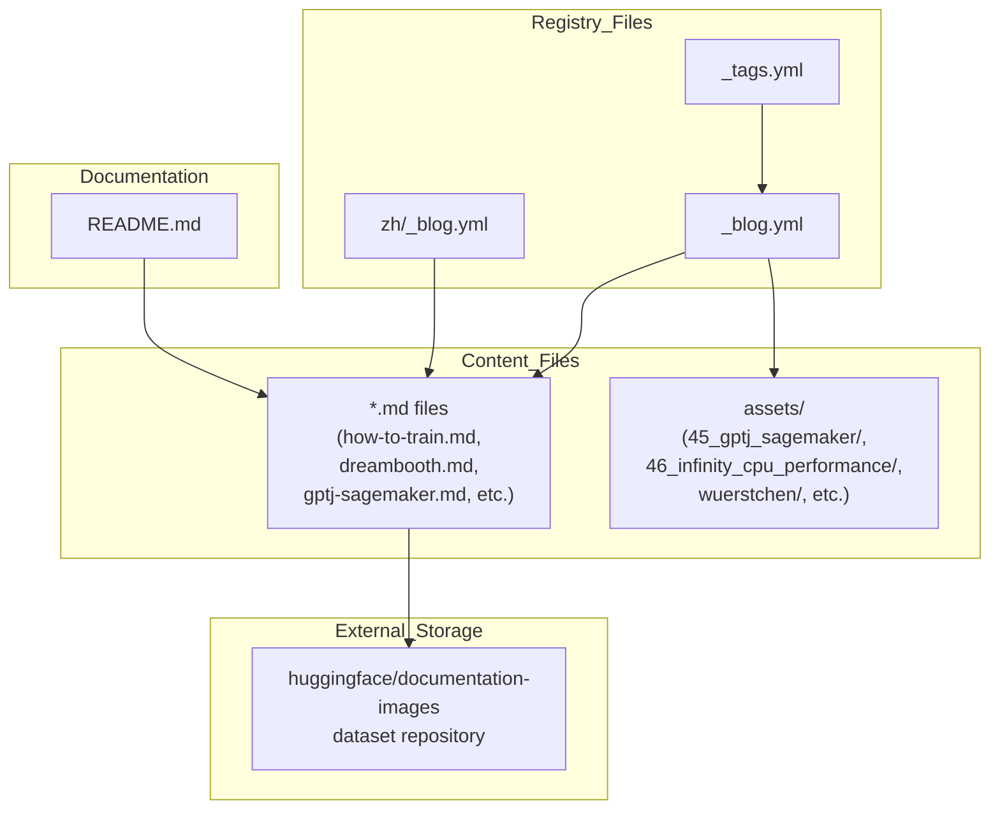
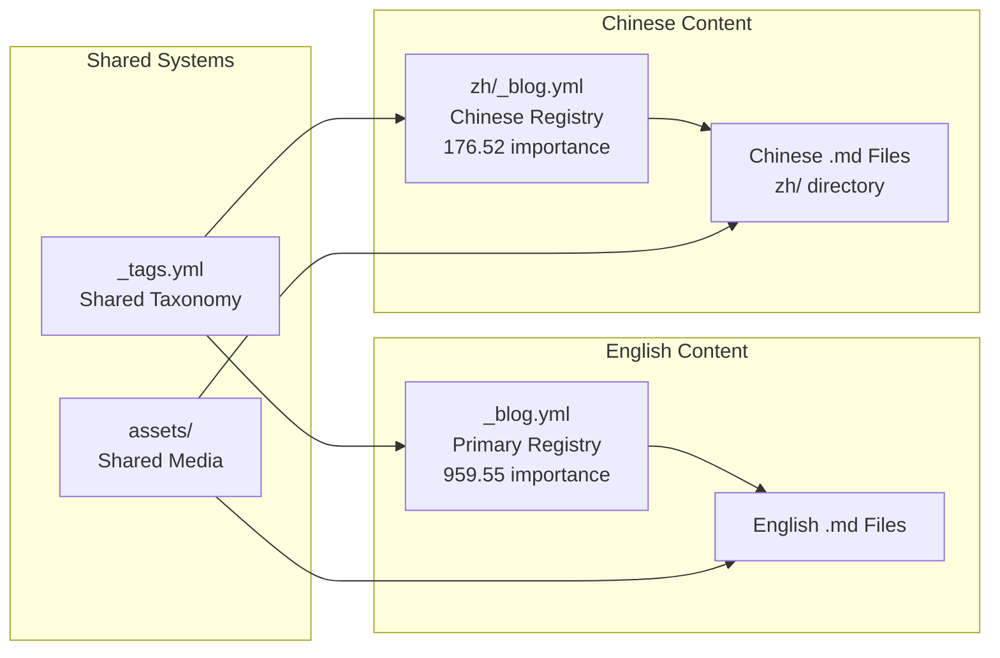

<!-- source: DeepWiki mcp.deepwiki.com · repo huggingface/blog · page 1 Overview · fetched 2026-10-26 -->

# Overview

<details>
<summary>Relevant source files</summary>

The following files were used as context for generating this wiki page:

- [1_58_llm_extreme_quantization.md](1_58_llm_extreme_quantization.md)
- [README.md](README.md)
- [_blog.yml](_blog.yml)
- [_tags.yml](_tags.yml)
- [assets/114_pricing-update/thumbnail.png](assets/114_pricing-update/thumbnail.png)
- [assets/192_pi0/new_thumbnail_pi0.001.png](assets/192_pi0/new_thumbnail_pi0.001.png)
- [assets/193_l2d/lerobot-driver.gif](assets/193_l2d/lerobot-driver.gif)
- [assets/1_58_llm_extreme_quantization/thumbnail.png](assets/1_58_llm_extreme_quantization/thumbnail.png)
- [assets/45_gptj_sagemaker/model_load_time.png](assets/45_gptj_sagemaker/model_load_time.png)
- [assets/45_gptj_sagemaker/thumbnail.png](assets/45_gptj_sagemaker/thumbnail.png)
- [assets/46_infinity_cpu_performance/latency.png](assets/46_infinity_cpu_performance/latency.png)
- [assets/46_infinity_cpu_performance/overview.png](assets/46_infinity_cpu_performance/overview.png)
- [assets/46_infinity_cpu_performance/pipeline.png](assets/46_infinity_cpu_performance/pipeline.png)
- [assets/46_infinity_cpu_performance/throughput.png](assets/46_infinity_cpu_performance/throughput.png)
- [assets/46_infinity_cpu_performance/thumbnail.png](assets/46_infinity_cpu_performance/thumbnail.png)
- [assets/inference-providers/welcome-featherless.jpg](assets/inference-providers/welcome-featherless.jpg)
- [assets/optimum_intel/optimum_openvino_thumbnail.png](assets/optimum_intel/optimum_openvino_thumbnail.png)
- [assets/sd_dreambooth_training/thumbnail.jpg](assets/sd_dreambooth_training/thumbnail.jpg)
- [assets/streaming_datasets/streaming_datasets.png](assets/streaming_datasets/streaming_datasets.png)
- [assets/textquests/thumbnail.gif](assets/textquests/thumbnail.gif)
- [assets/thumbnail-template.svg](assets/thumbnail-template.svg)
- [assets/trl_vlm/thumbnail.png](assets/trl_vlm/thumbnail.png)
- [assets/virustotal/thumbnail.png](assets/virustotal/thumbnail.png)
- [assets/wuerstchen/thumbnail.jpg](assets/wuerstchen/thumbnail.jpg)
- [dreambooth.md](dreambooth.md)
- [gptj-sagemaker.md](gptj-sagemaker.md)
- [inference-providers-featherless.md](inference-providers-featherless.md)
- [infinity-cpu-performance.md](infinity-cpu-performance.md)
- [lerobot-goes-to-driving-school.md](lerobot-goes-to-driving-school.md)
- [openvino-vlm.md](openvino-vlm.md)
- [pi0.md](pi0.md)
- [pricing-update.md](pricing-update.md)
- [streaming-datasets.md](streaming-datasets.md)
- [textquests.md](textquests.md)
- [trl-vlm-alignment.md](trl-vlm-alignment.md)
- [virustotal.md](virustotal.md)

</details>


The Hugging Face blog repository (https://github.com/huggingface/blog) is a YAML-based content management system for publishing technical articles about machine learning. The repository contains markdown files for articles, YAML registries for metadata management, and asset storage for images and media.

The repository manages over 1000 technical blog posts across topics including LLM deployment, VLM training, diffusion models, and hardware optimization. Content is organized through `_blog.yml` (primary registry), `_tags.yml` (taxonomy), and corresponding `.md` files. Publication occurs automatically when pull requests are merged to the main branch.

For content-specific documentation, see [Large Language Models](#2), [Vision Language Models](#3), [Model Training and Optimization](#4), [Model Deployment and Inference](#5), [Specialized Model Types](#6), and [Deep Reinforcement Learning](#7).

## Repository Architecture

The repository consists of YAML configuration files, markdown content files, and asset directories.



Sources: [_blog.yml:1-2500](), [_tags.yml:1-51](), [README.md:1-111](), [gptj-sagemaker.md:1-285](), [dreambooth.md:1-200]()

## Content Registry Structure

`_blog.yml` contains an array of entries with the following structure:

```yaml
- local: how-to-train
  date: February 14, 2020
  tags:
    - guide
    - nlp
```

Each entry maps to a markdown file (`${local}.md`) and optionally an assets directory (`assets/${prefix}_${local}/`).

### YAML Entry Fields

| Field | Type | Example | Description |
|-------|------|---------|-------------|
| `local` | string | `"gptj-sagemaker"` | Filename without .md extension |
| `date` | string | `"January 11, 2022"` | Publication date |
| `tags` | array | `["partnerships", "aws", "guide", "nlp"]` | Tag references from `_tags.yml` |
| `guest` | boolean | `true` | Optional, indicates guest author |
| `thumbnail` | string | Not in YAML | Defined in markdown front matter |

### Markdown Front Matter Structure

```yaml
---
title: "Deploy GPT-J 6B for inference using Hugging Face Transformers and Amazon SageMaker"
thumbnail: /blog/assets/45_gptj_sagemaker/thumbnail.png
authors:
- user: philschmid
---
```

The `local` field in `_blog.yml` must match the filename. For `local: gptj-sagemaker`, the file must be `gptj-sagemaker.md`.

Sources: [_blog.yml:3-11](), [_blog.yml:304-311](), [gptj-sagemaker.md:1-7](), [README.md:19-35]()

## Publication Workflow

The publication process requires five steps:

1. **Branch Creation**: Create a branch with format `YourName/Title`
2. **File Creation**: Create `${local}.md` file with markdown content
3. **Asset Creation**: Create `assets/${local}/` directory with thumbnail image
4. **Registry Update**: Add entry to `_blog.yml` with `local`, `date`, and `tags` fields
5. **Pull Request**: Open PR, which triggers automatic publication on merge

### File Creation Example

For an article with `local: gptj-sagemaker`:
- Create file: `gptj-sagemaker.md`
- Create directory: `assets/45_gptj_sagemaker/`
- Add thumbnail: `assets/45_gptj_sagemaker/thumbnail.png`
- Update `_blog.yml`:
  ```yaml
  - local: gptj-sagemaker
    date: January 11, 2022
    tags:
      - partnerships
      - aws
      - guide
      - nlp
  ```

The numerical prefix (e.g., `45_`) in asset directories is optional and used for rough ordering.

### Hub Integration

Upon merge, the article is automatically published to `https://huggingface.co/blog/${local}`. For example, `local: gptj-sagemaker` publishes to `https://huggingface.co/blog/gptj-sagemaker`.

The Hub automatically inserts UI elements after the first `<h1>` tag:
- Publication date
- "Update on GitHub" button
- Author avatars (from `authors` field in front matter)

Sources: [README.md:6-49](), [_blog.yml:304-311](), [gptj-sagemaker.md:1-7]()

## Asset Management

Assets are split between local storage (thumbnails) and external storage (content images).

### Local Assets (Thumbnails Only)

Thumbnails are stored in `assets/${prefix}_${local}/thumbnail.{png,jpg,gif}` and referenced in markdown front matter:

```yaml
thumbnail: /blog/assets/45_gptj_sagemaker/thumbnail.png
```

Images should be compressed using https://tinypng.com or https://www.iloveimg.com/compress-image.

### External Assets (Content Images)

Content images are stored in the `huggingface/documentation-images` dataset repository to reduce repository bloat. The folder structure mirrors the blog repository:

- Blog repo: `assets/192_pi0/`
- Documentation images: `huggingface/documentation-images/resolve/main/blog/192_pi0/`

Example reference in markdown:
```markdown

```

### Thumbnail Generation

Recommended thumbnail size: `1300x650` pixels. Templates:
- SVG template: `assets/thumbnail-template.svg`
- Figma template: https://www.figma.com/file/sXrf9VtkkbWI7kCIesMkDY/HF-Blog-Template

Sources: [README.md:12-18](), [README.md:51-56](), [pi0.md:1-10](), [gptj-sagemaker.md:2]()

## Content Taxonomy

`_tags.yml` defines allowed tag values and their display labels:

```yaml
- value: community
  label: community

- value: guide
  label: guide

- value: nlp
  label: NLP
```

### Complete Tag List

| Tag Value | Display Label | Common Use Cases |
|-----------|--------------|------------------|
| `community` | community | Community events, contributor highlights |
| `guide` | guide | Tutorials, how-to articles |
| `open-source-collab` | open source collab | Library integrations, partnerships |
| `partnerships` | partnerships | Commercial partnerships (AWS, Intel, etc.) |
| `research` | research | Research paper summaries |
| `nlp` | NLP | Natural language processing |
| `audio` | Audio | Speech recognition, TTS |
| `cv` | CV | Computer vision |
| `rl` | RL | Reinforcement learning |
| `ethics` | ethics | AI safety, responsible AI |
| `diffusion` | Diffusion | Diffusion models (Stable Diffusion, etc.) |
| `game-dev` | Game Development | Unity integration, game AI |
| `rlhf` | RLHF | RLHF training techniques |
| `leaderboard` | Leaderboard | Model evaluation leaderboards |
| `case-studies` | Case Studies | Industry use cases |
| `lerobot` | LeRobot | Robotics (LeRobot ecosystem) |
| `inference-providers` | Inference Providers | Inference optimization |

Tags in `_blog.yml` entries must reference values defined in `_tags.yml`.

Sources: [_tags.yml:1-51](), [_blog.yml:5-10](), [_blog.yml:304-311]()

## Multilingual Content Support

The repository supports internationalization through separate content registries for different languages.



The multilingual system maintains separate registries while sharing common resources like assets and taxonomy definitions.

Sources: [_blog.yml:1](), [zh/_blog.yml]() (referenced in architecture diagrams)

---

