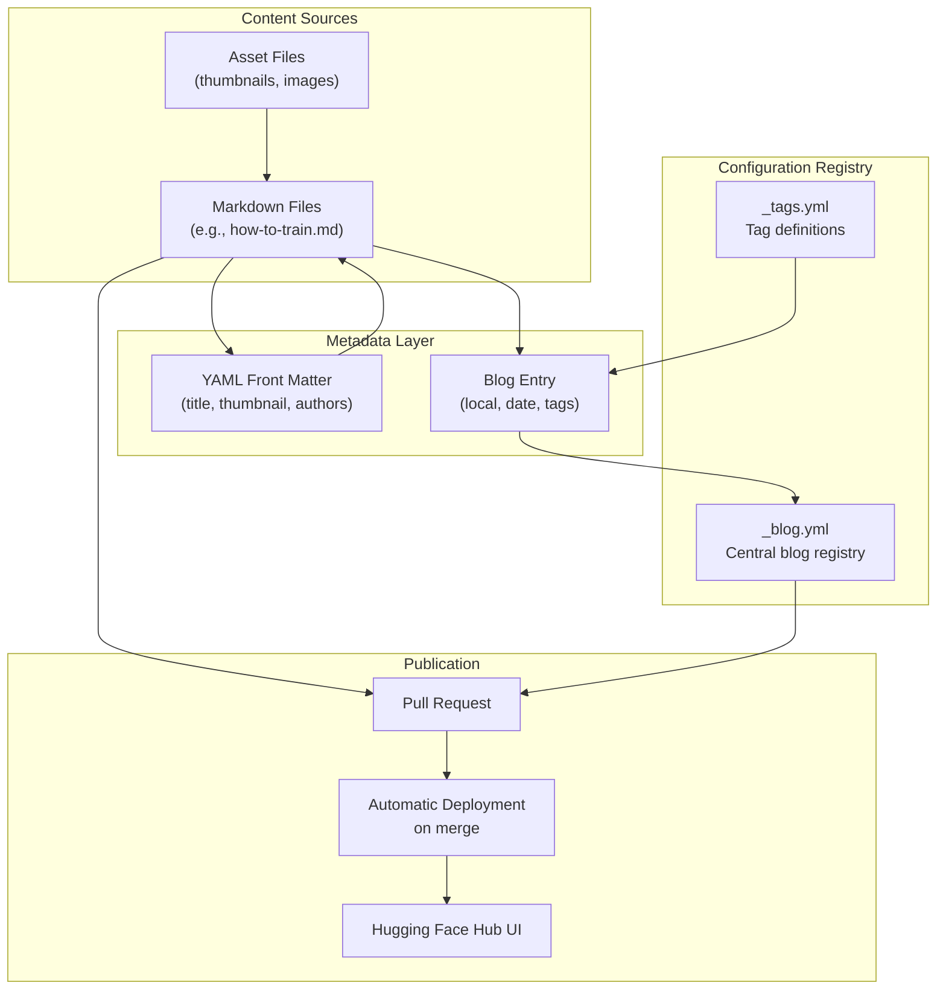
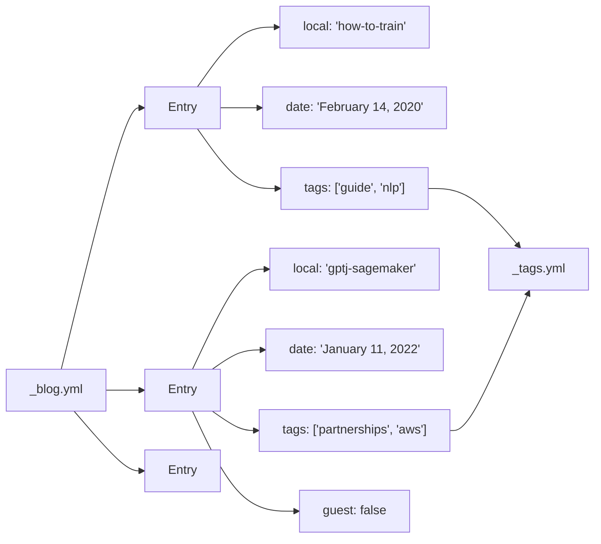
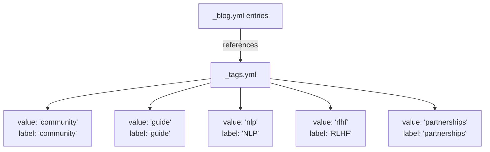
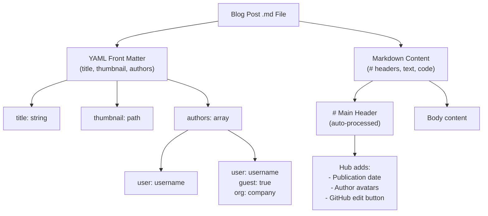
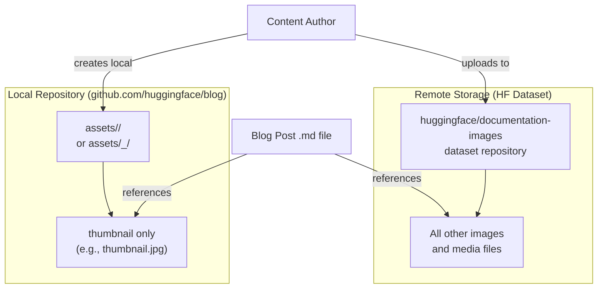
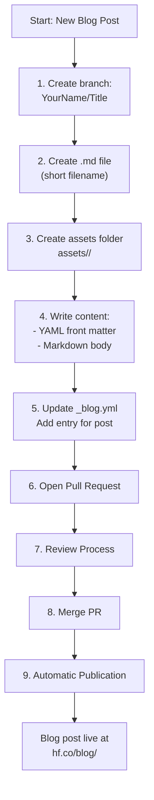
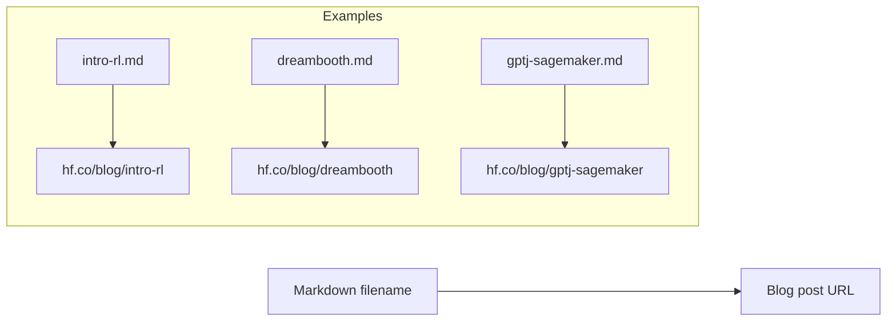
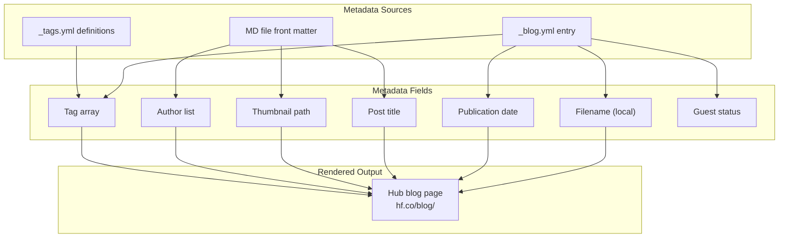
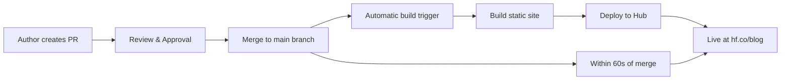

<!-- source: DeepWiki mcp.deepwiki.com · repo huggingface/blog · page 1.1 Blog System Architecture · fetched 2026-10-26 -->

# Blog System Architecture

<details>
<summary>Relevant source files</summary>

The following files were used as context for generating this wiki page:

- [1_58_llm_extreme_quantization.md](1_58_llm_extreme_quantization.md)
- [README.md](README.md)
- [_blog.yml](_blog.yml)
- [_tags.yml](_tags.yml)
- [assets/114_pricing-update/thumbnail.png](assets/114_pricing-update/thumbnail.png)
- [assets/192_pi0/new_thumbnail_pi0.001.png](assets/192_pi0/new_thumbnail_pi0.001.png)
- [assets/193_l2d/lerobot-driver.gif](assets/193_l2d/lerobot-driver.gif)
- [assets/1_58_llm_extreme_quantization/thumbnail.png](assets/1_58_llm_extreme_quantization/thumbnail.png)
- [assets/45_gptj_sagemaker/model_load_time.png](assets/45_gptj_sagemaker/model_load_time.png)
- [assets/45_gptj_sagemaker/thumbnail.png](assets/45_gptj_sagemaker/thumbnail.png)
- [assets/46_infinity_cpu_performance/latency.png](assets/46_infinity_cpu_performance/latency.png)
- [assets/46_infinity_cpu_performance/overview.png](assets/46_infinity_cpu_performance/overview.png)
- [assets/46_infinity_cpu_performance/pipeline.png](assets/46_infinity_cpu_performance/pipeline.png)
- [assets/46_infinity_cpu_performance/throughput.png](assets/46_infinity_cpu_performance/throughput.png)
- [assets/46_infinity_cpu_performance/thumbnail.png](assets/46_infinity_cpu_performance/thumbnail.png)
- [assets/inference-providers/welcome-featherless.jpg](assets/inference-providers/welcome-featherless.jpg)
- [assets/optimum_intel/optimum_openvino_thumbnail.png](assets/optimum_intel/optimum_openvino_thumbnail.png)
- [assets/sd_dreambooth_training/thumbnail.jpg](assets/sd_dreambooth_training/thumbnail.jpg)
- [assets/streaming_datasets/streaming_datasets.png](assets/streaming_datasets/streaming_datasets.png)
- [assets/textquests/thumbnail.gif](assets/textquests/thumbnail.gif)
- [assets/thumbnail-template.svg](assets/thumbnail-template.svg)
- [assets/trl_vlm/thumbnail.png](assets/trl_vlm/thumbnail.png)
- [assets/virustotal/thumbnail.png](assets/virustotal/thumbnail.png)
- [assets/wuerstchen/thumbnail.jpg](assets/wuerstchen/thumbnail.jpg)
- [dreambooth.md](dreambooth.md)
- [gptj-sagemaker.md](gptj-sagemaker.md)
- [inference-providers-featherless.md](inference-providers-featherless.md)
- [infinity-cpu-performance.md](infinity-cpu-performance.md)
- [lerobot-goes-to-driving-school.md](lerobot-goes-to-driving-school.md)
- [openvino-vlm.md](openvino-vlm.md)
- [pi0.md](pi0.md)
- [pricing-update.md](pricing-update.md)
- [streaming-datasets.md](streaming-datasets.md)
- [textquests.md](textquests.md)
- [trl-vlm-alignment.md](trl-vlm-alignment.md)
- [virustotal.md](virustotal.md)

</details>


This document describes the technical architecture of the Hugging Face blog content management system, including the file-based structure, metadata organization, asset management, and publication workflow. The blog system is built around YAML configuration files (`_blog.yml`, `_tags.yml`) and Markdown content files that together form a version-controlled, static-site-friendly blog platform.

For information about contributing content to the blog, see [Contributing to the Blog](#1.2).

## System Overview

The blog system operates as a file-based content management system where blog posts are authored as Markdown files with YAML front matter, registered in a central `_blog.yml` configuration file, and categorized using tags defined in `_tags.yml`. The system is designed to be simple, version-controlled, and automatically deployed through GitHub workflows.



Sources: [_blog.yml:1-8000](), [README.md:1-111](), [_tags.yml:1-51]()

## Core Configuration Files

### _blog.yml: Central Blog Registry

The `_blog.yml` file serves as the master index of all blog posts in the repository. Each entry in this YAML file represents a single blog post and contains metadata that complements the post's front matter.

**Structure:**

Each blog entry in `_blog.yml` follows this schema:

- `local`: The filename of the markdown file (without `.md` extension)
- `date`: Publication date
- `tags`: Array of tag values (references `_tags.yml`)
- `guest` (optional): Boolean indicating guest post
- `thumbnail` (optional): Can be overridden here



**Example entries:**

```yaml
- local: how-to-train
  date: February 14, 2020
  tags:
    - guide
    - nlp

- local: gptj-sagemaker
  date: January 11, 2022
  tags:
    - partnerships
    - aws
    - guide
    - nlp
```

Sources: [_blog.yml:1-100](), [_blog.yml:304-311]()

### _tags.yml: Tag Taxonomy

The `_tags.yml` file defines all available tags that can be applied to blog posts. Each tag has a `value` (used in `_blog.yml`) and a `label` (displayed in the UI).

**Tag Structure:**

| Field | Description | Example |
|-------|-------------|---------|
| `value` | Internal identifier used in `_blog.yml` | `"rlhf"` |
| `label` | Display label shown to users | `"RLHF"` |



**Common tag categories:**

- **Content Type**: `guide`, `research`, `case-studies`, `announcement`
- **Technical Domain**: `nlp`, `audio`, `cv` (computer vision), `rl` (reinforcement learning), `diffusion`
- **Collaboration**: `community`, `open-source-collab`, `partnerships`
- **Specific Topics**: `rlhf`, `game-dev`, `leaderboard`, `inference-providers`
- **Ethics**: `ethics`

Sources: [_tags.yml:1-51]()

## Markdown File Structure

### YAML Front Matter

Every blog post markdown file begins with YAML front matter enclosed in triple dashes (`---`). This metadata is essential for the Hub to display the post correctly.

**Required fields:**

| Field | Description | Example |
|-------|-------------|---------|
| `title` | Post title displayed at the top | `"Training Stable Diffusion with Dreambooth"` |
| `thumbnail` | Path to thumbnail image | `"/blog/assets/sd_dreambooth_training/thumbnail.jpg"` |
| `authors` | Array of author objects with `user` field | `[{user: "valhalla"}, {user: "pcuenq"}]` |

**Optional fields:**

- `guest`: Boolean for guest authors (also can use `org` field in author object)



**Example from dreambooth.md:**

```yaml
---
title: Training Stable Diffusion with Dreambooth using Diffusers
thumbnail: /blog/assets/sd_dreambooth_training/thumbnail.jpg
authors:
- user: valhalla
- user: pcuenq
- user: 9of9
  guest: true
---

# Training Stable Diffusion with Dreambooth using 🧨 Diffusers

[Content begins here...]
```

The Hub automatically inserts UI elements after the main header (`# Training Stable Diffusion...`):
- Publication date ("Published on [date]")
- "Update on GitHub" button
- Author avatars

Sources: [README.md:19-42](), [dreambooth.md:1-10](), [trl-vlm-alignment.md:1-10]()

## Asset Management

### Two-Tier Storage Strategy

The blog uses a split storage approach to balance repository size with asset accessibility:



**Local asset folder structure:**

1. Create folder: `assets/<post-name>/` or optionally `assets/<number>_<post-name>/`
   - The numeric prefix is optional and used for rough ordering
   - Example: `assets/sd_dreambooth_training/` or `assets/123_intro-rl/`

2. Store **only the thumbnail** in this folder
   - This keeps the git repository lean
   - Example: `assets/sd_dreambooth_training/thumbnail.jpg`

**Remote asset storage:**

1. All other images go to: `https://huggingface.co/datasets/huggingface/documentation-images/tree/main/blog/<post-name>/`
2. Benefits:
   - Reduces repository bloat for cloning/pulling
   - Centralized image hosting
   - Easier to manage large media files

**Asset optimization requirements:**

Images should be compressed to ensure fast page loading:
- Use https://tinypng.com or https://www.iloveimg.com/compress-image
- Keep file sizes small

Sources: [README.md:12-17](), [dreambooth.md:2](), [gptj-sagemaker.md:2]()

## Content Creation Workflow

### Branch-Based Contribution Model

The blog follows a standard Git workflow with branch-based development and pull request reviews:



**Step-by-step process:**

1. **Create branch**: `YourName/Title` format
   - Example: `john/introducing-dreambooth`

2. **Create markdown file** with short, URL-friendly name
   - Filename becomes the URL path
   - Example: `intro-rl.md` → `hf.co/blog/intro-rl`

3. **Create asset folder**: `assets/<post-name>/`
   - Optional numeric prefix: `assets/123_intro-rl/`
   - Upload thumbnail to this folder
   - Upload other images to HuggingFace documentation-images dataset

4. **Write content**:
   - Add YAML front matter with title, thumbnail, authors
   - Write markdown content starting with `# Main Header`

5. **Update `_blog.yml`**:
   - Add entry with `local`, `date`, `tags` fields
   - Ensure tags exist in `_tags.yml`

6. **Open pull request** for review

7. **Automatic deployment** occurs when PR is merged

Sources: [README.md:6-49]()

### File Naming Conventions



**Guidelines:**
- Use short, descriptive names
- Use hyphens for word separation
- Avoid spaces and special characters
- The filename is permanent (becomes the URL)

Sources: [README.md:9-10]()

## Metadata Schema Relationships

The blog system uses three sources of metadata that work together:



**Metadata Resolution:**

| Field | Primary Source | Secondary Source | Usage |
|-------|---------------|------------------|--------|
| Filename | `_blog.yml` (`local`) | N/A | URL path generation |
| Publication Date | `_blog.yml` (`date`) | N/A | "Published on" display |
| Title | MD front matter (`title`) | N/A | Page header, meta tags |
| Thumbnail | MD front matter (`thumbnail`) | Can override in `_blog.yml` | Social sharing, preview |
| Authors | MD front matter (`authors`) | N/A | Author avatars, attribution |
| Tags | `_blog.yml` (`tags`) | Validated against `_tags.yml` | Categorization, filtering |
| Guest Status | `_blog.yml` (`guest`) or MD author object | N/A | Attribution display |

Sources: [_blog.yml:1-100](), [README.md:19-42](), [_tags.yml:1-51]()

## Content Formatting Features

### LaTeX Support

Mathematical expressions can be included using LaTeX notation wrapped in `\\(` and `\\)`:

```markdown
\\( Q(S_t, A_t) \\)
```

This renders as: Q(S_t, A_t)

Sources: [README.md:59-70]()

### Figure Captions

Two methods are supported for captioning figures:

**Method 1: Markdown tables**
```markdown
|  |
|:--:|
| *Figure caption text* |
```

**Method 2: HTML**
```html
<figure>
  
  <figcaption>Figure caption text</figcaption>
</figure>
```

Sources: [README.md:72-77]()

### Highlight Boxes

Special highlight boxes can be used sparingly for important notes:

```html
<div style="background-color: #e6f9e6; padding: 16px 32px; outline: 2px solid; border-radius: 10px;">
  Important note content here
</div>
```

Sources: [README.md:79-81](), [infinity-cpu-performance.md:15-23]()

### Embedding Spaces

Hugging Face Spaces can be embedded directly in blog posts using a Gradio script tag:

```html
<script
	type="module"
	src="https://gradio.s3-us-west-2.amazonaws.com/4.36.1/gradio.js"
></script>

<gradio-app theme_mode="light" space="derek-thomas/hugging-face-blog-assistant"></gradio-app>
```

Sources: [README.md:83-97]()

## Publication Workflow

### Automatic Deployment Pipeline



**Key characteristics:**

1. **Automatic**: No manual deployment steps required
2. **Merge-triggered**: Publication happens automatically on PR merge
3. **Version controlled**: All changes tracked in Git history
4. **Rollback capable**: Can revert via Git if needed

Sources: [README.md:47-49]()

### Content Review Tools

The blog system provides tools to help with content creation:

**Community Blog Editor**
- URL: `https://huggingface.co/new-blog`
- Features: Preview function for markdown rendering
- Use case: Draft and preview posts before committing

**Blog Assistant Space**
- URL: `https://huggingface.co/spaces/derek-thomas/hugging-face-blog-assistant`
- Features: 
  - Caption figure formatting
  - Tip formatting helpers
  - Clickable reference insertion

Sources: [README.md:99-109]()

## Tag Taxonomy and Organization

### Tag Categories

The blog uses a structured tag taxonomy to organize content:

```mermaid
graph TB
    Tags["Blog Tags (_tags.yml)"]
    
    Tags --> Type["Content Type"]
    Tags --> Domain["Technical Domain"]
    Tags --> Collab["Collaboration Type"]
    Tags --> Special["Specialized Topics"]
    
    Type --> Guide["guide"]
    Type --> Research["research"]
    Type --> CaseStudy["case-studies"]
    Type --> Announce["announcement"]
    
    Domain --> NLP["nlp (NLP)"]
    Domain --> Audio["audio (Audio)"]
    Domain --> CV["cv (CV)"]
    Domain --> RL["rl (RL)"]
    Domain --> Diff["diffusion (Diffusion)"]
    
    Collab --> Community["community"]
    Collab --> OpenSource["open-source-collab"]
    Collab --> Partner["partnerships"]
    
    Special --> RLHF["rlhf (RLHF)"]
    Special --> GameDev["game-dev (Game Development)"]
    Special --> Leaderboard["leaderboard (Leaderboard)"]
    Special --> Ethics["ethics"]
    Special --> LeRobot["lerobot (LeRobot)"]
```



**Tag usage examples:**

| Post Type | Typical Tags | Example |
|-----------|-------------|---------|
| Tutorial | `guide`, domain tag | `["guide", "nlp"]` |
| Research announcement | `research`, domain tags | `["research", "cv", "multimodal"]` |
| Partnership | `partnerships`, company tag, domain | `["partnerships", "aws", "nlp"]` |
| Case study | `case-studies` | `["case-studies"]` |
| Community content | `community`, `open-source-collab` | `["community", "research"]` |

Sources: [_tags.yml:1-51](), [_blog.yml:3-7](), [_blog.yml:304-311]()

## Historical Evolution

### Post Volume and Growth

The `_blog.yml` file contains over 2,000 entries spanning from February 2020 to present, showing the blog's growth trajectory:

**Early posts (2020)**:
- Focus on foundational guides (`how-to-train`, `how-to-generate`)
- Introduction of key concepts like Reformer, encoder-decoder architectures

**Partnership expansion (2021-2022)**:
- AWS SageMaker integration posts
- Intel hardware optimization guides
- Cloud provider collaborations (GCP, Azure)

**Model evolution (2022-2023)**:
- Diffusion models (Stable Diffusion, Dreambooth)
- Large language models (GPT-J, BLOOM)
- Quantization techniques (8-bit, 4-bit)

**Recent focus (2024-2025)**:
- Vision-language models (VLMs)
- Extreme quantization (1.58-bit models)
- Robotics foundation models (π0, LeRobot)
- Streaming datasets optimization

Sources: [_blog.yml:1-100](), [_blog.yml:2000-2400]()

## Summary

The Hugging Face blog system architecture is a file-based, version-controlled content management system built on:

1. **Configuration files**: `_blog.yml` (master registry) and `_tags.yml` (tag taxonomy)
2. **Content files**: Markdown with YAML front matter
3. **Asset management**: Split storage (local thumbnails, remote full assets)
4. **Publication workflow**: Branch-based Git workflow with automatic deployment
5. **Metadata schema**: Coordinated data across YAML files and front matter

This architecture enables distributed content creation while maintaining consistency through version control and automated validation.

Sources: [_blog.yml:1-8000](), [_tags.yml:1-51](), [README.md:1-111]()

---

