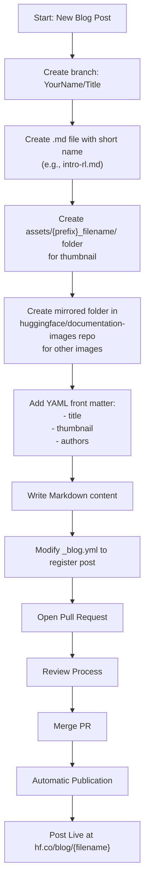
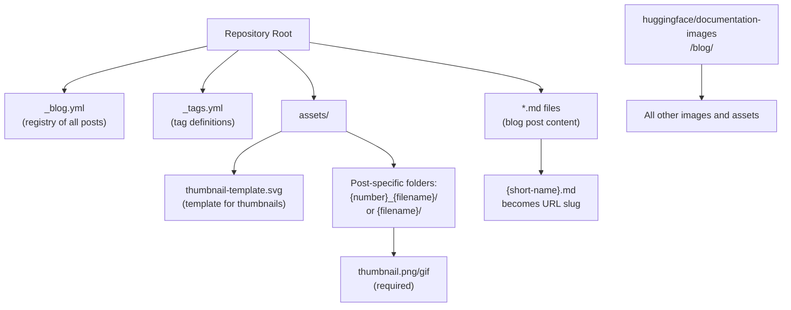
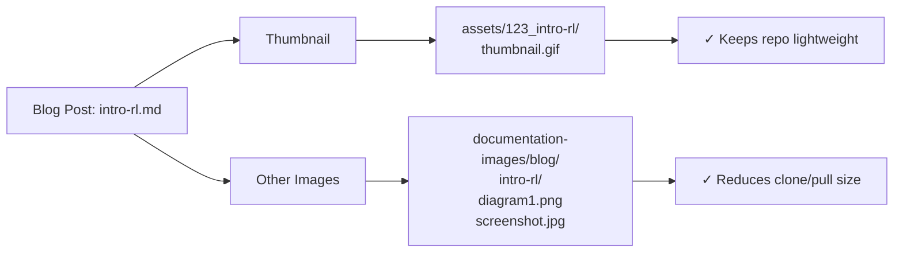
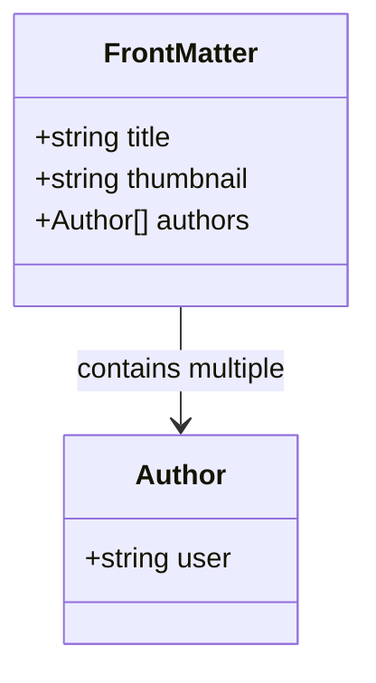
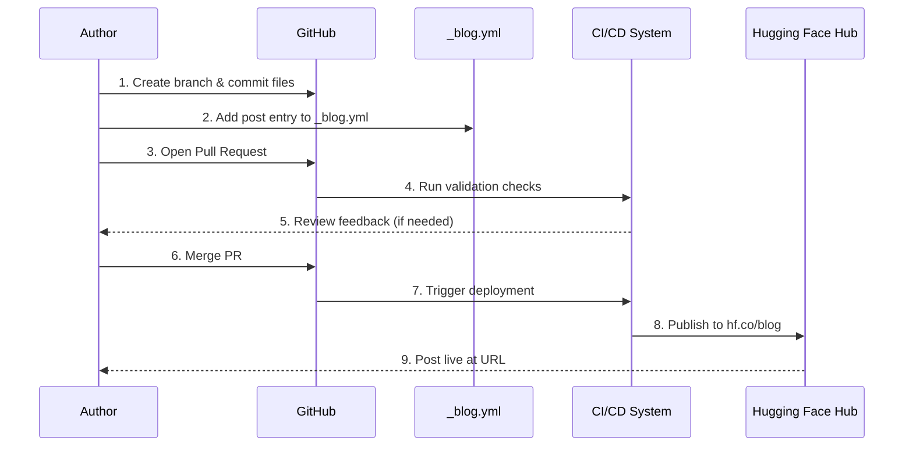

<!-- source: DeepWiki mcp.deepwiki.com · repo huggingface/blog · page 1.2 Contributing to the Blog · fetched 2026-10-26 -->

# Contributing to the Blog

<details>
<summary>Relevant source files</summary>

The following files were used as context for generating this wiki page:

- [README.md](README.md)
- [assets/114_pricing-update/thumbnail.png](assets/114_pricing-update/thumbnail.png)
- [assets/45_gptj_sagemaker/model_load_time.png](assets/45_gptj_sagemaker/model_load_time.png)
- [assets/45_gptj_sagemaker/thumbnail.png](assets/45_gptj_sagemaker/thumbnail.png)
- [assets/46_infinity_cpu_performance/latency.png](assets/46_infinity_cpu_performance/latency.png)
- [assets/46_infinity_cpu_performance/overview.png](assets/46_infinity_cpu_performance/overview.png)
- [assets/46_infinity_cpu_performance/pipeline.png](assets/46_infinity_cpu_performance/pipeline.png)
- [assets/46_infinity_cpu_performance/throughput.png](assets/46_infinity_cpu_performance/throughput.png)
- [assets/46_infinity_cpu_performance/thumbnail.png](assets/46_infinity_cpu_performance/thumbnail.png)
- [assets/thumbnail-template.svg](assets/thumbnail-template.svg)
- [gptj-sagemaker.md](gptj-sagemaker.md)
- [infinity-cpu-performance.md](infinity-cpu-performance.md)
- [pricing-update.md](pricing-update.md)

</details>


## Purpose and Scope

This document provides technical guidance for contributing blog posts to the Hugging Face blog repository. It covers the branch-based workflow, file structure conventions, Markdown authoring requirements, YAML front matter configuration, asset management, and the pull request process that results in automatic publication.

**Note**: External contributors should consider creating a [community blog](https://huggingface.co/blog-explorers) instead of submitting to this repository. Community blog posts appear on the main blog page alongside official posts. This repository is primarily for collaboration posts with Hugging Face.

For information about the blog infrastructure and metadata management, see [Blog System Architecture](#1.1).

---

## Contribution Workflow

The blog contribution process follows a Git-based workflow with specific conventions for file naming, asset organization, and metadata configuration.

**Workflow: Blog Post Creation and Publication**



Sources: [README.md:1-111]()

---

## Repository File Structure

The repository organizes blog posts, assets, and metadata using a specific directory structure.

**File Organization**



**Key File Types:**
- **Markdown files**: Blog post content (e.g., `gptj-sagemaker.md`, `infinity-cpu-performance.md`)
- **`_blog.yml`**: Central registry that controls post visibility and ordering
- **`assets/{folder}/`**: Contains thumbnail images only
- **External repo**: All non-thumbnail images stored in `huggingface/documentation-images`

Sources: [README.md:9-14](), [gptj-sagemaker.md:1-285](), [infinity-cpu-performance.md:1-171]()

---

## Creating a Blog Post

### Step 1: Branch Creation

Create a descriptive branch following the naming convention:

```
YourName/Title
```

Example: `john/deep-rl-tutorial`

Sources: [README.md:7]()

### Step 2: File Naming

Create a Markdown file with a **short, URL-friendly name**. This name becomes the blog post URL.

| File Name | Resulting URL |
|-----------|---------------|
| `intro-rl.md` | `https://hf.co/blog/intro-rl` |
| `gptj-sagemaker.md` | `https://hf.co/blog/gptj-sagemaker` |
| `infinity-cpu-performance.md` | `https://hf.co/blog/infinity-cpu-performance` |

Sources: [README.md:9-10]()

### Step 3: Asset Management

**Asset Organization Strategy**



**Thumbnail Storage** (in this repository):
1. Create folder: `assets/{optional-number}_{filename}/`
2. Place thumbnail image (1300×650 recommended)
3. Reference in front matter: `/blog/assets/{folder}/thumbnail.{ext}`

**Other Images** (external repository):
1. Create mirrored folder in `huggingface/documentation-images/tree/main/blog/`
2. Upload all non-thumbnail images there
3. Reference using full URL or repository path

**Image Optimization**: Use compressed images (try [tinypng.com](https://tinypng.com) or [iloveimg.com](https://www.iloveimg.com/compress-image)) to ensure fast page loading.

Sources: [README.md:12-17]()

### Step 4: YAML Front Matter Structure

Every blog post must begin with YAML front matter enclosed in `---` delimiters.

**Front Matter Schema**



**Example Configuration:**

```yaml
---
title: "Deploy GPT-J 6B for inference using Hugging Face Transformers and Amazon SageMaker" 
thumbnail: /blog/assets/45_gptj_sagemaker/thumbnail.png
authors:
- user: philschmid
- user: jeffboudier
---
```

**Field Specifications:**

| Field | Type | Required | Description |
|-------|------|----------|-------------|
| `title` | string | Yes | Post title (appears in H1) |
| `thumbnail` | string | Yes | Path to thumbnail image |
| `authors` | array | Yes | List of author objects with `user` field |

**Author Rendering**: The Hub automatically inserts after the main header (`# Title`):
- Publication date
- "Update on GitHub" button  
- Author avatars from the `authors` list

Sources: [README.md:19-41](), [gptj-sagemaker.md:1-6](), [infinity-cpu-performance.md:1-8](), [pricing-update.md:1-7]()

### Step 5: Content Authoring

Write content using standard Markdown. The system supports:

**Basic Markdown**: Headings, lists, links, images, code blocks, tables, etc.

**Copy-Paste from Notion**: Use `Ctrl+Shift+V` to paste as Markdown.

Sources: [README.md:43]()

---

## Advanced Content Features

### LaTeX Mathematical Expressions

Inline LaTeX using escaped parentheses syntax:

```
\\(Q(S_t, A_t)\\)
```

Renders as: $Q(S_t, A_t)$

Sources: [README.md:59-70]()

### Figure Captions

**Method 1: Markdown Table**

```markdown
|  |
|:--:|
| *Figure caption text* |
```

**Method 2: HTML**

```html
<figure class="image table text-center m-0 w-full">
  <medium-zoom background="rgba(0,0,0,.7)" alt="Description" src="path/to/image.png"></medium-zoom>
  <figcaption>Figure 1. Caption text</figcaption>
</figure>
```

Sources: [README.md:72-77](), [gptj-sagemaker.md:59-63](), [infinity-cpu-performance.md:46-49]()

### Highlight Boxes

Special emphasis boxes for important notes (use sparingly):

```html
<div style="background-color: #e6f9e6; padding: 16px 32px; outline: 2px solid; border-radius: 10px;">
  Important note text here.
</div>
```

Sources: [README.md:79-81](), [infinity-cpu-performance.md:15-23]()

### Embedding Hugging Face Spaces

Embed interactive Gradio apps directly in posts:

```html
<script
	type="module"
	src="https://gradio.s3-us-west-2.amazonaws.com/4.36.1/gradio.js"
></script>

<gradio-app theme_mode="light" space="derek-thomas/hugging-face-blog-assistant"></gradio-app>
```

Sources: [README.md:83-97]()

---

## Publishing Process

**Publication Pipeline**



**Critical Steps:**

1. **Modify `_blog.yml`**: Add entry for your post to register it in the system
2. **Open Pull Request**: Initiates review process
3. **Merge = Publish**: Merging the PR **automatically publishes** the post

**Post-Publication URL**: `https://huggingface.co/blog/{filename-without-md}`

Sources: [README.md:45-49]()

---

## Helper Tools and Resources

### Thumbnail Template

Use the provided SVG template to create consistent thumbnails:

**Template Location**: `assets/thumbnail-template.svg`

**Recommended Dimensions**: 1300×650 pixels

**Alternative**: [Figma template](https://www.figma.com/file/sXrf9VtkkbWI7kCIesMkDY/HF-Blog-Template?node-id=351%3A39)

Sources: [README.md:51-56](), [assets/thumbnail-template.svg:1-12]()

### Community Blog Editor

Preview your Markdown before submitting:

**Tool**: [https://huggingface.co/new-blog](https://huggingface.co/new-blog)

**Features**: 
- Live preview function
- WYSIWYG editing
- Proper rendering of custom elements

Sources: [README.md:101]()

### Blog Assistant Space

Helper tool for generating common Markdown patterns:

**Tool**: [https://huggingface.co/spaces/derek-thomas/hugging-face-blog-assistant](https://huggingface.co/spaces/derek-thomas/hugging-face-blog-assistant)

**Capabilities**:
- Insert caption figures with image tables
- Format tip boxes
- Generate clickable references

Sources: [README.md:103-109]()

---

## Summary Checklist

Before opening a pull request, verify:

- [ ] Branch created with `YourName/Title` naming
- [ ] Markdown file created with short, URL-friendly name
- [ ] Thumbnail created and placed in `assets/{folder}/`
- [ ] Other images uploaded to `documentation-images` repo
- [ ] Images compressed for web performance
- [ ] YAML front matter complete (`title`, `thumbnail`, `authors`)
- [ ] Content written in Markdown
- [ ] Entry added to `_blog.yml`
- [ ] Pull request opened
- [ ] Ready for automatic publication upon merge

Sources: [README.md:1-111]()

---

