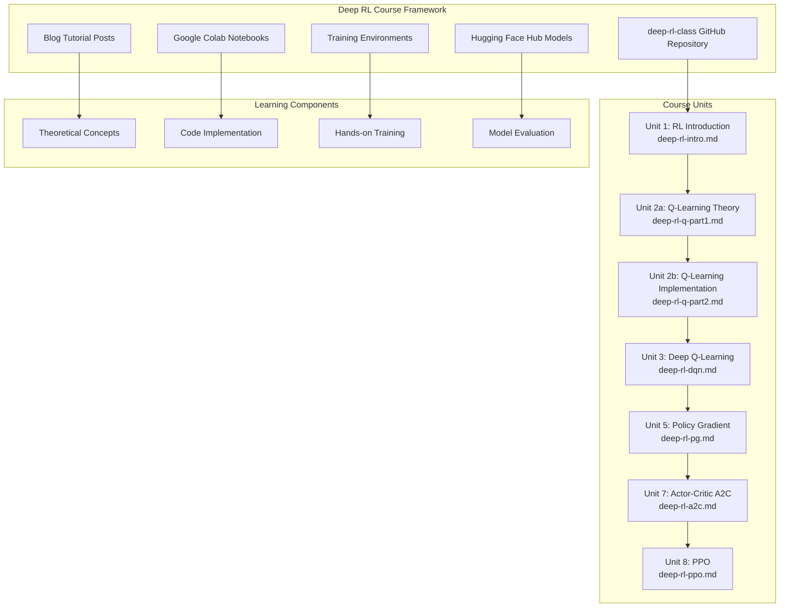
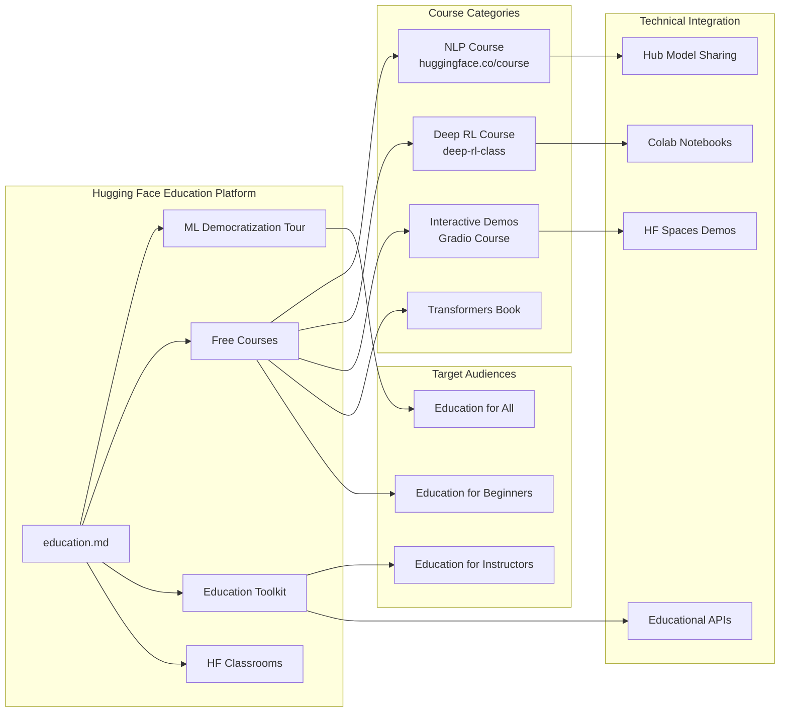
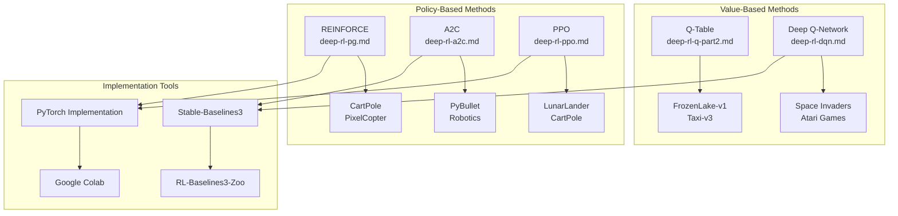
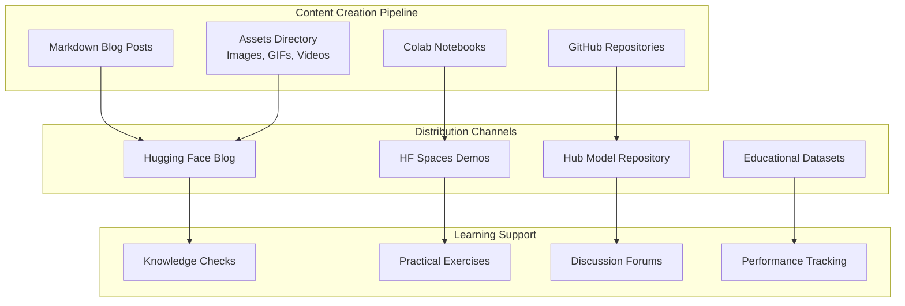

<!-- source: DeepWiki mcp.deepwiki.com · repo huggingface/blog · page 10 Educational Resources · fetched 2026-10-26 -->

# Educational Resources

<details>
<summary>Relevant source files</summary>

The following files were used as context for generating this wiki page:

- [1_58_llm_extreme_quantization.md](1_58_llm_extreme_quantization.md)
- [_blog.yml](_blog.yml)
- [_tags.yml](_tags.yml)
- [assets/192_pi0/new_thumbnail_pi0.001.png](assets/192_pi0/new_thumbnail_pi0.001.png)
- [assets/193_l2d/lerobot-driver.gif](assets/193_l2d/lerobot-driver.gif)
- [assets/1_58_llm_extreme_quantization/thumbnail.png](assets/1_58_llm_extreme_quantization/thumbnail.png)
- [assets/63_deep_rl_intro/tasks.jpg](assets/63_deep_rl_intro/tasks.jpg)
- [assets/70_deep_rl_q_part1/bellman6.jpg](assets/70_deep_rl_q_part1/bellman6.jpg)
- [assets/78_ml_director_insights/witty-works.png](assets/78_ml_director_insights/witty-works.png)
- [assets/86_bloom/bloom-examples.jpg](assets/86_bloom/bloom-examples.jpg)
- [assets/controlnet/thumbnail.png](assets/controlnet/thumbnail.png)
- [assets/cosmopedia/thumbnail.png](assets/cosmopedia/thumbnail.png)
- [assets/inference-providers/welcome-featherless.jpg](assets/inference-providers/welcome-featherless.jpg)
- [assets/optimum_intel/optimum_openvino_thumbnail.png](assets/optimum_intel/optimum_openvino_thumbnail.png)
- [assets/sd_dreambooth_training/thumbnail.jpg](assets/sd_dreambooth_training/thumbnail.jpg)
- [assets/streaming_datasets/streaming_datasets.png](assets/streaming_datasets/streaming_datasets.png)
- [assets/textquests/thumbnail.gif](assets/textquests/thumbnail.gif)
- [assets/trl_vlm/thumbnail.png](assets/trl_vlm/thumbnail.png)
- [assets/virustotal/thumbnail.png](assets/virustotal/thumbnail.png)
- [assets/wuerstchen/thumbnail.jpg](assets/wuerstchen/thumbnail.jpg)
- [bloom.md](bloom.md)
- [classification-use-cases.md](classification-use-cases.md)
- [controlnet.md](controlnet.md)
- [cosmopedia.md](cosmopedia.md)
- [deep-rl-a2c.md](deep-rl-a2c.md)
- [deep-rl-dqn.md](deep-rl-dqn.md)
- [deep-rl-intro.md](deep-rl-intro.md)
- [deep-rl-pg.md](deep-rl-pg.md)
- [deep-rl-ppo.md](deep-rl-ppo.md)
- [deep-rl-q-part1.md](deep-rl-q-part1.md)
- [deep-rl-q-part2.md](deep-rl-q-part2.md)
- [dreambooth.md](dreambooth.md)
- [inference-providers-featherless.md](inference-providers-featherless.md)
- [lerobot-goes-to-driving-school.md](lerobot-goes-to-driving-school.md)
- [ml-director-insights-2.md](ml-director-insights-2.md)
- [openvino-vlm.md](openvino-vlm.md)
- [pi0.md](pi0.md)
- [streaming-datasets.md](streaming-datasets.md)
- [textquests.md](textquests.md)
- [trl-vlm-alignment.md](trl-vlm-alignment.md)
- [virustotal.md](virustotal.md)

</details>


This document covers the educational initiatives, courses, and learning materials provided through the Hugging Face blog ecosystem. The educational resources span from comprehensive multi-unit courses to standalone tutorials, targeting audiences from beginners to researchers.

For information about community events and workshops, see [Community and Events](#9). For technical training guides and optimization techniques, see [Model Training and Optimization](#4).

## Educational Content Architecture

The educational content system is built around structured learning paths, practical implementations, and community-driven knowledge sharing.

### Deep Reinforcement Learning Course Structure



**Deep RL Course Educational Framework**

Sources: `deep-rl-intro.md`, `deep-rl-q-part1.md`, `deep-rl-q-part2.md`, `deep-rl-dqn.md`, `deep-rl-pg.md`, `deep-rl-a2c.md`, `deep-rl-ppo.md`

### Educational Initiatives System



**Educational Initiatives and Target Audiences**

Sources: `education.md`, `deep-rl-intro.md`

## Deep Reinforcement Learning Course

The flagship educational offering is a comprehensive Deep Reinforcement Learning course spanning multiple units, each building upon previous concepts with theoretical explanations and practical implementations.

### Course Structure and Progression

| Unit | Topic | Implementation | Environment |
|------|-------|----------------|-------------|
| 1 | RL Fundamentals | LunarLander training | `gym` environments |
| 2a | Value-Based Methods | Q-Table implementation | Theoretical foundations |
| 2b | Q-Learning Algorithm | FrozenLake, Taxi | `q_learning.py` |
| 3 | Deep Q-Learning | Space Invaders | Atari environments |
| 5 | Policy Gradients | REINFORCE algorithm | CartPole, PixelCopter |
| 7 | Actor-Critic | A2C implementation | Robotics simulations |
| 8 | PPO | PyTorch from scratch | LunarLander, CartPole |

### Learning Methodology

The course employs a multi-modal approach combining:

- **Theoretical Foundation**: Mathematical concepts with visual explanations
- **Code Implementation**: Step-by-step algorithm development  
- **Practical Training**: Real environment applications
- **Community Sharing**: Hub integration for model publishing

Each unit follows the pattern established in [deep-rl-intro.md:16-18]():
```markdown
*This article is part of the Deep Reinforcement Learning Class. A free course from beginner to expert. Check the syllabus [here.](https://huggingface.co/deep-rl-course/unit0/introduction)*
```

Sources: `deep-rl-intro.md`, `deep-rl-q-part1.md`, `deep-rl-q-part2.md`, `deep-rl-dqn.md`, `deep-rl-pg.md`, `deep-rl-a2c.md`, `deep-rl-ppo.md`

### Algorithm Implementation Progression



**Algorithm Implementation and Environment Progression**

Sources: `deep-rl-q-part2.md`, `deep-rl-dqn.md`, `deep-rl-pg.md`, `deep-rl-a2c.md`, `deep-rl-ppo.md`

## Educational Content Types

### Tutorial Blog Posts

The blog serves as the primary delivery mechanism for educational content, with posts structured as comprehensive tutorials:

- **Theoretical Explanations**: Mathematical concepts with visual aids
- **Code Walkthroughs**: Step-by-step implementation guidance
- **Practical Examples**: Real-world applications and use cases
- **Community Integration**: Hub model sharing and collaboration

### Interactive Learning Components

Key interactive elements enhance the learning experience:

| Component | Purpose | Implementation |
|-----------|---------|----------------|
| Google Colab Notebooks | Hands-on coding | Direct execution environment |
| Hugging Face Spaces | Model demonstrations | Interactive web interfaces |
| Hub Model Sharing | Community collaboration | One-line model publishing |
| Leaderboards | Peer comparison | Performance tracking |

Examples from the Deep RL course include integration patterns like [deep-rl-dqn.md:236-238]():
```markdown
Start the tutorial here 👉 https://colab.research.google.com/github/huggingface/deep-rl-class/blob/main/unit3/unit3.ipynb

The leaderboard to compare your results with your classmates 🏆 👉 https://huggingface.co/spaces/chrisjay/Deep-Reinforcement-Learning-Leaderboard
```

Sources: `deep-rl-dqn.md`, `deep-rl-pg.md`, `deep-rl-a2c.md`, `deep-rl-ppo.md`

## Specialized Educational Content

### Technical Domain Tutorials

Beyond the structured courses, the blog provides specialized educational content for specific domains:

**Computer Vision and Generative Models**:
- ControlNet implementation with Diffusers library
- Step-by-step image generation tutorials
- Multi-modal conditioning techniques

**Advanced ML Techniques**:
- Decision Transformers for offline reinforcement learning
- CLIP fine-tuning for domain-specific applications
- Synthetic data generation with Cosmopedia

### Case Study Learning

Educational content includes real-world application case studies:

**Industry Applications**: The Witty Works case study demonstrates practical ML implementation for text classification and bias detection, showing the complete pipeline from problem definition to deployment.

**Research Applications**: Technical papers and implementations provide advanced learning opportunities for researchers and practitioners.

Sources: `controlnet.md`, `decision-transformers.md`, `cosmopedia.md`, `classification-use-cases.md`

## Educational Infrastructure

### Content Management System



**Educational Content Infrastructure**

### Global Educational Reach

The educational initiatives target global accessibility:

- **ML Democratization Tour**: Reached 1000+ students across 16 countries
- **Multilingual Support**: Content available in multiple languages
- **Free Access**: All educational materials provided without cost
- **Community Workshops**: Regular educational events and training sessions

As stated in [education.md:15]():
```markdown
We launched the [ML demo.cratization tour](https://www.notion.so/ML-Demo-cratization-tour-with-66847a294abd4e9785e85663f5239652) in March 2022, where experts from Hugging Face taught hands-on classes on Building Machine Learning Collaboratively to more than 1000 students from 16 countries.
```

Sources: `education.md`, `deep-rl-intro.md`

## Learning Assessment and Community

### Knowledge Validation

The educational system includes multiple forms of assessment:

- **Interactive Quizzes**: Self-assessment tools embedded in courses
- **Practical Projects**: Hands-on implementation assignments
- **Community Challenges**: Competitive learning opportunities
- **Peer Review**: Community-driven knowledge sharing

### Community Integration

Educational content is tightly integrated with the Hugging Face ecosystem:

- **Model Hub Publishing**: Students share trained models with one-line commands
- **Spaces Demonstrations**: Interactive demos showcase learning outcomes  
- **Discussion Forums**: Community support and knowledge sharing
- **Collaborative Learning**: Group projects and shared resources

The hub integration pattern is demonstrated throughout the courses, as shown in [deep-rl-intro.md:53-54]():
```markdown
- 💾 Publish your trained agents **in one line of code to the Hub**. But also download powerful agents from the community.
```

Sources: `deep-rl-intro.md`, `deep-rl-q-part1.md`, `education.md`

## Synthetic Educational Data

### Cosmopedia Initiative

A specialized educational resource focuses on synthetic data generation for large language model training, representing advanced educational content in the ML pipeline domain.

**Key Components**:
- Large-scale synthetic dataset creation (25 billion tokens)
- Prompt engineering methodologies
- Educational content generation techniques
- Open-source code and model release

This initiative demonstrates the educational approach to cutting-edge research, making complex techniques accessible through detailed documentation and code release.

Sources: `cosmopedia.md`

## Future Educational Directions

The educational content system continues to evolve with plans for:

- **Expanded Course Offerings**: Additional domains beyond Deep RL
- **Enhanced Interactivity**: More sophisticated learning tools
- **Global Localization**: Increased language support
- **Advanced Specializations**: Research-level educational content
- **Industry Partnerships**: Real-world application case studies

The educational mission as outlined in [education.md:21]() aims to "make the potential and limitations of machine learning understandable to everyone," establishing a foundation for continuous educational expansion.

Sources: `education.md`, `deep-rl-intro.md`

---

