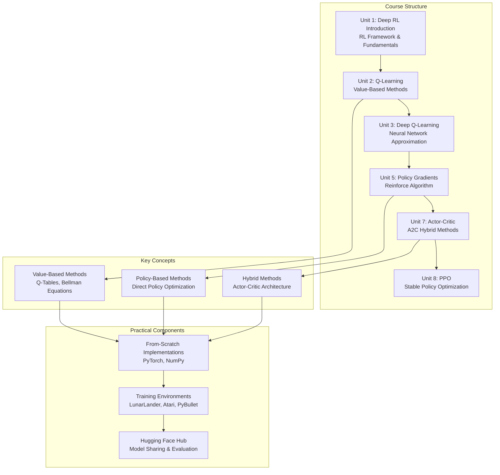
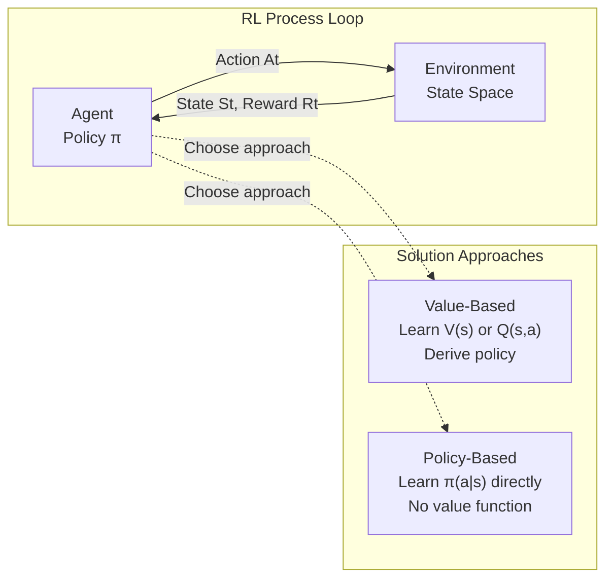
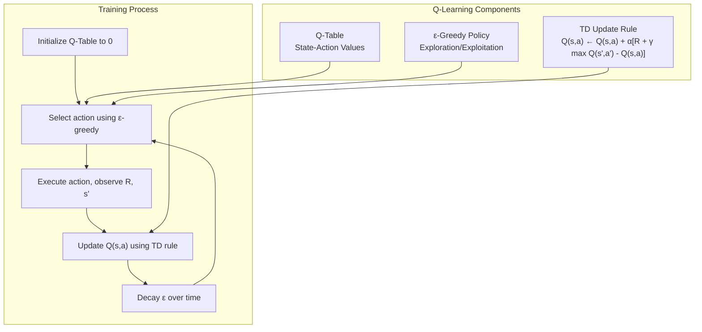
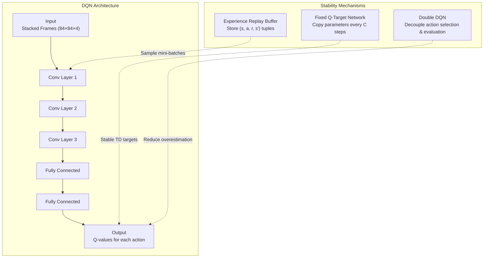
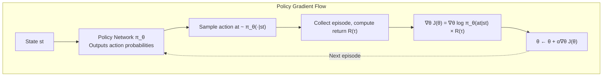
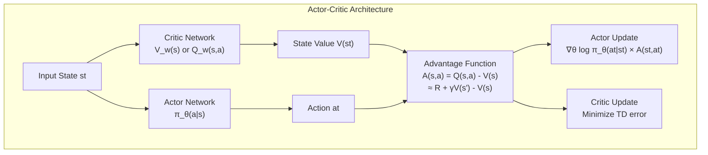
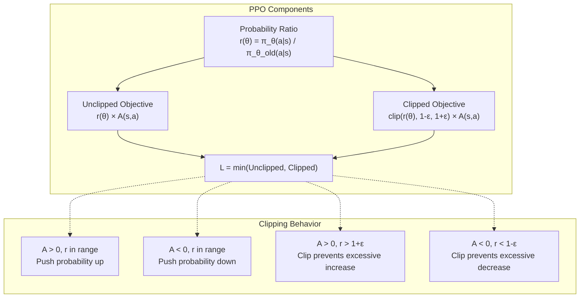
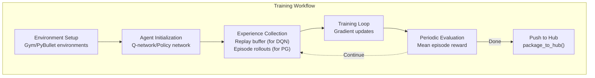
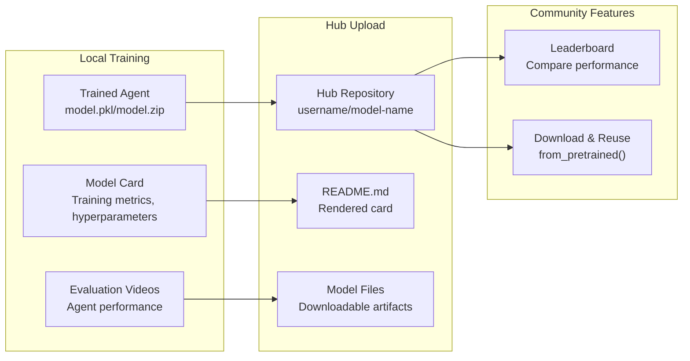
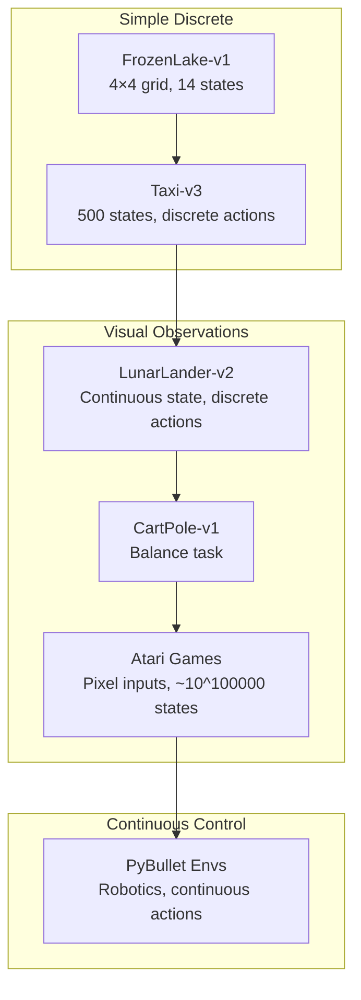

<!-- source: DeepWiki mcp.deepwiki.com · repo huggingface/blog · page 10.1 Deep RL Class · fetched 2026-10-26 -->

# Deep RL Class

<details>
<summary>Relevant source files</summary>

The following files were used as context for generating this wiki page:

- [assets/63_deep_rl_intro/tasks.jpg](assets/63_deep_rl_intro/tasks.jpg)
- [assets/70_deep_rl_q_part1/bellman6.jpg](assets/70_deep_rl_q_part1/bellman6.jpg)
- [assets/78_ml_director_insights/witty-works.png](assets/78_ml_director_insights/witty-works.png)
- [assets/86_bloom/bloom-examples.jpg](assets/86_bloom/bloom-examples.jpg)
- [assets/controlnet/thumbnail.png](assets/controlnet/thumbnail.png)
- [assets/cosmopedia/thumbnail.png](assets/cosmopedia/thumbnail.png)
- [bloom.md](bloom.md)
- [classification-use-cases.md](classification-use-cases.md)
- [controlnet.md](controlnet.md)
- [cosmopedia.md](cosmopedia.md)
- [deep-rl-a2c.md](deep-rl-a2c.md)
- [deep-rl-dqn.md](deep-rl-dqn.md)
- [deep-rl-intro.md](deep-rl-intro.md)
- [deep-rl-pg.md](deep-rl-pg.md)
- [deep-rl-ppo.md](deep-rl-ppo.md)
- [deep-rl-q-part1.md](deep-rl-q-part1.md)
- [deep-rl-q-part2.md](deep-rl-q-part2.md)
- [ml-director-insights-2.md](ml-director-insights-2.md)

</details>


The Deep RL Class is a comprehensive, free educational curriculum that teaches Deep Reinforcement Learning from foundational concepts to state-of-the-art algorithms. The course combines theoretical explanations with hands-on implementations, enabling learners to build and train RL agents from scratch using PyTorch and established libraries like Stable-Baselines3.

This page documents the course structure, curriculum progression, key algorithms, and implementation patterns. For information about model evaluation metrics, see [Model Evaluation](#10.3). For game development applications of RL, see [Game Development and AI](#10.2).

## Course Overview

The Deep RL Class follows a carefully sequenced curriculum spanning multiple units, each building upon previous concepts. The course emphasizes practical implementation alongside theory, with all trained agents publishable to the Hugging Face Hub.



**Sources:** [deep-rl-intro.md:1-73](), [deep-rl-q-part1.md:1-52](), [deep-rl-dqn.md:1-46]()

## Learning Progression

### Foundational Concepts (Unit 1)

The course begins with core RL concepts: the agent-environment loop, states, actions, rewards, and the distinction between policy-based and value-based methods.



Key concepts introduced:
- **Markov Decision Process (MDP)**: Framework requiring only current state for decision-making
- **Expected Return**: Sum of discounted future rewards `R(τ) = R_{t+1} + γR_{t+2} + γ²R_{t+3} + ...`
- **Exploration vs Exploitation**: Balancing discovery of new strategies vs leveraging known good actions
- **Episodic vs Continuing Tasks**: Finite-horizon vs infinite-horizon problems

**Sources:** [deep-rl-intro.md:97-253](), [deep-rl-intro.md:336-378]()

### Value-Based Methods (Units 2-3)

#### Q-Learning Algorithm

Q-Learning trains a Q-function that maps state-action pairs to expected returns. The algorithm uses Temporal Difference (TD) learning to update estimates after each step.



The Q-Learning update formula:
- **TD Target**: `R_{t+1} + γ max_a Q(s_{t+1}, a)`
- **TD Error**: `TD_target - Q(s_t, a_t)`
- **Update**: `Q(s_t, a_t) ← Q(s_t, a_t) + α × TD_error`

Implementation environments:
- **FrozenLake-v1**: Discrete 4×4 grid navigation (14 states)
- **Taxi-v3**: Discrete city navigation (500 states)

**Sources:** [deep-rl-q-part1.md:54-424](), [deep-rl-q-part2.md:50-321]()

#### Deep Q-Learning (DQN)

For large state spaces, Q-tables become impractical. Deep Q-Learning approximates Q-values using neural networks.



**Preprocessing steps**:
1. Resize frames to 84×84 grayscale
2. Stack 4 consecutive frames to capture temporal information
3. Normalize pixel values

**Training innovations**:
- **Experience Replay**: Breaks correlation between consecutive samples by randomly sampling from replay buffer
- **Fixed Q-Target**: Separate target network updated every C steps prevents moving target problem
- **Double DQN**: Uses online network for action selection, target network for Q-value estimation

Training environments: Space Invaders, Pong, Breakout (Atari environments with ~10^{100800} state space)

**Sources:** [deep-rl-dqn.md:55-229]()

### Policy-Based Methods (Units 5-8)

#### Reinforce (Monte Carlo Policy Gradient)

Reinforce directly optimizes the policy parameters θ by estimating the policy gradient.



**Advantages**:
- Learns stochastic policies naturally
- Handles continuous action spaces
- No perceptual aliasing issues

**Disadvantages**:
- High variance (uses full episode return)
- Sample inefficient
- Can converge to local optima

Training environments: CartPole-v1, PixelCopter, Pong

**Sources:** [deep-rl-pg.md:51-192]()

#### Actor-Critic (A2C)

A2C reduces variance by combining policy-based (actor) and value-based (critic) methods.



**Advantage function as critic**: Using `A(s,a) = R + γV(s') - V(s)` as the TD error provides:
- **Lower variance** than Monte Carlo return
- **Unbiased estimate** of action quality
- **Faster convergence** than pure policy gradient

Training environments: PyBullet robotics (BipedalWalker, Spider)

**Sources:** [deep-rl-a2c.md:54-162]()

#### Proximal Policy Optimization (PPO)

PPO improves training stability by constraining policy updates to prevent destructive large changes.



**Clipped surrogate objective**:
```
L^CLIP(θ) = min(r_t(θ) × A_t, clip(r_t(θ), 1-ε, 1+ε) × A_t)
```

Where:
- `r_t(θ)` measures divergence from old policy
- `ε` (typically 0.2) defines allowed update range
- Taking minimum ensures pessimistic (conservative) updates

Training environments: CartPole-v1, LunarLander-v2

**Sources:** [deep-rl-ppo.md:61-176]()

## Implementation Patterns

### Model Training Pipeline



**Sources:** [deep-rl-q-part2.md:323-360](), [deep-rl-dqn.md:232-245]()

### Hugging Face Hub Integration

All course units demonstrate model sharing via the Hub:



Hub integration enables:
- **Model versioning**: Track training iterations
- **Reproducibility**: Share exact model checkpoints
- **Benchmarking**: Compare against community models via leaderboards
- **Reusability**: Load pre-trained models with single function call

**Sources:** [deep-rl-intro.md:46-58](), [deep-rl-q-part2.md:332-337]()

## Course Materials Structure

### Theoretical Content

Each unit blog post follows this structure:
1. **Motivation**: Why the algorithm matters, what problems it solves
2. **Core Concepts**: Mathematical foundations, key equations
3. **Algorithm Walkthrough**: Pseudocode and step-by-step explanation
4. **Practical Considerations**: Hyperparameters, common pitfalls
5. **Hands-on Tutorial**: Colab notebook with implementation

### Coding Implementations

| Unit | Algorithm | Implementation Style | Key Libraries |
|------|-----------|---------------------|---------------|
| 2 | Q-Learning | From scratch | NumPy, OpenAI Gym |
| 3 | DQN | RL Baselines3 Zoo | Stable-Baselines3, PyTorch |
| 5 | Reinforce | From scratch | PyTorch, Gym |
| 7 | A2C | Stable-Baselines3 | SB3, PyBullet |
| 8 | PPO | From scratch | PyTorch |

**Sources:** [deep-rl-q-part2.md:323-360](), [deep-rl-pg.md:183-192]()

### Environments Progression

The course uses progressively complex environments:



**Sources:** [deep-rl-q-part1.md:33-39](), [deep-rl-dqn.md:37-42](), [deep-rl-a2c.md:38-42]()

## Key Algorithm Comparison

| Aspect | Q-Learning | DQN | Reinforce | A2C | PPO |
|--------|-----------|-----|-----------|-----|-----|
| **Type** | Value-based | Value-based | Policy-based | Hybrid | Hybrid |
| **Action Space** | Discrete | Discrete | Discrete/Continuous | Discrete/Continuous | Discrete/Continuous |
| **Function Approximation** | Q-table | Neural network | Neural network | Neural network | Neural network |
| **Update Frequency** | Every step | Every step (batch) | End of episode | Every step | Multiple epochs per batch |
| **Variance** | Low | Low | High | Medium | Low |
| **Sample Efficiency** | High | Medium | Low | Medium | Medium |
| **Stability** | High | Medium | Low | Medium | High |

**Sources:** [deep-rl-q-part1.md:256-420](), [deep-rl-dqn.md:127-229](), [deep-rl-pg.md:82-135](), [deep-rl-a2c.md:84-152](), [deep-rl-ppo.md:61-176]()

## Updated Course Version

All blog posts reference an updated version of the course:
> ⚠️ A **new updated version of this article is available here** 👉 https://huggingface.co/deep-rl-course/

The updated course maintains the same curriculum structure but with revised content and additional resources. Original blog posts remain available as historical references.

**Sources:** [deep-rl-intro.md:15-27](), [deep-rl-q-part1.md:15-26](), [deep-rl-dqn.md:15-27]()

---

