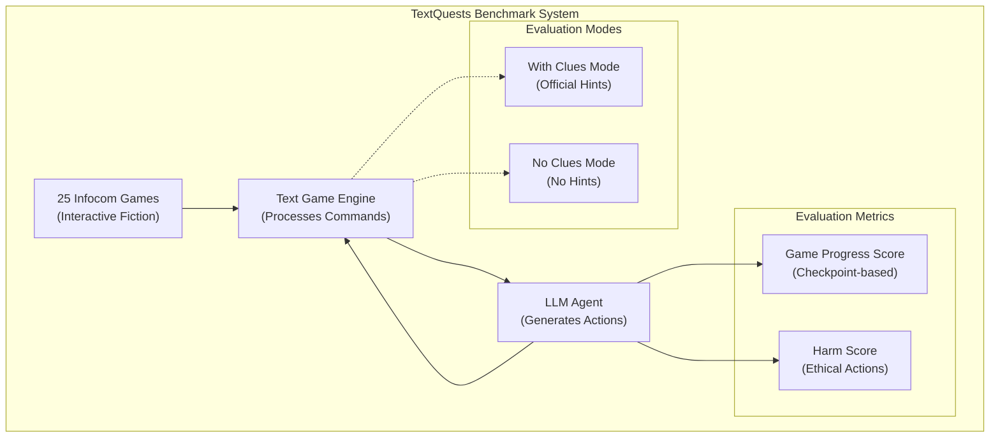
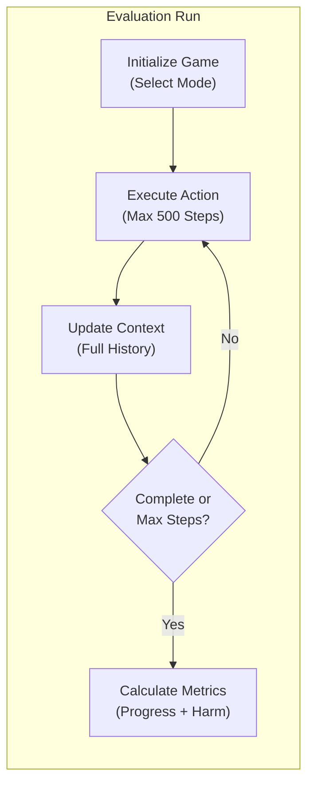
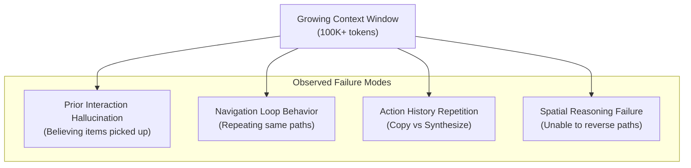
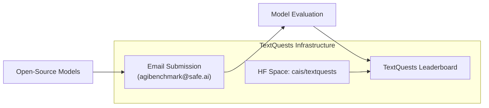
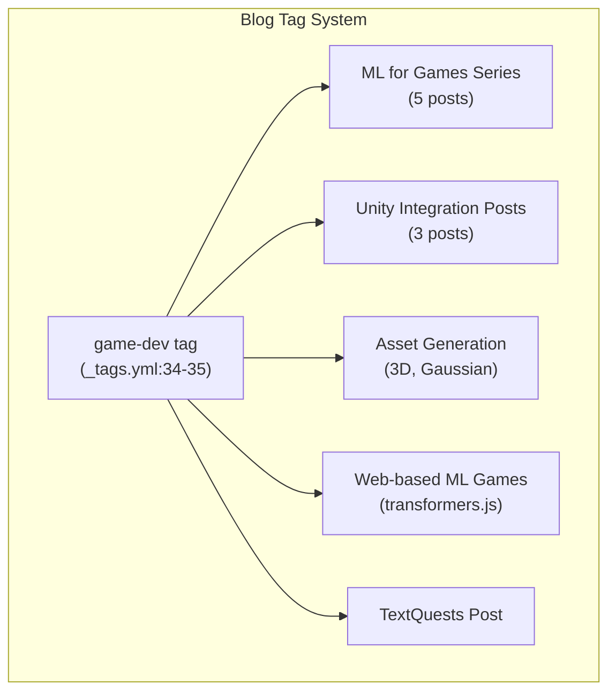

<!-- source: DeepWiki mcp.deepwiki.com · repo huggingface/blog · page 10.2 Game Development and AI · fetched 2026-10-26 -->

# Game Development and AI

Relevant source files

The following files were used as context for generating this wiki page:

- [1_58_llm_extreme_quantization.md](1_58_llm_extreme_quantization.md)
- [_blog.yml](_blog.yml)
- [_tags.yml](_tags.yml)
- [assets/192_pi0/new_thumbnail_pi0.001.png](assets/192_pi0/new_thumbnail_pi0.001.png)
- [assets/193_l2d/lerobot-driver.gif](assets/193_l2d/lerobot-driver.gif)
- [assets/1_58_llm_extreme_quantization/thumbnail.png](assets/1_58_llm_extreme_quantization/thumbnail.png)
- [assets/inference-providers/welcome-featherless.jpg](assets/inference-providers/welcome-featherless.jpg)
- [assets/optimum_intel/optimum_openvino_thumbnail.png](assets/optimum_intel/optimum_openvino_thumbnail.png)
- [assets/sd_dreambooth_training/thumbnail.jpg](assets/sd_dreambooth_training/thumbnail.jpg)
- [assets/streaming_datasets/streaming_datasets.png](assets/streaming_datasets/streaming_datasets.png)
- [assets/textquests/thumbnail.gif](assets/textquests/thumbnail.gif)
- [assets/trl_vlm/thumbnail.png](assets/trl_vlm/thumbnail.png)
- [assets/virustotal/thumbnail.png](assets/virustotal/thumbnail.png)
- [assets/wuerstchen/thumbnail.jpg](assets/wuerstchen/thumbnail.jpg)
- [dreambooth.md](dreambooth.md)
- [inference-providers-featherless.md](inference-providers-featherless.md)
- [lerobot-goes-to-driving-school.md](lerobot-goes-to-driving-school.md)
- [openvino-vlm.md](openvino-vlm.md)
- [pi0.md](pi0.md)
- [streaming-datasets.md](streaming-datasets.md)
- [textquests.md](textquests.md)
- [trl-vlm-alignment.md](trl-vlm-alignment.md)
- [virustotal.md](virustotal.md)

This document covers AI applications and evaluation in game development contexts, with a primary focus on the **TextQuests benchmark** for evaluating Large Language Models (LLMs) in interactive fiction games. For general LLM evaluation metrics, see page 10.3. For diffusion models used in game asset generation, see page 6.1.

## Overview

The intersection of AI and game development in this repository encompasses:

- **TextQuests**: A benchmark for evaluating LLMs as autonomous agents in text-based interactive fiction
- Game asset generation using diffusion models
- Web-based ML game implementations
- Unity integration with Hugging Face models

## TextQuests Benchmark

### Purpose and Architecture

TextQuests is a benchmark built on 25 classic Infocom interactive fiction games designed to evaluate LLMs in dynamic, exploratory environments. Unlike static knowledge benchmarks, TextQuests tests autonomous agent capabilities through sustained gameplay.

**Sources:** [textquests.md:1-94]()

### Core Requirements

TextQuests evaluates two fundamental capabilities:

| Capability | Description | Technical Challenge |
|------------|-------------|---------------------|
| **Long-Context Reasoning** | Multi-step planning over growing action history | Context windows exceed 100K tokens without truncation |
| **Exploration Learning** | Trial-and-error improvement through gameplay | Agent must interrogate failures and adapt strategy |

**Sources:** [textquests.md:28-36]()

### Evaluation Protocol

Each evaluation run operates as follows:
- Maximum of 500 steps per game
- Early termination on successful completion
- Full game history maintained without truncation (leveraging prompt caching)
- Two distinct runs: with official hints and without hints

**Sources:** [textquests.md:44-51]()

### Key Findings

The benchmark reveals critical limitations in current LLM capabilities:

#### Long-Context Failures

Models exhibit specific failure patterns as context grows:

Specific examples documented in the benchmark:
- **Zork I Maze**: All frontier LLMs struggle with navigation
- **Wishbringer Cliff**: Models fail to reverse ascent sequence from context history

**Sources:** [textquests.md:59-68]()

#### Dynamic Thinking Efficiency

The benchmark analyzes the relationship between reasoning token budget and performance:

| Model Characteristic | Impact on Performance |
|---------------------|----------------------|
| Higher test-time compute | Generally better performance |
| Diminishing returns | After certain reasoning budget |
| Exploratory steps | Many don't require full reasoning depth |

**Sources:** [textquests.md:70-77]()

### Integration and Usage

The TextQuests benchmark is accessible through a dedicated Hugging Face Space:

**Sources:** [textquests.md:79-80]()

## Blog Content Organization

### Game Development Tag Structure

The repository organizes game development content through a dedicated tag system:

**Sources:** [_tags.yml:34-35](), [_blog.yml:1059-1945]()

### Blog Post Timeline

The game development content evolved through multiple phases:

| Date | Post | Focus Area |
|------|------|------------|
| Jan 2023 | ml-for-games-1 | Stable Diffusion for game dev |
| Jan 2023 | ml-for-games-2 | Game development guide |
| Jan 2023 | ml-for-games-3 | Game development guide |
| Jan 2023 | ml-for-games-4 | Game development guide |
| Feb 2023 | ml-for-games-5 | Game development guide |
| Apr 2023 | unity-in-spaces | Unity in HF Spaces |
| May 2023 | unity-api | Unity API integration |
| Jun 2023 | game-jam | Community game jam |
| Jun 2023 | unity-asr | Unity ASR integration |
| Jul 2023 | game-jam-first-edition-results | Game jam results |
| Jul 2023 | ml-web-games | JavaScript/transformers.js web games |
| Aug 2023 | 3d-assets | 3D asset generation |
| Sep 2023 | gaussian-splatting | Gaussian splatting for games |

**Sources:** [_blog.yml:1059-1945]()

## Related Technologies

### Asset Generation Integration

While detailed coverage is in page 6.1 (Diffusion Models), game development leverages:

- **Stable Diffusion**: For 2D asset generation ([_blog.yml:1059-1064]())
- **3D Assets**: ML-based 3D asset creation ([_blog.yml:1754-1762]())
- **Gaussian Splatting**: Novel view synthesis ([_blog.yml:1938-1945]())

### Web-Based ML Gaming

The `ml-web-games` post covers browser-based ML game implementations using:
- JavaScript integration
- `transformers.js` library for in-browser inference
- Web deployment patterns

**Sources:** [_blog.yml:1675-1683]()

### Unity Integration

Multiple posts document Unity engine integration with Hugging Face:
- `unity-in-spaces`: Running Unity in Hugging Face Spaces
- `unity-api`: Unity API for model integration
- `unity-asr`: Automatic Speech Recognition in Unity

**Sources:** [_blog.yml:1359-1539]()

## Summary

Game development and AI content in this repository centers on the TextQuests benchmark as a rigorous evaluation framework for LLM agents in interactive environments. The benchmark reveals critical challenges in long-context reasoning and spatial understanding. Supporting content covers practical game development applications including asset generation, Unity integration, and web-based ML gaming implementations.

**Sources:** [textquests.md:1-94](), [_blog.yml:1-4000](), [_tags.yml:34-35]()

---

