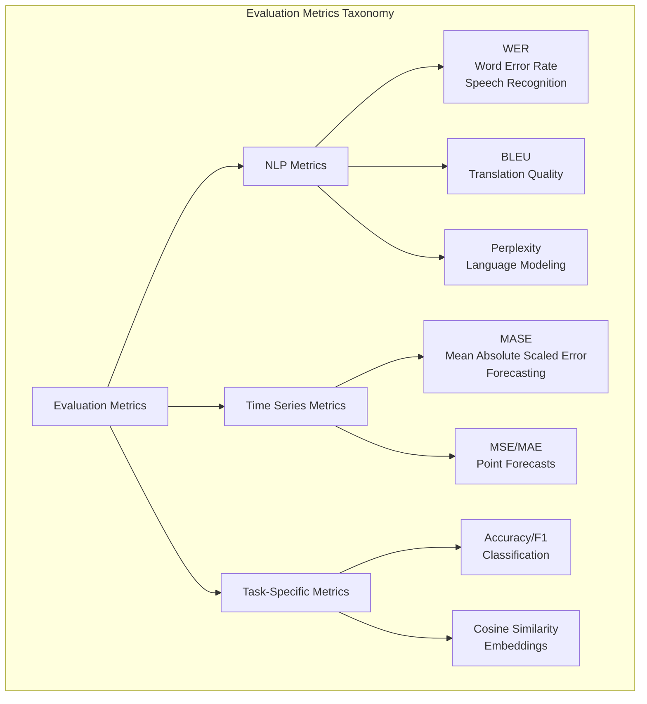
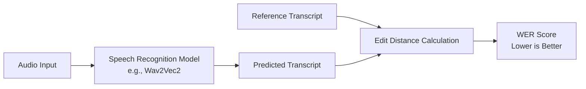
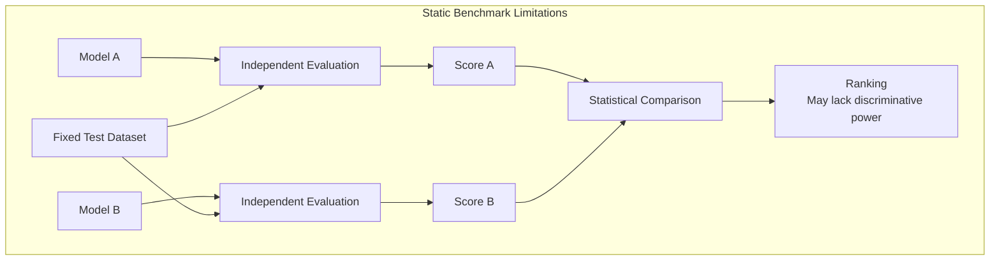
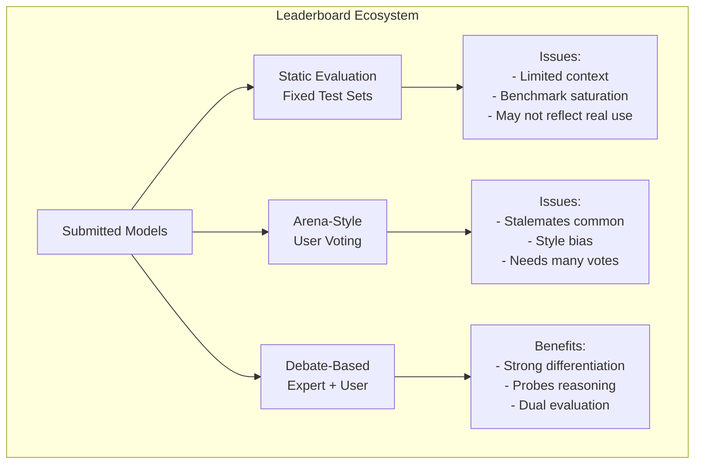
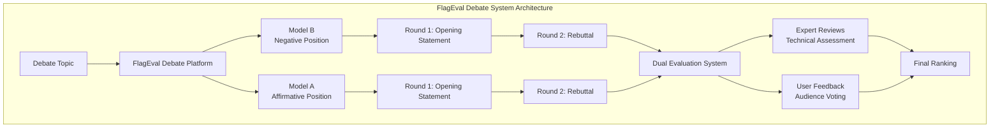
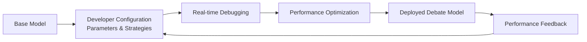
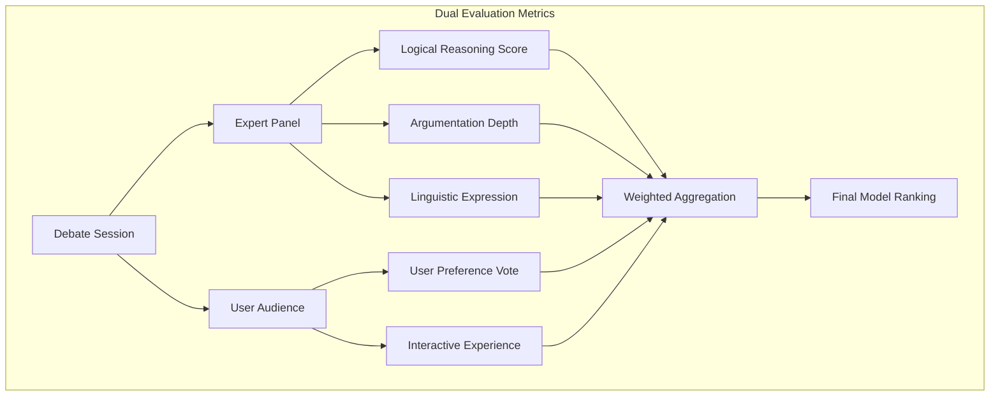
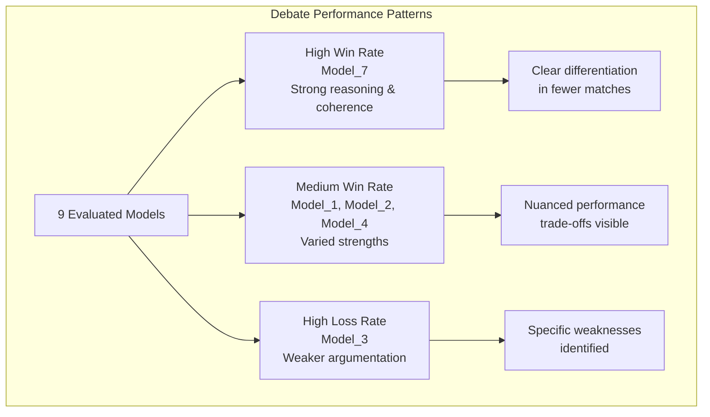
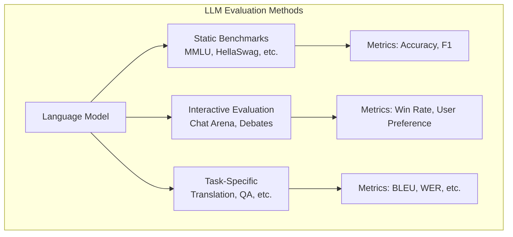
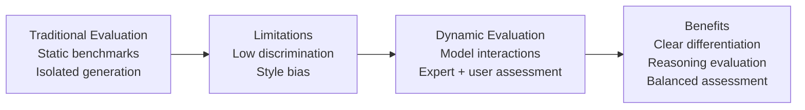

<!-- source: DeepWiki mcp.deepwiki.com · repo huggingface/blog · page 10.3 Model Evaluation · fetched 2026-10-26 -->

# Model Evaluation

<details>
<summary>Relevant source files</summary>

The following files were used as context for generating this wiki page:

- [1b-sentence-embeddings.md](1b-sentence-embeddings.md)
- [accelerated-inference.md](accelerated-inference.md)
- [assets/118_time-series-transformers/thumbnail.png](assets/118_time-series-transformers/thumbnail.png)
- [assets/134_informer/thumbnail.png](assets/134_informer/thumbnail.png)
- [assets/150_autoformer/thumbnail.png](assets/150_autoformer/thumbnail.png)
- [assets/17_the_partnership_amazon_sagemaker_and_hugging_face/cover.png](assets/17_the_partnership_amazon_sagemaker_and_hugging_face/cover.png)
- [assets/17_the_partnership_amazon_sagemaker_and_hugging_face/thumbnail.png](assets/17_the_partnership_amazon_sagemaker_and_hugging_face/thumbnail.png)
- [assets/25_hardware_partners_program/carbon_inc_quantizer.png](assets/25_hardware_partners_program/carbon_inc_quantizer.png)
- [assets/deploy-with-openvino/demo.gif](assets/deploy-with-openvino/demo.gif)
- [assets/deploy-with-openvino/openvino_genai_workflow.png](assets/deploy-with-openvino/openvino_genai_workflow.png)
- [assets/galore_introduction/thumbnail.png](assets/galore_introduction/thumbnail.png)
- [assets/leaderboards-on-the-hub/thumbnail_flageval.png](assets/leaderboards-on-the-hub/thumbnail_flageval.png)
- [autoformer.md](autoformer.md)
- [bert-cpu-scaling-part-2.md](bert-cpu-scaling-part-2.md)
- [community-update.md](community-update.md)
- [debate.md](debate.md)
- [deploy-hugging-face-models-easily-with-amazon-sagemaker.md](deploy-hugging-face-models-easily-with-amazon-sagemaker.md)
- [deploy-with-openvino.md](deploy-with-openvino.md)
- [few-shot-learning-gpt-neo-and-inference-api.md](few-shot-learning-gpt-neo-and-inference-api.md)
- [fr/_blog.yml](fr/_blog.yml)
- [galore.md](galore.md)
- [hardware-partners-program.md](hardware-partners-program.md)
- [informer.md](informer.md)
- [sentence-transformers-in-the-hub.md](sentence-transformers-in-the-hub.md)
- [the-partnership-amazon-sagemaker-and-hugging-face.md](the-partnership-amazon-sagemaker-and-hugging-face.md)
- [time-series-transformers.md](time-series-transformers.md)
- [zh/informer.md](zh/informer.md)
- [zh/time-series-transformers.md](zh/time-series-transformers.md)

</details>


## Purpose and Scope

This document covers evaluation methodologies, metrics, benchmarks, and leaderboards used to assess machine learning model performance across different domains. The focus is on evaluation techniques documented in the Hugging Face blog, ranging from traditional static metrics to novel dynamic evaluation approaches like debate-based assessment.

For training-related topics, see [Model Training and Optimization](#4). For deployment considerations, see [Model Deployment and Inference](#5). For specific model architectures, see [Large Language Models](#2), [Vision Language Models](#3), and [Specialized Model Types](#6).

## Evaluation Metrics Overview

Model evaluation employs different metrics depending on the task domain, model architecture, and deployment requirements. These metrics serve as quantitative measures to compare model performance and guide optimization decisions.



**Sources:** [debate.md:1-154](), [informer.md:1-900](), [time-series-transformers.md:1-800]()

### Natural Language Processing Metrics

#### Word Error Rate (WER)

WER measures the accuracy of speech recognition models by calculating the minimum edit distance between predicted and reference transcripts. It is commonly used for evaluating models like Wav2Vec2.



**Sources:** [debate.md:52-61]()

#### BLEU Score

BLEU (Bilingual Evaluation Understudy) evaluates machine translation quality by comparing n-gram overlap between generated and reference translations. This metric is mentioned in the context of evaluating translation models and multilingual systems.

**Sources:** [debate.md:52-61]()

#### Perplexity

Perplexity measures how well a language model predicts a sample, commonly used for evaluating autoregressive models. Lower perplexity indicates better predictive performance.

```python
# Example from time series but concept applies to LLMs
# Perplexity calculation for language models
# Referenced in evaluation contexts
```

**Sources:** [informer.md:105-127](), [autoformer.md:105-112]()

### Time Series Forecasting Metrics

#### MASE (Mean Absolute Scaled Error)

MASE is a scale-independent metric used to evaluate time series forecasting models. It compares the mean absolute error of the forecasting method to a naive baseline forecast.

The Autoformer and DLinear benchmarking comparison demonstrates MASE usage:

| Dataset | Autoformer (uni.) MASE | DLinear MASE |
|:-------:|:----------------------:|:------------:|
| `Traffic` | 0.910 | 0.965 |
| `Exchange-Rate` | 1.087 | 1.690 |
| `Electricity` | 0.751 | 0.831 |

These results show Autoformer outperforming DLinear on all three datasets when using MASE as the evaluation metric.

**Sources:** [autoformer.md:36-44](), [informer.md:1-900]()

## Benchmarking Approaches

### Static Benchmarks

Traditional evaluation relies on fixed datasets where models are tested against held-out test sets. This approach has well-documented limitations:

- **Limited discriminative power**: Many model confrontations result in stalemates
- **Requires large sample sizes**: Statistical stability needs many evaluations
- **Isolated generation**: Models don't interact with each other
- **Potential for bias**: User preferences may favor style over content



**Sources:** [debate.md:56-60](), [autoformer.md:29-44]()

### Dynamic and Interactive Evaluation

Dynamic evaluation addresses limitations of static benchmarks by enabling real-time model interactions and multi-agent scenarios. This is particularly relevant for large language models where reasoning and argumentation capabilities are critical.

**Sources:** [debate.md:52-86]()

## Leaderboards and Ranking Systems

### Traditional Leaderboards

Leaderboards track model performance across standardized benchmarks, enabling comparison and tracking progress. The blog references various leaderboard systems:



**Sources:** [debate.md:43-86]()

### FlagEval Debate Platform

FlagEval Debate represents a novel evaluation methodology where models engage in direct debates, showcasing reasoning and argumentation abilities.

#### Architecture and Features



**Sources:** [debate.md:63-108]()

#### Multilingual Support

The platform supports debates in multiple languages, enabling comprehensive global evaluation:

- **Chinese**: Testing performance in logographic writing systems
- **English**: Standard evaluation language
- **Korean**: Agglutinative language structure
- **Arabic**: Right-to-left script and morphological complexity

This multilingual capability provides insights into model adaptability across diverse linguistic environments.

**Sources:** [debate.md:65-66]()

#### Developer Customization

The platform allows model teams to optimize their models specifically for debate tasks:



**Sources:** [debate.md:68-70]()

#### Dual Evaluation System

FlagEval Debate employs both expert assessment and user feedback:

**Expert Reviews:**
- Rigorous evaluation across logical reasoning, argumentation depth, and linguistic expression
- Provides objective, detailed technical assessments
- Ensures professional credibility

**User Feedback:**
- Audience voting based on preferences and experience
- Reflects acceptance in practical interactions
- Complements expert evaluations with real-world perspectives



**Sources:** [debate.md:71-75]()

### Experimental Results

Key findings from FlagEval Debate experiments in Q3 2024:

1. **Most models can engage in debate**: All participating models demonstrated capability for debate tasks across different architectures

2. **Strong performance differentiation**: Models showed significant variations in reasoning logic, argumentation techniques, and language use under adversarial conditions

3. **Win matrix reveals clear patterns**: Even with hundreds of matches, certain models showed notably higher win counts, whereas traditional evaluations required many more matches for conclusive results



4. **Common error patterns identified**:
   - Generating content for both sides simultaneously
   - Forced agreement when disagreement is appropriate
   - Coherence and topic maintenance challenges in smaller models

**Sources:** [debate.md:79-104]()

### Participating Models

Major model providers participating in FlagEval Debate evaluation:

| Company | Model | Debugging Method |
|---------|-------|------------------|
| OpenAI | o1-preview, o1-mini, GPT-4o, GPT-4o-mini | Self-debugged |
| Anthropic | claude-3-5-sonnet | Self-debugged |
| Stepfun | step-2-16k-f | Provider-debugged |
| Baidu | ERNIE-4.0-Turbo | Provider-debugged |
| ByteDance | Doubao-pro | Provider-debugged |
| Alibaba | qwen2.5-72b-instruct | Self-debugged |
| Tencent | Hunyuan-Turbo | Provider-debugged |
| 01.AI | Yi-Lightning | Self-debugged |
| Zhipu AI | GLM-4-plus | Provider-debugged |
| DeepSeek | DeepSeek_V2.5 | Self-debugged |

**Sources:** [debate.md:119-134]()

## Evaluation in Practice

### Time Series Model Evaluation

Time series models are evaluated using metrics like MASE, with careful consideration of:

- **Prediction length**: Horizon for forecasting (e.g., 24 hours, 48 hours)
- **Context length**: Historical data window used
- **Multivariate vs. univariate**: Number of time series predicted simultaneously

Example evaluation setup from traffic dataset:

```python
# Evaluation parameters from traffic dataset
prediction_length = 24  # 24 hours ahead
context_length = prediction_length * 2  # 48 hours context
freq = "1H"  # Hourly frequency
```

**Sources:** [autoformer.md:245-253](), [informer.md:260-266]()

### Language Model Evaluation

Language models are evaluated through multiple approaches:



**Sources:** [debate.md:52-86]()

### Sentence Embedding Evaluation

Sentence embeddings are evaluated using semantic similarity tasks:

- **Cosine similarity**: Measuring semantic closeness
- **Clustering performance**: K-means and other clustering methods
- **Retrieval tasks**: Finding semantically similar sentences

**Sources:** [1b-sentence-embeddings.md:1-85](), [sentence-transformers-in-the-hub.md:1-90]()

## Evaluation Challenges and Solutions

### Addressing Evaluation Limitations

The evolution from static benchmarks to dynamic evaluation addresses several key challenges:

**Challenge 1: Lack of Discriminative Power**
- **Problem**: Traditional benchmarks often produce similar scores for different models
- **Solution**: Interactive debates force models to demonstrate reasoning in adversarial contexts

**Challenge 2: Isolated Generation**
- **Problem**: Models generate responses independently without real interaction
- **Solution**: Multi-turn debates require models to respond to opponent arguments

**Challenge 3: Evaluation Bias**
- **Problem**: User preferences may favor style over substance
- **Solution**: Dual evaluation combining expert technical assessment with user feedback



**Sources:** [debate.md:52-75]()

### Best Practices

1. **Choose appropriate metrics**: Match metrics to task requirements and deployment context
2. **Use multiple evaluation methods**: Combine static benchmarks with dynamic evaluation
3. **Consider scale**: Larger models may require different evaluation approaches
4. **Account for domain**: NLP, vision, time series each have specialized metrics
5. **Monitor real-world performance**: Deployment metrics may differ from benchmark scores

**Sources:** [debate.md:52-146](), [autoformer.md:29-44]()

## Future Directions

The evaluation landscape continues to evolve with:

- **More sophisticated interaction-based evaluation**: Beyond simple pairwise comparisons
- **Domain-specific benchmarks**: Tailored to particular use cases
- **Efficiency metrics**: Balancing performance with computational cost
- **Multimodal evaluation**: Assessing models across text, vision, and audio
- **Continuous evaluation**: Real-time monitoring in production environments

**Sources:** [debate.md:138-146]()

---

