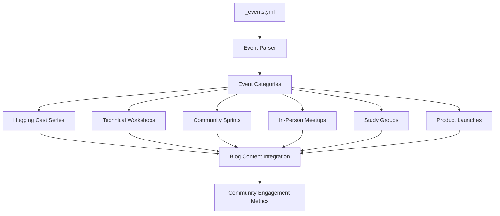
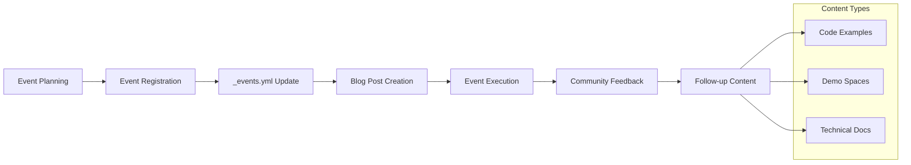
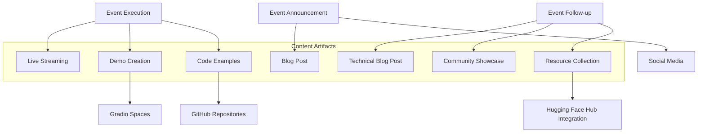

<!-- source: DeepWiki mcp.deepwiki.com · repo huggingface/blog · page 11 Community and Events · fetched 2026-10-26 -->

# Community and Events

<details>
<summary>Relevant source files</summary>

The following files were used as context for generating this wiki page:

- [4bit-transformers-bitsandbytes.md](4bit-transformers-bitsandbytes.md)
- [_events.yml](_events.yml)
- [accelerate-deepspeed.md](accelerate-deepspeed.md)
- [assets/138_stackllama/thumbnail.png](assets/138_stackllama/thumbnail.png)
- [assets/147_falcon/falcon_thumbnail.jpg](assets/147_falcon/falcon_thumbnail.jpg)
- [assets/83_accelerate_deepspeed/chatbot.png](assets/83_accelerate_deepspeed/chatbot.png)
- [assets/83_accelerate_deepspeed/cls_run.png](assets/83_accelerate_deepspeed/cls_run.png)
- [assets/83_accelerate_deepspeed/deepspeed-thumbnail.png](assets/83_accelerate_deepspeed/deepspeed-thumbnail.png)
- [assets/98_spaces_3dmoljs/thumbnail.png](assets/98_spaces_3dmoljs/thumbnail.png)
- [assets/assisted-generation/thumbnail.png](assets/assisted-generation/thumbnail.png)
- [assets/diffusion-models-event/thumbnail.png](assets/diffusion-models-event/thumbnail.png)
- [assets/inference_pro/thumbnail.png](assets/inference_pro/thumbnail.png)
- [assets/instruction_tuning_sd/thumbnail.png](assets/instruction_tuning_sd/thumbnail.png)
- [assets/llama2/thumbnail.jpg](assets/llama2/thumbnail.jpg)
- [assisted-generation.md](assisted-generation.md)
- [diffusion-models-event.md](diffusion-models-event.md)
- [falcon.md](falcon.md)
- [inference-pro.md](inference-pro.md)
- [instruction-tuning-sd.md](instruction-tuning-sd.md)
- [llama2.md](llama2.md)
- [spaces_3dmoljs.md](spaces_3dmoljs.md)
- [stackllama.md](stackllama.md)

</details>


This document covers the community engagement and event management system within the Hugging Face blog repository. This system orchestrates educational initiatives, technical workshops, community sprints, and live events that support the broader machine learning community.

For information about educational content and structured learning materials, see [Educational Resources](#8). For details about blog content management, see [Blog System Architecture](#1.1).

## Event Registry System

The core of the community events system is the centralized event registry stored in `_events.yml`. This YAML file maintains a chronological record of all community activities, workshops, and educational events.

### Event Data Structure

Each event entry contains standardized metadata fields:

```yaml
- name: "Event title"
  link: https://event-url
  date: Month DD, YYYY
  date_formatted: "Optional custom date format"
  description: "Event description and context"
```

The registry supports various date formats through the optional `date_formatted` field, allowing for date ranges and custom formatting while maintaining consistent chronological ordering through the primary `date` field.

**Event Registry Architecture**



Sources: [_events.yml:1-324]()

## Community Engagement Types

The events system supports six primary categories of community engagement, each serving different educational and collaborative purposes.

### Live Educational Series

**Hugging Cast** represents the flagship live streaming series, featuring AI news, model demonstrations, and technical discussions. These events follow a regular format with episodes numbered sequentially.

### Technical Workshops

Partnership workshops with cloud providers and hardware vendors deliver hands-on technical training. These events focus on specific deployment scenarios and optimization techniques.

### Community Development Sprints

Collaborative development events where community members contribute to open-source projects. Notable examples include the Diffusers/JAX Community Sprint and Keras DreamBooth events.

### Academic and Research Meetups

In-person and virtual gatherings for researchers and practitioners, often co-located with conferences or held at innovation hubs in major cities.

### Study Groups and Reading Sessions

Regular educational sessions covering academic papers, technical concepts, and emerging research areas in machine learning.

### Product and Model Launch Events

Coordinated announcements and demonstrations for new models, tools, or platform features.

**Community Engagement Workflow**



Sources: [_events.yml:6-324](), [diffusion-models-event.md:1-55]()

## Event Integration with Blog System

Community events are tightly integrated with the blog content management system, creating a comprehensive educational ecosystem.

### Event-Driven Content Creation

Major events often generate corresponding blog posts that provide detailed technical explanations, code examples, and follow-up resources. This pattern is evident in events like model releases and technical workshops.

### Cross-Platform Promotion

Events leverage multiple channels including:
- Blog post announcements
- Social media integration (`wandb`, `twitter` tracking)
- Demo spaces on Hugging Face Hub
- Interactive notebooks and tutorials

### Community Contribution Workflows

The events system facilitates community contributions through structured sprints and hackathons. These events produce tangible outputs including:
- Model contributions to Hugging Face Hub
- Documentation improvements
- Code examples and tutorials
- Demo applications

**Event-to-Content Pipeline**



Sources: [diffusion-models-event.md:12-55](), [llama2.md:67-74](), [stackllama.md:28-34]()

## Community Sprint Management

Community sprints represent a specialized form of event management focused on collaborative development and contribution.

### Sprint Structure and Organization

Each community sprint follows a structured approach:
- **Project Definition**: Clear objectives and deliverables
- **Technical Setup**: Development environment and tools
- **Community Coordination**: Communication channels and support
- **Timeline Management**: Milestone tracking and deadlines
- **Result Integration**: Incorporation of community contributions

### Notable Sprint Examples

The **Diffusers/JAX Community Sprint** exemplifies the sprint methodology, focusing on developing applications with diffusers and JAX using TPUs. The **Keras DreamBooth Community Sprint** concentrated on fine-tuning Stable Diffusion using DreamBooth techniques.

### Sprint Outcome Integration

Sprint results are systematically integrated into the broader ecosystem through:
- Model uploads to Hugging Face Hub
- Documentation contributions
- Blog post summaries and tutorials
- Demo space creation

Sources: [_events.yml:61-79](), [_events.yml:121-124]()

## Educational Event Series

The community events system supports ongoing educational series that provide structured learning opportunities for the machine learning community.

### Reading Groups and Study Sessions

Regular study sessions cover academic papers and technical concepts. The **NLP with Transformers Reading Group** and **ML for Audio Study Group** represent long-running educational series.

### Workshop Series

Technical workshops are organized around specific themes and technologies:
- **Hardware Integration**: AWS Inferentia, Intel optimization, Habana acceleration
- **Model Deployment**: SageMaker integration, optimization techniques
- **Research Applications**: Computer vision, audio processing, multimodal systems

### Course Launch Events

Major educational initiatives like course launches are supported through coordinated events that include live presentations, demonstrations, and community Q&A sessions.

**Educational Event Lifecycle**

```mermaid
flowchart LR
    SeriesPlanning["Series Planning"] --> ContentDevelopment["Content Development"]
    ContentDevelopment --> CommunityOutreach["Community Outreach"]
    
    CommunityOutreach --> EventScheduling["Event Scheduling"]
    EventScheduling --> EventsYMLUpdate["_events.yml Update"]
    
    EventsYMLUpdate --> SessionExecution["Session Execution"]
    SessionExecution --> RecordingArchival["Recording & Archival"]
    
    RecordingArchival --> FollowUpResources["Follow-up Resources"]
    FollowUpResources --> CommunityFeedback["Community Feedback"]
    
    CommunityFeedback --> SeriesIteration["Series Iteration"]
    SeriesIteration --> SeriesPlanning
```



Sources: [_events.yml:106-149](), [_events.yml:177-288]()

## Technical Implementation

The events system integrates with the broader blog architecture through standardized data formats and automated processing workflows.

### YAML Processing

The `_events.yml` file is processed as part of the Jekyll build system, enabling dynamic generation of event listings and integration with blog templates.

### Date Handling and Formatting

The system supports flexible date formatting through dual date fields:
- `date`: Standardized format for chronological sorting
- `date_formatted`: Custom display format for date ranges and special formatting

### Link Management and Validation

Event links encompass various platforms and services:
- External event platforms (Eventbrite, Partiful)
- Streaming services (YouTube, StreamYard, Zoom)
- Documentation and repositories (GitHub, Hugging Face Hub)
- Social platforms (Twitter Spaces, Discord)

### Integration Points

The events system connects with multiple external services and platforms:
- **Analytics Integration**: Weights & Biases tracking for technical content
- **Platform Integration**: Hugging Face Spaces for demos and interactive content
- **Repository Integration**: GitHub repositories for code examples and sprint outcomes
- **Social Integration**: Twitter, Discord, and other community platforms

Sources: [_events.yml:1-5](), [diffusion-models-event.md:20-21](), [stackllama.md:212-213]()

---

