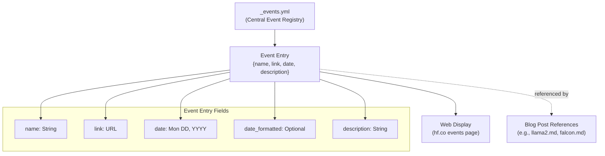
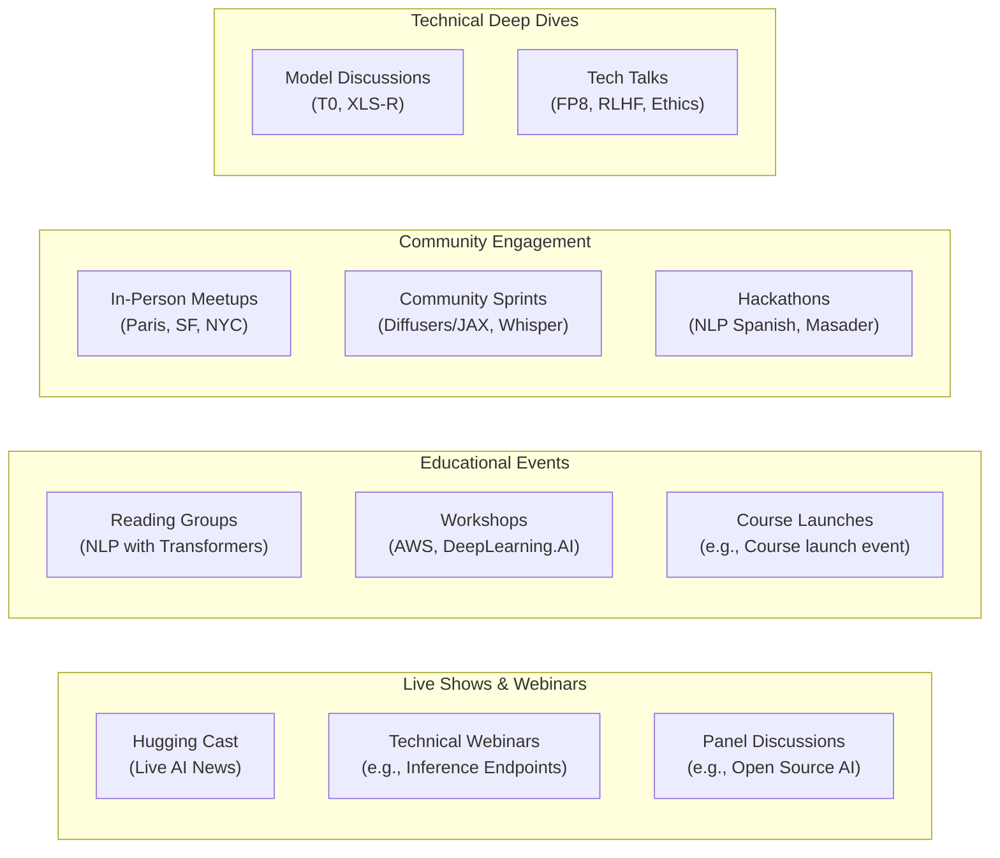
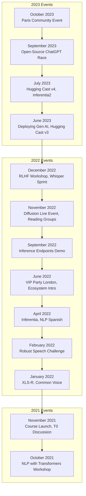
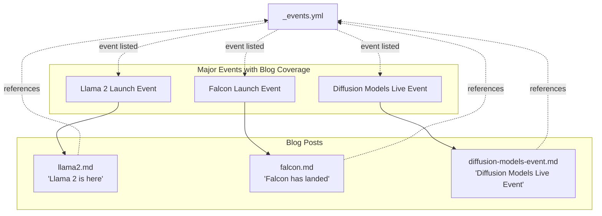

<!-- source: DeepWiki mcp.deepwiki.com · repo huggingface/blog · page 11.1 Event Listings · fetched 2026-10-26 -->

# Event Listings

<details>
<summary>Relevant source files</summary>

The following files were used as context for generating this wiki page:

- [4bit-transformers-bitsandbytes.md](4bit-transformers-bitsandbytes.md)
- [_events.yml](_events.yml)
- [accelerate-deepspeed.md](accelerate-deepspeed.md)
- [assets/138_stackllama/thumbnail.png](assets/138_stackllama/thumbnail.png)
- [assets/147_falcon/falcon_thumbnail.jpg](assets/147_falcon/falcon_thumbnail.jpg)
- [assets/83_accelerate_deepspeed/chatbot.png](assets/83_accelerate_deepspeed/chatbot.png)
- [assets/83_accelerate_deepspeed/cls_run.png](assets/83_accelerate_deepspeed/cls_run.png)
- [assets/83_accelerate_deepspeed/deepspeed-thumbnail.png](assets/83_accelerate_deepspeed/deepspeed-thumbnail.png)
- [assets/98_spaces_3dmoljs/thumbnail.png](assets/98_spaces_3dmoljs/thumbnail.png)
- [assets/assisted-generation/thumbnail.png](assets/assisted-generation/thumbnail.png)
- [assets/diffusion-models-event/thumbnail.png](assets/diffusion-models-event/thumbnail.png)
- [assets/inference_pro/thumbnail.png](assets/inference_pro/thumbnail.png)
- [assets/instruction_tuning_sd/thumbnail.png](assets/instruction_tuning_sd/thumbnail.png)
- [assets/llama2/thumbnail.jpg](assets/llama2/thumbnail.jpg)
- [assisted-generation.md](assisted-generation.md)
- [diffusion-models-event.md](diffusion-models-event.md)
- [falcon.md](falcon.md)
- [inference-pro.md](inference-pro.md)
- [instruction-tuning-sd.md](instruction-tuning-sd.md)
- [llama2.md](llama2.md)
- [spaces_3dmoljs.md](spaces_3dmoljs.md)
- [stackllama.md](stackllama.md)

</details>


This page documents the event listing system used to track and display community events, workshops, meetups, and other gatherings in the Hugging Face blog repository. Event data is managed through a centralized YAML configuration file that supports various event types including live shows, workshops, reading groups, community sprints, and in-person meetups.

For information about major model release events (such as Llama 2, Falcon launches), see [Model Release Events](#11.2).

## Event Data Structure

All event listings are stored in [`_events.yml`](), which serves as the single source of truth for community event information. Each event entry follows a standardized YAML schema.

### Core Event Schema

```yaml
- name: "Event Name"
  link: "https://event-url.com"
  date: "Month DD, YYYY"  # End date in this specific format
  date_formatted: "Optional custom date display"  # e.g., "Jan 24 to Feb 7, 2022"
  description: "Event description text"
```

**Field Specifications:**

| Field | Type | Required | Description |
|-------|------|----------|-------------|
| `name` | String | Yes | Event title (use quotes to avoid special character issues) |
| `link` | URL | Yes | Registration or event information URL |
| `date` | String | Yes | Event end date in `Mon DD, YYYY` format |
| `date_formatted` | String | No | Custom date display (e.g., for date ranges) |
| `description` | String | Yes | Brief event description (avoid special characters like `:`, `[`) |

Sources: [_events.yml:1-4]()

### Event Data Flow



Sources: [_events.yml:1-324]()

## Event Types and Categories

The event listing system tracks diverse event types across the Hugging Face ecosystem. Events are chronologically ordered in the YAML file with the most recent events appearing first.

### Event Type Distribution



### Event Examples by Type

**Live Shows:**
- Hugging Cast series (v1-v4): Regular live shows discussing AI news and demos
- Format: Streaming via StreamYard/YouTube with interactive demos

**Community Sprints:**
- Diffusers/JAX Sprint: Application development with diffusers and JAX on TPUs
- Whisper Fine-tuning: Bringing speech recognition to 70+ languages
- Scikit-learn Documentation: Creating Gradio examples for sklearn docs

**Workshops:**
- AWS Integration: Text/image generation with Inferentia2
- DeepLearning.AI: Building ML apps without Ops
- Hardware-specific: Intel, Graphcore, Habana optimization

**Reading Groups:**
- NLP with Transformers: Regular study sessions on transformer applications
- Focus on practical application and open-source contribution

**In-Person Events:**
- Location-tagged with `(IRL City)`
- Venues include SF, NYC, Paris, London

Sources: [_events.yml:6-324]()

## Event Chronology

The event listing maintains a historical record of community activities. Events are organized in reverse chronological order (most recent first).

### Temporal Event Organization



### Notable Event Series

| Series Name | Frequency | Format | Example Topics |
|-------------|-----------|--------|----------------|
| Hugging Cast | Episodic (v1-v4) | Live streaming | LLaMa 2, Falcon, StarCoder demos |
| NLP with Transformers Reading Group | Recurring | Discord study sessions | Transformer applications, OSS contribution |
| ML for Audio Study Group | Multi-session | Video presentations | ASR, TTS, pyctcdecode |
| Inference Workshops | One-off | Technical demos | Endpoints, Inferentia2, quantization |

Sources: [_events.yml:6-324]()

## Event Data Management

### Adding New Events

Events are added by inserting new YAML entries at the top of [`_events.yml`](). The file includes inline documentation for proper formatting:

**Key Guidelines (from file header):**
1. Date format must be `Mon DD, YYYY` (e.g., "Feb 3, 2014")
2. Use `date_formatted` for custom displays like date ranges
3. Enclose strings in quotes to avoid special character issues
4. Avoid special characters (`:`, `[`) in descriptions

**Example Event Entry:**
```yaml
- name: "Hugging Face Open Source community event 🥐 Paris"
  link: https://partiful.com/e/oWOMGoPxB5D37qw5F8yN
  date: October 5, 2023
  description: "Hugging Face Community event in Paris is here! Join the space with an amazing intersection between researchers, machine learning engineers, artists, and enthusiasts."
```

Sources: [_events.yml:1-9]()

### Event URL Patterns

Events use various platform URLs for registration and participation:

| Platform | URL Pattern | Use Case | Examples |
|----------|-------------|----------|----------|
| StreamYard | `streamyard.com/watch/*` | Live streaming | Hugging Cast episodes |
| Zoom | `zoom.us/webinar/register/*` | Webinars | Technical presentations |
| Eventbrite | `eventbrite.com/e/*` | Registration | Workshops, meetups |
| Discord | `discord.gg/*` or `discord.com/events/*` | Community events | Reading groups |
| YouTube | `youtube.com/watch?v=*` | Recordings/live | Presentations, discussions |
| Partiful | `partiful.com/e/*` | Social events | In-person meetups |
| Livestorm | `livestorm.co/*` | Professional webinars | Product demos |
| Lu.ma | `lu.ma/*` | Event management | Meetups |
| Google Forms/Docs | `docs.google.com/*` | Information/signup | Hackathons |

Sources: [_events.yml:7-324]()

## Integration with Blog Content

Event listings are referenced and promoted through blog posts. Major events often receive dedicated blog coverage or are mentioned in related technical posts.

### Event-Blog Relationship



**Blog Post References:**

- **Llama 2 Launch**: Blog post provides demos and technical details, events listing includes related workshops and talks
- **Falcon Demo**: Live playground linked from blog, related meetups in events
- **Diffusion Models**: Dedicated event blog post with speaker lineup, main event in `_events.yml`

Sources: [_events.yml:11-19](), [llama2.md:1-242](), [falcon.md:1-324](), [diffusion-models-event.md:1-55]()

## Event Description Patterns

Event descriptions follow specific patterns based on event type:

**Community Sprints:**
```
"This is a community event to [objective] using [technologies]."
```
Example: "This is a community event to develop applications with 🧨 diffusers and JAX using TPUs."

**Workshops:**
```
"[Format] hosted by [organization] for developers [to learn/build] [topic]."
```
Example: "Free workshop hosted by DeepLearning.AI for developers learn how to build with ML without the Ops."

**Live Shows:**
```
"Join [our/the] live show - we'll discuss [topic] and demo [feature]!"
```
Example: "Join our live show - we'll discuss LLaMa 2 with our special guest Omar, and demo how to deploy it!"

**In-Person Meetups:**
```
"[Organization] [team members] heading to [location] to [purpose]."
```
Example: "🤗 CEO Clement Delangue & team members are heading to San Francisco to celebrate the open-source AI community."

Sources: [_events.yml:9-324]()

## Date Handling

The event system supports both standard and custom date formatting to handle various event duration patterns.

### Date Format Examples

| Event Type | Standard Date | Custom `date_formatted` | Use Case |
|------------|---------------|-------------------------|----------|
| Single-day event | `Oct 20, 2022` | N/A | Default format |
| Multi-day sprint | `Apr 1, 2023` | `"Mar 6 to Apr 1, 2023"` | Shows full duration |
| Event series | `Jul 15, 2022` | `"Jun 15 to Jul 15, 2022"` | Extended programs |
| Two-day workshop | `Jan 8, 2022` | `"Jan 7 & 8, 2022"` | Consecutive days |

**Implementation Pattern:**
```yaml
- name: "fastai X Hugging Face Group 2022"
  link: https://huggingface.co/hugginglearners
  date: Jul 15, 2022
  date_formatted: Jun 15 to Jul 15, 2022
  description: "Share Vision and Text pre-trained fastai Learners with the community."
```

Sources: [_events.yml:166-170](), [_events.yml:217-221](), [_events.yml:233-237](), [_events.yml:259-263]()

## Event Geographic Distribution

Events span multiple geographic regions with both virtual and in-person formats.

### Location Patterns

**In-Person Events (IRL):**
- San Francisco: AWS Loft, startup tech talks
- New York: ML workshops at AWS Loft
- Paris: Community celebrations
- London: VIP parties at AI Summit

**Virtual Events:**
- Platform-agnostic (accessible globally)
- Time zones sometimes indicated (e.g., "5pm-7pm Saudi Arabia time")

**Hybrid Approach:**
- Some series (Hugging Cast) exclusively virtual
- Technical workshops often have both virtual and regional in-person components

Sources: [_events.yml:21-95]()

---

