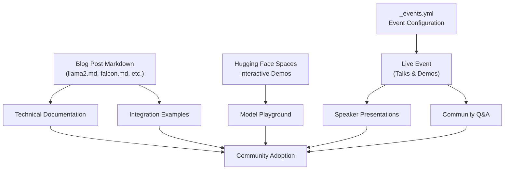
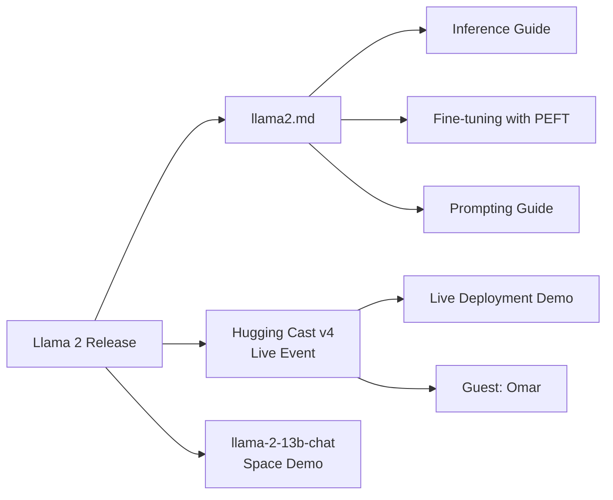
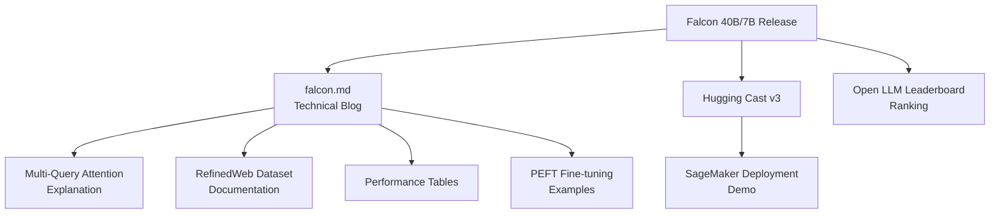
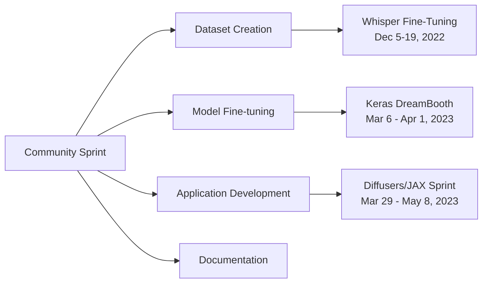
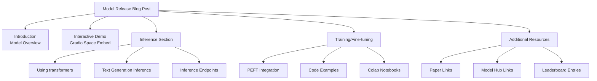
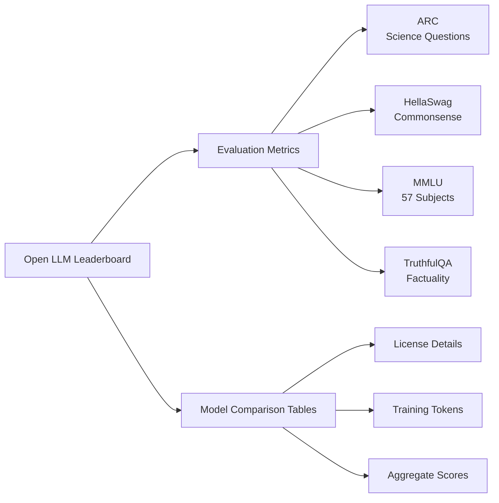
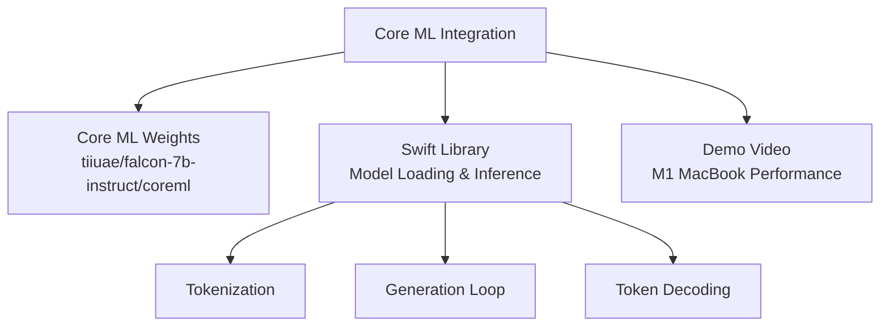
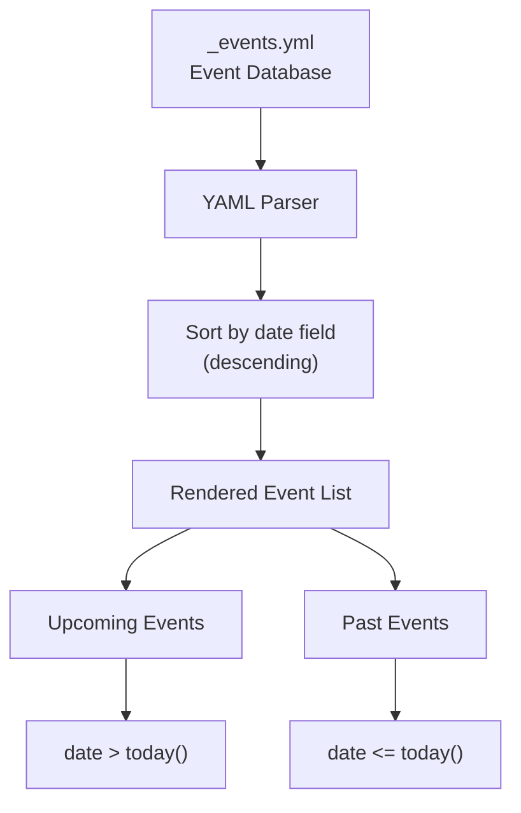
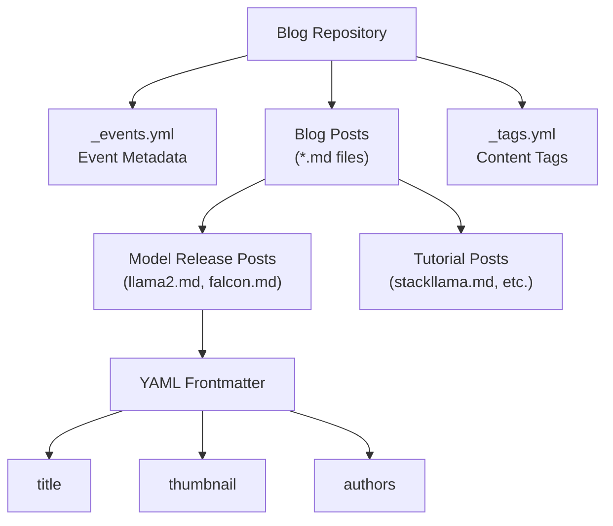
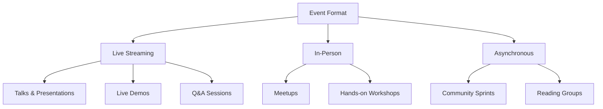

<!-- source: DeepWiki mcp.deepwiki.com · repo huggingface/blog · page 11.2 Model Release Events · fetched 2026-10-26 -->

# Model Release Events

<details>
<summary>Relevant source files</summary>

The following files were used as context for generating this wiki page:

- [4bit-transformers-bitsandbytes.md](4bit-transformers-bitsandbytes.md)
- [_events.yml](_events.yml)
- [accelerate-deepspeed.md](accelerate-deepspeed.md)
- [assets/138_stackllama/thumbnail.png](assets/138_stackllama/thumbnail.png)
- [assets/147_falcon/falcon_thumbnail.jpg](assets/147_falcon/falcon_thumbnail.jpg)
- [assets/83_accelerate_deepspeed/chatbot.png](assets/83_accelerate_deepspeed/chatbot.png)
- [assets/83_accelerate_deepspeed/cls_run.png](assets/83_accelerate_deepspeed/cls_run.png)
- [assets/83_accelerate_deepspeed/deepspeed-thumbnail.png](assets/83_accelerate_deepspeed/deepspeed-thumbnail.png)
- [assets/98_spaces_3dmoljs/thumbnail.png](assets/98_spaces_3dmoljs/thumbnail.png)
- [assets/assisted-generation/thumbnail.png](assets/assisted-generation/thumbnail.png)
- [assets/diffusion-models-event/thumbnail.png](assets/diffusion-models-event/thumbnail.png)
- [assets/inference_pro/thumbnail.png](assets/inference_pro/thumbnail.png)
- [assets/instruction_tuning_sd/thumbnail.png](assets/instruction_tuning_sd/thumbnail.png)
- [assets/llama2/thumbnail.jpg](assets/llama2/thumbnail.jpg)
- [assisted-generation.md](assisted-generation.md)
- [diffusion-models-event.md](diffusion-models-event.md)
- [falcon.md](falcon.md)
- [inference-pro.md](inference-pro.md)
- [instruction-tuning-sd.md](instruction-tuning-sd.md)
- [llama2.md](llama2.md)
- [spaces_3dmoljs.md](spaces_3dmoljs.md)
- [stackllama.md](stackllama.md)

</details>


This document describes the infrastructure and processes for announcing and showcasing major model releases through community events in the Hugging Face blog repository. Model release events are coordinated launches that combine blog posts, live demonstrations, and community engagement activities centered around significant new open-source models.

For information about general community events and meetups, see [Event Listings](#11.1).

## Overview

Model release events serve as focal points for introducing state-of-the-art models to the community. These events typically combine multiple elements:

- **Technical blog posts** providing in-depth model documentation
- **Live demonstration events** with talks from model creators
- **Interactive demos** deployed as Hugging Face Spaces
- **Integration guides** for using models with the HF ecosystem
- **Benchmark results** and performance comparisons

Sources: [_events.yml:1-324](), [llama2.md:1-242](), [falcon.md:1-297]()

## Event Data Structure

Model release events are defined in the `_events.yml` configuration file using a structured YAML format:

```yaml
- name: "Event Title"
  link: https://event-url
  date: Mon DD, YYYY
  date_formatted: Optional custom date format
  description: "Event description"
```

### Field Specifications

| Field | Required | Format | Purpose |
|-------|----------|--------|---------|
| `name` | Yes | String | Event display name |
| `link` | Yes | URL | Registration or event page |
| `date` | Yes | `Mon DD, YYYY` | End date for sorting |
| `date_formatted` | No | String | Override display format for date ranges |
| `description` | Yes | String | Brief event summary |

**Important**: Strings containing special characters (`:`, `[`, etc.) must be enclosed in quotes to prevent YAML parsing errors.

Sources: [_events.yml:1-5]()

## Major Model Release Events



Sources: [_events.yml:1-324](), [llama2.md:1-242](), [falcon.md:1-297]()

### Llama 2 Release Event

The Llama 2 family release represents a comprehensive model launch event combining multiple channels:

**Event Components**:
- Blog post: `llama2.md`
- Live event: "Hugging Cast v4" (July 27, 2023)
- Interactive demos via Spaces
- Full integration with `transformers`, `text-generation-inference`, and Inference Endpoints

**Model Variants Released**:
- Llama-2-7b, Llama-2-13b, Llama-2-70b (base models)
- Llama-2-7b-chat, Llama-2-13b-chat, Llama-2-70b-chat (instruction-tuned)



Sources: [llama2.md:1-242](), [_events.yml:16-19]()

### Falcon Release Event

The Falcon model family launch emphasized Apache 2.0 licensing and performance benchmarks:

**Event Components**:
- Blog post: `falcon.md`
- Live event: "Hugging Cast v3" (June 29, 2023)
- Deployment demonstrations on SageMaker
- Open LLM Leaderboard integration

**Key Features Highlighted**:
- Multi-query attention for inference optimization
- RefinedWeb dataset (600B tokens released publicly)
- Commercial use licensing
- Top performance on Open LLM Leaderboard



Sources: [falcon.md:1-297](), [_events.yml:26-29]()

### Diffusion Models Live Event

A specialized event format for the Diffusion Models Class launch:

**Event Structure**:
```yaml
name: "Diffusion Models Live Event"
link: https://www.youtube.com/watch?v=5gPS_Tn9rlg
date: Nov 30, 2022
```

**Speaker Program**:
- David Ha (Stability AI): "Collective Intelligence and Creative AI"
- Devi Parikh (Meta FAIR): "Make-A-Video: Text-to-Video Generation"
- Patrick Esser (Runway): "Food for Diffusion"
- Justin Pinkney (Lambda Labs): "Beyond text - giving Stable Diffusion new abilities"
- Apolinário Passos (Hugging Face): "Post-generative media hype"

Sources: [diffusion-models-event.md:1-54](), [_events.yml:131-134]()

## Event Types and Patterns

### Hugging Cast Series

Recurring live show format for major announcements:

| Episode | Date | Focus Model | Format |
|---------|------|-------------|--------|
| v1 | Apr 27, 2023 | General AI news | Live premiere |
| v2 | May 26, 2023 | StarCoder, Transformer Agents | News + Demos |
| v3 | Jun 29, 2023 | Falcon | Deployment demo (SageMaker) |
| v4 | Jul 27, 2023 | LLaMa 2 | Guest speaker + deployment |

Sources: [_events.yml:56-59](), [_events.yml:36-39](), [_events.yml:26-29](), [_events.yml:16-19]()

### Community Sprints

Model-focused development events:



Sources: [_events.yml:121-124](), [_events.yml:76-79](), [_events.yml:61-64]()

### Integration Workshops

Technical workshops accompanying model releases:

- **Format**: Hands-on deployment tutorials
- **Duration**: 1-2 hours
- **Platforms**: AWS, Google Cloud, Azure integrations
- **Focus**: Production deployment patterns

Examples:
- "Text and Image Generation with Inferentia2" (Jul 25, 2023)
- "Building Generative AI Products with AWS and HuggingFace" (Mar 8, 2023)
- "Deploying Text Summarization and Image Generation with Inferentia2" (May 11, 2023)

Sources: [_events.yml:21-24](), [_events.yml:91-94](), [_events.yml:46-49]()

## Blog Post Structure for Model Releases

### Standard Sections

Model release blog posts follow a consistent structure:



Sources: [llama2.md:26-36](), [falcon.md:29-36]()

### Code Integration Examples

#### Llama 2 Inference

The blog demonstrates basic usage patterns:

```python
# From llama2.md example
from transformers import AutoTokenizer, AutoModelForCausalLM
import transformers
import torch

model = "meta-llama/Llama-2-7b-chat-hf"
tokenizer = AutoTokenizer.from_pretrained(model)
pipeline = transformers.pipeline(
    "text-generation",
    model=model,
    torch_dtype=torch.float16,
    device_map="auto",
)
```

Sources: [llama2.md:101-114]()

#### Falcon Multi-GPU Configuration

Shows hardware-specific deployment:

```python
# From falcon.md examples
model = AutoModelForCausalLM.from_pretrained(
    model_id,
    torch_dtype=torch.bfloat16,
    trust_remote_code=True,
    load_in_8bit=True,  # or load_in_4bit for quantization
    device_map="auto",
)
```

Sources: [falcon.md:152-159]()

## Performance Benchmarking

Model release events include standardized benchmark tables:

### Example: Llama 2 vs Competitors



Sources: [llama2.md:51-63](), [falcon.md:222-235]()

### Benchmark Table Format

| Model | License | Commercial | Tokens | Score |
|-------|---------|-----------|--------|-------|
| Falcon-7B | Apache 2.0 | ✅ | 1,500B | 44.17 |
| Llama-2-7B | Llama 2 | ✅ | 2,000B | 50.97 |
| Falcon-40B | Apache 2.0 | ✅ | 1,000B | 58.07 |
| Llama-2-70B | Llama 2 | ✅ | 2,000B | 67.87 |

Sources: [llama2.md:51-63](), [falcon.md:58-66]()

## Interactive Demonstration Infrastructure

### Gradio Space Embedding

Blog posts embed live demos using Gradio's web component system:

```html
<script type="module" src="https://gradio.s3-us-west-2.amazonaws.com/[version]/gradio.js">
</script>
<gradio-app theme_mode="light" space="[space-name]"></gradio-app>
```

**Example Spaces**:
- `huggingface-projects/llama-2-13b-chat` (Llama 2 demo)
- `HuggingFaceH4/falcon-chat` (Falcon demo)
- `runwayml/stable-diffusion-v1-5` (Diffusion models)

Sources: [llama2.md:71-72](), [falcon.md:72-74](), [diffusion-models-event.md:14-16]()

### Core ML Integration

Demonstrates on-device deployment capabilities:



Sources: [falcon.md:78-85]()

## Event Configuration Processing

### YAML Parsing Rules

The `_events.yml` file uses strict formatting:

**Date Format**: Must use `Mon DD, YYYY` pattern for the `date` field
- Example: `October 5, 2023` ✅
- Counter-example: `Oct 5, 2023` ❌ (would break sorting)

**String Escaping**: Special characters require quotes:
```yaml
# Correct
description: "Q&A with Leif Hancox-Li, PhD and Borhane Blili-Hamelin, PhD!"

# Would break parsing
description: Q&A with Leif: Discussion on Ethics
```

**Date Ranges**: Use `date_formatted` for custom display:
```yaml
date: Jul 15, 2022
date_formatted: Jun 15 to Jul 15, 2022
```

Sources: [_events.yml:1-4]()

### Event Chronology

Events are sorted by the `date` field (end date) in descending order, creating a reverse-chronological listing on the blog.



Sources: [_events.yml:1-324]()

## Integration with Blog Infrastructure

### Content Organization



Sources: [llama2.md:1-9](), [falcon.md:1-13](), [_events.yml:1-324]()

### Blog Post Metadata

Model release posts use consistent YAML frontmatter:

```yaml
---
title: "Model Name - Release Announcement"
thumbnail: /blog/assets/folder/thumbnail.jpg
authors:
- user: username1
- user: username2
---
```

Sources: [llama2.md:1-9](), [falcon.md:1-13]()

## Model Release Checklist

Based on the structure of successful model releases:

1. **Pre-Release**:
   - Model Hub repositories created
   - Model cards written
   - Licensing finalized
   - Benchmark evaluation complete

2. **Blog Post**:
   - Technical introduction
   - Architecture explanation
   - Benchmark tables
   - Inference examples (transformers, TGI)
   - Fine-tuning guide (PEFT)
   - Resource links

3. **Live Event**:
   - Event entry in `_events.yml`
   - Speaker lineup confirmed
   - Streaming platform configured
   - Demo preparation

4. **Interactive Demos**:
   - Gradio Space deployment
   - Embedding code in blog post
   - Performance optimization

5. **Integration Examples**:
   - Colab notebooks
   - Cloud platform guides (SageMaker, Vertex AI)
   - Hardware optimization examples

Sources: [llama2.md:1-242](), [falcon.md:1-297](), [_events.yml:1-324]()

## Event Registration and Links

Events use various platforms for registration and hosting:

| Platform | Use Case | Example |
|----------|----------|---------|
| YouTube | Live streams, recorded talks | Diffusion Models Live Event |
| StreamYard | Interactive live shows | Hugging Cast series |
| Partiful | In-person events | Community meetups |
| Eventbrite | Workshops | Company case studies |
| Zoom | Webinars | Technical workshops |
| Discord | Discussion events | Reading groups |

Sources: [_events.yml:6-324]()

## Community Engagement Patterns

### Speaker Program Structure

Major model releases feature talks from:

1. **Model Creators**: Original researchers (Meta, Stability AI, Runway)
2. **Integration Engineers**: HF team members demonstrating tooling
3. **Industry Practitioners**: Companies using models in production
4. **Research Scientists**: Academic perspectives on techniques

Sources: [diffusion-models-event.md:22-54]()

### Event Formats



Sources: [_events.yml:1-324]()

---

