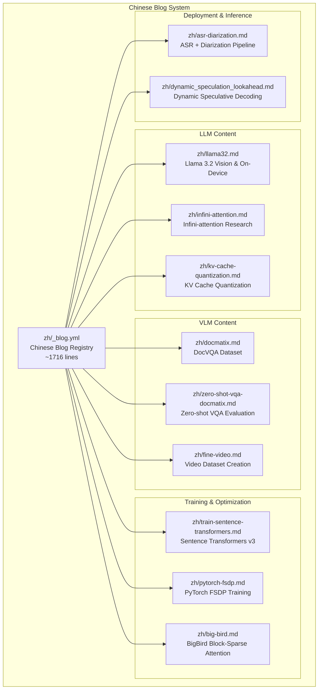
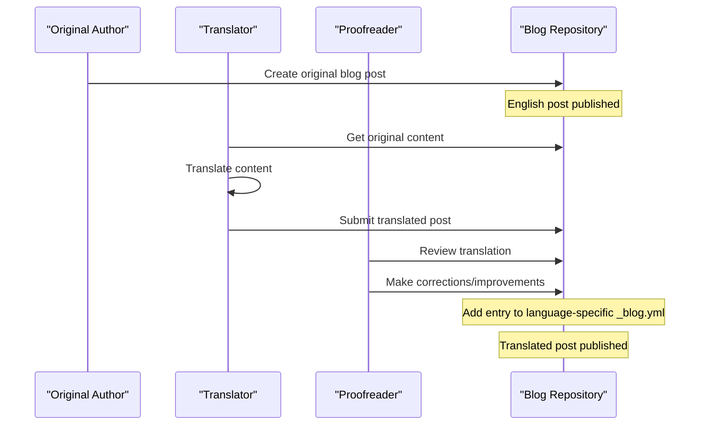
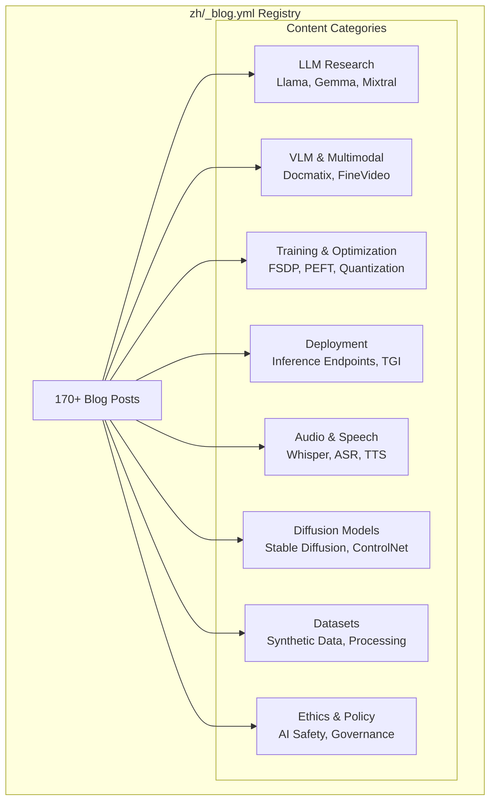
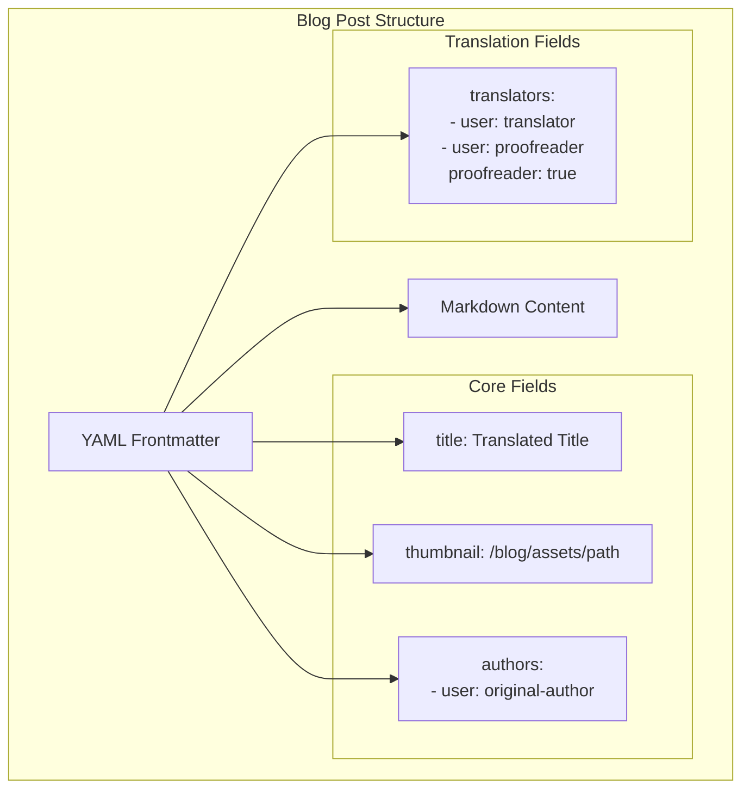

<!-- source: DeepWiki mcp.deepwiki.com · repo huggingface/blog · page 12 International Resources · fetched 2026-10-26 -->

# International Resources

<details>
<summary>Relevant source files</summary>

The following files were used as context for generating this wiki page:

- [zh/_blog.yml](zh/_blog.yml)
- [zh/asr-diarization.md](zh/asr-diarization.md)
- [zh/big-bird.md](zh/big-bird.md)
- [zh/docmatix.md](zh/docmatix.md)
- [zh/dynamic_speculation_lookahead.md](zh/dynamic_speculation_lookahead.md)
- [zh/fine-video.md](zh/fine-video.md)
- [zh/infini-attention.md](zh/infini-attention.md)
- [zh/kv-cache-quantization.md](zh/kv-cache-quantization.md)
- [zh/llama32.md](zh/llama32.md)
- [zh/pytorch-fsdp.md](zh/pytorch-fsdp.md)
- [zh/train-sentence-transformers.md](zh/train-sentence-transformers.md)
- [zh/vertex-colored-to-textured-mesh.md](zh/vertex-colored-to-textured-mesh.md)
- [zh/zero-shot-vqa-docmatix.md](zh/zero-shot-vqa-docmatix.md)

</details>


This page documents the international resources and multilingual content system within the Hugging Face blog repository, with a focus on the Chinese blog (`zh/` directory). The Chinese blog provides translated versions of technical blog posts covering LLM/VLM research, optimization techniques, and practical guides for the Chinese-speaking ML community.

## Purpose and Scope

The International Resources system provides Chinese translations of Hugging Face blog content, focusing on:
- Large Language Model (LLM) research and techniques
- Vision Language Model (VLM) research and applications  
- Model optimization and quantization techniques
- Training guides and tutorials
- Hardware acceleration and deployment strategies

The primary implementation is the Chinese blog located in the `zh/` directory, which maintains its own registry file at [zh/_blog.yml:1-1716]() and contains over 170 translated blog posts.

Sources: `zh/_blog.yml`, `zh/llama32.md`, `zh/docmatix.md`, `zh/kv-cache-quantization.md`

## Chinese Blog Architecture

Chinese Blog File Structure


The Chinese blog system is organized as a parallel structure to the main English blog, with all content stored in the `zh/` directory. The registry file [zh/_blog.yml:1-1716]() catalogs 170+ translated posts with metadata including authors, translators, and proofreaders.

Sources: `zh/_blog.yml`, `zh/llama32.md`, `zh/docmatix.md`, `zh/kv-cache-quantization.md`, `zh/train-sentence-transformers.md`

## Content Organization

### Directory Structure

The Chinese blog content is organized in the `zh/` directory with a parallel structure to the main blog:

```
huggingface/blog/
├── _blog.yml                          # Main blog registry (English)
├── llama32.md                         # Original English post
├── assets/                            # Shared assets directory
│   └── llama32/                       # Post-specific assets
│       └── thumbnail.jpg
└── zh/                                # Chinese language directory
    ├── _blog.yml                      # Chinese blog registry (1716 lines)
    ├── llama32.md                     # Translated Chinese post
    ├── docmatix.md                    # DocVQA dataset post
    ├── kv-cache-quantization.md       # KV cache quantization guide
    └── train-sentence-transformers.md # Training guide
```

### Blog Registry Structure

The Chinese blog registry at [zh/_blog.yml:1-1716]() contains entries for each translated post. Each entry includes:

**Example from Llama 3.2 post** [zh/_blog.yml:1467-1475]():
```yaml
- local: llama32
  date: September 25, 2024
  tags:
    - multimodal
    - on-device
    - llm
    - nlp
    - vision
```

**Example with translator attribution** [zh/llama32.md:1-17]():
```yaml
title: "现在 Llama 具备视觉能力并可以在你的设备上运行 - 欢迎使用 Llama 3.2" 
thumbnail: /blog/assets/llama32/thumbnail.jpg
authors:
- user: merve
- user: philschmid
translators:
- user: cheninwang
- user: roseking
- user: zhongdongy
  proofreader: true
```

The `translators` field lists contributors who translated the content, with optional `proofreader: true` designation for reviewers.

Sources: `zh/_blog.yml`, `zh/llama32.md`, `zh/docmatix.md`

## Translation Workflow



The translation workflow involves these key steps:

1. **Content Selection**: Original English blog posts are selected for translation
2. **Translation**: Content is translated by one or more translators
3. **Proofreading**: A designated proofreader reviews and refines the translation 
4. **Publishing**: The translated content is added to the language-specific blog registry and published

This collaborative approach ensures high-quality translations while maintaining the technical accuracy of the original content.

Sources: `zh/_blog.yml`, `zh/introduction-to-ggml.md`, `zh/quanto-diffusers.md`

## Metadata and Attribution

Each translated blog post includes specific metadata to properly attribute both the original authors and the translators. This is structured in the frontmatter of the Markdown file as follows:

```yaml
---
title: "Translated Title"
thumbnail: /blog/assets/path-to-thumbnail.png
authors:
- user: original-author-username
- user: another-author
  guest: true
  org: organization-name
translators:
- user: translator-username
- user: proofreader-username
  proofreader: true
---
```

Key metadata fields include:
- `title`: Translated title in the target language
- `thumbnail`: Usually the same path as the original post
- `authors`: Original authors of the content, preserved from the source
- `translators`: Users who translated the content, with an optional `proofreader` designation

Sources: `zh/introduction-to-ggml.md`, `zh/accelerate-v1.md`

## LLM and VLM Research Content

The Chinese blog extensively covers LLM and VLM research, optimization techniques, and deployment guides:

### Large Language Models (LLMs)

**Llama 3.2 Vision and On-Device Models** [zh/llama32.md:1-453]()
- Covers Llama 3.2's vision capabilities and on-device deployment
- Topics: multimodal models (11B, 90B), on-device models (1B, 3B), vision-language understanding
- Includes code examples for inference with transformers, quantization, and device deployment
- Tags: `multimodal`, `on-device`, `llm`, `nlp`, `vision`

**Infini-attention Research** [zh/infini-attention.md:1-453]()
- Documents failed experiments with Infini-attention for long-context modeling
- Covers memory compression, attention mechanisms, and convergence challenges
- Compares with Ring Attention, YaRN, and rope scaling alternatives
- Tags: `long-context`, `infini-attention`, `memory-compression`

**KV Cache Quantization** [zh/kv-cache-quantization.md:1-150]()
- Explains KV cache quantization for reducing memory in long-text generation
- Covers quantization backends (quanto, HQQ), precision options (int2, int4, int8)
- Performance comparisons and memory savings analysis
- Tags: `generation`, `LLM`, `quantization`

### Vision Language Models (VLMs)

**Docmatix Dataset** [zh/docmatix.md:1-83]()
- Introduces Docmatix, a 240x larger DocVQA dataset with 2.4M images
- Generated using Phi-3-small model on PDFA dataset
- Florence-2 fine-tuning results and performance evaluation
- Tags: `community`, `datasets`, `synthetic-data`, `cv`, `vlm`

**Zero-shot VQA Evaluation** [zh/zero-shot-vqa-docmatix.md:1-150]()
- LAVE (LLM-Assisted VQA Evaluation) methodology for zero-shot evaluation
- Addresses misalignment between traditional metrics and human judgment
- Uses Llama-2-Chat-7b for answer scoring
- Tags: `community`, `evaluation`, `synthetic-data`, `vqa`, `vlm`

**FineVideo Dataset** [zh/fine-video.md:1-495]()
- Documents creation of FineVideo: 43,000 videos with rich annotations
- Covers filtering, classification, and metadata generation pipeline
- Uses Gemini 1.5 Pro and GPT-4o for structured output annotation
- Tags: `video`, `datasets`, `multimodal`

### Training and Optimization

**Sentence Transformers v3** [zh/train-sentence-transformers.md:1-577]()
- Complete training guide for embedding models using Sentence Transformers v3
- Covers datasets, loss functions, training arguments, and evaluators
- Multi-dataset training and callback functions
- Tags: `nlp`, `guide`, `community`, `open-source`

**PyTorch FSDP** [zh/pytorch-fsdp.md:1-362]()
- Guide for training large models using PyTorch Fully Sharded Data Parallel
- Covers ZeRO optimization stages, memory efficiency, and distributed training
- Comparison with DeepSpeed and configuration examples
- Tags: `llm`, `guide`, `nlp`

**BigBird Block-Sparse Attention** [zh/big-bird.md:1-462]()
- Deep dive into BigBird's block-sparse attention mechanism
- Explains global, sliding, and random attention patterns
- Implementation details and complexity analysis
- Tags: `cv`, `guide`, `partnerships`, `multimodal`

### Deployment and Inference

**ASR + Diarization Pipeline** [zh/asr-diarization.md:1-242]()
- Building ASR with speaker diarization using Inference Endpoints
- Combines Whisper, Pyannote, and speculative decoding
- Custom handler implementation and deployment guide
- Tags: `audio`, `asr`, `inference`

**Dynamic Speculative Decoding** [zh/dynamic_speculation_lookahead.md:1-127]()
- Faster assisted generation with dynamic speculation
- Up to 2.7x speedup for text generation
- Default mode in Transformers 4.45.0+
- Tags: `research`, `nlp`, `open-source`, `collaboration`

Sources: `zh/_blog.yml`, `zh/llama32.md`, `zh/docmatix.md`, `zh/kv-cache-quantization.md`, `zh/train-sentence-transformers.md`, `zh/fine-video.md`, `zh/asr-diarization.md`

## Chinese Blog Statistics

Content Coverage by Topic


The Chinese blog (announced April 24, 2023 via [zh/_blog.yml:406-411]()) provides extensive coverage with 170+ translated posts across:

| Category | Example Posts | Key Topics |
|----------|--------------|------------|
| LLM Research | llama32, llama31, gemma2, mixtral | Vision models, on-device deployment, model architectures |
| VLM & Multimodal | docmatix, fine-video, vlms, idefics2 | DocVQA, video understanding, vision-language tasks |
| Training | train-sentence-transformers, pytorch-fsdp, peft | FSDP, LoRA, quantization, distributed training |
| Optimization | kv-cache-quantization, 4bit-transformers-bitsandbytes | KV cache, quantization, memory efficiency |
| Deployment | asr-diarization, deploy-with-openvino | Inference endpoints, hardware acceleration |
| Attention Mechanisms | infini-attention, big-bird | Long-context, block-sparse attention |

The registry at [zh/_blog.yml:1-1716]() uses consistent tagging with fields like `nlp`, `llm`, `cv`, `multimodal`, `quantization`, `inference`, etc.

Sources: `zh/_blog.yml`, `zh/llama32.md`, `zh/docmatix.md`, `zh/kv-cache-quantization.md`

## Technical Implementation

Translation Metadata Structure


The Chinese blog implementation uses:

1. **Directory Structure**: All Chinese content in `zh/` directory at repository root
2. **Registry File**: [zh/_blog.yml:1-1716]() with 170+ entries containing:
   - `local`: filename without extension
   - `date`: publication date
   - `tags`: topic tags (nlp, llm, cv, multimodal, etc.)
   - `guest`: true/false for guest authors
   
3. **Frontmatter Format** [zh/llama32.md:1-17]():
   ```yaml
   title: "现在 Llama 具备视觉能力..."
   thumbnail: /blog/assets/llama32/thumbnail.jpg
   authors:
   - user: merve
   translators:
   - user: cheninwang
   - user: zhongdongy
     proofreader: true
   ```

4. **Asset Sharing**: Thumbnails and images use shared `/blog/assets/` paths, same as English posts

5. **Tag Consistency**: Uses same tag system as main blog for discoverability

Sources: `zh/_blog.yml`, `zh/llama32.md`, `zh/docmatix.md`, `zh/train-sentence-transformers.md`

## Best Practices for Contributors

When contributing to international resources:

1. **Maintain Technical Accuracy**: Ensure that technical terms, code snippets, and concepts are accurately translated
2. **Preserve Formatting**: Keep the same formatting, structure, and code references as the original
3. **Update with Source Changes**: When original content is updated, update translations accordingly
4. **Attribute Properly**: Always include both original authors and translators in the frontmatter
5. **Verify Asset Paths**: Ensure that image paths and other assets are correctly referenced

Following these practices helps maintain consistency and quality across all languages.

Sources: `zh/introduction-to-ggml.md`, `zh/sql-console.md`, `zh/quanto-diffusers.md`

## Conclusion

The International Resources system enables the Hugging Face blog to reach a global audience by providing translated content in multiple languages. Through a structured approach to content organization, clear attribution of translators and proofreaders, and consistent technical implementation, the system ensures that high-quality technical content is accessible regardless of language barriers.

---

