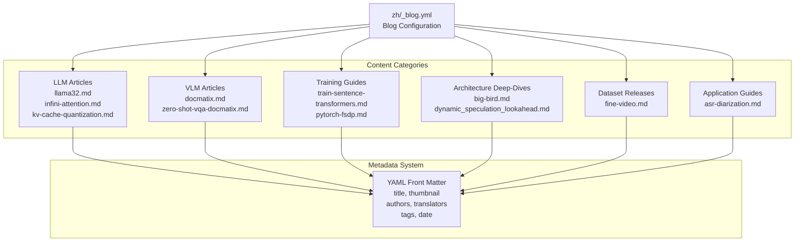
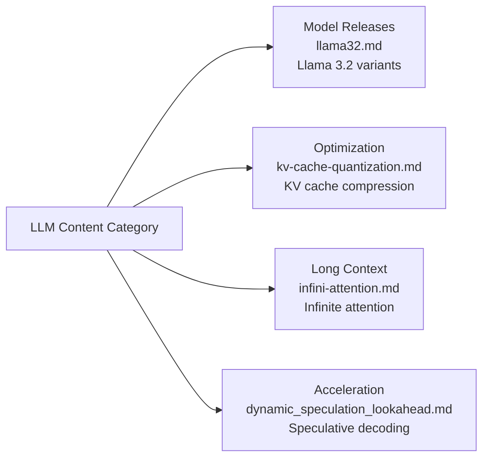
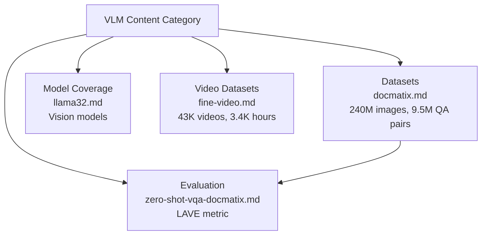
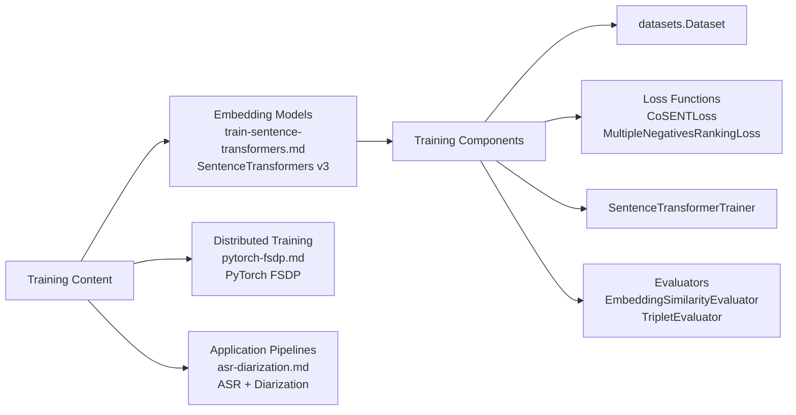
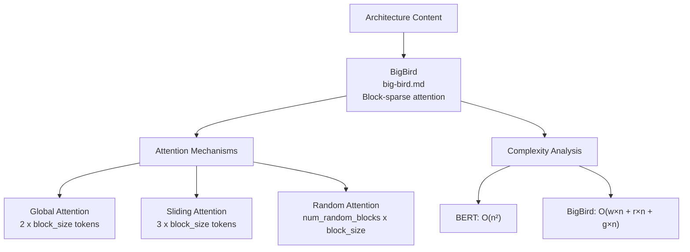
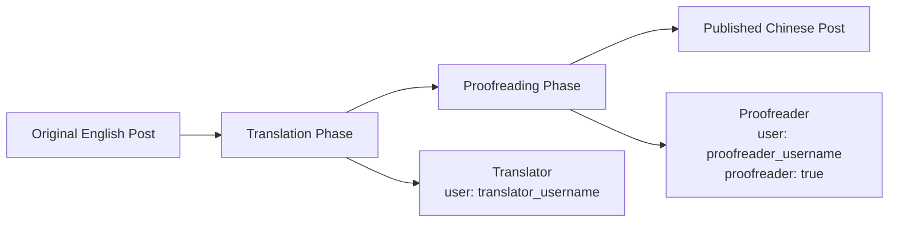
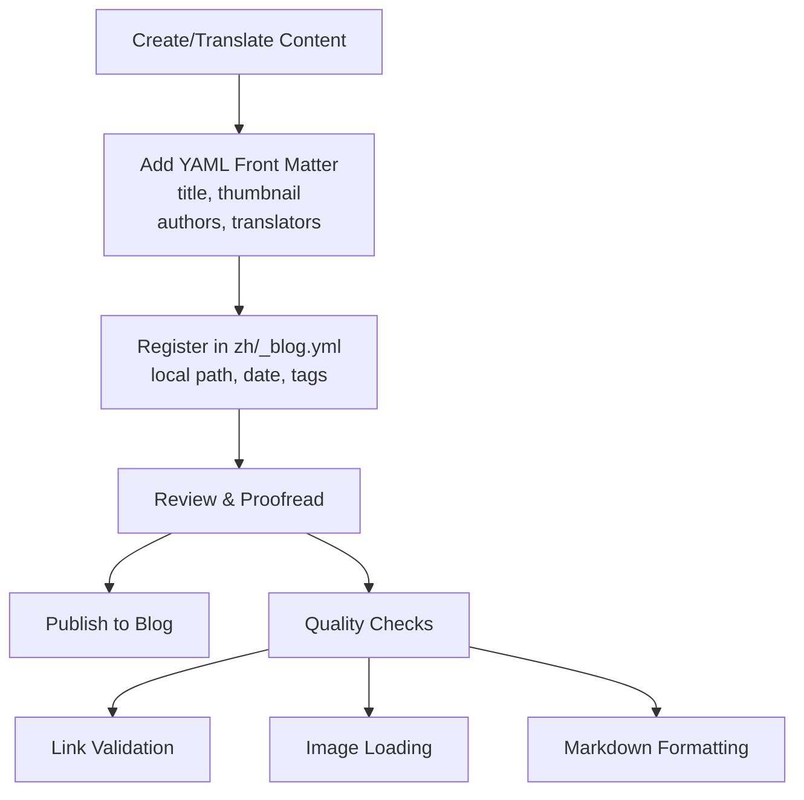

<!-- source: DeepWiki mcp.deepwiki.com · repo huggingface/blog · page 12.1 Chinese Blog Content · fetched 2026-10-26 -->

# Chinese Blog Content

<details>
<summary>Relevant source files</summary>

The following files were used as context for generating this wiki page:

- [zh/_blog.yml](zh/_blog.yml)
- [zh/asr-diarization.md](zh/asr-diarization.md)
- [zh/big-bird.md](zh/big-bird.md)
- [zh/docmatix.md](zh/docmatix.md)
- [zh/dynamic_speculation_lookahead.md](zh/dynamic_speculation_lookahead.md)
- [zh/fine-video.md](zh/fine-video.md)
- [zh/infini-attention.md](zh/infini-attention.md)
- [zh/kv-cache-quantization.md](zh/kv-cache-quantization.md)
- [zh/llama32.md](zh/llama32.md)
- [zh/pytorch-fsdp.md](zh/pytorch-fsdp.md)
- [zh/train-sentence-transformers.md](zh/train-sentence-transformers.md)
- [zh/vertex-colored-to-textured-mesh.md](zh/vertex-colored-to-textured-mesh.md)
- [zh/zero-shot-vqa-docmatix.md](zh/zero-shot-vqa-docmatix.md)

</details>


## Purpose and Scope

This document describes the Chinese language blog content system within the Hugging Face blog repository. The Chinese blog (`zh/` directory) provides translated and localized technical content covering machine learning topics including Large Language Models (LLMs), Vision Language Models (VLMs), training techniques, optimization methods, and datasets. This content serves Chinese-speaking ML practitioners, researchers, and engineers.

For information about other blog content, see [Overview](#1). For general contribution guidelines, see [Contributing to the Blog](#1.2).

## System Architecture

The Chinese blog system consists of a YAML-based configuration file and Markdown content files organized by topic.



**Sources:** [zh/_blog.yml:1-1715]()

## Configuration Structure

The `zh/_blog.yml` file serves as the central registry for all Chinese blog posts. Each entry contains metadata linking to the local Markdown file.

### YAML Entry Format

Each blog post is registered with the following structure:

| Field | Description | Required |
|-------|-------------|----------|
| `local` | Path to Markdown file (without extension) | Yes |
| `date` | Publication date | Yes |
| `tags` | List of categorization tags | Yes |
| `guest` | Whether post has guest authors | No |

Example entry structure from the configuration:

```yaml
- local: llama32
  date: September 25, 2024
  tags:
    - multimodal
    - on-device
    - llm
    - nlp
    - vision
```

**Sources:** [zh/_blog.yml:1467-1475]()

### Tag System

The configuration uses tags to categorize content across multiple dimensions:

**Primary Technology Tags:**
- `llm`, `nlp`, `multimodal`, `vlm`, `cv`, `audio`, `diffusers`

**Technique Tags:**
- `guide`, `research`, `quantization`, `fine-tuning`, `training`, `inference`

**Partnership Tags:**
- `partnerships`, `community`, `collaboration`, `open-source-collab`

**Application Tags:**
- `rlhf`, `agents`, `game-dev`, `datasets`

**Sources:** [zh/_blog.yml:1-1715]()

## Content Front Matter

Each Markdown file contains YAML front matter with metadata and attribution information.

### Front Matter Schema

```yaml
title: "Article Title in Chinese"
thumbnail: /blog/assets/folder/image.png
authors:
- user: original_author
translators:
- user: translator_username
- user: proofreader_username
  proofreader: true
```

**Required Fields:**
- `title`: Chinese language title
- `thumbnail`: Path to thumbnail image
- `authors`: List of original author usernames
- `translators`: List of translator and proofreader usernames

**Sources:** [zh/llama32.md:1-17](), [zh/docmatix.md:1-11]()

## Content Categories by Topic

### Large Language Model Content

LLM-focused content covers model releases, optimization techniques, and long-context handling.



**Key Articles:**
- **Llama 3.2**: Vision-capable and on-device models [zh/llama32.md:1-453]()
- **KV Cache Quantization**: Memory optimization for long text generation [zh/kv-cache-quantization.md:1-129]()
- **Infini-Attention**: Failed experiment in infinite context attention [zh/infini-attention.md:1-302]()
- **Dynamic Speculation**: Faster assisted generation techniques [zh/dynamic_speculation_lookahead.md:1-118]()

**Sources:** [zh/llama32.md:1-453](), [zh/kv-cache-quantization.md:1-129](), [zh/infini-attention.md:1-302](), [zh/dynamic_speculation_lookahead.md:1-118]()

### Vision Language Model Content

VLM content focuses on multimodal models, datasets, and evaluation methodologies.



**Key Topics:**

**Docmatix Dataset:**
- 240x larger than previous DocVQA datasets
- Generated using Phi-3-small on PDFA dataset
- 15% quality filtering for hallucination removal
[zh/docmatix.md:1-83]()

**Zero-Shot VQA Evaluation:**
- LAVE (LLM-Assisted VQA Evaluation) metric
- Addresses distribution shift in synthetic datasets
- Uses Llama-2-Chat-7b for semantic scoring
[zh/zero-shot-vqa-docmatix.md:1-183]()

**FineVideo Dataset:**
- 43,000 videos with rich annotations
- 3,400 hours total duration
- Scene segmentation and Q&A pairs
[zh/fine-video.md:1-560]()

**Sources:** [zh/docmatix.md:1-83](), [zh/zero-shot-vqa-docmatix.md:1-183](), [zh/fine-video.md:1-560]()

### Training and Optimization Content

Training-focused content covers distributed training, model optimization, and fine-tuning techniques.



**Sentence Transformers Training:**
- New `SentenceTransformerTrainer` API
- Multi-dataset training support
- Integrated evaluation during training
[zh/train-sentence-transformers.md:1-619]()

**PyTorch FSDP:**
- ZeRO-3 style parameter sharding
- Support for large models (GPT-2 Large 762M, XL 1.5B)
- Integration with Accelerate library
[zh/pytorch-fsdp.md:1-330]()

**ASR Pipeline:**
- Combines ASR, speaker diarization, and speculative decoding
- Uses Pyannote for speaker diarization
- distil-whisper for assisted generation
[zh/asr-diarization.md:1-242]()

**Sources:** [zh/train-sentence-transformers.md:1-619](), [zh/pytorch-fsdp.md:1-330](), [zh/asr-diarization.md:1-242]()

### Architecture Deep-Dive Content

Architectural content provides detailed technical explanations of model designs and attention mechanisms.



**BigBird Block-Sparse Attention:**

The article provides deep implementation details of BigBird's attention mechanism:

**Block Structure:**
- Block size (`b`): 4
- Random blocks (`r`): 1  
- Sliding blocks (`s`): 3
- Global blocks (`g`): 2

**Attention Computation:**
- First block: Attends to all tokens (global behavior)
- Middle blocks: Attend to global, sliding, and random blocks
- Last block: Attends to all tokens (global behavior)

**Memory Efficiency:**
| Sequence Length | BERT | BigBird | Ratio |
|----------------|------|---------|-------|
| 512 | T | T | 1x |
| 1024 | 4×T | 2×T | 2x |
| 4096 | 64×T | 8×T | 8x |

**Sources:** [zh/big-bird.md:1-453]()

## Translation Workflow

The translation system uses a collaborative model with translators and proofreaders.



### Translator Attribution

Each translation includes attribution in the front matter:

```yaml
translators:
- user: primary_translator
- user: proofreader_user
  proofreader: true
```

**Common Translators:**
- `MatrixYao`: Primary translator for multiple posts
- `zhongdongy`: Frequent proofreader
- `innovation64`: Translation contributor
- `cheninwang`, `roseking`, `Zipxuan`: Additional translators

**Sources:** [zh/docmatix.md:8-10](), [zh/llama32.md:13-16](), [zh/train-sentence-transformers.md:7-9]()

## Content Statistics

The Chinese blog contains diverse technical content covering the ML/AI landscape:

**Topic Distribution (from tags in zh/_blog.yml):**

| Category | Representative Tags | Article Count (approx) |
|----------|-------------------|-------------|
| LLM/NLP | `llm`, `nlp`, `transformers` | 80+ entries |
| Computer Vision | `cv`, `diffusers`, `stable-diffusion` | 40+ entries |
| Multimodal | `multimodal`, `vlm`, `vision` | 30+ entries |
| Training | `guide`, `fine-tuning`, `training` | 50+ entries |
| Optimization | `quantization`, `inference`, `hardware` | 35+ entries |
| Research | `research`, `community` | 60+ entries |

**Hardware Partnerships:**
- Intel optimizations: `intel`, `optimum`, `openvino`
- Habana accelerators: `habana`, `gaudi`
- NVIDIA integrations: `nvidia`
- Cloud platforms: `gcp`, `partnerships`

**Sources:** [zh/_blog.yml:1-1715]()

## File Organization

The Chinese blog follows a structured organization pattern:

```
zh/
├── _blog.yml                           # Central configuration
├── llama32.md                          # LLM model release
├── docmatix.md                         # VLM dataset
├── train-sentence-transformers.md     # Training guide
├── pytorch-fsdp.md                     # Distributed training
├── big-bird.md                         # Architecture explanation
├── infini-attention.md                 # Research experiment
├── kv-cache-quantization.md           # Optimization technique
├── asr-diarization.md                 # Application pipeline
├── fine-video.md                       # Video dataset
├── zero-shot-vqa-docmatix.md         # Evaluation methodology
└── dynamic_speculation_lookahead.md   # Acceleration technique
```

**Naming Convention:**
- Files use lowercase with hyphens: `kebab-case`
- File names match the `local` field in `_blog.yml`
- No `.md` extension in YAML configuration

**Sources:** [zh/_blog.yml:1-1715]()

## Asset Management

Blog posts reference assets using standardized paths:

**Thumbnail Path Pattern:**
```
/blog/assets/{folder_name}/{image_file}
```

**Examples:**
- `/blog/assets/llama32/thumbnail.jpg`
- `/blog/assets/183_docmatix/thumbnail_new.png`
- `/blog/assets/185_infini_attention/infini_attention_thumbnail.png`

**Image Hosting:**
- Inline images hosted on `huggingface.co/datasets/huggingface/documentation-images`
- External images from Hugging Face CDN
- Relative paths for blog-specific assets

**Sources:** [zh/llama32.md:2](), [zh/docmatix.md:2](), [zh/infini-attention.md:2]()

## Content Publication Workflow



**Publication Steps:**

1. **Content Creation**: Translate or create original Chinese content
2. **Front Matter**: Add metadata with translator attribution
3. **Registration**: Add entry to `zh/_blog.yml` with appropriate tags
4. **Review**: Proofreader checks translation quality
5. **Publication**: Content goes live on Hugging Face blog

**Sources:** [zh/_blog.yml:1-1715]()

## Technical Content Patterns

Chinese blog posts follow specific patterns for technical explanations:

### Code Examples

Posts include executable code snippets:

```python
from transformers import pipeline
model_id = "meta-llama/Llama-3.2-3B-Instruct"
pipe = pipeline("text-generation", model=model_id)
```

[zh/llama32.md:186-195]()

### Mathematical Notation

LaTeX math rendering for technical concepts:

```markdown
\( A_{\text{mem}} = \frac{\sigma(Q) M_{s-1}}{\sigma(Q) z_{s-1}} \)
```

[zh/infini-attention.md:54]()

### Diagrams

Mermaid diagrams for visual explanations (though the examples in the files show image links instead)

### Tables

Comparative data in markdown tables:

| Model | Accuracy | Speed |
|-------|----------|-------|
| Base  | 85.2%    | 100ms |
| Optimized | 84.8% | 45ms  |

**Sources:** [zh/llama32.md:106-112](), [zh/infini-attention.md:1-302]()

## Integration with Main Blog

The Chinese blog integrates with the main blog infrastructure:

**Shared Components:**
- Asset hosting system
- Markdown rendering pipeline  
- Front matter schema
- Tag system (though Chinese uses separate `_blog.yml`)

**Differences from Main Blog:**
- Separate configuration file: `zh/_blog.yml` vs `_blog.yml`
- Additional `translators` field in front matter
- Chinese language content and titles
- May have publication date offset from original English version

**Sources:** [zh/_blog.yml:1-1715]()